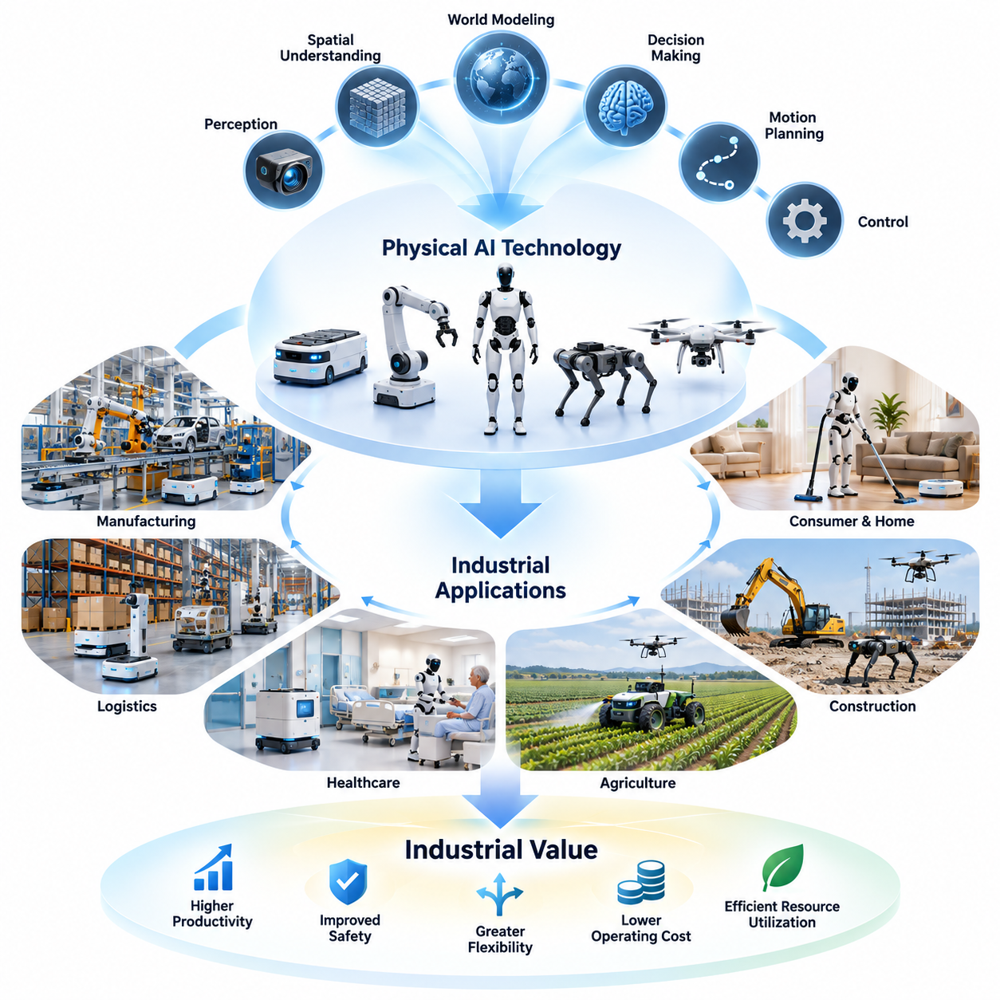
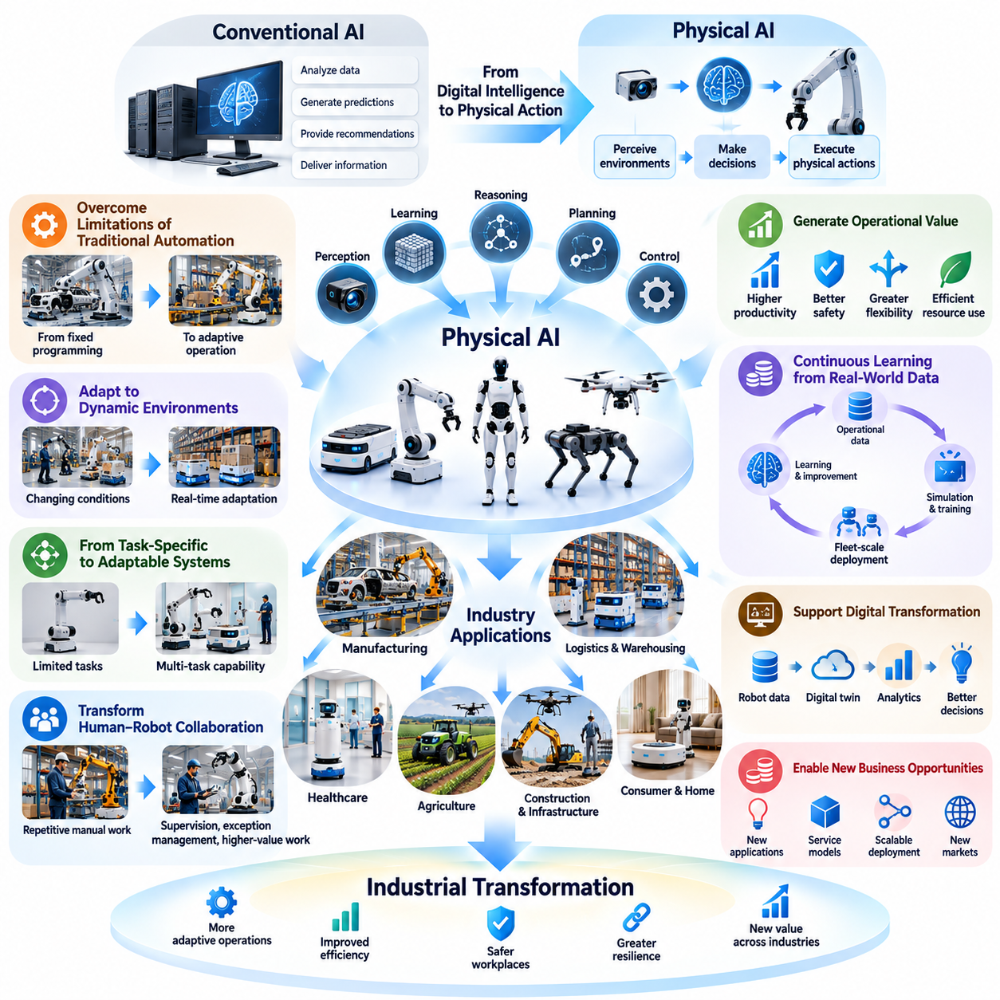
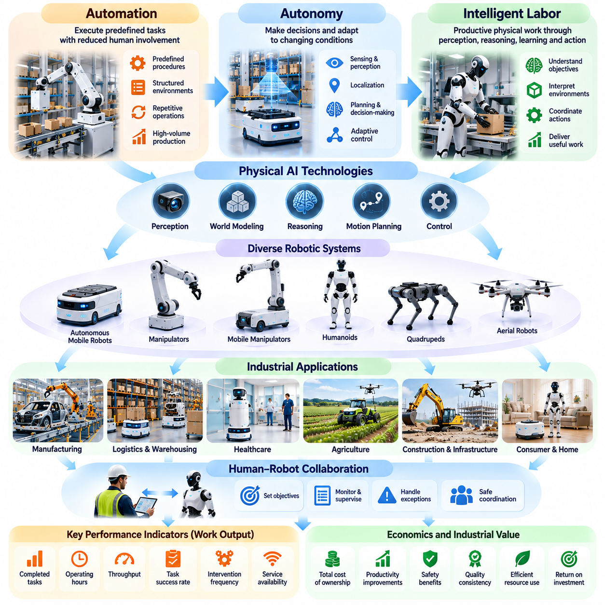
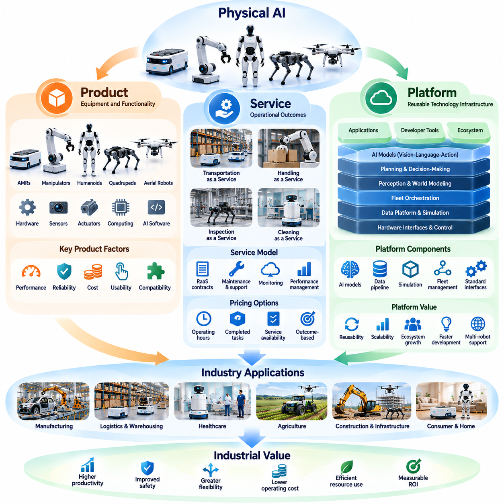
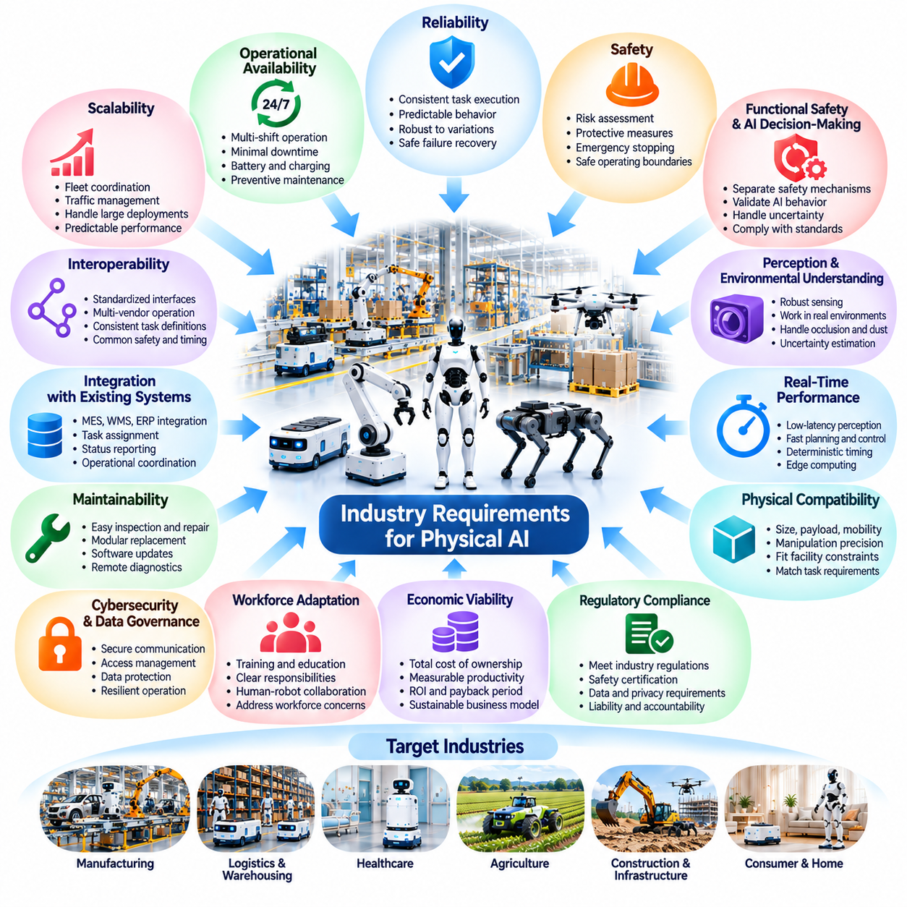
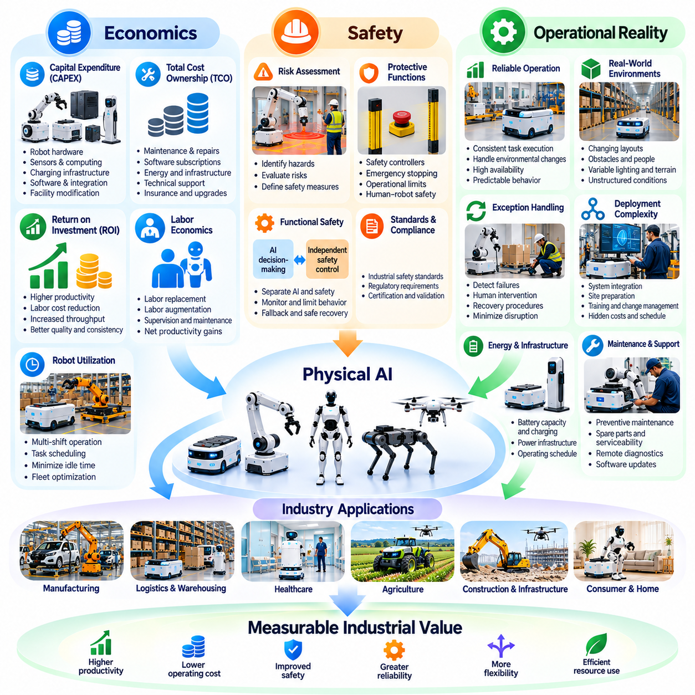
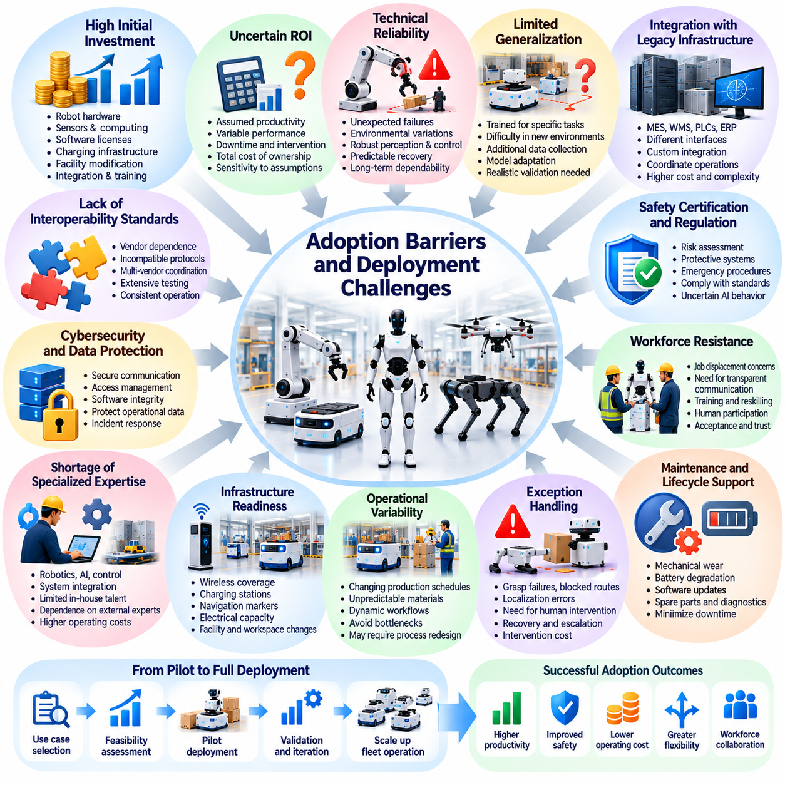
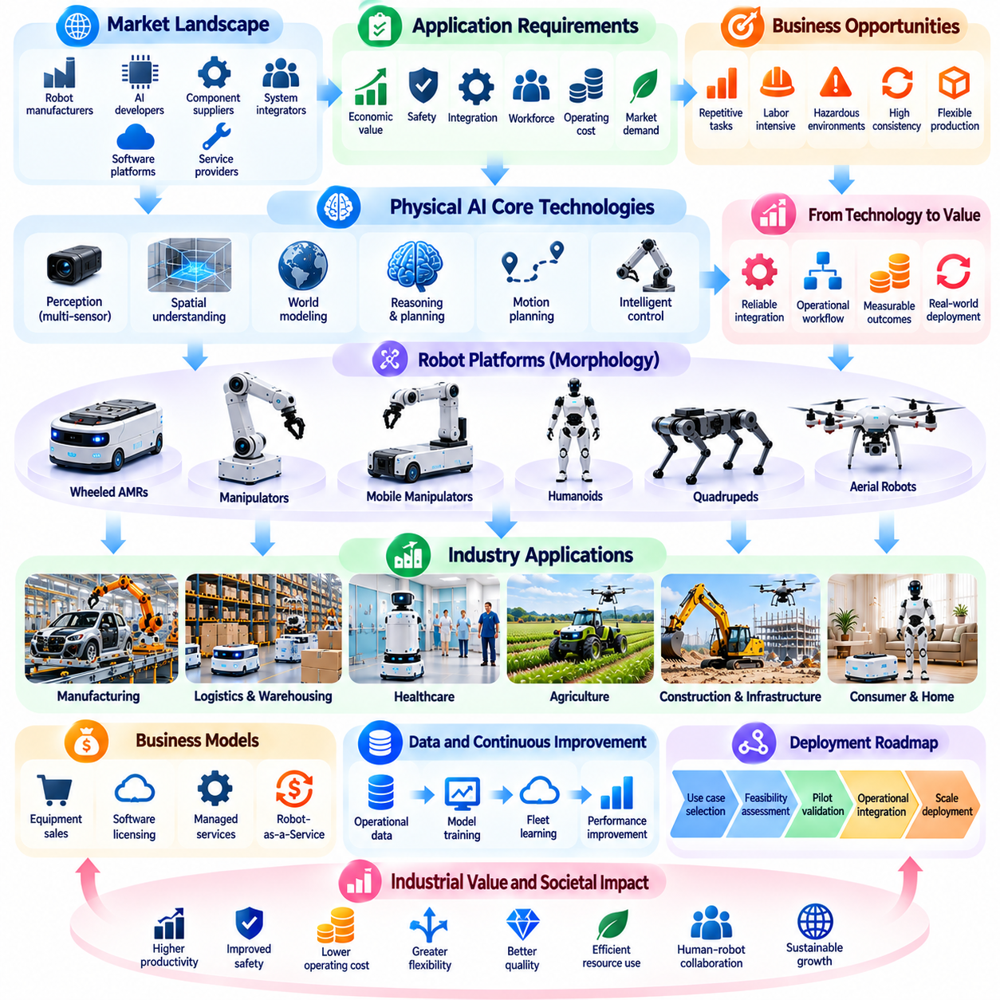

**Volume 12. Physical AI Business and Industry Applications**

# Chapter 00. Introduction

## 00.01. From Physical AI Technology to Industrial Value

{width="7.268055555555556in" height="7.268055555555556in"}

피지컬 AI(Physical AI)는 주로 디지털 정보(Digital Information)를 처리하던 인공지능(Artificial Intelligence)이 물리적 세계(Physical World)를 인식하고, 추론하며, 실제 행동을 수행할 수 있는 지능형 시스템(Intelligent Systems)으로 발전하는 근본적인 전환을 의미한다. 이러한 기술의 산업적 중요성은 생산성 향상, 안전성 개선, 운영 유연성 확대, 물리적 자원의 효율적 활용 등 측정 가능한 운영 성과(Operational Performance)로 전환될 때 나타난다.

피지컬 AI(Physical AI)의 기술적 기반은 기계 인식(Machine Perception), 공간 이해(Spatial Understanding), 월드 모델링(World Modeling), 의사결정(Decision-Making), 동작 계획(Motion Planning), 지능형 제어(Intelligent Control)를 결합하는 데 있다. 이러한 기능은 자율이동로봇(Autonomous Mobile Robot, AMR), 매니퓰레이터(Manipulator), 휴머노이드(Humanoid), 사족보행 로봇(Quadruped Robot), 비행 로봇(Aerial Robot)과 같은 체화된 시스템(Embodied Systems)을 통해 구현된다. 산업적 가치는 개별 알고리즘 자체가 아니라 이러한 기술들이 완전한 운영 작업 흐름(Operational Workflow)으로 안정적으로 통합될 때 창출된다.

전통적인 산업 자동화(Industrial Automation)는 사전에 정의된 작업 순서, 구조화된 환경, 비교적 예측 가능한 운영 조건에 의존해 왔다. 피지컬 AI(Physical AI)는 기계가 변화하는 환경을 해석하고, 예상하지 못한 상황에 대응하며, 작업 요구사항에 따라 행동을 조정할 수 있도록 이러한 접근 방식을 확장한다. 이러한 적응성(Adaptability)은 기존 자동화 설비로 처리하기 어려웠던 작업까지 자동화할 수 있는 새로운 가능성을 제공한다.

기술적 역량(Technological Capability)을 산업적 가치(Industrial Value)로 전환하는 과정은 지능형 자동화(Intelligent Automation)를 도입할 필요가 있는 운영 문제를 식별하는 것에서 시작된다. 자율주행(Autonomous Navigation)이 가능한 로봇이라고 해서 자동으로 경제적 이익이 발생하는 것은 아니다. 실제 생산 또는 물류 환경에서 운송 지연을 줄이고, 자재 공급 효율을 높이며, 설비 활용률을 개선하거나, 반복적인 수작업 이동을 감소시킬 수 있을 때 비로소 가치가 형성된다.

따라서 피지컬 AI(Physical AI)의 적용 가능성은 기술적 성능(Technical Performance)과 사업적 성과(Business Outcomes)의 관계를 통해 평가해야 한다. 인식 정확도(Perception Accuracy), 주행 신뢰성(Navigation Reliability), 조작 성공률(Manipulation Success Rate), 의사결정 지연시간(Decision Latency)은 중요한 공학적 지표이다. 그러나 산업 고객은 궁극적으로 처리량(Throughput), 운영 비용(Operating Cost), 서비스 가용성(Service Availability), 품질 일관성(Quality Consistency), 투자수익률(Return on Investment, ROI)을 기준으로 시스템을 평가한다. 성공적인 상용화(Commercialization)는 이러한 두 평가 영역을 연결하는 데 달려 있다.

제조업(Manufacturing)은 이러한 전환을 보여주는 대표적인 사례이다. 자율이동로봇(AMR)은 생산 공정 사이에서 자재를 운반하고, 지능형 매니퓰레이터(Intelligent Manipulator)는 설비 투입 및 배출(Machine Tending), 부품 취급(Component Handling), 유연 조립(Flexible Assembly)을 수행할 수 있다. 이러한 기술이 생산관리시스템(Production Management System)과 연결되면 전체 생산 공정을 완전히 재설계하지 않고도 자재 흐름(Material Flow)을 개선하고, 공정 중단을 줄이며, 적응형 생산 운영(Adaptive Manufacturing Operations)을 지원할 수 있다.

물류 및 창고 운영(Logistics and Warehouse Operations)에서 피지컬 AI(Physical AI)는 자율 운송(Autonomous Transportation), 지능형 피킹(Intelligent Picking), 팔레트 취급(Pallet Handling), 분류(Sorting), 로봇 군집 운영(Fleet Operations)을 통해 가치를 창출한다. 경제적 효과는 로봇 활용률(Robot Utilization), 주문 처리량(Order Throughput), 인력 요구량(Labor Requirements), 인프라 비용(Infrastructure Costs)의 상호관계에 따라 결정된다. 자율 기능을 실제 운영 성과로 전환하기 위해서는 창고관리시스템(Warehouse Management System, WMS), 전사적자원관리(Enterprise Resource Planning, ERP), 로봇군집관리시스템(Fleet Management System, FMS)과의 통합이 필수적이다.

의료 분야(Healthcare Applications)는 산업적 가치를 반드시 인건비 절감만으로 측정할 수 없다는 점을 보여준다. 병원 배송 로봇(Hospital Delivery Robot), 보조 시스템(Assistive System), 재활 로봇(Rehabilitation Robot), 자율 검사 플랫폼(Autonomous Inspection Platform)은 서비스 일관성을 높이고, 의료진의 불필요한 이동을 줄이며, 환자 중심 업무 흐름(Patient-Centered Workflow)을 지원할 수 있다. 이러한 시스템을 도입하려면 안전성(Safety), 개인정보 보호(Privacy), 임상 환경 적합성(Clinical Compatibility), 인간과 로봇의 상호작용(Human-Robot Interaction), 실질적인 운영 개선을 입증하는 객관적 근거를 종합적으로 검토해야 한다.

농업(Agriculture)은 불균일한 지형(Uneven Terrain), 변화하는 기상 조건(Variable Weather), 생물학적 다양성(Biological Diversity), 계절적 수요(Seasonal Demand)가 존재한다는 점에서 다른 요구사항을 가진다. 자율 수확(Autonomous Harvesting), 정밀 살포(Precision Spraying), 작물 모니터링(Crop Monitoring), 농경지 운송(Field Transportation)은 반복 노동을 줄이고 자원 효율성을 향상시킬 수 있다. 그러나 경제적 타당성(Economic Feasibility)은 장비 활용률, 작물 특성, 실제 작업 가능 기간, 야외 자율운행의 신뢰성에 따라 달라진다.

건설 및 인프라(Construction and Infrastructure) 분야에서는 물리적 조건이 지속적으로 변화하는 환경으로 피지컬 AI(Physical AI)의 적용 범위가 확대된다. 자율 건설장비(Autonomous Equipment), 로봇 측량(Robotic Surveying), 항공 검사(Aerial Inspection), 사족보행 플랫폼(Quadruped Platform)은 현장 모니터링(Site Monitoring), 인프라 상태 평가(Infrastructure Assessment), 위험지역 접근(Hazardous-Area Access)을 지원한다. 산업적 가치는 검사 범위 확대, 작업자 위험 노출 감소, 프로젝트 정보 품질 향상, 공정 지연과 재작업 및 유지보수에 따른 비용 절감 가능성에서 나타난다.

소비자 및 가정용 응용(Consumer and Home Applications)에서는 가격 적정성(Affordability), 편의성(Convenience), 신뢰성(Reliability), 개인정보 보호(Privacy), 사회적 수용성(Social Acceptance)이 추가적인 고려사항으로 등장한다. 가정용 로봇(Household Robot)은 사람, 가구, 반려동물, 예측하기 어려운 물체가 존재하는 환경에서도 일관된 성능을 제공해야 한다. 산업시설과 달리 가정은 표준화된 운영 조건을 제공하기 어렵기 때문에 일반화 능력(Generalization)과 안전한 인간 상호작용(Safe Human Interaction)이 제품의 지속적인 사용과 시장 수용에 중요한 역할을 한다.

피지컬 AI(Physical AI)의 상업적 잠재력(Commercial Potential)은 자율성(Autonomy)과 운영 신뢰성(Operational Reliability)의 관계에 크게 좌우된다. 복잡한 시연 작업을 수행하더라도 빈번하게 인간의 개입(Human Intervention)이 필요한 시스템은 경제적 가치가 제한적일 수 있다. 반대로 수행 가능한 작업 범위가 좁더라도 안정적으로 작동하고, 기존 업무 흐름과 통합되며, 장기간 높은 가용성(Availability)을 유지하는 로봇은 상당한 경제적 효과를 창출할 수 있다.

도입 경제성(Deployment Economics)을 평가할 때는 로봇 하드웨어(Hardware)의 구매 가격뿐 아니라 전체 비용을 고려해야 한다. 총소유비용(Total Cost of Ownership, TCO)에는 소프트웨어 라이선스(Software Licensing), 설치 및 통합(Installation and Integration), 충전 인프라(Charging Infrastructure), 유지보수(Maintenance), 에너지 소비(Energy Consumption), 운영자 교육(Operator Training), 감독(Supervision), 장비 교체 비용이 포함된다. 이러한 비용은 초기 생산성 시연 결과만이 아니라 시스템의 예상 운영 수명 전체에서 발생하는 측정 가능한 편익과 비교해야 한다.

자본적 지출(Capital Expenditure, CAPEX)과 운영적 지출(Operating Expenditure, OPEX)의 차이도 기술 도입에 영향을 미친다. 장비 직접 구매 방식은 고객이 초기 자본을 투입하고 자산 소유에 따른 책임을 부담하도록 한다. 반면 서비스형 로봇(Robot-as-a-Service, RaaS) 모델은 정기적인 비용 지불을 통해 투자 부담을 분산하고, 일부 유지보수 및 운영 책임을 서비스 제공업체로 이전할 수 있다. 두 방식은 재무적 유인(Financial Incentives), 위험 분담(Risk Allocation), 서비스 신뢰성(Service Reliability)에 서로 다른 요구사항을 형성한다.

피지컬 AI(Physical AI)는 산업 가치사슬(Industrial Value Chain)의 구조도 변화시킨다. 하드웨어 제조업체(Hardware Manufacturer)는 기계 플랫폼(Mechanical Platform), 액추에이터(Actuator), 센서(Sensor), 컴퓨팅 시스템(Computing System)을 제공하고, 소프트웨어 개발업체(Software Developer)는 인식, 계획, 제어, 학습 기능을 담당한다. 시스템 통합업체(System Integrator)는 이러한 기술을 고객 운영 환경에 연결하며, 서비스 제공업체(Service Provider)는 장비 수명주기(Equipment Lifecycle) 전반에 걸쳐 배포, 모니터링, 유지보수, 지속적인 성능 개선을 지원한다.

피지컬 AI(Physical AI) 시스템의 연결성이 높아지면서 운영 데이터(Operational Data)는 추가적인 가치 창출의 원천이 될 수 있다. 로봇 군집(Robot Fleet)은 작업 실행, 환경 조건, 장애, 인간 개입, 장비 성능에 관한 정보를 지속적으로 생성한다. 이러한 데이터를 적절한 데이터 거버넌스(Data Governance) 체계 아래 분석하면 모델 개선(Model Improvement), 예지보전(Predictive Maintenance), 군집 최적화(Fleet Optimization), 배포 의사결정(Deployment Decision)을 지원할 수 있으며, 실제 운영 경험과 기술 발전 사이에 피드백 구조(Feedback Loop)를 형성할 수 있다.

성공적인 실증사업(Pilot Project)을 상업적으로 지속 가능한 운영 규모로 확대하는 능력은 중요한 과제이다. 실험실 시연(Laboratory Demonstration)은 일반적으로 통제된 조건에서 수행되지만, 실제 생산 환경에는 예상하지 못한 장애물, 인프라 제약, 변화하는 작업량, 유지보수 문제가 존재한다. 확장 가능한 배포(Scalable Deployment)를 위해서는 표준화된 인터페이스(Standardized Interface), 반복 가능한 설치 절차(Repeatable Installation Procedure), 견고한 모니터링(Robust Monitoring), 신뢰할 수 있는 지원 서비스(Support Service), 명확하게 정의된 운영 책임이 필요하다.

안전성(Safety)과 규제 준수(Regulatory Compliance)는 산업 도입의 필수적인 기반이다. 피지컬 AI(Physical AI) 시스템은 장비, 인프라, 작업자, 때로는 취약한 사용자와 직접 상호작용한다. 시스템의 의사결정이 실제 물리적 결과를 발생시킬 수 있으므로 위험 평가(Risk Assessment), 보호 메커니즘(Protective Mechanism), 대체 동작(Fallback Behavior), 사이버보안(Cybersecurity), 인간 감독(Human Oversight)이 시스템 설계의 필수 요소가 된다. 상업적 가치는 통제되지 않은 운영 위험을 감수하는 방식으로 확보되어서는 안 된다.

산업적 도입(Industrial Adoption)은 조직의 준비 수준(Organizational Readiness)에도 영향을 받는다. 직원은 지능형 기계가 자신의 업무와 책임에 어떤 변화를 가져오는지 이해해야 하며, 관리자는 감독, 예외 처리(Exception Handling), 유지보수, 성과 평가를 위한 절차를 수립해야 한다. 효과적인 도입은 개별 인간 작업을 단순히 로봇으로 대체하는 것보다 업무 흐름 자체를 재설계하는 과정(Workflow Redesign)을 수반하는 경우가 많다. 따라서 조직적 적응(Organizational Adaptation)은 피지컬 AI(Physical AI)의 기술적 성공과 밀접하게 연결된다.

가장 유망한 응용 분야가 반드시 가장 높은 수준의 범용 지능(General Intelligence)을 요구하는 것은 아니다. 상업적 기회는 작업 요구사항이 충분히 정의되어 있고, 운영 조건을 관리할 수 있으며, 성능 개선이 경제적으로 의미 있는 영역에서 자주 발생한다. 적절한 자율성 수준(Level of Autonomy)을 선택하면 기술적 복잡성(Technical Complexity), 도입 위험(Deployment Risk), 예상 사업 가치(Expected Business Value) 사이의 균형을 확보할 수 있다.

장기적으로 파운데이션 모델(Foundation Model), 멀티모달 인식(Multimodal Perception), 시뮬레이션(Simulation), 체화 간 학습(Cross-Embodiment Learning)의 발전은 로봇을 새로운 작업에 적응시키는 데 필요한 엔지니어링 노력(Engineering Effort)을 줄일 수 있다. 그러나 지능의 범용성이 확대되더라도 특화 하드웨어(Specialized Hardware), 운영 시스템 통합(Operational Integration), 안전성 검증(Safety Validation), 응용 분야별 최적화(Application-Specific Optimization)의 필요성이 사라지는 것은 아니다. 산업 경쟁력은 재사용 가능한 지능(Reusable Intelligence)과 신뢰할 수 있는 물리적 실행(Reliable Physical Execution)을 결합하는 능력에 달려 있다.

이에 따라 피지컬 AI(Physical AI)의 사업 모델(Business Model)은 독립형 로봇 제품(Standalone Robotic Product)에서 통합 시스템(Integrated System), 소프트웨어 플랫폼(Software Platform), 관리형 로봇 군집(Managed Robot Fleet), 지능형 서비스(Intelligence-Enabled Service)로 발전할 수 있다. 이러한 전환은 반복 매출(Recurring Revenue)의 기회를 창출하는 동시에 수명주기 관리(Lifecycle Management)와 고객 관계(Customer Relationship)의 중요성을 높인다. 지속 가능한 사업 모델(Sustainable Business Model)은 가격 정책(Pricing), 서비스 수준 약정(Service Commitments), 하드웨어 비용(Hardware Costs), 운영 성능(Operational Performance)을 고객에게 제공하는 경제적 가치와 일치시켜야 한다.

산업용 피지컬 AI(Industrial Physical AI)의 핵심 원칙은 기술적 정교함(Technological Sophistication)이 수용 가능한 비용과 위험 수준에서 실제 문제를 해결할 때 비로소 상업적 의미를 갖는다는 것이다. 성공적인 시스템은 인식(Perception), 지능(Intelligence), 물리적 행동(Physical Action)을 실제 운영의 측정 가능한 개선으로 연결한다. 이러한 관계에 대한 이해는 피지컬 AI(Physical AI) 생태계 전반의 시장 기회(Market Opportunities), 산업 응용(Industry Applications), 사업 모델(Business Models), 상용화 전략(Commercialization Strategies)을 평가하는 기초가 된다.

## 00.02. Why Physical AI Changes Industry

{width="7.268055555555556in" height="7.268055555555556in"}

피지컬 AI(Physical AI)는 인공지능(Artificial Intelligence)의 적용 범위를 디지털 분석(Digital Analysis)에서 물리적 세계(Physical World)와의 직접적인 상호작용으로 확장함으로써 산업을 변화시킨다. 주로 예측, 권고 또는 정보 생성을 수행하는 기존 인공지능 시스템과 달리, 피지컬 AI는 기계가 환경을 인식하고, 의사결정을 수행하며, 실제 물리적 행동을 실행할 수 있도록 한다. 이러한 전환은 산업 자동화(Industrial Automation), 운영 유연성(Operational Flexibility), 지능형 자원 활용(Intelligent Resource Utilization)에 새로운 가능성을 제공한다.

피지컬 AI(Physical AI)의 중요성은 전통적인 자동화(Traditional Automation)의 한계를 극복할 수 있는 능력에 있다. 기존 산업 시스템은 일반적으로 사전에 정의된 절차(Predefined Procedures), 고정된 장비 구성(Fixed Equipment Configurations), 예측 가능한 운영 조건(Predictable Operating Conditions)에 의존한다. 피지컬 AI는 인식(Perception), 학습(Learning), 추론(Reasoning), 적응형 제어(Adaptive Control)를 도입하여 기계가 환경 변화에 대응하고, 경직된 프로그래밍(Rigid Programming)으로 완전히 정의하기 어려운 작업을 수행할 수 있도록 한다.

산업 환경(Industrial Environment)은 자재, 장비, 작업자, 운영 조건이 지속적으로 변화하기 때문에 본질적으로 동적(Dynamic)이다. 전통적인 자동화 시스템은 이러한 조건이 달라질 때 상당한 엔지니어링 변경(Engineering Modification)을 요구하는 경우가 많다. 피지컬 AI(Physical AI) 시스템은 센서 정보(Sensor Information)를 해석하고, 주변 환경에 대한 이해를 갱신하며, 그에 따라 행동을 조정할 수 있다. 이러한 능력은 완전히 구조화된 환경(Structured Environment)에 대한 의존도를 줄이고 자동화할 수 있는 작업 범위를 확대한다.

가장 중요한 산업적 변화 중 하나는 작업 특화 자동화(Task-Specific Automation)에서 적응형 지능 시스템(Adaptive Intelligent System)으로의 전환이다. 전통적인 로봇은 제한된 반복 작업을 수행하도록 설계되는 경우가 많다. 피지컬 AI(Physical AI)는 인식, 계획, 제어 기능을 여러 작업에 재사용할 수 있는 가능성을 제공한다. 전문적인 엔지니어링이 여전히 필요하지만, 이러한 적응성(Adaptability)은 새로운 제품, 작업 흐름(Workflow), 운영 절차(Operating Procedure)를 도입하는 데 필요한 노력을 줄일 수 있다.

피지컬 AI(Physical AI)는 인간 노동(Human Labor)과 기계 사이의 관계도 변화시킨다. 반복성이 높은 작업만 자동화하는 대신, 지능형 로봇 시스템(Intelligent Robotic System)은 자재 취급(Material Handling), 검사(Inspection), 운송(Transportation), 설비 운영(Equipment Operation), 일부 조작 작업(Manipulation Task)을 지원할 수 있다. 인간 작업자는 점차 감독(Supervision), 예외 상황 관리(Exception Management), 공정 개선(Process Improvement), 복잡한 판단이 필요한 활동에 집중할 수 있다. 이러한 변화는 단순한 인력 대체가 아니라 업무 자체를 재설계하는 과정(Work Redesign)을 포함한다.

제조업(Manufacturing)은 피지컬 AI(Physical AI)가 산업 운영을 어떻게 변화시킬 수 있는지 보여준다. 자율이동로봇(Autonomous Mobile Robot, AMR)은 자재 운송을 조정하고, 지능형 매니퓰레이터(Intelligent Manipulator)는 부품 위치의 변화에 적응하며, 인식 시스템(Perception System)은 생산 이상 상태(Production Abnormality)를 식별할 수 있다. 이러한 기능이 제조실행시스템(Manufacturing Execution System, MES) 및 생산계획 플랫폼(Production Planning Platform)과 연결되면, 변화하는 생산 요구사항에 따라 운영을 조정할 수 있는 대응형 공장(Responsive Factory)을 지원한다.

물류 및 창고(Logistics and Warehousing) 분야에서 피지컬 AI(Physical AI)는 운송 및 취급 시스템이 재고 이동(Inventory Movement), 주문 수요(Order Demand), 시설 환경 변화에 동적으로 대응할 수 있도록 한다. 자율이동로봇(AMR), 로봇 피킹 시스템(Robotic Picking System), 지능형 지게차(Intelligent Forklift)는 군집관리 플랫폼(Fleet Management Platform)을 통해 협력할 수 있다. 이러한 통합 운영은 자재 흐름(Material Flow)을 개선하고, 불필요한 이동을 줄이며, 고정식 운송 인프라(Fixed Transportation Infrastructure)에 의존하는 자동화보다 유연한 창고 구성을 지원한다.

의료 분야(Healthcare)는 산업적 변화의 또 다른 측면을 보여준다. 지능형 배송 로봇(Intelligent Delivery Robot), 보조 장치(Assistive Device), 재활 시스템(Rehabilitation System), 자율 모니터링 플랫폼(Autonomous Monitoring Platform)은 병원 운영과 환자 서비스를 지원할 수 있다. 이러한 기술은 일상적인 운송 업무의 부담을 줄이고 서비스 일관성(Service Consistency)을 개선할 가능성이 있다. 그러나 실제 효과는 임상 시스템 통합(Clinical Integration), 안전성 보장(Safety Assurance), 개인정보 보호(Privacy Protection), 기존 의료 업무 흐름(Healthcare Workflow)과의 적합성에 따라 결정된다.

농업(Agriculture)은 작업 환경을 표준화하기 어렵기 때문에 피지컬 AI(Physical AI)의 이점을 활용할 수 있는 분야이다. 자율 농경지 차량(Autonomous Field Vehicle), 작물 모니터링 로봇(Crop Monitoring Robot), 지능형 수확 시스템(Intelligent Harvesting System), 정밀 처리 플랫폼(Precision Treatment Platform)은 지형, 식생, 환경 조건의 변화에 대응할 수 있다. 이러한 기능은 자원의 선택적 투입(Selective Resource Application)을 지원하고, 운영 일관성(Operational Consistency)을 높이며, 작업 시기가 중요한 농업 활동에서 수작업 의존도를 줄일 수 있다.

건설 및 인프라(Construction and Infrastructure) 산업도 변화하는 물리적 환경과 어려운 작업 조건이라는 유사한 문제에 직면한다. 피지컬 AI(Physical AI)는 자율 검사(Autonomous Inspection), 로봇 측량(Robotic Surveying), 지능형 건설장비(Intelligent Construction Equipment), 복잡한 현장을 이동할 수 있는 모바일 플랫폼(Mobile Platform)을 가능하게 한다. 이러한 기술은 정보 수집(Information Collection)을 개선하고, 프로젝트 모니터링(Project Monitoring)을 지원하며, 위험지역에 대한 인간의 노출을 줄이는 동시에 인프라 상태(Infrastructure Condition)를 더욱 빈번하게 관찰할 수 있도록 한다.

또 다른 중요한 변화는 물리적 운영(Physical Operations)과 디지털 지능(Digital Intelligence)의 통합이다. 센서가 장착된 로봇은 주변 환경, 수행 행동, 장비 상태, 운영 결과에 관한 정보를 지속적으로 생성한다. 이러한 정보는 기업 운영 시스템(Enterprise System), 디지털 트윈(Digital Twin), 분석 플랫폼(Analytics Platform)과 연결될 수 있다. 결과적으로 물리적 활동은 운영 최적화(Operational Optimization)와 경영 의사결정(Management Decision-Making)을 지원하는 측정 가능한 데이터 원천(Data Source)으로 전환된다.

피지컬 AI(Physical AI)는 운영 데이터 수집(Operational Data Collection)을 통한 지속적 학습(Continuous Learning)의 기회도 제공한다. 성공적인 행동, 실패, 인간의 개입(Human Intervention), 환경 변화는 로봇 행동(Robotic Behavior)을 개선하는 데 활용될 수 있다. 이러한 경험을 시뮬레이션(Simulation), 데이터 정제(Data Curation), 모델 학습(Model Training)과 결합하면 반복적인 시스템 개발(Iterative System Development)을 지원할 수 있다. 대규모 로봇 군집 배포(Fleet-Scale Deployment)는 다양한 로봇과 환경에서 운영 사례를 수집함으로써 학습을 더욱 가속할 가능성이 있다.

로봇 파운데이션 모델(Robot Foundation Model)과 시각-언어-행동 아키텍처(Vision-Language-Action Architecture, VLA)의 발전은 산업용 로봇 시스템의 적응성을 높일 수 있다. 이러한 접근 방식은 시각 인식(Visual Perception), 언어 명령(Language Instruction), 물리적 행동(Physical Action)을 재사용 가능한 학습 프레임워크(Reusable Learning Framework)로 연결하는 것을 목표로 한다. 현재 시스템은 신뢰성(Reliability)과 일반화(Generalization) 측면에서 여전히 한계가 있지만, 일부 로봇 응용 분야에서 작업별 프로그래밍(Task-Specific Programming)의 필요성을 줄일 수 있는 잠재적인 발전 경로를 제공한다.

피지컬 AI(Physical AI)는 엣지 컴퓨팅(Edge Computing), 로컬 제어(Local Control), 기업 플랫폼(Enterprise Platform), 클라우드 기반 지능(Cloud-Based Intelligence)을 연결함으로써 산업 시스템 아키텍처(Industrial System Architecture)도 변화시킨다. 시간 제약이 중요한 동작 제어(Motion Control)와 안전 기능(Safety Function)은 일반적으로 신뢰할 수 있는 로컬 실행(Local Execution)이 필요하다. 반면 대규모 데이터 처리(Large-Scale Data Processing)와 모델 개발(Model Development)은 중앙집중형 인프라(Centralized Infrastructure)의 이점을 활용할 수 있다. 효과적인 아키텍처 설계는 통신 지연(Communication Latency), 컴퓨팅 요구사항(Computing Requirements), 사이버보안(Cybersecurity), 운영 연속성(Operational Continuity), 물리적 행동의 신뢰성 사이에서 균형을 유지해야 한다.

경제적 가치(Economic Value)는 이러한 기술적 변화가 광범위한 산업 도입(Industrial Adoption)으로 이어지는지를 결정하는 핵심 요소이다. 자율성(Autonomy)이 향상된다고 해서 운영 비용이 자동으로 감소하거나 생산성이 높아지는 것은 아니다. 기업은 장비 투자(Equipment Investment), 시스템 통합 비용(Integration Expenses), 유지보수(Maintenance), 에너지 소비(Energy Consumption), 장비 활용률(Utilization), 서비스 가용성(Service Availability)을 평가해야 한다. 피지컬 AI(Physical AI)는 운영상의 편익이 도입과 관련된 총비용 및 위험을 초과할 때 상업적으로 의미 있는 기술이 된다.

피지컬 AI(Physical AI)의 도입은 산업 사업 모델(Industrial Business Model)도 변화시킬 수 있다. 기업은 자율 장비(Autonomous Equipment)를 직접 구매하거나, 지능형 소프트웨어 플랫폼(Intelligent Software Platform)을 구독하거나, 하드웨어와 소프트웨어, 유지보수 및 운영 지원을 결합한 서비스형 로봇(Robot-as-a-Service, RaaS) 모델을 채택할 수 있다. 이러한 대안은 서로 다른 재무 구조(Financial Structure)와 책임 관계를 형성한다. 또한 기술 공급업체(Technology Provider)가 단순한 장비 납품보다 지속적인 고객 성과(Customer Outcomes)에 집중하도록 유도한다.

산업 경쟁력(Industrial Competitiveness)은 지능형 기계(Intelligent Machine)를 통합 운영 시스템(Integrated Operational System)과 결합하는 능력에 점점 더 의존할 수 있다. 단일 자율 로봇(Autonomous Robot)은 특정 작업을 개선할 수 있지만, 연결된 로봇 군집(Connected Robot Fleet)과 통합 생산 플랫폼(Integrated Production Platform)은 더 넓은 업무 흐름을 최적화할 수 있다. 작업 할당(Task Allocation), 교통 조정(Traffic Coordination), 자원 일정관리(Resource Scheduling), 운영 모니터링(Operational Monitoring)은 개별 로봇의 능력을 시스템 수준의 생산성(System-Level Productivity) 향상으로 전환하는 중요한 수단이 된다.

그러나 피지컬 AI(Physical AI)는 순수한 디지털 지능(Digital Intelligence)과는 다른 문제를 발생시킨다. 물리적 행동(Physical Action)에는 기계적 힘(Mechanical Force), 이동 장비(Moving Equipment), 환경 불확실성(Environmental Uncertainty), 사람과의 직접적인 상호작용이 포함된다. 오류는 장비 손상(Equipment Damage), 생산 중단(Production Interruption), 안전사고(Safety Incident)를 유발할 수 있다. 따라서 산업 시스템에는 엄격한 검증(Rigorous Validation), 예측 가능한 대체 동작(Predictable Fallback Behavior), 기능 안전 메커니즘(Functional Safety Mechanism), 사이버보안 보호(Cybersecurity Protection), 적절한 인간 감독(Human Oversight)이 필요하다.

이러한 변화는 조직의 준비 수준(Organizational Readiness)과 인력 적응(Workforce Adaptation)에도 영향을 받는다. 성공적인 도입을 위해서는 직원이 로봇의 기능(Robotic Capabilities), 운영상의 한계(Operational Limitations), 개입 절차(Intervention Procedures)를 이해해야 한다. 관리자는 유지보수, 모니터링, 성과 평가(Performance Assessment), 예외 상황 처리(Exception Handling)에 관한 책임을 수립해야 한다. 지능형 자동화(Intelligent Automation)는 사람과 기계의 협업 방식 및 운영 의사결정의 분배 구조를 변화시키므로 교육(Training)과 업무 흐름 재설계(Workflow Redesign)가 필수적이다.

피지컬 AI(Physical AI)가 모든 산업 작업에 휴머노이드 로봇(Humanoid Robot)이나 범용 자율 시스템(General-Purpose Autonomous System)을 필요로 한다는 의미는 아니다. 서로 다른 응용 분야에는 이동성(Mobility), 조작 능력(Manipulation), 센싱(Sensing), 적재 능력(Payload Capacity), 정밀도(Precision), 지능(Intelligence)의 조합이 다르게 요구된다. 자율이동로봇(AMR)은 내부 물류에, 매니퓰레이터(Manipulator)는 조립에, 사족보행 로봇(Quadruped Robot)은 험지 이동에, 비행 로봇(Aerial Robot)은 검사 작업에 적합할 수 있다. 시스템의 능력을 실제 운영 요구사항(Operational Requirements)에 맞추는 것은 여전히 기본적인 원칙이다.

피지컬 AI(Physical AI)의 장기적인 산업적 영향은 신뢰성(Reliability), 가격 적정성(Affordability), 일반화(Generalization), 배포 확장성(Deployment Scalability)의 개선에 달려 있다. 시뮬레이션(Simulation), 파운데이션 모델(Foundation Model), 하드웨어-소프트웨어 공동설계(Hardware-Software Co-Design), 군집 학습(Fleet Learning)의 발전은 경제적으로 실현 가능한 응용 분야의 범위를 점진적으로 확대할 수 있다. 그러나 실질적인 발전을 위해서는 실제 운영 조건에서의 일관된 성능(Consistent Performance), 관리 가능한 수명주기 비용(Lifecycle Costs), 측정 가능한 운영 편익(Measurable Operational Benefits)에 대한 검증이 필요하다.

궁극적으로 피지컬 AI(Physical AI)는 기계를 경직된 자동화 구성요소(Rigid Automation Component)에서 물리적 운영에 점점 더 적응적으로 참여하는 지능형 시스템(Adaptive Intelligent System)으로 전환함으로써 산업을 변화시킨다. 그 중요성은 개별 로봇을 넘어 업무 흐름(Workflow), 산업 인프라(Industrial Infrastructure), 인력의 역할과 책임(Workforce Responsibilities), 사업 모델(Business Model)의 재설계로 확장된다. 가장 큰 가치는 지능형 물리적 역량(Intelligent Physical Capabilities)이 신뢰할 수 있고, 안전하며, 경제적으로 지속 가능한 운영 시스템(Reliable, Safe, and Economically Sustainable Operational Systems)에 통합될 때 창출된다.

## 00.03. Automation Autonomy and Intelligent Labor

{width="7.268055555555556in" height="7.268055555555556in"}

자동화(Automation), 자율성(Autonomy), 지능형 노동(Intelligent Labor)은 피지컬 AI(Physical AI)가 가능하게 하는 산업 혁신(Industrial Transformation)의 세 가지 상호 연결된 차원을 나타낸다. 자동화는 인간의 개입을 줄이면서 사전에 정의된 작업을 수행하는 데 중점을 두는 반면, 자율성은 의사결정을 수행하고 변화하는 조건에 적응하는 능력을 도입한다. 지능형 노동은 이러한 기능을 확장하여 인식(Perception), 추론(Reasoning), 학습(Learning), 협력적 행동(Coordinated Action)을 통해 생산적인 물리적 작업을 수행하는 것을 의미한다.

전통적인 자동화(Traditional Automation)는 반복적인 수작업을 기계, 프로그래머블 제어기(Programmable Controller), 로봇 시스템(Robotic System)으로 대체함으로써 산업 생산성(Industrial Productivity)을 향상시켜 왔다. 이러한 기술은 작업이 구조화되어 있고 예측 가능하며 대량으로 반복되는 환경에서 매우 우수한 성능을 발휘한다. 그러나 운영 환경이 변화하거나 물체의 특성이 달라지고, 사전에 정의된 프로그래밍(Predefined Programming)을 넘어서는 의사결정이 필요한 예기치 못한 상황이 발생하면 효과가 감소하는 경우가 많다.

자율성(Autonomy)은 기계가 지속적인 인간의 지시 없이 환경 정보를 해석하고 적절한 행동을 선택할 수 있도록 함으로써 자동화의 범위를 확장한다. 자율 시스템(Autonomous System)은 센싱(Sensing), 위치 추정(Localization), 인식(Perception), 계획(Planning), 제어(Control)를 결합하여 운영 목표를 달성한다. 그러나 이러한 독립성이 절대적인 것은 아니며, 실제 자율성은 정의된 안전 제약(Safety Constraints), 운영 경계(Operational Boundaries), 인간 감독 체계(Human Supervisory Structure) 내에서 작동한다.

피지컬 AI(Physical AI)는 학습 기반 인식(Learning-Based Perception)과 의사결정(Decision-Making)을 통해 고정형 자동화(Fixed Automation)에서 적응형 자율성(Adaptive Autonomy)으로의 전환을 가능하게 한다. 지능형 기계(Intelligent Machine)는 수작업으로 프로그래밍된 규칙에만 의존하는 대신, 학습된 표현(Learned Representation)을 활용하여 익숙하지 않은 상황을 해석하고 행동을 조정할 수 있다. 이러한 능력은 운영 조건을 완전히 표준화하기 어려운 제조업(Manufacturing), 물류(Logistics), 농업(Agriculture), 의료(Healthcare), 인프라(Infrastructure) 환경에서 특히 중요하다.

지능형 노동(Intelligent Labor)은 기계적 능력(Mechanical Capability)과 인공지능(Artificial Intelligence)을 결합한 기계가 수행하는 생산적인 물리적 활동(Productive Physical Activity)을 의미한다. 단순히 명령을 실행하는 기존 장비와 달리, 지능형 로봇 시스템(Intelligent Robotic System)은 작업 목표(Task Objective)를 해석하고, 관련 환경 조건(Environmental Conditions)을 인식하며, 원하는 결과를 달성하기 위해 행동을 조정할 수 있다. 이러한 시스템의 경제적 중요성은 단순히 지능을 시연하는 것이 아니라 유용한 작업을 신뢰성 있게 수행하는 능력에 달려 있다.

산업 노동(Industrial Labor)은 운송(Transportation), 조작(Manipulation), 검사(Inspection), 모니터링(Monitoring), 유지보수(Maintenance), 운영 의사결정(Operational Decision-Making) 등 여러 상호 연결된 활동으로 구성된다. 각 활동에는 물리적 힘(Physical Strength), 정교한 조작 능력(Dexterity), 이동성(Mobility), 인식(Perception), 추론(Reasoning)의 서로 다른 조합이 필요하다. 따라서 피지컬 AI(Physical AI)는 단일한 범용 로봇 아키텍처(Universal Robot Architecture)를 의미하는 것이 아니라, 특정 운영 요구사항(Operational Requirements)에 최적화된 다양한 지능형 기계의 집합을 의미한다.

자율이동로봇(Autonomous Mobile Robot, AMR)은 비교적 특화된 기능을 통해 지능형 노동(Intelligent Labor)이 어떻게 구현될 수 있는지를 보여준다. 이러한 시스템은 시설 내부를 자율적으로 주행하고, 자재를 운송하며, 장애물을 회피하고, 다른 장비와 이동을 조정한다. 창고관리시스템(Warehouse Management System, WMS) 및 로봇군집관리 플랫폼(Fleet Management Platform)과 통합되면 변화하는 작업 우선순위(Task Priority)와 시설 환경(Facility Conditions)에 대응하면서 지속적으로 운송 서비스를 수행할 수 있다.

로봇 매니퓰레이터(Robotic Manipulator)는 지능형 노동(Intelligent Labor)의 범위를 물체 및 장비와의 물리적 상호작용(Physical Interaction)으로 확장한다. 비전 기반 조작(Vision-Guided Manipulation)은 로봇이 부품을 식별하고, 물체의 자세(Object Pose)를 추정하며, 파지(Grasping) 또는 배치(Placement) 작업을 수행할 수 있도록 한다. 모바일 매니퓰레이터(Mobile Manipulator)는 운송과 조작을 결합하여 고정된 작업 공간에 제한되지 않고 여러 위치에서 설비 투입 및 배출(Machine Tending), 주문 피킹(Order Picking), 자재 보충(Material Replenishment)을 지원할 수 있다.

휴머노이드 로봇(Humanoid Robot)은 인간의 이동과 조작을 중심으로 설계된 환경에 적합한 형태(Morphology)를 가질 수 있다는 점에서 지능형 노동(Intelligent Labor)에 대한 또 다른 접근 방식을 제공한다. 그러나 인간과 유사한 외형(Human-Like Appearance)이 반드시 우수한 산업 성능(Industrial Performance)을 보장하는 것은 아니다. 실제 도입 가능성은 특화된 로봇 대안(Specialized Robotic Alternatives)과 비교한 작업 성공률(Task Success Rate), 적재 능력(Payload Capacity), 신뢰성(Reliability), 안전성(Safety), 에너지 효율(Energy Efficiency), 운영 비용(Operating Cost)에 따라 결정된다.

산업 작업에 필요한 자율성 수준(Level of Autonomy)은 응용 분야에 따라 크게 달라진다. 일부 시스템은 결정론적 제어(Deterministic Control)와 사전에 정의된 경로(Predefined Route)를 기반으로 작동하지만, 다른 시스템은 적응형 계획(Adaptive Planning)과 지속적인 환경 해석(Continuous Environmental Interpretation)을 필요로 한다. 높은 자율성은 일상적인 감독 업무를 줄일 수 있지만, 동시에 검증(Validation), 불확실성 관리(Uncertainty Management), 예외 상황 처리(Exception Handling), 운영 책임성(Operational Accountability)에 대한 요구사항을 증가시킨다.

로봇의 자율성(Autonomy)이 향상되더라도 인간 감독(Human Supervision)은 여전히 중요하다. 운영자는 작업 목표를 정의하고, 민감한 행동을 승인하며, 예기치 못한 상황을 해결하고, 자율 행동(Autonomous Behavior)의 신뢰성이 저하될 때 개입할 수 있다. 효과적인 인간-로봇 협업(Human-Robot Collaboration)을 위해서는 명확한 책임 경계(Responsibility Boundaries), 이해하기 쉬운 시스템 상태(System States), 적절한 개입 메커니즘(Intervention Mechanisms), 사람과 지능형 기계 사이의 안전한 협력을 지원하는 인터페이스(Interface)가 필요하다.

지능형 노동(Intelligent Labor)은 배포된 로봇의 수가 아니라 측정 가능한 작업 산출량(Measurable Work Output)을 기준으로 평가해야 한다. 주요 지표에는 완료된 작업 수(Completed Tasks), 운영 시간(Operating Hours), 처리량(Throughput), 개입 빈도(Intervention Frequency), 작업 성공률(Task Success Rate), 서비스 가용성(Service Availability)이 포함된다. 자율성이 높은 기계라도 활용률(Utilization)이 낮으면 경제적 가치가 제한적일 수 있으며, 반대로 단순한 시스템이라도 필수 작업을 일관되게 수행하면 상업적으로 성공할 수 있다.

지능형 노동(Intelligent Labor)의 경제성(Economics)은 로봇을 둘러싼 전체 운영 시스템(Operating System)에 따라 결정된다. 하드웨어 구매(Hardware Acquisition), 소프트웨어 라이선스(Software Licensing), 충전 인프라(Charging Infrastructure), 시스템 통합(System Integration), 유지보수(Maintenance), 감독(Supervision), 가동 중단(Downtime)은 총소유비용(Total Cost of Ownership, TCO)을 구성한다. 기업은 이러한 비용을 생산성 향상(Productivity Improvement), 지연 방지(Avoided Delays), 품질 개선(Quality Benefits), 안전성 향상(Safety Improvements), 대체 운영 방식의 실질적인 비용(Effective Cost of Alternative Operating Methods)과 비교해야 한다.

피지컬 AI(Physical AI)는 다중 로봇 시스템(Multi-Robot System)을 통한 협력형 지능 노동(Coordinated Intelligent Labor)도 가능하게 한다. 개별 로봇은 운영 정보를 공유하고, 동적으로 할당된 작업을 수신하며, 공통 환경에서 이동을 조정할 수 있다. 로봇군집관리시스템(Fleet Management System, FMS)은 로봇의 가용성(Availability), 위치(Location), 배터리 상태(Battery Condition), 작업 우선순위(Task Priority)에 따라 작업량을 분배함으로써 개별 기계의 성능이 아니라 전체 시스템의 성능(Collective Performance)을 최적화할 수 있다.

데이터 기반 학습(Data-Driven Learning)은 기존 자동화(Conventional Automation)와 새롭게 등장하는 지능형 노동(Intelligent Labor)을 구분하는 또 다른 특징이다. 실제 운영 경험(Operational Experience)은 반복적으로 발생하는 실패, 환경 변화, 성능 개선 기회를 드러낼 수 있다. 이러한 데이터를 적절하게 수집하고 검증하면 모델 개선(Model Refinement), 시뮬레이션 기반 학습(Simulation-Based Training), 예지보전(Predictive Maintenance), 배포된 로봇 시스템 전반의 작업 할당 개선(Improved Task Allocation)을 지원할 수 있다.

파운데이션 모델(Foundation Model)과 시각-언어-행동 아키텍처(Vision-Language-Action Architecture, VLA)의 도입은 지능형 노동(Intelligent Labor)의 유연성을 더욱 확대할 수 있다. 이러한 모델은 자연어 명령(Natural-Language Instruction), 시각적 관측(Visual Observation), 로봇 행동(Robotic Action)을 재사용 가능한 학습 시스템(Reusable Learning System)으로 연결하는 것을 목표로 한다. 작업별 프로그래밍(Task-Specific Programming)을 줄일 수 있다는 잠재력이 있지만, 산업 현장에 적용하기 위해서는 여전히 신뢰할 수 있는 제어(Reliable Control), 안전성 검증(Safety Validation), 물리적 하드웨어 제약(Hardware Constraints)에 대한 적응이 필요하다.

지능형 노동(Intelligent Labor)은 조직 구조(Organizational Structure)와 인력의 역할 및 책임(Workforce Responsibilities)도 변화시킨다. 인간 작업자는 자동화 공정을 감독하고, 예외 상황을 관리하며, 로봇 장비를 유지보수하고, 작업 흐름을 개선하는 역할을 점차 확대할 수 있다. 이러한 전환에는 기술 교육(Technical Training), 개정된 운영 절차(Revised Operating Procedures), 새로운 생산성 평가 방법(Productivity Evaluation Methods)이 필요하다. 성공적인 도입은 인력을 완전히 대체한다고 가정하기보다 인간의 전문성(Human Expertise)과 기계의 능력(Machine Capabilities)을 통합하는 데 달려 있다.

자율 기계(Autonomous Machine)가 사람, 차량, 고가 장비 주변에서 물리적 작업을 수행할 때 안전성(Safety)은 특히 중요하다. 지능형 노동 시스템(Intelligent Labor System)은 적절한 기계적 제약(Mechanical Constraints), 전기적 제약(Electrical Constraints), 행동 제약(Behavioral Constraints) 내에서 작동해야 한다. 고급 인공지능 모델(Advanced AI Model)이 상위 수준의 의사결정(High-Level Decision-Making)을 제공하더라도 위험 평가(Risk Assessment), 비상 정지(Emergency Stopping), 충돌 회피(Collision Avoidance), 대체 제어(Fallback Control), 사이버보안(Cybersecurity), 운영 모니터링(Operational Monitoring)은 여전히 필수적이다.

지능형 노동(Intelligent Labor)으로의 전환은 기존 자동화(Conventional Automation)를 즉시 대체하기보다는 점진적으로 진행될 가능성이 높다. 구조화된 반복 작업(Structured Repetitive Tasks)은 결정론적 시스템(Deterministic System)에 경제적으로 적합할 수 있으며, 변화가 많거나 프로그래밍하기 어려운 작업은 적응형 지능(Adaptive Intelligence)의 이점을 활용할 수 있다. 전통적인 제어(Traditional Control), 학습된 정책(Learned Policy), 인간 감독(Human Supervision)을 결합한 하이브리드 아키텍처(Hybrid Architecture)는 산업 자율성(Industrial Autonomy)을 확대하기 위한 현실적인 발전 경로를 제공한다.

궁극적으로 자동화(Automation)는 반복 가능한 실행(Repeatable Execution)을 제공하고, 자율성(Autonomy)은 독립적인 적응(Independent Adaptation)을 가능하게 하며, 지능형 노동(Intelligent Labor)은 이러한 능력을 생산적인 물리적 작업(Productive Physical Work)으로 전환한다. 피지컬 AI(Physical AI)는 체화 지능(Embodied Intelligence)과 운영 통합(Operational Integration)을 통해 이 세 가지 차원을 연결한다. 산업적 중요성은 자동화 적용 범위(Automation Coverage)를 확대하고, 자원 활용률(Resource Utilization)을 개선하며, 인간과 지능형 기계 사이의 경제적으로 지속 가능한 협업(Economically Sustainable Collaboration)을 지원하는 신뢰성 높은 시스템을 구축하는 데 있다.

## 00.04. Product Service and Platform Perspectives

{width="7.268055555555556in" height="7.268055555555556in"}

피지컬 AI(Physical AI)는 제품(Product), 서비스(Service), 플랫폼(Platform)이라는 세 가지 상호 보완적인 사업 관점(Business Perspectives)에서 이해할 수 있다. 각 관점은 지능형 물리적 역량(Intelligent Physical Capabilities)을 제공하고 경제적 가치(Economic Value)를 확보하는 서로 다른 접근 방식을 나타낸다. 제품 사업(Product Business)은 장비 소유권(Equipment Ownership)과 기능성(Functionality)을 강조하고, 서비스 사업(Service Business)은 운영 성과(Operational Outcomes)를 중시하며, 플랫폼 사업(Platform Business)은 다양한 응용 분야와 참여자를 지원하는 재사용 가능한 기술(Reusable Technologies)을 제공한다.

제품 관점(Product Perspective)은 피지컬 AI(Physical AI)를 기계적 하드웨어(Mechanical Hardware), 센서(Sensor), 액추에이터(Actuator), 컴퓨팅 자원(Computing Resources), 지능형 소프트웨어(Intelligent Software)가 결합된 통합 시스템(Integrated System)으로 이해한다. 자율이동로봇(Autonomous Mobile Robot, AMR), 로봇 매니퓰레이터(Robotic Manipulator), 휴머노이드(Humanoid), 사족보행 로봇(Quadruped Robot), 비행 로봇(Aerial Robot)이 대표적인 사례이다. 이러한 제품의 상업적 가치(Commercial Value)는 기술적 성능(Technical Performance), 신뢰성(Reliability), 제조 원가(Manufacturing Cost), 사용 편의성(Usability), 고객 환경과의 호환성(Compatibility)에 따라 결정된다.

성공적인 피지컬 AI(Physical AI) 제품을 개발하려면 물리적 역량(Physical Capabilities)과 운영 요구사항(Operational Requirements) 사이의 균형을 유지해야 한다. 적재 능력(Payload Capacity), 이동성(Mobility), 조작 정밀도(Manipulation Precision), 배터리 지속시간(Battery Endurance), 처리 성능(Processing Performance), 안전성(Safety)은 목표 응용 분야(Intended Application)에 적합해야 한다. 지나치게 복잡한 기술은 고객 가치를 높이지 못하면서 비용만 증가시킬 수 있으며, 반대로 기능이 부족하면 생산성이 제한되고 제품의 실용성(Practical Usefulness)이 감소할 수 있다.

제품 차별화(Product Differentiation)는 기계적 사양(Mechanical Specifications)뿐 아니라 소프트웨어 지능(Software Intelligence)에 점점 더 크게 의존하고 있다. 인식 알고리즘(Perception Algorithm), 자율주행(Autonomous Navigation), 조작 정책(Manipulation Policy), 적응형 제어(Adaptive Control)는 유사한 하드웨어 플랫폼(Hardware Platform)의 기능을 향상시킬 수 있다. 소프트웨어 업데이트(Software Update)는 새로운 기능을 추가하고 운영상의 한계를 개선하며 장비의 활용 수명을 연장할 수 있지만, 물리적 제약(Physical Constraints)은 여전히 달성 가능한 성능의 범위를 결정한다.

서비스 관점(Service Perspective)은 로봇 장비 판매에서 측정 가능한 운영 성과(Measurable Operational Results)를 제공하는 방향으로 관심을 전환한다. 고객은 실제 장비를 소유하는 대신 운송 능력(Transportation Capacity), 검사 범위(Inspection Coverage), 청소 성능(Cleaning Performance), 자동화된 취급 서비스(Automated Handling Service)를 구매할 수 있다. 이러한 접근 방식은 설치된 로봇의 수보다 완료된 작업(Completed Work), 서비스 가용성(Service Availability), 운영 신뢰성(Operational Reliability)을 중심으로 상업적 가치를 평가하도록 한다.

서비스형 로봇(Robot-as-a-Service, RaaS) 모델은 서비스 관점(Service Perspective)을 구현하는 중요한 방식이다. 서비스 제공업체(Service Provider)는 장비, 소프트웨어, 유지보수(Maintenance), 모니터링(Monitoring), 기술 지원(Technical Support)을 정기 계약(Recurring Contract)으로 결합하여 제공할 수 있다. 고객은 초기 자본 투자(Initial Capital Commitment)를 줄일 수 있고, 공급업체는 지속적인 매출 관계(Continuing Revenue Relationship)를 형성할 수 있다. 그러나 사업의 지속 가능성(Commercial Sustainability)은 장비 활용률(Equipment Utilization), 유지보수 비용(Maintenance Expenses), 금융 비용(Financing Costs), 계약 기간(Contract Duration), 서비스 성능(Service Performance)에 따라 결정된다.

서비스 중심 피지컬 AI(Service-Oriented Physical AI)는 장비 배포 수명주기(Deployment Lifecycle) 전반에 걸친 지속적인 운영 관리(Operational Management)를 필요로 한다. 서비스 제공업체는 장비 상태(Equipment Health)를 모니터링하고, 소프트웨어 버전(Software Version)을 관리하며, 유지보수를 조정하고, 장애에 대응해야 한다. 로봇군집관리시스템(Fleet Management System, FMS)은 작업 할당(Task Allocation), 원격 진단(Remote Diagnostics), 활용률 분석(Utilization Analysis), 서비스 보고(Service Reporting)를 지원하여 여러 고객 현장에서 일관된 성능을 유지할 수 있도록 한다.

서비스 가격 책정(Service Pricing)은 장비 가용성(Equipment Availability), 운영 시간(Operating Hours), 완료된 작업(Completed Tasks), 운송된 물량(Transported Units), 검증된 운영 성과(Verified Operational Outcomes)를 기준으로 이루어질 수 있다. 각 가격 구조(Pricing Structure)는 고객과 공급업체 사이에 재무적 위험(Financial Risk)을 서로 다르게 배분한다. 성과 기반 계약(Outcome-Based Arrangement)은 고객 목표(Customer Objectives)와의 높은 일치성을 제공할 수 있지만, 신뢰할 수 있는 측정 방법(Reliable Measurement Methods)과 환경 조건, 책임 범위, 성능 한계에 대한 명확한 합의가 필요하다.

플랫폼 관점(Platform Perspective)은 여러 로봇, 응용 분야, 고객, 개발자를 지원하는 재사용 가능한 인프라(Reusable Infrastructure)를 강조한다. 피지컬 AI 플랫폼(Physical AI Platform)은 인식 모델(Perception Model), 내비게이션 서비스(Navigation Service), 시뮬레이션 환경(Simulation Environment), 로봇군집 오케스트레이션(Fleet Orchestration), 데이터 파이프라인(Data Pipeline), 소프트웨어 개발 인터페이스(Software Development Interface)를 제공할 수 있다. 플랫폼의 가치는 중복된 엔지니어링 작업(Duplicated Engineering Effort)을 줄이고 다양한 물리적 시스템에 지능형 기능을 배포할 수 있도록 하는 데 있다.

로봇 소프트웨어 플랫폼(Robot Software Platform)은 일반적으로 하드웨어 인터페이스(Hardware Interface), 실시간 제어(Real-Time Control), 인식(Perception), 계획(Planning), 응용 로직(Application Logic), 운영 관리(Operational Management)를 연결하는 여러 아키텍처 계층(Architectural Layers)으로 구성된다. 표준화된 인터페이스(Standardized Interface)는 응용 프로그램 개발(Application Development)을 특정 하드웨어 구현(Hardware Implementation)으로부터 분리할 수 있다. 이러한 모듈성(Modularity)은 소프트웨어 재사용(Software Reuse), 구성요소 교체(Component Replacement), 시스템 통합(System Integration), 변화하는 운영 요구사항에 대한 적응을 지원한다.

AI 모델 플랫폼(AI Model Platform)은 피지컬 AI 생태계(Physical AI Ecosystem)의 또 다른 중요한 범주이다. 파운데이션 모델(Foundation Model), 시각-언어-행동 아키텍처(Vision-Language-Action Architecture, VLA), 학습 기반 제어 정책(Learned Control Policy)은 다양한 로봇 작업에 재사용 가능한 지능(Reusable Intelligence)을 제공할 수 있다. 이러한 기술의 상업적 잠재력(Commercial Potential)은 일반화(Generalization), 추론 효율(Inference Efficiency), 배포 신뢰성(Deployment Reliability), 특정 로봇 형태(Robot Morphology)와 산업 환경(Industrial Environment)에 모델을 적응시키는 능력에 따라 결정된다.

데이터 플랫폼(Data Platform)은 물리적 상호작용 경험(Physical Interaction Experience)의 수집, 저장, 처리, 분석을 지원한다. 로봇 관측 데이터(Robot Observations), 행동 궤적(Action Trajectories), 작업 결과(Task Outcomes), 실패 사례(Failures), 인간 개입(Human Interventions)은 모델 개발(Model Development)과 운영 개선(Operational Improvement)에 활용될 수 있다. 이러한 기능을 시뮬레이션(Simulation) 및 평가 시스템(Evaluation System)과 결합하면 실제 배포된 로봇과 지속적인 지능 개발(Continuous Intelligence Development)을 연결하는 구조화된 학습 파이프라인(Structured Learning Pipeline)을 구축할 수 있다.

로봇군집 플랫폼(Fleet Platform)은 플랫폼 개념을 개별 기계에서 협력적인 로봇 운영(Coordinated Robotic Operations)으로 확장한다. 이러한 플랫폼은 이기종 로봇(Heterogeneous Robots)을 관리하고, 작업을 할당하며, 교통 흐름(Traffic)을 조정하고, 배터리 상태(Battery Conditions)를 모니터링하며, 로봇 활동을 기업 응용 시스템(Enterprise Applications)과 연결할 수 있다. 고객이 여러 종류의 로봇을 운영하거나 창고관리시스템(Warehouse Management System, WMS), 제조관리시스템(Manufacturing Management System), 시설관리시스템(Facility Management System)과의 통합을 요구할 때 전략적 가치(Strategic Value)가 더욱 높아진다.

제품(Product), 서비스(Service), 플랫폼(Platform)의 구분은 절대적인 것이 아니다. 하나의 피지컬 AI(Physical AI) 기업이 로봇 하드웨어를 제조하고, 자율 소프트웨어(Autonomous Software)를 라이선스로 제공하며, 관리형 로봇군집 서비스(Managed Fleet Service)를 운영하고, 공유 지능 플랫폼(Shared Intelligence Platform)을 제공할 수도 있다. 이러한 활동은 서로를 강화할 수 있지만, 자본 투자(Capital Investment), 기술 지원(Technical Support), 조직 역량(Organizational Capabilities), 매출 관리(Revenue Management)에 서로 다른 요구사항을 발생시킨다.

제품 사업(Product Business)은 일반적으로 제조 효율(Manufacturing Efficiency), 공급망 관리(Supply Chain Management), 하드웨어 마진(Hardware Margin), 장비 판매량(Equipment Sales Volume)을 강조한다. 서비스 사업(Service Business)은 활용률(Utilization), 계약 수익성(Contract Profitability), 운영 가동률(Operational Uptime), 수명주기 비용(Lifecycle Costs)을 중시한다. 플랫폼 사업(Platform Business)은 소프트웨어 도입(Software Adoption), 생태계 참여(Ecosystem Participation), 통합 효율(Integration Efficiency), 반복적인 라이선스 매출(Recurring Licensing Revenue)에 중점을 둔다. 이러한 차이를 이해하는 것은 피지컬 AI 사업 전략(Physical AI Business Strategy)을 평가하는 데 필수적이다.

각 관점의 경제성(Economics)은 비용과 책임이 어떻게 분배되는지에 따라 달라진다. 제품 고객(Product Customer)은 소유권(Ownership), 유지보수(Maintenance), 감가상각 위험(Depreciation Risk)을 부담할 수 있으며, 서비스 제공업체(Service Provider)는 장비 성능(Equipment Performance)에 대한 책임을 유지할 수 있다. 플랫폼 운영업체(Platform Operator)는 일반적으로 호환성(Compatibility), 개발자 채택(Developer Adoption), 지속적인 소프트웨어 가치(Sustained Software Value)에 의존한다. 하이브리드 사업 모델(Hybrid Business Model)은 불명확한 서비스 의무(Service Obligations)를 방지하기 위해 이러한 책임을 신중하게 조정해야 한다.

시스템 통합업체(System Integrator)는 세 가지 관점을 연결하는 중요한 역할을 수행한다. 산업 고객은 기존 인프라(Infrastructure), 소프트웨어(Software), 운영 절차(Operating Procedures)와 분리된 상태에서 로봇을 배포하는 경우가 드물다. 시스템 통합업체는 장비를 구성하고, 기업 시스템(Enterprise System)을 연결하며, 안전 요구사항(Safety Requirements)을 검증하고, 업무 흐름(Workflow)을 조정한다. 이러한 전문성(Expertise)은 기술적으로 우수한 제품이 실제 운영에서 신뢰할 수 있는 솔루션(Reliable Operational Solution)으로 전환될 수 있는지를 결정할 수 있다.

플랫폼 전략(Platform Strategy)은 추가적인 개발자(Developer), 하드웨어 협력업체(Hardware Partner), 응용 서비스 제공업체(Application Provider)가 공유 인프라(Shared Infrastructure)의 유용성을 높일 때 생태계 효과(Ecosystem Effects)를 얻을 수 있다. 공통 인터페이스(Common Interface), 재사용 가능한 소프트웨어 구성요소(Reusable Software Components), 확립된 통합 관행(Established Integration Practices)은 배포에 필요한 노력을 줄일 수 있다. 그러나 네트워크 효과(Network Effects)는 자동으로 발생하지 않으며, 상호운용성(Interoperability), 거버넌스(Governance), 상업적 유인(Commercial Incentives), 지속적인 참여자 활동(Sustained Participant Engagement)에 따라 결정된다.

고객 요구사항(Customer Requirements)은 어떤 사업 관점이 가장 적합한지에 큰 영향을 미친다. 자체 엔지니어링 조직(Engineering Team)을 보유한 기업은 장비 소유(Equipment Ownership)와 직접적인 소프트웨어 통합(Direct Software Integration)을 선호할 수 있다. 예측 가능한 운영 비용(Predictable Operating Expenses)을 원하는 고객은 관리형 서비스(Managed Service)를 선호할 수 있다. 다양한 로봇 군집(Diverse Robotic Fleets)을 배포하는 기업은 중앙집중형 조정(Centralized Coordination), 데이터 관리(Data Management), 일관된 운영 가시성(Operational Visibility)을 제공하는 상호운용 가능한 플랫폼(Interoperable Platform)을 우선시할 수 있다.

안전성(Safety), 사이버보안(Cybersecurity), 수명주기 책임(Lifecycle Responsibility)은 모든 사업 관점에서 필수적이다. 제품 제조업체(Product Manufacturer)는 신뢰할 수 있는 장비 동작(Reliable Equipment Behavior)을 보장해야 하고, 서비스 제공업체(Service Provider)는 안전한 운영(Safe Operations)을 유지해야 하며, 플랫폼 개발업체(Platform Developer)는 보안이 확보된 인터페이스(Secure Interface)와 신뢰할 수 있는 소프트웨어 업데이트(Dependable Software Update)를 지원해야 한다. 여러 조직이 하나의 피지컬 AI 시스템(Physical AI System)에 구성요소를 제공하는 경우 공동 책임(Shared Responsibility)은 특히 중요해진다.

피지컬 AI 사업(Physical AI Business)의 장기적인 발전은 물리적 하드웨어(Physical Hardware), 재사용 가능한 지능(Reusable Intelligence), 운영 서비스 제공(Operational Service Delivery) 사이의 분리가 점차 확대되는 방향으로 진행될 수 있다. 표준화된 로봇 플랫폼(Standardized Robotic Platform)은 특화된 응용 분야(Specialized Applications)를 지원하고, 공유 AI 인프라(Shared AI Infrastructure)는 더욱 광범위한 소프트웨어 재사용(Software Reuse)을 가능하게 할 수 있다. 그러나 성공적인 상용화(Successful Commercialization)는 앞으로도 통합 품질(Integration Quality), 실제 환경에서의 신뢰성(Real-World Reliability), 고객 경제성(Customer Economics), 명확하게 입증된 운영 가치(Demonstrated Operational Value)에 달려 있을 것이다.

궁극적으로 제품 관점(Product Perspective)은 지능형 기계(Intelligent Machine)가 물리적으로 무엇을 수행할 수 있는지를 정의하고, 서비스 관점(Service Perspective)은 고객에게 제공되는 운영 가치(Operational Value)를 정의하며, 플랫폼 관점(Platform Perspective)은 이러한 역량을 어떻게 재사용하고 확장할 수 있는지를 결정한다. 이 세 가지 관점은 기술 혁신(Technological Innovation)을 실제 산업 수요(Practical Industrial Demand)와 연결하는 상업적으로 지속 가능한 피지컬 AI 사업(Commercially Sustainable Physical AI Business)을 설계하기 위한 통합적인 프레임워크(Framework)를 제공한다.

## 00.05. Industry Requirements for Physical AI

{width="7.268055555555556in" height="7.268055555555556in"}

피지컬 AI(Physical AI)의 산업적 도입(Industrial Adoption)에는 첨단 인공지능(Artificial Intelligence)이나 정교한 로봇 하드웨어(Robotic Hardware) 이상의 요소가 필요하다. 산업 고객(Industrial Customer)은 기존 생산 및 서비스 환경에서 안정적이고 안전하며 경제적으로 작동하는 시스템을 기대한다. 따라서 성공적인 배포(Successful Deployment)는 실험실 시연(Laboratory Demonstration)이나 개별 로봇 기능을 넘어서는 기술적(Technical), 운영적(Operational), 조직적(Organizational), 상업적 요구사항(Commercial Requirements)을 충족하는 데 달려 있다.

신뢰성(Reliability)은 산업용 피지컬 AI(Industrial Physical AI)의 가장 중요한 요구사항 중 하나이다. 로봇은 환경 변화(Environmental Variations), 부품 마모(Component Wear), 작업 부하 변화(Changing Workloads)에도 불구하고 장시간에 걸쳐 할당된 작업을 일관되게 수행해야 한다. 신뢰성에는 예측 가능한 동작(Predictable Behavior), 반복 가능한 작업 수행(Repeatable Task Execution), 통제된 장애 대응(Controlled Failure Responses), 신뢰할 수 있는 복구 메커니즘(Dependable Recovery Mechanisms)이 포함된다. 지능이 매우 높은 시스템이라도 잦은 중단으로 운영 연속성(Operational Continuity)이 저하된다면 산업적 가치는 제한적이다.

운영 가용성(Operational Availability)은 피지컬 AI 시스템(Physical AI System)이 실제 생산 일정(Production Schedule)을 지원할 수 있는지를 결정한다. 산업 시설(Industrial Facility)은 유지보수나 예상치 못한 가동 중단을 위한 시간이 제한된 상태에서 여러 교대조에 걸쳐 연속 운전(Continuous Operation)을 요구할 수 있다. 시스템 설계(System Design)에서는 부품 내구성(Component Durability), 배터리 관리(Battery Management), 충전 일정(Charging Schedule), 예방 정비(Preventive Maintenance), 신속한 장애 복구(Rapid Fault Recovery)를 고려해야 한다. 가용성 목표(Availability Target)는 이론적인 장비 성능이 아니라 실제 고객 요구사항을 반영해야 한다.

안전성(Safety)은 피지컬 AI 시스템(Physical AI System)이 사람, 기계, 자재, 인프라와 직접 상호작용하기 때문에 기본적인 요구사항이다. 자율 이동(Autonomous Movement)과 조작(Manipulation)은 충돌(Collision), 끼임 및 압착(Crushing), 예기치 않은 움직임(Unexpected Motion), 장비 손상(Equipment Damage)과 관련된 위험을 발생시킨다. 산업 현장 배포(Industrial Deployment)에는 체계적인 위험 평가(Systematic Risk Assessment), 적절한 보호 조치(Protective Measures), 비상 정지(Emergency Stopping), 안전 운전 경계(Safe Operating Boundaries), 위험하거나 불확실한 상황에 대한 검증된 대응(Validated Responses)이 필요하다.

기능 안전(Functional Safety)과 AI 의사결정(AI Decision-Making)은 서로 관련되어 있지만 구분되는 엔지니어링 과제(Engineering Concerns)로 다루어야 한다. 학습 모델(Learned Model)은 인식(Perception), 계획(Planning), 행동 유연성(Behavioral Flexibility)을 제공할 수 있으며, 독립적인 안전 메커니즘(Independent Safety Mechanism)은 핵심 운영 제약(Critical Operating Constraints)을 강제한다. 이러한 분리는 불확실한 AI 출력(Uncertain AI Outputs)이 허용할 수 없는 물리적 위험(Physical Risks)을 직접 발생시키는 것을 방지하는 데 도움이 된다. 안전 아키텍처(Safety Architecture)는 응용 분야의 위험 요소(Application Hazards), 적용 가능한 표준(Applicable Standards), 시스템 장애의 결과(Consequences of System Failure)를 반영해야 한다.

산업 환경(Industrial Environment)은 강건한 인식(Robust Perception)과 환경 이해(Environmental Understanding)도 요구한다. 조명 변화(Lighting Variations), 반사 표면(Reflective Surfaces), 먼지(Dust), 진동(Vibration), 가림 현상(Occlusion), 이동 장애물(Moving Obstacles)은 센서 성능(Sensor Performance)을 저하시킬 수 있다. 피지컬 AI 시스템은 예상되는 운영 조건에서 충분한 환경 인식 능력(Environmental Awareness)을 유지하고, 인식 신뢰도(Perception Confidence)가 불충분해지는 상황을 식별해야 한다. 센서 이중화(Sensor Redundancy), 보정(Calibration), 불확실성 추정(Uncertainty Estimation), 통제된 대체 동작(Controlled Fallback Behavior)은 운영 강건성(Operational Robustness)을 향상시킬 수 있다.

실시간 성능(Real-Time Performance)은 지능형 의사결정(Intelligent Decision-Making)이 물리적 움직임(Physical Motion)에 영향을 미치는 모든 상황에서 필수적이다. 인식(Perception), 계획(Planning), 통신(Communication), 제어(Control)는 응답성(Responsiveness)과 안정성(Stability)에 영향을 줄 수 있는 계산 지연(Computational Delays)을 발생시킨다. 산업 시스템은 각 기능에 적절한 시간 요구사항(Timing Requirements)을 설정하고 핵심 제어 루프(Critical Control Loops)가 안정적으로 유지되도록 해야 한다. 엣지 컴퓨팅(Edge Computing)과 결정론적 제어 아키텍처(Deterministic Control Architecture)는 예측 가능한 물리적 동작을 유지하기 위해 필요한 경우가 많다.

운영 환경과의 물리적 호환성(Physical Compatibility)도 마찬가지로 중요하다. 로봇의 크기(Robot Dimensions), 적재 능력(Payload Capacity), 이동성(Mobility), 작업 도달 범위(Reach), 조작 정밀도(Manipulation Precision), 에너지 소비(Energy Consumption)는 실제 작업과 시설 제약(Facility Constraints)에 적합해야 한다. 좁은 통로(Narrow Passages), 바닥 상태(Floor Conditions), 엘리베이터(Elevators), 적재 인터페이스(Loading Interfaces), 작업 공간 형상(Workspace Geometry)은 배포 가능성(Deployment Feasibility)을 결정할 수 있다. 따라서 적절한 로봇 형태(Robot Morphology)의 선택은 단순한 기술적 선호가 아니라 실질적인 엔지니어링 의사결정(Engineering Decision)이다.

기존 산업 인프라(Industrial Infrastructure)와의 통합(Integration)은 또 다른 주요 요구사항이다. 피지컬 AI 시스템은 제조실행시스템(Manufacturing Execution System, MES), 창고관리시스템(Warehouse Management System, WMS), 전사적자원관리(Enterprise Resource Planning, ERP), 로봇군집관리 플랫폼(Fleet Management Platform)과 독립적으로 작동하는 경우가 드물다. 작업 할당(Task Assignment), 상태 보고(Status Reporting), 자원 조정(Resource Coordination), 운영 모니터링(Operational Monitoring)을 위한 신뢰할 수 있는 인터페이스(Reliable Interfaces)가 필요하다. 통합 품질(Integration Quality)은 배포 복잡성(Deployment Complexity), 생산성(Productivity), 확장 능력(Scalability)에 직접적인 영향을 미친다.

상호운용성(Interoperability)은 시설에서 여러 제조업체의 장비를 운영할 때 점점 더 중요해진다. 표준화된 통신 인터페이스(Standardized Communication Interfaces), 일관된 작업 표현(Consistent Task Representations), 명확하게 정의된 시스템 책임(System Responsibilities)은 독점적 통합(Proprietary Integration)에 대한 의존도를 줄일 수 있다. 그러나 상호운용성은 단순히 메시지 형식(Message Formats)이 호환되는 것 이상을 요구한다. 서로 다른 시스템은 운영 의미 체계(Operational Semantics), 시간 요구사항(Timing Expectations), 안전 경계(Safety Boundaries), 예외 처리 절차(Exception-Handling Procedures)에 대해서도 일치된 기준을 가져야 한다.

확장성(Scalability)은 피지컬 AI 솔루션(Physical AI Solution)이 개별 시범 설치(Pilot Installation)를 넘어 효과적으로 작동할 것을 요구한다. 한 대의 로봇으로 정상 작동하는 시스템도 대규모 로봇군집(Large Fleet)으로 확장되면 혼잡(Congestion), 통신 제약(Communication Limitations), 일정 충돌(Scheduling Conflicts), 유지보수 복잡성(Maintenance Complexity)에 직면할 수 있다. 확장 가능한 아키텍처(Scalable Architecture)는 협력적 작업 할당(Coordinated Task Allocation), 교통 관리(Traffic Management), 중앙집중형 가시성(Centralized Visibility), 분산 실행(Distributed Execution), 운영 수요 증가에 따른 예측 가능한 성능(Predictable Performance)을 지원해야 한다.

유지보수성(Maintainability)은 장기적인 산업 운영(Long-Term Industrial Operation)에 필수적이다. 하드웨어 구성요소(Hardware Components)는 실용적인 검사(Inspection), 수리(Repair), 교체(Replacement), 보정(Calibration)을 지원해야 하며, 소프트웨어 시스템(Software Systems)은 통제된 업데이트(Controlled Updates), 진단(Diagnostics), 구성 관리(Configuration Management)를 필요로 한다. 원격 모니터링(Remote Monitoring)은 문제 해결 시간(Troubleshooting Time)을 줄일 수 있지만, 물리적 유지보수(Physical Maintenance)는 여전히 불가피하다. 따라서 정비 용이성(Serviceability)은 상업적 배포 이후가 아니라 제품 설계(Product Design) 단계에서 고려되어야 한다.

사이버보안(Cybersecurity)과 데이터 거버넌스(Data Governance)는 연결된 로봇이 운영 정보를 교환하고 핵심 물리적 공정(Critical Physical Processes)에 영향을 미칠 수 있기 때문에 필요하다. 무단 접근(Unauthorized Access), 손상된 소프트웨어(Compromised Software), 조작된 센서 데이터(Manipulated Sensor Data)는 디지털 위험(Digital Risks)과 물리적 위험(Physical Risks)을 동시에 발생시킬 수 있다. 산업 시스템에는 보안 통신(Secure Communication), 인증(Authentication), 접근 제어(Access Control), 업데이트 무결성(Update Integrity), 적절한 데이터 보존 정책(Data Retention Policies)이 필요하다. 보안 책임(Security Responsibilities)은 제조업체, 시스템 통합업체, 운영업체 사이에서 명확하게 유지되어야 한다.

데이터 품질(Data Quality)은 학습 기반 피지컬 AI(Learning-Enabled Physical AI)의 또 다른 중요한 요구사항이다. 학습 데이터셋(Training Dataset)은 관련 작업(Tasks), 환경(Environments), 물체(Objects), 장애 조건(Failure Conditions)을 충분히 대표해야 한다. 불완전하거나 편향된 데이터(Incomplete or Biased Data)는 로봇이 익숙하지 않은 상황에 직면했을 때 신뢰할 수 없는 행동(Unreliable Behavior)을 유발할 수 있다. 데이터 수집(Data Collection), 라벨링(Labeling), 필터링(Filtering), 버전 관리(Versioning), 평가(Evaluation)는 추적성(Traceability)과 지속적인 개선(Continuous Improvement)을 지원하는 체계적인 절차를 통해 관리되어야 한다.

일반화(Generalization)와 적응성(Adaptability)은 성능 한계(Performance Boundaries)가 명확하게 이해될 때에만 가치가 있다. 산업 고객은 로봇이 물체(Objects), 배치 구조(Layouts), 작업 부하(Workloads), 환경 조건(Environmental Conditions)의 예상되는 변화를 처리할 수 있다는 근거를 필요로 한다. 시험(Testing)은 입증된 기능(Demonstrated Capabilities)과 더 광범위한 지능(Broader Intelligence)에 대한 검증되지 않은 가정을 구분해야 한다. 불확실성(Uncertainty)이 검증된 한계(Validated Limits)를 초과하면 시스템은 지원을 요청하거나, 작동을 제한하거나, 더 안전한 동작(Safer Behaviors)으로 전환해야 한다.

인간-로봇 상호작용(Human-Robot Interaction, HRI)은 명확한 의사소통(Clear Communication)과 실용적인 운영 제어(Operational Control)를 지원해야 한다. 작업자는 로봇의 의도(Robot Intentions), 현재 상태(Current States), 작업 우선순위(Task Priorities), 개입 절차(Intervention Procedures)를 이해할 수 있어야 한다. 인터페이스(Interface)는 권한이 부여된 담당자가 불필요한 복잡성 없이 작업을 일시 중지하고, 예외 상황을 해결하며, 정상 서비스를 복구할 수 있도록 해야 한다. 인간공학적 요소(Human Factors)는 로봇 행동이 직원의 안전과 생산성에 영향을 미치는 공유 작업 공간(Shared Workspaces)에서 특히 중요하다.

경제적 요구사항(Economic Requirements)은 기술 선택(Technology Selection)과 배포 의사결정(Deployment Decisions)에 큰 영향을 미친다. 고객은 자본 투자(Capital Investment), 소프트웨어 라이선스(Software Licensing), 시스템 통합(System Integration), 에너지 소비(Energy Consumption), 유지보수(Maintenance), 감독(Supervision), 장비 감가상각(Equipment Depreciation)을 평가해야 한다. 이러한 비용은 처리량(Throughput), 노동 생산성(Labor Productivity), 품질(Quality), 안전성(Safety), 운영 가용성(Operational Availability)의 측정 가능한 개선 효과와 비교되어야 한다. 총소유비용(Total Cost of Ownership, TCO)과 현실적인 투자수익률(Return on Investment, ROI)은 필수적인 상업적 평가 기준(Commercial Evaluation Criteria)이다.

산업별 요구사항(Industry-Specific Requirements)은 공통적인 기술 기반(Technological Foundations)을 공유하더라도 상당히 다를 수 있다. 제조업(Manufacturing)은 생산 연속성(Production Continuity)과 정밀도(Precision)를 우선시하는 반면, 물류(Logistics)는 처리량(Throughput)과 협력적 이동(Coordinated Mobility)을 강조한다. 의료(Healthcare)는 환자 안전(Patient Safety), 개인정보 보호(Privacy), 업무 흐름 호환성(Workflow Compatibility)을 요구한다. 농업(Agriculture)은 환경 내구성(Environmental Resilience)과 계절적 효율성(Seasonal Efficiency)을 필요로 하며, 건설 및 인프라(Construction and Infrastructure) 분야는 견고성(Ruggedness), 이동성(Mobility), 변화하는 조건에서의 신뢰할 수 있는 운영(Reliable Operation)을 우선시한다.

검증(Validation)과 벤치마킹(Benchmarking)은 산업적 준비도(Industrial Readiness)를 확립하는 데 필요한 근거를 제공한다. 시뮬레이션 시험(Simulation Testing)은 다양한 조건과 드문 장애(Rare Failures)를 검토할 수 있지만, 실제 운영 성능(Operational Performance)을 확인하기 위해서는 실환경 시험(Real-World Trials)이 여전히 필요하다. 평가(Evaluation)에는 작업 성공률(Task Success Rate), 개입 빈도(Intervention Frequency), 복구 동작(Recovery Behavior), 안전 성능(Safety Performance), 가용성(Availability), 경제적 성과(Economic Outcomes)가 포함되어야 한다. 인수 기준(Acceptance Criteria)은 일반적인 로봇 지능 시연이 아니라 목표 응용 분야(Intended Application)를 반영해야 한다.

조직적 준비도(Organizational Readiness)는 성공적인 도입(Successful Adoption)을 위한 또 다른 조건이다. 기업은 자율 시스템(Autonomous Systems)을 배포하기 전에 운영 책임(Operational Ownership), 유지보수 책임(Maintenance Responsibilities), 교육 절차(Training Procedures), 문제 상향 보고 체계(Escalation Mechanisms)를 확립해야 한다. 직원은 지능형 기계(Intelligent Machines)와 효과적으로 협력하기 위해 시스템 기능(System Capabilities)과 한계(Limitations)를 충분히 이해해야 한다. 배포 성공(Deployment Success)은 기술(Technology), 업무 흐름(Workflows), 관리 관행(Management Practices), 인력 역량(Workforce Skills)의 조화로운 변화에 달려 있다.

상업적 배포(Commercial Deployment)에는 로봇 제조업체(Robot Manufacturers), 소프트웨어 제공업체(Software Providers), 시스템 통합업체(System Integrators), 서비스 운영업체(Service Operators) 사이의 명확한 수명주기 책임(Lifecycle Responsibilities)도 필요하다. 계약(Contracts)은 성능 기대 수준(Performance Expectations), 유지보수 의무(Maintenance Obligations), 소프트웨어 지원(Software Support), 보증 조건(Warranty Conditions), 장애 처리 절차(Failure-Handling Procedures)를 정의해야 한다. 이러한 계약 관계는 고객이 장비 소유권보다 지속적인 운영 성과(Continuing Operational Outcomes)에 의존하는 서비스형 로봇(Robot-as-a-Service, RaaS) 모델에서 특히 중요해진다.

궁극적으로 산업 요구사항(Industrial Requirements)은 피지컬 AI(Physical AI)를 실험적 기술(Experimental Technology)에서 신뢰할 수 있는 운영 역량(Dependable Operational Capability)으로 전환한다. 지능(Intelligence), 자율성(Autonomy), 적응성(Adaptability)은 안전성(Safety), 신뢰성(Reliability), 상호운용성(Interoperability), 유지보수성(Maintainability), 경제적 실현 가능성(Economic Feasibility)과 결합되어야 한다. 가장 성공적인 피지컬 AI 시스템은 반드시 가장 높은 기술적 복잡성(Technological Complexity)을 보여주는 시스템이 아니라, 실제 운영 조건(Practical Operating Conditions)에서 산업 현장의 요구사항(Industrial Needs)을 일관되게 충족하는 시스템이 될 것이다.

## 00.06. Economics Safety and Operational Reality

{width="7.268055555555556in" height="7.268055555555556in"}

피지컬 AI(Physical AI)의 경제적 실현 가능성(Economic Viability)은 첨단 로봇 기술(Advanced Robotic Capabilities)을 측정 가능한 운영 가치(Measurable Operational Value)로 전환하는 능력에 달려 있다. 기술적 성능(Technical Performance)만으로는 상업적 성공(Commercial Success)을 보장할 수 없으며, 산업 고객(Industrial Customers)은 투자 비용(Investment Costs), 생산성 향상(Productivity Improvements), 안전 의무(Safety Obligations), 장기 운영 조건(Long-Term Operating Conditions)을 함께 고려해야 한다. 성공적인 배포(Successful Deployment)를 위해서는 재무적 수익(Financial Returns), 신뢰할 수 있는 물리적 성능(Dependable Physical Performance), 현실적인 조직적 제약(Organizational Constraints) 사이의 균형이 필요하다.

자본적 지출(Capital Expenditure, CAPEX)은 피지컬 AI 시스템(Physical AI Systems)을 도입하기 위해 필요한 초기 재무적 투자(Initial Financial Commitment)를 의미한다. 로봇 하드웨어(Robot Hardware), 센서(Sensors), 컴퓨팅 장비(Computing Equipment), 충전 인프라(Charging Infrastructure), 소프트웨어 라이선스(Software Licenses), 시설 개조(Facility Modifications), 시스템 통합(System Integration)이 배포 비용(Deployment Costs)을 구성할 수 있다. 기업은 안정적인 운영이 시작되기 전에 발생할 수 있는 엔지니어링 검증(Engineering Validation), 직원 교육(Employee Training), 시운전(Commissioning), 생산 중단(Production Interruptions)도 고려해야 한다.

총소유비용(Total Cost of Ownership, TCO)은 단순한 장비 구매 가격(Equipment Purchase Price)보다 폭넓은 경제적 관점(Economic Perspective)을 제공한다. 운영비용(Operating Expenses, OPEX)에는 전력(Electricity), 유지보수(Maintenance), 교체 부품(Replacement Components), 소프트웨어 구독(Software Subscriptions), 기술 지원(Technical Support), 보험(Insurance), 운영 감독(Supervision)이 포함된다. 배터리 교체(Battery Replacement), 부품 마모(Component Wear), 사이버보안 관리(Cybersecurity Management), 소프트웨어 업그레이드(Software Upgrades)는 추가적인 수명주기 비용(Lifecycle Costs)을 발생시킬 수 있다. 정확한 경제성 분석(Economic Analysis)은 예상 사용 수명(Expected Service Life) 전체에 걸쳐 이러한 비용을 반영해야 한다.

투자수익률(Return on Investment, ROI)은 배포 비용(Deployment Costs)과 측정 가능한 운영 편익(Measurable Operational Benefits) 사이의 관계에 따라 결정된다. 피지컬 AI(Physical AI)는 반복적인 노동 요구량(Repetitive Labor Requirements)을 줄이고, 처리량(Throughput)을 증가시키며, 작업 일관성(Consistency)을 개선하고, 생산적인 운영 시간(Productive Operating Hours)을 연장할 수 있다. 그러나 예상 편익(Projected Benefits)은 현실적인 활용률(Utilization), 작업 완료율(Task Completion Rates), 유지보수 요구사항(Maintenance Requirements), 운영 제약(Operating Constraints)을 반영해야 한다. 이상적인 실험실 성능(Laboratory Performance)에 기반한 재무 모델(Financial Models)은 실제 수익을 상당히 과대평가할 수 있다.

노동 경제성(Labor Economics)은 자동화(Automation)가 반드시 모든 인간의 개입(Human Involvement)을 제거하는 것은 아니기 때문에 특별한 주의가 필요하다. 자율 로봇(Autonomous Robots)은 직접적인 수작업(Direct Manual Work)을 줄이는 동시에 운영 감독(Supervision), 유지보수(Maintenance), 예외 상황 처리(Exception Handling), 작업 흐름 조정(Workflow Coordination)과 관련된 새로운 책임을 발생시킬 수 있다. 경제성 평가(Economic Evaluation)에서는 노동 대체(Labor Replacement)와 노동 보완(Labor Augmentation)을 구분하고, 자동화된 모든 작업이 동일한 노동비 절감(Labor Savings)을 가져온다고 가정하기보다 순생산성 향상(Net Productivity Improvements)을 계산해야 한다.

로봇 활용률(Robot Utilization)은 경제적 성과(Economic Performance)에 큰 영향을 미친다. 여러 교대조(Multiple Shifts)에 걸쳐 생산적으로 운영되는 장비는 고정비(Fixed Costs)를 더 많은 완료 작업(Completed Tasks)에 분산시켜 단위 경제성(Unit Economics)을 개선할 수 있다. 반대로 유휴 시간(Idle Time), 비효율적인 일정 관리(Inefficient Scheduling), 충전 지연(Charging Delays), 제한된 작업 가용성(Limited Task Availability)은 재무적 효율성(Financial Efficiency)을 저하시킨다. 따라서 로봇군집관리(Fleet Management)와 작업 부하 최적화(Workload Optimization)는 개별 로봇의 성능만큼이나 수익성(Profitability)에 중요할 수 있다.

운영 신뢰성(Operational Reliability)은 재무적 성과(Financial Outcomes)에 직접적인 영향을 미친다. 예상치 못한 장애(Unexpected Failures)는 생산을 중단시키고, 납품을 지연시키며, 자재를 손상시키고, 긴급 개입(Emergency Intervention)을 요구할 수 있다. 평균고장간격(Mean Time Between Failures, MTBF), 평균수리시간(Mean Time to Repair, MTTR), 운영 가용성(Operational Availability)은 시스템 신뢰도(System Dependability)를 평가하는 유용한 지표이다. 예방 정비(Preventive Maintenance), 예비 부품 가용성(Spare-Part Availability), 원격 진단(Remote Diagnostics), 신속한 복구 절차(Rapid Recovery Procedures)는 가동 중단(Downtime)에 따른 경제적 손실을 줄이는 데 도움이 된다.

안전성(Safety)은 단순한 선택적 비용(Optional Costs)으로 취급할 수 없는 필수 요구사항을 수반한다. 피지컬 AI 시스템(Physical AI Systems)은 사람, 차량, 기계, 고가의 인프라(Valuable Infrastructure) 주변에서 작동하므로 순수 디지털 응용 분야(Purely Digital Applications)와는 다른 위험을 발생시킨다. 안전 엔지니어링(Safety Engineering)에는 위험요인 식별(Hazard Identification), 위험 평가(Risk Assessment), 보호 기능(Protective Functions), 비상 정지(Emergency Stopping), 검증된 운영 한계(Validated Operational Limits)가 필요하다. 적절한 안전장치(Safeguards)는 작업자를 보호하면서 예측 가능한 산업 운영(Predictable Industrial Operations)을 지원한다.

기능 안전(Functional Safety)은 학습 기반 AI(Learning-Based AI)의 확률적 동작(Probabilistic Behavior)과 구분되어야 한다. 인식 모델(Perception Models)과 계획 모델(Planning Models)은 특히 익숙하지 않은 환경 조건(Unfamiliar Environmental Conditions)에서 불확실한 출력(Uncertain Outputs)을 생성할 수 있다. 독립적인 안전 제어기(Independent Safety Controllers), 감시되는 운영 경계(Monitored Operating Boundaries), 대체 동작 절차(Fallback Procedures)는 위험한 행동(Hazardous Behavior)을 제한할 수 있다. 필요한 아키텍처(Architecture)는 응용 분야(Application), 적용 규정(Applicable Regulations), 잠재적인 물리적 결과(Potential Physical Consequences)의 심각도에 따라 결정된다.

실제 운영 환경(Operational Reality)은 통제된 시연 환경(Controlled Demonstrations)과 상당히 다른 경우가 많다. 산업 환경(Industrial Environments)에는 변화하는 배치 구조(Changing Layouts), 예측하기 어려운 인간의 움직임(Unpredictable Human Movement), 손상된 자재(Damaged Materials), 통신 중단(Communication Interruptions), 가변적인 환경 조건(Variable Environmental Conditions)이 존재한다. 로봇은 과도한 인간 개입(Excessive Intervention)이나 안전하지 않은 행동(Unsafe Behavior) 없이 이러한 교란(Disturbances)을 처리해야 한다. 강건한 배포(Robust Deployment)를 위해서는 정상 운영(Ordinary Operations), 예측 가능한 예외 상황(Foreseeable Exceptions), 현실적인 장애 시나리오(Realistic Failure Scenarios)에 대한 체계적인 시험(Systematic Testing)이 필요하다.

예외 상황 처리(Exception Handling)의 경제적 중요성(Economic Importance)은 종종 과소평가된다. 로봇은 높은 작업 성공률(Task Success Rate)을 달성하더라도 어려운 작업에서 빈번한 인간 지원(Human Assistance)을 필요로 할 수 있다. 각각의 개입(Intervention)은 지연(Delays), 노동 비용(Labor Costs), 작업 흐름 중단(Workflow Disruption)을 발생시킬 수 있다. 따라서 평가(Evaluation)에서는 일반적인 자율 작업 성능(Autonomous Task Performance) 지표와 함께 개입 빈도(Intervention Frequency), 복구 시간(Recovery Time), 해결되지 않은 장애 비용(Cost of Unresolved Failures)을 고려해야 한다.

배포 복잡성(Deployment Complexity)은 사업 타당성(Business Case)에 상당한 영향을 미칠 수 있다. 제조실행시스템(Manufacturing Execution System, MES), 창고관리 플랫폼(Warehouse Management Platform), 시설 인프라(Facility Infrastructure), 기존 운영 절차(Existing Operating Procedures)와의 통합에는 상당한 엔지니어링 노력(Engineering Effort)이 필요할 수 있다. 현장 준비(Site Preparation), 네트워크 구성(Network Configuration), 안전성 검증(Safety Validation), 직원 교육(Employee Training)은 구축 일정(Implementation Schedules)을 연장시킬 수 있다. 표준화된 인터페이스(Standardized Interfaces)와 반복 가능한 배포 방법(Repeatable Deployment Methods)은 이러한 숨겨진 비용(Hidden Costs)을 줄이는 데 도움이 된다.

에너지 소비(Energy Consumption)와 인프라 요구사항(Infrastructure Requirements)도 장기적인 경제성(Long-Term Economics)에 영향을 미친다. 배터리 용량(Battery Capacity), 충전 시간(Charging Duration), 최대 전력 수요(Peak Power Demand), 운영 일정(Operating Schedules)은 로봇이 생산적인 작업(Productive Work)을 얼마나 효과적으로 지속할 수 있는지를 결정한다. 대용량 배터리(Larger Batteries)는 작동 지속시간(Endurance)을 늘릴 수 있지만 무게(Weight), 비용(Cost), 유지보수 요구사항(Maintenance Requirements)도 증가시킬 수 있다. 에너지 최적화(Energy Optimization)는 모터(Motor)나 프로세서(Processor)의 개별 효율만이 아니라 전체 작업 주기(Complete Duty Cycles)를 고려해야 한다.

상업적 계약 구조(Commercial Arrangements)는 재무적 위험(Financial Risks)이 어떻게 분배되는지에 영향을 미친다. 장비 직접 구매(Direct Equipment Purchases)는 상당한 소유권 책임(Ownership Responsibility)과 유지보수 책임(Maintenance Responsibility)을 고객에게 부여하는 반면, 서비스형 로봇(Robot-as-a-Service, RaaS) 모델은 이러한 의무를 서비스 제공업체(Service Providers)로 이전할 수 있다. 구독형 가격 책정(Subscription Pricing)은 초기 투자 장벽(Initial Investment Barriers)을 낮출 수 있지만, 장기 비용(Long-Term Costs)은 활용률(Utilization), 계약 조건(Contract Terms), 서비스 가용성(Service Availability), 성능 보장 약정(Performance Commitments)에 따라 결정된다. 어느 한 모델이 모든 상황에서 우월한 것은 아니다.

피지컬 AI(Physical AI)의 규모 확장(Scaling)은 추가적인 운영 및 경제적 과제(Operational and Economic Challenges)를 발생시킨다. 로봇군집 규모(Fleet Size)를 확대하면 처리 능력(Capacity)이 증가할 수 있지만, 교통 혼잡(Traffic Congestion), 충전 자원 경쟁(Charging Competition), 통신 요구량(Communication Demands), 유지보수 조정 문제(Maintenance Coordination Problems)도 발생할 수 있다. 공유 인프라(Shared Infrastructure)에 제약이 생기면 한계 생산성 증가(Marginal Productivity Gains)가 감소할 수 있다. 따라서 확장 가능한 배포(Scalable Deployment)를 위해서는 용량 계획(Capacity Planning), 로봇군집 오케스트레이션(Fleet Orchestration), 시스템 수준 효율성(System-Level Efficiency)에 대한 지속적인 분석이 필요하다.

인력 적응(Workforce Adaptation)은 또 다른 실질적인 요구사항이다. 직원은 로봇의 기능(Robotic Capabilities), 운영 한계(Operational Limitations), 비상 절차(Emergency Procedures), 적절한 개입 방법(Intervention Methods)을 이해해야 한다. 로봇군집 감독(Fleet Supervision), 기술 유지보수(Technical Maintenance), 데이터 분석(Data Analysis), 공정 개선(Process Improvement) 분야에서 새로운 책임이 발생할 수 있다. 교육(Training)과 명확한 운영 책임(Operational Ownership)에 투자하는 조직은 불필요한 혼란을 초래하지 않으면서 생산성 향상(Productivity Benefits)을 확보하는 데 더 유리하다.

규제 준수(Regulatory Compliance), 사이버보안(Cybersecurity), 책임 관리(Liability Management)는 상당한 사업적 의무(Business Obligations)를 발생시킬 수 있다. 자율 기계(Autonomous Machines)는 운영 데이터(Operational Data)와 연결된 인프라(Connected Infrastructure)를 보호하면서 적용 가능한 안전 요구사항(Applicable Safety Requirements)을 충족해야 한다. 보안 사고(Security Incidents)나 사고에 대한 불명확한 책임(Unclear Responsibility for Accidents)은 고객 신뢰(Customer Confidence)를 약화시키고 상당한 비용을 발생시킬 수 있다. 계약(Contracts)에는 유지보수 의무(Maintenance Duties), 소프트웨어 지원(Software Support), 사고 대응(Incident Response), 참여 조직 간 책임 소재(Accountability)를 명확하게 정의해야 한다.

시범 프로젝트(Pilot Projects)는 대규모 투자(Large-Scale Investment)에 앞서 경제적 및 운영적 가정(Economic and Operational Assumptions)을 평가할 기회를 제공한다. 효과적인 시범 프로젝트(Effective Pilots)는 실제 처리량(Actual Throughput), 활용률(Utilization), 개입 빈도(Intervention Frequency), 가동 중단 시간(Downtime), 안전 성능(Safety Performance), 통합 노력(Integration Effort)을 측정한다. 결과는 대표적인 운영 조건(Representative Conditions)에서 기존 기준 운영(Baseline Operations)과 비교해야 한다. 확장 결정(Expansion Decisions)은 개별적인 기술 성과(Isolated Technical Achievements)가 아니라 입증된 개선 효과(Demonstrated Improvements)에 근거해야 한다.

경제적 실현 가능성(Economic Feasibility)은 산업과 응용 분야에 따라서도 달라진다. 제조업(Manufacturing)은 생산 연속성(Production Continuity)과 품질(Quality)을 우선시할 수 있으며, 물류(Logistics)는 운송 처리량(Transportation Throughput)과 노동 효율(Labor Efficiency)을 강조한다. 의료(Healthcare)는 특히 신중한 안전 관리(Safety Management)와 업무 흐름 통합(Workflow Integration)을 요구하는 반면, 농업(Agriculture)과 건설(Construction)은 환경 변동성(Environmental Variability)에 대응해야 한다. 각 응용 분야에는 해당 운영 제약(Operational Constraints)과 가치 창출 요인(Value Drivers)을 반영한 경제 모델(Economic Model)이 필요하다.

가장 실용적인 도입 전략(Practical Adoption Strategies)은 측정 가능한 편익(Measurable Benefits)과 관리 가능한 위험(Manageable Risks)을 제공하는 명확하게 정의된 작업(Clearly Defined Tasks)에서 시작하는 경우가 많다. 조직은 신뢰할 수 있는 운영(Reliable Operations)을 확립하고, 작업 흐름(Workflows)을 개선하며, 실증 근거(Evidence)가 축적됨에 따라 자율성(Autonomy)을 확대할 수 있다. 기존 자동화(Conventional Automation), 학습 기반 지능(Learning-Based Intelligence), 인간 감독(Human Supervision)을 결합한 하이브리드 시스템(Hybrid Systems)은 초기 단계부터 제한 없는 자율성(Unrestricted Autonomy)을 추구하는 것보다 더 높은 단기적 가치(Near-Term Value)를 제공할 수 있다.

궁극적으로 피지컬 AI(Physical AI)의 산업적 성공(Industrial Success)은 경제성(Economics), 안전성(Safety), 실제 운영 환경(Operational Reality)을 일치시키는 데 달려 있다. 지속 가능한 배포(Sustainable Deployment)를 위해서는 현실적인 비용 모델(Realistic Cost Models), 측정 가능한 생산성 향상(Measurable Productivity Gains), 신뢰할 수 있는 장비(Reliable Equipment), 효과적인 인간 감독(Effective Human Oversight), 체계적인 위험 관리(Disciplined Risk Management)가 필요하다. 피지컬 AI는 지능형 기계(Intelligent Machines)가 전체 운영 수명주기(Operational Lifecycle)에 걸쳐 유용한 작업(Useful Work)을 일관되고 안전하며 경제적으로 수행할 때 지속적인 사업 가치(Lasting Business Value)를 창출한다.

## 00.07. Adoption Barriers and Deployment Challenges

{width="7.268055555555556in" height="7.268055555555556in"}

피지컬 AI(Physical AI)의 도입(Adoption)은 지능형 로봇 기술(Intelligent Robotic Capabilities)의 개발을 넘어서는 다양한 장벽에 직면한다. 산업 조직(Industrial Organizations)은 배포(Deployment)를 결정하기 전에 기술 성숙도(Technological Maturity), 재무적 실현 가능성(Financial Feasibility), 운영 호환성(Operational Compatibility), 인력 준비도(Workforce Readiness), 규제 의무(Regulatory Obligations)를 평가해야 한다. 유망한 시스템이라도 실험실 성능(Laboratory Performance)을 신뢰할 수 있고 확장 가능하며 경제적으로 지속 가능한 운영(Reliable, Scalable, and Economically Sustainable Operations)으로 전환하는 과정에서 어려움을 겪을 수 있다.

높은 초기 투자비용(High Initial Investment)은 피지컬 AI(Physical AI) 도입의 중요한 장벽으로 남아 있다. 로봇 하드웨어(Robot Hardware), 센서(Sensors), 컴퓨팅 시스템(Computing Systems), 소프트웨어 라이선스(Software Licenses), 충전 인프라(Charging Infrastructure), 시설 개조(Facility Modifications)는 상당한 자본 투자(Capital Requirements)를 필요로 할 수 있다. 시스템 통합(Integration), 시험(Testing), 교육(Training), 시운전(Commissioning)은 추가 비용을 발생시킨다. 이러한 비용은 미래의 생산성 향상(Productivity Improvements)이나 장비 활용률(Equipment Utilization)을 확신하기 어려운 조직에 특히 큰 부담이 된다.

투자수익률(Return on Investment, ROI)에 대한 불확실성(Uncertainty)은 구매 의사결정(Purchasing Decisions)을 복잡하게 만든다. 예상 절감액(Expected Savings)은 노동 요구량(Labor Requirements), 처리량(Throughput), 운영 시간(Operating Hours), 작업 성공률(Task Success Rates)에 대한 가정에 의존하는 경우가 많다. 실제 성능(Actual Performance)은 가동 중단(Downtime), 인간 개입(Human Interventions), 생산 조건 변화(Changing Production Conditions)로 인해 예상과 달라질 수 있다. 따라서 고객은 총소유비용(Total Cost of Ownership, TCO), 운영 위험(Operational Risks), 불확실한 가정에 대한 민감도(Sensitivity to Uncertain Assumptions)를 포함하는 현실적인 재무 모델(Financial Models)을 필요로 한다.

기술적 신뢰성(Technical Reliability)은 또 다른 주요 장애요인이다. 통제된 시연 환경(Controlled Demonstrations)에서 성공적으로 작동한 로봇도 산업 환경(Industrial Environments)에서는 예상치 못한 장애(Unexpected Failures)에 직면할 수 있다. 조명 변화(Lighting Variations), 반사 물체(Reflective Objects), 손상된 자재(Damaged Materials), 불규칙한 바닥(Floor Irregularities), 이동 장애물(Moving Obstacles)은 인식 및 제어 성능(Perception and Control Performance)을 저하시킬 수 있다. 산업 고객은 일관된 작업 수행(Consistent Task Execution), 예측 가능한 복구 동작(Predictable Recovery Behavior), 장시간에 걸친 신뢰할 수 있는 운영(Dependable Operation)을 요구한다.

제한적인 일반화 능력(Limited Generalization)은 많은 학습 기반 로봇 시스템(Learning-Based Robotic Systems)의 활용성을 제약한다. 특정 물체(Objects), 배치 구조(Layouts), 운영 조건(Operating Conditions)에 맞추어 학습된 모델은 익숙하지 않은 환경(Unfamiliar Environments)으로 이전될 때 어려움을 겪을 수 있다. 추가적인 데이터 수집(Data Collection), 모델 적응(Model Adaptation), 검증(Validation)은 배포에 필요한 노력을 증가시킬 수 있다. 따라서 광범위한 지능(Broad Intelligence)에 대한 주장과 현실적인 운영 조건(Realistic Operational Conditions)에서 입증된 기능(Demonstrated Capabilities)은 명확하게 구분되어야 한다.

기존 인프라(Legacy Infrastructure)와의 통합(Integration)은 상당한 엔지니어링 과제(Engineering Challenges)를 발생시킨다. 기존 제조실행시스템(Manufacturing Execution System, MES), 창고관리시스템(Warehouse Management System, WMS), 프로그래머블 제어기(Programmable Controllers), 기업용 응용 시스템(Enterprise Applications)은 서로 다른 인터페이스(Interfaces)와 데이터 구조(Data Structures)를 사용할 수 있다. 피지컬 AI 배포(Physical AI Deployment)에서는 작업 할당(Task Assignments), 장비 상태(Equipment States), 운영 우선순위(Operational Priorities), 안전 요구사항(Safety Requirements)을 조정해야 한다. 맞춤형 통합(Custom Integration)은 비용을 증가시키고 향후 업그레이드(Upgrades)를 복잡하게 만들 수 있다.

보편적인 상호운용성 표준(Universal Interoperability Standards)의 부재는 특정 공급업체에 대한 의존성(Vendor Dependence)과 분절된 로봇 생태계(Fragmented Robotic Ecosystems)를 초래할 수 있다. 서로 다른 제조업체의 장비는 호환되지 않는 통신 프로토콜(Communication Protocols), 내비게이션 규약(Navigation Conventions), 작업 표현(Task Representations)을 사용할 수 있다. 다중 공급업체 배포(Multi-Vendor Deployments)에는 추가적인 조정 계층(Coordination Layers)과 광범위한 시험(Extensive Testing)이 필요하다. 표준화된 인터페이스(Standardized Interfaces)는 복잡성을 줄일 수 있지만, 실질적인 상호운용성(Practical Interoperability)은 일관된 운영 동작(Consistent Operational Behavior)에도 의존한다.

안전 인증(Safety Certification)과 규제 준수(Regulatory Compliance)는 추가적인 도입 요구사항(Adoption Requirements)을 발생시킨다. 자율 로봇(Autonomous Robots)은 작업자, 차량, 기계, 고가의 인프라(Valuable Infrastructure) 주변에서 작동할 수 있으므로 잠재적인 물리적 위험(Potential Physical Hazards)을 초래한다. 위험 평가(Risk Assessments), 보호 시스템(Protective Systems), 비상 절차(Emergency Procedures), 검증된 안전 기능(Validated Safety Functions)은 응용 분야(Application)에 적합해야 한다. 학습 기반 의사결정(Learning-Based Decision-Making)은 익숙하지 않은 조건에서 모델 동작(Model Behavior)을 예측하기 어려울 수 있기 때문에 복잡성을 더욱 증가시킨다.

사이버보안(Cybersecurity)과 데이터 보호(Data Protection)는 점점 더 중요한 도입 장벽(Adoption Barriers)이 되고 있다. 연결된 로봇(Connected Robots)은 운영 정보(Operational Information)를 교환하고, 소프트웨어 업데이트(Software Updates)를 수신하며, 기업 네트워크(Enterprise Networks)와 상호작용한다. 무단 접근(Unauthorized Access)이나 손상된 제어 시스템(Compromised Control Systems)은 운영을 방해하고 물리적 위험(Physical Risks)을 발생시킬 수 있다. 조직은 인증(Authentication), 보안 통신(Secure Communication), 접근 관리(Access Management), 소프트웨어 무결성(Software Integrity), 사고 대응(Incident Response)에 대한 명확한 책임 체계를 수립해야 한다.

인력의 저항(Workforce Resistance)은 직원들이 지능형 로봇(Intelligent Robots)을 일자리 대체(Job Displacement), 감시 강화(Increased Surveillance), 익숙하지 않은 근무 조건(Unfamiliar Working Conditions)과 연관 지을 때 발생할 수 있다. 성공적인 도입(Successful Adoption)을 위해서는 운영 목표(Operational Objectives)와 책임 변화(Changes in Responsibilities)에 대한 투명한 의사소통(Transparent Communication)이 필요하다. 교육(Training)은 작업자가 로봇의 기능(Robotic Capabilities), 한계(Limitations), 개입 절차(Intervention Procedures)를 이해하도록 지원해야 한다. 배포 계획(Deployment Planning)에 인간의 참여(Human Participation)를 확대하면 수용성(Acceptance)과 운영 효과성(Operational Effectiveness)을 개선할 수 있다.

전문 엔지니어링 인력(Specialized Engineering Expertise)의 부족은 구축(Implementation)을 지연시킬 수 있다. 피지컬 AI(Physical AI)는 로보틱스(Robotics), 인공지능(Artificial Intelligence), 제어(Control), 임베디드 컴퓨팅(Embedded Computing), 산업용 네트워킹(Industrial Networking), 안전 엔지니어링(Safety Engineering), 시스템 통합(System Integration)에 대한 지식을 필요로 한다. 조직은 이러한 상호 연결된 기술을 유지관리할 수 있는 인력을 충분히 확보하지 못할 수 있다. 외부 전문가(External Specialists)에 대한 의존은 운영 비용(Operating Costs)을 증가시키고 긴급한 기술 지원(Urgent Technical Support)이 필요한 상황에서 어려움을 초래할 수 있다.

인프라 준비도(Infrastructure Readiness)는 배포가 실질적으로 가능한지를 결정하는 경우가 많다. 시설에는 무선 통신 범위(Wireless Coverage) 개선, 충전소(Charging Stations), 주행 기준 표식(Navigation Markers), 전력 공급 용량(Electrical Capacity), 작업 공간 개조(Modified Workspaces)가 필요할 수 있다. 좁은 통로(Narrow Passages), 고르지 않은 바닥(Uneven Floors), 엘리베이터 인터페이스(Elevator Interfaces), 혼잡한 운영 구역(Congested Operating Areas)은 로봇의 이동을 제한할 수 있다. 이러한 요구사항은 장비 설치 이후가 아니라 현장 평가(Site Assessment) 단계에서 식별되어야 한다.

운영 변동성(Operational Variability)은 소프트웨어 개선만으로 해결하기 어려운 과제를 제시한다. 생산 일정(Production Schedules)이 변경되고, 자재(Materials)가 예상과 다른 상태로 도착하며, 작업자(Workers)는 즉각적인 필요에 따라 업무 흐름(Workflows)을 변경한다. 로봇은 병목현상(Bottlenecks)을 발생시키지 않으면서 이러한 변화하는 공정(Changing Processes) 내에서 작동해야 한다. 효과적인 배포(Effective Deployment)를 위해서는 인간 작업자(Human Operators)의 유연성을 유지하면서 일부 업무 흐름을 재설계(Redesigning Workflows)해야 하는 경우가 많다.

예외 상황 처리(Exception Handling)는 자율 운영(Autonomous Operations)의 특히 중요한 한계이다. 로봇이 높은 작업 성공률(Task Success Rate)을 달성하더라도 매일 수천 개의 작업을 수행하면 빈번한 운영 중단(Operational Disruptions)이 발생할 수 있다. 파지 실패(Failed Grasps), 경로 차단(Blocked Routes), 위치 추정 오류(Localization Errors), 장비 사용 불가(Unavailable Equipment)는 인간 개입(Human Intervention)을 필요로 할 수 있다. 복구 메커니즘(Recovery Mechanisms), 문제 상향 보고 절차(Escalation Procedures), 개입 비용(Intervention Costs)은 운영 계획(Operational Planning)에 포함되어야 한다.

시범 프로젝트(Pilot Projects)에서 실제 운영용 로봇군집(Production Fleets)으로 확장하는 과정은 새로운 어려움을 발생시킨다. 여러 로봇은 공유 경로(Shared Routes), 충전 자원(Charging Resources), 네트워크 대역폭(Network Bandwidth), 작업대(Workstations)를 놓고 경쟁한다. 혼잡(Congestion)과 일정 충돌(Scheduling Conflicts)은 로봇군집 규모(Fleet Size)가 증가하더라도 생산성을 감소시킬 수 있다. 로봇군집관리시스템(Fleet Management System, FMS)은 예측 가능한 시스템 성능(Predictable System Performance)을 유지하면서 작업(Tasks), 교통 흐름(Traffic), 배터리 상태(Battery Conditions), 운영 우선순위(Operational Priorities)를 조정해야 한다.

유지보수(Maintenance)와 수명주기 지원(Lifecycle Support)은 필수적이지만 도입 계획(Adoption Planning)에서 과소평가되는 경우가 많다. 기계적 마모(Mechanical Wear), 센서 정렬 불량(Sensor Misalignment), 배터리 성능 저하(Battery Degradation), 소프트웨어 결함(Software Defects)은 점진적으로 성능을 저하시킬 수 있다. 조직에는 예비 부품(Spare Parts), 진단 도구(Diagnostic Tools), 예방 정비 일정(Preventive Maintenance Schedules), 신뢰할 수 있는 기술 지원(Reliable Technical Support)이 필요하다. 불명확한 유지보수 책임(Maintenance Responsibilities)은 장시간의 가동 중단(Prolonged Downtime)을 초래하고 로봇 운영(Robotic Operations)에 대한 신뢰를 약화시킬 수 있다.

데이터 가용성(Data Availability)과 품질(Data Quality)은 학습 기반 피지컬 AI(Learning-Enabled Physical AI)에 추가적인 장애요인을 발생시킨다. 실제 산업 데이터셋(Industrial Datasets)에는 드문 장애(Rare Failures), 특이한 물체(Unusual Objects), 위험 조건(Hazardous Conditions)에 대한 사례가 제한적으로 포함될 수 있다. 데이터 수집(Data Collection)은 개인정보 보호(Privacy), 기밀성(Confidentiality), 소유권(Ownership)과 관련된 제약에도 직면할 수 있다. 신뢰할 수 있는 학습 파이프라인(Learning Pipelines)을 구축하려면 대표성 있는 데이터(Representative Data), 체계적인 라벨링(Systematic Labeling), 버전 관리(Version Control), 평가 절차(Evaluation Procedures), 적절한 거버넌스(Governance)가 필요하다.

사업 모델의 불확실성(Business Model Uncertainty)은 고객과 기술 공급업체(Technology Providers) 모두의 도입 의지를 약화시킬 수 있다. 장비 구매(Equipment Purchases), 소프트웨어 구독(Software Subscriptions), 서비스형 로봇(Robot-as-a-Service, RaaS) 계약은 투자 위험(Investment Risks)과 운영 위험(Operational Risks)을 서로 다르게 배분한다. 고객은 검증된 성능(Verified Performance) 없이 장기 계약(Long-Term Commitments)을 체결하는 것을 주저할 수 있으며, 공급업체는 장비와 지속적인 지원(Continuing Support)에 필요한 자금을 조달해야 한다. 명확한 서비스 수준 협약(Service-Level Agreements, SLA)과 측정 가능한 인수 기준(Measurable Acceptance Criteria)은 이러한 불확실성을 줄이는 데 도움이 된다.

조직 간 조정(Organizational Coordination)은 또 다른 핵심 배포 과제(Critical Deployment Challenge)이다. 엔지니어링(Engineering), 운영(Operations), 정보기술(Information Technology, IT), 안전(Safety), 구매(Procurement), 재무(Finance) 부서는 서로 다른 우선순위(Priorities)를 기준으로 피지컬 AI(Physical AI)를 평가할 수 있다. 운영 책임(Ownership), 의사결정 권한(Decision Authority), 성능 기대 수준(Performance Expectations)이 명확하지 않으면 프로젝트가 지연되거나 중단될 수 있다. 부서 간 거버넌스(Cross-Functional Governance)와 명확하게 정의된 배포 이정표(Deployment Milestones)는 기술 구현(Technical Implementation)을 사업 목표(Business Objectives)와 일치시키는 데 필요하다.

효과적인 도입 전략(Effective Adoption Strategies)은 현실적인 적용 사례(Realistic Use Cases)와 측정 가능한 운영 목표(Measurable Operational Targets)에서 시작한다. 시범 배포(Pilot Deployments)는 대표적인 작업 부하(Representative Workloads), 환경 변화(Environmental Variations), 개입 빈도(Intervention Frequency), 안전 성능(Safety Performance), 통합 복잡성(Integration Complexity)을 시험해야 한다. 결과는 기존 운영 방식(Existing Operating Methods)과 비교해야 한다. 점진적인 확장(Incremental Expansion)은 조직이 더 큰 로봇군집(Larger Fleets)에 투자하기 전에 공정을 개선하고, 기술 역량(Technical Competence)을 확보하며, 불확실성을 줄일 수 있도록 한다.

궁극적으로 도입 장벽(Adoption Barriers)을 극복하려면 기술(Technology), 경제성(Economics), 안전성(Safety), 인프라(Infrastructure), 조직 준비도(Organizational Readiness) 전반에 걸친 조화로운 발전이 필요하다. 피지컬 AI(Physical AI)는 알고리즘(Algorithms)이나 하드웨어(Hardware)의 개선만으로 성공할 수 없다. 지속 가능한 배포(Sustainable Deployment)는 신뢰할 수 있는 시스템 통합(Reliable System Integration), 현실적인 성능 검증(Realistic Performance Validation), 인력 참여(Workforce Participation), 실제 산업 운영 조건(Actual Industrial Operating Conditions)에서 명확하게 입증된 사업 가치(Demonstrated Business Value)에 달려 있다.

## 00.08. Roadmap of Business and Industry Applications

{width="7.268055555555556in" height="7.268055555555556in"}

피지컬 AI(Physical AI)의 비즈니스 및 산업 응용 로드맵(Business and Industry Applications Roadmap)은 주요 경제 분야(Major Economic Sectors) 전반에서 기술적 역량(Technological Capabilities)과 실질적인 배포 기회(Practical Deployment Opportunities)를 연결한다. 이 로드맵은 지능형 기계(Intelligent Machines)가 어떻게 가치를 창출하고, 어떤 운영 요구사항(Operational Requirements)이 도입을 결정하며, 성공적인 구현(Successful Implementations)이 어떻게 확장될 수 있는지를 체계적으로 제시한다. 이러한 로드맵을 이해하려면 시장 환경(Market Conditions), 산업별 업무 흐름(Industry Workflows), 사업 모델(Business Models), 실제 배포 경험(Real-World Deployment Experiences)을 함께 검토해야 한다.

피지컬 AI(Physical AI)의 상용화(Commercialization)는 자율적인 물리적 역량(Autonomous Physical Capabilities)이 측정 가능한 편익(Measurable Benefits)을 창출할 수 있는 작업을 식별하는 것에서 시작된다. 적합한 응용 분야(Suitable Applications)는 반복 작업(Repetitive Operations), 노동집약적 활동(Labor-Intensive Activities), 위험 환경(Hazardous Environments), 높은 일관성이 요구되는 공정(Processes Requiring Greater Consistency)을 포함하는 경우가 많다. 그러나 기술적 실현 가능성(Technical Feasibility)만으로는 충분하지 않다. 조직은 고객 수요(Customer Demand), 통합 복잡성(Integration Complexity), 안전 요구사항(Safety Requirements), 운영 비용(Operating Costs), 실행 가능한 대안(Viable Alternatives)의 존재 여부를 평가해야 한다.

피지컬 AI 시장 환경(Physical AI Market Landscape)은 산업적 도입(Industrial Adoption)을 위한 경제적 및 경쟁적 맥락(Economic and Competitive Context)을 형성한다. 여기에는 로봇 제조업체(Robot Manufacturers), 인공지능 개발업체(Artificial Intelligence Developers), 부품 공급업체(Component Suppliers), 시스템 통합업체(System Integrators), 소프트웨어 플랫폼(Software Platforms), 서비스 제공업체(Service Providers)가 포함된다. 시장 발전(Market Development)은 기술 성숙도(Technological Maturity), 고객 투자 우선순위(Customer Investment Priorities), 노동시장 여건(Workforce Conditions), 반복적으로 발생하는 운영 문제(Recurring Operational Problems)를 해결하는 확장 가능한 솔루션(Scalable Solutions)의 등장에 따라 결정된다.

제조업(Manufacturing)은 산업 생산(Industrial Production)이 이미 광범위한 자동화 인프라(Automation Infrastructure)에 의존하고 있기 때문에 주요 응용 분야(Application Domain)에 해당한다. 피지컬 AI(Physical AI)는 기존 로보틱스(Conventional Robotics)를 유연한 자재 취급(Flexible Material Handling), 설비 투입 및 배출(Machine Tending), 비전 검사(Visual Inspection), 조립 지원(Assembly Assistance), 적응형 조작(Adaptive Manipulation)으로 확장할 수 있다. 생산 환경에서 빈번한 변경(Frequent Changes), 소량 생산(Smaller Batch Sizes), 고정된 프로그래밍(Fixed Programming)으로 처리하기 어려운 물체의 취급이 요구될 때 그 가치가 더욱 높아진다.

성공적인 제조업 배포(Manufacturing Deployment)를 위해서는 생산 장비(Production Equipment), 제조실행시스템(Manufacturing Execution System, MES), 기존 품질 관리 절차(Quality Procedures)와의 통합(Integration)이 필요하다. 지능형 로봇(Intelligent Robots)은 정밀도(Precision), 사이클 타임(Cycle Time), 장비 가용성(Equipment Availability), 작업장 안전(Workplace Safety)에 관한 요구사항을 충족해야 한다. 경제적 기여(Economic Contribution)는 생산 처리량(Production Throughput), 공정 중단 감소(Reduced Process Interruptions), 작업 일관성 향상(Improved Consistency), 변화하는 제조 요구사항(Changing Manufacturing Requirements)에 대한 대응 능력을 기준으로 평가해야 한다.

물류 및 창고 운영(Logistics and Warehouse Operations)은 피지컬 AI(Physical AI) 도입을 위한 또 다른 중요한 경로를 제공한다. 자율이동로봇(Autonomous Mobile Robot, AMR), 로봇 피킹 시스템(Robotic Picking Systems), 분류 장비(Sorting Equipment), 모바일 매니퓰레이터(Mobile Manipulators)는 자재 이동(Material Movement)과 주문 이행(Order Fulfillment)을 지원할 수 있다. 이러한 응용 분야는 협력적 작업 수행(Coordinated Task Execution)과 지속적인 운영 가시성(Continuous Operational Visibility)을 통해 이점을 얻는다. 효과성(Effectiveness)은 시설 배치(Facility Layout), 작업 부하 변동성(Workload Variability), 로봇군집 일정 관리(Fleet Scheduling), 창고관리시스템(Warehouse Management System, WMS)과의 통합에 따라 결정된다.

창고 자동화(Warehouse Automation)는 개별 로봇 기계(Isolated Robotic Machines)보다 협력적으로 운영되는 로봇군집(Coordinated Fleets)을 중심으로 점차 발전하고 있다. 로봇군집관리 플랫폼(Fleet Management Platform)은 운송 작업(Transportation Tasks)을 할당하고, 교통 흐름(Traffic)을 관리하며, 충전 요구사항(Charging Requirements)을 모니터링하고, 작업 부하(Workloads)를 균형 있게 분배할 수 있다. 재고관리시스템(Inventory Systems) 및 주문관리 프로세스(Order Management Processes)와의 통합은 로봇 활동(Robotic Activities)을 보다 광범위한 물류 목표(Logistics Objectives)와 연결한다. 확장 가능한 성능(Scalable Performance)은 공유 인프라(Shared Infrastructure)를 관리하고 운영 병목현상(Operational Bottlenecks)을 최소화하는 능력에 달려 있다.

의료 응용 분야(Healthcare Applications)는 안전성(Safety), 신뢰성(Reliability), 인간과의 상호작용(Human Interaction)이 특히 중요한 환경에서 피지컬 AI(Physical AI)가 어떻게 활용될 수 있는지를 보여준다. 잠재적인 응용 분야(Potential Applications)에는 병원 물류(Hospital Logistics), 의료 물품 운송(Medical Supply Transportation), 재활 지원(Rehabilitation Assistance), 일부 임상 지원 업무(Selected Clinical Support Tasks)가 포함된다. 배포(Deployment)를 위해서는 환자 안전(Patient Safety), 개인정보 보호(Privacy), 위생(Hygiene), 접근성(Accessibility), 전문 의료 업무 흐름(Professional Healthcare Workflows)과의 호환성을 신중하게 고려해야 한다.

농업(Agriculture)은 상당한 환경적 불확실성(Environmental Uncertainty) 속에서 작동하는 지능형 기계(Intelligent Machines)에 새로운 기회를 제공한다. 자율 트랙터(Autonomous Tractors), 수확 로봇(Harvesting Robots), 작물 모니터링 시스템(Crop Monitoring Systems), 정밀 살포 플랫폼(Precision Spraying Platforms)은 농업 생산성(Agricultural Productivity)을 지원할 수 있다. 이러한 응용 분야에는 강건한 인식(Robust Perception), 지형 이동성(Terrain Mobility), 변화하는 날씨(Weather), 조명(Lighting), 작물 상태(Crop Conditions)에 대한 적응 능력이 필요하다. 상업적 실현 가능성(Commercial Viability)은 계절적 활용률(Seasonal Utilization)과 농업 운영 경제성(Agricultural Operating Economics)도 반영해야 한다.

건설 및 인프라 응용 분야(Construction and Infrastructure Applications)는 피지컬 AI(Physical AI)를 변화하는 현장 배치(Changing Layouts), 중장비(Heavy Equipment), 까다로운 안전 조건(Demanding Safety Conditions)이 특징인 환경으로 확장한다. 자율 검사(Autonomous Inspection), 측량(Surveying), 자재 운송(Material Transportation), 일부 건설 작업(Selected Construction Activities)은 효율성을 개선하고 위험 노출(Hazardous Exposure)을 줄일 수 있다. 실질적인 배포(Practical Deployment)는 견고한 하드웨어(Rugged Hardware), 정확한 위치 추정(Accurate Localization), 신뢰할 수 있는 통신(Reliable Communication), 인간 작업자 및 기존 기계와의 협력(Coordination)에 달려 있다.

소비자 및 가정용 응용 분야(Consumer and Home Applications)는 산업 환경(Industrial Environments)과는 다른 요구사항을 제시한다. 가정용 서비스 로봇(Domestic Service Robots), 청소 시스템(Cleaning Systems), 보조 장치(Assistive Devices), 지능형 홈 플랫폼(Intelligent Home Platforms)은 기술적 감독(Technical Supervision)이 제한된 매우 가변적인 공간(Highly Variable Spaces)에서 작동해야 한다. 경제적 접근성(Affordability), 사용 편의성(Ease of Use), 개인정보 보호(Privacy), 물리적 안전성(Physical Safety), 유지보수의 단순성(Maintenance Simplicity)이 핵심 도입 요인(Central Adoption Factors)이 된다. 고객 수용성(Customer Acceptance)은 기술적 정교함(Technological Sophistication) 자체보다 일관된 유용성(Consistent Usefulness)에 달려 있다.

이러한 산업 분야 전반에서 로봇 형태(Robot Morphology)는 수행하려는 물리적 작업(Physical Task)에 적합해야 한다. 바퀴형 플랫폼(Wheeled Platforms)은 정비된 표면(Prepared Surfaces)에서 효율적인 운송을 제공할 수 있으며, 매니퓰레이터(Manipulators)는 물체 취급(Object Handling)을 지원하고, 사족보행 로봇(Quadrupeds)은 특정 지형 문제(Terrain Challenges)에 대응할 수 있다. 비행 로봇(Aerial Robots)은 높은 위치나 접근하기 어려운 장소에 도달할 수 있다. 휴머노이드 구조(Humanoid Configurations)는 인간 중심으로 설계된 환경(Human-Designed Environments)에서 이점을 제공할 수 있지만, 적합성(Suitability)은 운영 성능(Operational Performance)을 통해 입증되어야 한다.

사업 모델 설계(Business Model Design)는 기술적 솔루션(Technical Solutions)을 지속 가능한 상업적 제공(Sustainable Commercial Delivery)과 연결한다. 장비 판매(Equipment Sales), 소프트웨어 라이선스(Software Licensing), 관리형 서비스(Managed Services), 서비스형 로봇(Robot-as-a-Service, RaaS)은 로봇 시스템(Robotic Systems)의 자금 조달과 운영을 위한 서로 다른 접근 방식을 제공한다. 고객은 소유권(Ownership), 예측 가능한 서비스 비용(Predictable Service Costs), 보장된 성과(Guaranteed Outcomes)를 우선시할 수 있다. 공급업체(Providers)는 매출 기회(Revenue Opportunities)와 하드웨어 투자(Hardware Investment), 유지보수 책임(Maintenance Responsibilities), 배포 복잡성(Deployment Complexity), 지속적인 지원(Continuing Support) 사이의 균형을 유지해야 한다.

플랫폼 전략(Platform Strategies)은 여러 응용 분야에서 재사용(Reuse)을 가능하게 함으로써 도입을 가속화할 수 있다. 공유 인식 모델(Shared Perception Models), 내비게이션 소프트웨어(Navigation Software), 시뮬레이션 도구(Simulation Tools), 데이터 파이프라인(Data Pipelines), 로봇군집 오케스트레이션 시스템(Fleet Orchestration Systems)은 중복 개발 노력(Duplicated Development Effort)을 줄인다. 상호운용 가능한 인터페이스(Interoperable Interfaces)는 기업용 응용 시스템(Enterprise Applications) 및 이기종 로봇(Heterogeneous Robots)과의 통합도 지원한다. 플랫폼 가치(Platform Value)는 신뢰성(Reliability), 생태계 참여(Ecosystem Participation), 개발자 접근성(Developer Accessibility), 실질적인 배포 요구사항(Practical Deployment Requirements)을 지원하는 능력에 달려 있다.

데이터 기반 개선(Data-Driven Improvement)은 개별 배포(Individual Deployments)와 광범위한 기술 발전(Broader Technological Progress)을 연결한다. 운영 데이터(Operational Data)는 작업 실패(Task Failures), 환경 변화(Environmental Variations), 장비 한계(Equipment Limitations), 공정 최적화 기회(Process Optimization Opportunities)를 드러낼 수 있다. 적절한 거버넌스(Governance)와 검증(Validation)이 뒷받침되면 이러한 경험은 로봇 모델(Robotic Models)과 운영 정책(Operational Policies)을 개선할 수 있다. 로봇군집 규모 학습(Fleet-Scale Learning)은 경제적으로 실현 가능한 응용 분야(Economically Feasible Applications)의 범위를 점진적으로 확대할 수 있다.

사례 연구(Case Studies)는 기술 시연(Technical Demonstrations)과 성공적인 산업 구현(Successful Industrial Implementation)의 차이를 이해하는 데 필수적이다. 실제 사례(Practical Examples)는 초기 운영 문제(Initial Operational Problems), 시스템 아키텍처(System Architecture), 배포 절차(Deployment Procedures), 통합 요구사항(Integration Requirements), 측정 가능한 결과(Measurable Results)를 검토해야 한다. 또한 장애(Failures), 예상치 못한 비용(Unexpected Costs), 인간 개입 요구사항(Human Intervention Needs), 도출된 교훈(Lessons Learned)을 식별해야 한다. 이러한 근거(Evidence)는 다른 환경에도 적용 가능한 솔루션(Transferable Solutions)과 고도로 특화된 설치 사례(Highly Specialized Installations)를 구분하는 데 도움이 된다.

실용적인 도입 로드맵(Practical Adoption Roadmap)은 일반적으로 응용 분야 선정(Application Selection), 실현 가능성 평가(Feasibility Assessment), 시범 검증(Pilot Validation), 운영 통합(Operational Integration), 통제된 확장(Controlled Expansion)의 순서로 진행된다. 각 단계에서는 작업 성능(Task Performance), 안전성(Safety), 신뢰성(Reliability), 활용률(Utilization), 경제적 성과(Economic Outcomes)에 관한 측정 가능한 인수 기준(Measurable Acceptance Criteria)을 설정해야 한다. 조직은 대표적인 작업 부하(Representative Workloads)와 환경 조건(Environmental Conditions)에서 성능을 검증하기 전에 시스템을 확장하는 것을 피해야 한다.

산업별 요구사항(Industry Requirements)은 이러한 발전 과정의 속도와 방향을 결정한다. 제조업(Manufacturing)은 사이클 타임 일관성(Cycle-Time Consistency)을 강조할 수 있고, 물류(Logistics)는 로봇군집 처리량(Fleet Throughput)을 우선시할 수 있으며, 의료(Healthcare)는 엄격한 안전 제어(Stringent Safety Controls)를 요구할 수 있다. 농업(Agriculture)과 건설(Construction)은 일반적으로 더 높은 환경 적응력(Environmental Resilience)을 필요로 하며, 소비자 응용 분야(Consumer Applications)는 경제적 접근성(Affordability)과 사용 편의성(Usability)을 강조한다. 이러한 차이는 피지컬 AI(Physical AI)의 도입이 모든 산업에서 동일한 발전 경로(Uniform Trajectory)를 따르지 않을 것임을 설명한다.

개별 로봇 응용 분야(Isolated Robotic Applications)에서 협력적 지능형 운영(Coordinated Intelligent Operations)으로의 전환은 중요한 장기 발전 방향(Long-Term Development Direction)을 나타낸다. 여러 기계(Multiple Machines)는 정보를 공유하고, 작업을 조정하며, 기업 계획 시스템(Enterprise Planning Systems)과 상호작용할 수 있다. 점점 더 발전하는 AI 모델(AI Models)은 작업별 프로그래밍(Task-Specific Programming)을 줄이고 더욱 적응적인 행동(Adaptable Behavior)을 지원할 수 있다. 그럼에도 불구하고 신뢰할 수 있는 물리적 실행(Reliable Physical Execution), 안전성 검증(Safety Validation), 경제적 성과(Economic Performance)는 계속해서 근본적인 제약 조건(Fundamental Constraints)으로 남을 것이다.

궁극적으로 피지컬 AI 비즈니스 및 산업 응용 로드맵(Physical AI Business and Industry Applications Roadmap)은 시장 기회(Market Opportunities), 산업별 요구사항(Sector-Specific Requirements), 상업적 전략(Commercial Strategies), 배포 실증 근거(Deployment Evidence)를 하나의 통합 프레임워크(Unified Framework)로 연결한다. 제조업(Manufacturing), 물류(Logistics), 의료(Healthcare), 농업(Agriculture), 건설(Construction), 소비자 환경(Consumer Environments)은 각각 서로 다른 도입 경로(Adoption Pathways)를 제공한다. 지속 가능한 성장(Sustainable Growth)은 지능형 로봇 역량(Intelligent Robotic Capabilities)을 측정 가능한 고객 요구사항(Measurable Customer Needs)과 반복적으로 실현 가능한 운영 가치(Repeatable Operational Value)에 적합하게 연결하는 데 달려 있다.
