**Volume 12. Physical AI Business and Industry Applications**


# Chapter 01. Physical AI Market Landscape

##  

## 01.01. Defining the Physical AI Market

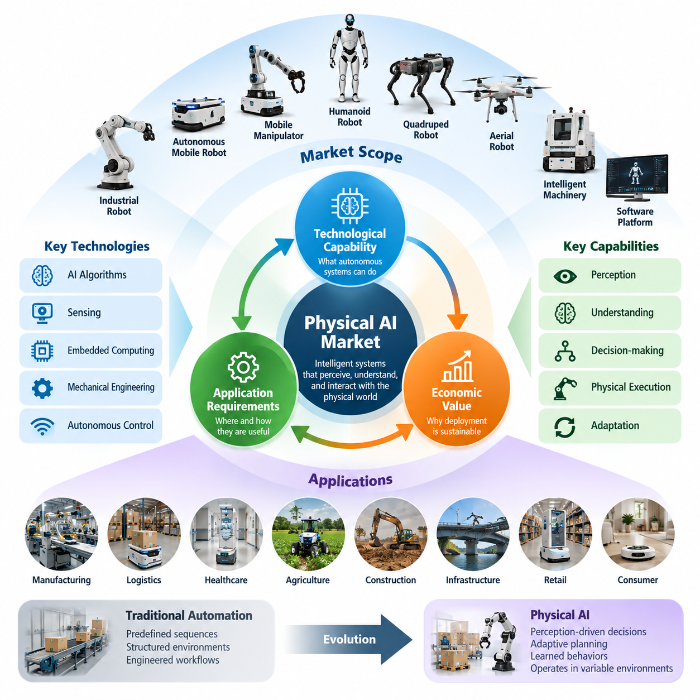{width="7.268055555555556in" height="7.268055555555556in"}

The Physical AI market encompasses the development, commercialization, deployment, and operation of intelligent systems capable of perceiving, understanding, and interacting with the physical world. Unlike conventional artificial intelligence markets centered on digital information processing, Physical AI creates economic value through autonomous movement, manipulation, inspection, transportation, and other actions performed within real environments.

Physical AI combines artificial intelligence, robotics, sensing technologies, embedded computing, mechanical engineering, and autonomous control into integrated operational systems. Its market boundaries extend beyond traditional industrial robots to include autonomous mobile robots, mobile manipulators, humanoid robots, quadrupeds, aerial robots, intelligent machinery, and software platforms that enable physical autonomy across different industries.

A defining characteristic of this market is the direct relationship between intelligent decision-making and physical execution. A Physical AI system must interpret environmental information, select appropriate actions, and execute those actions while respecting physical constraints. Consequently, commercial performance depends not only on algorithmic intelligence but also on mechanical capability, operational reliability, safety, energy efficiency, and environmental adaptability.

The market can be understood through three interconnected dimensions: technological capability, application requirements, and economic value creation. Technological capability determines what autonomous systems can accomplish, application requirements establish the conditions under which those capabilities are useful, and economic value determines whether deployment can be sustained commercially. Successful products must satisfy all three dimensions simultaneously.

Traditional automation generally operates through predefined sequences, structured environments, and carefully engineered workflows. Physical AI expands this model by introducing perception-driven decisions, adaptive planning, learned behaviors, and greater tolerance for environmental variation. The commercial distinction becomes particularly important when tasks involve changing objects, uncertain conditions, human interaction, or operational situations that cannot be completely programmed in advance.

However, Physical AI should not be defined simply as any machine containing an artificial intelligence algorithm. An AI-based inspection camera may provide valuable perception capabilities without independently performing physical actions. It becomes part of a broader Physical AI system when its outputs influence autonomous decisions and physical operations. This distinction helps separate enabling technologies from complete embodied systems while recognizing their economic interdependence.

The market includes both specialized autonomous systems and emerging general-purpose robotic platforms. Specialized systems perform relatively well-defined tasks such as warehouse transportation, industrial inspection, agricultural spraying, or automated material handling. General-purpose platforms seek to execute multiple tasks through adaptable hardware and reusable intelligence. These approaches differ in technical complexity, deployment readiness, customer expectations, and commercialization risk.

Autonomous mobile robots represent an important market category because transportation tasks are common across manufacturing, logistics, healthcare, and commercial facilities. Their value originates from reducing repetitive movement, improving material availability, and coordinating internal logistics. Advanced navigation, obstacle avoidance, fleet management, and integration with enterprise systems distinguish intelligent mobile operations from basic automated guided transportation.

Manipulators and mobile manipulators extend Physical AI from movement into physical interaction with objects. Their commercial applications include machine tending, picking, assembly, sorting, packaging, and laboratory automation. Combining mobility with manipulation introduces additional complexity involving object recognition, grasp planning, force control, and coordinated motion. Nevertheless, this combination can increase automation flexibility by allowing one platform to perform tasks across multiple workstations.

Humanoid robots constitute another market category, distinguished by their potential compatibility with environments originally designed for human workers. Their proposed applications include material handling, equipment operation, inspection, and selected service activities. Commercial feasibility depends on whether their versatility can compensate for the additional costs and technical challenges associated with balance, dexterity, power consumption, safety, and maintenance.

Quadruped robots and other field-oriented platforms address environments where conventional wheeled mobility may be insufficient. Industrial facilities, construction sites, agricultural terrain, and infrastructure corridors create opportunities for robots capable of negotiating irregular surfaces and obstacles. Their market value depends on terrain accessibility, sensing capability, inspection quality, payload capacity, endurance, and the operational cost of replacing or supporting human field activities.

Aerial robots extend the market into three-dimensional mobility, enabling inspection, surveying, mapping, monitoring, and selected logistics operations. Their commercial potential is shaped by payload limitations, flight endurance, environmental conditions, airspace regulations, and operational safety. Autonomous navigation and mission planning can improve productivity, but sustainable deployment also requires reliable ground infrastructure, maintenance procedures, and integration with customer workflows.

Physical AI also includes a substantial enabling technology market. Sensors, actuators, motor drives, batteries, embedded processors, communication modules, and mechanical components form the hardware foundation of intelligent machines. Their technical characteristics influence system cost, computational performance, accuracy, energy consumption, and durability. Component suppliers therefore participate in Physical AI commercialization even when they do not manufacture complete robotic products.

Software represents another major layer of the market, including perception systems, localization, mapping, motion planning, control, simulation, fleet orchestration, and operational monitoring. These capabilities may be delivered as embedded software, licensed modules, development platforms, or subscription services. Their economic significance increases when reusable software architectures reduce engineering effort across multiple robot models, customer sites, and application environments.

Robot foundation models, vision-language-action models, and learned control policies introduce an additional intelligence-oriented market segment. These technologies aim to improve task generalization, language-guided operation, and adaptation to unfamiliar situations. Their commercial value depends on demonstrated physical performance, efficient deployment, data requirements, safety validation, and compatibility with diverse robotic embodiments rather than model capability alone.

The Physical AI ecosystem also includes simulation platforms, digital twins, synthetic data generation, teleoperation systems, and data management infrastructure. These technologies support development, training, testing, and continuous improvement of autonomous behavior. Their importance arises from the difficulty and expense of collecting physical interaction data, especially for rare events, complex manipulation tasks, and safety-critical operating conditions.

System integrators and service providers occupy a critical position between technology suppliers and industrial customers. Physical AI products rarely operate independently of existing infrastructure, equipment, information systems, and workforce procedures. Integration services connect robots with manufacturing execution systems, warehouse management systems, enterprise resource planning platforms, and fleet management systems while adapting deployments to specific operational requirements.

Market demand is driven by several overlapping economic and operational pressures, including labor availability, productivity improvement, workplace safety, service continuity, and the need for flexible production. The relative importance of these factors varies by industry. A warehouse may prioritize throughput and operating hours, while a hospital may emphasize dependable delivery and staff assistance. An infrastructure operator may prioritize inspection coverage and reduced human exposure to hazardous locations.

Market adoption cannot be evaluated solely through robot shipment volumes or artificial intelligence investment. Installed systems, active deployments, utilization rates, recurring software revenue, service contracts, and customer retention provide complementary indicators. A robot purchased for experimentation does not represent the same commercial maturity as a platform operating continuously across multiple production facilities with measurable productivity improvements.

Economic evaluation requires consideration of the complete operating lifecycle. Acquisition cost represents only one component of total cost of ownership, alongside installation, integration, maintenance, energy, software licensing, supervision, infrastructure, and eventual replacement. Customers assess these expenses against labor savings, increased output, reduced downtime, improved quality, and other measurable benefits. Reliable financial performance ultimately determines whether pilot projects progress into larger deployments.

The Physical AI market is also characterized by significant differences in technological maturity. Structured industrial transportation and selected inspection applications can operate within established commercial frameworks, whereas highly dexterous general-purpose manipulation and broad household assistance remain more technically challenging. Market forecasts must therefore distinguish demonstrated operational capabilities from research achievements, prototype demonstrations, and anticipated future functionality.

Geographic and industrial differences further influence market development. Manufacturing concentration, labor economics, regulatory requirements, technology infrastructure, capital availability, and customer acceptance shape regional adoption. Industries with standardized processes and measurable automation benefits may adopt specialized solutions more readily, while highly variable environments require additional advances in perception, manipulation, reasoning, and operational robustness.

Competition occurs across several layers rather than within a single unified product category. Robot manufacturers compete through hardware performance and system reliability, software providers through intelligence and interoperability, and service organizations through deployment expertise and lifecycle support. Platform providers may seek competitive advantages through development ecosystems, reusable data infrastructure, integration partnerships, and continuous improvements generated from operational experience.

A practical market definition must therefore distinguish the direct market for autonomous physical systems from the broader ecosystem of enabling technologies and associated services. It must also avoid counting the same economic activity repeatedly across components, software, integration, and complete system sales. Clear segmentation by application, embodiment, autonomy level, customer industry, and revenue category enables more consistent market analysis.

Ultimately, Physical AI should be understood as an emerging industrial and technological market in which machine intelligence becomes economically valuable through reliable physical action. Its development will depend on the convergence of increasingly capable algorithms, affordable robotic hardware, scalable data infrastructure, and commercially sustainable operating models. The central measure of market progress is the ability to transform autonomous physical capabilities into repeatable, safe, and measurable industrial value.

피지컬 AI(Physical AI) 시장은 물리적 세계(Physical World)를 인식하고 이해하며 상호작용할 수 있는 지능형 시스템(Intelligent Systems)의 개발, 상용화, 배포 및 운영을 포괄한다. 디지털 정보 처리(Digital Information Processing)를 중심으로 형성된 기존 인공지능(Artificial Intelligence) 시장과 달리, 피지컬 AI는 실제 환경에서 수행되는 자율 이동(Autonomous Mobility), 조작(Manipulation), 검사(Inspection), 운송(Transportation) 및 다양한 물리적 행동(Physical Actions)을 통해 경제적 가치를 창출한다.

피지컬 AI는 인공지능(Artificial Intelligence), 로보틱스(Robotics), 센싱 기술(Sensing Technologies), 임베디드 컴퓨팅(Embedded Computing), 기계공학(Mechanical Engineering), 자율 제어(Autonomous Control)를 통합된 운영 시스템으로 결합한다. 시장의 범위는 기존 산업용 로봇(Industrial Robots)을 넘어 자율이동로봇(Autonomous Mobile Robots, AMR), 모바일 매니퓰레이터(Mobile Manipulators), 휴머노이드 로봇(Humanoid Robots), 사족보행 로봇(Quadruped Robots), 항공 로봇(Aerial Robots), 지능형 기계(Intelligent Machinery), 물리적 자율성을 지원하는 소프트웨어 플랫폼(Software Platforms)까지 확장된다.

이 시장의 핵심적인 특징은 지능형 의사결정(Intelligent Decision-Making)과 물리적 실행(Physical Execution) 사이의 직접적인 관계이다. 피지컬 AI 시스템은 환경 정보를 해석하고 적절한 행동을 선택하며, 물리적 제약조건(Physical Constraints)을 준수하면서 해당 행동을 실행해야 한다. 따라서 상업적 성능(Commercial Performance)은 알고리즘 지능(Algorithmic Intelligence)뿐만 아니라 기계적 능력(Mechanical Capability), 운영 신뢰성(Operational Reliability), 안전성(Safety), 에너지 효율(Energy Efficiency), 환경 적응성(Environmental Adaptability)에 의해서도 결정된다.

피지컬 AI 시장은 기술적 역량(Technological Capability), 응용 요구사항(Application Requirements), 경제적 가치 창출(Economic Value Creation)이라는 세 가지 상호 연결된 차원에서 이해할 수 있다. 기술적 역량은 자율 시스템이 수행할 수 있는 작업을 결정하고, 응용 요구사항은 이러한 역량이 유용하게 활용되는 조건을 정의하며, 경제적 가치는 해당 시스템의 지속 가능한 상용화 가능성을 결정한다. 성공적인 제품은 이 세 가지 차원을 동시에 충족해야 한다.

기존 자동화(Traditional Automation)는 일반적으로 사전에 정의된 작업 순서(Predefined Sequences), 구조화된 환경(Structured Environments), 정밀하게 설계된 작업 흐름(Engineered Workflows)을 기반으로 작동한다. 피지컬 AI는 인식 기반 의사결정(Perception-Driven Decision-Making), 적응형 계획(Adaptive Planning), 학습된 행동(Learned Behaviors), 환경 변화에 대한 대응 능력을 도입하여 이러한 자동화 모델을 확장한다. 특히 작업 대상이나 주변 환경이 지속적으로 변화하고 모든 상황을 사전에 프로그래밍하기 어려운 경우 이러한 차이가 중요해진다.

그러나 피지컬 AI를 단순히 인공지능 알고리즘(AI Algorithm)이 포함된 모든 기계로 정의해서는 안 된다. 인공지능 기반 검사 카메라(AI-Based Inspection Camera)는 독립적인 물리적 행동을 수행하지 않더라도 유용한 인식 기능을 제공할 수 있다. 이러한 인식 결과가 자율적인 의사결정과 물리적 작업에 영향을 미칠 때 더 넓은 피지컬 AI 시스템의 일부가 된다. 이러한 구분은 지원 기술(Enabling Technologies)과 완전한 체화형 시스템(Embodied Systems)을 구별하면서도 경제적 상호의존성을 인정하는 데 도움이 된다.

피지컬 AI 시장에는 특수 목적 자율 시스템(Specialized Autonomous Systems)과 새롭게 등장하는 범용 로봇 플랫폼(General-Purpose Robotic Platforms)이 모두 포함된다. 특수 목적 시스템은 창고 운송, 산업 검사, 농업용 살포, 자동 자재 취급 등 비교적 명확하게 정의된 작업을 수행한다. 반면 범용 플랫폼은 적응 가능한 하드웨어(Adaptable Hardware)와 재사용 가능한 지능(Reusable Intelligence)을 통해 여러 작업을 수행하는 것을 목표로 한다. 두 접근 방식은 기술적 복잡성, 배포 준비 수준, 고객 기대 및 상용화 위험 측면에서 차이를 보인다.

자율이동로봇(Autonomous Mobile Robots, AMR)은 제조, 물류, 의료 및 상업 시설에서 운송 작업이 광범위하게 발생하기 때문에 중요한 시장 분야를 형성한다. 이들의 가치는 반복적인 이동 작업 감소, 자재 공급 효율 향상, 내부 물류 조정에서 발생한다. 고급 자율주행(Advanced Autonomous Navigation), 장애물 회피(Obstacle Avoidance), 군집 관리(Fleet Management), 기업 시스템 통합(Enterprise System Integration)은 지능형 이동 작업을 기본적인 무인 운송(Automated Guided Transportation)과 구별하는 핵심 요소이다.

매니퓰레이터(Manipulators)와 모바일 매니퓰레이터(Mobile Manipulators)는 피지컬 AI의 적용 범위를 이동에서 물체와의 물리적 상호작용(Physical Interaction)으로 확장한다. 주요 상업적 응용 분야에는 기계 투입 및 배출(Machine Tending), 피킹(Picking), 조립(Assembly), 분류(Sorting), 포장(Packaging), 실험실 자동화(Laboratory Automation)가 포함된다. 이동성과 조작 기능의 결합은 물체 인식(Object Recognition), 파지 계획(Grasp Planning), 힘 제어(Force Control), 협조 운동(Coordinated Motion)과 관련된 복잡성을 증가시키지만, 하나의 플랫폼이 여러 작업장에서 다양한 작업을 수행하도록 하여 자동화 유연성을 향상시킬 수 있다.

휴머노이드 로봇(Humanoid Robots)은 인간 작업자를 중심으로 설계된 환경과의 잠재적인 호환성(Human Environment Compatibility)을 특징으로 하는 또 다른 시장 분야이다. 예상되는 응용 분야에는 자재 취급(Material Handling), 장비 조작(Equipment Operation), 검사(Inspection), 일부 서비스 작업(Service Activities)이 포함된다. 상업적 실현 가능성(Commercial Feasibility)은 범용성이 균형 제어(Balance Control), 정교한 조작(Dexterity), 전력 소비(Power Consumption), 안전성 및 유지보수와 관련된 추가 비용과 기술적 어려움을 상쇄할 수 있는지에 달려 있다.

사족보행 로봇(Quadruped Robots)과 기타 현장 작업용 플랫폼(Field-Oriented Platforms)은 기존 바퀴 기반 이동(Wheeled Mobility) 방식으로 접근하기 어려운 환경을 대상으로 한다. 산업 시설, 건설 현장, 농업 지형, 사회기반시설 통로(Infrastructure Corridors)는 불규칙한 지면과 장애물을 통과할 수 있는 로봇에 새로운 기회를 제공한다. 이들의 시장 가치는 지형 접근성(Terrain Accessibility), 센싱 성능(Sensing Capability), 검사 품질(Inspection Quality), 적재 능력(Payload Capacity), 운용 지속시간(Endurance), 인간의 현장 작업을 대체하거나 지원하는 데 필요한 운영 비용에 의해 결정된다.

항공 로봇(Aerial Robots)은 시장을 3차원 이동성(Three-Dimensional Mobility) 영역으로 확장하여 검사, 측량(Surveying), 지도 작성(Mapping), 모니터링(Monitoring), 일부 물류 작업을 가능하게 한다. 상업적 잠재력은 적재 중량 제한(Payload Limitations), 비행 지속시간(Flight Endurance), 환경 조건(Environmental Conditions), 공역 규제(Airspace Regulations), 운영 안전성(Operational Safety)에 의해 영향을 받는다. 자율항법(Autonomous Navigation)과 임무 계획(Mission Planning)은 생산성을 향상시킬 수 있지만, 지속 가능한 운영을 위해서는 지상 인프라(Ground Infrastructure), 유지보수 절차 및 고객 업무 시스템과의 통합도 필요하다.

피지컬 AI에는 상당한 규모의 기반 기술 시장(Enabling Technology Market)도 포함된다. 센서(Sensors), 액추에이터(Actuators), 모터 드라이브(Motor Drives), 배터리(Batteries), 임베디드 프로세서(Embedded Processors), 통신 모듈(Communication Modules), 기계 부품(Mechanical Components)은 지능형 기계의 하드웨어 기반을 구성한다. 이러한 구성요소의 기술적 특성은 시스템 비용, 연산 성능, 정확도, 에너지 소비 및 내구성에 영향을 미친다. 따라서 부품 공급업체도 완성형 로봇을 직접 제조하지 않더라도 피지컬 AI 상용화 생태계에 참여한다.

소프트웨어(Software)는 인식 시스템(Perception Systems), 위치 추정(Localization), 지도 작성(Mapping), 동작 계획(Motion Planning), 제어(Control), 시뮬레이션(Simulation), 군집 운영 조정(Fleet Orchestration), 운영 모니터링(Operational Monitoring)을 포함하는 또 다른 주요 시장 계층이다. 이러한 기능은 임베디드 소프트웨어(Embedded Software), 라이선스 모듈(Licensed Modules), 개발 플랫폼(Development Platforms), 구독형 서비스(Subscription Services) 형태로 제공될 수 있다. 재사용 가능한 소프트웨어 아키텍처(Reusable Software Architectures)가 여러 로봇 모델과 고객 현장에서 엔지니어링 부담을 줄일수록 경제적 중요성이 증가한다.

로봇 파운데이션 모델(Robot Foundation Models), 비전-언어-행동 모델(Vision-Language-Action Models, VLA), 학습 기반 제어 정책(Learned Control Policies)은 지능 중심의 새로운 시장 분야를 형성한다. 이러한 기술은 작업 일반화(Task Generalization), 언어 기반 작업 수행(Language-Guided Operation), 익숙하지 않은 상황에 대한 적응 능력 향상을 목표로 한다. 상업적 가치는 모델 자체의 성능뿐만 아니라 실제 물리적 작업 성능, 효율적인 배포, 데이터 요구사항, 안전성 검증(Safety Validation), 다양한 로봇 형태와의 호환성(Cross-Embodiment Compatibility)에 의해 결정된다.

피지컬 AI 생태계에는 시뮬레이션 플랫폼(Simulation Platforms), 디지털 트윈(Digital Twins), 합성 데이터 생성(Synthetic Data Generation), 원격조작 시스템(Teleoperation Systems), 데이터 관리 인프라(Data Management Infrastructure)도 포함된다. 이러한 기술은 자율 행동(Autonomous Behavior)의 개발, 학습, 시험 및 지속적인 개선을 지원한다. 특히 드문 사건(Rare Events), 복잡한 조작 작업(Complex Manipulation Tasks), 안전 필수 운영(Safety-Critical Operations)에 필요한 물리적 상호작용 데이터를 수집하는 데 많은 비용과 어려움이 발생하기 때문에 중요성이 높아진다.

시스템 통합업체(System Integrators)와 서비스 제공업체(Service Providers)는 기술 공급업체와 산업 고객 사이에서 핵심적인 역할을 수행한다. 피지컬 AI 제품은 기존 인프라, 장비, 정보 시스템 및 인력 운영 절차와 독립적으로 작동하기 어렵다. 시스템 통합 서비스(System Integration Services)는 로봇을 제조실행시스템(Manufacturing Execution Systems, MES), 창고관리시스템(Warehouse Management Systems, WMS), 전사적자원관리(Enterprise Resource Planning, ERP), 군집관리시스템(Fleet Management Systems, FMS)과 연결하고 고객별 운영 요구사항에 맞게 배포 환경을 조정한다.

시장 수요(Market Demand)는 노동력 확보(Labor Availability), 생산성 향상(Productivity Improvement), 작업장 안전(Workplace Safety), 서비스 연속성(Service Continuity), 유연한 생산(Flexible Production) 등 여러 경제적·운영적 요인에 의해 형성된다. 이러한 요인의 상대적 중요성은 산업마다 다르다. 창고에서는 처리량(Throughput)과 운영시간(Operating Hours)을 우선할 수 있지만, 병원에서는 안정적인 물품 배송과 의료진 지원을 중시할 수 있다. 사회기반시설 운영자는 검사 범위(Inspection Coverage)와 위험 지역에서의 인간 작업 감소를 우선할 수 있다.

시장 도입 수준(Market Adoption)은 로봇 출하량(Robot Shipment Volumes)이나 인공지능 투자액(AI Investment)만으로 평가할 수 없다. 설치 시스템(Installed Systems), 실제 운영 배포(Active Deployments), 가동률(Utilization Rates), 반복 소프트웨어 매출(Recurring Software Revenue), 서비스 계약(Service Contracts), 고객 유지율(Customer Retention) 등도 중요한 지표이다. 실험 목적으로 구매한 로봇은 여러 생산 시설에서 지속적으로 운영되며 측정 가능한 생산성 향상을 제공하는 플랫폼과 동일한 상업적 성숙도(Commercial Maturity)를 나타내지 않는다.

경제성 평가(Economic Evaluation)에서는 전체 운영 수명주기(Operating Lifecycle)를 고려해야 한다. 초기 구매 비용(Acquisition Cost)은 총소유비용(Total Cost of Ownership, TCO)의 일부에 불과하며, 설치, 시스템 통합, 유지보수, 에너지, 소프트웨어 라이선스, 운영 감독, 인프라 및 최종 교체 비용도 포함된다. 고객은 이러한 비용을 인건비 절감(Labor Savings), 생산량 증가(Increased Output), 가동 중단 감소(Reduced Downtime), 품질 향상(Quality Improvement) 및 기타 측정 가능한 편익과 비교한다. 궁극적으로 안정적인 재무 성과(Financial Performance)가 시범사업(Pilot Projects)의 대규모 확산 여부를 결정한다.

피지컬 AI 시장은 기술적 성숙도(Technological Maturity)에 상당한 차이가 있다는 특징도 가진다. 구조화된 산업 운송(Structured Industrial Transportation)과 일부 검사 응용 분야는 이미 확립된 상업적 체계에서 운영될 수 있지만, 고도의 정교한 범용 조작(General-Purpose Manipulation)과 광범위한 가정 지원(Household Assistance)은 여전히 더 큰 기술적 어려움을 가진다. 따라서 시장 전망(Market Forecasts)은 실제 운영으로 입증된 역량(Demonstrated Operational Capabilities)과 연구 성과, 시제품 시연(Prototype Demonstrations), 미래에 예상되는 기능을 명확하게 구분해야 한다.

지역별·산업별 차이(Geographic and Industrial Differences)도 시장 발전에 영향을 미친다. 제조업 집중도(Manufacturing Concentration), 노동 경제성(Labor Economics), 규제 요구사항(Regulatory Requirements), 기술 인프라(Technology Infrastructure), 자본 접근성(Capital Availability), 고객 수용성(Customer Acceptance)은 지역별 도입 양상을 형성한다. 표준화된 공정(Standardized Processes)과 측정 가능한 자동화 편익을 가진 산업은 특수 목적 솔루션을 상대적으로 쉽게 도입할 수 있지만, 변화가 심한 환경에서는 인식, 조작, 추론 및 운영 강건성(Operational Robustness)의 추가적인 발전이 필요하다.

경쟁(Competition)은 단일 제품 분야가 아니라 여러 시장 계층에서 발생한다. 로봇 제조업체(Robot Manufacturers)는 하드웨어 성능과 시스템 신뢰성(System Reliability)을 중심으로 경쟁하고, 소프트웨어 제공업체(Software Providers)는 지능과 상호운용성(Interoperability)을 중심으로 경쟁하며, 서비스 조직(Service Organizations)은 배포 전문성과 수명주기 지원(Lifecycle Support)을 중심으로 경쟁한다. 플랫폼 제공업체(Platform Providers)는 개발 생태계(Development Ecosystems), 재사용 가능한 데이터 인프라, 통합 파트너십, 운영 경험을 통해 축적되는 지속적인 개선을 경쟁우위(Competitive Advantage)로 확보하려 한다.

실용적인 시장 정의(Practical Market Definition)를 위해서는 자율 물리 시스템(Autonomous Physical Systems)의 직접 시장과 기반 기술 및 관련 서비스로 구성된 광범위한 생태계를 구분해야 한다. 또한 부품, 소프트웨어, 시스템 통합, 완성형 시스템 판매 과정에서 동일한 경제적 활동이 반복 계산되는 이중계산(Double Counting)을 방지해야 한다. 응용 분야(Application), 로봇 형태(Embodiment), 자율성 수준(Autonomy Level), 고객 산업(Customer Industry), 매출 유형(Revenue Category)에 따른 명확한 시장 세분화(Market Segmentation)는 일관성 있는 시장 분석을 가능하게 한다.

궁극적으로 피지컬 AI는 기계 지능(Machine Intelligence)이 신뢰할 수 있는 물리적 행동(Reliable Physical Action)을 통해 경제적 가치를 창출하는 새로운 산업·기술 시장으로 이해해야 한다. 시장 발전은 고도화되는 알고리즘(Algorithms), 경제적인 로봇 하드웨어(Affordable Robotic Hardware), 확장 가능한 데이터 인프라(Scalable Data Infrastructure), 상업적으로 지속 가능한 운영 모델(Sustainable Operating Models)의 융합에 달려 있다. 시장 발전을 판단하는 핵심 기준은 자율적인 물리적 역량을 반복 가능하고 안전하며 측정 가능한 산업적 가치(Industrial Value)로 전환하는 능력이다.

##  

## 01.02. Robotics AI and Automation Value Chains

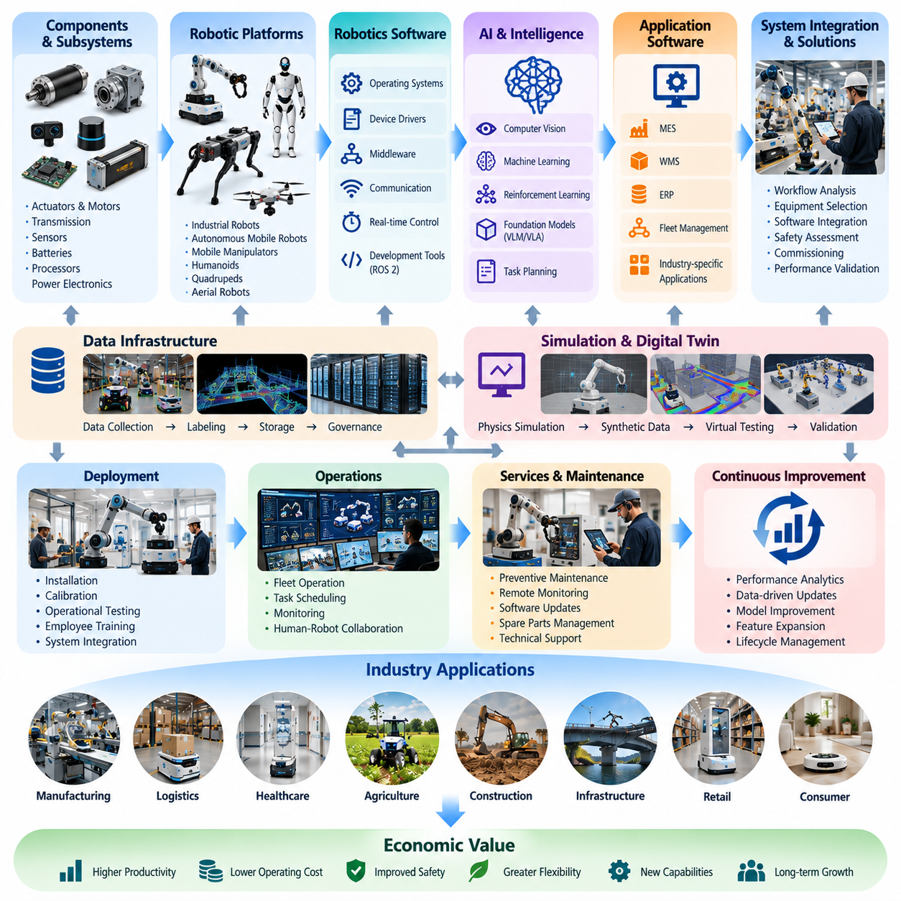{width="7.268055555555556in" height="7.268055555555556in"}

The Physical AI value chain connects robotics hardware, artificial intelligence, automation software, system integration, and operational services into a coordinated industrial ecosystem. Unlike conventional technology markets, where value may be delivered through standalone digital products, Physical AI requires multiple technological layers to function together. Economic value emerges when these layers enable reliable autonomous actions within real operational environments.

The value chain begins with foundational components, including mechanical structures, actuators, motors, transmissions, sensors, batteries, and embedded processors. These elements establish the physical capabilities and operating limits of robotic systems. Their performance influences payload capacity, positioning accuracy, mobility, energy efficiency, and durability, making component engineering an essential foundation for commercial Physical AI products.

Hardware suppliers contribute through specialized technologies that support sensing, computation, movement, and physical interaction. Cameras, LiDAR sensors, inertial measurement units, force sensors, and tactile sensors provide information about the surrounding environment. Motor controllers, power electronics, and communication interfaces translate computational decisions into physical actions while maintaining the responsiveness required for autonomous operation.

The next layer consists of robotic platforms that integrate mechanical components, electronics, embedded software, and control systems into functional machines. These platforms include autonomous mobile robots, manipulators, mobile manipulators, humanoids, quadrupeds, and aerial robots. Platform manufacturers must balance hardware capability, production cost, reliability, maintainability, and compatibility with higher-level intelligence software.

Robotics software provides the computational infrastructure required to operate physical platforms. Operating systems, device drivers, middleware, communication protocols, and real-time controllers coordinate sensors, actuators, and computing resources. Frameworks such as ROS 2 support modular software development and interoperability, although commercial deployments also require additional engineering for deterministic performance, cybersecurity, and functional safety.

Artificial intelligence introduces adaptive capabilities beyond conventional programmed automation. Computer vision, machine learning, reinforcement learning, and multimodal perception allow robots to interpret complex environments and respond to changing conditions. These technologies transform sensor measurements into meaningful representations of objects, locations, human activities, and operational situations that support autonomous decision-making.

Advanced intelligence platforms increasingly incorporate foundation models, vision-language models, and vision-language-action architectures. These models seek to connect natural language instructions, visual observations, and robotic actions within reusable learning frameworks. Their position in the value chain depends on whether they can deliver dependable task execution, generalization, and adaptation across different robotic embodiments and operating environments.

Data infrastructure forms another essential part of the Physical AI value chain. Robot operation generates sensor recordings, action trajectories, environmental observations, task outcomes, and failure information. Data collection, labeling, filtering, storage, and governance transform these records into resources for model development. High-quality datasets support improved perception, planning, control, and continuous adaptation of deployed systems.

Simulation and digital twin technologies connect algorithm development with physical deployment. Physics simulation, synthetic data generation, and virtual testing environments allow developers to evaluate robotic behavior before exposing equipment to real-world risks. These tools can reduce development costs and accelerate experimentation, although differences between simulated and actual environments require careful validation and adaptation.

Automation software connects robotic intelligence to industrial workflows. Manufacturing execution systems, warehouse management systems, enterprise resource planning platforms, and fleet management systems coordinate operational information and production requirements. Integration with these systems enables autonomous robots to receive assignments, report task completion, manage resources, and participate in broader organizational processes rather than functioning as isolated machines.

System integrators translate available technologies into customer-specific operational solutions. Their responsibilities include workflow analysis, equipment selection, facility preparation, software integration, safety assessment, commissioning, and performance validation. Because industrial environments vary significantly, integration expertise often determines whether technically capable robots can achieve reliable operation and measurable economic benefits.

Application developers occupy an important position between general-purpose robotic technology and industry-specific requirements. They configure perception, navigation, manipulation, and task planning capabilities for manufacturing, logistics, healthcare, agriculture, construction, and commercial services. Application specialization creates value by translating reusable technological capabilities into solutions that address identifiable customer problems.

The deployment layer includes installation, calibration, operational testing, employee training, and integration with existing equipment. Physical AI systems must function under actual environmental conditions involving obstacles, human movement, network limitations, and operational variability. Successful deployment requires more than demonstrating autonomous behavior; it requires predictable performance, safe operation, and compatibility with established production procedures.

Operational services extend the value chain beyond initial equipment delivery. Preventive maintenance, remote monitoring, technical support, software updates, fleet optimization, and replacement components contribute to long-term system availability. Service providers may generate recurring revenue while helping customers maintain productivity and reduce operational uncertainty throughout the equipment lifecycle.

Robot-as-a-Service business models connect technology ownership with ongoing operational performance. Under these arrangements, providers may retain responsibility for equipment availability, maintenance, software, and selected operating services. Customers obtain robotic capabilities through recurring payments rather than relying entirely on upfront capital investment. Commercial sustainability depends on utilization, service costs, reliability, contract structure, and the allocation of operational risks.

Value creation differs across the layers of the ecosystem. Component manufacturers capture value through hardware sales and technical differentiation, while software providers may monetize licenses, subscriptions, and development platforms. System integrators generate revenue through engineering projects, and service organizations capture lifecycle income. Platform manufacturers may combine several revenue streams depending on their degree of vertical integration.

Vertical integration occurs when one organization develops or controls multiple stages of the value chain, including hardware, artificial intelligence, software, deployment, and services. This approach can improve system optimization, product differentiation, and accountability for performance. However, it also increases capital requirements, engineering complexity, manufacturing responsibilities, and exposure to operational risks.

Horizontal specialization provides an alternative structure in which companies concentrate on particular technologies or services across multiple robotic platforms. Examples include sensor suppliers, actuator manufacturers, AI model developers, simulation providers, and fleet management software companies. Specialization can improve economies of scale and technological depth, but commercial success depends on interoperability, customer access, and sustainable competitive differentiation.

Open architectures and standardized interfaces influence how value is distributed throughout the ecosystem. Modular hardware, common communication protocols, reusable software components, and standardized data formats can reduce integration costs and supplier dependence. At the same time, proprietary technologies may offer performance advantages or differentiated functionality, creating strategic tradeoffs between openness, control, compatibility, and competitive positioning.

The value chain also contains important feedback mechanisms connecting deployed robots with research and product development. Operational data reveals failure modes, environmental variation, maintenance requirements, and opportunities for improved automation. When this information is systematically collected and incorporated into development processes, deployed systems become sources of continuous technological improvement rather than static products.

Economic performance must be evaluated across the complete value chain rather than at the level of individual components. Lower hardware prices do not necessarily produce lower operating costs if integration, maintenance, or supervision requirements remain high. Conversely, more expensive intelligent systems may deliver superior economic value when improved reliability, autonomy, and utilization reduce total cost of ownership and increase productive output.

The structure of the Physical AI value chain will continue evolving as intelligence becomes more reusable, hardware platforms become more standardized, and deployment services become more scalable. Competitive advantages may shift among component suppliers, platform manufacturers, AI developers, integrators, and service providers. Understanding these relationships is essential for identifying profitable market positions and building sustainable Physical AI businesses.

피지컬 AI(Physical AI) 가치사슬(Value Chain)은 로봇 하드웨어(Robotics Hardware), 인공지능(Artificial Intelligence), 자동화 소프트웨어(Automation Software), 시스템 통합(System Integration), 운영 서비스(Operational Services)를 하나의 조정된 산업 생태계(Industrial Ecosystem)로 연결한다. 독립적인 디지털 제품(Standalone Digital Products)을 통해 가치를 제공할 수 있는 기존 기술 시장과 달리, 피지컬 AI는 여러 기술 계층(Technological Layers)이 함께 작동해야 한다. 이러한 계층들이 실제 운영 환경에서 신뢰할 수 있는 자율 행동(Autonomous Actions)을 가능하게 할 때 경제적 가치(Economic Value)가 창출된다.

가치사슬은 기계 구조물(Mechanical Structures), 액추에이터(Actuators), 모터(Motors), 동력전달장치(Transmissions), 센서(Sensors), 배터리(Batteries), 임베디드 프로세서(Embedded Processors) 등 기초 구성요소(Foundational Components)에서 시작된다. 이러한 요소들은 로봇 시스템의 물리적 성능(Physical Capabilities)과 운영 한계(Operating Limits)를 결정한다. 구성요소의 성능은 적재 능력(Payload Capacity), 위치 정확도(Positioning Accuracy), 이동성(Mobility), 에너지 효율(Energy Efficiency), 내구성(Durability)에 영향을 미치므로 부품 엔지니어링(Component Engineering)은 상용 피지컬 AI 제품의 필수적인 기반이 된다.

하드웨어 공급업체(Hardware Suppliers)는 센싱(Sensing), 연산(Computation), 이동(Movement), 물리적 상호작용(Physical Interaction)을 지원하는 전문 기술을 제공한다. 카메라(Cameras), 라이다(LiDAR), 관성측정장치(Inertial Measurement Units, IMU), 힘 센서(Force Sensors), 촉각 센서(Tactile Sensors)는 주변 환경에 대한 정보를 제공한다. 모터 제어기(Motor Controllers), 전력전자장치(Power Electronics), 통신 인터페이스(Communication Interfaces)는 자율 운영에 필요한 응답성을 유지하면서 연산 결과를 물리적 행동으로 변환한다.

다음 계층은 기계 부품, 전자장치(Electronics), 임베디드 소프트웨어(Embedded Software), 제어 시스템(Control Systems)을 통합하여 실제 작동하는 기계를 구현하는 로봇 플랫폼(Robotic Platforms)으로 구성된다. 이러한 플랫폼에는 자율이동로봇(Autonomous Mobile Robots, AMR), 매니퓰레이터(Manipulators), 모바일 매니퓰레이터(Mobile Manipulators), 휴머노이드(Humanoids), 사족보행 로봇(Quadrupeds), 항공 로봇(Aerial Robots)이 포함된다. 플랫폼 제조업체는 하드웨어 성능, 생산 비용, 신뢰성, 유지보수성(Maintainability), 상위 지능 소프트웨어(Higher-Level Intelligence Software)와의 호환성을 균형 있게 고려해야 한다.

로봇 소프트웨어(Robotics Software)는 물리적 플랫폼을 운영하는 데 필요한 컴퓨팅 인프라(Computational Infrastructure)를 제공한다. 운영체제(Operating Systems), 장치 드라이버(Device Drivers), 미들웨어(Middleware), 통신 프로토콜(Communication Protocols), 실시간 제어기(Real-Time Controllers)는 센서, 액추에이터 및 컴퓨팅 자원을 조정한다. ROS 2와 같은 프레임워크(Frameworks)는 모듈형 소프트웨어 개발(Modular Software Development)과 상호운용성(Interoperability)을 지원하지만, 상용 배포에는 결정론적 성능(Deterministic Performance), 사이버보안(Cybersecurity), 기능 안전(Functional Safety)을 위한 추가 엔지니어링이 필요하다.

인공지능(Artificial Intelligence)은 기존의 프로그래밍 기반 자동화(Programmed Automation)를 넘어서는 적응형 기능(Adaptive Capabilities)을 제공한다. 컴퓨터 비전(Computer Vision), 기계학습(Machine Learning), 강화학습(Reinforcement Learning), 다중모달 인식(Multimodal Perception)은 로봇이 복잡한 환경을 해석하고 변화하는 조건에 대응하도록 한다. 이러한 기술은 센서 측정값을 물체, 위치, 인간 활동 및 운영 상황에 대한 의미 있는 표현(Meaningful Representations)으로 변환하여 자율 의사결정(Autonomous Decision-Making)을 지원한다.

고급 지능 플랫폼(Advanced Intelligence Platforms)은 점차 파운데이션 모델(Foundation Models), 비전-언어 모델(Vision-Language Models), 비전-언어-행동 아키텍처(Vision-Language-Action Architectures)를 통합하고 있다. 이러한 모델은 자연어 명령(Natural Language Instructions), 시각적 관측(Visual Observations), 로봇 행동(Robotic Actions)을 재사용 가능한 학습 프레임워크(Reusable Learning Frameworks) 안에서 연결하는 것을 목표로 한다. 가치사슬에서 이들의 위치는 다양한 로봇 형태(Robotic Embodiments)와 운영 환경에서 신뢰할 수 있는 작업 수행(Task Execution), 일반화(Generalization), 적응(Adaptation)을 제공할 수 있는지에 따라 결정된다.

데이터 인프라(Data Infrastructure)는 피지컬 AI 가치사슬의 또 다른 필수 요소이다. 로봇 운영 과정에서는 센서 기록(Sensor Recordings), 행동 궤적(Action Trajectories), 환경 관측(Environmental Observations), 작업 결과(Task Outcomes), 실패 정보(Failure Information)가 생성된다. 데이터 수집(Data Collection), 라벨링(Labeling), 필터링(Filtering), 저장(Storage), 거버넌스(Governance)는 이러한 기록을 모델 개발(Model Development)에 활용할 수 있는 자원으로 변환한다. 고품질 데이터셋(High-Quality Datasets)은 인식, 계획, 제어 및 배포된 시스템의 지속적인 적응 능력 향상을 지원한다.

시뮬레이션(Simulation)과 디지털 트윈(Digital Twin) 기술은 알고리즘 개발(Algorithm Development)과 실제 물리적 배포(Physical Deployment)를 연결한다. 물리 시뮬레이션(Physics Simulation), 합성 데이터 생성(Synthetic Data Generation), 가상 시험 환경(Virtual Testing Environments)은 실제 장비를 위험에 노출시키기 전에 개발자가 로봇 행동을 평가할 수 있도록 한다. 이러한 도구는 개발 비용(Development Costs)을 줄이고 실험 속도를 높일 수 있지만, 시뮬레이션 환경과 실제 환경 사이의 차이에 대해서는 신중한 검증(Validation)과 적응(Adaptation)이 필요하다.

자동화 소프트웨어(Automation Software)는 로봇 지능(Robotic Intelligence)을 산업 작업 흐름(Industrial Workflows)과 연결한다. 제조실행시스템(Manufacturing Execution Systems, MES), 창고관리시스템(Warehouse Management Systems, WMS), 전사적자원관리(Enterprise Resource Planning, ERP), 군집관리시스템(Fleet Management Systems, FMS)은 운영 정보와 생산 요구사항을 조정한다. 이러한 시스템과의 통합을 통해 자율 로봇은 작업 지시를 수신하고, 작업 완료를 보고하며, 자원을 관리하고, 독립적인 기계가 아니라 조직 전체의 운영 프로세스에 참여할 수 있다.

시스템 통합업체(System Integrators)는 사용 가능한 기술을 고객별 운영 솔루션(Customer-Specific Operational Solutions)으로 전환한다. 주요 업무에는 작업 흐름 분석(Workflow Analysis), 장비 선정(Equipment Selection), 시설 준비(Facility Preparation), 소프트웨어 통합(Software Integration), 안전성 평가(Safety Assessment), 시운전(Commissioning), 성능 검증(Performance Validation)이 포함된다. 산업 환경은 매우 다양하므로 시스템 통합 전문성(Integration Expertise)은 기술적으로 우수한 로봇이 안정적으로 운영되고 측정 가능한 경제적 효과를 달성할 수 있는지를 결정하는 중요한 요소가 된다.

응용 개발업체(Application Developers)는 범용 로봇 기술(General-Purpose Robotic Technology)과 산업별 요구사항(Industry-Specific Requirements) 사이에서 중요한 역할을 수행한다. 이들은 제조, 물류, 의료, 농업, 건설 및 상업 서비스에 적합하도록 인식(Perception), 자율주행(Navigation), 조작(Manipulation), 작업 계획(Task Planning) 기능을 구성한다. 응용 분야별 전문화(Application Specialization)는 재사용 가능한 기술적 역량을 구체적인 고객 문제를 해결하는 솔루션으로 전환함으로써 가치를 창출한다.

배포 계층(Deployment Layer)에는 설치(Installation), 보정(Calibration), 운영 시험(Operational Testing), 직원 교육(Employee Training), 기존 장비와의 통합(Equipment Integration)이 포함된다. 피지컬 AI 시스템은 장애물, 사람의 이동, 네트워크 제약(Network Limitations), 운영 환경의 변동성(Operational Variability)이 존재하는 실제 조건에서 작동해야 한다. 성공적인 배포에는 단순히 자율 행동을 시연하는 것 이상의 역량이 필요하며, 예측 가능한 성능(Predictable Performance), 안전한 운영(Safe Operation), 기존 생산 절차와의 호환성(Compatibility)이 확보되어야 한다.

운영 서비스(Operational Services)는 초기 장비 공급 이후까지 가치사슬을 확장한다. 예방 정비(Preventive Maintenance), 원격 모니터링(Remote Monitoring), 기술 지원(Technical Support), 소프트웨어 업데이트(Software Updates), 군집 최적화(Fleet Optimization), 교체 부품(Replacement Components)은 장기적인 시스템 가용성(System Availability)에 기여한다. 서비스 제공업체는 반복 매출(Recurring Revenue)을 창출하는 동시에 고객이 장비 수명주기(Equipment Lifecycle) 전반에 걸쳐 생산성을 유지하고 운영 불확실성(Operational Uncertainty)을 줄이도록 지원할 수 있다.

서비스형 로봇(Robot-as-a-Service, RaaS) 비즈니스 모델(Business Models)은 기술 소유권(Technology Ownership)과 지속적인 운영 성과(Operational Performance)를 연결한다. 이러한 계약에서 제공업체는 장비 가용성(Equipment Availability), 유지보수(Maintenance), 소프트웨어 및 일부 운영 서비스에 대한 책임을 유지할 수 있다. 고객은 초기 설비투자(Upfront Capital Investment)에 전적으로 의존하는 대신 정기적인 비용을 지불하고 로봇 기능을 이용한다. 상업적 지속 가능성(Commercial Sustainability)은 가동률(Utilization), 서비스 비용(Service Costs), 신뢰성(Reliability), 계약 구조(Contract Structure), 운영 위험의 배분(Allocation of Operational Risks)에 따라 결정된다.

가치 창출(Value Creation)은 생태계의 각 계층에서 서로 다른 방식으로 발생한다. 부품 제조업체(Component Manufacturers)는 하드웨어 판매(Hardware Sales)와 기술적 차별화(Technical Differentiation)를 통해 가치를 확보하며, 소프트웨어 제공업체(Software Providers)는 라이선스(Licenses), 구독(Subscriptions), 개발 플랫폼(Development Platforms)을 통해 수익을 창출할 수 있다. 시스템 통합업체는 엔지니어링 프로젝트(Engineering Projects)를 통해 매출을 발생시키고, 서비스 조직(Service Organizations)은 장비 수명주기 전반에서 수익을 확보한다. 플랫폼 제조업체(Platform Manufacturers)는 수직 통합(Vertical Integration) 수준에 따라 여러 매출원을 결합할 수 있다.

수직 통합(Vertical Integration)은 하나의 기업이 하드웨어, 인공지능, 소프트웨어, 배포 및 서비스를 포함한 가치사슬의 여러 단계를 개발하거나 통제하는 경우에 발생한다. 이러한 접근 방식은 시스템 최적화(System Optimization), 제품 차별화(Product Differentiation), 성능에 대한 책임성(Accountability)을 향상시킬 수 있다. 그러나 동시에 자본 요구사항(Capital Requirements), 엔지니어링 복잡성(Engineering Complexity), 제조 책임(Manufacturing Responsibilities), 운영 위험(Operational Risks)에 대한 노출도 증가시킨다.

수평적 전문화(Horizontal Specialization)는 기업이 여러 로봇 플랫폼에 공통으로 적용할 수 있는 특정 기술이나 서비스에 집중하는 대안적인 구조이다. 대표적인 사례로 센서 공급업체(Sensor Suppliers), 액추에이터 제조업체(Actuator Manufacturers), 인공지능 모델 개발업체(AI Model Developers), 시뮬레이션 제공업체(Simulation Providers), 군집관리 소프트웨어 기업(Fleet Management Software Companies)이 있다. 전문화는 규모의 경제(Economies of Scale)와 기술적 전문성(Technological Depth)을 높일 수 있지만, 상업적 성공은 상호운용성(Interoperability), 고객 접근성(Customer Access), 지속 가능한 경쟁 차별화(Competitive Differentiation)에 달려 있다.

개방형 아키텍처(Open Architectures)와 표준화된 인터페이스(Standardized Interfaces)는 생태계 전반에서 가치가 분배되는 방식에 영향을 미친다. 모듈형 하드웨어(Modular Hardware), 공통 통신 프로토콜(Common Communication Protocols), 재사용 가능한 소프트웨어 구성요소(Reusable Software Components), 표준화된 데이터 형식(Standardized Data Formats)은 통합 비용(Integration Costs)과 공급업체 의존성(Supplier Dependence)을 줄일 수 있다. 동시에 독점 기술(Proprietary Technologies)은 성능 우위나 차별화된 기능을 제공할 수 있으므로 개방성(Openness), 통제력(Control), 호환성(Compatibility), 경쟁적 위치(Competitive Positioning) 사이에서 전략적 절충(Strategic Tradeoffs)이 필요하다.

가치사슬에는 배포된 로봇과 연구개발(Research and Development)을 연결하는 중요한 피드백 메커니즘(Feedback Mechanisms)도 포함된다. 운영 데이터(Operational Data)는 실패 유형(Failure Modes), 환경 변화(Environmental Variation), 유지보수 요구사항(Maintenance Requirements), 자동화 개선 기회(Automation Improvement Opportunities)를 보여준다. 이러한 정보를 체계적으로 수집하고 개발 프로세스(Development Processes)에 반영하면, 배포된 시스템은 정적인 제품(Static Products)이 아니라 지속적인 기술 개선(Continuous Technological Improvement)을 위한 데이터와 경험의 원천이 된다.

경제적 성과(Economic Performance)는 개별 구성요소 수준이 아니라 전체 가치사슬을 기준으로 평가해야 한다. 하드웨어 가격이 낮아지더라도 시스템 통합, 유지보수 또는 운영 감독 요구사항이 높게 유지된다면 전체 운영 비용(Operating Costs)은 반드시 감소하지 않는다. 반대로 가격이 높은 지능형 시스템(Intelligent Systems)이라도 신뢰성(Reliability), 자율성(Autonomy), 가동률(Utilization)이 향상되어 총소유비용(Total Cost of Ownership, TCO)을 줄이고 생산량(Productive Output)을 증가시킨다면 더 높은 경제적 가치(Economic Value)를 제공할 수 있다.

피지컬 AI 가치사슬의 구조는 지능 기술(Intelligence Technologies)의 재사용성이 높아지고, 하드웨어 플랫폼(Hardware Platforms)의 표준화가 진전되며, 배포 서비스(Deployment Services)의 확장성이 향상됨에 따라 계속 발전할 것이다. 경쟁우위(Competitive Advantages)는 부품 공급업체(Component Suppliers), 플랫폼 제조업체(Platform Manufacturers), 인공지능 개발업체(AI Developers), 시스템 통합업체(System Integrators), 서비스 제공업체(Service Providers) 사이에서 이동할 수 있다. 이러한 관계를 이해하는 것은 수익성 있는 시장 위치(Profitable Market Positions)를 식별하고 지속 가능한 피지컬 AI 비즈니스(Sustainable Physical AI Businesses)를 구축하는 데 필수적이다.

##  

## 01.03. Hardware Software AI and Service Ecosystem

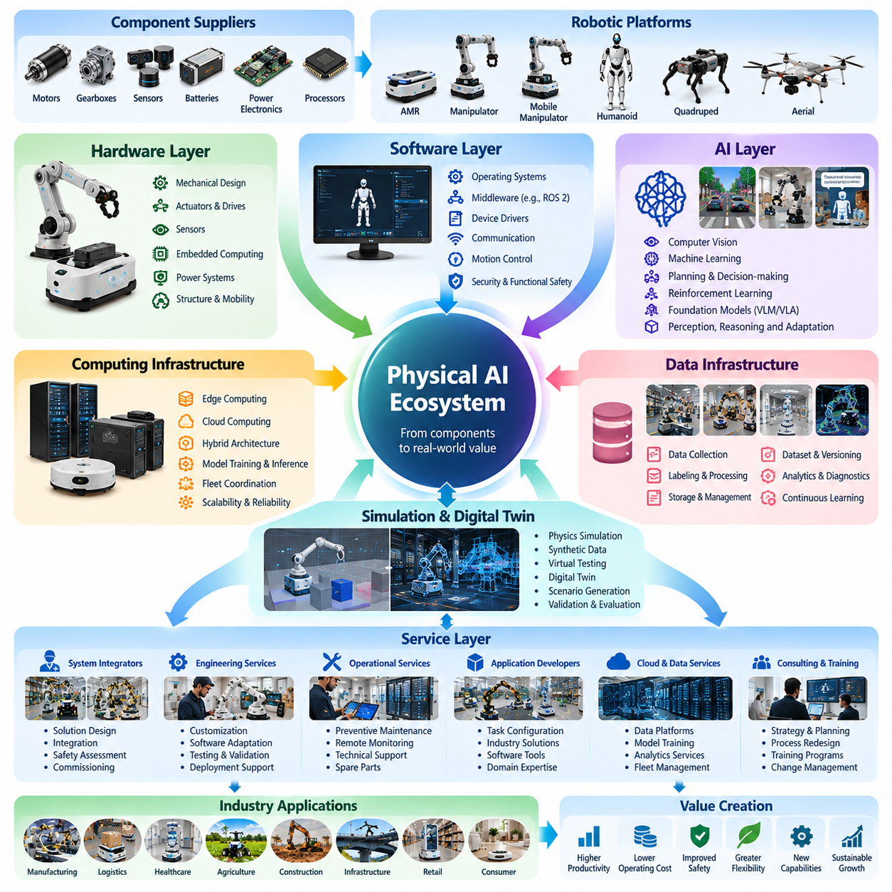{width="7.268055555555556in" height="7.268055555555556in"}

The Physical AI ecosystem consists of interconnected hardware, software, artificial intelligence, and service providers that collectively enable autonomous physical operations. Each layer contributes distinct capabilities, but commercial value emerges from their coordinated performance. A successful ecosystem must support the complete lifecycle of intelligent machines, including design, manufacturing, deployment, operation, maintenance, and continuous improvement.

Hardware forms the physical foundation of the ecosystem by providing structures, mobility mechanisms, manipulation devices, sensors, actuators, and computing equipment. Mechanical design determines the operating envelope of robotic systems, while electronic components enable sensing and control. Hardware architecture directly influences payload capacity, positioning accuracy, energy consumption, environmental resistance, and overall system reliability.

The hardware supply network includes manufacturers of motors, gearboxes, encoders, batteries, power electronics, cameras, LiDAR sensors, and embedded processors. Specialized suppliers often serve multiple robotic industries, allowing component technologies to benefit from production scale. However, component selection requires balancing technical specifications, procurement costs, availability, compatibility, and long-term maintenance requirements.

Robotic platform manufacturers integrate these components into complete machines designed for particular operating conditions. Autonomous mobile robots emphasize navigation and transportation, while manipulators prioritize precision and physical interaction. Humanoids, quadrupeds, and aerial robots introduce additional requirements involving balance, terrain adaptability, flight stability, or complex coordination. Platform architecture establishes the foundation for higher-level intelligence.

Software connects physical hardware with computational intelligence through operating systems, middleware, device drivers, communication interfaces, and control frameworks. These components manage data exchange, sensor synchronization, motion execution, and resource allocation. Modular architectures allow developers to replace or upgrade individual functions without redesigning the entire robotic system, supporting maintainability and product evolution.

Robotic middleware and development frameworks play an important role in ecosystem interoperability. ROS 2 provides communication mechanisms and reusable software structures for distributed robotic applications. Nevertheless, production systems require careful engineering for real-time responsiveness, cybersecurity, fault handling, and functional safety. Commercial software platforms therefore combine reusable frameworks with application-specific reliability and operational requirements.

Artificial intelligence provides the perception, reasoning, learning, and adaptation capabilities that distinguish Physical AI from conventional automation. Computer vision identifies objects and environmental features, while machine learning supports classification, prediction, and behavioral adaptation. Planning algorithms transform interpreted information into executable actions, allowing robots to respond to conditions that cannot be fully anticipated through fixed programming.

Advanced AI platforms increasingly incorporate foundation models, multimodal models, and vision-language-action architectures. These approaches seek to connect visual observations, natural language instructions, and physical actions within reusable computational models. Their ecosystem significance depends on practical performance, computational efficiency, safety, and the ability to transfer learned capabilities across different tasks, environments, and robotic embodiments.

Computing infrastructure connects AI algorithms with robotic execution. Edge processors provide low-latency perception and control, while cloud systems support large-scale training, simulation, analytics, and fleet coordination. Hybrid architectures distribute workloads according to timing, bandwidth, reliability, and privacy requirements. Effective computing strategies must balance processing performance, power consumption, thermal limitations, and operational continuity.

Data infrastructure supports the development and improvement of intelligent robotic behavior. Physical AI systems generate sensor streams, movement trajectories, task records, interaction histories, and failure observations. Data platforms organize these resources through storage, indexing, labeling, filtering, and version management. Reliable data pipelines enable model training, performance evaluation, operational diagnostics, and continuous improvement across deployed fleets.

Simulation providers contribute virtual environments for developing and validating robotic capabilities before physical deployment. Physics engines, digital twins, synthetic data generators, and automated testing platforms reduce dependence on expensive real-world experimentation. Their effectiveness depends on accurately representing physical dynamics, sensor behavior, environmental variation, and interaction constraints that influence real robotic performance.

The service ecosystem transforms technical capabilities into operational solutions. System integrators analyze customer requirements, configure robotic platforms, connect enterprise systems, and validate deployment performance. Engineering service providers support mechanical customization, software adaptation, safety assessment, and commissioning. Their expertise is particularly important when integrating autonomous machines into existing industrial facilities and complex operational workflows.

Operational service providers maintain system performance after installation through preventive maintenance, remote diagnostics, technical support, software updates, and fleet optimization. These activities reduce downtime and support predictable service quality. As deployments expand, lifecycle services become increasingly important because customers evaluate robotic systems through sustained productivity and reliability rather than initial technical demonstrations.

Robot-as-a-Service models create recurring commercial relationships between technology providers and customers. Instead of purchasing equipment outright, customers may pay for access to robotic capabilities, availability, or completed operations. Providers may retain responsibility for hardware, software, maintenance, and selected operational risks. Financial sustainability depends on equipment utilization, service efficiency, contract terms, and lifecycle cost management.

Ecosystem participants may adopt vertically integrated or horizontally specialized business strategies. Vertically integrated companies control multiple layers, potentially improving optimization and product consistency. Specialized providers focus on components, software, AI models, or services that support numerous platforms. Both approaches require coordination because the performance of a complete Physical AI solution depends on interactions among multiple technical and commercial participants.

Interoperability determines how efficiently ecosystem components can be combined and upgraded. Standard communication protocols, modular interfaces, common data structures, and reusable software components reduce integration complexity. Open architectures can encourage supplier diversity and innovation, while proprietary platforms may provide tightly optimized performance. Ecosystem development therefore involves balancing standardization, differentiation, compatibility, and commercial control.

Cybersecurity, functional safety, and data governance operate across every ecosystem layer. Hardware security, authenticated communication, software integrity, access management, and operational monitoring protect autonomous systems from failures and malicious interference. Safety engineering must address physical hazards arising from motion, manipulation, and human interaction. Regulatory requirements further influence product design, deployment procedures, and service responsibilities.

Industry applications shape ecosystem specialization. Manufacturing requires integration with production equipment and quality systems, while logistics emphasizes fleet coordination and throughput. Healthcare prioritizes dependable operation, privacy, and human interaction, whereas agriculture and construction demand environmental robustness. These differences encourage partnerships between general technology providers and organizations possessing detailed domain knowledge.

Partnership networks influence commercialization speed and market access. Hardware manufacturers collaborate with AI developers, software vendors, integrators, distributors, and service organizations to deliver complete solutions. Effective partnerships distribute engineering responsibilities and reduce development duplication. However, they also introduce dependencies involving technical compatibility, intellectual property, customer ownership, support obligations, and revenue sharing.

Economic value is distributed differently across ecosystem layers. Hardware suppliers generally depend on product margins and manufacturing efficiency, while software and AI providers may benefit from licensing, subscriptions, and platform adoption. Integrators generate project-based revenue, and service providers obtain recurring lifecycle income. Sustainable ecosystem development requires commercial arrangements that adequately compensate participants for their contributions and operational responsibilities.

Continuous learning creates feedback connections among hardware, software, AI, and service organizations. Operational data reveals mechanical limitations, software failures, perception errors, and changing customer requirements. These observations guide component redesign, algorithm improvements, software updates, and maintenance strategies. Organizations capable of coordinating such feedback can improve reliability and reduce deployment costs across successive product generations.

The long-term development of the Physical AI ecosystem will depend on increasingly capable intelligence, standardized hardware interfaces, scalable computing infrastructure, and mature service networks. As technologies become more reusable, competitive advantages may shift from individual components toward integrated performance and lifecycle value. Successful businesses will combine technical differentiation with dependable operations, ecosystem partnerships, and measurable customer outcomes.

피지컬 AI(Physical AI) 생태계(Ecosystem)는 하드웨어(Hardware), 소프트웨어(Software), 인공지능(Artificial Intelligence), 서비스 제공업체(Service Providers)가 상호 연결되어 자율적인 물리적 작업(Autonomous Physical Operations)을 공동으로 구현하는 구조로 구성된다. 각 계층은 서로 다른 기능을 제공하지만, 상업적 가치(Commercial Value)는 이들의 조화로운 성능을 통해 창출된다. 성공적인 생태계는 지능형 기계(Intelligent Machines)의 설계, 제조, 배포, 운영, 유지보수 및 지속적인 개선을 포함하는 전체 수명주기(Lifecycle)를 지원해야 한다.

하드웨어(Hardware)는 기계 구조물(Mechanical Structures), 이동 메커니즘(Mobility Mechanisms), 조작 장치(Manipulation Devices), 센서(Sensors), 액추에이터(Actuators), 컴퓨팅 장비(Computing Equipment)를 제공함으로써 생태계의 물리적 기반(Physical Foundation)을 형성한다. 기계 설계(Mechanical Design)는 로봇 시스템의 작동 범위(Operating Envelope)를 결정하며, 전자 부품(Electronic Components)은 센싱(Sensing)과 제어(Control)를 가능하게 한다. 하드웨어 아키텍처(Hardware Architecture)는 적재 능력(Payload Capacity), 위치 정확도(Positioning Accuracy), 에너지 소비(Energy Consumption), 환경 내성(Environmental Resistance), 전체 시스템 신뢰성(System Reliability)에 직접적인 영향을 미친다.

하드웨어 공급망(Hardware Supply Network)에는 모터(Motors), 감속기(Gearboxes), 엔코더(Encoders), 배터리(Batteries), 전력전자장치(Power Electronics), 카메라(Cameras), 라이다 센서(LiDAR Sensors), 임베디드 프로세서(Embedded Processors) 제조업체가 포함된다. 전문 부품 공급업체(Specialized Suppliers)는 여러 로봇 산업에 제품을 공급하는 경우가 많아 생산 규모 확대에 따른 이점을 얻을 수 있다. 그러나 부품 선정(Component Selection)에서는 기술 사양(Technical Specifications), 조달 비용(Procurement Costs), 공급 가능성(Availability), 호환성(Compatibility), 장기 유지보수 요구사항(Long-Term Maintenance Requirements) 사이의 균형을 고려해야 한다.

로봇 플랫폼 제조업체(Robotic Platform Manufacturers)는 이러한 구성요소를 통합하여 특정 운영 조건에 맞게 설계된 완성형 기계(Complete Machines)를 개발한다. 자율이동로봇(Autonomous Mobile Robots, AMR)은 자율주행(Navigation)과 운송(Transportation)을 중시하는 반면, 매니퓰레이터(Manipulators)는 정밀도(Precision)와 물리적 상호작용(Physical Interaction)을 우선한다. 휴머노이드(Humanoids), 사족보행 로봇(Quadrupeds), 항공 로봇(Aerial Robots)은 균형 제어(Balance Control), 지형 적응성(Terrain Adaptability), 비행 안정성(Flight Stability), 복잡한 협조 제어(Complex Coordination)와 관련된 추가 요구사항을 가진다. 플랫폼 아키텍처(Platform Architecture)는 상위 수준의 지능(Higher-Level Intelligence)을 구현하기 위한 기반을 제공한다.

소프트웨어(Software)는 운영체제(Operating Systems), 미들웨어(Middleware), 장치 드라이버(Device Drivers), 통신 인터페이스(Communication Interfaces), 제어 프레임워크(Control Frameworks)를 통해 물리적 하드웨어와 컴퓨팅 지능(Computational Intelligence)을 연결한다. 이러한 구성요소는 데이터 교환(Data Exchange), 센서 동기화(Sensor Synchronization), 동작 실행(Motion Execution), 자원 할당(Resource Allocation)을 관리한다. 모듈형 아키텍처(Modular Architectures)는 전체 로봇 시스템을 재설계하지 않고도 개별 기능을 교체하거나 업그레이드할 수 있도록 하여 유지보수성(Maintainability)과 제품 발전(Product Evolution)을 지원한다.

로봇 미들웨어(Robotic Middleware)와 개발 프레임워크(Development Frameworks)는 생태계의 상호운용성(Interoperability)을 확보하는 데 중요한 역할을 한다. ROS 2는 분산 로봇 응용 프로그램(Distributed Robotic Applications)을 위한 통신 메커니즘(Communication Mechanisms)과 재사용 가능한 소프트웨어 구조(Reusable Software Structures)를 제공한다. 그러나 실제 생산 시스템(Production Systems)에서는 실시간 응답성(Real-Time Responsiveness), 사이버보안(Cybersecurity), 장애 처리(Fault Handling), 기능 안전(Functional Safety)을 위한 세심한 엔지니어링이 필요하다. 따라서 상용 소프트웨어 플랫폼(Commercial Software Platforms)은 재사용 가능한 프레임워크와 응용 분야별 신뢰성 및 운영 요구사항을 결합한다.

인공지능(Artificial Intelligence)은 기존 자동화(Conventional Automation)와 피지컬 AI를 구별하는 인식(Perception), 추론(Reasoning), 학습(Learning), 적응(Adaptation) 능력을 제공한다. 컴퓨터 비전(Computer Vision)은 물체와 환경적 특징(Environmental Features)을 식별하며, 기계학습(Machine Learning)은 분류(Classification), 예측(Prediction), 행동 적응(Behavioral Adaptation)을 지원한다. 계획 알고리즘(Planning Algorithms)은 해석된 정보를 실행 가능한 행동(Executable Actions)으로 변환하여 로봇이 고정된 프로그래밍(Fixed Programming)으로 완전히 예측할 수 없는 조건에도 대응하도록 한다.

고급 인공지능 플랫폼(Advanced AI Platforms)은 점차 파운데이션 모델(Foundation Models), 다중모달 모델(Multimodal Models), 비전-언어-행동 아키텍처(Vision-Language-Action Architectures, VLA)를 통합하고 있다. 이러한 접근 방식은 시각적 관측(Visual Observations), 자연어 명령(Natural Language Instructions), 물리적 행동(Physical Actions)을 재사용 가능한 컴퓨팅 모델(Reusable Computational Models) 안에서 연결하는 것을 목표로 한다. 생태계에서 이들의 중요성은 실제 작업 성능(Practical Performance), 연산 효율(Computational Efficiency), 안전성(Safety), 서로 다른 작업과 환경 및 로봇 형태(Robotic Embodiments) 사이에서 학습된 능력을 전이(Transfer)할 수 있는지에 따라 결정된다.

컴퓨팅 인프라(Computing Infrastructure)는 인공지능 알고리즘(AI Algorithms)을 로봇의 실제 동작(Robotic Execution)과 연결한다. 엣지 프로세서(Edge Processors)는 저지연 인식(Low-Latency Perception)과 제어(Control)를 제공하며, 클라우드 시스템(Cloud Systems)은 대규모 학습(Large-Scale Training), 시뮬레이션(Simulation), 분석(Analytics), 군집 조정(Fleet Coordination)을 지원한다. 하이브리드 아키텍처(Hybrid Architectures)는 시간 제약(Timing Constraints), 대역폭(Bandwidth), 신뢰성(Reliability), 개인정보 보호(Privacy) 요구사항에 따라 작업 부하(Workloads)를 분산한다. 효과적인 컴퓨팅 전략(Computing Strategies)은 처리 성능(Processing Performance), 전력 소비(Power Consumption), 열적 한계(Thermal Limitations), 운영 연속성(Operational Continuity) 사이의 균형을 유지해야 한다.

데이터 인프라(Data Infrastructure)는 지능형 로봇 행동(Intelligent Robotic Behavior)의 개발과 개선을 지원한다. 피지컬 AI 시스템은 센서 데이터 스트림(Sensor Streams), 이동 궤적(Movement Trajectories), 작업 기록(Task Records), 상호작용 이력(Interaction Histories), 실패 관측(Failure Observations)을 생성한다. 데이터 플랫폼(Data Platforms)은 저장(Storage), 색인화(Indexing), 라벨링(Labeling), 필터링(Filtering), 버전 관리(Version Management)를 통해 이러한 자원을 체계적으로 관리한다. 신뢰할 수 있는 데이터 파이프라인(Reliable Data Pipelines)은 배포된 로봇 군집(Deployed Fleets) 전반에서 모델 학습(Model Training), 성능 평가(Performance Evaluation), 운영 진단(Operational Diagnostics), 지속적인 개선(Continuous Improvement)을 가능하게 한다.

시뮬레이션 제공업체(Simulation Providers)는 실제 물리적 배포(Physical Deployment)에 앞서 로봇의 기능을 개발하고 검증할 수 있는 가상 환경(Virtual Environments)을 제공한다. 물리 엔진(Physics Engines), 디지털 트윈(Digital Twins), 합성 데이터 생성기(Synthetic Data Generators), 자동화 시험 플랫폼(Automated Testing Platforms)은 비용이 많이 드는 실제 환경 실험(Real-World Experimentation)에 대한 의존도를 줄인다. 이러한 기술의 효과는 실제 로봇 성능에 영향을 미치는 물리 동역학(Physical Dynamics), 센서 동작(Sensor Behavior), 환경 변화(Environmental Variation), 상호작용 제약조건(Interaction Constraints)을 얼마나 정확하게 표현하는지에 달려 있다.

서비스 생태계(Service Ecosystem)는 기술적 역량(Technical Capabilities)을 실제 운영 솔루션(Operational Solutions)으로 전환한다. 시스템 통합업체(System Integrators)는 고객 요구사항(Customer Requirements)을 분석하고, 로봇 플랫폼을 구성하며, 기업 시스템(Enterprise Systems)을 연결하고, 배포 성능(Deployment Performance)을 검증한다. 엔지니어링 서비스 제공업체(Engineering Service Providers)는 기계적 맞춤화(Mechanical Customization), 소프트웨어 적응(Software Adaptation), 안전성 평가(Safety Assessment), 시운전(Commissioning)을 지원한다. 이러한 전문성은 기존 산업 시설과 복잡한 운영 작업 흐름(Operational Workflows)에 자율 기계를 통합할 때 특히 중요하다.

운영 서비스 제공업체(Operational Service Providers)는 설치 이후 예방 정비(Preventive Maintenance), 원격 진단(Remote Diagnostics), 기술 지원(Technical Support), 소프트웨어 업데이트(Software Updates), 군집 최적화(Fleet Optimization)를 통해 시스템 성능을 유지한다. 이러한 활동은 가동 중단시간(Downtime)을 줄이고 예측 가능한 서비스 품질(Predictable Service Quality)을 지원한다. 배포 규모가 확대될수록 고객은 초기 기술 시연(Technical Demonstrations)보다 지속적인 생산성(Sustained Productivity)과 신뢰성(Reliability)을 기준으로 로봇 시스템을 평가하므로 수명주기 서비스(Lifecycle Services)의 중요성이 더욱 커진다.

서비스형 로봇(Robot-as-a-Service, RaaS) 모델은 기술 제공업체(Technology Providers)와 고객 사이에 반복적인 상업 관계(Recurring Commercial Relationships)를 형성한다. 고객은 장비를 직접 구매하는 대신 로봇 기능(Robotic Capabilities), 가용성(Availability), 완료된 작업(Completed Operations)에 대한 이용료를 지불할 수 있다. 제공업체는 하드웨어, 소프트웨어, 유지보수 및 일부 운영 위험(Operational Risks)에 대한 책임을 유지할 수 있다. 재무적 지속 가능성(Financial Sustainability)은 장비 가동률(Equipment Utilization), 서비스 효율(Service Efficiency), 계약 조건(Contract Terms), 수명주기 비용 관리(Lifecycle Cost Management)에 달려 있다.

생태계 참여기업(Ecosystem Participants)은 수직 통합(Vertical Integration) 또는 수평적 전문화(Horizontal Specialization) 비즈니스 전략(Business Strategies)을 채택할 수 있다. 수직 통합 기업(Vertically Integrated Companies)은 여러 계층을 직접 통제하여 최적화(Optimization)와 제품 일관성(Product Consistency)을 향상시킬 수 있다. 전문 공급업체(Specialized Providers)는 다수의 플랫폼을 지원하는 부품, 소프트웨어, 인공지능 모델 또는 서비스에 집중한다. 두 접근 방식 모두 완전한 피지컬 AI 솔루션(Physical AI Solutions)의 성능이 여러 기술적·상업적 참여자 사이의 상호작용에 의존하므로 긴밀한 조정(Coordination)이 필요하다.

상호운용성(Interoperability)은 생태계 구성요소를 얼마나 효율적으로 결합하고 업그레이드할 수 있는지를 결정한다. 표준 통신 프로토콜(Standard Communication Protocols), 모듈형 인터페이스(Modular Interfaces), 공통 데이터 구조(Common Data Structures), 재사용 가능한 소프트웨어 구성요소(Reusable Software Components)는 시스템 통합 복잡성(Integration Complexity)을 줄인다. 개방형 아키텍처(Open Architectures)는 공급업체 다양성(Supplier Diversity)과 혁신(Innovation)을 촉진할 수 있으며, 독점 플랫폼(Proprietary Platforms)은 긴밀하게 최적화된 성능(Tightly Optimized Performance)을 제공할 수 있다. 따라서 생태계 발전에는 표준화(Standardization), 차별화(Differentiation), 호환성(Compatibility), 상업적 통제(Commercial Control) 사이의 균형이 필요하다.

사이버보안(Cybersecurity), 기능 안전(Functional Safety), 데이터 거버넌스(Data Governance)는 생태계의 모든 계층에 걸쳐 적용된다. 하드웨어 보안(Hardware Security), 인증된 통신(Authenticated Communication), 소프트웨어 무결성(Software Integrity), 접근 관리(Access Management), 운영 모니터링(Operational Monitoring)은 자율 시스템을 고장과 악의적인 간섭(Malicious Interference)으로부터 보호한다. 안전 엔지니어링(Safety Engineering)은 이동(Motion), 조작(Manipulation), 인간과의 상호작용(Human Interaction)에서 발생하는 물리적 위험(Physical Hazards)을 다루어야 한다. 규제 요구사항(Regulatory Requirements)은 제품 설계(Product Design), 배포 절차(Deployment Procedures), 서비스 책임(Service Responsibilities)에도 영향을 미친다.

산업별 응용 분야(Industry Applications)는 생태계의 전문화(Ecosystem Specialization)를 촉진한다. 제조업(Manufacturing)은 생산 장비(Production Equipment) 및 품질 시스템(Quality Systems)과의 통합이 필요하며, 물류(Logistics)는 군집 조정(Fleet Coordination)과 처리량(Throughput)을 중시한다. 의료(Healthcare)는 안정적인 운영(Dependable Operation), 개인정보 보호(Privacy), 인간과의 상호작용(Human Interaction)을 우선하는 반면, 농업(Agriculture)과 건설(Construction)은 환경 강건성(Environmental Robustness)을 요구한다. 이러한 차이는 범용 기술 제공업체(General Technology Providers)와 상세한 산업 전문지식(Domain Knowledge)을 보유한 조직 사이의 협력을 촉진한다.

파트너십 네트워크(Partnership Networks)는 상용화 속도(Commercialization Speed)와 시장 접근성(Market Access)에 영향을 미친다. 하드웨어 제조업체(Hardware Manufacturers)는 인공지능 개발업체(AI Developers), 소프트웨어 공급업체(Software Vendors), 시스템 통합업체(System Integrators), 유통업체(Distributors), 서비스 조직(Service Organizations)과 협력하여 완전한 솔루션을 제공한다. 효과적인 파트너십(Effective Partnerships)은 엔지니어링 책임(Engineering Responsibilities)을 분담하고 중복 개발(Development Duplication)을 줄인다. 그러나 기술적 호환성(Technical Compatibility), 지식재산권(Intellectual Property), 고객 소유권(Customer Ownership), 지원 의무(Support Obligations), 수익 배분(Revenue Sharing)과 관련된 의존성도 발생시킨다.

경제적 가치(Economic Value)는 생태계의 각 계층에 서로 다른 방식으로 분배된다. 하드웨어 공급업체(Hardware Suppliers)는 일반적으로 제품 이익률(Product Margins)과 제조 효율(Manufacturing Efficiency)에 의존하며, 소프트웨어 및 인공지능 제공업체(Software and AI Providers)는 라이선싱(Licensing), 구독(Subscriptions), 플랫폼 도입(Platform Adoption)을 통해 수익을 얻을 수 있다. 시스템 통합업체(System Integrators)는 프로젝트 기반 매출(Project-Based Revenue)을 창출하고, 서비스 제공업체(Service Providers)는 반복적인 수명주기 매출(Recurring Lifecycle Income)을 확보한다. 지속 가능한 생태계 발전(Sustainable Ecosystem Development)을 위해서는 참여기업의 기여도(Contributions)와 운영 책임(Operational Responsibilities)에 적절하게 보상하는 상업적 계약(Commercial Arrangements)이 필요하다.

지속적인 학습(Continuous Learning)은 하드웨어, 소프트웨어, 인공지능 및 서비스 조직 사이에 피드백 연결(Feedback Connections)을 형성한다. 운영 데이터(Operational Data)는 기계적 한계(Mechanical Limitations), 소프트웨어 오류(Software Failures), 인식 오류(Perception Errors), 변화하는 고객 요구사항(Changing Customer Requirements)을 보여준다. 이러한 관측 결과(Observations)는 부품 재설계(Component Redesign), 알고리즘 개선(Algorithm Improvements), 소프트웨어 업데이트(Software Updates), 유지보수 전략(Maintenance Strategies)에 반영된다. 이러한 피드백을 효과적으로 조정할 수 있는 조직은 후속 제품 세대(Successive Product Generations)에 걸쳐 신뢰성을 높이고 배포 비용(Deployment Costs)을 줄일 수 있다.

피지컬 AI 생태계의 장기적인 발전(Long-Term Development)은 더욱 고도화된 지능(Increasingly Capable Intelligence), 표준화된 하드웨어 인터페이스(Standardized Hardware Interfaces), 확장 가능한 컴퓨팅 인프라(Scalable Computing Infrastructure), 성숙한 서비스 네트워크(Mature Service Networks)에 달려 있다. 기술의 재사용성(Reusability)이 높아질수록 경쟁우위(Competitive Advantages)는 개별 구성요소에서 통합 성능(Integrated Performance)과 수명주기 가치(Lifecycle Value)로 이동할 수 있다. 성공적인 기업은 기술적 차별화(Technical Differentiation)를 안정적인 운영(Dependable Operations), 생태계 파트너십(Ecosystem Partnerships), 측정 가능한 고객 성과(Measurable Customer Outcomes)와 결합하게 될 것이다.

##  

## 01.04. AMR and Autonomous Mobility Market

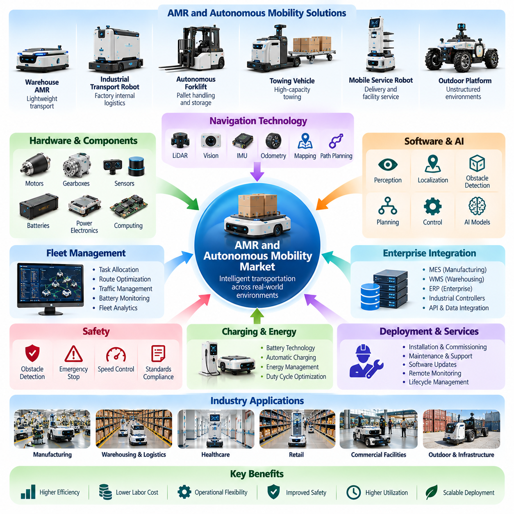{width="7.268055555555556in" height="7.268055555555556in"}

The autonomous mobile robot (AMR) and autonomous mobility market represents a major commercial segment of Physical AI, focused on intelligent machines capable of navigating and transporting materials through physical environments. Unlike fixed automation, autonomous mobility systems can adapt routes and respond to changing surroundings. Their economic value arises from improving transportation efficiency, reducing repetitive labor, and increasing operational flexibility.

The market encompasses warehouse AMRs, industrial transport robots, autonomous forklifts, towing vehicles, mobile service robots, and selected outdoor autonomous platforms. These systems differ in payload capacity, navigation technology, environmental requirements, and operational complexity. Market segmentation therefore requires distinguishing lightweight indoor transportation from heavy-duty industrial mobility and autonomous operation in unstructured environments.

Traditional automated guided vehicles (AGVs) typically rely on predefined routes, markers, or controlled navigation infrastructure. Modern AMRs increasingly employ simultaneous localization and mapping, sensor fusion, obstacle detection, and dynamic path planning. This transition enables more flexible deployment, although actual autonomy depends on environmental conditions, safety requirements, software capabilities, and the degree of human intervention required.

Manufacturing facilities represent an important application market for autonomous mobility. AMRs transport components, work-in-process materials, finished products, and production supplies between workstations. Their integration with manufacturing execution systems and production schedules can improve material availability and reduce transportation delays. Economic benefits depend on transport frequency, route complexity, equipment utilization, and production continuity.

Warehousing and distribution centers constitute another major demand segment. Autonomous robots support inventory movement, order fulfillment, goods-to-person operations, pallet transportation, and internal logistics. Their value increases when transportation tasks are frequent and predictable enough to support high utilization. Integration with warehouse management systems and warehouse execution systems enables robots to coordinate with inventory processes and fulfillment priorities.

Heavy-payload AMRs and autonomous industrial transporters address applications involving large components, machinery, pallets, and production assemblies. These platforms require stronger mechanical structures, higher-capacity drives, reliable braking, and precise load handling. Their commercial attractiveness depends on safely transporting substantial loads while maintaining positioning accuracy, maneuverability, equipment durability, and acceptable operating costs.

Autonomous forklifts extend intelligent mobility into pallet handling, storage, and vertical material movement. Compared with basic floor transportation, forklift autonomy introduces additional challenges involving load stability, mast control, pallet detection, and interaction with warehouse infrastructure. Successful commercialization requires dependable perception, precise positioning, safety validation, and compatibility with existing material-handling workflows.

Navigation technology is a major source of product differentiation within the AMR market. LiDAR-based localization, visual navigation, inertial sensing, wheel odometry, and environmental mapping provide complementary information about robot position and surroundings. Advanced systems combine these inputs to maintain reliable operation under changing conditions. Navigation performance directly influences deployment flexibility, operational safety, and productivity.

Fleet management software forms an essential commercial layer above individual robots. Fleet management systems allocate transportation tasks, coordinate routes, manage traffic, monitor battery conditions, and supervise operational status. As fleet size increases, centralized or distributed coordination becomes critical for avoiding congestion and balancing workloads. Software quality can therefore influence overall system productivity as strongly as individual robot performance.

Enterprise integration determines whether autonomous mobility creates measurable operational value. Interfaces with manufacturing execution systems, warehouse management systems, enterprise resource planning platforms, and industrial controllers allow transportation tasks to become part of coordinated workflows. Reliable integration reduces manual dispatching, improves traceability, and supports automatic responses to changing production or logistics requirements.

Safety requirements strongly influence AMR product design and market adoption. Autonomous platforms must detect obstacles, manage stopping distances, control speed, and interact safely with pedestrians and equipment. Safety engineering includes risk assessment, protective sensing, emergency stopping, and validated control functions. Industrial deployments must also consider applicable standards, facility conditions, and operational responsibilities.

Battery technology and charging infrastructure determine the practical availability of autonomous mobility systems. Battery capacity, energy consumption, charging time, and duty cycles influence how many robots are required to maintain continuous operations. Automatic charging and docking can reduce manual intervention, while fleet-level energy management supports efficient scheduling. These factors directly affect lifecycle costs and achievable utilization.

The economics of AMR deployment extend beyond equipment purchase prices. Total cost of ownership includes software, integration, charging infrastructure, maintenance, technical support, and operational supervision. Customers compare these expenses with labor savings, increased throughput, reduced transport delays, and improved workplace safety. Return on investment depends on sustained utilization and measurable improvements in operational performance.

Robot-as-a-Service models provide an alternative commercialization approach for autonomous mobility. Customers may obtain robotic transportation capacity through recurring payments rather than purchasing equipment outright. Providers can bundle hardware, fleet software, maintenance, and operational support into service contracts. This approach may reduce initial investment barriers but requires providers to manage asset utilization, reliability, financing, and lifecycle service costs.

The competitive landscape includes established industrial automation companies, specialized AMR manufacturers, autonomous forklift developers, robotics software providers, and system integrators. Competition involves hardware reliability, navigation performance, payload capability, integration flexibility, deployment speed, and service coverage. Differentiation increasingly depends on complete operational solutions rather than isolated robot specifications.

Market adoption varies according to industry structure and regional economic conditions. Facilities with high transportation volumes, standardized workflows, and significant labor constraints may achieve attractive deployment economics. Smaller operations or highly irregular environments can face greater integration challenges. Regional differences in wages, industrial infrastructure, safety regulation, and service availability further influence purchasing decisions.

Outdoor autonomous mobility expands the market beyond factories and warehouses into ports, industrial yards, campuses, agricultural facilities, and infrastructure sites. These environments introduce weather exposure, uneven terrain, changing illumination, and less predictable traffic. Commercial systems require robust localization, environmental perception, mobility hardware, and operational supervision appropriate to the complexity of their surroundings.

The development of mobile manipulation creates opportunities to combine transportation with physical handling. A mobile manipulator can navigate between workstations and interact with machines, containers, or products. This capability may expand the economic value of autonomous mobility by reducing dependence on fixed loading equipment. However, manipulation introduces additional requirements for perception, dexterity, force control, and coordinated motion.

Scalability is a central consideration for customers deploying large AMR fleets. Increasing robot numbers does not automatically produce proportional productivity improvements because traffic congestion, charging demand, and workflow bottlenecks can reduce efficiency. Effective scaling requires fleet orchestration, facility analysis, task optimization, and performance monitoring. Deployment planning must therefore consider the entire operating system rather than individual robots.

Operational data creates opportunities for continuous improvement in autonomous mobility systems. Robot fleets generate navigation histories, task completion records, traffic observations, battery information, and failure reports. Analyzing these datasets can improve route planning, predictive maintenance, fleet allocation, and operational reliability. Data-driven optimization becomes increasingly valuable as deployments expand across multiple facilities.

The future AMR market will be influenced by advances in perception, learning-based navigation, interoperable fleet platforms, energy management, and more affordable hardware. Greater autonomy may reduce deployment complexity and extend operation into less structured environments. Nevertheless, commercial success will continue to depend on safety, reliability, integration, and demonstrated economic performance rather than technological sophistication alone.

Ultimately, the AMR and autonomous mobility market illustrates how Physical AI converts intelligent perception and decision-making into measurable industrial productivity. Its development connects robotic hardware, navigation intelligence, fleet software, enterprise integration, and lifecycle services. Sustainable growth will depend on delivering dependable transportation capabilities that can be deployed repeatedly, operated efficiently, and justified through clear customer value.

자율이동로봇(Autonomous Mobile Robot, AMR) 및 자율 이동(Autonomous Mobility) 시장은 물리적 환경에서 자율적으로 주행하고 자재를 운송할 수 있는 지능형 기계(Intelligent Machines)를 중심으로 형성된 피지컬 AI(Physical AI)의 주요 상업적 시장 분야이다. 고정형 자동화(Fixed Automation)와 달리 자율 이동 시스템(Autonomous Mobility Systems)은 경로를 유연하게 변경하고 주변 환경 변화에 대응할 수 있다. 이러한 시스템의 경제적 가치(Economic Value)는 운송 효율(Transportation Efficiency) 향상, 반복 노동(Repetitive Labor) 감소, 운영 유연성(Operational Flexibility) 증대에서 발생한다.

이 시장에는 창고용 자율이동로봇(Warehouse AMRs), 산업용 운송 로봇(Industrial Transport Robots), 자율주행 지게차(Autonomous Forklifts), 견인 차량(Towing Vehicles), 이동형 서비스 로봇(Mobile Service Robots), 일부 실외 자율주행 플랫폼(Outdoor Autonomous Platforms)이 포함된다. 이러한 시스템은 적재 능력(Payload Capacity), 자율주행 기술(Navigation Technology), 환경 요구사항(Environmental Requirements), 운영 복잡성(Operational Complexity) 측면에서 차이가 있다. 따라서 시장 세분화(Market Segmentation)에서는 경량 실내 운송(Lightweight Indoor Transportation), 고중량 산업용 이동(Heavy-Duty Industrial Mobility), 비정형 환경(Unstructured Environments)에서의 자율 운영을 구분해야 한다.

기존 무인운반차(Automated Guided Vehicles, AGV)는 일반적으로 사전에 정의된 경로(Predefined Routes), 마커(Markers), 통제된 주행 인프라(Controlled Navigation Infrastructure)에 의존한다. 반면 현대적인 자율이동로봇(AMR)은 동시적 위치추정 및 지도작성(Simultaneous Localization and Mapping, SLAM), 센서 융합(Sensor Fusion), 장애물 감지(Obstacle Detection), 동적 경로 계획(Dynamic Path Planning)을 점차 활용하고 있다. 이러한 전환은 더욱 유연한 배포(Flexible Deployment)를 가능하게 하지만, 실제 자율성(Autonomy)은 환경 조건, 안전 요구사항, 소프트웨어 성능 및 필요한 인간 개입(Human Intervention)의 정도에 따라 달라진다.

제조 시설(Manufacturing Facilities)은 자율 이동 기술(Autonomous Mobility Technology)의 중요한 응용 시장(Application Market)을 형성한다. 자율이동로봇은 작업장(Workstations) 사이에서 부품(Components), 재공품(Work-in-Process Materials), 완제품(Finished Products), 생산 자재(Production Supplies)를 운송한다. 제조실행시스템(Manufacturing Execution Systems, MES) 및 생산 일정(Production Schedules)과의 통합은 자재 공급 가용성(Material Availability)을 높이고 운송 지연(Transportation Delays)을 줄일 수 있다. 경제적 효과는 운송 빈도(Transport Frequency), 경로 복잡성(Route Complexity), 장비 가동률(Equipment Utilization), 생산 연속성(Production Continuity)에 따라 결정된다.

창고(Warehouses)와 물류센터(Distribution Centers)는 또 다른 주요 수요 시장(Demand Segment)을 구성한다. 자율 로봇(Autonomous Robots)은 재고 이동(Inventory Movement), 주문 이행(Order Fulfillment), 상품-작업자 이동(Goods-to-Person Operations), 팔레트 운송(Pallet Transportation), 내부 물류(Internal Logistics)를 지원한다. 운송 작업의 빈도가 높고 예측 가능하여 높은 가동률(High Utilization)을 확보할 수 있을수록 경제적 가치가 증가한다. 창고관리시스템(Warehouse Management Systems, WMS) 및 창고실행시스템(Warehouse Execution Systems, WES)과의 통합은 로봇이 재고 처리 과정과 주문 처리 우선순위를 조정하도록 한다.

고중량 자율이동로봇(Heavy-Payload AMRs)과 자율 산업용 운송장비(Autonomous Industrial Transporters)는 대형 부품(Large Components), 기계 장비(Machinery), 팔레트(Pallets), 생산 조립체(Production Assemblies)를 운송하는 응용 분야를 대상으로 한다. 이러한 플랫폼은 견고한 기계 구조물(Mechanical Structures), 고용량 구동장치(High-Capacity Drives), 신뢰할 수 있는 제동장치(Reliable Braking), 정밀한 하중 취급(Precise Load Handling)을 필요로 한다. 상업적 매력도(Commercial Attractiveness)는 상당한 중량의 화물을 안전하게 운송하면서 위치 정확도(Positioning Accuracy), 기동성(Maneuverability), 장비 내구성(Equipment Durability), 적절한 운영 비용(Operating Costs)을 유지할 수 있는지에 달려 있다.

자율주행 지게차(Autonomous Forklifts)는 지능형 이동(Intelligent Mobility)의 적용 범위를 팔레트 취급(Pallet Handling), 보관(Storage), 수직 자재 이동(Vertical Material Movement)으로 확장한다. 기본적인 바닥 운송(Floor Transportation)과 비교하면 지게차 자율화(Forklift Autonomy)는 하중 안정성(Load Stability), 마스트 제어(Mast Control), 팔레트 감지(Pallet Detection), 창고 인프라(Warehouse Infrastructure)와의 상호작용에서 추가적인 어려움을 수반한다. 성공적인 상용화를 위해서는 신뢰할 수 있는 환경 인식(Dependable Perception), 정밀 위치결정(Precise Positioning), 안전성 검증(Safety Validation), 기존 자재 취급 작업 흐름(Material-Handling Workflows)과의 호환성이 필요하다.

자율주행 기술(Navigation Technology)은 자율이동로봇 시장에서 제품 차별화(Product Differentiation)를 결정하는 주요 요소이다. 라이다 기반 위치추정(LiDAR-Based Localization), 시각 기반 자율주행(Visual Navigation), 관성 센싱(Inertial Sensing), 휠 오도메트리(Wheel Odometry), 환경 지도작성(Environmental Mapping)은 로봇의 위치와 주변 환경에 관한 상호보완적인 정보를 제공한다. 고급 시스템(Advanced Systems)은 이러한 정보를 결합하여 변화하는 조건에서도 안정적인 운영을 유지한다. 자율주행 성능(Navigation Performance)은 배포 유연성(Deployment Flexibility), 운영 안전성(Operational Safety), 생산성(Productivity)에 직접적인 영향을 미친다.

군집관리 소프트웨어(Fleet Management Software)는 개별 로봇보다 상위에 위치하는 필수적인 상업적 계층(Commercial Layer)을 형성한다. 군집관리시스템(Fleet Management Systems, FMS)은 운송 작업 할당(Task Allocation), 경로 조정(Route Coordination), 교통 관리(Traffic Management), 배터리 상태 감시(Battery Monitoring), 운영 상태 감독(Operational Supervision)을 수행한다. 로봇 군집 규모(Fleet Size)가 증가할수록 혼잡(Congestion)을 방지하고 작업 부하(Workloads)를 균형 있게 분배하기 위한 중앙집중형 또는 분산형 조정(Centralized or Distributed Coordination)이 중요해진다. 따라서 소프트웨어 품질(Software Quality)은 개별 로봇의 성능만큼 전체 시스템 생산성(System Productivity)에 큰 영향을 미칠 수 있다.

기업 시스템 통합(Enterprise Integration)은 자율 이동 기술이 측정 가능한 운영 가치(Measurable Operational Value)를 창출할 수 있는지를 결정한다. 제조실행시스템(MES), 창고관리시스템(WMS), 전사적자원관리(Enterprise Resource Planning, ERP), 산업용 제어기(Industrial Controllers)와의 인터페이스(Interfaces)를 통해 운송 작업을 통합된 작업 흐름(Coordinated Workflows)의 일부로 만들 수 있다. 신뢰할 수 있는 시스템 통합(Reliable Integration)은 수동 작업 지시(Manual Dispatching)를 줄이고, 추적성(Traceability)을 높이며, 변화하는 생산 및 물류 요구사항에 자동으로 대응하도록 지원한다.

안전 요구사항(Safety Requirements)은 자율이동로봇의 제품 설계(Product Design)와 시장 도입(Market Adoption)에 큰 영향을 미친다. 자율주행 플랫폼(Autonomous Platforms)은 장애물을 감지하고, 정지거리(Stopping Distances)를 관리하며, 속도를 제어하고, 보행자 및 주변 장비와 안전하게 상호작용해야 한다. 안전 엔지니어링(Safety Engineering)에는 위험성 평가(Risk Assessment), 보호 센싱(Protective Sensing), 비상 정지(Emergency Stopping), 검증된 제어 기능(Validated Control Functions)이 포함된다. 산업 현장 배포(Industrial Deployments)에서는 적용 가능한 표준(Applicable Standards), 시설 조건(Facility Conditions), 운영 책임(Operational Responsibilities)도 고려해야 한다.

배터리 기술(Battery Technology)과 충전 인프라(Charging Infrastructure)는 자율 이동 시스템의 실질적인 가용성(Practical Availability)을 결정한다. 배터리 용량(Battery Capacity), 에너지 소비(Energy Consumption), 충전 시간(Charging Time), 운전 주기(Duty Cycles)는 연속 운영(Continuous Operations)을 유지하는 데 필요한 로봇 수량에 영향을 미친다. 자동 충전(Automatic Charging)과 도킹(Docking)은 수동 개입(Manual Intervention)을 줄일 수 있으며, 군집 수준의 에너지 관리(Fleet-Level Energy Management)는 효율적인 작업 일정 수립을 지원한다. 이러한 요소들은 수명주기 비용(Lifecycle Costs)과 달성 가능한 가동률(Achievable Utilization)에 직접적인 영향을 미친다.

자율이동로봇 배포의 경제성(AMR Deployment Economics)은 장비 구매 가격(Equipment Purchase Prices)을 넘어선다. 총소유비용(Total Cost of Ownership, TCO)에는 소프트웨어, 시스템 통합(System Integration), 충전 인프라, 유지보수(Maintenance), 기술 지원(Technical Support), 운영 감독(Operational Supervision)이 포함된다. 고객은 이러한 비용을 인건비 절감(Labor Savings), 처리량 증가(Increased Throughput), 운송 지연 감소(Reduced Transport Delays), 작업장 안전 향상(Improved Workplace Safety)과 비교한다. 투자수익률(Return on Investment, ROI)은 지속적인 가동률(Sustained Utilization)과 측정 가능한 운영 성과(Operational Performance) 개선에 따라 결정된다.

서비스형 로봇(Robot-as-a-Service, RaaS) 모델은 자율 이동 기술을 상용화하는 대안적인 접근 방식(Alternative Commercialization Approach)을 제공한다. 고객은 장비를 직접 구매하는 대신 정기적인 비용(Recurring Payments)을 지불하여 로봇 운송 능력(Robotic Transportation Capacity)을 확보할 수 있다. 제공업체는 하드웨어, 군집관리 소프트웨어(Fleet Software), 유지보수, 운영 지원(Operational Support)을 서비스 계약(Service Contracts)에 통합할 수 있다. 이러한 방식은 초기 투자 장벽(Initial Investment Barriers)을 낮출 수 있지만, 제공업체는 자산 가동률(Asset Utilization), 신뢰성(Reliability), 자금 조달(Financing), 수명주기 서비스 비용(Lifecycle Service Costs)을 관리해야 한다.

경쟁 구도(Competitive Landscape)에는 기존 산업 자동화 기업(Industrial Automation Companies), 전문 자율이동로봇 제조업체(Specialized AMR Manufacturers), 자율주행 지게차 개발업체(Autonomous Forklift Developers), 로봇 소프트웨어 제공업체(Robotics Software Providers), 시스템 통합업체(System Integrators)가 포함된다. 경쟁 요소에는 하드웨어 신뢰성(Hardware Reliability), 자율주행 성능(Navigation Performance), 적재 능력(Payload Capability), 시스템 통합 유연성(Integration Flexibility), 배포 속도(Deployment Speed), 서비스 지원 범위(Service Coverage)가 포함된다. 제품 차별화는 개별 로봇 사양(Isolated Robot Specifications)보다 완전한 운영 솔루션(Complete Operational Solutions)에 점차 의존하고 있다.

시장 도입(Market Adoption)은 산업 구조(Industry Structure)와 지역별 경제 조건(Regional Economic Conditions)에 따라 달라진다. 운송 물량(Transportation Volumes)이 많고, 작업 흐름이 표준화(Standardized Workflows)되어 있으며, 노동력 확보에 어려움(Labor Constraints)이 큰 시설은 매력적인 도입 경제성(Deployment Economics)을 확보할 수 있다. 반면 소규모 사업장(Smaller Operations)이나 매우 불규칙한 환경(Highly Irregular Environments)에서는 시스템 통합의 어려움(Integration Challenges)이 커질 수 있다. 임금(Wages), 산업 인프라(Industrial Infrastructure), 안전 규제(Safety Regulation), 서비스 가용성(Service Availability)의 지역별 차이도 구매 결정(Purchasing Decisions)에 영향을 미친다.

실외 자율 이동(Outdoor Autonomous Mobility)은 시장을 공장과 창고에서 항만(Ports), 산업 야적장(Industrial Yards), 캠퍼스(Campuses), 농업 시설(Agricultural Facilities), 사회기반시설 현장(Infrastructure Sites)으로 확장한다. 이러한 환경에서는 기상 노출(Weather Exposure), 불규칙한 지형(Uneven Terrain), 변화하는 조도(Changing Illumination), 예측하기 어려운 교통 상황(Unpredictable Traffic)이 발생한다. 상용 시스템(Commercial Systems)은 주변 환경의 복잡성에 적합한 강건한 위치추정(Robust Localization), 환경 인식(Environmental Perception), 이동 하드웨어(Mobility Hardware), 운영 감독(Operational Supervision)을 필요로 한다.

모바일 매니퓰레이션(Mobile Manipulation)의 발전은 운송과 물리적 취급(Physical Handling)을 결합하는 새로운 기회를 제공한다. 모바일 매니퓰레이터(Mobile Manipulator)는 작업장 사이를 자율적으로 이동하면서 기계, 컨테이너 또는 제품과 상호작용할 수 있다. 이러한 기능은 고정형 적재 장비(Fixed Loading Equipment)에 대한 의존도를 줄여 자율 이동의 경제적 가치를 확대할 수 있다. 그러나 조작 기능(Manipulation)은 인식(Perception), 정교한 조작 능력(Dexterity), 힘 제어(Force Control), 협조 운동(Coordinated Motion)에 대한 추가 요구사항을 발생시킨다.

확장성(Scalability)은 대규모 자율이동로봇 군집(Large AMR Fleets)을 도입하는 고객에게 핵심적인 고려사항이다. 로봇 수량을 늘린다고 해서 생산성이 비례하여 증가하는 것은 아니며, 교통 혼잡(Traffic Congestion), 충전 수요(Charging Demand), 작업 흐름 병목(Workflow Bottlenecks)이 효율을 감소시킬 수 있다. 효과적인 규모 확장(Effective Scaling)을 위해서는 군집 운영 조정(Fleet Orchestration), 시설 분석(Facility Analysis), 작업 최적화(Task Optimization), 성능 모니터링(Performance Monitoring)이 필요하다. 따라서 배포 계획(Deployment Planning)은 개별 로봇이 아니라 전체 운영 시스템(Entire Operating System)을 고려해야 한다.

운영 데이터(Operational Data)는 자율 이동 시스템의 지속적인 개선(Continuous Improvement)을 위한 기회를 제공한다. 로봇 군집(Robot Fleets)은 자율주행 이력(Navigation Histories), 작업 완료 기록(Task Completion Records), 교통 관측(Traffic Observations), 배터리 정보(Battery Information), 장애 보고서(Failure Reports)를 생성한다. 이러한 데이터셋(Datasets)을 분석하면 경로 계획(Route Planning), 예지보전(Predictive Maintenance), 군집 작업 할당(Fleet Allocation), 운영 신뢰성(Operational Reliability)을 향상시킬 수 있다. 데이터 기반 최적화(Data-Driven Optimization)는 여러 시설로 배포 규모가 확대될수록 더욱 중요한 가치를 가진다.

미래 자율이동로봇 시장(Future AMR Market)은 인식 기술(Perception Technology), 학습 기반 자율주행(Learning-Based Navigation), 상호운용 가능한 군집 플랫폼(Interoperable Fleet Platforms), 에너지 관리(Energy Management), 경제적인 하드웨어(Affordable Hardware)의 발전에 영향을 받을 것이다. 자율성(Autonomy)이 향상되면 배포 복잡성(Deployment Complexity)이 감소하고 비정형 환경(Less Structured Environments)으로 운영 범위가 확장될 수 있다. 그러나 상업적 성공(Commercial Success)은 기술적 정교함(Technological Sophistication) 자체보다 안전성(Safety), 신뢰성(Reliability), 시스템 통합(Integration), 검증된 경제적 성과(Demonstrated Economic Performance)에 계속 의존할 것이다.

궁극적으로 자율이동로봇 및 자율 이동 시장(AMR and Autonomous Mobility Market)은 피지컬 AI가 지능형 인식(Intelligent Perception)과 의사결정(Decision-Making)을 측정 가능한 산업 생산성(Measurable Industrial Productivity)으로 전환하는 방식을 보여준다. 이 시장의 발전은 로봇 하드웨어(Robotic Hardware), 자율주행 지능(Navigation Intelligence), 군집관리 소프트웨어(Fleet Software), 기업 시스템 통합(Enterprise Integration), 수명주기 서비스(Lifecycle Services)를 연결한다. 지속 가능한 성장(Sustainable Growth)은 반복적으로 배포할 수 있고, 효율적으로 운영할 수 있으며, 명확한 고객 가치(Customer Value)를 통해 경제성을 입증할 수 있는 신뢰성 높은 운송 능력(Dependable Transportation Capabilities)을 제공하는 데 달려 있다.

##  

## 01.05. Manipulator and Mobile Manipulator Market

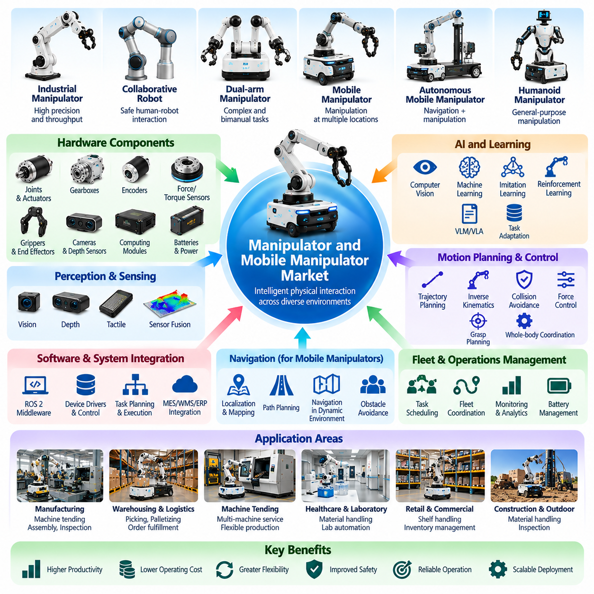{width="7.268055555555556in" height="7.268055555555556in"}

The manipulator and mobile manipulator market represents a major segment of Physical AI focused on intelligent systems capable of physically interacting with objects, tools, and industrial equipment. Manipulators provide controlled movement and object handling, while mobile manipulators combine robotic arms with autonomous mobility. Their economic value arises from automating repetitive tasks, improving production flexibility, and extending robotic capabilities across multiple workstations.

The market includes industrial robotic arms, collaborative robots, dual-arm manipulators, mobile manipulation platforms, and specialized handling systems. These products differ in payload capacity, reach, degrees of freedom, precision, and operational autonomy. Market segmentation must distinguish fixed industrial manipulation, human-robot collaboration, autonomous mobile manipulation, and emerging general-purpose robotic systems.

Traditional industrial manipulators operate primarily within structured production environments using programmed trajectories and predefined sequences. They provide high repeatability, positioning accuracy, and production throughput for tasks such as welding, assembly, and machine loading. Their commercial success depends on predictable operating conditions, reliable tooling, high utilization, and integration with established manufacturing processes.

Collaborative robots expand the manipulation market by supporting applications where humans and robots operate within shared workspaces. Their designs incorporate appropriate sensing, force limitations, and safety functions according to application requirements. Collaborative operation can reduce certain integration barriers, but actual safety depends on the complete robotic application, including tools, payloads, movement speeds, and surrounding equipment.

Mobile manipulators integrate robotic arms with autonomous mobile bases, enabling manipulation tasks at multiple physical locations. Unlike fixed robots, these systems can navigate between workstations and interact with machines, shelves, containers, and production materials. Their commercial potential comes from combining transportation and handling capabilities, although reliable operation requires coordination between navigation, positioning, manipulation, and safety systems.

Manufacturing represents an important application market for robotic manipulation. Industrial robots perform machine tending, assembly, material transfer, inspection, packaging, and precision handling. Mobile manipulators can support flexible production by servicing multiple machines or work cells. Their economic attractiveness depends on cycle time, production volume, changeover frequency, task variability, and the cost of integrating robotic operations into existing facilities.

Warehousing and logistics create growing opportunities for intelligent manipulation systems. Robotic arms support parcel sorting, palletizing, depalletizing, and order picking, while mobile manipulators can retrieve or place items across distributed storage locations. Commercial performance depends on object diversity, grasp success rates, handling speed, inventory accessibility, and integration with warehouse management and fulfillment systems.

Machine tending is a particularly relevant application because many industrial processes require repetitive loading, unloading, and equipment interaction. A mobile manipulator may service multiple CNC machines, inspection stations, or production cells according to changing schedules. This flexibility can improve equipment utilization, but dependable operation requires accurate docking, reliable gripping, machine interfaces, and predictable task execution.

Manipulation hardware forms a substantial part of the market ecosystem. Robotic joints, servo motors, gear reducers, encoders, force sensors, grippers, and end effectors determine physical performance. Their characteristics influence payload capacity, repeatability, stiffness, speed, energy consumption, and maintenance requirements. Hardware selection must balance mechanical capability with system cost, safety, and long-term operational reliability.

End effectors represent an important specialization within the manipulation market. Mechanical grippers, vacuum systems, magnetic tools, and adaptive hands enable robots to interact with different object categories. Their commercial value depends on grasp reliability, object compatibility, changeover time, and maintenance requirements. Advanced dexterous hands may expand task versatility but introduce additional complexity in sensing, control, and mechanical durability.

Perception technology enables manipulators to operate beyond precisely structured environments. Cameras, depth sensors, tactile sensors, and force-torque sensors provide information about object geometry, position, contact, and interaction forces. Computer vision and sensor fusion support object recognition, pose estimation, grasp planning, and visual servoing. Reliable perception is essential when objects vary in shape, orientation, placement, or material properties.

Artificial intelligence increasingly contributes to manipulation planning and adaptive control. Machine learning, imitation learning, reinforcement learning, and vision-language-action models can support task acquisition and behavioral adaptation. These approaches seek to reduce manual programming and improve generalization across objects and environments. Commercial adoption depends on consistent physical performance, safety validation, computational efficiency, and manageable training requirements.

Motion planning and control software connect intelligent decisions with physical execution. Inverse kinematics, trajectory optimization, collision avoidance, force control, and whole-body coordination determine how manipulators move and interact with their surroundings. Mobile manipulation introduces additional challenges because the robotic arm and mobile base must operate as a coordinated system while maintaining stability, positioning accuracy, and safe motion.

Dual-arm manipulation creates opportunities for handling large objects, coordinating assembly operations, and performing tasks requiring simultaneous interactions. Such systems may reproduce selected capabilities associated with human bimanual work. However, coordinated manipulation increases planning complexity, collision risks, sensing requirements, and hardware costs. Commercial viability depends on whether the additional flexibility produces sufficient productivity benefits.

The competitive landscape includes established industrial robot manufacturers, collaborative robot suppliers, mobile manipulator developers, gripper manufacturers, AI software companies, and system integrators. Competition involves hardware reliability, precision, payload capability, programming flexibility, integration complexity, and service availability. Emerging providers may differentiate through intelligent manipulation software and reusable task capabilities rather than mechanical performance alone.

System integration is a critical factor in commercial deployment. Manipulators must interface with production machines, conveyors, fixtures, safety systems, and enterprise software. Mobile manipulators additionally require navigation infrastructure, fleet coordination, and reliable docking procedures. Integration costs can become significant when facilities contain heterogeneous equipment or workflows that were not originally designed for robotic automation.

Safety requirements strongly influence manipulation system design and market acceptance. Industrial robots must manage collision risks, unexpected motion, tool hazards, and interactions with human workers. Safety engineering includes risk assessment, protective devices, emergency stopping, safe motion functions, and operational procedures. Mobile manipulators require additional consideration of combined movement, stability, payload handling, and changing environmental conditions.

The economics of robotic manipulation depend on more than acquisition prices. Total cost of ownership includes end effectors, programming, integration, maintenance, software, operator training, and production downtime. Customers evaluate these costs against labor savings, throughput improvements, quality consistency, and equipment utilization. Flexible systems may justify higher initial costs when they can perform multiple tasks or adapt to changing production requirements.

Robot-as-a-Service and subscription-based models may reduce initial investment barriers for manipulation automation. Providers can combine robotic hardware, intelligent software, maintenance, and operational support into recurring contracts. However, manipulation tasks often require substantial application customization, making service economics sensitive to integration costs, task variability, equipment utilization, and customer-specific operating requirements.

The future market will be influenced by advances in dexterous manipulation, multimodal perception, foundation models, adaptive control, and affordable robotic hardware. Improvements in generalization may reduce programming effort and expand applications beyond highly structured environments. Nevertheless, widespread commercialization requires dependable task completion, safe interaction, predictable maintenance, and measurable economic benefits.

Ultimately, the manipulator and mobile manipulator market demonstrates how Physical AI transforms perception, reasoning, and control into productive physical interaction. Fixed manipulators provide established industrial automation capabilities, while mobile manipulation extends flexibility across changing workspaces. Sustainable market growth will depend on combining reliable hardware, adaptable intelligence, efficient integration, and economically justified deployment.

매니퓰레이터(Manipulator) 및 모바일 매니퓰레이터(Mobile Manipulator) 시장은 물체(Objects), 도구(Tools), 산업 장비(Industrial Equipment)와 물리적으로 상호작용할 수 있는 지능형 시스템(Intelligent Systems)을 중심으로 형성된 피지컬 AI(Physical AI)의 주요 시장 분야이다. 매니퓰레이터는 제어된 움직임(Controlled Movement)과 물체 취급(Object Handling) 기능을 제공하며, 모바일 매니퓰레이터는 로봇 팔(Robotic Arms)과 자율 이동(Autonomous Mobility)을 결합한다. 이러한 시스템의 경제적 가치(Economic Value)는 반복 작업(Repetitive Tasks)의 자동화, 생산 유연성(Production Flexibility) 향상, 여러 작업장(Workstations)으로의 로봇 기능 확장에서 발생한다.

이 시장에는 산업용 로봇 팔(Industrial Robotic Arms), 협동로봇(Collaborative Robots), 양팔 매니퓰레이터(Dual-Arm Manipulators), 모바일 매니퓰레이션 플랫폼(Mobile Manipulation Platforms), 특수 취급 시스템(Specialized Handling Systems)이 포함된다. 이러한 제품은 적재 능력(Payload Capacity), 작업 반경(Reach), 자유도(Degrees of Freedom), 정밀도(Precision), 운영 자율성(Operational Autonomy) 측면에서 차이가 있다. 따라서 시장 세분화(Market Segmentation)에서는 고정형 산업용 조작(Fixed Industrial Manipulation), 인간-로봇 협업(Human-Robot Collaboration), 자율 모바일 매니퓰레이션(Autonomous Mobile Manipulation), 새롭게 등장하는 범용 로봇 시스템(General-Purpose Robotic Systems)을 구분해야 한다.

기존 산업용 매니퓰레이터(Traditional Industrial Manipulators)는 주로 구조화된 생산 환경(Structured Production Environments)에서 프로그래밍된 궤적(Programmed Trajectories)과 사전 정의된 작업 순서(Predefined Sequences)에 따라 작동한다. 이러한 시스템은 용접(Welding), 조립(Assembly), 기계 로딩(Machine Loading) 등의 작업에서 높은 반복 정밀도(Repeatability), 위치 정확도(Positioning Accuracy), 생산 처리량(Production Throughput)을 제공한다. 상업적 성공(Commercial Success)은 예측 가능한 운영 조건(Predictable Operating Conditions), 신뢰할 수 있는 툴링(Reliable Tooling), 높은 장비 가동률(High Utilization), 기존 제조 공정(Manufacturing Processes)과의 통합에 달려 있다.

협동로봇(Collaborative Robots)은 인간과 로봇이 공동 작업 공간(Shared Workspaces)에서 작업하는 응용 분야를 지원함으로써 매니퓰레이션 시장(Manipulation Market)을 확대한다. 협동로봇의 설계에는 응용 분야의 요구사항에 적합한 센싱(Sensing), 힘 제한(Force Limitations), 안전 기능(Safety Functions)이 포함된다. 협업 운영(Collaborative Operation)은 일부 시스템 통합 장벽(Integration Barriers)을 낮출 수 있지만, 실제 안전성(Safety)은 도구, 적재물(Payloads), 이동 속도(Movement Speeds), 주변 장비를 포함한 전체 로봇 응용 시스템(Complete Robotic Application)에 따라 결정된다.

모바일 매니퓰레이터(Mobile Manipulators)는 로봇 팔(Robotic Arms)과 자율이동 플랫폼(Autonomous Mobile Bases)을 통합하여 여러 물리적 위치에서 조작 작업(Manipulation Tasks)을 수행할 수 있도록 한다. 고정형 로봇(Fixed Robots)과 달리 이러한 시스템은 작업장 사이를 이동하면서 기계(Machines), 선반(Shelves), 컨테이너(Containers), 생산 자재(Production Materials)와 상호작용할 수 있다. 상업적 잠재력(Commercial Potential)은 운송(Transportation)과 취급(Handling) 기능을 결합하는 데서 발생하지만, 신뢰할 수 있는 운영을 위해서는 자율주행(Navigation), 위치결정(Positioning), 조작(Manipulation), 안전 시스템(Safety Systems) 사이의 협조가 필요하다.

제조업(Manufacturing)은 로봇 매니퓰레이션(Robotic Manipulation)의 중요한 응용 시장(Application Market)을 형성한다. 산업용 로봇(Industrial Robots)은 기계 관리(Machine Tending), 조립(Assembly), 자재 이송(Material Transfer), 검사(Inspection), 포장(Packaging), 정밀 취급(Precision Handling)을 수행한다. 모바일 매니퓰레이터는 여러 기계 또는 작업 셀(Work Cells)을 담당함으로써 유연 생산(Flexible Production)을 지원할 수 있다. 경제적 매력도(Economic Attractiveness)는 사이클 타임(Cycle Time), 생산량(Production Volume), 작업 전환 빈도(Changeover Frequency), 작업 변동성(Task Variability), 기존 시설에 로봇 작업을 통합하는 비용에 따라 결정된다.

창고(Warehousing)와 물류(Logistics)는 지능형 매니퓰레이션 시스템(Intelligent Manipulation Systems)에 새로운 성장 기회를 제공한다. 로봇 팔은 소포 분류(Parcel Sorting), 팔레타이징(Palletizing), 디팔레타이징(Depalletizing), 주문 피킹(Order Picking)을 지원하며, 모바일 매니퓰레이터는 분산된 보관 위치(Distributed Storage Locations)에서 물품을 집거나 배치할 수 있다. 상업적 성능(Commercial Performance)은 물체 다양성(Object Diversity), 파지 성공률(Grasp Success Rates), 취급 속도(Handling Speed), 재고 접근성(Inventory Accessibility), 창고관리 및 주문 이행 시스템(Warehouse Management and Fulfillment Systems)과의 통합에 달려 있다.

기계 관리(Machine Tending)는 많은 산업 공정(Industrial Processes)에서 반복적인 적재(Loading), 하역(Unloading), 장비 상호작용(Equipment Interaction)이 필요하다는 점에서 특히 중요한 응용 분야이다. 모바일 매니퓰레이터는 변화하는 생산 일정(Changing Schedules)에 따라 여러 컴퓨터 수치제어 기계(Computer Numerical Control Machines, CNC), 검사 스테이션(Inspection Stations), 생산 셀(Production Cells)을 담당할 수 있다. 이러한 유연성(Flexibility)은 장비 가동률(Equipment Utilization)을 향상시킬 수 있지만, 안정적인 운영을 위해서는 정확한 도킹(Accurate Docking), 신뢰할 수 있는 파지(Reliable Gripping), 기계 인터페이스(Machine Interfaces), 예측 가능한 작업 실행(Predictable Task Execution)이 필요하다.

매니퓰레이션 하드웨어(Manipulation Hardware)는 시장 생태계(Market Ecosystem)의 상당 부분을 구성한다. 로봇 관절(Robotic Joints), 서보 모터(Servo Motors), 감속기(Gear Reducers), 엔코더(Encoders), 힘 센서(Force Sensors), 그리퍼(Grippers), 엔드 이펙터(End Effectors)는 물리적 성능(Physical Performance)을 결정한다. 이러한 구성요소의 특성은 적재 능력(Payload Capacity), 반복 정밀도(Repeatability), 강성(Stiffness), 속도(Speed), 에너지 소비(Energy Consumption), 유지보수 요구사항(Maintenance Requirements)에 영향을 미친다. 하드웨어 선정(Hardware Selection)에서는 기계적 성능(Mechanical Capability), 시스템 비용(System Cost), 안전성(Safety), 장기 운영 신뢰성(Long-Term Operational Reliability) 사이의 균형을 고려해야 한다.

엔드 이펙터(End Effectors)는 매니퓰레이션 시장에서 중요한 전문화 분야(Specialization)를 형성한다. 기계식 그리퍼(Mechanical Grippers), 진공 시스템(Vacuum Systems), 자기식 도구(Magnetic Tools), 적응형 로봇 손(Adaptive Hands)은 로봇이 서로 다른 유형의 물체와 상호작용할 수 있도록 한다. 이들의 상업적 가치(Commercial Value)는 파지 신뢰성(Grasp Reliability), 물체 호환성(Object Compatibility), 작업 전환 시간(Changeover Time), 유지보수 요구사항(Maintenance Requirements)에 따라 결정된다. 고급 다자유도 로봇 손(Advanced Dexterous Hands)은 작업 범용성(Task Versatility)을 확대할 수 있지만, 센싱(Sensing), 제어(Control), 기계적 내구성(Mechanical Durability) 측면에서 추가적인 복잡성을 발생시킨다.

인식 기술(Perception Technology)은 매니퓰레이터가 정밀하게 구조화된 환경(Precisely Structured Environments)을 넘어 작업할 수 있도록 한다. 카메라(Cameras), 깊이 센서(Depth Sensors), 촉각 센서(Tactile Sensors), 힘-토크 센서(Force-Torque Sensors)는 물체 형상(Object Geometry), 위치(Position), 접촉(Contact), 상호작용 힘(Interaction Forces)에 관한 정보를 제공한다. 컴퓨터 비전(Computer Vision)과 센서 융합(Sensor Fusion)은 물체 인식(Object Recognition), 자세 추정(Pose Estimation), 파지 계획(Grasp Planning), 시각 서보 제어(Visual Servoing)를 지원한다. 물체의 형상, 방향, 배치, 재료 특성이 달라지는 환경에서는 신뢰할 수 있는 인식(Reliable Perception)이 필수적이다.

인공지능(Artificial Intelligence)은 매니퓰레이션 계획(Manipulation Planning)과 적응형 제어(Adaptive Control)에 점차 중요한 역할을 하고 있다. 기계학습(Machine Learning), 모방학습(Imitation Learning), 강화학습(Reinforcement Learning), 비전-언어-행동 모델(Vision-Language-Action Models, VLA)은 작업 학습(Task Acquisition)과 행동 적응(Behavioral Adaptation)을 지원할 수 있다. 이러한 접근 방식은 수동 프로그래밍(Manual Programming)을 줄이고 다양한 물체와 환경에 대한 일반화(Generalization)를 개선하는 것을 목표로 한다. 상업적 도입(Commercial Adoption)은 일관된 물리적 작업 성능(Consistent Physical Performance), 안전성 검증(Safety Validation), 연산 효율(Computational Efficiency), 관리 가능한 학습 요구사항(Manageable Training Requirements)에 달려 있다.

동작 계획(Motion Planning)과 제어 소프트웨어(Control Software)는 지능형 의사결정(Intelligent Decisions)을 실제 물리적 실행(Physical Execution)과 연결한다. 역기구학(Inverse Kinematics), 궤적 최적화(Trajectory Optimization), 충돌 회피(Collision Avoidance), 힘 제어(Force Control), 전신 협조 제어(Whole-Body Coordination)는 매니퓰레이터가 주변 환경에서 어떻게 움직이고 상호작용하는지를 결정한다. 모바일 매니퓰레이션(Mobile Manipulation)은 로봇 팔과 이동 플랫폼이 안정성(Stability), 위치 정확도(Positioning Accuracy), 안전한 움직임(Safe Motion)을 유지하면서 하나의 협조 시스템(Coordinated System)으로 작동해야 하므로 추가적인 어려움이 발생한다.

양팔 매니퓰레이션(Dual-Arm Manipulation)은 대형 물체 취급(Large Object Handling), 조립 작업의 협조(Coordinated Assembly Operations), 동시 상호작용(Simultaneous Interactions)이 필요한 작업에 새로운 기회를 제공한다. 이러한 시스템은 인간의 양손 작업(Human Bimanual Work)과 관련된 일부 능력을 구현할 수 있다. 그러나 협조 매니퓰레이션(Coordinated Manipulation)은 계획 복잡성(Planning Complexity), 충돌 위험(Collision Risks), 센싱 요구사항(Sensing Requirements), 하드웨어 비용(Hardware Costs)을 증가시킨다. 상업적 타당성(Commercial Viability)은 추가적인 유연성이 충분한 생산성 향상(Productivity Benefits)을 제공하는지에 따라 결정된다.

경쟁 구도(Competitive Landscape)에는 기존 산업용 로봇 제조업체(Industrial Robot Manufacturers), 협동로봇 공급업체(Collaborative Robot Suppliers), 모바일 매니퓰레이터 개발업체(Mobile Manipulator Developers), 그리퍼 제조업체(Gripper Manufacturers), 인공지능 소프트웨어 기업(AI Software Companies), 시스템 통합업체(System Integrators)가 포함된다. 경쟁 요소에는 하드웨어 신뢰성(Hardware Reliability), 정밀도(Precision), 적재 능력(Payload Capability), 프로그래밍 유연성(Programming Flexibility), 시스템 통합 복잡성(Integration Complexity), 서비스 가용성(Service Availability)이 포함된다. 신규 시장 참여기업(Emerging Providers)은 기계적 성능(Mechanical Performance)뿐 아니라 지능형 매니퓰레이션 소프트웨어(Intelligent Manipulation Software)와 재사용 가능한 작업 기능(Reusable Task Capabilities)을 통해 차별화할 수 있다.

시스템 통합(System Integration)은 상업적 배포(Commercial Deployment)의 핵심 요소이다. 매니퓰레이터는 생산 기계(Production Machines), 컨베이어(Conveyors), 고정 지그(Fixtures), 안전 시스템(Safety Systems), 기업용 소프트웨어(Enterprise Software)와 연결되어야 한다. 모바일 매니퓰레이터는 추가적으로 자율주행 인프라(Navigation Infrastructure), 군집 조정(Fleet Coordination), 신뢰할 수 있는 도킹 절차(Reliable Docking Procedures)가 필요하다. 시설에 서로 다른 종류의 장비(Heterogeneous Equipment)가 존재하거나 기존 작업 흐름이 로봇 자동화(Robotic Automation)를 고려하여 설계되지 않은 경우, 시스템 통합 비용(Integration Costs)이 크게 증가할 수 있다.

안전 요구사항(Safety Requirements)은 매니퓰레이션 시스템의 설계(System Design)와 시장 수용성(Market Acceptance)에 큰 영향을 미친다. 산업용 로봇(Industrial Robots)은 충돌 위험(Collision Risks), 예기치 않은 움직임(Unexpected Motion), 도구 관련 위험(Tool Hazards), 작업자와의 상호작용(Interactions with Human Workers)을 관리해야 한다. 안전 엔지니어링(Safety Engineering)에는 위험성 평가(Risk Assessment), 보호 장치(Protective Devices), 비상 정지(Emergency Stopping), 안전 동작 기능(Safe Motion Functions), 운영 절차(Operational Procedures)가 포함된다. 모바일 매니퓰레이터는 이동과 조작이 결합된 움직임(Combined Movement), 안정성(Stability), 적재물 취급(Payload Handling), 변화하는 환경 조건(Changing Environmental Conditions)을 추가로 고려해야 한다.

로봇 매니퓰레이션의 경제성(Robotic Manipulation Economics)은 장비 취득 가격(Acquisition Prices)만으로 결정되지 않는다. 총소유비용(Total Cost of Ownership, TCO)에는 엔드 이펙터(End Effectors), 프로그래밍(Programming), 시스템 통합(Integration), 유지보수(Maintenance), 소프트웨어(Software), 작업자 교육(Operator Training), 생산 중단시간(Production Downtime)이 포함된다. 고객은 이러한 비용을 인건비 절감(Labor Savings), 처리량 향상(Throughput Improvements), 품질 일관성(Quality Consistency), 장비 가동률(Equipment Utilization)과 비교한다. 유연한 시스템(Flexible Systems)은 여러 작업을 수행하거나 변화하는 생산 요구사항에 적응할 수 있을 때 높은 초기 비용(Higher Initial Costs)을 정당화할 수 있다.

서비스형 로봇(Robot-as-a-Service, RaaS)과 구독 기반 모델(Subscription-Based Models)은 매니퓰레이션 자동화(Manipulation Automation)의 초기 투자 장벽(Initial Investment Barriers)을 낮출 수 있다. 제공업체는 로봇 하드웨어(Robotic Hardware), 지능형 소프트웨어(Intelligent Software), 유지보수(Maintenance), 운영 지원(Operational Support)을 반복 계약(Recurring Contracts)으로 결합할 수 있다. 그러나 매니퓰레이션 작업은 상당한 응용 분야별 맞춤화(Application Customization)를 요구하는 경우가 많으므로 서비스 경제성(Service Economics)은 시스템 통합 비용(Integration Costs), 작업 변동성(Task Variability), 장비 가동률(Equipment Utilization), 고객별 운영 요구사항(Customer-Specific Operating Requirements)에 민감하다.

미래 시장(Future Market)은 정교한 조작 능력(Dexterous Manipulation), 다중모달 인식(Multimodal Perception), 파운데이션 모델(Foundation Models), 적응형 제어(Adaptive Control), 경제적인 로봇 하드웨어(Affordable Robotic Hardware)의 발전에 영향을 받을 것이다. 일반화 성능(Generalization Performance)이 향상되면 프로그래밍 작업(Programming Effort)이 줄어들고 고도로 구조화된 환경(Highly Structured Environments)을 넘어 응용 분야가 확대될 수 있다. 그러나 광범위한 상용화(Widespread Commercialization)를 위해서는 신뢰할 수 있는 작업 완료(Dependable Task Completion), 안전한 상호작용(Safe Interaction), 예측 가능한 유지보수(Predictable Maintenance), 측정 가능한 경제적 효과(Measurable Economic Benefits)가 필요하다.

궁극적으로 매니퓰레이터 및 모바일 매니퓰레이터 시장(Manipulator and Mobile Manipulator Market)은 피지컬 AI(Physical AI)가 인식(Perception), 추론(Reasoning), 제어(Control)를 생산적인 물리적 상호작용(Productive Physical Interaction)으로 전환하는 방식을 보여준다. 고정형 매니퓰레이터(Fixed Manipulators)는 이미 확립된 산업 자동화 기능(Established Industrial Automation Capabilities)을 제공하는 반면, 모바일 매니퓰레이션(Mobile Manipulation)은 변화하는 작업 공간(Changing Workspaces) 전반으로 유연성을 확대한다. 지속 가능한 시장 성장(Sustainable Market Growth)은 신뢰할 수 있는 하드웨어(Reliable Hardware), 적응 가능한 지능(Adaptable Intelligence), 효율적인 시스템 통합(Efficient Integration), 경제적으로 정당화할 수 있는 배포(Economically Justified Deployment)를 결합하는 데 달려 있다.

##  

## 01.06. Humanoid Robot Market

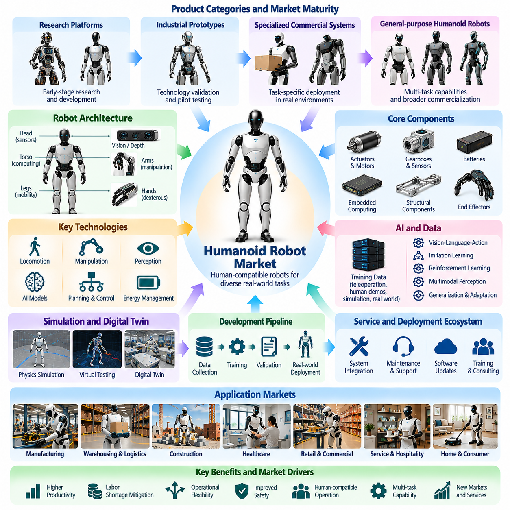{width="7.268055555555556in" height="7.268055555555556in"}

The humanoid robot market represents an emerging segment of Physical AI focused on robots designed to perform physical tasks within environments originally developed for humans. Humanoid systems combine mobility, manipulation, perception, and intelligent control within a human-inspired body structure. Their commercial potential arises from the possibility of automating diverse activities without requiring extensive modifications to existing workplaces.

Humanoid robots typically incorporate articulated legs, arms, hands, torso structures, and sensor-equipped heads or upper bodies. Their morphology enables interaction with stairs, doors, tools, shelves, and workstations designed around human dimensions. However, human-like appearance alone does not guarantee practical utility. Commercial performance depends on stability, manipulation capability, energy efficiency, safety, and reliable task completion.

The humanoid market includes research platforms, industrial prototypes, specialized commercial systems, and emerging general-purpose robotic products. These categories differ substantially in technological maturity, operational autonomy, payload capability, and deployment readiness. Market evaluation must therefore distinguish laboratory demonstrations and pilot programs from commercially validated systems capable of sustained operation.

Manufacturing represents a potential early market for humanoid robots because many factories contain tasks originally designed for human workers. Applications may include material handling, machine tending, component transportation, inspection, and repetitive assembly support. Humanoids could operate across multiple workstations, although their economic advantages must be compared with fixed manipulators, AMRs, and conventional automation.

Warehousing and logistics provide additional opportunities for humanoid deployment. Potential tasks include tote handling, parcel movement, shelf interaction, sorting, and loading assistance. Human-compatible morphology may allow operation within existing warehouse layouts, but practical performance requires reliable grasping, stable locomotion, and appropriate handling speed. Specialized logistics robots may remain more efficient for narrowly defined tasks.

The commercial justification for humanoid robots depends on their ability to perform multiple useful tasks within a shared hardware platform. General-purpose capability could reduce the need for separate machines dedicated to individual operations. Nevertheless, versatility introduces engineering complexity and may compromise performance on specific tasks. Customers must evaluate whether broader flexibility produces measurable economic benefits.

Locomotion technology is a central determinant of humanoid market maturity. Bipedal robots must maintain balance while walking, turning, stopping, carrying objects, and responding to disturbances. Uneven floors, stairs, obstacles, and unexpected contact increase control complexity. Reliable locomotion requires coordinated sensing, dynamic modeling, actuator control, and recovery strategies suitable for real operating environments.

Manipulation capability is equally important because many commercially valuable tasks require physical interaction rather than movement alone. Humanoid arms and hands must reach objects, generate appropriate forces, maintain stable grasps, and coordinate with body motion. Dexterous manipulation remains challenging when objects vary in shape, weight, and placement. Practical systems must balance hand complexity with durability and maintenance requirements.

Humanoid hardware architecture creates distinctive cost and reliability challenges. High-performance actuators, precision transmissions, joint sensors, embedded computers, and structural components must operate within strict weight and power constraints. Mechanical complexity increases assembly effort and potential maintenance requirements. Commercial scalability depends on improving component reliability, manufacturability, supply availability, and production economics.

Energy management strongly influences practical humanoid operation. Walking, balancing, lifting, and manipulation can require substantial electrical power, while onboard batteries impose limitations on operating duration and payload. Charging strategies, thermal management, and power-efficient control affect availability. Market adoption will depend partly on whether useful operating time can justify charging interruptions and infrastructure costs.

Artificial intelligence provides the perception, reasoning, planning, and adaptation capabilities required for flexible humanoid behavior. Vision-language-action models, imitation learning, reinforcement learning, and multimodal perception may support reusable task skills. However, successful demonstrations do not necessarily establish reliable generalization. Commercial systems require consistent performance across unfamiliar objects, environmental changes, and operational disturbances.

Training data represents a significant competitive resource in humanoid development. Teleoperation, human demonstrations, simulation, and real-world robot experience can provide examples of locomotion and manipulation behavior. Data quality, diversity, and embodiment compatibility influence model performance. Developers must establish efficient learning pipelines while managing the cost and complexity of collecting physical interaction data.

Simulation and digital twin technologies support humanoid development by enabling repeated experiments without exposing expensive hardware to every training failure. Virtual environments can accelerate locomotion learning, manipulation testing, and safety evaluation. Nevertheless, differences between simulated and physical systems remain important. Effective deployment requires validation under real-world contact dynamics, sensor uncertainty, and hardware limitations.

Safety engineering is particularly important because humanoids may operate near people while combining whole-body movement with object manipulation. Potential hazards include falls, unintended contact, dropped objects, and unexpected actuator behavior. Protective design, controlled motion, emergency stopping, and operational supervision are essential. Safety validation must consider the complete application rather than relying solely on robot-level capabilities.

The competitive landscape includes established robotics manufacturers, specialized humanoid developers, artificial intelligence companies, actuator suppliers, and industrial technology providers. Companies pursue different combinations of proprietary hardware, integrated software, foundation models, and manufacturing partnerships. Competitive differentiation involves task reliability, deployment readiness, hardware cost, autonomy, serviceability, and access to operational data.

Humanoid commercialization also requires a supporting service ecosystem. System integrators must configure work environments, connect enterprise applications, validate tasks, and establish operating procedures. Maintenance providers must address joint wear, actuator failures, battery replacement, and software updates. Reliable technical support becomes increasingly important as deployments move from supervised demonstrations toward sustained industrial operations.

Economic evaluation must account for total cost of ownership rather than robot purchase price alone. Relevant expenses include hardware, software, training, integration, supervision, maintenance, charging, and downtime. Customers compare these costs with productive operating hours, task completion rates, labor requirements, and flexibility. Economic feasibility depends on sustained performance under realistic conditions rather than theoretical labor substitution.

Robot-as-a-Service models may provide a commercial pathway for humanoid adoption by reducing initial customer investment. Providers could offer task capacity or robot availability through recurring contracts that include maintenance and software support. However, financial viability requires dependable utilization, predictable service costs, and clearly defined responsibilities. Immature hardware or frequent human intervention can undermine service profitability.

Market adoption is likely to progress through controlled environments and carefully selected applications before expanding into more unpredictable settings. Industrial pilots provide opportunities to measure reliability, safety, task performance, and integration requirements. Broader deployment will depend on repeatable operational results and improved economics. Market forecasts should distinguish announced production targets from verified deliveries and productive installations.

Humanoid robots face strong competition from alternative automation architectures. Fixed robotic arms may provide superior precision and throughput, while wheeled mobile manipulators often offer simpler mobility and lower energy consumption. Humanoid morphology becomes attractive when human-oriented infrastructure or task diversity provides meaningful advantages. The appropriate robotic form should therefore be selected according to operational requirements.

The long-term humanoid market will be shaped by advances in whole-body control, dexterous hands, foundation models, actuator technology, and scalable manufacturing. Improvements in learning and hardware efficiency may expand the range of economically viable applications. Nevertheless, general-purpose autonomy remains a demanding objective, and technological progress must be evaluated against safety, reliability, and sustained productivity.

Ultimately, the humanoid robot market illustrates both the ambition and commercial challenges of Physical AI. Human-compatible embodiment offers the possibility of performing diverse physical tasks within existing infrastructure, but versatility alone does not establish economic value. Sustainable growth will depend on converting advanced robotic capabilities into dependable, repeatable, and cost-effective operations that solve genuine customer problems.

휴머노이드 로봇(Humanoid Robot) 시장은 인간을 위해 설계된 환경에서 물리적 작업(Physical Tasks)을 수행하도록 개발된 로봇을 중심으로 형성되는 피지컬 AI(Physical AI)의 신흥 시장 분야(Emerging Market Segment)이다. 휴머노이드 시스템(Humanoid Systems)은 인간의 신체 구조를 모방한 형태(Human-Inspired Body Structure) 안에 이동성(Mobility), 조작 능력(Manipulation), 환경 인식(Perception), 지능형 제어(Intelligent Control)를 통합한다. 이러한 시스템의 상업적 잠재력(Commercial Potential)은 기존 작업 환경(Existing Workplaces)을 대규모로 변경하지 않고도 다양한 작업을 자동화할 수 있다는 가능성에서 발생한다.

휴머노이드 로봇(Humanoid Robots)은 일반적으로 관절형 다리(Articulated Legs), 팔(Arms), 손(Hands), 몸통 구조(Torso Structures), 센서가 장착된 머리 또는 상체(Sensor-Equipped Heads or Upper Bodies)로 구성된다. 이러한 신체 형태(Morphology)는 인간의 신체 치수(Human Dimensions)에 맞춰 설계된 계단(Stairs), 문(Doors), 도구(Tools), 선반(Shelves), 작업대(Workstations)와의 상호작용을 가능하게 한다. 그러나 인간과 유사한 외형(Human-Like Appearance)만으로 실용적 유용성(Practical Utility)이 보장되는 것은 아니다. 상업적 성능(Commercial Performance)은 안정성(Stability), 조작 능력(Manipulation Capability), 에너지 효율(Energy Efficiency), 안전성(Safety), 신뢰할 수 있는 작업 완료(Reliable Task Completion)에 따라 결정된다.

휴머노이드 시장(Humanoid Market)에는 연구용 플랫폼(Research Platforms), 산업용 시제품(Industrial Prototypes), 특수 목적 상용 시스템(Specialized Commercial Systems), 새롭게 등장하는 범용 로봇 제품(General-Purpose Robotic Products)이 포함된다. 이러한 제품군은 기술 성숙도(Technological Maturity), 운영 자율성(Operational Autonomy), 적재 능력(Payload Capability), 현장 배포 준비 수준(Deployment Readiness)에서 상당한 차이를 보인다. 따라서 시장 평가(Market Evaluation)에서는 실험실 시연(Laboratory Demonstrations) 및 시범 운영(Pilot Programs)과 지속적인 운영이 가능한 상업적으로 검증된 시스템(Commercially Validated Systems)을 구분해야 한다.

제조업(Manufacturing)은 많은 공장이 인간 작업자를 중심으로 설계된 업무를 포함하고 있다는 점에서 휴머노이드 로봇의 잠재적인 초기 시장(Early Market)이 될 수 있다. 적용 분야에는 자재 취급(Material Handling), 기계 관리(Machine Tending), 부품 운송(Component Transportation), 검사(Inspection), 반복 조립 지원(Repetitive Assembly Support) 등이 포함될 수 있다. 휴머노이드는 여러 작업장(Workstations)에서 작업할 수 있지만, 경제적 이점(Economic Advantages)은 고정형 매니퓰레이터(Fixed Manipulators), 자율이동로봇(Autonomous Mobile Robots, AMRs), 기존 자동화(Conventional Automation)와 비교하여 평가해야 한다.

창고(Warehousing)와 물류(Logistics)는 휴머노이드 배포(Humanoid Deployment)를 위한 추가적인 기회를 제공한다. 잠재적인 작업에는 토트 박스 취급(Tote Handling), 소포 이동(Parcel Movement), 선반 조작(Shelf Interaction), 분류(Sorting), 적재 지원(Loading Assistance)이 포함된다. 인간 친화적인 신체 형태(Human-Compatible Morphology)는 기존 창고 배치(Existing Warehouse Layouts)에서의 운영을 가능하게 할 수 있지만, 실제 성능을 확보하려면 신뢰할 수 있는 파지(Reliable Grasping), 안정적인 보행(Stable Locomotion), 적절한 취급 속도(Handling Speed)가 필요하다. 제한적으로 정의된 작업(Narrowly Defined Tasks)에서는 특수 목적 물류 로봇(Specialized Logistics Robots)이 여전히 더 높은 효율을 제공할 수 있다.

휴머노이드 로봇의 상업적 타당성(Commercial Justification)은 하나의 공통 하드웨어 플랫폼(Shared Hardware Platform)에서 여러 유용한 작업(Multiple Useful Tasks)을 수행할 수 있는 능력에 달려 있다. 범용 기능(General-Purpose Capability)은 개별 작업마다 전용 기계(Dedicated Machines)를 배치해야 하는 필요성을 줄일 수 있다. 그러나 범용성(Versatility)은 엔지니어링 복잡성(Engineering Complexity)을 증가시키고 특정 작업의 성능을 저하시킬 수도 있다. 고객은 폭넓은 유연성(Broader Flexibility)이 측정 가능한 경제적 효과(Measurable Economic Benefits)를 제공하는지 평가해야 한다.

보행 기술(Locomotion Technology)은 휴머노이드 시장 성숙도(Humanoid Market Maturity)를 결정하는 핵심 요소이다. 이족보행 로봇(Bipedal Robots)은 걷기(Walking), 회전(Turning), 정지(Stopping), 물체 운반(Carrying Objects), 외란 대응(Responding to Disturbances) 과정에서 균형(Balance)을 유지해야 한다. 불규칙한 바닥(Uneven Floors), 계단(Stairs), 장애물(Obstacles), 예기치 않은 접촉(Unexpected Contact)은 제어 복잡성(Control Complexity)을 증가시킨다. 신뢰할 수 있는 보행(Reliable Locomotion)을 위해서는 실제 운영 환경(Real Operating Environments)에 적합한 센싱(Sensing), 동역학 모델링(Dynamic Modeling), 액추에이터 제어(Actuator Control), 복구 전략(Recovery Strategies)의 협조가 필요하다.

조작 능력(Manipulation Capability) 역시 중요하다. 상업적으로 가치 있는 많은 작업은 단순한 이동(Movement)이 아니라 물리적 상호작용(Physical Interaction)을 요구하기 때문이다. 휴머노이드의 팔과 손(Humanoid Arms and Hands)은 물체에 도달하고, 적절한 힘(Appropriate Forces)을 발생시키며, 안정적인 파지(Stable Grasps)를 유지하고, 신체 움직임(Body Motion)과 협조해야 한다. 물체의 형상(Shape), 무게(Weight), 배치(Placement)가 다양할 경우 정교한 조작(Dexterous Manipulation)은 여전히 어려운 과제이다. 실용적인 시스템(Practical Systems)은 손의 기계적 복잡성(Hand Complexity)과 내구성(Durability), 유지보수 요구사항(Maintenance Requirements) 사이의 균형을 유지해야 한다.

휴머노이드 하드웨어 아키텍처(Humanoid Hardware Architecture)는 독특한 비용 및 신뢰성 문제(Cost and Reliability Challenges)를 발생시킨다. 고성능 액추에이터(High-Performance Actuators), 정밀 동력전달장치(Precision Transmissions), 관절 센서(Joint Sensors), 임베디드 컴퓨터(Embedded Computers), 구조 부품(Structural Components)은 엄격한 중량 및 전력 제약(Weight and Power Constraints) 내에서 작동해야 한다. 기계적 복잡성(Mechanical Complexity)은 조립 작업(Assembly Effort)과 잠재적인 유지보수 요구사항을 증가시킨다. 상업적 확장성(Commercial Scalability)은 부품 신뢰성(Component Reliability), 제조 용이성(Manufacturability), 공급 안정성(Supply Availability), 생산 경제성(Production Economics)의 개선에 달려 있다.

에너지 관리(Energy Management)는 휴머노이드의 실제 운영(Practical Humanoid Operation)에 큰 영향을 미친다. 보행(Walking), 균형 유지(Balancing), 들어 올리기(Lifting), 조작(Manipulation)은 상당한 전력(Electrical Power)을 필요로 할 수 있으며, 탑재형 배터리(Onboard Batteries)는 운영 시간(Operating Duration)과 적재 능력(Payload)에 제약을 준다. 충전 전략(Charging Strategies), 열 관리(Thermal Management), 전력 효율적인 제어(Power-Efficient Control)는 시스템 가용성(Availability)에 영향을 미친다. 시장 도입(Market Adoption)은 유효 작업 시간(Useful Operating Time)이 충전 중단(Charging Interruptions)과 인프라 비용(Infrastructure Costs)을 정당화할 수 있는지에 부분적으로 달려 있다.

인공지능(Artificial Intelligence)은 유연한 휴머노이드 행동(Flexible Humanoid Behavior)에 필요한 인식(Perception), 추론(Reasoning), 계획(Planning), 적응(Adaptation) 능력을 제공한다. 비전-언어-행동 모델(Vision-Language-Action Models, VLA), 모방학습(Imitation Learning), 강화학습(Reinforcement Learning), 다중모달 인식(Multimodal Perception)은 재사용 가능한 작업 기술(Reusable Task Skills)을 지원할 수 있다. 그러나 성공적인 시연(Successful Demonstrations)이 반드시 신뢰할 수 있는 일반화(Reliable Generalization)를 입증하는 것은 아니다. 상용 시스템(Commercial Systems)은 익숙하지 않은 물체(Unfamiliar Objects), 환경 변화(Environmental Changes), 운영 중 외란(Operational Disturbances)에 걸쳐 일관된 성능(Consistent Performance)을 확보해야 한다.

학습 데이터(Training Data)는 휴머노이드 개발(Humanoid Development)에서 중요한 경쟁 자원(Competitive Resource)이다. 원격조작(Teleoperation), 인간 시연(Human Demonstrations), 시뮬레이션(Simulation), 실제 로봇 경험(Real-World Robot Experience)은 보행 및 조작 행동(Locomotion and Manipulation Behavior)의 학습 사례를 제공할 수 있다. 데이터 품질(Data Quality), 다양성(Diversity), 신체 형태 호환성(Embodiment Compatibility)은 모델 성능(Model Performance)에 영향을 미친다. 개발업체(Developers)는 물리적 상호작용 데이터(Physical Interaction Data)의 수집 비용과 복잡성을 관리하면서 효율적인 학습 파이프라인(Efficient Learning Pipelines)을 구축해야 한다.

시뮬레이션(Simulation)과 디지털 트윈(Digital Twin) 기술은 모든 학습 실패(Training Failure)에 고가의 하드웨어(Expensive Hardware)를 노출하지 않고도 반복 실험(Repeated Experiments)을 수행할 수 있도록 하여 휴머노이드 개발을 지원한다. 가상 환경(Virtual Environments)은 보행 학습(Locomotion Learning), 조작 시험(Manipulation Testing), 안전성 평가(Safety Evaluation)를 가속화할 수 있다. 그러나 시뮬레이션 시스템(Simulated Systems)과 실제 물리 시스템(Physical Systems) 사이의 차이는 여전히 중요하다. 효과적인 배포(Effective Deployment)를 위해서는 실제 접촉 동역학(Real-World Contact Dynamics), 센서 불확실성(Sensor Uncertainty), 하드웨어 한계(Hardware Limitations) 조건에서 검증이 필요하다.

안전 엔지니어링(Safety Engineering)은 휴머노이드가 전신 움직임(Whole-Body Movement)과 물체 조작(Object Manipulation)을 결합하면서 인간 가까이에서 작동할 수 있다는 점에서 특히 중요하다. 잠재적인 위험(Potential Hazards)에는 넘어짐(Falls), 의도하지 않은 접촉(Unintended Contact), 물체 낙하(Dropped Objects), 예기치 않은 액추에이터 동작(Unexpected Actuator Behavior)이 포함된다. 보호 설계(Protective Design), 제어된 움직임(Controlled Motion), 비상 정지(Emergency Stopping), 운영 감독(Operational Supervision)은 필수적이다. 안전성 검증(Safety Validation)은 로봇 자체의 기능(Robot-Level Capabilities)에만 의존하지 않고 전체 응용 시스템(Complete Application)을 고려해야 한다.

경쟁 구도(Competitive Landscape)에는 기존 로봇 제조업체(Established Robotics Manufacturers), 전문 휴머노이드 개발업체(Specialized Humanoid Developers), 인공지능 기업(Artificial Intelligence Companies), 액추에이터 공급업체(Actuator Suppliers), 산업 기술 제공업체(Industrial Technology Providers)가 포함된다. 기업들은 독자적인 하드웨어(Proprietary Hardware), 통합 소프트웨어(Integrated Software), 파운데이션 모델(Foundation Models), 제조 파트너십(Manufacturing Partnerships)을 서로 다른 방식으로 결합하는 전략을 추구한다. 경쟁 차별화(Competitive Differentiation)는 작업 신뢰성(Task Reliability), 배포 준비 수준(Deployment Readiness), 하드웨어 비용(Hardware Cost), 자율성(Autonomy), 유지보수 용이성(Serviceability), 운영 데이터 접근성(Access to Operational Data)에 의해 결정된다.

휴머노이드 상용화(Humanoid Commercialization)에는 이를 지원하는 서비스 생태계(Service Ecosystem)도 필요하다. 시스템 통합업체(System Integrators)는 작업 환경(Work Environments)을 구성하고, 기업용 응용 시스템(Enterprise Applications)을 연결하며, 작업을 검증하고, 운영 절차(Operating Procedures)를 수립해야 한다. 유지보수 제공업체(Maintenance Providers)는 관절 마모(Joint Wear), 액추에이터 고장(Actuator Failures), 배터리 교체(Battery Replacement), 소프트웨어 업데이트(Software Updates)에 대응해야 한다. 배포가 감독하에 수행되는 시연(Supervised Demonstrations)에서 지속적인 산업 운영(Sustained Industrial Operations)으로 전환될수록 신뢰할 수 있는 기술 지원(Reliable Technical Support)의 중요성은 더욱 커진다.

경제성 평가(Economic Evaluation)에서는 로봇 구매 가격(Robot Purchase Price)뿐 아니라 총소유비용(Total Cost of Ownership, TCO)을 고려해야 한다. 관련 비용에는 하드웨어(Hardware), 소프트웨어(Software), 학습 및 교육(Training), 시스템 통합(Integration), 운영 감독(Supervision), 유지보수(Maintenance), 충전(Charging), 가동 중단시간(Downtime)이 포함된다. 고객은 이러한 비용을 생산적인 운영 시간(Productive Operating Hours), 작업 완료율(Task Completion Rates), 노동력 요구사항(Labor Requirements), 유연성(Flexibility)과 비교한다. 경제적 실현 가능성(Economic Feasibility)은 이론적인 노동 대체(Theoretical Labor Substitution)가 아니라 현실적인 조건에서 지속되는 성능(Sustained Performance)에 달려 있다.

서비스형 로봇(Robot-as-a-Service, RaaS) 모델은 고객의 초기 투자(Initial Customer Investment)를 줄임으로써 휴머노이드 도입(Humanoid Adoption)을 위한 상업적 경로(Commercial Pathway)를 제공할 수 있다. 제공업체는 유지보수(Maintenance)와 소프트웨어 지원(Software Support)을 포함하는 반복 계약(Recurring Contracts)을 통해 작업 수행 능력(Task Capacity) 또는 로봇 가용성(Robot Availability)을 제공할 수 있다. 그러나 재무적 타당성(Financial Viability)을 확보하려면 안정적인 가동률(Dependable Utilization), 예측 가능한 서비스 비용(Predictable Service Costs), 명확하게 정의된 책임(Clearly Defined Responsibilities)이 필요하다. 미성숙한 하드웨어(Immature Hardware)나 빈번한 인간 개입(Frequent Human Intervention)은 서비스 수익성(Service Profitability)을 저하시킬 수 있다.

시장 도입(Market Adoption)은 예측하기 어려운 환경(Unpredictable Settings)으로 확대되기 전에 통제된 환경(Controlled Environments)과 신중하게 선정된 응용 분야(Carefully Selected Applications)를 중심으로 진행될 가능성이 높다. 산업 현장 시범 운영(Industrial Pilots)은 신뢰성(Reliability), 안전성(Safety), 작업 성능(Task Performance), 시스템 통합 요구사항(Integration Requirements)을 측정할 기회를 제공한다. 광범위한 배포(Broader Deployment)는 반복적으로 재현 가능한 운영 성과(Repeatable Operational Results)와 개선된 경제성(Improved Economics)에 달려 있다. 시장 전망(Market Forecasts)에서는 발표된 생산 목표(Announced Production Targets)와 검증된 납품 실적(Verified Deliveries) 및 실제 생산 활동에 투입된 설치 실적(Productive Installations)을 구분해야 한다.

휴머노이드 로봇(Humanoid Robots)은 다른 자동화 아키텍처(Alternative Automation Architectures)와의 강한 경쟁에 직면해 있다. 고정형 로봇 팔(Fixed Robotic Arms)은 더 높은 정밀도(Precision)와 처리량(Throughput)을 제공할 수 있으며, 바퀴형 모바일 매니퓰레이터(Wheeled Mobile Manipulators)는 일반적으로 더 단순한 이동 구조(Simpler Mobility)와 낮은 에너지 소비(Lower Energy Consumption)를 제공한다. 휴머노이드 신체 형태(Humanoid Morphology)는 인간 중심 인프라(Human-Oriented Infrastructure) 또는 작업 다양성(Task Diversity)이 의미 있는 이점을 제공할 때 매력적이다. 따라서 적절한 로봇 형태(Robotic Form)는 운영 요구사항(Operational Requirements)에 따라 선정해야 한다.

장기적인 휴머노이드 시장(Long-Term Humanoid Market)은 전신 제어(Whole-Body Control), 정교한 로봇 손(Dexterous Hands), 파운데이션 모델(Foundation Models), 액추에이터 기술(Actuator Technology), 확장 가능한 제조(Scalable Manufacturing)의 발전에 의해 형성될 것이다. 학습 성능(Learning Performance)과 하드웨어 효율(Hardware Efficiency)의 개선은 경제적으로 실현 가능한 응용 분야(Economically Viable Applications)를 확대할 수 있다. 그러나 범용 자율성(General-Purpose Autonomy)은 여전히 달성하기 어려운 목표이며, 기술 발전(Technological Progress)은 안전성(Safety), 신뢰성(Reliability), 지속적인 생산성(Sustained Productivity)을 기준으로 평가해야 한다.

궁극적으로 휴머노이드 로봇 시장(Humanoid Robot Market)은 피지컬 AI(Physical AI)의 기술적 목표(Ambition)와 상업적 과제(Commercial Challenges)를 동시에 보여준다. 인간 환경에 적합한 신체 구조(Human-Compatible Embodiment)는 기존 인프라(Existing Infrastructure)에서 다양한 물리적 작업(Diverse Physical Tasks)을 수행할 가능성을 제공하지만, 범용성(Versatility)만으로 경제적 가치(Economic Value)가 입증되는 것은 아니다. 지속 가능한 성장(Sustainable Growth)은 고도화된 로봇 기능(Advanced Robotic Capabilities)을 실제 고객 문제(Genuine Customer Problems)를 해결하는 신뢰할 수 있고(Dependable), 반복 가능하며(Repeatable), 비용 효율적인(Cost-Effective) 운영으로 전환하는 데 달려 있다.

##  

## 01.07. Quadruped and Field Robot Market

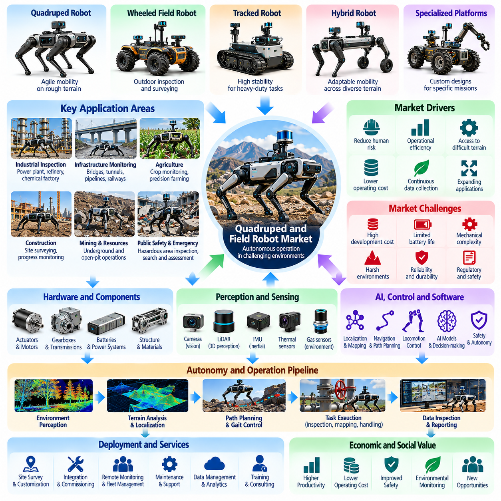{width="7.268055555555556in" height="7.268055555555556in"}

The quadruped and field robot market represents a specialized segment of Physical AI focused on autonomous operation in environments where conventional wheeled robots face mobility limitations. Quadruped robots use articulated legs to navigate uneven terrain, stairs, and obstacles, while field robots encompass broader platforms designed for outdoor and industrial tasks. Their commercial value arises from improved accessibility, reduced human exposure to hazards, and automated field operations.

The market includes quadruped inspection robots, agricultural robots, construction robots, mining platforms, infrastructure monitoring systems, and autonomous environmental survey vehicles. These systems differ in mobility architecture, payload capacity, environmental protection, and operational autonomy. Market segmentation must distinguish legged robotic platforms from wheeled, tracked, and hybrid field robots according to application requirements.

Quadruped robots offer distinctive mobility advantages through coordinated leg movement and adaptive foot placement. Their mechanical configuration allows traversal of irregular surfaces, narrow passages, and obstacles that may restrict wheeled platforms. However, legged locomotion introduces greater mechanical complexity, control requirements, and energy consumption. Commercial adoption depends on whether terrain accessibility justifies these additional costs.

Industrial inspection represents an important early market for quadruped robots. Facilities such as power plants, refineries, chemical factories, and industrial complexes require repeated inspection of equipment and infrastructure. Quadruped platforms can carry cameras, thermal sensors, acoustic instruments, and gas detectors to collect operational information. Their economic value depends on inspection frequency, data quality, safety improvements, and reduced manual effort.

Infrastructure monitoring creates opportunities for autonomous robots operating around bridges, tunnels, railways, pipelines, and utility installations. Field robots can collect visual, thermal, acoustic, and geometric information to identify abnormal conditions or maintenance requirements. Their effectiveness depends on environmental accessibility, localization accuracy, sensor reliability, and integration with asset management systems used by infrastructure operators.

Agriculture represents a broad application market for field robotics. Autonomous platforms can support crop monitoring, soil analysis, precision spraying, harvesting assistance, and transportation within agricultural environments. Wheeled and tracked vehicles remain attractive for many structured agricultural tasks, while legged robots may provide advantages in difficult terrain. Commercial viability depends on seasonal utilization, operating costs, and measurable improvements in agricultural productivity.

Construction sites introduce demanding conditions involving uneven ground, temporary obstacles, dust, weather exposure, and changing work layouts. Field robots can support site surveying, progress monitoring, material inspection, and selected transportation activities. Quadruped mobility may improve access to stairs and partially completed structures. However, dependable deployment requires robust perception, navigation, safety procedures, and adaptation to continuously changing environments.

Mining and resource extraction provide additional opportunities for autonomous field systems. Underground passages, remote extraction sites, and hazardous inspection areas can expose workers to significant operational risks. Robots equipped with mapping sensors, environmental detectors, and communication systems may support exploration and monitoring. Market adoption depends on ruggedness, reliable communication, autonomous navigation, and demonstrated safety benefits.

Public safety and emergency response represent specialized applications where field robots may enter dangerous or inaccessible locations. Potential missions include environmental assessment, remote inspection, and situational awareness in disaster-affected areas. Such deployments require robust mobility, reliable sensing, and effective human supervision. Their value is primarily associated with reducing personnel exposure and improving access to critical information.

Mobility hardware forms a major source of differentiation in the quadruped market. Joint actuators, transmissions, structural materials, foot mechanisms, and onboard batteries determine movement performance and durability. Design choices influence walking speed, payload capacity, obstacle negotiation, energy efficiency, and maintenance requirements. Manufacturers must balance mobility capability with mechanical simplicity, production cost, and operational reliability.

Locomotion control is a critical technological capability for quadruped robots. Dynamic balance, gait generation, terrain estimation, and contact planning enable coordinated movement across irregular surfaces. Advanced controllers may combine model-based optimization with learned policies to improve adaptability. Commercial systems must maintain predictable behavior despite uncertain ground conditions, payload changes, and unexpected disturbances.

Perception and localization technologies allow field robots to operate where conventional navigation infrastructure is unavailable. LiDAR, stereo cameras, inertial sensors, satellite positioning, and visual odometry provide complementary information about terrain and robot movement. Sensor fusion supports mapping, obstacle avoidance, and route planning. Reliable operation requires handling changing illumination, weather, vegetation, dust, and degraded positioning signals.

Autonomy levels vary considerably across field robotics applications. Some systems follow predefined inspection routes, while others perform adaptive navigation or respond to changing mission conditions. Human operators may remain responsible for mission approval, exception handling, and remote intervention. Commercial maturity should therefore be evaluated through actual autonomous operating performance rather than demonstrations of isolated navigation capabilities.

Payload integration expands the commercial usefulness of quadruped and field robots. Inspection sensors, environmental instruments, robotic arms, communication equipment, and specialized tools allow a common platform to support multiple missions. However, additional payloads affect balance, energy consumption, and mobility performance. Modular payload interfaces can improve flexibility while reducing customization and maintenance complexity.

Fleet management and remote operation platforms support coordinated deployment across large industrial sites. Operators can schedule inspection missions, monitor robot status, review collected data, and manage exceptions from centralized systems. Connectivity limitations may require onboard autonomy and local data storage. Effective fleet software reduces operational supervision requirements and improves the consistency of repeated field activities.

Environmental durability is essential for commercial field robotics. Robots may encounter rain, dust, temperature extremes, vibration, mud, and corrosive substances. Mechanical sealing, thermal management, protective materials, and reliable electrical systems influence service life. Environmental protection must be matched to the actual application because laboratory mobility performance does not necessarily translate into dependable field operation.

Safety and regulatory considerations influence deployment in industrial and public environments. Robots must manage collision hazards, unexpected motion, unstable terrain, and interactions with nearby personnel. Risk assessment, emergency stopping, operational boundaries, and remote supervision contribute to safe operation. Outdoor deployments may also involve site permissions, communications requirements, and industry-specific safety procedures.

The competitive landscape includes specialized quadruped manufacturers, agricultural automation companies, industrial inspection providers, autonomous vehicle developers, and robotics software suppliers. Competition involves mobility performance, sensor integration, operational endurance, reliability, software capability, and service support. Commercial differentiation increasingly depends on delivering complete application solutions rather than demonstrating exceptional locomotion alone.

Economic evaluation requires consideration of total cost of ownership, including robot hardware, sensors, integration, maintenance, batteries, communications, and operator supervision. Customers compare these costs with inspection labor, equipment downtime, safety exposure, and operational coverage. Return on investment is strongest when robots perform frequent, valuable tasks that would otherwise require substantial human effort or hazardous access.

Service-based business models may support adoption by providing inspection or field operation capabilities without requiring customers to own robotic equipment. Providers can combine robots, sensors, mission software, data analytics, and maintenance into recurring contracts. Financial sustainability depends on utilization, mission reliability, service logistics, and the ability to deliver actionable information rather than raw sensor recordings.

The future market will be influenced by improvements in legged locomotion, energy efficiency, multimodal perception, autonomous planning, and ruggedized hardware. Learning-based control may expand operation across unfamiliar terrain, while standardized payload interfaces can support additional applications. Nevertheless, practical growth will depend on reliable field performance, manageable maintenance, and clear economic advantages over alternative technologies.

Ultimately, the quadruped and field robot market demonstrates how Physical AI extends autonomous capabilities into complex physical environments. Quadrupeds provide specialized mobility, while broader field robots address diverse outdoor and industrial requirements. Sustainable commercialization will depend on matching robotic architecture to actual mission needs and delivering dependable, safe, and economically valuable operations.

사족보행 로봇(Quadruped Robot) 및 필드 로봇(Field Robot) 시장은 기존 바퀴형 로봇(Wheeled Robots)이 이동성의 한계(Mobility Limitations)에 직면하는 환경에서 자율 운영(Autonomous Operation)을 수행하는 피지컬 AI(Physical AI)의 전문화된 시장 분야이다. 사족보행 로봇은 관절형 다리(Articulated Legs)를 사용하여 불규칙한 지형(Uneven Terrain), 계단(Stairs), 장애물(Obstacles)을 통과하며, 필드 로봇은 실외 및 산업 현장 작업(Outdoor and Industrial Tasks)을 위해 설계된 보다 광범위한 로봇 플랫폼을 포함한다. 이러한 시스템의 상업적 가치(Commercial Value)는 접근성(Accessibility) 향상, 작업자의 위험 노출(Human Exposure to Hazards) 감소, 현장 작업 자동화(Automated Field Operations)에서 발생한다.

이 시장에는 사족보행 점검 로봇(Quadruped Inspection Robots), 농업용 로봇(Agricultural Robots), 건설 로봇(Construction Robots), 광산용 플랫폼(Mining Platforms), 인프라 모니터링 시스템(Infrastructure Monitoring Systems), 자율 환경 조사 차량(Autonomous Environmental Survey Vehicles)이 포함된다. 이러한 시스템은 이동 구조(Mobility Architecture), 적재 능력(Payload Capacity), 환경 보호 성능(Environmental Protection), 운영 자율성(Operational Autonomy)에서 차이가 있다. 따라서 시장 세분화(Market Segmentation)에서는 응용 분야의 요구사항(Application Requirements)에 따라 다리형 로봇 플랫폼(Legged Robotic Platforms)과 바퀴형(Wheeled), 궤도형(Tracked), 하이브리드 필드 로봇(Hybrid Field Robots)을 구분해야 한다.

사족보행 로봇(Quadruped Robots)은 협조된 다리 움직임(Coordinated Leg Movement)과 적응형 발 배치(Adaptive Foot Placement)를 통해 차별화된 이동 능력(Mobility Advantages)을 제공한다. 이러한 기계적 구조(Mechanical Configuration)는 바퀴형 플랫폼(Wheeled Platforms)의 이동을 제한할 수 있는 불규칙한 표면(Irregular Surfaces), 좁은 통로(Narrow Passages), 장애물(Obstacles)을 통과할 수 있도록 한다. 그러나 다리형 이동(Legged Locomotion)은 더 높은 기계적 복잡성(Mechanical Complexity), 제어 요구사항(Control Requirements), 에너지 소비(Energy Consumption)를 수반한다. 상업적 도입(Commercial Adoption)은 지형 접근성(Terrain Accessibility)이 이러한 추가 비용을 정당화할 수 있는지에 달려 있다.

산업 설비 점검(Industrial Inspection)은 사족보행 로봇의 중요한 초기 시장(Early Market)을 형성한다. 발전소(Power Plants), 정유시설(Refineries), 화학공장(Chemical Factories), 산업단지(Industrial Complexes)와 같은 시설은 장비와 인프라에 대한 반복적인 점검(Repeated Inspection)을 필요로 한다. 사족보행 플랫폼(Quadruped Platforms)은 카메라(Cameras), 열화상 센서(Thermal Sensors), 음향 계측기(Acoustic Instruments), 가스 감지기(Gas Detectors)를 탑재하여 운영 정보(Operational Information)를 수집할 수 있다. 경제적 가치(Economic Value)는 점검 빈도(Inspection Frequency), 데이터 품질(Data Quality), 안전성 향상(Safety Improvements), 수작업 감소(Reduced Manual Effort)에 따라 결정된다.

인프라 모니터링(Infrastructure Monitoring)은 교량(Bridges), 터널(Tunnels), 철도(Railways), 파이프라인(Pipelines), 공공 설비(Utility Installations) 주변에서 작동하는 자율 로봇(Autonomous Robots)에 새로운 기회를 제공한다. 필드 로봇(Field Robots)은 시각(Visual), 열(Thermal), 음향(Acoustic), 기하학적 정보(Geometric Information)를 수집하여 비정상 상태(Abnormal Conditions)나 유지보수 요구사항(Maintenance Requirements)을 식별할 수 있다. 효과성(Effectiveness)은 환경 접근성(Environmental Accessibility), 위치추정 정확도(Localization Accuracy), 센서 신뢰성(Sensor Reliability), 인프라 운영자가 사용하는 자산관리시스템(Asset Management Systems)과의 통합에 달려 있다.

농업(Agriculture)은 필드 로보틱스(Field Robotics)의 광범위한 응용 시장(Application Market)을 형성한다. 자율 플랫폼(Autonomous Platforms)은 작물 모니터링(Crop Monitoring), 토양 분석(Soil Analysis), 정밀 살포(Precision Spraying), 수확 지원(Harvesting Assistance), 농업 환경 내 운송(Transportation)을 지원할 수 있다. 바퀴형 및 궤도형 차량(Wheeled and Tracked Vehicles)은 구조화된 농업 작업(Structured Agricultural Tasks)에서 여전히 매력적인 선택지이며, 다리형 로봇(Legged Robots)은 험난한 지형(Difficult Terrain)에서 장점을 제공할 수 있다. 상업적 타당성(Commercial Viability)은 계절별 가동률(Seasonal Utilization), 운영 비용(Operating Costs), 측정 가능한 농업 생산성(Agricultural Productivity) 향상에 달려 있다.

건설 현장(Construction Sites)은 불규칙한 지면(Uneven Ground), 임시 장애물(Temporary Obstacles), 먼지(Dust), 기상 노출(Weather Exposure), 변화하는 작업장 배치(Changing Work Layouts) 등 까다로운 조건을 가진다. 필드 로봇(Field Robots)은 현장 측량(Site Surveying), 공정 진행 모니터링(Progress Monitoring), 자재 검사(Material Inspection), 일부 운송 작업(Transportation Activities)을 지원할 수 있다. 사족보행 이동성(Quadruped Mobility)은 계단과 부분적으로 완공된 구조물(Partially Completed Structures)에 대한 접근성을 향상시킬 수 있다. 그러나 안정적인 배포(Dependable Deployment)를 위해서는 강건한 인식(Robust Perception), 자율주행(Navigation), 안전 절차(Safety Procedures), 지속적으로 변화하는 환경에 대한 적응(Adaptation)이 필요하다.

광업(Mining)과 자원 채굴(Resource Extraction)은 자율 필드 시스템(Autonomous Field Systems)에 추가적인 기회를 제공한다. 지하 통로(Underground Passages), 원격 채굴 현장(Remote Extraction Sites), 위험 점검 구역(Hazardous Inspection Areas)은 작업자를 상당한 운영 위험(Operational Risks)에 노출시킬 수 있다. 지도작성 센서(Mapping Sensors), 환경 감지기(Environmental Detectors), 통신 시스템(Communication Systems)을 장착한 로봇은 탐사(Exploration)와 모니터링(Monitoring)을 지원할 수 있다. 시장 도입(Market Adoption)은 내환경성(Ruggedness), 신뢰할 수 있는 통신(Reliable Communication), 자율주행(Autonomous Navigation), 입증된 안전성 개선 효과(Demonstrated Safety Benefits)에 달려 있다.

공공 안전(Public Safety)과 긴급 대응(Emergency Response)은 필드 로봇이 위험하거나 접근하기 어려운 장소에 진입할 수 있는 전문 응용 분야(Specialized Applications)를 형성한다. 잠재적인 임무(Potential Missions)에는 환경 평가(Environmental Assessment), 원격 점검(Remote Inspection), 재난 피해 지역(Disaster-Affected Areas)의 상황 인식(Situational Awareness)이 포함된다. 이러한 배포에는 강건한 이동성(Robust Mobility), 신뢰할 수 있는 센싱(Reliable Sensing), 효과적인 인간 감독(Effective Human Supervision)이 필요하다. 주요 가치는 인력의 위험 노출(Personnel Exposure)을 줄이고 핵심 정보(Critical Information)에 대한 접근성을 높이는 데 있다.

이동 하드웨어(Mobility Hardware)는 사족보행 로봇 시장에서 제품 차별화(Product Differentiation)를 결정하는 주요 요소이다. 관절 액추에이터(Joint Actuators), 동력전달장치(Transmissions), 구조 재료(Structural Materials), 발 메커니즘(Foot Mechanisms), 탑재형 배터리(Onboard Batteries)는 이동 성능(Movement Performance)과 내구성(Durability)을 결정한다. 설계 선택(Design Choices)은 보행 속도(Walking Speed), 적재 능력(Payload Capacity), 장애물 통과 능력(Obstacle Negotiation), 에너지 효율(Energy Efficiency), 유지보수 요구사항(Maintenance Requirements)에 영향을 미친다. 제조업체는 이동 능력(Mobility Capability)과 기계적 단순성(Mechanical Simplicity), 생산 비용(Production Cost), 운영 신뢰성(Operational Reliability) 사이의 균형을 유지해야 한다.

보행 제어(Locomotion Control)는 사족보행 로봇의 핵심 기술 역량(Critical Technological Capability)이다. 동적 균형(Dynamic Balance), 보행 패턴 생성(Gait Generation), 지형 추정(Terrain Estimation), 접촉 계획(Contact Planning)은 불규칙한 표면에서 협조된 움직임(Coordinated Movement)을 가능하게 한다. 고급 제어기(Advanced Controllers)는 모델 기반 최적화(Model-Based Optimization)와 학습된 정책(Learned Policies)을 결합하여 적응성(Adaptability)을 향상시킬 수 있다. 상용 시스템(Commercial Systems)은 불확실한 지면 조건(Uncertain Ground Conditions), 적재물 변화(Payload Changes), 예기치 않은 외란(Unexpected Disturbances)에도 예측 가능한 동작(Predictable Behavior)을 유지해야 한다.

인식 및 위치추정 기술(Perception and Localization Technologies)은 기존 자율주행 인프라(Conventional Navigation Infrastructure)를 사용할 수 없는 환경에서도 필드 로봇이 작동하도록 한다. 라이다(LiDAR), 스테레오 카메라(Stereo Cameras), 관성 센서(Inertial Sensors), 위성 위치결정(Satellite Positioning), 시각 오도메트리(Visual Odometry)는 지형과 로봇 움직임에 관한 상호보완적인 정보를 제공한다. 센서 융합(Sensor Fusion)은 지도작성(Mapping), 장애물 회피(Obstacle Avoidance), 경로 계획(Route Planning)을 지원한다. 신뢰할 수 있는 운영을 위해서는 변화하는 조도(Changing Illumination), 기상 조건(Weather), 식생(Vegetation), 먼지(Dust), 위치결정 신호 저하(Degraded Positioning Signals)에 대응해야 한다.

자율성 수준(Autonomy Levels)은 필드 로보틱스(Field Robotics)의 응용 분야에 따라 상당한 차이를 보인다. 일부 시스템은 사전에 정의된 점검 경로(Predefined Inspection Routes)를 따르지만, 다른 시스템은 적응형 자율주행(Adaptive Navigation)을 수행하거나 변화하는 임무 조건(Changing Mission Conditions)에 대응한다. 인간 운영자(Human Operators)는 임무 승인(Mission Approval), 예외 상황 처리(Exception Handling), 원격 개입(Remote Intervention)에 대한 책임을 계속 담당할 수 있다. 따라서 상업적 성숙도(Commercial Maturity)는 개별 자율주행 기능(Isolated Navigation Capabilities)의 시연보다 실제 자율 운영 성능(Actual Autonomous Operating Performance)을 통해 평가해야 한다.

탑재장비 통합(Payload Integration)은 사족보행 로봇과 필드 로봇의 상업적 활용성(Commercial Usefulness)을 확대한다. 점검 센서(Inspection Sensors), 환경 계측기(Environmental Instruments), 로봇 팔(Robotic Arms), 통신 장비(Communication Equipment), 특수 도구(Specialized Tools)를 통해 공통 플랫폼(Common Platform)이 여러 임무(Multiple Missions)를 수행할 수 있다. 그러나 추가 탑재장비(Additional Payloads)는 균형(Balance), 에너지 소비(Energy Consumption), 이동 성능(Mobility Performance)에 영향을 미친다. 모듈형 탑재장비 인터페이스(Modular Payload Interfaces)는 맞춤화(Customization)와 유지보수 복잡성(Maintenance Complexity)을 줄이면서 유연성(Flexibility)을 높일 수 있다.

군집관리(Fleet Management) 및 원격 운영 플랫폼(Remote Operation Platforms)은 대규모 산업 현장(Large Industrial Sites)에서의 협조된 배포(Coordinated Deployment)를 지원한다. 운영자는 중앙집중형 시스템(Centralized Systems)을 통해 점검 임무(Inspection Missions)를 계획하고, 로봇 상태(Robot Status)를 감시하며, 수집된 데이터(Collected Data)를 검토하고, 예외 상황(Exceptions)을 관리할 수 있다. 통신 연결의 한계(Connectivity Limitations)로 인해 로봇 자체의 자율성(Onboard Autonomy)과 로컬 데이터 저장(Local Data Storage)이 필요할 수 있다. 효과적인 군집관리 소프트웨어(Fleet Software)는 운영 감독 요구사항(Operational Supervision Requirements)을 줄이고 반복적인 현장 작업(Repeated Field Activities)의 일관성을 향상시킨다.

환경 내구성(Environmental Durability)은 상용 필드 로보틱스(Commercial Field Robotics)에 필수적이다. 로봇은 비(Rain), 먼지(Dust), 극한 온도(Temperature Extremes), 진동(Vibration), 진흙(Mud), 부식성 물질(Corrosive Substances)에 노출될 수 있다. 기계적 밀봉(Mechanical Sealing), 열 관리(Thermal Management), 보호 재료(Protective Materials), 신뢰할 수 있는 전기 시스템(Reliable Electrical Systems)은 사용 수명(Service Life)에 영향을 미친다. 실험실에서의 이동 성능(Laboratory Mobility Performance)이 반드시 안정적인 현장 운영(Dependable Field Operation)으로 이어지는 것은 아니므로 환경 보호(Environmental Protection)는 실제 응용 분야에 맞게 설계해야 한다.

안전 및 규제 고려사항(Safety and Regulatory Considerations)은 산업 환경과 공공 환경에서의 배포에 영향을 미친다. 로봇은 충돌 위험(Collision Hazards), 예기치 않은 움직임(Unexpected Motion), 불안정한 지형(Unstable Terrain), 주변 인력과의 상호작용(Interactions with Nearby Personnel)을 관리해야 한다. 위험성 평가(Risk Assessment), 비상 정지(Emergency Stopping), 운영 경계(Operational Boundaries), 원격 감독(Remote Supervision)은 안전한 운영(Safe Operation)에 기여한다. 실외 배포(Outdoor Deployments)에서는 현장 허가(Site Permissions), 통신 요구사항(Communications Requirements), 산업별 안전 절차(Industry-Specific Safety Procedures)도 고려해야 할 수 있다.

경쟁 구도(Competitive Landscape)에는 전문 사족보행 로봇 제조업체(Specialized Quadruped Manufacturers), 농업 자동화 기업(Agricultural Automation Companies), 산업 점검 서비스 제공업체(Industrial Inspection Providers), 자율주행 차량 개발업체(Autonomous Vehicle Developers), 로봇 소프트웨어 공급업체(Robotics Software Suppliers)가 포함된다. 경쟁 요소에는 이동 성능(Mobility Performance), 센서 통합(Sensor Integration), 운영 지속시간(Operational Endurance), 신뢰성(Reliability), 소프트웨어 기능(Software Capability), 서비스 지원(Service Support)이 포함된다. 상업적 차별화(Commercial Differentiation)는 뛰어난 보행 성능(Exceptional Locomotion)만을 시연하는 것보다 완전한 응용 솔루션(Complete Application Solutions)을 제공하는 능력에 점차 의존하고 있다.

경제성 평가(Economic Evaluation)에서는 로봇 하드웨어(Robot Hardware), 센서(Sensors), 시스템 통합(Integration), 유지보수(Maintenance), 배터리(Batteries), 통신(Communications), 운영자 감독(Operator Supervision)을 포함한 총소유비용(Total Cost of Ownership, TCO)을 고려해야 한다. 고객은 이러한 비용을 점검 인건비(Inspection Labor), 장비 가동 중단시간(Equipment Downtime), 안전 위험 노출(Safety Exposure), 운영 범위(Operational Coverage)와 비교한다. 투자수익률(Return on Investment, ROI)은 상당한 인력 투입(Substantial Human Effort)이나 위험 지역 접근(Hazardous Access)이 필요한 빈번하고 가치 있는 작업(Frequent, Valuable Tasks)을 로봇이 수행할 때 가장 높아진다.

서비스 기반 비즈니스 모델(Service-Based Business Models)은 고객이 로봇 장비를 직접 소유하지 않고도 점검 또는 현장 운영 기능(Inspection or Field Operation Capabilities)을 이용할 수 있도록 하여 시장 도입을 지원할 수 있다. 제공업체는 로봇(Robots), 센서(Sensors), 임무 소프트웨어(Mission Software), 데이터 분석(Data Analytics), 유지보수(Maintenance)를 반복 계약(Recurring Contracts)으로 결합할 수 있다. 재무적 지속 가능성(Financial Sustainability)은 가동률(Utilization), 임무 신뢰성(Mission Reliability), 서비스 물류(Service Logistics), 단순한 원시 센서 기록(Raw Sensor Recordings)이 아닌 실행 가능한 정보(Actionable Information)를 제공하는 능력에 달려 있다.

미래 시장(Future Market)은 다리형 보행(Legged Locomotion), 에너지 효율(Energy Efficiency), 다중모달 인식(Multimodal Perception), 자율 계획(Autonomous Planning), 내환경성이 강화된 하드웨어(Ruggedized Hardware)의 발전에 영향을 받을 것이다. 학습 기반 제어(Learning-Based Control)는 익숙하지 않은 지형(Unfamiliar Terrain)에서의 운영 범위를 확대할 수 있으며, 표준화된 탑재장비 인터페이스(Standardized Payload Interfaces)는 추가적인 응용 분야를 지원할 수 있다. 그러나 실질적인 시장 성장(Practical Market Growth)은 신뢰할 수 있는 현장 성능(Reliable Field Performance), 관리 가능한 유지보수(Manageable Maintenance), 대체 기술(Alternative Technologies) 대비 명확한 경제적 이점(Clear Economic Advantages)에 달려 있다.

궁극적으로 사족보행 로봇 및 필드 로봇 시장(Quadruped and Field Robot Market)은 피지컬 AI(Physical AI)가 복잡한 물리적 환경(Complex Physical Environments)으로 자율 기능(Autonomous Capabilities)을 확장하는 방식을 보여준다. 사족보행 로봇(Quadrupeds)은 특화된 이동성(Specialized Mobility)을 제공하며, 보다 광범위한 필드 로봇(Field Robots)은 다양한 실외 및 산업 현장 요구사항(Outdoor and Industrial Requirements)에 대응한다. 지속 가능한 상용화(Sustainable Commercialization)는 로봇 구조(Robotic Architecture)를 실제 임무 요구사항(Actual Mission Needs)에 맞추고, 신뢰할 수 있으며 안전하고 경제적 가치가 있는 운영(Dependable, Safe, and Economically Valuable Operations)을 제공하는 데 달려 있다.

##  

## 01.08. Aerial and Autonomous Logistics Market

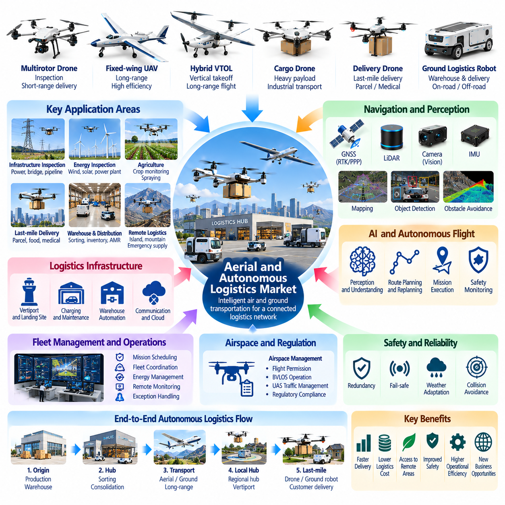{width="7.268055555555556in" height="7.268055555555556in"}

The aerial robotics and autonomous logistics market represents an expanding segment of Physical AI focused on intelligent transportation, inspection, and delivery across airborne and ground-based environments. Aerial robots provide mobility beyond conventional surface constraints, while autonomous logistics systems coordinate physical goods movement. Their commercial value arises from faster access, improved delivery flexibility, reduced operational labor, and more efficient logistics networks.

The market includes multirotor drones, fixed-wing unmanned aircraft, hybrid vertical takeoff platforms, autonomous delivery vehicles, warehouse robots, and integrated logistics systems. These platforms differ in payload capacity, flight endurance, operating range, infrastructure requirements, and autonomy. Market segmentation must distinguish aerial inspection, cargo transportation, last-mile delivery, and coordinated multimodal logistics operations.

Aerial robot morphology strongly influences commercial applications. Multirotor systems provide hovering and precise positioning, making them suitable for inspection and short-range transportation. Fixed-wing aircraft offer greater aerodynamic efficiency for longer missions, while hybrid platforms combine vertical takeoff with forward flight. Platform selection depends on payload requirements, operating distance, landing infrastructure, and environmental conditions.

Industrial inspection remains an established commercial application for aerial robotics. Drones equipped with visual cameras, thermal sensors, and specialized instruments can inspect power lines, wind turbines, industrial facilities, and infrastructure assets. Autonomous flight planning and repeatable data collection improve inspection consistency. Economic benefits depend on reduced access costs, inspection frequency, data quality, and operational safety.

Autonomous aerial delivery introduces opportunities for transporting parcels, medical supplies, replacement components, and time-sensitive materials. Such systems may improve accessibility in remote regions or locations with limited ground transportation infrastructure. However, delivery economics depend on payload weight, mission distance, weather availability, regulatory permissions, and the efficiency of loading and receiving operations.

Last-mile delivery represents a highly visible but operationally demanding market segment. Autonomous drones and ground delivery robots seek to reduce the cost and complexity of moving goods from distribution facilities to final destinations. Commercial feasibility depends on delivery density, customer accessibility, route predictability, and infrastructure compatibility. Human supervision and exception handling remain important cost factors.

Warehouse and distribution automation provides the foundation for broader autonomous logistics networks. AMRs, autonomous forklifts, robotic sorters, and conveyor systems coordinate inventory movement and order fulfillment. Aerial platforms may support inventory inspection or specialized transportation where appropriate. Effective logistics automation requires synchronization between storage systems, transportation assets, scheduling software, and enterprise operations.

Autonomous cargo drones target applications requiring transportation of heavier payloads across industrial sites, remote facilities, or geographically separated locations. Their development requires high-capacity propulsion, structural reliability, stable flight control, and dependable payload attachment. Commercial adoption depends on achieving sufficient transportation efficiency while managing energy consumption, maintenance requirements, and operational restrictions.

Navigation and localization technologies are essential for reliable aerial autonomy. Satellite positioning, inertial navigation, visual odometry, LiDAR, and environmental mapping provide complementary information about aircraft movement and surroundings. Advanced systems combine these inputs to support obstacle avoidance and trajectory planning. Navigation robustness becomes particularly important near buildings, vegetation, and areas with degraded positioning signals.

Artificial intelligence contributes to autonomous flight through perception, route planning, environmental understanding, and adaptive decision-making. Learning-based methods may improve obstacle recognition, landing-site assessment, and responses to changing conditions. However, commercial systems require predictable behavior under uncertainty. AI capabilities must therefore operate within validated flight control, safety monitoring, and mission management architectures.

Fleet management software connects individual aerial and ground robots into coordinated logistics operations. These platforms allocate missions, schedule vehicles, monitor energy availability, manage maintenance, and respond to operational exceptions. Mixed fleets introduce additional complexity because different vehicles have distinct payload capacities, speeds, and operating constraints. Effective orchestration improves asset utilization and delivery reliability.

Airspace management and regulatory compliance are major determinants of aerial market development. Commercial operations may require aircraft registration, operator authorization, flight permissions, and compliance with airspace restrictions. Beyond-visual-line-of-sight operations introduce additional requirements for risk management and operational assurance. Regulatory conditions vary across jurisdictions and influence deployment speed, service coverage, and business viability.

Safety engineering addresses hazards involving aircraft failures, collisions, falling payloads, and interactions with people or infrastructure. Commercial platforms require appropriate redundancy, emergency procedures, reliable communication, and fault detection. Ground delivery systems face different risks involving pedestrians, vehicles, and public pathways. Safety validation must consider the complete operating environment rather than individual robotic components alone.

Energy storage and propulsion technology strongly influence aerial logistics economics. Battery capacity, motor efficiency, aerodynamic design, and payload weight determine flight duration and useful operating range. Charging infrastructure and battery replacement strategies affect turnaround time and fleet availability. Higher payload capacity may increase transportation value but also creates additional energy, structural, and maintenance demands.

Weather resilience remains a significant limitation for many aerial applications. Wind, precipitation, temperature variation, and reduced visibility can restrict flight operations or increase energy consumption. Autonomous logistics services must account for these limitations when planning routes and promising delivery performance. Reliable commercialization requires realistic operating envelopes, contingency procedures, and alternative transportation arrangements.

Ground and aerial logistics systems can complement one another through multimodal transportation architectures. Ground robots provide efficient movement within facilities and accessible road networks, while aerial platforms may overcome geographical barriers or serve time-critical destinations. Coordinated operations require standardized handoff procedures, shared mission information, and compatible logistics infrastructure. Their value depends on reducing total network cost rather than maximizing individual vehicle autonomy.

Infrastructure requirements extend beyond robotic vehicles themselves. Autonomous logistics networks may need charging stations, docking facilities, landing zones, loading mechanisms, secure storage, and communications systems. These investments influence deployment economics and geographical coverage. Infrastructure standardization can reduce expansion costs, while highly customized installations may limit scalability and increase operational complexity.

The competitive landscape includes drone manufacturers, autonomous delivery developers, logistics technology companies, robotics software providers, infrastructure operators, and system integrators. Competition involves transportation cost, payload capability, operational reliability, regulatory readiness, and service coverage. Commercial differentiation increasingly depends on integrated logistics performance rather than aircraft specifications or autonomous navigation demonstrations.

Economic evaluation requires a comprehensive view of transportation costs. Total cost of ownership includes vehicles, batteries, charging equipment, software, infrastructure, maintenance, insurance, and operational supervision. Customers compare these expenses with delivery speed, service availability, labor requirements, and logistics efficiency. Financial viability depends on sustained utilization, appropriate mission selection, and reliable completion rates.

Service-based business models may accelerate adoption by allowing customers to purchase delivery or inspection outcomes rather than robotic equipment. Providers can combine vehicles, fleet software, operational personnel, maintenance, and data services into recurring contracts. However, profitability depends on mission density, asset utilization, regulatory compliance, and predictable service costs. Business models must reflect the practical limitations of autonomous operations.

The future aerial and autonomous logistics market will be influenced by advances in perception, energy efficiency, autonomous coordination, and regulatory frameworks. Improved interoperability may enable larger networks combining drones, ground robots, and automated distribution facilities. Nevertheless, sustainable expansion requires dependable operations, public acceptance, manageable infrastructure costs, and demonstrated economic advantages over conventional transportation.

Ultimately, the aerial robotics and autonomous logistics market illustrates how Physical AI extends intelligent mobility into interconnected transportation networks. Aerial platforms provide distinctive access and operational flexibility, while autonomous logistics systems coordinate goods movement across multiple environments. Long-term growth will depend on integrating reliable robotics, intelligent software, safe operations, and economically sustainable delivery services.

항공 로보틱스(Aerial Robotics) 및 자율 물류(Autonomous Logistics) 시장은 공중 및 지상 환경(Airborne and Ground-Based Environments)에서 지능형 운송(Intelligent Transportation), 점검(Inspection), 배송(Delivery)을 중심으로 확대되고 있는 피지컬 AI(Physical AI)의 시장 분야이다. 항공 로봇(Aerial Robots)은 기존 지상 이동의 제약(Surface Constraints)을 넘어서는 이동성을 제공하며, 자율 물류 시스템(Autonomous Logistics Systems)은 물리적 상품의 이동(Physical Goods Movement)을 조정한다. 이러한 시스템의 상업적 가치(Commercial Value)는 접근 속도(Faster Access), 배송 유연성(Delivery Flexibility), 운영 인력 감소(Reduced Operational Labor), 물류 네트워크 효율성(Logistics Network Efficiency) 향상에서 발생한다.

이 시장에는 멀티로터 드론(Multirotor Drones), 고정익 무인항공기(Fixed-Wing Unmanned Aircraft), 하이브리드 수직이착륙 플랫폼(Hybrid Vertical Takeoff Platforms), 자율 배송 차량(Autonomous Delivery Vehicles), 창고 로봇(Warehouse Robots), 통합 물류 시스템(Integrated Logistics Systems)이 포함된다. 이러한 플랫폼은 적재 능력(Payload Capacity), 비행 지속시간(Flight Endurance), 운영 범위(Operating Range), 인프라 요구사항(Infrastructure Requirements), 자율성(Autonomy)에서 차이가 있다. 시장 세분화(Market Segmentation)에서는 항공 점검(Aerial Inspection), 화물 운송(Cargo Transportation), 라스트마일 배송(Last-Mile Delivery), 협조형 다중모달 물류 운영(Coordinated Multimodal Logistics Operations)을 구분해야 한다.

항공 로봇의 형태(Aerial Robot Morphology)는 상업적 응용 분야(Commercial Applications)에 큰 영향을 미친다. 멀티로터 시스템(Multirotor Systems)은 제자리 비행(Hovering)과 정밀 위치 제어(Precise Positioning)를 제공하므로 점검 및 단거리 운송(Short-Range Transportation)에 적합하다. 고정익 항공기(Fixed-Wing Aircraft)는 장거리 임무(Longer Missions)에 더 높은 공기역학적 효율(Aerodynamic Efficiency)을 제공하며, 하이브리드 플랫폼(Hybrid Platforms)은 수직이륙(Vertical Takeoff)과 전진 비행(Forward Flight)을 결합한다. 플랫폼 선정(Platform Selection)은 적재 요구사항(Payload Requirements), 운항 거리(Operating Distance), 착륙 인프라(Landing Infrastructure), 환경 조건(Environmental Conditions)에 따라 결정된다.

산업 설비 점검(Industrial Inspection)은 항공 로보틱스(Aerial Robotics)의 확립된 상업적 응용 분야(Established Commercial Application)이다. 영상 카메라(Visual Cameras), 열화상 센서(Thermal Sensors), 특수 계측기(Specialized Instruments)를 장착한 드론은 송전선(Power Lines), 풍력 터빈(Wind Turbines), 산업 시설(Industrial Facilities), 인프라 자산(Infrastructure Assets)을 점검할 수 있다. 자율 비행 계획(Autonomous Flight Planning)과 반복 가능한 데이터 수집(Repeatable Data Collection)은 점검의 일관성(Inspection Consistency)을 향상시킨다. 경제적 효과(Economic Benefits)는 접근 비용 감소(Reduced Access Costs), 점검 빈도(Inspection Frequency), 데이터 품질(Data Quality), 운영 안전성(Operational Safety)에 달려 있다.

자율 항공 배송(Autonomous Aerial Delivery)은 소포(Parcels), 의료 물품(Medical Supplies), 교체 부품(Replacement Components), 시간 민감형 물자(Time-Sensitive Materials)를 운송할 수 있는 기회를 제공한다. 이러한 시스템은 원격 지역(Remote Regions)이나 지상 교통 인프라(Ground Transportation Infrastructure)가 제한된 장소의 접근성을 향상시킬 수 있다. 그러나 배송 경제성(Delivery Economics)은 적재물 무게(Payload Weight), 임무 거리(Mission Distance), 기상 조건에 따른 운항 가능성(Weather Availability), 규제 허가(Regulatory Permissions), 적재 및 수령 작업(Loading and Receiving Operations)의 효율성에 따라 결정된다.

라스트마일 배송(Last-Mile Delivery)은 시장에서 높은 관심을 받지만 운영상 요구사항이 까다로운 분야이다. 자율 드론(Autonomous Drones)과 지상 배송 로봇(Ground Delivery Robots)은 물류 거점(Distribution Facilities)에서 최종 목적지(Final Destinations)까지 상품을 이동시키는 비용과 복잡성을 줄이는 것을 목표로 한다. 상업적 실현 가능성(Commercial Feasibility)은 배송 밀도(Delivery Density), 고객 접근성(Customer Accessibility), 경로 예측 가능성(Route Predictability), 인프라 호환성(Infrastructure Compatibility)에 달려 있다. 인간 감독(Human Supervision)과 예외 상황 처리(Exception Handling)는 여전히 중요한 비용 요소(Cost Factors)이다.

창고 및 물류센터 자동화(Warehouse and Distribution Automation)는 보다 광범위한 자율 물류 네트워크(Autonomous Logistics Networks)의 기반을 제공한다. 자율이동로봇(Autonomous Mobile Robots, AMRs), 자율주행 지게차(Autonomous Forklifts), 로봇 분류기(Robotic Sorters), 컨베이어 시스템(Conveyor Systems)은 재고 이동(Inventory Movement)과 주문 이행(Order Fulfillment)을 조정한다. 항공 플랫폼(Aerial Platforms)은 적절한 환경에서 재고 점검(Inventory Inspection)이나 특수 운송(Specialized Transportation)을 지원할 수 있다. 효과적인 물류 자동화(Effective Logistics Automation)를 위해서는 보관 시스템(Storage Systems), 운송 자산(Transportation Assets), 일정 관리 소프트웨어(Scheduling Software), 기업 운영 시스템(Enterprise Operations) 간의 동기화(Synchronization)가 필요하다.

자율 화물 드론(Autonomous Cargo Drones)은 산업 현장(Industrial Sites), 원격 시설(Remote Facilities), 지리적으로 분리된 장소(Geographically Separated Locations) 사이에서 무거운 적재물(Heavier Payloads)을 운송해야 하는 응용 분야를 목표로 한다. 이러한 시스템의 개발에는 고용량 추진 시스템(High-Capacity Propulsion), 구조적 신뢰성(Structural Reliability), 안정적인 비행 제어(Stable Flight Control), 신뢰할 수 있는 적재물 고정 장치(Dependable Payload Attachment)가 필요하다. 상업적 도입(Commercial Adoption)은 에너지 소비(Energy Consumption), 유지보수 요구사항(Maintenance Requirements), 운영 제한(Operational Restrictions)을 관리하면서 충분한 운송 효율(Transportation Efficiency)을 확보할 수 있는지에 달려 있다.

항법 및 위치추정 기술(Navigation and Localization Technologies)은 신뢰할 수 있는 항공 자율성(Aerial Autonomy)에 필수적이다. 위성 위치결정(Satellite Positioning), 관성항법(Inertial Navigation), 시각 오도메트리(Visual Odometry), 라이다(LiDAR), 환경 지도작성(Environmental Mapping)은 항공기의 움직임과 주변 환경에 대한 상호보완적인 정보를 제공한다. 고급 시스템(Advanced Systems)은 이러한 정보를 결합하여 장애물 회피(Obstacle Avoidance)와 궤적 계획(Trajectory Planning)을 지원한다. 항법 강건성(Navigation Robustness)은 건물(Buildings), 식생(Vegetation), 위치결정 신호가 저하된 지역(Degraded Positioning Signals) 근처에서 특히 중요하다.

인공지능(Artificial Intelligence)은 인식(Perception), 경로 계획(Route Planning), 환경 이해(Environmental Understanding), 적응형 의사결정(Adaptive Decision-Making)을 통해 자율 비행(Autonomous Flight)에 기여한다. 학습 기반 방법(Learning-Based Methods)은 장애물 인식(Obstacle Recognition), 착륙 지점 평가(Landing-Site Assessment), 변화하는 조건에 대한 대응(Responses to Changing Conditions)을 향상시킬 수 있다. 그러나 상용 시스템(Commercial Systems)은 불확실성(Uncertainty) 속에서도 예측 가능한 동작(Predictable Behavior)을 보장해야 한다. 따라서 인공지능 기능(AI Capabilities)은 검증된 비행 제어(Validated Flight Control), 안전 모니터링(Safety Monitoring), 임무 관리 아키텍처(Mission Management Architectures) 내에서 작동해야 한다.

군집관리 소프트웨어(Fleet Management Software)는 개별 항공 및 지상 로봇(Individual Aerial and Ground Robots)을 연결하여 협조된 물류 운영(Coordinated Logistics Operations)을 가능하게 한다. 이러한 플랫폼은 임무 할당(Mission Allocation), 차량 일정 관리(Vehicle Scheduling), 에너지 가용성 모니터링(Energy Availability Monitoring), 유지보수 관리(Maintenance Management), 운영 예외 상황 대응(Operational Exception Handling)을 수행한다. 혼합 로봇군(Mixed Fleets)은 차량마다 적재 능력(Payload Capacities), 속도(Speeds), 운영 제약(Operating Constraints)이 다르므로 추가적인 복잡성을 발생시킨다. 효과적인 통합 운영(Effective Orchestration)은 자산 활용률(Asset Utilization)과 배송 신뢰성(Delivery Reliability)을 향상시킨다.

공역 관리(Airspace Management)와 규제 준수(Regulatory Compliance)는 항공 시장 발전(Aerial Market Development)을 결정하는 주요 요소이다. 상업적 운영(Commercial Operations)에는 항공기 등록(Aircraft Registration), 운영자 승인(Operator Authorization), 비행 허가(Flight Permissions), 공역 제한 준수(Compliance with Airspace Restrictions)가 필요할 수 있다. 비가시권 비행(Beyond-Visual-Line-of-Sight Operations, BVLOS)은 위험 관리(Risk Management)와 운영 안전성 보증(Operational Assurance)에 대한 추가 요구사항을 수반한다. 규제 조건(Regulatory Conditions)은 국가 및 관할권(Jurisdictions)에 따라 달라지며 배포 속도(Deployment Speed), 서비스 범위(Service Coverage), 사업 타당성(Business Viability)에 영향을 미친다.

안전 엔지니어링(Safety Engineering)은 항공기 고장(Aircraft Failures), 충돌(Collisions), 적재물 낙하(Falling Payloads), 사람 또는 인프라와의 상호작용(Interactions with People or Infrastructure)에서 발생하는 위험을 다룬다. 상용 플랫폼(Commercial Platforms)은 적절한 이중화(Redundancy), 비상 절차(Emergency Procedures), 신뢰할 수 있는 통신(Reliable Communication), 고장 감지(Fault Detection)를 필요로 한다. 지상 배송 시스템(Ground Delivery Systems)은 보행자(Pedestrians), 차량(Vehicles), 공공 보행로(Public Pathways)와 관련된 다른 유형의 위험에 직면한다. 안전성 검증(Safety Validation)은 개별 로봇 구성요소(Individual Robotic Components)만이 아니라 전체 운영 환경(Complete Operating Environment)을 고려해야 한다.

에너지 저장(Energy Storage) 및 추진 기술(Propulsion Technology)은 항공 물류 경제성(Aerial Logistics Economics)에 큰 영향을 미친다. 배터리 용량(Battery Capacity), 모터 효율(Motor Efficiency), 공기역학적 설계(Aerodynamic Design), 적재물 무게(Payload Weight)는 비행 지속시간(Flight Duration)과 유효 운항 범위(Useful Operating Range)를 결정한다. 충전 인프라(Charging Infrastructure)와 배터리 교체 전략(Battery Replacement Strategies)은 운항 준비시간(Turnaround Time)과 군집 가용성(Fleet Availability)에 영향을 미친다. 더 높은 적재 능력(Higher Payload Capacity)은 운송 가치를 높일 수 있지만 추가적인 에너지, 구조, 유지보수 요구사항(Energy, Structural, and Maintenance Demands)을 발생시킨다.

기상 대응 능력(Weather Resilience)은 많은 항공 응용 분야(Aerial Applications)에서 여전히 중요한 제약 요소이다. 바람(Wind), 강수(Precipitation), 온도 변화(Temperature Variation), 시야 저하(Reduced Visibility)는 비행 운영(Flight Operations)을 제한하거나 에너지 소비(Energy Consumption)를 증가시킬 수 있다. 자율 물류 서비스(Autonomous Logistics Services)는 경로 계획(Route Planning)과 배송 성능(Delivery Performance)을 약속할 때 이러한 제약을 고려해야 한다. 신뢰할 수 있는 상용화(Reliable Commercialization)를 위해서는 현실적인 운항 가능 범위(Realistic Operating Envelopes), 비상 대응 절차(Contingency Procedures), 대체 운송 수단(Alternative Transportation Arrangements)이 필요하다.

지상 및 항공 물류 시스템(Ground and Aerial Logistics Systems)은 다중모달 운송 아키텍처(Multimodal Transportation Architectures)를 통해 상호보완적으로 작동할 수 있다. 지상 로봇(Ground Robots)은 시설 내부와 접근 가능한 도로망(Accessible Road Networks)에서 효율적인 이동을 제공하며, 항공 플랫폼(Aerial Platforms)은 지리적 장벽(Geographical Barriers)을 극복하거나 긴급 목적지(Time-Critical Destinations)에 서비스를 제공할 수 있다. 협조된 운영(Coordinated Operations)을 위해서는 표준화된 인계 절차(Standardized Handoff Procedures), 공유 임무 정보(Shared Mission Information), 호환 가능한 물류 인프라(Compatible Logistics Infrastructure)가 필요하다. 이러한 시스템의 가치는 개별 차량의 자율성(Individual Vehicle Autonomy)을 극대화하는 것이 아니라 전체 네트워크 비용(Total Network Cost)을 줄이는 데 달려 있다.

인프라 요구사항(Infrastructure Requirements)은 로봇 차량(Robotic Vehicles) 자체를 넘어선다. 자율 물류 네트워크(Autonomous Logistics Networks)에는 충전소(Charging Stations), 도킹 시설(Docking Facilities), 착륙 구역(Landing Zones), 적재 장치(Loading Mechanisms), 보안 저장시설(Secure Storage), 통신 시스템(Communications Systems)이 필요할 수 있다. 이러한 투자는 배포 경제성(Deployment Economics)과 지리적 서비스 범위(Geographical Coverage)에 영향을 미친다. 인프라 표준화(Infrastructure Standardization)는 확장 비용(Expansion Costs)을 줄일 수 있지만, 고도로 맞춤화된 설치(Highly Customized Installations)는 확장성(Scalability)을 제한하고 운영 복잡성(Operational Complexity)을 증가시킬 수 있다.

경쟁 구도(Competitive Landscape)에는 드론 제조업체(Drone Manufacturers), 자율 배송 개발업체(Autonomous Delivery Developers), 물류 기술 기업(Logistics Technology Companies), 로봇 소프트웨어 제공업체(Robotics Software Providers), 인프라 운영업체(Infrastructure Operators), 시스템 통합업체(System Integrators)가 포함된다. 경쟁 요소에는 운송 비용(Transportation Cost), 적재 능력(Payload Capability), 운영 신뢰성(Operational Reliability), 규제 대응 준비 수준(Regulatory Readiness), 서비스 범위(Service Coverage)가 포함된다. 상업적 차별화(Commercial Differentiation)는 항공기 사양(Aircraft Specifications)이나 자율주행 시연(Autonomous Navigation Demonstrations)보다 통합 물류 성능(Integrated Logistics Performance)에 점차 의존하고 있다.

경제성 평가(Economic Evaluation)에서는 운송 비용(Transportation Costs)을 포괄적으로 검토해야 한다. 총소유비용(Total Cost of Ownership, TCO)에는 차량(Vehicles), 배터리(Batteries), 충전 장비(Charging Equipment), 소프트웨어(Software), 인프라(Infrastructure), 유지보수(Maintenance), 보험(Insurance), 운영 감독(Operational Supervision)이 포함된다. 고객은 이러한 비용을 배송 속도(Delivery Speed), 서비스 가용성(Service Availability), 인력 요구사항(Labor Requirements), 물류 효율(Logistics Efficiency)과 비교한다. 재무적 타당성(Financial Viability)은 지속적인 가동률(Sustained Utilization), 적절한 임무 선정(Appropriate Mission Selection), 신뢰할 수 있는 임무 완료율(Reliable Completion Rates)에 달려 있다.

서비스 기반 비즈니스 모델(Service-Based Business Models)은 고객이 로봇 장비(Robotic Equipment) 자체보다 배송 또는 점검 결과(Delivery or Inspection Outcomes)를 구매하도록 하여 도입을 가속화할 수 있다. 서비스 제공업체(Providers)는 차량(Vehicles), 군집관리 소프트웨어(Fleet Software), 운영 인력(Operational Personnel), 유지보수(Maintenance), 데이터 서비스(Data Services)를 반복 계약(Recurring Contracts)으로 결합할 수 있다. 그러나 수익성(Profitability)은 임무 밀도(Mission Density), 자산 활용률(Asset Utilization), 규제 준수(Regulatory Compliance), 예측 가능한 서비스 비용(Predictable Service Costs)에 달려 있다. 비즈니스 모델(Business Models)은 자율 운영(Autonomous Operations)의 현실적인 한계를 반영해야 한다.

미래의 항공 및 자율 물류 시장(Future Aerial and Autonomous Logistics Market)은 인식(Perception), 에너지 효율(Energy Efficiency), 자율 협조(Autonomous Coordination), 규제 체계(Regulatory Frameworks)의 발전에 영향을 받을 것이다. 향상된 상호운용성(Improved Interoperability)은 드론(Drones), 지상 로봇(Ground Robots), 자동화 물류센터(Automated Distribution Facilities)를 결합하는 대규모 네트워크(Larger Networks)를 가능하게 할 수 있다. 그러나 지속 가능한 확장(Sustainable Expansion)을 위해서는 신뢰할 수 있는 운영(Dependable Operations), 사회적 수용성(Public Acceptance), 관리 가능한 인프라 비용(Manageable Infrastructure Costs), 기존 운송 방식(Conventional Transportation) 대비 입증된 경제적 이점(Demonstrated Economic Advantages)이 필요하다.

궁극적으로 항공 로보틱스 및 자율 물류 시장(Aerial Robotics and Autonomous Logistics Market)은 피지컬 AI(Physical AI)가 지능형 이동성(Intelligent Mobility)을 상호 연결된 운송 네트워크(Interconnected Transportation Networks)로 확장하는 방식을 보여준다. 항공 플랫폼(Aerial Platforms)은 차별화된 접근성(Distinctive Access)과 운영 유연성(Operational Flexibility)을 제공하며, 자율 물류 시스템(Autonomous Logistics Systems)은 여러 환경에 걸친 상품 이동(Goods Movement)을 조정한다. 장기적인 성장(Long-Term Growth)은 신뢰할 수 있는 로보틱스(Reliable Robotics), 지능형 소프트웨어(Intelligent Software), 안전한 운영(Safe Operations), 경제적으로 지속 가능한 배송 서비스(Economically Sustainable Delivery Services)를 통합하는 능력에 달려 있다.

##  

## 01.09. Robot Foundation Model and AI Platform Market

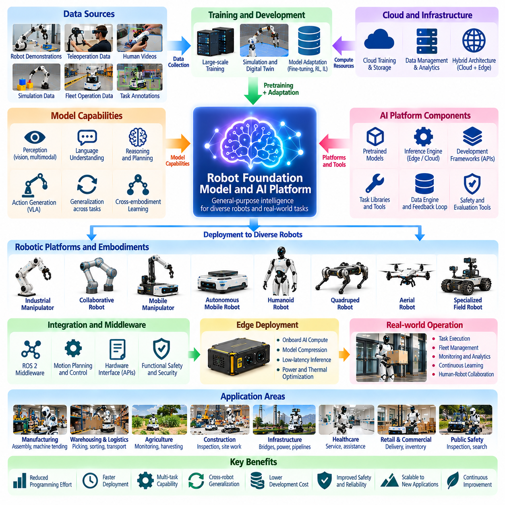{width="7.268055555555556in" height="7.268055555555556in"}

The robot foundation model and AI platform market represents an emerging software and intelligence layer within the Physical AI ecosystem. Unlike conventional robotics software designed for specific machines and tasks, foundation models seek to provide reusable capabilities across multiple robotic applications. Their commercial potential comes from reducing task-specific programming, accelerating deployment, and enabling more adaptable physical automation.

Robot foundation models are trained on diverse combinations of visual observations, language instructions, robot states, and action trajectories. These models aim to learn representations that support perception, reasoning, planning, and physical interaction. The market includes pretrained models, adaptable robot policies, inference engines, development frameworks, and integrated platforms connecting intelligent models with robotic hardware.

Vision-language-action models represent an important category within this market. They connect visual perception and natural-language instructions to executable robot actions, potentially enabling task specification without extensive manual programming. However, language understanding does not automatically guarantee physical competence. Commercial performance depends on accurate perception, action generation, control integration, and reliable execution under real-world constraints.

The market can be divided into foundation model developers, robotics AI platform providers, cloud infrastructure companies, simulation vendors, and robot manufacturers offering integrated intelligence stacks. Some suppliers provide general-purpose models, while others specialize in manipulation, mobility, or industrial workflows. Their competitive positions depend on model performance, data access, deployment compatibility, and customer integration requirements.

Generalist robot policies seek to perform multiple tasks using shared model parameters rather than separate controllers for every application. This approach may reduce engineering effort when introducing new objects, environments, or task variations. Nevertheless, broad task coverage can introduce performance tradeoffs. Commercial customers must determine whether generalized capability provides sufficient accuracy, speed, and reliability for their operational requirements.

Cross-embodiment learning is a strategically important capability because robotic platforms differ in geometry, sensors, actuators, and action spaces. A model trained across multiple embodiments may transfer useful representations between robot types. However, differences in kinematics, dynamics, and hardware limitations complicate direct transfer. Platform providers must support embodiment adaptation, calibration, and task-specific validation.

Training data forms a central competitive asset in the foundation model market. Robot demonstrations, teleoperation records, human videos, simulation trajectories, and operational fleet data contribute different forms of experience. Data diversity may improve generalization, but inconsistent labeling and incompatible action formats reduce usefulness. Commercial data platforms must therefore emphasize quality, synchronization, governance, and traceability.

Data engines create recurring relationships between deployed robots and AI development platforms. Operational systems collect execution results, failures, interventions, and environmental variations that can inform subsequent training. Effective feedback loops support continuous model improvement and targeted adaptation. However, data ownership, privacy obligations, customer permissions, and transfer costs influence the economic value of fleet-generated information.

Simulation platforms provide another important market layer by supporting synthetic data generation, policy training, and virtual evaluation. Physics simulation and digital twins can reduce dependence on expensive real-world experiments. Domain randomization and simulation-to-real transfer techniques help prepare models for physical deployment. Nevertheless, simulated success must be verified against real contact dynamics, sensor errors, and operational variability.

Model adaptation services address the gap between general pretrained capabilities and customer-specific requirements. Fine-tuning, imitation learning, reinforcement learning, and task-specific datasets can improve performance within particular environments. Adaptation costs depend on data availability, hardware compatibility, and validation effort. Suppliers that simplify these processes may create substantial value for system integrators and enterprise customers.

Edge deployment is a major commercial consideration because physical robots require timely decisions and reliable operation despite network interruptions. Onboard processors must execute perception, planning, and action models within power and thermal limits. Model compression, quantization, and optimized inference can reduce computational requirements. Platform value depends on achieving acceptable latency without sacrificing essential task performance.

Cloud computing supports large-scale model training, data management, simulation, and fleet analytics. Hybrid architectures distribute computation between onboard systems, local servers, and centralized cloud platforms. Time-critical control generally remains close to the robot, while less urgent learning and analysis can occur remotely. Commercial architecture decisions depend on latency, bandwidth, cybersecurity, operational continuity, and infrastructure cost.

Robot AI platforms must integrate with established robotics middleware, motion planning systems, and safety controllers. Standardized interfaces can connect high-level task reasoning to low-level execution while accommodating different hardware configurations. Compatibility with existing enterprise software also matters. Customers favor platforms that reduce integration effort and preserve investments in deployed equipment and operational infrastructure.

Safety and reliability represent fundamental barriers to commercialization. Foundation models may generate inappropriate actions when confronted with unfamiliar situations, ambiguous instructions, or misleading sensory information. Practical systems require constrained execution, uncertainty handling, runtime monitoring, and independent safety mechanisms. Model capability alone cannot replace application-level risk assessment and validation.

Evaluation and benchmarking influence purchasing decisions because model performance is difficult to compare across different robots and tasks. Useful metrics include task success rate, completion time, intervention frequency, generalization, and recovery performance. Evaluations should include unfamiliar objects and changing environments. Standardized testing can improve market transparency, although real deployment results remain essential.

The competitive landscape includes proprietary model providers, open-source communities, cloud AI companies, robotics manufacturers, and specialized software developers. Open models can reduce entry barriers and encourage experimentation, while proprietary platforms may offer integrated support and optimized performance. Competition increasingly involves ecosystem strength, developer accessibility, hardware compatibility, and access to high-quality training data.

Commercial business models include software licensing, API-based inference services, enterprise subscriptions, model customization, and managed robotics intelligence platforms. Pricing may depend on robot count, computational usage, supported capabilities, or deployment scale. Providers must align revenue with measurable customer value. Excessive recurring costs can weaken adoption when conventional automation already performs the required task economically.

Platform economics differ from conventional robot hardware sales because software capabilities may be distributed across many compatible systems. Reusable models and development tools can create economies of scale, while accumulated operational data may strengthen future products. However, training infrastructure, data acquisition, support, and model maintenance remain expensive. Sustainable profitability requires balancing development costs with deployment volume and customer retention.

Vendor lock-in and interoperability are important considerations for enterprise buyers. Proprietary action formats, model interfaces, and data pipelines may make migration between providers difficult. Open interfaces and portable deployment architectures can reduce dependence on individual suppliers. Customers must evaluate long-term upgrade paths, intellectual property rights, data ownership, and compatibility with future robotic hardware.

The market also faces uncertainty regarding how much intelligence can be shared across different physical tasks. Foundation models may generalize effectively within related domains while requiring substantial adaptation for unfamiliar manipulation or locomotion problems. Physical constraints cannot be eliminated through model scaling alone. Successful commercialization requires realistic expectations about generalization, reliability, and the continuing importance of specialized control.

Future growth will depend on improved multimodal learning, action representations, world models, and efficient inference architectures. Better integration between language reasoning, predictive physical models, and robot control may expand task flexibility. Fleet-scale learning could accelerate improvement as deployments increase. Nevertheless, progress must be demonstrated through repeatable physical performance rather than benchmark scores or isolated demonstrations.

Ultimately, the robot foundation model and AI platform market seeks to transform robotic intelligence from isolated application software into reusable infrastructure for Physical AI. Its strategic value lies in connecting data, learning, simulation, deployment, and operational improvement across robotic systems. Long-term market leadership will depend on delivering reliable intelligence, manageable integration costs, strong ecosystems, and measurable industrial productivity.

로봇 파운데이션 모델(Robot Foundation Model) 및 인공지능 플랫폼(AI Platform) 시장은 피지컬 AI(Physical AI) 생태계 내에서 새롭게 등장하는 소프트웨어 및 지능 계층(Software and Intelligence Layer)을 형성한다. 특정 기계와 작업을 위해 설계된 기존 로보틱스 소프트웨어(Conventional Robotics Software)와 달리, 파운데이션 모델(Foundation Models)은 다양한 로봇 응용 분야에서 재사용 가능한 기능(Reusable Capabilities)을 제공하는 것을 목표로 한다. 이러한 기술의 상업적 잠재력(Commercial Potential)은 작업별 프로그래밍(Task-Specific Programming)을 줄이고, 현장 배포(Deployment)를 가속화하며, 더욱 유연하게 적응하는 물리적 자동화(Adaptable Physical Automation)를 가능하게 하는 데 있다.

로봇 파운데이션 모델(Robot Foundation Models)은 다양한 시각적 관측(Visual Observations), 언어 명령(Language Instructions), 로봇 상태(Robot States), 행동 궤적(Action Trajectories)을 조합한 데이터로 학습된다. 이러한 모델은 인식(Perception), 추론(Reasoning), 계획(Planning), 물리적 상호작용(Physical Interaction)을 지원하는 표현(Representations)을 학습하는 것을 목표로 한다. 이 시장에는 사전학습 모델(Pretrained Models), 적응 가능한 로봇 정책(Adaptable Robot Policies), 추론 엔진(Inference Engines), 개발 프레임워크(Development Frameworks), 지능형 모델과 로봇 하드웨어를 연결하는 통합 플랫폼(Integrated Platforms)이 포함된다.

비전-언어-행동 모델(Vision-Language-Action Models, VLA)은 이 시장의 중요한 분야를 형성한다. 이러한 모델은 시각적 인식(Visual Perception)과 자연어 명령(Natural-Language Instructions)을 실행 가능한 로봇 행동(Executable Robot Actions)으로 연결하여, 광범위한 수동 프로그래밍(Manual Programming) 없이 작업을 지정할 수 있도록 한다. 그러나 언어 이해(Language Understanding)가 자동으로 물리적 작업 능력(Physical Competence)을 보장하는 것은 아니다. 상업적 성능(Commercial Performance)은 정확한 인식(Accurate Perception), 행동 생성(Action Generation), 제어 통합(Control Integration), 실제 환경의 제약(Real-World Constraints)에서 신뢰할 수 있는 실행(Reliable Execution)에 달려 있다.

이 시장은 파운데이션 모델 개발업체(Foundation Model Developers), 로보틱스 AI 플랫폼 제공업체(Robotics AI Platform Providers), 클라우드 인프라 기업(Cloud Infrastructure Companies), 시뮬레이션 공급업체(Simulation Vendors), 통합 지능 소프트웨어 스택(Integrated Intelligence Stacks)을 제공하는 로봇 제조업체(Robot Manufacturers)로 구분할 수 있다. 일부 공급업체는 범용 모델(General-Purpose Models)을 제공하는 반면, 다른 업체는 조작(Manipulation), 이동성(Mobility), 산업 작업흐름(Industrial Workflows)에 특화되어 있다. 경쟁력(Competitive Positions)은 모델 성능(Model Performance), 데이터 접근성(Data Access), 배포 호환성(Deployment Compatibility), 고객의 시스템 통합 요구사항(Customer Integration Requirements)에 따라 결정된다.

범용 로봇 정책(Generalist Robot Policies)은 모든 응용 분야에 별도의 제어기(Separate Controllers)를 사용하는 대신, 공유된 모델 매개변수(Shared Model Parameters)를 활용하여 여러 작업을 수행하는 것을 목표로 한다. 이러한 접근법은 새로운 물체(Objects), 환경(Environments), 작업 변형(Task Variations)을 도입할 때 필요한 엔지니어링 작업(Engineering Effort)을 줄일 수 있다. 그러나 광범위한 작업 지원(Broad Task Coverage)은 성능상의 상충관계(Performance Tradeoffs)를 발생시킬 수 있다. 상업적 고객(Commercial Customers)은 일반화된 기능(Generalized Capability)이 운영 요구사항(Operational Requirements)에 필요한 정확도(Accuracy), 속도(Speed), 신뢰성(Reliability)을 충분히 제공하는지 판단해야 한다.

서로 다른 로봇 신체 형태 간 학습(Cross-Embodiment Learning)은 로봇 플랫폼마다 기하학적 구조(Geometry), 센서(Sensors), 액추에이터(Actuators), 행동 공간(Action Spaces)이 다르기 때문에 전략적으로 중요한 기능이다. 여러 신체 형태(Multiple Embodiments)를 대상으로 학습한 모델은 서로 다른 로봇 유형 사이에서 유용한 표현(Useful Representations)을 전이(Transfer)할 수 있다. 그러나 운동학(Kinematics), 동역학(Dynamics), 하드웨어 제약(Hardware Limitations)의 차이는 직접적인 전이(Direct Transfer)를 어렵게 만든다. 플랫폼 제공업체는 신체 형태 적응(Embodiment Adaptation), 보정(Calibration), 작업별 검증(Task-Specific Validation)을 지원해야 한다.

학습 데이터(Training Data)는 파운데이션 모델 시장(Foundation Model Market)의 핵심 경쟁 자산(Competitive Asset)을 형성한다. 로봇 시연(Robot Demonstrations), 원격조작 기록(Teleoperation Records), 인간 동영상(Human Videos), 시뮬레이션 궤적(Simulation Trajectories), 운영 중인 로봇군 데이터(Operational Fleet Data)는 서로 다른 형태의 경험(Experience)을 제공한다. 데이터 다양성(Data Diversity)은 일반화(Generalization)를 향상시킬 수 있지만, 일관되지 않은 라벨링(Inconsistent Labeling)과 호환되지 않는 행동 형식(Incompatible Action Formats)은 활용 가치를 낮춘다. 따라서 상용 데이터 플랫폼(Commercial Data Platforms)은 품질(Quality), 동기화(Synchronization), 거버넌스(Governance), 추적 가능성(Traceability)을 중시해야 한다.

데이터 엔진(Data Engines)은 배포된 로봇(Deployed Robots)과 AI 개발 플랫폼(AI Development Platforms) 사이에 반복적인 관계(Recurring Relationships)를 형성한다. 운영 시스템(Operational Systems)은 실행 결과(Execution Results), 실패(Failures), 개입(Interventions), 환경 변화(Environmental Variations)를 수집하여 후속 학습(Subsequent Training)에 활용할 수 있다. 효과적인 피드백 루프(Effective Feedback Loops)는 지속적인 모델 개선(Continuous Model Improvement)과 목표 지향적 적응(Targeted Adaptation)을 지원한다. 그러나 데이터 소유권(Data Ownership), 개인정보 보호 의무(Privacy Obligations), 고객 허가(Customer Permissions), 데이터 전송 비용(Transfer Costs)은 로봇군에서 생성된 정보(Fleet-Generated Information)의 경제적 가치(Economic Value)에 영향을 미친다.

시뮬레이션 플랫폼(Simulation Platforms)은 합성 데이터 생성(Synthetic Data Generation), 정책 학습(Policy Training), 가상 평가(Virtual Evaluation)를 지원하는 또 다른 중요한 시장 계층(Market Layer)을 제공한다. 물리 시뮬레이션(Physics Simulation)과 디지털 트윈(Digital Twins)은 비용이 많이 드는 실제 환경 실험(Real-World Experiments)에 대한 의존도를 줄일 수 있다. 도메인 무작위화(Domain Randomization)와 시뮬레이션-현실 전이(Simulation-to-Real Transfer) 기술은 모델이 실제 물리 환경에 배포될 수 있도록 준비하는 데 도움을 준다. 그러나 시뮬레이션에서의 성공(Simulated Success)은 실제 접촉 동역학(Real Contact Dynamics), 센서 오류(Sensor Errors), 운영 변동성(Operational Variability)을 기준으로 검증되어야 한다.

모델 적응 서비스(Model Adaptation Services)는 범용 사전학습 기능(General Pretrained Capabilities)과 고객별 요구사항(Customer-Specific Requirements) 사이의 격차를 해결한다. 미세조정(Fine-Tuning), 모방학습(Imitation Learning), 강화학습(Reinforcement Learning), 작업별 데이터셋(Task-Specific Datasets)은 특정 환경에서의 성능을 향상시킬 수 있다. 적응 비용(Adaptation Costs)은 데이터 가용성(Data Availability), 하드웨어 호환성(Hardware Compatibility), 검증 작업(Validation Effort)에 따라 달라진다. 이러한 과정을 단순화하는 공급업체는 시스템 통합업체(System Integrators)와 기업 고객(Enterprise Customers)에게 상당한 가치를 제공할 수 있다.

엣지 배포(Edge Deployment)는 물리적 로봇(Physical Robots)이 네트워크 중단(Network Interruptions) 상황에서도 신속하게 의사결정을 수행하고 안정적으로 작동해야 하므로 중요한 상업적 고려사항(Commercial Consideration)이다. 탑재형 프로세서(Onboard Processors)는 전력 및 열 제약(Power and Thermal Limits) 내에서 인식(Perception), 계획(Planning), 행동 모델(Action Models)을 실행해야 한다. 모델 압축(Model Compression), 양자화(Quantization), 최적화된 추론(Optimized Inference)은 연산 요구사항(Computational Requirements)을 줄일 수 있다. 플랫폼 가치(Platform Value)는 필수적인 작업 성능(Essential Task Performance)을 유지하면서 허용 가능한 지연시간(Acceptable Latency)을 달성하는 데 달려 있다.

클라우드 컴퓨팅(Cloud Computing)은 대규모 모델 학습(Large-Scale Model Training), 데이터 관리(Data Management), 시뮬레이션(Simulation), 로봇군 분석(Fleet Analytics)을 지원한다. 하이브리드 아키텍처(Hybrid Architectures)는 탑재형 시스템(Onboard Systems), 로컬 서버(Local Servers), 중앙집중형 클라우드 플랫폼(Centralized Cloud Platforms) 사이에 연산 작업(Computation)을 분산한다. 시간에 민감한 제어(Time-Critical Control)는 일반적으로 로봇 가까이에서 수행되며, 상대적으로 긴급하지 않은 학습과 분석(Learning and Analysis)은 원격으로 처리할 수 있다. 상업적 아키텍처 결정(Commercial Architecture Decisions)은 지연시간(Latency), 대역폭(Bandwidth), 사이버보안(Cybersecurity), 운영 연속성(Operational Continuity), 인프라 비용(Infrastructure Cost)에 따라 달라진다.

로봇 AI 플랫폼(Robot AI Platforms)은 기존 로보틱스 미들웨어(Robotics Middleware), 동작 계획 시스템(Motion Planning Systems), 안전 제어기(Safety Controllers)와 통합되어야 한다. 표준화된 인터페이스(Standardized Interfaces)는 다양한 하드웨어 구성(Hardware Configurations)을 수용하면서 상위 수준 작업 추론(High-Level Task Reasoning)을 하위 수준 실행(Low-Level Execution)에 연결할 수 있다. 기존 기업용 소프트웨어(Enterprise Software)와의 호환성(Compatibility)도 중요하다. 고객은 시스템 통합 작업(Integration Effort)을 줄이고 이미 배포된 장비(Deployed Equipment)와 운영 인프라(Operational Infrastructure)에 대한 투자를 보호하는 플랫폼을 선호한다.

안전성(Safety)과 신뢰성(Reliability)은 상용화(Commercialization)의 근본적인 장벽을 형성한다. 파운데이션 모델(Foundation Models)은 익숙하지 않은 상황(Unfamiliar Situations), 모호한 명령(Ambiguous Instructions), 잘못된 방향으로 유도하는 감각 정보(Misleading Sensory Information)에 직면했을 때 부적절한 행동(Inappropriate Actions)을 생성할 수 있다. 실용적인 시스템(Practical Systems)에는 제약된 실행(Constrained Execution), 불확실성 처리(Uncertainty Handling), 실행시간 모니터링(Runtime Monitoring), 독립적인 안전 메커니즘(Independent Safety Mechanisms)이 필요하다. 모델의 기능(Model Capability)만으로는 응용 수준의 위험성 평가(Application-Level Risk Assessment)와 검증(Validation)을 대체할 수 없다.

평가 및 벤치마킹(Evaluation and Benchmarking)은 서로 다른 로봇과 작업에서 모델 성능(Model Performance)을 비교하기 어렵기 때문에 구매 의사결정(Purchasing Decisions)에 영향을 미친다. 유용한 평가 지표(Useful Metrics)에는 작업 성공률(Task Success Rate), 완료 시간(Completion Time), 개입 빈도(Intervention Frequency), 일반화 성능(Generalization), 복구 성능(Recovery Performance)이 포함된다. 평가에는 익숙하지 않은 물체(Unfamiliar Objects)와 변화하는 환경(Changing Environments)이 포함되어야 한다. 표준화된 시험(Standardized Testing)은 시장 투명성(Market Transparency)을 향상시킬 수 있지만, 실제 배포 결과(Real Deployment Results)는 여전히 필수적이다.

경쟁 구도(Competitive Landscape)에는 독점 모델 제공업체(Proprietary Model Providers), 오픈소스 커뮤니티(Open-Source Communities), 클라우드 AI 기업(Cloud AI Companies), 로봇 제조업체(Robotics Manufacturers), 전문 소프트웨어 개발업체(Specialized Software Developers)가 포함된다. 개방형 모델(Open Models)은 시장 진입 장벽(Entry Barriers)을 낮추고 실험(Experimentation)을 촉진할 수 있으며, 독점 플랫폼(Proprietary Platforms)은 통합 지원(Integrated Support)과 최적화된 성능(Optimized Performance)을 제공할 수 있다. 경쟁은 점차 생태계 경쟁력(Ecosystem Strength), 개발자 접근성(Developer Accessibility), 하드웨어 호환성(Hardware Compatibility), 고품질 학습 데이터(High-Quality Training Data)에 대한 접근성을 중심으로 전개된다.

상업적 비즈니스 모델(Commercial Business Models)에는 소프트웨어 라이선싱(Software Licensing), API 기반 추론 서비스(API-Based Inference Services), 기업용 구독(Enterprise Subscriptions), 모델 맞춤화(Model Customization), 관리형 로보틱스 지능 플랫폼(Managed Robotics Intelligence Platforms)이 포함된다. 가격 책정(Pricing)은 로봇 수(Robot Count), 연산 사용량(Computational Usage), 지원 기능(Supported Capabilities), 배포 규모(Deployment Scale)에 따라 결정될 수 있다. 공급업체는 수익(Revenue)을 측정 가능한 고객 가치(Measurable Customer Value)와 연계해야 한다. 기존 자동화(Conventional Automation)가 필요한 작업을 이미 경제적으로 수행하고 있다면 과도한 반복 비용(Excessive Recurring Costs)은 도입을 저해할 수 있다.

플랫폼 경제성(Platform Economics)은 소프트웨어 기능(Software Capabilities)을 다수의 호환 가능한 시스템(Compatible Systems)에 배포할 수 있다는 점에서 기존 로봇 하드웨어 판매(Conventional Robot Hardware Sales)와 차이가 있다. 재사용 가능한 모델(Reusable Models)과 개발 도구(Development Tools)는 규모의 경제(Economies of Scale)를 창출할 수 있으며, 축적된 운영 데이터(Accumulated Operational Data)는 향후 제품(Future Products)의 경쟁력을 강화할 수 있다. 그러나 학습 인프라(Training Infrastructure), 데이터 확보(Data Acquisition), 기술 지원(Support), 모델 유지보수(Model Maintenance)에는 여전히 상당한 비용이 발생한다. 지속 가능한 수익성(Sustainable Profitability)을 확보하려면 개발 비용(Development Costs)과 배포 규모(Deployment Volume), 고객 유지율(Customer Retention) 사이의 균형이 필요하다.

공급업체 종속(Vendor Lock-In)과 상호운용성(Interoperability)은 기업 구매자(Enterprise Buyers)에게 중요한 고려사항이다. 독점적인 행동 형식(Proprietary Action Formats), 모델 인터페이스(Model Interfaces), 데이터 파이프라인(Data Pipelines)은 공급업체 간 이전(Migration)을 어렵게 만들 수 있다. 개방형 인터페이스(Open Interfaces)와 이식 가능한 배포 아키텍처(Portable Deployment Architectures)는 개별 공급업체에 대한 의존도를 줄일 수 있다. 고객은 장기적인 업그레이드 경로(Long-Term Upgrade Paths), 지식재산권(Intellectual Property Rights), 데이터 소유권(Data Ownership), 미래 로봇 하드웨어(Future Robotic Hardware)와의 호환성을 평가해야 한다.

이 시장은 서로 다른 물리적 작업(Physical Tasks) 사이에서 어느 정도의 지능(Intelligence)을 공유할 수 있는지에 대한 불확실성(Uncertainty)에도 직면해 있다. 파운데이션 모델(Foundation Models)은 관련성이 높은 작업 영역(Related Domains)에서는 효과적으로 일반화(Generalization)할 수 있지만, 익숙하지 않은 조작 또는 보행 문제(Unfamiliar Manipulation or Locomotion Problems)에는 상당한 적응(Adaptation)이 필요할 수 있다. 물리적 제약(Physical Constraints)은 모델 규모 확장(Model Scaling)만으로 제거할 수 없다. 성공적인 상용화(Successful Commercialization)를 위해서는 일반화(Generalization), 신뢰성(Reliability), 전문화된 제어(Specialized Control)의 지속적인 중요성에 대해 현실적인 기대(Realistic Expectations)를 설정해야 한다.

미래 성장(Future Growth)은 향상된 다중모달 학습(Multimodal Learning), 행동 표현(Action Representations), 월드 모델(World Models), 효율적인 추론 아키텍처(Efficient Inference Architectures)에 달려 있다. 언어 추론(Language Reasoning), 예측형 물리 모델(Predictive Physical Models), 로봇 제어(Robot Control) 사이의 통합이 개선되면 작업 유연성(Task Flexibility)이 확대될 수 있다. 로봇군 규모의 학습(Fleet-Scale Learning)은 배포가 증가함에 따라 성능 개선을 가속화할 수 있다. 그러나 기술 발전(Progress)은 벤치마크 점수(Benchmark Scores)나 개별 시연(Isolated Demonstrations)이 아니라 반복적으로 재현 가능한 물리적 성능(Repeatable Physical Performance)을 통해 입증되어야 한다.

궁극적으로 로봇 파운데이션 모델 및 AI 플랫폼 시장(Robot Foundation Model and AI Platform Market)은 로봇 지능(Robotic Intelligence)을 개별 응용 소프트웨어(Isolated Application Software)에서 피지컬 AI(Physical AI)를 위한 재사용 가능한 인프라(Reusable Infrastructure)로 전환하는 것을 목표로 한다. 전략적 가치(Strategic Value)는 다양한 로봇 시스템(Robotic Systems)에 걸쳐 데이터(Data), 학습(Learning), 시뮬레이션(Simulation), 배포(Deployment), 운영 개선(Operational Improvement)을 연결하는 데 있다. 장기적인 시장 주도권(Long-Term Market Leadership)은 신뢰할 수 있는 지능(Reliable Intelligence), 관리 가능한 시스템 통합 비용(Manageable Integration Costs), 강력한 생태계(Strong Ecosystems), 측정 가능한 산업 생산성(Measurable Industrial Productivity)을 제공하는 능력에 달려 있다.

##  

## 01.10. Component Compute and Sensor Ecosystem

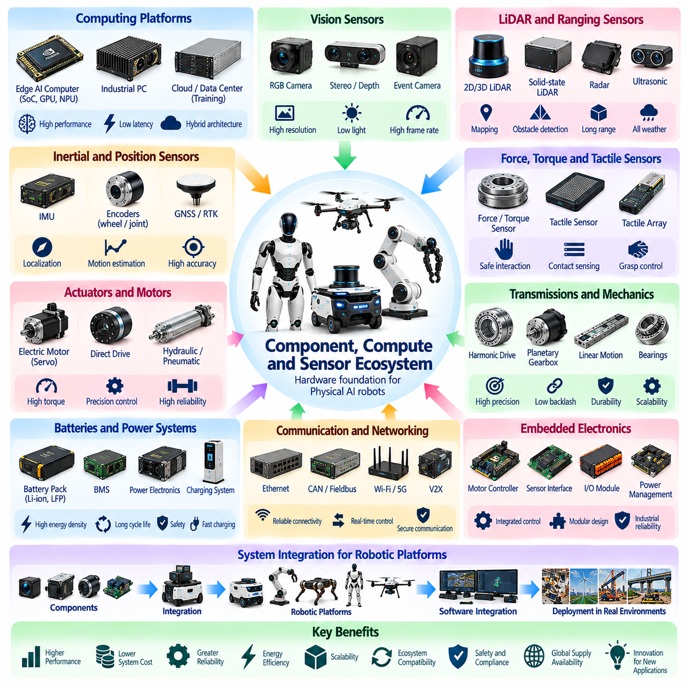{width="7.268055555555556in" height="7.268055555555556in"}

The component, compute, and sensor ecosystem forms the technological foundation of the Physical AI market by supplying the hardware required for perception, intelligence, motion, and physical interaction. Unlike software-only AI systems, physical robots depend on tightly integrated mechanical, electrical, and computational components. Commercial competitiveness therefore reflects not only AI performance but also component reliability, energy efficiency, manufacturing cost, and supply availability.

The ecosystem includes semiconductor manufacturers, sensor suppliers, actuator developers, transmission manufacturers, battery providers, embedded computing vendors, and industrial electronics companies. These suppliers occupy different positions within the robotics value chain and contribute to overall system performance. Their products influence robot capabilities, integration complexity, maintenance requirements, and the economics of large-scale deployment.

Computing platforms represent a critical market segment because Physical AI requires continuous processing of sensory information and real-time generation of actions. Robot computers may combine central processing units, graphics processors, neural processing units, and dedicated accelerators. Platform selection depends on computational throughput, memory capacity, latency, power consumption, and compatibility with robotics software frameworks.

Edge AI computing has become increasingly important as robots require autonomous operation without constant cloud connectivity. Embedded processors execute perception, localization, planning, and learned policies directly onboard the machine. This architecture reduces communication dependency and supports timely decisions. However, thermal limitations, battery constraints, and hardware cost create significant tradeoffs between computing performance and operational endurance.

Cloud and data center computing provide complementary capabilities for training foundation models, processing large datasets, running simulations, and managing robotic fleets. High-performance accelerators support computationally intensive learning and model development. Hybrid computing architectures distribute workloads between robots, local servers, and cloud infrastructure. Commercial value depends on efficient resource allocation, secure communication, and manageable operating costs.

Vision sensors form a major component category because cameras provide information about objects, people, workspaces, and environmental changes. RGB cameras, stereo vision systems, depth cameras, and event-based sensors support different perception requirements. Their selection depends on resolution, frame rate, depth accuracy, lighting tolerance, and processing requirements. Industrial reliability also depends on calibration stability and environmental protection.

LiDAR and ranging sensors are widely used for navigation, obstacle detection, mapping, and spatial understanding. Two-dimensional and three-dimensional LiDAR systems provide geometric measurements that support mobile robots and autonomous vehicles. Radar, ultrasonic sensors, and proximity detectors offer complementary capabilities under different environmental conditions. Sensor selection must balance range, accuracy, robustness, integration effort, and total system cost.

Inertial and position sensing components support robot localization, motion estimation, and dynamic control. Inertial measurement units, wheel encoders, joint encoders, and satellite positioning receivers provide information about movement and configuration. Sensor fusion combines measurements to improve estimation accuracy. Reliable operation requires calibration, synchronization, and algorithms capable of handling noise, drift, and intermittent measurement failures.

Force, torque, and tactile sensors enable robots to interact safely and precisely with physical objects. Joint torque sensors support compliant control, while wrist force sensors measure interaction loads during manipulation. Tactile arrays can provide contact distribution and grasp information. These components are particularly important for collaborative robots, dexterous hands, and humanoid systems where contact conditions change frequently.

Actuators convert control commands into mechanical motion and therefore represent a major source of differentiation across robotic platforms. Electric motors, servo drives, hydraulic actuators, and pneumatic systems offer different combinations of force, speed, precision, and efficiency. Selection depends on robot morphology and application requirements. High-performance actuation must balance power density, controllability, durability, and cost.

Precision transmissions and mechanical components strongly influence actuator performance. Harmonic drives, planetary gearboxes, cycloidal reducers, bearings, and linear motion systems determine torque transmission, backlash, stiffness, and service life. Their characteristics affect positioning accuracy and maintenance frequency. Component suppliers compete through mechanical performance, manufacturing consistency, reliability, and the ability to scale production economically.

Battery and power management technologies determine the operating duration and practical availability of mobile Physical AI systems. Lithium-based battery packs, battery management systems, power converters, and charging equipment must satisfy application-specific requirements. Energy density, cycle life, safety, and charging time influence system economics. Reliable power architecture also requires thermal management, protection circuits, and appropriate maintenance procedures.

Communication and industrial networking components connect sensors, controllers, actuators, and external systems. Ethernet, CAN-based networks, industrial fieldbuses, wireless connectivity, and time-sensitive communication technologies support different operating requirements. Real-time control depends on predictable data exchange and synchronization. Network architecture must also address cybersecurity, fault tolerance, electromagnetic compatibility, and system interoperability.

Hardware and software co-design increasingly shapes component selection as AI models place new demands on computing and sensing architectures. Larger perception models may require additional memory bandwidth, while advanced control algorithms demand predictable execution latency. Sensor placement and actuator characteristics also influence learning performance. Effective co-design reduces unnecessary hardware complexity while improving overall robot capability.

The supplier ecosystem differs across robot categories because each morphology creates distinct technical requirements. AMRs prioritize navigation sensors, drive systems, and batteries, while manipulators emphasize precision transmissions and joint control. Humanoids require compact actuators, distributed sensing, and high-density computing. Aerial robots place greater emphasis on lightweight structures, propulsion efficiency, and reliable flight electronics.

Component standardization can accelerate market development by reducing integration costs and simplifying replacement procedures. Common electrical interfaces, mechanical mounting standards, communication protocols, and software drivers improve compatibility across suppliers. However, highly optimized robots may require proprietary designs to achieve specific performance targets. Manufacturers must balance standardization benefits against differentiation and system-level optimization.

Supply chain resilience is an important commercial consideration because robotics production depends on specialized electronic and mechanical components. Limited supplier capacity, long lead times, and inconsistent quality can delay deployment and increase costs. Manufacturers may adopt multiple sourcing strategies, component qualification procedures, and inventory planning. Long-term competitiveness depends on dependable procurement and stable manufacturing partnerships.

The competitive landscape includes global semiconductor companies, industrial automation suppliers, specialized sensor manufacturers, precision mechanical component producers, and emerging robotics hardware startups. Established suppliers benefit from manufacturing scale and proven reliability, while specialized companies may introduce innovative designs. Competitive differentiation involves performance, pricing, technical support, product availability, and integration convenience.

Component economics directly influence the affordability and scalability of Physical AI products. Bill-of-materials costs, assembly labor, quality assurance, warranty exposure, and replacement expenses contribute to the final robot price. Higher-performance components may reduce operational failures but increase initial investment. Product designers must evaluate total lifecycle value rather than selecting components solely according to purchase price.

Manufacturing scale can reduce component costs through improved production processes, supplier agreements, and design simplification. However, projected cost reductions depend on actual production volume, yield, and demand stability. Robotics manufacturers must avoid assuming that prototype economics automatically translate into mass production. Commercial planning requires realistic estimates of tooling investment, quality control, and supply chain development.

Future market development will be influenced by more efficient AI accelerators, integrated sensing modules, compact actuators, advanced batteries, and intelligent power electronics. Improvements in component integration may reduce robot weight, energy consumption, and assembly complexity. Standardized hardware platforms could support broader software reuse. Nevertheless, technological progress must be evaluated through operational reliability and measurable system-level benefits.

Ultimately, the component, compute, and sensor ecosystem determines how effectively Physical AI intelligence can be translated into reliable physical action. Competitive robotic products require coordinated optimization across perception hardware, computing resources, actuation, power systems, and communication infrastructure. Sustainable market growth will depend on affordable components, resilient supply chains, manufacturing scalability, and dependable performance throughout the robot lifecycle.

부품(Component), 컴퓨팅(Compute), 센서(Sensor) 생태계는 인식(Perception), 지능(Intelligence), 운동(Motion), 물리적 상호작용(Physical Interaction)에 필요한 하드웨어를 공급함으로써 피지컬 AI(Physical AI) 시장의 기술적 기반(Technological Foundation)을 형성한다. 소프트웨어 중심 인공지능 시스템(Software-Only AI Systems)과 달리, 물리적 로봇(Physical Robots)은 기계적(Mechanical), 전기적(Electrical), 컴퓨팅(Computational) 구성요소의 긴밀한 통합에 의존한다. 따라서 상업적 경쟁력(Commercial Competitiveness)은 AI 성능(AI Performance)뿐만 아니라 부품 신뢰성(Component Reliability), 에너지 효율(Energy Efficiency), 제조 비용(Manufacturing Cost), 공급 가용성(Supply Availability)에 의해서도 결정된다.

이 생태계에는 반도체 제조업체(Semiconductor Manufacturers), 센서 공급업체(Sensor Suppliers), 액추에이터 개발업체(Actuator Developers), 동력전달장치 제조업체(Transmission Manufacturers), 배터리 공급업체(Battery Providers), 임베디드 컴퓨팅 공급업체(Embedded Computing Vendors), 산업용 전자기기 기업(Industrial Electronics Companies)이 포함된다. 이러한 공급업체는 로보틱스 가치사슬(Robotics Value Chain) 내에서 서로 다른 위치를 차지하며 전체 시스템 성능(Overall System Performance)에 기여한다. 이들이 공급하는 제품은 로봇의 기능(Robot Capabilities), 통합 복잡성(Integration Complexity), 유지보수 요구사항(Maintenance Requirements), 대규모 배포의 경제성(Economics of Large-Scale Deployment)에 영향을 미친다.

컴퓨팅 플랫폼(Computing Platforms)은 피지컬 AI(Physical AI)가 감각 정보(Sensory Information)를 지속적으로 처리하고 실시간 행동(Real-Time Actions)을 생성해야 하므로 핵심적인 시장 분야(Critical Market Segment)를 형성한다. 로봇 컴퓨터(Robot Computers)는 중앙처리장치(Central Processing Units, CPUs), 그래픽처리장치(Graphics Processing Units, GPUs), 신경망처리장치(Neural Processing Units, NPUs), 전용 가속기(Dedicated Accelerators)를 결합할 수 있다. 플랫폼 선정(Platform Selection)은 연산 처리량(Computational Throughput), 메모리 용량(Memory Capacity), 지연시간(Latency), 전력 소비(Power Consumption), 로보틱스 소프트웨어 프레임워크(Robotics Software Frameworks)와의 호환성(Compatibility)에 따라 결정된다.

엣지 AI 컴퓨팅(Edge AI Computing)은 로봇이 클라우드에 지속적으로 연결되지 않은 상태에서도 자율적으로 작동해야 하므로 점점 더 중요해지고 있다. 임베디드 프로세서(Embedded Processors)는 인식(Perception), 위치추정(Localization), 계획(Planning), 학습된 정책(Learned Policies)을 로봇에 탑재된 컴퓨터에서 직접 실행한다. 이러한 아키텍처(Architecture)는 통신 의존성(Communication Dependency)을 줄이고 신속한 의사결정(Timely Decisions)을 지원한다. 그러나 열적 제약(Thermal Limitations), 배터리 제약(Battery Constraints), 하드웨어 비용(Hardware Cost)은 컴퓨팅 성능(Computing Performance)과 운영 지속시간(Operational Endurance) 사이에 중요한 상충관계(Tradeoffs)를 발생시킨다.

클라우드 및 데이터센터 컴퓨팅(Cloud and Data Center Computing)은 파운데이션 모델 학습(Foundation Model Training), 대규모 데이터셋 처리(Large Dataset Processing), 시뮬레이션 실행(Simulation Execution), 로봇군 관리(Robotic Fleet Management)를 위한 보완적인 기능을 제공한다. 고성능 가속기(High-Performance Accelerators)는 연산 집약적인 학습(Computationally Intensive Learning)과 모델 개발(Model Development)을 지원한다. 하이브리드 컴퓨팅 아키텍처(Hybrid Computing Architectures)는 로봇, 로컬 서버(Local Servers), 클라우드 인프라(Cloud Infrastructure) 사이에 작업 부하(Workloads)를 분산한다. 상업적 가치(Commercial Value)는 효율적인 자원 할당(Efficient Resource Allocation), 보안 통신(Secure Communication), 관리 가능한 운영 비용(Manageable Operating Costs)에 달려 있다.

비전 센서(Vision Sensors)는 카메라가 물체(Objects), 사람(People), 작업공간(Workspaces), 환경 변화(Environmental Changes)에 관한 정보를 제공하므로 주요 부품 분야(Major Component Category)를 형성한다. RGB 카메라(RGB Cameras), 스테레오 비전 시스템(Stereo Vision Systems), 깊이 카메라(Depth Cameras), 이벤트 기반 센서(Event-Based Sensors)는 서로 다른 인식 요구사항(Perception Requirements)을 지원한다. 센서 선정(Sensor Selection)은 해상도(Resolution), 프레임 속도(Frame Rate), 깊이 정확도(Depth Accuracy), 조명 변화 대응 능력(Lighting Tolerance), 처리 요구사항(Processing Requirements)에 따라 결정된다. 산업적 신뢰성(Industrial Reliability)은 보정 안정성(Calibration Stability)과 환경 보호(Environmental Protection)에도 의존한다.

라이다(LiDAR) 및 거리 측정 센서(Ranging Sensors)는 항법(Navigation), 장애물 감지(Obstacle Detection), 지도작성(Mapping), 공간 이해(Spatial Understanding)에 널리 사용된다. 2차원 및 3차원 라이다 시스템(Two-Dimensional and Three-Dimensional LiDAR Systems)은 이동로봇(Mobile Robots)과 자율주행 차량(Autonomous Vehicles)을 지원하는 기하학적 측정값(Geometric Measurements)을 제공한다. 레이더(Radar), 초음파 센서(Ultrasonic Sensors), 근접 감지기(Proximity Detectors)는 다양한 환경 조건(Environmental Conditions)에서 상호보완적인 기능을 제공한다. 센서 선정에서는 측정 범위(Range), 정확도(Accuracy), 강건성(Robustness), 통합 작업(Integration Effort), 전체 시스템 비용(Total System Cost)의 균형을 고려해야 한다.

관성 및 위치 감지 부품(Inertial and Position Sensing Components)은 로봇 위치추정(Robot Localization), 운동 추정(Motion Estimation), 동적 제어(Dynamic Control)를 지원한다. 관성측정장치(Inertial Measurement Units, IMUs), 휠 엔코더(Wheel Encoders), 관절 엔코더(Joint Encoders), 위성 위치결정 수신기(Satellite Positioning Receivers)는 움직임과 로봇 구성 상태(Configuration)에 관한 정보를 제공한다. 센서 융합(Sensor Fusion)은 여러 측정값을 결합하여 추정 정확도(Estimation Accuracy)를 향상시킨다. 신뢰할 수 있는 운영(Reliable Operation)을 위해서는 보정(Calibration), 동기화(Synchronization), 잡음(Noise), 드리프트(Drift), 간헐적인 측정 실패(Intermittent Measurement Failures)를 처리할 수 있는 알고리즘이 필요하다.

힘(Force), 토크(Torque), 촉각 센서(Tactile Sensors)는 로봇이 물리적 물체(Physical Objects)와 안전하고 정밀하게 상호작용하도록 지원한다. 관절 토크 센서(Joint Torque Sensors)는 유연한 제어(Compliant Control)를 지원하며, 손목 힘 센서(Wrist Force Sensors)는 조작(Manipulation) 과정에서 발생하는 상호작용 하중(Interaction Loads)을 측정한다. 촉각 센서 배열(Tactile Arrays)은 접촉 분포(Contact Distribution)와 파지 정보(Grasp Information)를 제공할 수 있다. 이러한 부품은 접촉 조건(Contact Conditions)이 자주 변화하는 협동로봇(Collaborative Robots), 정교한 로봇 손(Dexterous Hands), 휴머노이드 시스템(Humanoid Systems)에서 특히 중요하다.

액추에이터(Actuators)는 제어 명령(Control Commands)을 기계적 운동(Mechanical Motion)으로 변환하므로 다양한 로봇 플랫폼(Robotic Platforms)에서 중요한 차별화 요소(Differentiation Factor)가 된다. 전기 모터(Electric Motors), 서보 드라이브(Servo Drives), 유압 액추에이터(Hydraulic Actuators), 공압 시스템(Pneumatic Systems)은 힘(Force), 속도(Speed), 정밀도(Precision), 효율(Efficiency)의 서로 다른 조합을 제공한다. 선정 기준은 로봇 형태(Robot Morphology)와 응용 요구사항(Application Requirements)에 따라 달라진다. 고성능 구동(High-Performance Actuation)은 출력 밀도(Power Density), 제어 가능성(Controllability), 내구성(Durability), 비용(Cost)의 균형을 확보해야 한다.

정밀 감속기(Precision Transmissions)와 기계 부품(Mechanical Components)은 액추에이터 성능(Actuator Performance)에 큰 영향을 미친다. 하모닉 드라이브(Harmonic Drives), 유성 감속기(Planetary Gearboxes), 사이클로이드 감속기(Cycloidal Reducers), 베어링(Bearings), 직선 운동 시스템(Linear Motion Systems)은 토크 전달(Torque Transmission), 백래시(Backlash), 강성(Stiffness), 사용 수명(Service Life)을 결정한다. 이러한 특성은 위치결정 정확도(Positioning Accuracy)와 유지보수 빈도(Maintenance Frequency)에 영향을 미친다. 부품 공급업체(Component Suppliers)는 기계적 성능(Mechanical Performance), 제조 일관성(Manufacturing Consistency), 신뢰성(Reliability), 경제적인 생산 확대 능력(Ability to Scale Production Economically)을 중심으로 경쟁한다.

배터리 및 전력관리 기술(Battery and Power Management Technologies)은 이동형 피지컬 AI 시스템(Mobile Physical AI Systems)의 운영 지속시간(Operating Duration)과 실질적인 가용성(Practical Availability)을 결정한다. 리튬 기반 배터리 팩(Lithium-Based Battery Packs), 배터리 관리 시스템(Battery Management Systems, BMS), 전력 변환기(Power Converters), 충전 장비(Charging Equipment)는 응용 분야별 요구사항(Application-Specific Requirements)을 충족해야 한다. 에너지 밀도(Energy Density), 사이클 수명(Cycle Life), 안전성(Safety), 충전 시간(Charging Time)은 시스템 경제성(System Economics)에 영향을 미친다. 신뢰할 수 있는 전력 아키텍처(Reliable Power Architecture)에는 열관리(Thermal Management), 보호 회로(Protection Circuits), 적절한 유지보수 절차(Maintenance Procedures)도 필요하다.

통신 및 산업용 네트워킹 부품(Communication and Industrial Networking Components)은 센서(Sensors), 제어기(Controllers), 액추에이터(Actuators), 외부 시스템(External Systems)을 연결한다. 이더넷(Ethernet), CAN 기반 네트워크(CAN-Based Networks), 산업용 필드버스(Industrial Fieldbuses), 무선 연결(Wireless Connectivity), 시간 민감형 통신 기술(Time-Sensitive Communication Technologies)은 서로 다른 운영 요구사항(Operating Requirements)을 지원한다. 실시간 제어(Real-Time Control)는 예측 가능한 데이터 교환(Predictable Data Exchange)과 동기화(Synchronization)에 의존한다. 네트워크 아키텍처(Network Architecture)는 사이버보안(Cybersecurity), 내결함성(Fault Tolerance), 전자기 적합성(Electromagnetic Compatibility), 시스템 상호운용성(System Interoperability)도 고려해야 한다.

하드웨어-소프트웨어 공동설계(Hardware and Software Co-Design)는 AI 모델(AI Models)이 컴퓨팅 및 센싱 아키텍처(Computing and Sensing Architectures)에 새로운 요구사항을 부과함에 따라 부품 선정(Component Selection)에 점점 더 큰 영향을 미치고 있다. 대규모 인식 모델(Larger Perception Models)은 추가적인 메모리 대역폭(Memory Bandwidth)을 요구할 수 있으며, 고급 제어 알고리즘(Advanced Control Algorithms)은 예측 가능한 실행 지연시간(Predictable Execution Latency)을 필요로 한다. 센서 배치(Sensor Placement)와 액추에이터 특성(Actuator Characteristics)도 학습 성능(Learning Performance)에 영향을 미친다. 효과적인 공동설계(Effective Co-Design)는 불필요한 하드웨어 복잡성(Unnecessary Hardware Complexity)을 줄이면서 전체 로봇 성능(Overall Robot Capability)을 향상시킨다.

공급업체 생태계(Supplier Ecosystem)는 로봇의 형태(Robot Morphology)마다 서로 다른 기술적 요구사항(Technical Requirements)이 발생하므로 로봇 유형별로 차이를 보인다. 자율이동로봇(Autonomous Mobile Robots, AMRs)은 항법 센서(Navigation Sensors), 구동 시스템(Drive Systems), 배터리(Batteries)를 중시하며, 로봇 매니퓰레이터(Manipulators)는 정밀 감속기(Precision Transmissions)와 관절 제어(Joint Control)를 강조한다. 휴머노이드(Humanoids)는 소형 액추에이터(Compact Actuators), 분산 센싱(Distributed Sensing), 고밀도 컴퓨팅(High-Density Computing)을 필요로 한다. 항공 로봇(Aerial Robots)은 경량 구조(Lightweight Structures), 추진 효율(Propulsion Efficiency), 신뢰할 수 있는 비행 전자장치(Reliable Flight Electronics)를 더욱 중시한다.

부품 표준화(Component Standardization)는 통합 비용(Integration Costs)을 줄이고 교체 절차(Replacement Procedures)를 단순화함으로써 시장 발전(Market Development)을 가속화할 수 있다. 공통 전기 인터페이스(Common Electrical Interfaces), 기계적 장착 표준(Mechanical Mounting Standards), 통신 프로토콜(Communication Protocols), 소프트웨어 드라이버(Software Drivers)는 공급업체 간 호환성(Compatibility)을 향상시킨다. 그러나 고도로 최적화된 로봇(Highly Optimized Robots)은 특정 성능 목표(Specific Performance Targets)를 달성하기 위해 독점 설계(Proprietary Designs)를 필요로 할 수 있다. 제조업체는 표준화의 이점(Standardization Benefits)과 차별화(Differentiation), 시스템 수준 최적화(System-Level Optimization) 사이에서 균형을 유지해야 한다.

공급망 회복탄력성(Supply Chain Resilience)은 로봇 생산(Robotics Production)이 특수 전자 및 기계 부품(Specialized Electronic and Mechanical Components)에 의존하기 때문에 중요한 상업적 고려사항(Commercial Consideration)이다. 제한된 공급업체 생산능력(Limited Supplier Capacity), 긴 조달 기간(Long Lead Times), 불균일한 품질(Inconsistent Quality)은 배포(Deployment)를 지연시키고 비용을 증가시킬 수 있다. 제조업체는 다중 공급원 확보 전략(Multiple Sourcing Strategies), 부품 적격성 평가(Component Qualification Procedures), 재고 계획(Inventory Planning)을 도입할 수 있다. 장기적인 경쟁력(Long-Term Competitiveness)은 안정적인 조달(Dependable Procurement)과 지속적인 제조 협력관계(Stable Manufacturing Partnerships)에 달려 있다.

경쟁 구도(Competitive Landscape)에는 글로벌 반도체 기업(Global Semiconductor Companies), 산업 자동화 공급업체(Industrial Automation Suppliers), 전문 센서 제조업체(Specialized Sensor Manufacturers), 정밀 기계 부품 생산업체(Precision Mechanical Component Producers), 신생 로보틱스 하드웨어 스타트업(Emerging Robotics Hardware Startups)이 포함된다. 기존 공급업체(Established Suppliers)는 제조 규모(Manufacturing Scale)와 검증된 신뢰성(Proven Reliability)에서 이점을 가지며, 전문 기업(Specialized Companies)은 혁신적인 설계(Innovative Designs)를 도입할 수 있다. 경쟁 차별화(Competitive Differentiation)는 성능(Performance), 가격(Pricing), 기술 지원(Technical Support), 제품 가용성(Product Availability), 통합 편의성(Integration Convenience)에 따라 결정된다.

부품 경제성(Component Economics)은 피지컬 AI 제품(Physical AI Products)의 가격 경쟁력(Affordability)과 확장성(Scalability)에 직접적인 영향을 미친다. 자재명세서 비용(Bill-of-Materials Costs, BOM Costs), 조립 인건비(Assembly Labor), 품질보증(Quality Assurance), 보증 관련 비용(Warranty Exposure), 교체 비용(Replacement Expenses)은 최종 로봇 가격(Final Robot Price)을 구성한다. 고성능 부품(Higher-Performance Components)은 운영 장애(Operational Failures)를 줄일 수 있지만 초기 투자(Initial Investment)를 증가시킬 수 있다. 제품 설계자(Product Designers)는 구매 가격(Purchase Price)만을 기준으로 부품을 선정하기보다 전체 수명주기 가치(Total Lifecycle Value)를 평가해야 한다.

제조 규모 확대(Manufacturing Scale)는 생산 공정 개선(Improved Production Processes), 공급업체 계약(Supplier Agreements), 설계 단순화(Design Simplification)를 통해 부품 비용(Component Costs)을 낮출 수 있다. 그러나 예상 비용 절감(Projected Cost Reductions)은 실제 생산량(Actual Production Volume), 생산 수율(Yield), 수요 안정성(Demand Stability)에 따라 달라진다. 로봇 제조업체(Robotics Manufacturers)는 시제품 단계의 경제성(Prototype Economics)이 자동으로 대량생산(Mass Production)에 적용된다고 가정해서는 안 된다. 상업적 계획(Commercial Planning)에는 금형 및 생산설비 투자(Tooling Investment), 품질관리(Quality Control), 공급망 개발(Supply Chain Development)에 대한 현실적인 추정이 필요하다.

미래 시장 발전(Future Market Development)은 더욱 효율적인 AI 가속기(AI Accelerators), 통합 센싱 모듈(Integrated Sensing Modules), 소형 액추에이터(Compact Actuators), 첨단 배터리(Advanced Batteries), 지능형 전력 전자장치(Intelligent Power Electronics)의 영향을 받을 것이다. 부품 통합(Component Integration)의 개선은 로봇 무게(Robot Weight), 에너지 소비(Energy Consumption), 조립 복잡성(Assembly Complexity)을 줄일 수 있다. 표준화된 하드웨어 플랫폼(Standardized Hardware Platforms)은 보다 광범위한 소프트웨어 재사용(Software Reuse)을 지원할 수 있다. 그러나 기술 발전(Technological Progress)은 운영 신뢰성(Operational Reliability)과 측정 가능한 시스템 수준의 이점(Measurable System-Level Benefits)을 통해 평가되어야 한다.

궁극적으로 부품, 컴퓨팅, 센서 생태계(Component, Compute, and Sensor Ecosystem)는 피지컬 AI 지능(Physical AI Intelligence)이 얼마나 효과적으로 신뢰할 수 있는 물리적 행동(Reliable Physical Action)으로 전환될 수 있는지를 결정한다. 경쟁력 있는 로봇 제품(Competitive Robotic Products)은 인식 하드웨어(Perception Hardware), 컴퓨팅 자원(Computing Resources), 구동 시스템(Actuation), 전력 시스템(Power Systems), 통신 인프라(Communication Infrastructure)에 걸친 통합 최적화(Coordinated Optimization)를 필요로 한다. 지속 가능한 시장 성장(Sustainable Market Growth)은 경제적인 부품(Affordable Components), 회복탄력적인 공급망(Resilient Supply Chains), 제조 확장성(Manufacturing Scalability), 로봇 수명주기(Robot Lifecycle) 전반에 걸친 신뢰할 수 있는 성능(Dependable Performance)에 달려 있다.

##  

## 01.11. System Integrators and Service Providers

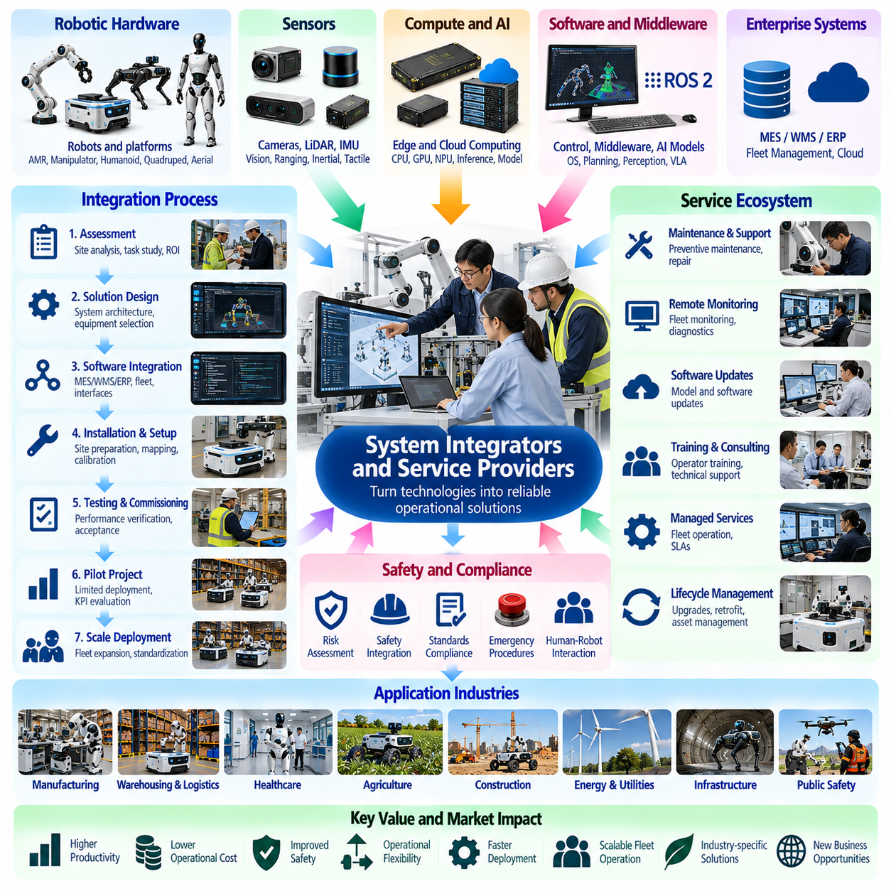{width="7.268055555555556in" height="7.268055555555556in"}

System integrators and service providers form a critical commercialization layer within the Physical AI market, connecting robotic technologies with practical industrial operations. Their primary role is to transform hardware, software, and AI capabilities into dependable customer solutions. Market value arises from engineering expertise, workflow adaptation, operational support, and the ability to deliver measurable productivity improvements.

System integration involves combining robots, sensors, computing platforms, control software, and enterprise applications into a functioning automation system. Individual components may perform well independently but require substantial engineering to operate together. Integrators address interface compatibility, communication protocols, safety requirements, and operational constraints, reducing the complexity customers face during deployment.

The service ecosystem includes robotics system integrators, automation engineering firms, software implementation partners, managed service operators, maintenance specialists, and technical consultants. These organizations differ in technical depth, industry specialization, and contractual responsibility. Some deliver complete automation projects, while others provide focused services such as fleet optimization, software integration, or equipment maintenance.

Industry-specific knowledge is a major competitive advantage for system integrators. Manufacturing facilities, warehouses, hospitals, farms, and construction sites operate under different physical constraints and performance requirements. Successful deployments require understanding customer workflows, equipment interfaces, labor practices, and safety obligations. Technical capability alone is insufficient without practical knowledge of the operating environment.

Customer engagement typically begins with operational assessment and feasibility analysis. Integrators examine existing processes, identify repetitive or hazardous activities, and determine whether robotics can improve performance economically. This stage includes evaluating site conditions, task variability, infrastructure readiness, and workforce requirements. Accurate assessment reduces the risk of investing in unsuitable automation solutions.

Solution architecture translates customer requirements into coordinated hardware and software configurations. Integrators select robotic platforms, sensing systems, computing resources, and communication infrastructure according to operational objectives. They also define interfaces between robots and existing equipment. Effective architecture must consider scalability, maintenance accessibility, safety, and future technology upgrades.

Software integration is particularly important because robotic systems rarely operate independently of enterprise infrastructure. Warehouse management systems, manufacturing execution systems, enterprise resource planning platforms, and fleet management software exchange operational information. Integrators develop interfaces that connect business instructions with robot execution. Reliable synchronization prevents task conflicts, inventory errors, and workflow interruptions.

Deployment engineering includes site preparation, installation, calibration, mapping, configuration, and operational testing. Mobile robots may require navigation maps and traffic rules, while manipulators need calibrated workspaces and validated motion sequences. Environmental changes can expose limitations not identified during laboratory development. Field engineering therefore represents a substantial component of deployment cost and project risk.

Safety integration establishes the relationship between robotic equipment, human workers, and surrounding infrastructure. Integrators assess hazards, implement protective measures, and verify emergency procedures according to applicable requirements. Physical AI introduces additional uncertainty when learned behaviors interact with changing environments. Safety engineering must therefore address both conventional machinery risks and AI-related operational limitations.

Testing and commissioning determine whether an integrated system satisfies contractual and operational expectations. Acceptance criteria may include task completion rates, throughput, positioning accuracy, uptime, and recovery performance. Factory acceptance testing and site acceptance testing provide structured verification stages. Clearly defined criteria reduce disputes and establish measurable evidence of deployment readiness.

Pilot projects are commonly used to evaluate Physical AI solutions before wider deployment. A limited installation allows customers to measure productivity, reliability, worker interaction, and integration complexity under realistic conditions. Pilot results should identify technical deficiencies and operational improvements. However, successful demonstrations do not automatically establish the economics or reliability of large-scale operations.

Scaling from pilot installations to production fleets creates additional engineering requirements. Larger deployments introduce traffic coordination, charging schedules, software version management, maintenance planning, and exception handling. Integrators must design systems that maintain performance as robot numbers increase. Standardized deployment procedures and reusable software interfaces can reduce expansion costs and improve consistency.

Managed robotics services extend integration responsibilities into continuous operations. Providers may monitor robot fleets, supervise missions, resolve incidents, update software, and coordinate maintenance activities. These services allow customers to access specialized technical expertise without maintaining large internal robotics teams. Their economic value depends on service reliability, operational efficiency, and clearly defined responsibilities.

Robot-as-a-Service models combine robotic equipment, software, maintenance, and support into recurring commercial agreements. Customers may prefer subscription or usage-based payments over substantial initial capital expenditure. Service providers assume responsibilities that can include equipment availability and lifecycle maintenance. Contract profitability depends on utilization, financing costs, component durability, and the ability to control operational expenses.

Maintenance and lifecycle services represent important recurring revenue opportunities. Preventive maintenance, diagnostics, spare parts management, battery replacement, and software updates help sustain robotic performance. Predictive maintenance systems may identify degradation before failures interrupt operations. Providers that maintain accurate service records and efficient spare parts networks can reduce downtime and improve customer retention.

Remote monitoring and fleet analytics create additional service opportunities by converting operational data into actionable insights. Providers can analyze utilization, task failures, intervention frequency, energy consumption, and equipment condition. These measurements support workflow optimization and maintenance decisions. Data access agreements, cybersecurity requirements, and customer confidentiality must be addressed within service contracts.

The competitive landscape includes global automation companies, regional engineering integrators, robotics manufacturers, specialized software firms, and emerging managed service providers. Large organizations may offer extensive delivery capacity and established customer relationships. Smaller specialists can compete through technical expertise, flexibility, and industry knowledge. Competitive differentiation increasingly depends on repeatable deployment results.

Commercial pricing varies according to project scope, technical complexity, service obligations, and customer risk allocation. Integration projects may use fixed-price contracts, engineering fees, milestone payments, or recurring service agreements. Providers must account for design work, installation labor, testing, training, and warranty exposure. Inaccurate project estimation can erode margins even when the underlying robotic technology performs successfully.

Service-level agreements establish measurable expectations for system availability, response times, maintenance responsibilities, and operational support. Performance guarantees require careful definition because customer workflows and environmental conditions influence results. Contracts should distinguish equipment failures from infrastructure problems and operational misuse. Transparent responsibility allocation supports sustainable relationships between customers and service providers.

Interoperability and vendor independence influence the strategic position of integrators. Customers operating mixed robotic fleets may prefer partners capable of connecting equipment from multiple manufacturers. Open interfaces and standardized communication reduce integration barriers. However, proprietary platforms can simplify support when supplied as complete solutions. Integrators must balance flexibility, accountability, and long-term maintenance requirements.

Workforce training and organizational change management are essential to successful automation adoption. Operators, technicians, supervisors, and safety personnel require appropriate knowledge of robotic behavior and operational procedures. Integrators often provide training, documentation, and transition support. Effective human-robot collaboration depends on clear responsibilities, practical user interfaces, and employee confidence in system reliability.

Ultimately, system integrators and service providers determine whether Physical AI technologies can deliver sustained industrial value beyond laboratory demonstrations. Their expertise connects robotics innovation with customer processes, safety requirements, enterprise systems, and lifecycle operations. Long-term market growth will favor organizations that combine repeatable engineering methods, dependable service delivery, and measurable customer outcomes.

시스템 통합업체(System Integrators)와 서비스 제공업체(Service Providers)는 로봇 기술(Robotic Technologies)을 실제 산업 운영(Industrial Operations)과 연결하는 피지컬 AI(Physical AI) 시장의 핵심 상용화 계층(Commercialization Layer)을 형성한다. 이들의 주요 역할은 하드웨어(Hardware), 소프트웨어(Software), 인공지능 기능(AI Capabilities)을 신뢰할 수 있는 고객 솔루션(Dependable Customer Solutions)으로 전환하는 것이다. 시장 가치(Market Value)는 엔지니어링 전문성(Engineering Expertise), 작업흐름 적응(Workflow Adaptation), 운영 지원(Operational Support), 측정 가능한 생산성 향상(Measurable Productivity Improvements)을 제공하는 능력에서 발생한다.

시스템 통합(System Integration)은 로봇(Robots), 센서(Sensors), 컴퓨팅 플랫폼(Computing Platforms), 제어 소프트웨어(Control Software), 기업용 응용 프로그램(Enterprise Applications)을 결합하여 실제로 작동하는 자동화 시스템(Automation System)을 구축하는 과정이다. 개별 구성요소(Individual Components)는 독립적으로 우수한 성능을 발휘하더라도 함께 작동하기 위해 상당한 엔지니어링 작업(Engineering Effort)이 필요할 수 있다. 시스템 통합업체(Integrators)는 인터페이스 호환성(Interface Compatibility), 통신 프로토콜(Communication Protocols), 안전 요구사항(Safety Requirements), 운영 제약(Operational Constraints)을 해결하여 고객이 배포(Deployment) 과정에서 직면하는 복잡성을 줄인다.

서비스 생태계(Service Ecosystem)에는 로보틱스 시스템 통합업체(Robotics System Integrators), 자동화 엔지니어링 기업(Automation Engineering Firms), 소프트웨어 구축 파트너(Software Implementation Partners), 관리형 서비스 운영업체(Managed Service Operators), 유지보수 전문업체(Maintenance Specialists), 기술 컨설턴트(Technical Consultants)가 포함된다. 이러한 조직은 기술적 전문성(Technical Depth), 산업별 전문화(Industry Specialization), 계약상 책임(Contractual Responsibility)에서 차이를 보인다. 일부는 완전한 자동화 프로젝트(Complete Automation Projects)를 제공하는 반면, 다른 업체는 로봇군 최적화(Fleet Optimization), 소프트웨어 통합(Software Integration), 장비 유지보수(Equipment Maintenance)와 같은 전문 서비스를 제공한다.

산업별 전문지식(Industry-Specific Knowledge)은 시스템 통합업체(System Integrators)의 주요 경쟁우위(Competitive Advantage)이다. 제조시설(Manufacturing Facilities), 창고(Warehouses), 병원(Hospitals), 농장(Farms), 건설 현장(Construction Sites)은 서로 다른 물리적 제약(Physical Constraints)과 성능 요구사항(Performance Requirements)을 가지고 운영된다. 성공적인 배포(Successful Deployments)를 위해서는 고객 작업흐름(Customer Workflows), 장비 인터페이스(Equipment Interfaces), 노동 관행(Labor Practices), 안전 의무(Safety Obligations)를 이해해야 한다. 운영 환경(Operating Environment)에 대한 실무 지식(Practical Knowledge)이 없다면 기술적 역량(Technical Capability)만으로는 충분하지 않다.

고객 참여(Customer Engagement)는 일반적으로 운영 평가(Operational Assessment)와 실현 가능성 분석(Feasibility Analysis)에서 시작된다. 시스템 통합업체(Integrators)는 기존 프로세스(Existing Processes)를 조사하고, 반복적이거나 위험한 작업(Repetitive or Hazardous Activities)을 식별하며, 로보틱스(Robotics)가 경제적으로 성능을 개선할 수 있는지 판단한다. 이 단계에는 현장 조건(Site Conditions), 작업 변동성(Task Variability), 인프라 준비 수준(Infrastructure Readiness), 인력 요구사항(Workforce Requirements)에 대한 평가가 포함된다. 정확한 평가(Accurate Assessment)는 적합하지 않은 자동화 솔루션(Unsuitable Automation Solutions)에 투자할 위험을 줄인다.

솔루션 아키텍처(Solution Architecture)는 고객 요구사항(Customer Requirements)을 상호 연계된 하드웨어 및 소프트웨어 구성(Coordinated Hardware and Software Configurations)으로 전환한다. 시스템 통합업체(Integrators)는 운영 목표(Operational Objectives)에 따라 로봇 플랫폼(Robotic Platforms), 센싱 시스템(Sensing Systems), 컴퓨팅 자원(Computing Resources), 통신 인프라(Communication Infrastructure)를 선정한다. 또한 로봇과 기존 장비(Existing Equipment) 사이의 인터페이스(Interfaces)를 정의한다. 효과적인 아키텍처(Effective Architecture)는 확장성(Scalability), 유지보수 접근성(Maintenance Accessibility), 안전성(Safety), 향후 기술 업그레이드(Future Technology Upgrades)를 고려해야 한다.

소프트웨어 통합(Software Integration)은 로봇 시스템(Robotic Systems)이 기업 인프라(Enterprise Infrastructure)와 독립적으로 작동하는 경우가 드물기 때문에 특히 중요하다. 창고관리시스템(Warehouse Management Systems, WMS), 제조실행시스템(Manufacturing Execution Systems, MES), 전사적자원관리 플랫폼(Enterprise Resource Planning Platforms, ERP), 로봇군 관리 소프트웨어(Fleet Management Software, FMS)는 운영 정보(Operational Information)를 교환한다. 시스템 통합업체는 비즈니스 명령(Business Instructions)을 로봇 실행(Robot Execution)과 연결하는 인터페이스를 개발한다. 신뢰할 수 있는 동기화(Reliable Synchronization)는 작업 충돌(Task Conflicts), 재고 오류(Inventory Errors), 작업흐름 중단(Workflow Interruptions)을 방지한다.

현장 배포 엔지니어링(Deployment Engineering)에는 현장 준비(Site Preparation), 설치(Installation), 보정(Calibration), 지도작성(Mapping), 구성(Configuration), 운영 시험(Operational Testing)이 포함된다. 이동로봇(Mobile Robots)은 항법 지도(Navigation Maps)와 교통 규칙(Traffic Rules)이 필요할 수 있으며, 로봇 매니퓰레이터(Manipulators)는 보정된 작업공간(Calibrated Workspaces)과 검증된 동작 시퀀스(Validated Motion Sequences)가 필요하다. 환경 변화(Environmental Changes)는 실험실 개발(Laboratory Development) 과정에서 확인되지 않았던 한계를 드러낼 수 있다. 따라서 현장 엔지니어링(Field Engineering)은 배포 비용(Deployment Cost)과 프로젝트 위험(Project Risk)의 상당한 부분을 차지한다.

안전 통합(Safety Integration)은 로봇 장비(Robotic Equipment), 작업자(Human Workers), 주변 인프라(Surrounding Infrastructure) 사이의 관계를 설정한다. 시스템 통합업체(Integrators)는 적용 가능한 요구사항(Applicable Requirements)에 따라 위험요소(Hazards)를 평가하고, 보호조치(Protective Measures)를 구현하며, 비상 절차(Emergency Procedures)를 검증한다. 피지컬 AI(Physical AI)는 학습된 행동(Learned Behaviors)이 변화하는 환경(Changing Environments)과 상호작용할 때 추가적인 불확실성(Uncertainty)을 발생시킨다. 따라서 안전 엔지니어링(Safety Engineering)은 기존 기계 위험(Conventional Machinery Risks)과 AI 관련 운영 한계(AI-Related Operational Limitations)를 모두 다루어야 한다.

시험 및 시운전(Testing and Commissioning)은 통합 시스템(Integrated System)이 계약상 기대사항(Contractual Expectations)과 운영 요구사항(Operational Expectations)을 충족하는지 판단한다. 인수 기준(Acceptance Criteria)에는 작업 완료율(Task Completion Rates), 처리량(Throughput), 위치결정 정확도(Positioning Accuracy), 가동시간(Uptime), 복구 성능(Recovery Performance)이 포함될 수 있다. 공장 인수시험(Factory Acceptance Testing, FAT)과 현장 인수시험(Site Acceptance Testing, SAT)은 체계적인 검증 단계(Structured Verification Stages)를 제공한다. 명확하게 정의된 기준(Clearly Defined Criteria)은 분쟁(Disputes)을 줄이고 배포 준비 상태(Deployment Readiness)에 대한 측정 가능한 근거(Measurable Evidence)를 확립한다.

파일럿 프로젝트(Pilot Projects)는 피지컬 AI 솔루션(Physical AI Solutions)을 광범위하게 배포하기 전에 평가하는 데 일반적으로 사용된다. 제한된 규모의 설치(Limited Installation)를 통해 고객은 현실적인 조건(Realistic Conditions)에서 생산성(Productivity), 신뢰성(Reliability), 작업자와의 상호작용(Worker Interaction), 통합 복잡성(Integration Complexity)을 측정할 수 있다. 파일럿 결과(Pilot Results)는 기술적 결함(Technical Deficiencies)과 운영 개선사항(Operational Improvements)을 식별해야 한다. 그러나 성공적인 시연(Successful Demonstrations)이 대규모 운영(Large-Scale Operations)의 경제성(Economics)이나 신뢰성(Reliability)을 자동으로 입증하는 것은 아니다.

파일럿 설치(Pilot Installations)에서 실제 생산용 로봇군(Production Fleets)으로 확장하려면 추가적인 엔지니어링 요구사항(Engineering Requirements)이 발생한다. 대규모 배포(Larger Deployments)는 교통 조정(Traffic Coordination), 충전 일정 관리(Charging Schedules), 소프트웨어 버전 관리(Software Version Management), 유지보수 계획(Maintenance Planning), 예외 상황 처리(Exception Handling)를 필요로 한다. 시스템 통합업체(Integrators)는 로봇 수(Robot Numbers)가 증가해도 성능을 유지할 수 있는 시스템을 설계해야 한다. 표준화된 배포 절차(Standardized Deployment Procedures)와 재사용 가능한 소프트웨어 인터페이스(Reusable Software Interfaces)는 확장 비용(Expansion Costs)을 줄이고 일관성(Consistency)을 향상시킬 수 있다.

관리형 로보틱스 서비스(Managed Robotics Services)는 시스템 통합 책임(Integration Responsibilities)을 지속적인 운영(Continuous Operations)으로 확장한다. 서비스 제공업체(Providers)는 로봇군(Robot Fleets)을 모니터링하고, 임무(Missions)를 감독하며, 사고 및 장애(Incidents)를 해결하고, 소프트웨어(Software)를 업데이트하며, 유지보수 활동(Maintenance Activities)을 조정할 수 있다. 이러한 서비스를 통해 고객은 대규모 내부 로보틱스 조직(Internal Robotics Teams)을 유지하지 않고도 전문 기술 역량(Specialized Technical Expertise)을 활용할 수 있다. 경제적 가치(Economic Value)는 서비스 신뢰성(Service Reliability), 운영 효율성(Operational Efficiency), 명확하게 정의된 책임(Clearly Defined Responsibilities)에 달려 있다.

서비스형 로봇(Robot-as-a-Service, RaaS) 모델은 로봇 장비(Robotic Equipment), 소프트웨어(Software), 유지보수(Maintenance), 지원 서비스(Support)를 반복적인 상업 계약(Recurring Commercial Agreements)으로 결합한다. 고객은 상당한 초기 자본지출(Initial Capital Expenditure)보다 구독형 또는 사용량 기반 결제(Subscription or Usage-Based Payments)를 선호할 수 있다. 서비스 제공업체(Service Providers)는 장비 가용성(Equipment Availability)과 수명주기 유지보수(Lifecycle Maintenance)를 포함한 책임을 부담한다. 계약 수익성(Contract Profitability)은 가동률(Utilization), 금융 비용(Financing Costs), 부품 내구성(Component Durability), 운영 비용 통제 능력(Ability to Control Operational Expenses)에 달려 있다.

유지보수 및 수명주기 서비스(Maintenance and Lifecycle Services)는 중요한 반복 매출 기회(Recurring Revenue Opportunities)를 제공한다. 예방정비(Preventive Maintenance), 진단(Diagnostics), 예비부품 관리(Spare Parts Management), 배터리 교체(Battery Replacement), 소프트웨어 업데이트(Software Updates)는 로봇 성능(Robotic Performance)을 지속적으로 유지하는 데 기여한다. 예지보전 시스템(Predictive Maintenance Systems)은 고장(Failures)이 운영을 중단시키기 전에 성능 저하(Degradation)를 식별할 수 있다. 정확한 서비스 기록(Accurate Service Records)과 효율적인 예비부품 네트워크(Efficient Spare Parts Networks)를 유지하는 제공업체는 가동중단시간(Downtime)을 줄이고 고객 유지율(Customer Retention)을 향상시킬 수 있다.

원격 모니터링(Remote Monitoring)과 로봇군 분석(Fleet Analytics)은 운영 데이터(Operational Data)를 실행 가능한 통찰(Actionable Insights)로 전환함으로써 추가적인 서비스 기회(Service Opportunities)를 창출한다. 서비스 제공업체(Providers)는 가동률(Utilization), 작업 실패(Task Failures), 개입 빈도(Intervention Frequency), 에너지 소비(Energy Consumption), 장비 상태(Equipment Condition)를 분석할 수 있다. 이러한 측정값(Measurements)은 작업흐름 최적화(Workflow Optimization)와 유지보수 의사결정(Maintenance Decisions)을 지원한다. 데이터 접근 계약(Data Access Agreements), 사이버보안 요구사항(Cybersecurity Requirements), 고객 기밀성(Customer Confidentiality)은 서비스 계약(Service Contracts)에서 다루어져야 한다.

경쟁 구도(Competitive Landscape)에는 글로벌 자동화 기업(Global Automation Companies), 지역 엔지니어링 통합업체(Regional Engineering Integrators), 로봇 제조업체(Robotics Manufacturers), 전문 소프트웨어 기업(Specialized Software Firms), 신생 관리형 서비스 제공업체(Emerging Managed Service Providers)가 포함된다. 대규모 조직(Large Organizations)은 폭넓은 프로젝트 수행 역량(Extensive Delivery Capacity)과 기존 고객 관계(Established Customer Relationships)를 제공할 수 있다. 소규모 전문업체(Smaller Specialists)는 기술적 전문성(Technical Expertise), 유연성(Flexibility), 산업 지식(Industry Knowledge)을 통해 경쟁할 수 있다. 경쟁 차별화(Competitive Differentiation)는 반복적으로 재현 가능한 배포 성과(Repeatable Deployment Results)에 점점 더 의존하고 있다.

상업적 가격 책정(Commercial Pricing)은 프로젝트 범위(Project Scope), 기술적 복잡성(Technical Complexity), 서비스 의무(Service Obligations), 고객 위험 분담(Customer Risk Allocation)에 따라 달라진다. 시스템 통합 프로젝트(Integration Projects)는 고정가격 계약(Fixed-Price Contracts), 엔지니어링 수수료(Engineering Fees), 단계별 지급(Milestone Payments), 반복 서비스 계약(Recurring Service Agreements)을 활용할 수 있다. 서비스 제공업체는 설계 작업(Design Work), 설치 인건비(Installation Labor), 시험(Testing), 교육(Training), 보증 관련 위험(Warranty Exposure)을 고려해야 한다. 부정확한 프로젝트 비용 추정(Inaccurate Project Estimation)은 기반 로봇 기술(Underlying Robotic Technology)이 성공적으로 작동하더라도 이익률(Margins)을 감소시킬 수 있다.

서비스 수준 계약(Service-Level Agreements, SLAs)은 시스템 가용성(System Availability), 대응시간(Response Times), 유지보수 책임(Maintenance Responsibilities), 운영 지원(Operational Support)에 대한 측정 가능한 기대사항(Measurable Expectations)을 설정한다. 성능 보증(Performance Guarantees)은 고객 작업흐름(Customer Workflows)과 환경 조건(Environmental Conditions)이 결과에 영향을 미치므로 신중하게 정의해야 한다. 계약(Contracts)은 장비 고장(Equipment Failures), 인프라 문제(Infrastructure Problems), 운영상 오용(Operational Misuse)을 구분해야 한다. 투명한 책임 배분(Transparent Responsibility Allocation)은 고객과 서비스 제공업체 사이의 지속 가능한 관계(Sustainable Relationships)를 지원한다.

상호운용성(Interoperability)과 공급업체 독립성(Vendor Independence)은 시스템 통합업체(Integrators)의 전략적 위치(Strategic Position)에 영향을 미친다. 혼합 로봇군(Mixed Robotic Fleets)을 운영하는 고객은 여러 제조업체(Multiple Manufacturers)의 장비를 연결할 수 있는 파트너를 선호할 수 있다. 개방형 인터페이스(Open Interfaces)와 표준화된 통신(Standardized Communication)은 시스템 통합 장벽(Integration Barriers)을 낮춘다. 그러나 독점 플랫폼(Proprietary Platforms)은 완전한 솔루션(Complete Solutions)으로 공급될 경우 기술 지원(Support)을 단순화할 수 있다. 시스템 통합업체는 유연성(Flexibility), 책임성(Accountability), 장기 유지보수 요구사항(Long-Term Maintenance Requirements) 사이에서 균형을 유지해야 한다.

인력 교육(Workforce Training)과 조직 변화관리(Organizational Change Management)는 성공적인 자동화 도입(Successful Automation Adoption)에 필수적이다. 운영자(Operators), 기술자(Technicians), 감독자(Supervisors), 안전 담당자(Safety Personnel)는 로봇 행동(Robotic Behavior)과 운영 절차(Operational Procedures)에 대한 적절한 지식을 갖추어야 한다. 시스템 통합업체(Integrators)는 교육(Training), 문서화(Documentation), 전환 지원(Transition Support)을 제공하는 경우가 많다. 효과적인 인간-로봇 협업(Effective Human-Robot Collaboration)은 명확한 책임(Clear Responsibilities), 실용적인 사용자 인터페이스(Practical User Interfaces), 시스템 신뢰성(System Reliability)에 대한 직원의 신뢰(Employee Confidence)에 달려 있다.

궁극적으로 시스템 통합업체와 서비스 제공업체(System Integrators and Service Providers)는 피지컬 AI 기술(Physical AI Technologies)이 실험실 시연(Laboratory Demonstrations)을 넘어 지속적인 산업적 가치(Sustained Industrial Value)를 제공할 수 있는지를 결정한다. 이들의 전문성(Expertise)은 로보틱스 혁신(Robotics Innovation)을 고객 프로세스(Customer Processes), 안전 요구사항(Safety Requirements), 기업 시스템(Enterprise Systems), 수명주기 운영(Lifecycle Operations)과 연결한다. 장기적인 시장 성장(Long-Term Market Growth)은 반복 가능한 엔지니어링 방법(Repeatable Engineering Methods), 신뢰할 수 있는 서비스 제공(Dependable Service Delivery), 측정 가능한 고객 성과(Measurable Customer Outcomes)를 결합하는 조직에 유리하게 전개될 것이다.

##  

## 01.12. Regional and Industry Adoption Patterns

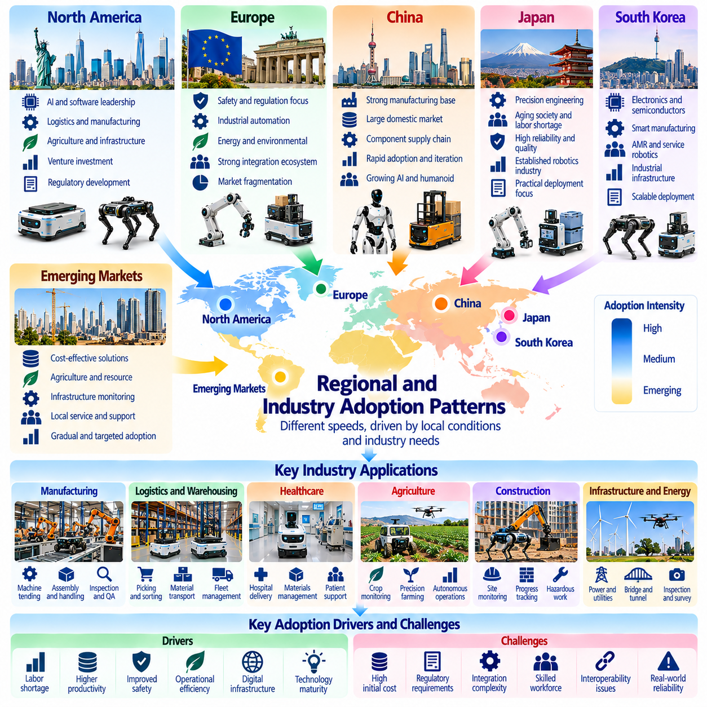{width="7.268055555555556in" height="7.268055555555556in"}

Regional and industry adoption patterns reveal how the Physical AI market develops at different speeds across economic environments and operational sectors. Adoption is influenced by labor availability, industrial structure, technology readiness, capital investment, and regulatory conditions. Rather than following a uniform global trajectory, Physical AI expands through applications where automation delivers measurable operational value and manageable implementation risk.

Regional differences reflect the interaction between manufacturing capacity, robotics research, digital infrastructure, and customer demand. Economies with established automation industries often possess stronger supplier networks and integration capabilities. Other regions may prioritize imported robotic solutions or specialized applications. Market development depends on local technical expertise, financing availability, service infrastructure, and institutional support.

North America represents an important market for robotics software, AI platforms, autonomous mobility, and advanced industrial automation. Research institutions, technology companies, and venture investment support innovation across multiple robotic categories. Commercial adoption is particularly relevant in logistics, manufacturing, agriculture, and infrastructure inspection. Deployment economics remain sensitive to labor costs, reliability, and regulatory requirements.

Europe has established capabilities in industrial robotics, precision engineering, automotive manufacturing, and automation integration. Regional adoption frequently emphasizes operational safety, equipment reliability, energy efficiency, and regulatory compliance. Manufacturing modernization and industrial digitalization create opportunities for Physical AI. However, market fragmentation, integration costs, and differing national conditions can influence deployment strategies.

East Asia is a major center of robotics manufacturing, component production, and industrial automation. Japan, South Korea, and China possess significant capabilities across different parts of the robotics value chain. Applications include factory automation, warehouse logistics, service robotics, and emerging humanoid systems. Regional competitiveness depends on production scale, supply chains, AI capabilities, and the integration of intelligent software with established hardware industries.

China\'s Physical AI ecosystem benefits from extensive electronics manufacturing, industrial supply networks, and a large domestic market. These conditions can support rapid hardware iteration and competitive component sourcing. Industrial automation, logistics robotics, and humanoid development attract substantial commercial attention. Nevertheless, technological demonstrations must be distinguished from sustainable deployments, profitable operations, and verified customer demand.

Japan\'s robotics market reflects longstanding strengths in industrial automation, precision components, and reliable mechanical engineering. Demographic pressures and labor shortages encourage interest in automation across manufacturing, logistics, and service environments. Adoption often emphasizes equipment durability, operational consistency, and integration with established workflows. Commercial expansion depends on balancing sophisticated engineering with practical deployment costs.

South Korea combines advanced electronics, semiconductor manufacturing, automotive production, and industrial automation capabilities. These strengths create opportunities for intelligent factories, autonomous mobile robots, service robotics, and AI-enabled manufacturing systems. Domestic adoption can benefit from concentrated industrial infrastructure and digital connectivity. Scaling requires interoperable platforms, skilled integration partners, and convincing economic results.

Emerging markets exhibit different adoption priorities because labor economics, infrastructure quality, and investment capacity vary substantially. Some regions may favor cost-effective warehouse automation, agricultural robotics, or infrastructure monitoring over highly sophisticated general-purpose robots. Local service availability and maintenance capabilities are particularly important. Affordable, robust solutions may achieve broader adoption than technically advanced but expensive systems.

Manufacturing remains a central industry for Physical AI adoption because production environments often contain repetitive tasks, structured workflows, and measurable performance requirements. Industrial robots and automation systems provide an established foundation for more adaptive capabilities. Opportunities include machine tending, inspection, material handling, and flexible assembly. Adoption depends on productivity improvement, process stability, and integration with existing equipment.

Logistics and warehousing represent another major adoption domain because material movement and order fulfillment involve frequent, measurable operations. Autonomous mobile robots, robotic picking systems, and intelligent fleet management can improve workflow flexibility. High utilization and predictable task demand support economic evaluation. However, facility layouts, software compatibility, and operational disruptions influence implementation complexity.

Healthcare adoption follows a different pattern because patient safety, clinical workflows, privacy, and institutional accountability impose additional requirements. Hospital delivery robots and logistics automation may offer clearer initial opportunities than complex patient-facing manipulation. Clinical environments demand dependable operation and careful human oversight. Adoption depends on validated benefits, regulatory obligations, and acceptance by healthcare personnel.

Agricultural Physical AI adoption is shaped by labor shortages, seasonal demand, crop diversity, and environmental variability. Autonomous tractors, field robots, drones, and precision treatment systems address different operational needs. Large farms may support higher equipment utilization, while smaller farms may prefer shared or service-based solutions. Economic feasibility depends on crop value, field conditions, operating seasons, and maintenance accessibility.

Construction and infrastructure applications face challenges involving changing worksites, uneven terrain, unpredictable obstacles, and demanding safety requirements. Autonomous equipment, inspection robots, and aerial mapping systems may improve productivity or reduce hazardous exposure. Adoption often begins with specialized tasks rather than fully autonomous construction processes. Commercial value depends on project duration, deployment flexibility, and measurable risk reduction.

Consumer and home robotics follow a distinct adoption trajectory because purchasing decisions depend on affordability, convenience, reliability, and user experience. Cleaning robots demonstrate the potential of narrowly defined household automation. More general domestic manipulation remains technically challenging because homes contain diverse objects and unpredictable conditions. Broad adoption requires dependable functionality, intuitive interaction, and acceptable maintenance costs.

Industry adoption patterns also differ according to organizational size and investment capacity. Large enterprises can finance pilot programs, integration teams, and long-term automation strategies. Small and medium-sized businesses often require standardized products, external technical support, and shorter payback periods. Subscription services and shared automation infrastructure may reduce entry barriers. Market expansion depends on solutions that fit diverse customer budgets.

Labor conditions influence adoption but do not determine it independently. High wages, worker shortages, hazardous environments, and repetitive tasks can strengthen the economic case for robotics. However, deployment requires training, process redesign, and continuing technical support. Workforce acceptance depends on perceived safety, operational usefulness, and organizational communication. Successful automation combines technological capability with realistic workforce planning.

Regulatory environments shape regional market opportunities through machinery safety rules, data protection obligations, workplace standards, and autonomous vehicle requirements. Aerial robotics and public-space mobility face particularly important location-specific restrictions. Regulatory uncertainty can delay investment or limit operational scope. Providers entering multiple markets must adapt certification, documentation, safety procedures, and service models to local conditions.

Infrastructure readiness creates additional differences between regions and industries. Reliable electricity, wireless connectivity, industrial networks, charging facilities, and technical maintenance services support robotic operations. Facilities with mature digital systems can integrate automation more efficiently. In less prepared environments, infrastructure upgrades may dominate initial project costs. Adoption strategies must account for the entire operating ecosystem.

Regional supply chains and system integration networks influence both deployment speed and long-term service quality. Local access to sensors, actuators, computing hardware, spare parts, and qualified technicians reduces operational uncertainty. Dependence on distant suppliers can increase maintenance delays and procurement risks. Manufacturers may establish regional partnerships to improve customer support, regulatory adaptation, and installation efficiency.

Future adoption will likely expand unevenly as AI capabilities improve and hardware costs evolve. Structured industrial environments may continue to support earlier commercial scaling, while complex service applications require stronger generalization and safety assurance. Regional leadership may differ across manufacturing, AI software, components, and deployment services. Market analysis should therefore distinguish technological capability from actual installed capacity and recurring revenue.

Ultimately, regional and industry adoption patterns demonstrate that Physical AI commercialization depends on the alignment of technology, economics, infrastructure, and institutional conditions. No single robotic architecture or business model will satisfy every market. Sustainable growth will emerge where providers adapt solutions to local requirements, establish reliable service ecosystems, and demonstrate measurable improvements in productivity, safety, and operational flexibility.

지역별 및 산업별 도입 패턴(Regional and Industry Adoption Patterns)은 피지컬 AI(Physical AI) 시장이 서로 다른 경제 환경(Economic Environments)과 산업 분야(Industrial Sectors)에서 각기 다른 속도로 발전하는 양상을 보여준다. 도입(Adoption)은 노동력 가용성(Labor Availability), 산업 구조(Industrial Structure), 기술 준비도(Technology Readiness), 자본 투자(Capital Investment), 규제 조건(Regulatory Conditions)의 영향을 받는다. 피지컬 AI는 전 세계적으로 동일한 발전 경로(Global Trajectory)를 따르기보다 자동화(Automation)가 측정 가능한 운영 가치(Measurable Operational Value)를 제공하고 구현 위험(Implementation Risk)을 관리할 수 있는 응용 분야를 중심으로 확산된다.

지역별 차이(Regional Differences)는 제조 역량(Manufacturing Capacity), 로보틱스 연구(Robotics Research), 디지털 인프라(Digital Infrastructure), 고객 수요(Customer Demand) 사이의 상호작용을 반영한다. 자동화 산업(Automation Industries)이 확립된 경제권은 일반적으로 더욱 강력한 공급업체 네트워크(Supplier Networks)와 시스템 통합 역량(Integration Capabilities)을 보유하고 있다. 다른 지역에서는 수입 로봇 솔루션(Imported Robotic Solutions)이나 전문 응용 분야(Specialized Applications)를 우선시할 수 있다. 시장 발전(Market Development)은 현지 기술 전문성(Local Technical Expertise), 자금 조달 가능성(Financing Availability), 서비스 인프라(Service Infrastructure), 제도적 지원(Institutional Support)에 달려 있다.

북미(North America)는 로보틱스 소프트웨어(Robotics Software), AI 플랫폼(AI Platforms), 자율이동(Autonomous Mobility), 첨단 산업 자동화(Advanced Industrial Automation)의 중요한 시장을 형성한다. 연구기관(Research Institutions), 기술기업(Technology Companies), 벤처 투자(Venture Investment)는 다양한 로봇 분야(Robotic Categories)의 혁신을 지원한다. 상업적 도입(Commercial Adoption)은 물류(Logistics), 제조업(Manufacturing), 농업(Agriculture), 인프라 점검(Infrastructure Inspection)에서 특히 중요하다. 배포 경제성(Deployment Economics)은 인건비(Labor Costs), 신뢰성(Reliability), 규제 요구사항(Regulatory Requirements)에 민감하게 영향을 받는다.

유럽(Europe)은 산업용 로보틱스(Industrial Robotics), 정밀 엔지니어링(Precision Engineering), 자동차 제조(Automotive Manufacturing), 자동화 통합(Automation Integration) 분야에서 확립된 역량을 보유하고 있다. 지역 내 도입(Regional Adoption)은 운영 안전성(Operational Safety), 장비 신뢰성(Equipment Reliability), 에너지 효율(Energy Efficiency), 규제 준수(Regulatory Compliance)를 중시하는 경향이 있다. 제조업 현대화(Manufacturing Modernization)와 산업 디지털화(Industrial Digitalization)는 피지컬 AI(Physical AI)에 새로운 기회를 제공한다. 그러나 시장 분절화(Market Fragmentation), 통합 비용(Integration Costs), 국가별로 상이한 조건(Differing National Conditions)은 배포 전략(Deployment Strategies)에 영향을 미칠 수 있다.

동아시아(East Asia)는 로봇 제조(Robotics Manufacturing), 부품 생산(Component Production), 산업 자동화(Industrial Automation)의 주요 중심지이다. 일본(Japan), 한국(South Korea), 중국(China)은 로보틱스 가치사슬(Robotics Value Chain)의 서로 다른 영역에서 상당한 역량을 보유하고 있다. 주요 응용 분야(Applications)에는 공장 자동화(Factory Automation), 창고 물류(Warehouse Logistics), 서비스 로보틱스(Service Robotics), 신흥 휴머노이드 시스템(Emerging Humanoid Systems)이 포함된다. 지역 경쟁력(Regional Competitiveness)은 생산 규모(Production Scale), 공급망(Supply Chains), AI 역량(AI Capabilities), 지능형 소프트웨어(Intelligent Software)와 기존 하드웨어 산업(Established Hardware Industries)의 통합에 달려 있다.

중국의 피지컬 AI 생태계(China\'s Physical AI Ecosystem)는 광범위한 전자제품 제조(Electronics Manufacturing), 산업 공급망(Industrial Supply Networks), 대규모 내수시장(Large Domestic Market)의 이점을 활용한다. 이러한 조건은 신속한 하드웨어 반복개발(Rapid Hardware Iteration)과 경쟁력 있는 부품 조달(Competitive Component Sourcing)을 지원할 수 있다. 산업 자동화(Industrial Automation), 물류 로보틱스(Logistics Robotics), 휴머노이드 개발(Humanoid Development)은 상당한 상업적 관심(Commercial Attention)을 받고 있다. 그러나 기술 시연(Technological Demonstrations)은 지속 가능한 배포(Sustainable Deployments), 수익성 있는 운영(Profitable Operations), 검증된 고객 수요(Verified Customer Demand)와 구분되어야 한다.

일본의 로보틱스 시장(Japan\'s Robotics Market)은 산업 자동화(Industrial Automation), 정밀 부품(Precision Components), 신뢰성 높은 기계공학(Reliable Mechanical Engineering) 분야에서 오랫동안 축적된 강점을 반영한다. 인구구조 변화에 따른 압력(Demographic Pressures)과 노동력 부족(Labor Shortages)은 제조업(Manufacturing), 물류(Logistics), 서비스 환경(Service Environments) 전반에서 자동화에 대한 관심을 높이고 있다. 도입(Adoption)은 장비 내구성(Equipment Durability), 운영 일관성(Operational Consistency), 기존 작업흐름(Established Workflows)과의 통합을 중시하는 경향이 있다. 상업적 확장(Commercial Expansion)은 정교한 엔지니어링(Sophisticated Engineering)과 현실적인 배포 비용(Practical Deployment Costs) 사이의 균형에 달려 있다.

한국(South Korea)은 첨단 전자산업(Advanced Electronics), 반도체 제조(Semiconductor Manufacturing), 자동차 생산(Automotive Production), 산업 자동화(Industrial Automation) 역량을 결합하고 있다. 이러한 강점은 지능형 공장(Intelligent Factories), 자율이동로봇(Autonomous Mobile Robots, AMRs), 서비스 로보틱스(Service Robotics), AI 기반 제조 시스템(AI-Enabled Manufacturing Systems)에 기회를 제공한다. 국내 도입(Domestic Adoption)은 집약된 산업 인프라(Concentrated Industrial Infrastructure)와 디지털 연결성(Digital Connectivity)의 이점을 활용할 수 있다. 규모 확대(Scaling)를 위해서는 상호운용 가능한 플랫폼(Interoperable Platforms), 숙련된 시스템 통합 파트너(Skilled Integration Partners), 설득력 있는 경제적 성과(Convincing Economic Results)가 필요하다.

신흥시장(Emerging Markets)은 노동 경제성(Labor Economics), 인프라 품질(Infrastructure Quality), 투자 역량(Investment Capacity)이 크게 다르기 때문에 서로 다른 도입 우선순위(Adoption Priorities)를 보인다. 일부 지역에서는 고도로 정교한 범용 로봇(General-Purpose Robots)보다 비용 효율적인 창고 자동화(Cost-Effective Warehouse Automation), 농업 로보틱스(Agricultural Robotics), 인프라 모니터링(Infrastructure Monitoring)을 선호할 수 있다. 현지 서비스 가용성(Local Service Availability)과 유지보수 역량(Maintenance Capabilities)은 특히 중요하다. 경제적이고 견고한 솔루션(Affordable, Robust Solutions)은 기술적으로 진보했지만 고가인 시스템보다 더 광범위하게 도입될 수 있다.

제조업(Manufacturing)은 생산 환경(Production Environments)에 반복 작업(Repetitive Tasks), 구조화된 작업흐름(Structured Workflows), 측정 가능한 성능 요구사항(Measurable Performance Requirements)이 존재하는 경우가 많기 때문에 피지컬 AI 도입(Physical AI Adoption)의 핵심 산업으로 남아 있다. 산업용 로봇(Industrial Robots)과 자동화 시스템(Automation Systems)은 더욱 적응적인 기능(Adaptive Capabilities)을 구현하기 위한 기존 기반을 제공한다. 주요 기회에는 공작기계 작업 지원(Machine Tending), 검사(Inspection), 자재 취급(Material Handling), 유연 조립(Flexible Assembly)이 포함된다. 도입은 생산성 향상(Productivity Improvement), 공정 안정성(Process Stability), 기존 장비(Existing Equipment)와의 통합에 달려 있다.

물류 및 창고업(Logistics and Warehousing)은 자재 이동(Material Movement)과 주문 이행(Order Fulfillment)에 빈번하고 측정 가능한 작업이 포함되기 때문에 또 다른 주요 도입 분야(Major Adoption Domain)를 형성한다. 자율이동로봇(Autonomous Mobile Robots), 로봇 피킹 시스템(Robotic Picking Systems), 지능형 로봇군 관리(Intelligent Fleet Management)는 작업흐름 유연성(Workflow Flexibility)을 향상시킬 수 있다. 높은 가동률(High Utilization)과 예측 가능한 작업 수요(Predictable Task Demand)는 경제성 평가(Economic Evaluation)를 뒷받침한다. 그러나 시설 배치(Facility Layouts), 소프트웨어 호환성(Software Compatibility), 운영 중단(Operational Disruptions)은 구현 복잡성(Implementation Complexity)에 영향을 미친다.

의료 분야의 도입(Healthcare Adoption)은 환자 안전(Patient Safety), 임상 작업흐름(Clinical Workflows), 개인정보 보호(Privacy), 기관의 책임성(Institutional Accountability)이 추가적인 요구사항을 부과하기 때문에 다른 양상을 보인다. 병원 내 배송 로봇(Hospital Delivery Robots)과 물류 자동화(Logistics Automation)는 복잡한 환자 대면 조작(Patient-Facing Manipulation)보다 초기 도입 기회가 더욱 명확할 수 있다. 임상 환경(Clinical Environments)은 신뢰할 수 있는 운영(Dependable Operation)과 신중한 인간 감독(Human Oversight)을 요구한다. 도입은 검증된 이점(Validated Benefits), 규제 의무(Regulatory Obligations), 의료 인력(Healthcare Personnel)의 수용성(Acceptance)에 달려 있다.

농업 분야의 피지컬 AI 도입(Agricultural Physical AI Adoption)은 노동력 부족(Labor Shortages), 계절적 수요(Seasonal Demand), 작물 다양성(Crop Diversity), 환경 변동성(Environmental Variability)의 영향을 받는다. 자율주행 트랙터(Autonomous Tractors), 농업용 현장 로봇(Field Robots), 드론(Drones), 정밀 처리 시스템(Precision Treatment Systems)은 서로 다른 운영 요구사항(Operational Needs)에 대응한다. 대규모 농장(Large Farms)은 높은 장비 가동률(Equipment Utilization)을 확보할 수 있는 반면, 소규모 농장(Smaller Farms)은 공동 이용 또는 서비스 기반 솔루션(Shared or Service-Based Solutions)을 선호할 수 있다. 경제적 타당성(Economic Feasibility)은 작물 가치(Crop Value), 농지 조건(Field Conditions), 작업 계절(Operating Seasons), 유지보수 접근성(Maintenance Accessibility)에 달려 있다.

건설 및 인프라 응용 분야(Construction and Infrastructure Applications)는 변화하는 작업 현장(Changing Worksites), 불규칙한 지형(Uneven Terrain), 예측하기 어려운 장애물(Unpredictable Obstacles), 엄격한 안전 요구사항(Demanding Safety Requirements)과 관련된 과제에 직면한다. 자율 장비(Autonomous Equipment), 점검 로봇(Inspection Robots), 항공 지도작성 시스템(Aerial Mapping Systems)은 생산성을 향상시키거나 위험 작업 노출(Hazardous Exposure)을 줄일 수 있다. 도입은 완전 자율 건설 공정(Fully Autonomous Construction Processes)보다 전문화된 작업(Specialized Tasks)에서 시작되는 경우가 많다. 상업적 가치(Commercial Value)는 프로젝트 기간(Project Duration), 배포 유연성(Deployment Flexibility), 측정 가능한 위험 감소(Measurable Risk Reduction)에 달려 있다.

소비자 및 가정용 로보틱스(Consumer and Home Robotics)는 구매 결정(Purchasing Decisions)이 가격 적정성(Affordability), 편의성(Convenience), 신뢰성(Reliability), 사용자 경험(User Experience)에 좌우되기 때문에 독특한 도입 경로(Adoption Trajectory)를 따른다. 청소 로봇(Cleaning Robots)은 명확하게 정의된 가정용 자동화(Narrowly Defined Household Automation)의 가능성을 보여준다. 보다 범용적인 가정 내 조작(General Domestic Manipulation)은 가정에 다양한 물체(Diverse Objects)와 예측하기 어려운 조건(Unpredictable Conditions)이 존재하기 때문에 여전히 기술적으로 어렵다. 광범위한 도입(Broad Adoption)을 위해서는 신뢰할 수 있는 기능(Dependable Functionality), 직관적인 상호작용(Intuitive Interaction), 수용 가능한 유지보수 비용(Acceptable Maintenance Costs)이 필요하다.

산업별 도입 패턴(Industry Adoption Patterns)은 조직 규모(Organizational Size)와 투자 역량(Investment Capacity)에 따라서도 차이를 보인다. 대기업(Large Enterprises)은 파일럿 프로그램(Pilot Programs), 시스템 통합 조직(Integration Teams), 장기 자동화 전략(Long-Term Automation Strategies)에 자금을 투자할 수 있다. 중소기업(Small and Medium-Sized Businesses)은 일반적으로 표준화된 제품(Standardized Products), 외부 기술 지원(External Technical Support), 짧은 투자 회수기간(Shorter Payback Periods)을 필요로 한다. 구독형 서비스(Subscription Services)와 공동 자동화 인프라(Shared Automation Infrastructure)는 진입장벽(Entry Barriers)을 낮출 수 있다. 시장 확대(Market Expansion)는 다양한 고객 예산(Customer Budgets)에 적합한 솔루션에 달려 있다.

노동 조건(Labor Conditions)은 도입에 영향을 미치지만 이를 독립적으로 결정하지는 않는다. 높은 임금(High Wages), 노동력 부족(Worker Shortages), 위험한 작업환경(Hazardous Environments), 반복 작업(Repetitive Tasks)은 로보틱스의 경제적 타당성(Economic Case)을 강화할 수 있다. 그러나 배포(Deployment)를 위해서는 교육(Training), 공정 재설계(Process Redesign), 지속적인 기술 지원(Continuing Technical Support)이 필요하다. 인력 수용성(Workforce Acceptance)은 인식된 안전성(Perceived Safety), 운영상 유용성(Operational Usefulness), 조직 내 의사소통(Organizational Communication)에 달려 있다. 성공적인 자동화(Successful Automation)는 기술적 역량(Technological Capability)과 현실적인 인력 계획(Realistic Workforce Planning)을 결합한다.

규제 환경(Regulatory Environments)은 기계 안전 규정(Machinery Safety Rules), 데이터 보호 의무(Data Protection Obligations), 작업장 표준(Workplace Standards), 자율주행 차량 요구사항(Autonomous Vehicle Requirements)을 통해 지역별 시장 기회(Regional Market Opportunities)를 형성한다. 항공 로보틱스(Aerial Robotics)와 공공장소 자율이동(Public-Space Mobility)은 특히 지역별 규제(Location-Specific Restrictions)의 영향을 크게 받는다. 규제 불확실성(Regulatory Uncertainty)은 투자를 지연시키거나 운영 범위(Operational Scope)를 제한할 수 있다. 여러 시장에 진출하는 공급업체(Providers)는 인증(Certification), 문서화(Documentation), 안전 절차(Safety Procedures), 서비스 모델(Service Models)을 현지 조건(Local Conditions)에 맞게 조정해야 한다.

인프라 준비도(Infrastructure Readiness)는 지역과 산업 사이에 추가적인 차이를 발생시킨다. 안정적인 전력 공급(Reliable Electricity), 무선 연결(Wireless Connectivity), 산업용 네트워크(Industrial Networks), 충전 시설(Charging Facilities), 기술 유지보수 서비스(Technical Maintenance Services)는 로봇 운영(Robotic Operations)을 지원한다. 성숙한 디지털 시스템(Mature Digital Systems)을 갖춘 시설은 자동화를 더욱 효율적으로 통합할 수 있다. 준비가 부족한 환경(Less Prepared Environments)에서는 인프라 개선(Infrastructure Upgrades)이 초기 프로젝트 비용(Initial Project Costs)의 대부분을 차지할 수 있다. 도입 전략(Adoption Strategies)은 전체 운영 생태계(Entire Operating Ecosystem)를 고려해야 한다.

지역 공급망(Regional Supply Chains)과 시스템 통합 네트워크(System Integration Networks)는 배포 속도(Deployment Speed)와 장기 서비스 품질(Long-Term Service Quality)에 모두 영향을 미친다. 센서(Sensors), 액추에이터(Actuators), 컴퓨팅 하드웨어(Computing Hardware), 예비부품(Spare Parts), 숙련된 기술자(Qualified Technicians)에 대한 현지 접근성(Local Access)은 운영 불확실성(Operational Uncertainty)을 줄인다. 원거리 공급업체(Distant Suppliers)에 대한 의존성은 유지보수 지연(Maintenance Delays)과 조달 위험(Procurement Risks)을 증가시킬 수 있다. 제조업체(Manufacturers)는 고객 지원(Customer Support), 규제 대응(Regulatory Adaptation), 설치 효율(Installation Efficiency)을 개선하기 위해 지역 파트너십(Regional Partnerships)을 구축할 수 있다.

향후 도입(Future Adoption)은 AI 역량(AI Capabilities)이 향상되고 하드웨어 비용(Hardware Costs)이 변화함에 따라 불균등하게 확대될 가능성이 높다. 구조화된 산업 환경(Structured Industrial Environments)은 비교적 이른 상업적 규모 확대(Commercial Scaling)를 지속적으로 지원할 수 있는 반면, 복잡한 서비스 응용 분야(Complex Service Applications)는 더욱 강력한 일반화 능력(Generalization)과 안전성 보증(Safety Assurance)을 필요로 한다. 지역별 선도 역량(Regional Leadership)은 제조(Manufacturing), AI 소프트웨어(AI Software), 부품(Components), 배포 서비스(Deployment Services)에서 서로 다르게 나타날 수 있다. 따라서 시장 분석(Market Analysis)은 기술적 역량(Technological Capability)을 실제 설치 규모(Actual Installed Capacity) 및 반복 매출(Recurring Revenue)과 구분해야 한다.

궁극적으로 지역별 및 산업별 도입 패턴(Regional and Industry Adoption Patterns)은 피지컬 AI 상용화(Physical AI Commercialization)가 기술(Technology), 경제성(Economics), 인프라(Infrastructure), 제도적 조건(Institutional Conditions)의 정합성(Alignment)에 달려 있음을 보여준다. 단일 로봇 아키텍처(Single Robotic Architecture)나 비즈니스 모델(Business Model)이 모든 시장의 요구를 충족할 수는 없다. 지속 가능한 성장(Sustainable Growth)은 공급업체가 솔루션(Solutions)을 현지 요구사항(Local Requirements)에 맞게 조정하고, 신뢰할 수 있는 서비스 생태계(Reliable Service Ecosystems)를 구축하며, 생산성(Productivity), 안전성(Safety), 운영 유연성(Operational Flexibility)에서 측정 가능한 개선(Measurable Improvements)을 입증하는 분야에서 나타날 것이다.

##  

## 01.13. Cost Performance and Maturity Trends

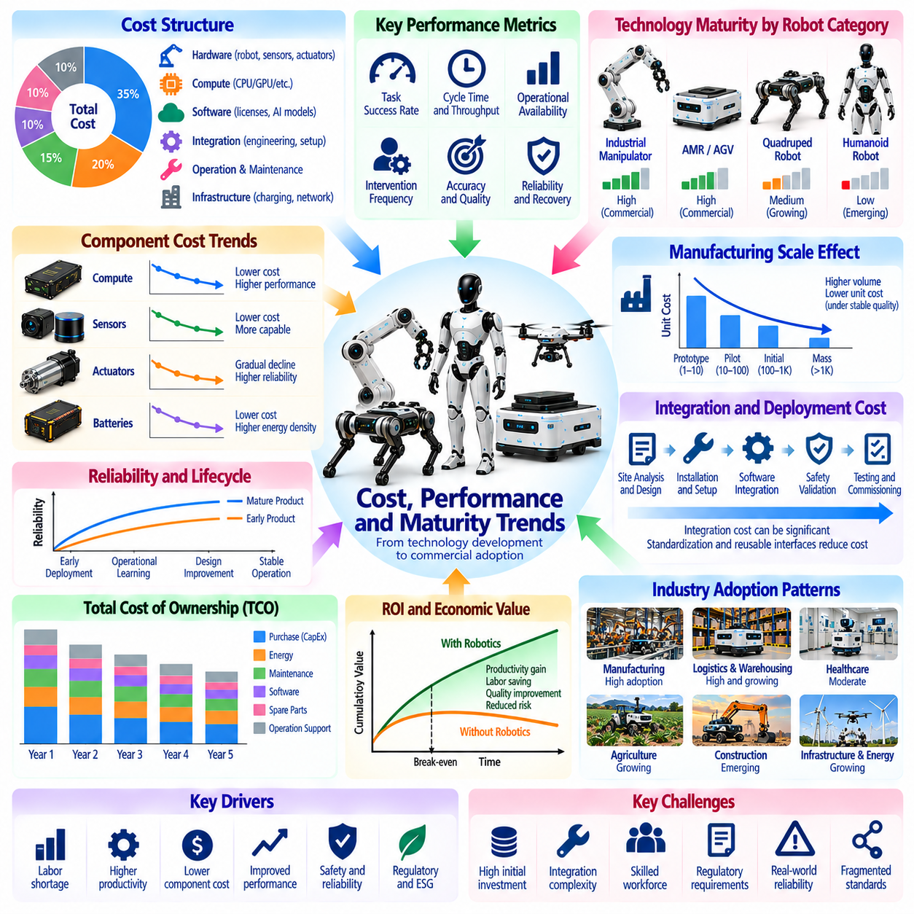{width="7.268055555555556in" height="7.268055555555556in"}

Cost, performance, and technological maturity determine whether Physical AI systems can progress from experimental prototypes to commercially sustainable products. Customers evaluate robotics investments through acquisition cost, operational productivity, reliability, and expected service life. Technological advancement creates market value only when improved capabilities translate into measurable economic benefits under realistic operating conditions.

The cost structure of Physical AI includes robotic hardware, computing systems, sensors, actuators, batteries, software, integration, and ongoing support. Hardware expenses are often visible during procurement, while engineering and lifecycle costs may be underestimated. A complete economic assessment must include installation, infrastructure modification, operator training, maintenance, software updates, and eventual equipment replacement.

Performance evaluation requires more than measuring robot speed, payload capacity, or AI model accuracy. Commercially relevant metrics include successful task completion, cycle time, operational availability, intervention frequency, and recovery capability. These measurements should reflect actual customer workflows rather than controlled demonstrations. Consistent performance across environmental variations is essential for dependable deployment.

Technological maturity varies substantially across robotic categories and application environments. Traditional industrial manipulators operate within established engineering and manufacturing ecosystems, while autonomous mobile robots have achieved commercial deployment in many structured facilities. General-purpose humanoids and highly adaptive manipulation systems remain less mature. Their commercial readiness depends on robust autonomy and repeatable field performance.

Manufacturing scale can reduce component costs through improved purchasing conditions, production efficiency, and design standardization. However, anticipated cost reductions are not guaranteed by increasing production volume alone. Manufacturing yield, component availability, quality assurance, and warranty exposure influence realized savings. Sustainable pricing requires production systems capable of maintaining consistent quality at scale.

Computing costs are increasingly important because advanced Physical AI relies on neural perception, planning, and learned control policies. More capable processors can support sophisticated autonomy but may increase power consumption, thermal requirements, and equipment prices. Hardware-software optimization can reduce these tradeoffs. Commercial designs must balance inference performance, response latency, energy efficiency, and upgrade flexibility.

Sensor economics involve balancing perception quality against hardware expense and integration complexity. Cameras, LiDAR, radar, tactile sensors, and force sensors provide complementary information, but additional sensing does not always produce proportional operational benefits. Effective sensor configurations depend on task requirements and environmental conditions. Calibration, durability, and replacement costs also influence total system economics.

Actuation and mechanical components represent substantial cost drivers in manipulators, humanoids, and mobile platforms. Precision transmissions, motors, bearings, and structural materials determine payload capability, movement quality, and equipment durability. High-performance components may increase initial prices while reducing failure rates or improving productivity. Cost optimization therefore requires evaluating mechanical performance over the complete service life.

Battery technology influences the economics of mobile robotics through energy capacity, charging frequency, replacement intervals, and operational availability. Larger batteries may extend operating time but increase weight and acquisition cost. Automated charging can reduce manual intervention while introducing infrastructure expenses. Energy management strategies should optimize useful working hours rather than battery capacity alone.

Integration costs can exceed expectations when robotic systems must operate within complex facilities and enterprise software environments. Site mapping, workflow redesign, safety validation, equipment interfaces, and operational testing require specialized engineering. Standardized interfaces and reusable deployment methods can reduce these expenses. Integration maturity is therefore a major determinant of commercialization readiness.

Reliability is a central economic variable because unexpected downtime can eliminate productivity gains and create additional labor requirements. Mean time between failures, mean time to repair, and operational availability provide useful indicators of equipment dependability. However, these measures must be interpreted alongside task success and intervention rates. Mature products demonstrate predictable performance over extended operating periods.

Total cost of ownership provides a broader framework than purchase price for comparing robotic alternatives. It includes capital expenditure, energy consumption, software subscriptions, maintenance, spare parts, insurance, and operational supervision. Economic evaluation should also consider productivity benefits and residual equipment value. A lower-cost robot may be less economical if it requires frequent intervention or replacement.

Return on investment depends on the relationship between deployment expenses and measurable operational improvements. Labor savings, higher throughput, improved quality, reduced waste, and safer operations may contribute to economic value. Benefits should be evaluated against actual utilization and operating constraints. Financial projections based on idealized continuous operation can significantly overstate commercial attractiveness.

Learning-based autonomy introduces a distinctive maturity challenge because performance depends on training data, environmental coverage, and generalization capability. A robot may perform reliably in familiar conditions while struggling with unfamiliar objects or unexpected disturbances. Evaluation must include rare events, recovery behavior, and human intervention requirements. Field evidence is more meaningful than isolated benchmark performance.

Commercial maturity also depends on organizational capabilities beyond the robot itself. Suppliers need manufacturing processes, technical documentation, spare parts networks, cybersecurity practices, and customer support infrastructure. System integrators must demonstrate repeatable installation and commissioning procedures. These supporting capabilities distinguish scalable products from research systems that require extensive engineering assistance.

The relationship between cost and performance differs across market segments. Warehouse robots may prioritize fleet utilization and operating cost per transport task, while manipulators emphasize cycle time and successful handling. Inspection robots may be evaluated through coverage and risk reduction. Humanoid systems require broader assessments of task diversity and intervention frequency. No single metric adequately represents the entire Physical AI market.

Cost-performance trends should be interpreted using consistent operational assumptions and comparable deployment conditions. Improvements in AI benchmark scores do not necessarily translate into lower cost per completed task. Likewise, falling component prices may be offset by integration, maintenance, or infrastructure expenses. Reliable market comparisons require transparent measurement methods and realistic workload definitions.

As technologies mature, market competition may shift from demonstrations of technical capability toward service quality, operational economics, and deployment scalability. Early adopters often accept higher costs to gain strategic experience, while mainstream customers demand predictable financial returns. Standardization and competition can improve affordability. However, advanced autonomy may introduce new costs associated with validation and lifecycle management.

Future progress will depend on coordinated improvements in AI models, computing efficiency, sensors, actuators, manufacturing methods, and system integration. Better generalization could reduce deployment customization, while improved hardware efficiency could lower operating expenses. These benefits must be demonstrated through sustained field performance. Technology roadmaps should distinguish research milestones from commercially validated capabilities.

Ultimately, Physical AI maturity is best understood as the convergence of technical performance, economic feasibility, operational reliability, and scalable service delivery. A system becomes commercially competitive when it consistently completes valuable tasks at an acceptable lifecycle cost. Sustainable market expansion will favor solutions that demonstrate measurable productivity, manageable risk, and predictable performance across real operating environments.

비용(Cost), 성능(Performance), 기술 성숙도(Technological Maturity)는 피지컬 AI(Physical AI) 시스템이 실험적 시제품(Experimental Prototypes)에서 상업적으로 지속 가능한 제품(Commercially Sustainable Products)으로 발전할 수 있는지를 결정한다. 고객은 도입 비용(Acquisition Cost), 운영 생산성(Operational Productivity), 신뢰성(Reliability), 예상 사용 수명(Expected Service Life)을 기준으로 로보틱스 투자(Robotics Investments)를 평가한다. 기술 발전(Technological Advancement)은 향상된 기능(Improved Capabilities)이 실제 운영 조건(Realistic Operating Conditions)에서 측정 가능한 경제적 이점(Measurable Economic Benefits)으로 전환될 때 비로소 시장 가치(Market Value)를 창출한다.

피지컬 AI(Physical AI)의 비용 구조(Cost Structure)에는 로봇 하드웨어(Robotic Hardware), 컴퓨팅 시스템(Computing Systems), 센서(Sensors), 액추에이터(Actuators), 배터리(Batteries), 소프트웨어(Software), 시스템 통합(Integration), 지속적인 지원(Ongoing Support)이 포함된다. 하드웨어 비용(Hardware Expenses)은 구매 과정(Procurement)에서 쉽게 확인할 수 있지만, 엔지니어링 비용(Engineering Costs)과 수명주기 비용(Lifecycle Costs)은 과소평가될 수 있다. 완전한 경제성 평가(Complete Economic Assessment)에는 설치(Installation), 인프라 변경(Infrastructure Modification), 운영자 교육(Operator Training), 유지보수(Maintenance), 소프트웨어 업데이트(Software Updates), 최종적인 장비 교체(Equipment Replacement)가 포함되어야 한다.

성능 평가(Performance Evaluation)는 단순히 로봇 속도(Robot Speed), 적재하중 용량(Payload Capacity), AI 모델 정확도(AI Model Accuracy)를 측정하는 것 이상을 요구한다. 상업적으로 중요한 성능 지표(Commercially Relevant Metrics)에는 작업 성공률(Successful Task Completion), 사이클 타임(Cycle Time), 운영 가용성(Operational Availability), 개입 빈도(Intervention Frequency), 복구 능력(Recovery Capability)이 포함된다. 이러한 측정값(Measurements)은 통제된 시연(Controlled Demonstrations)이 아니라 실제 고객 작업흐름(Actual Customer Workflows)을 반영해야 한다. 환경 변화(Environmental Variations)에도 일관된 성능(Consistent Performance)을 유지하는 것은 신뢰할 수 있는 배포(Dependable Deployment)에 필수적이다.

기술 성숙도(Technological Maturity)는 로봇 유형(Robotic Categories)과 응용 환경(Application Environments)에 따라 상당한 차이를 보인다. 기존 산업용 매니퓰레이터(Traditional Industrial Manipulators)는 확립된 엔지니어링 및 제조 생태계(Established Engineering and Manufacturing Ecosystems)에서 운영되는 반면, 자율이동로봇(Autonomous Mobile Robots, AMRs)은 많은 구조화된 시설(Structured Facilities)에서 상업적 배포(Commercial Deployment)를 달성하였다. 범용 휴머노이드(General-Purpose Humanoids)와 고도 적응형 조작 시스템(Highly Adaptive Manipulation Systems)은 상대적으로 성숙도가 낮다. 이들의 상업적 준비도(Commercial Readiness)는 강건한 자율성(Robust Autonomy)과 반복적으로 재현 가능한 현장 성능(Repeatable Field Performance)에 달려 있다.

제조 규모(Manufacturing Scale)는 구매 조건 개선(Improved Purchasing Conditions), 생산 효율 향상(Production Efficiency), 설계 표준화(Design Standardization)를 통해 부품 비용(Component Costs)을 절감할 수 있다. 그러나 예상 비용 절감(Anticipated Cost Reductions)이 단순히 생산량(Production Volume)을 늘린다고 보장되는 것은 아니다. 제조 수율(Manufacturing Yield), 부품 가용성(Component Availability), 품질보증(Quality Assurance), 보증 관련 위험(Warranty Exposure)은 실제 절감 효과(Realized Savings)에 영향을 미친다. 지속 가능한 가격 책정(Sustainable Pricing)을 위해서는 대규모 생산에서도 일관된 품질(Consistent Quality)을 유지할 수 있는 생산 시스템(Production Systems)이 필요하다.

컴퓨팅 비용(Computing Costs)은 첨단 피지컬 AI(Advanced Physical AI)가 신경망 기반 인식(Neural Perception), 계획(Planning), 학습 기반 제어 정책(Learned Control Policies)에 의존하기 때문에 점점 더 중요해지고 있다. 고성능 프로세서(More Capable Processors)는 정교한 자율성(Sophisticated Autonomy)을 지원할 수 있지만 전력 소비(Power Consumption), 열관리 요구사항(Thermal Requirements), 장비 가격(Equipment Prices)을 증가시킬 수 있다. 하드웨어-소프트웨어 최적화(Hardware-Software Optimization)는 이러한 상충관계(Tradeoffs)를 완화할 수 있다. 상업용 설계(Commercial Designs)는 추론 성능(Inference Performance), 응답 지연시간(Response Latency), 에너지 효율(Energy Efficiency), 업그레이드 유연성(Upgrade Flexibility) 사이에서 균형을 유지해야 한다.

센서 경제성(Sensor Economics)은 인식 품질(Perception Quality)과 하드웨어 비용(Hardware Expense), 통합 복잡성(Integration Complexity) 사이의 균형을 포함한다. 카메라(Cameras), 라이다(LiDAR), 레이더(Radar), 촉각 센서(Tactile Sensors), 힘 센서(Force Sensors)는 상호보완적인 정보(Complementary Information)를 제공하지만, 센서를 추가한다고 해서 운영상 이점(Operational Benefits)이 반드시 비례하여 증가하는 것은 아니다. 효과적인 센서 구성(Effective Sensor Configurations)은 작업 요구사항(Task Requirements)과 환경 조건(Environmental Conditions)에 따라 결정된다. 보정(Calibration), 내구성(Durability), 교체 비용(Replacement Costs)도 전체 시스템 경제성(Total System Economics)에 영향을 미친다.

구동 및 기계 부품(Actuation and Mechanical Components)은 매니퓰레이터(Manipulators), 휴머노이드(Humanoids), 이동 플랫폼(Mobile Platforms)의 주요 비용 결정요인(Substantial Cost Drivers)이다. 정밀 감속기(Precision Transmissions), 모터(Motors), 베어링(Bearings), 구조 재료(Structural Materials)는 적재하중 능력(Payload Capability), 동작 품질(Movement Quality), 장비 내구성(Equipment Durability)을 결정한다. 고성능 부품(High-Performance Components)은 초기 가격(Initial Prices)을 증가시킬 수 있지만 고장률(Failure Rates)을 낮추거나 생산성(Productivity)을 향상시킬 수 있다. 따라서 비용 최적화(Cost Optimization)를 위해서는 전체 사용 수명(Complete Service Life)에 걸친 기계적 성능(Mechanical Performance)을 평가해야 한다.

배터리 기술(Battery Technology)은 에너지 용량(Energy Capacity), 충전 빈도(Charging Frequency), 교체 주기(Replacement Intervals), 운영 가용성(Operational Availability)을 통해 이동로봇(Mobile Robotics)의 경제성에 영향을 미친다. 대용량 배터리(Larger Batteries)는 작동시간(Operating Time)을 연장할 수 있지만 무게(Weight)와 도입 비용(Acquisition Cost)을 증가시킨다. 자동 충전(Automated Charging)은 수동 개입(Manual Intervention)을 줄일 수 있지만 인프라 비용(Infrastructure Expenses)이 추가된다. 에너지 관리 전략(Energy Management Strategies)은 배터리 용량(Battery Capacity) 자체보다 실제 유효 작업시간(Useful Working Hours)을 최적화해야 한다.

시스템 통합 비용(Integration Costs)은 로봇 시스템(Robotic Systems)이 복잡한 시설(Complex Facilities)과 기업용 소프트웨어 환경(Enterprise Software Environments)에서 작동해야 할 때 예상치를 초과할 수 있다. 현장 지도작성(Site Mapping), 작업흐름 재설계(Workflow Redesign), 안전성 검증(Safety Validation), 장비 인터페이스(Equipment Interfaces), 운영 시험(Operational Testing)에는 전문 엔지니어링(Specialized Engineering)이 필요하다. 표준화된 인터페이스(Standardized Interfaces)와 재사용 가능한 배포 방법(Reusable Deployment Methods)은 이러한 비용을 줄일 수 있다. 따라서 시스템 통합 성숙도(Integration Maturity)는 상용화 준비도(Commercialization Readiness)를 결정하는 주요 요소이다.

신뢰성(Reliability)은 예상치 못한 가동중단(Unplanned Downtime)이 생산성 향상(Productivity Gains)을 상쇄하고 추가 인력 투입(Additional Labor Requirements)을 발생시킬 수 있기 때문에 핵심적인 경제적 변수(Economic Variable)이다. 평균고장간격(Mean Time Between Failures, MTBF), 평균수리시간(Mean Time to Repair, MTTR), 운영 가용성(Operational Availability)은 장비 신뢰성(Equipment Dependability)을 평가하는 유용한 지표이다. 그러나 이러한 지표는 작업 성공률(Task Success) 및 개입률(Intervention Rates)과 함께 해석해야 한다. 성숙한 제품(Mature Products)은 장기간의 운영(Extended Operating Periods)에서 예측 가능한 성능(Predictable Performance)을 입증한다.

총소유비용(Total Cost of Ownership, TCO)은 로봇 대안(Robotic Alternatives)을 비교할 때 구매 가격(Purchase Price)보다 포괄적인 평가 체계(Broader Framework)를 제공한다. 여기에는 자본지출(Capital Expenditure, CAPEX), 에너지 소비(Energy Consumption), 소프트웨어 구독료(Software Subscriptions), 유지보수(Maintenance), 예비부품(Spare Parts), 보험(Insurance), 운영 감독(Operational Supervision)이 포함된다. 경제성 평가(Economic Evaluation)는 생산성 이점(Productivity Benefits)과 장비 잔존가치(Residual Equipment Value)도 고려해야 한다. 저가 로봇(Lower-Cost Robot)이라도 빈번한 개입(Frequent Intervention)이나 교체(Replacement)가 필요하다면 경제성이 떨어질 수 있다.

투자수익률(Return on Investment, ROI)은 배포 비용(Deployment Expenses)과 측정 가능한 운영 개선(Measurable Operational Improvements) 사이의 관계에 따라 결정된다. 인건비 절감(Labor Savings), 처리량 증가(Higher Throughput), 품질 향상(Improved Quality), 폐기물 감소(Reduced Waste), 안전한 운영(Safer Operations)은 경제적 가치(Economic Value)에 기여할 수 있다. 이러한 이점은 실제 가동률(Actual Utilization)과 운영 제약(Operating Constraints)을 기준으로 평가해야 한다. 이상적인 연속 운영(Idealized Continuous Operation)을 가정한 재무 예측(Financial Projections)은 상업적 매력도(Commercial Attractiveness)를 상당히 과대평가할 수 있다.

학습 기반 자율성(Learning-Based Autonomy)은 성능이 학습 데이터(Training Data), 환경 포괄성(Environmental Coverage), 일반화 능력(Generalization Capability)에 의존하기 때문에 독특한 성숙도 과제(Maturity Challenge)를 발생시킨다. 로봇은 익숙한 조건(Familiar Conditions)에서는 안정적으로 작동하지만 익숙하지 않은 물체(Unfamiliar Objects)나 예상치 못한 외란(Unexpected Disturbances)에 어려움을 겪을 수 있다. 평가(Evaluation)에는 드문 사건(Rare Events), 복구 행동(Recovery Behavior), 인간 개입 요구사항(Human Intervention Requirements)이 포함되어야 한다. 현장 실증 근거(Field Evidence)는 개별적인 벤치마크 성능(Isolated Benchmark Performance)보다 더 의미가 있다.

상업적 성숙도(Commercial Maturity)는 로봇 자체를 넘어서는 조직적 역량(Organizational Capabilities)에도 달려 있다. 공급업체(Suppliers)는 제조 공정(Manufacturing Processes), 기술 문서(Technical Documentation), 예비부품 네트워크(Spare Parts Networks), 사이버보안 관행(Cybersecurity Practices), 고객 지원 인프라(Customer Support Infrastructure)를 갖추어야 한다. 시스템 통합업체(System Integrators)는 반복 가능한 설치 및 시운전 절차(Repeatable Installation and Commissioning Procedures)를 입증해야 한다. 이러한 지원 역량(Supporting Capabilities)은 확장 가능한 제품(Scalable Products)과 광범위한 엔지니어링 지원(Extensive Engineering Assistance)이 필요한 연구용 시스템(Research Systems)을 구분한다.

비용과 성능의 관계(Cost-Performance Relationship)는 시장 세그먼트(Market Segments)에 따라 달라진다. 창고 로봇(Warehouse Robots)은 로봇군 가동률(Fleet Utilization)과 운송 작업당 운영 비용(Operating Cost per Transport Task)을 우선시할 수 있는 반면, 매니퓰레이터(Manipulators)는 사이클 타임(Cycle Time)과 성공적인 물체 취급(Successful Handling)을 강조한다. 점검 로봇(Inspection Robots)은 점검 범위(Coverage)와 위험 감소(Risk Reduction)를 기준으로 평가할 수 있다. 휴머노이드 시스템(Humanoid Systems)은 작업 다양성(Task Diversity)과 개입 빈도(Intervention Frequency)에 대한 폭넓은 평가가 필요하다. 단일 지표(Single Metric)만으로는 전체 피지컬 AI 시장(Physical AI Market)을 적절하게 설명할 수 없다.

비용 대비 성능 추세(Cost-Performance Trends)는 일관된 운영 가정(Consistent Operational Assumptions)과 비교 가능한 배포 조건(Comparable Deployment Conditions)을 사용하여 해석해야 한다. AI 벤치마크 점수(AI Benchmark Scores)의 향상이 반드시 완료 작업당 비용(Cost per Completed Task)의 감소로 이어지는 것은 아니다. 마찬가지로 부품 가격(Component Prices)의 하락도 시스템 통합(Integration), 유지보수(Maintenance), 인프라 비용(Infrastructure Expenses)의 증가로 상쇄될 수 있다. 신뢰할 수 있는 시장 비교(Reliable Market Comparisons)를 위해서는 투명한 측정 방법(Transparent Measurement Methods)과 현실적인 작업 부하 정의(Realistic Workload Definitions)가 필요하다.

기술이 성숙함에 따라 시장 경쟁(Market Competition)은 기술적 역량(Technical Capability)의 시연에서 서비스 품질(Service Quality), 운영 경제성(Operational Economics), 배포 확장성(Deployment Scalability)으로 이동할 수 있다. 초기 도입자(Early Adopters)는 전략적 경험(Strategic Experience)을 확보하기 위해 높은 비용을 수용하는 경우가 많지만, 주류 고객(Mainstream Customers)은 예측 가능한 재무적 수익(Predictable Financial Returns)을 요구한다. 표준화(Standardization)와 경쟁(Competition)은 가격 적정성(Affordability)을 향상시킬 수 있다. 그러나 첨단 자율성(Advanced Autonomy)은 검증(Validation)과 수명주기 관리(Lifecycle Management)에 관련된 새로운 비용을 발생시킬 수 있다.

향후 발전(Future Progress)은 AI 모델(AI Models), 컴퓨팅 효율(Computing Efficiency), 센서(Sensors), 액추에이터(Actuators), 제조 방법(Manufacturing Methods), 시스템 통합(System Integration)의 조화로운 개선(Coordinated Improvements)에 달려 있다. 일반화 능력(Generalization)의 향상은 배포 맞춤화(Deployment Customization)를 줄일 수 있으며, 하드웨어 효율(Hardware Efficiency)의 개선은 운영 비용(Operating Expenses)을 낮출 수 있다. 이러한 이점은 지속적인 현장 성능(Sustained Field Performance)을 통해 입증되어야 한다. 기술 로드맵(Technology Roadmaps)은 연구개발 이정표(Research Milestones)와 상업적으로 검증된 역량(Commercially Validated Capabilities)을 구분해야 한다.

궁극적으로 피지컬 AI 성숙도(Physical AI Maturity)는 기술적 성능(Technical Performance), 경제적 타당성(Economic Feasibility), 운영 신뢰성(Operational Reliability), 확장 가능한 서비스 제공(Scalable Service Delivery)이 수렴하는 과정으로 이해하는 것이 가장 적절하다. 시스템은 수용 가능한 수명주기 비용(Acceptable Lifecycle Cost)으로 가치 있는 작업(Valuable Tasks)을 일관되게 완료할 때 상업적 경쟁력(Commercial Competitiveness)을 확보한다. 지속 가능한 시장 확대(Sustainable Market Expansion)는 실제 운영 환경(Real Operating Environments)에서 측정 가능한 생산성(Measurable Productivity), 관리 가능한 위험(Manageable Risk), 예측 가능한 성능(Predictable Performance)을 입증하는 솔루션에 유리하게 전개될 것이다.

##  

## 01.14. Physical AI Market Segmentation Framework

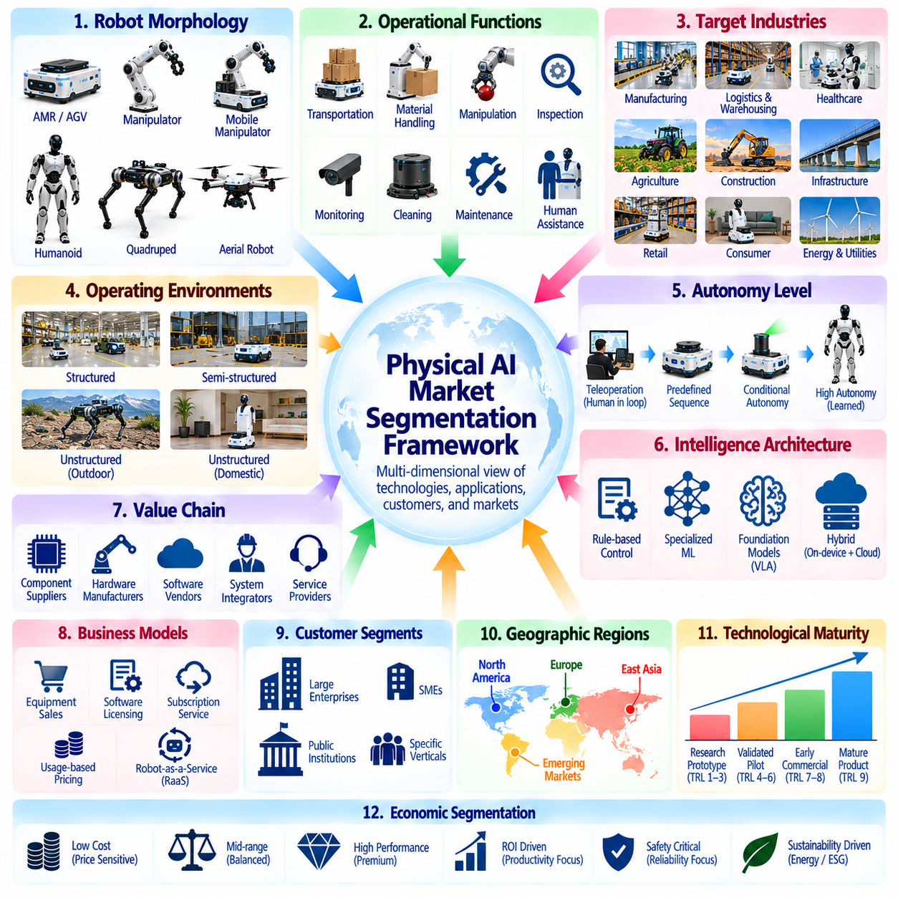{width="7.268055555555556in" height="7.268055555555556in"}

A Physical AI market segmentation framework provides a structured method for analyzing robotic technologies, customer requirements, commercial opportunities, and competitive dynamics. Because Physical AI combines hardware, software, intelligence, and physical operations, conventional robotics categories alone cannot fully describe the market. Effective segmentation must distinguish technological capabilities, application environments, business models, and deployment maturity.

The first segmentation dimension concerns robot morphology and physical architecture. Autonomous mobile robots, industrial manipulators, mobile manipulators, humanoids, quadrupeds, and aerial robots represent different hardware configurations. Each architecture creates distinct requirements for locomotion, manipulation, sensing, computing, and energy management. Morphology-based segmentation helps identify component demand, engineering complexity, and platform competition.

A second dimension classifies systems according to their primary operational functions. These include transportation, material handling, manipulation, inspection, monitoring, cleaning, maintenance, and human assistance. Functional segmentation emphasizes the economic activity performed rather than the robot\'s appearance. Different robotic architectures may compete within the same functional market when they deliver comparable operational outcomes.

Industry segmentation organizes Physical AI opportunities around manufacturing, logistics, healthcare, agriculture, construction, infrastructure, retail, and consumer applications. Each industry has distinct workflow requirements, purchasing processes, safety obligations, and economic priorities. Industry-specific analysis reveals where automation can create measurable value. It also identifies barriers that prevent technically capable systems from achieving commercial adoption.

Environmental segmentation distinguishes structured, semi-structured, and unstructured operating conditions. Structured factories and warehouses often provide predictable layouts and controlled workflows. Outdoor environments, construction sites, and domestic spaces introduce greater variability. Environmental complexity influences sensing requirements, autonomy performance, safety validation, and deployment costs. This dimension helps explain differences in technological maturity.

Autonomy level provides another important segmentation dimension. Some systems execute predefined sequences, while others navigate independently, adapt to disturbances, or perform tasks using learned policies. Human supervision may range from continuous teleoperation to occasional intervention. Classification should reflect demonstrated operational independence rather than marketing descriptions. Higher autonomy can increase flexibility but also introduces validation challenges.

The intelligence architecture dimension separates conventional control systems, specialized machine learning solutions, and foundation-model-based robotic platforms. Traditional systems may rely on deterministic planning and engineered rules. Learning-based systems can improve perception and task adaptation. Foundation models may support broader instruction understanding and behavioral generalization. Their commercial value depends on reliability, computing costs, and integration requirements.

Hardware and software value-chain segmentation identifies where companies capture revenue. Hardware suppliers provide robotic platforms, sensors, actuators, computing devices, and energy systems. Software vendors deliver perception, navigation, manipulation, fleet management, and AI development tools. System integrators connect these technologies to customer operations. Service providers generate additional value through maintenance, monitoring, training, and operational support.

Business-model segmentation distinguishes equipment sales, software licensing, subscription services, usage-based pricing, and Robot-as-a-Service arrangements. Each model allocates capital requirements, operational responsibilities, and financial risks differently. Equipment sales emphasize initial transactions, while recurring services depend on sustained performance. Comparing business models requires evaluating customer acquisition costs, utilization, service obligations, and lifecycle profitability.

Customer segmentation considers organizational size, technical readiness, operational scale, and purchasing authority. Large enterprises may demand extensive integration and multi-site deployment capabilities. Smaller organizations often prefer standardized products and simplified service agreements. Public institutions may face different procurement and accountability requirements. Understanding customer characteristics supports appropriate product positioning, pricing, and sales strategies.

Geographic segmentation evaluates regional demand, manufacturing ecosystems, labor conditions, infrastructure readiness, and regulatory requirements. North America, Europe, and East Asia exhibit different strengths across AI software, industrial automation, and hardware production. Emerging markets may prioritize affordable and maintainable solutions. Geographic analysis should distinguish technology development locations from manufacturing capacity and actual customer deployment.

Technological maturity segmentation separates research prototypes, validated pilots, early commercial products, and established production systems. These stages differ in operational evidence, manufacturing readiness, service infrastructure, and customer risk. A successful laboratory demonstration does not establish commercial maturity. Classification should consider sustained field performance, repeatable installation, maintenance capability, and verified economic outcomes.

Economic segmentation groups applications according to capital intensity, operating costs, utilization, and measurable return on investment. High-volume repetitive tasks may justify substantial automation expenditure through predictable productivity gains. Low-frequency tasks require flexible platforms or shared service arrangements. Economic attractiveness depends on cost per completed task, equipment availability, labor requirements, and lifecycle expenses rather than hardware price alone.

Competitive segmentation distinguishes platform manufacturers, component specialists, AI model developers, software providers, system integrators, and managed service operators. These participants may cooperate within one deployment while competing for control of customer relationships and recurring revenue. Market boundaries can overlap as suppliers expand vertically. Analysis must therefore separate product categories from company-level positioning and ecosystem influence.

A practical segmentation framework should combine multiple dimensions instead of relying on a single classification. For example, a warehouse mobile manipulator can be classified by morphology, material-handling function, logistics industry, structured environment, autonomy level, and subscription business model. This multidimensional approach exposes competitive alternatives and customer requirements that a hardware-only classification would overlook.

Market sizing requires consistent definitions to avoid double counting across overlapping segments. Robot hardware revenue, software subscriptions, integration fees, and managed services may all arise from the same deployment. Analysts should distinguish annual equipment sales, installed robotic fleets, recurring revenue, and total customer expenditure. Transparent accounting boundaries are essential for meaningful market comparisons and credible growth projections.

Segmentation should also distinguish addressable demand from commercially accessible opportunities. A task may be technically automatable but economically unattractive because of low utilization, high integration costs, or uncertain reliability. Regulatory barriers and limited service infrastructure can further restrict adoption. Market opportunity assessments should therefore evaluate technological feasibility, customer willingness to pay, and realistic deployment capacity.

The framework must remain adaptable because Physical AI technologies increasingly cross established category boundaries. Mobile manipulators combine transportation and manipulation, while humanoids may address tasks previously assigned to specialized equipment. Foundation models can enable software capabilities across multiple robot morphologies. Market classifications should accommodate convergence without assuming that general-purpose systems will replace specialized robots.

Ultimately, a Physical AI market segmentation framework connects technological classification with customer value, competitive structure, and commercial maturity. Its purpose is not merely to categorize robots but to identify where sustainable economic opportunities exist. Effective analysis integrates morphology, function, industry, environment, autonomy, value chain, business model, geography, and lifecycle economics into a coherent view of market development.

피지컬 AI 시장 세분화 프레임워크(Physical AI Market Segmentation Framework)는 로봇 기술(Robotic Technologies), 고객 요구사항(Customer Requirements), 상업적 기회(Commercial Opportunities), 경쟁 역학(Competitive Dynamics)을 분석하기 위한 체계적인 방법(Structured Method)을 제공한다. 피지컬 AI(Physical AI)는 하드웨어(Hardware), 소프트웨어(Software), 지능(Intelligence), 물리적 운영(Physical Operations)을 결합하기 때문에 기존 로보틱스 분류(Conventional Robotics Categories)만으로는 시장을 완전히 설명할 수 없다. 효과적인 시장 세분화(Effective Segmentation)를 위해서는 기술적 역량(Technological Capabilities), 응용 환경(Application Environments), 비즈니스 모델(Business Models), 배포 성숙도(Deployment Maturity)를 구분해야 한다.

첫 번째 시장 세분화 차원(Segmentation Dimension)은 로봇 형태(Robot Morphology)와 물리적 아키텍처(Physical Architecture)에 관한 것이다. 자율이동로봇(Autonomous Mobile Robots, AMRs), 산업용 매니퓰레이터(Industrial Manipulators), 이동형 매니퓰레이터(Mobile Manipulators), 휴머노이드(Humanoids), 사족보행 로봇(Quadrupeds), 항공 로봇(Aerial Robots)은 서로 다른 하드웨어 구성(Hardware Configurations)을 나타낸다. 각 아키텍처(Architecture)는 이동(Locomotion), 조작(Manipulation), 센싱(Sensing), 컴퓨팅(Computing), 에너지 관리(Energy Management)에 대한 고유한 요구사항을 발생시킨다. 형태 기반 시장 세분화(Morphology-Based Segmentation)는 부품 수요(Component Demand), 엔지니어링 복잡성(Engineering Complexity), 플랫폼 경쟁(Platform Competition)을 파악하는 데 도움이 된다.

두 번째 차원(Second Dimension)은 시스템을 주요 운영 기능(Primary Operational Functions)에 따라 분류한다. 여기에는 운송(Transportation), 자재 취급(Material Handling), 조작(Manipulation), 검사(Inspection), 모니터링(Monitoring), 청소(Cleaning), 유지보수(Maintenance), 인간 지원(Human Assistance)이 포함된다. 기능 기반 시장 세분화(Functional Segmentation)는 로봇의 외형(Appearance)보다 수행하는 경제적 활동(Economic Activity)에 중점을 둔다. 서로 다른 로봇 아키텍처(Robotic Architectures)라도 유사한 운영 성과(Comparable Operational Outcomes)를 제공한다면 동일한 기능별 시장(Functional Market)에서 경쟁할 수 있다.

산업별 시장 세분화(Industry Segmentation)는 피지컬 AI(Physical AI)의 기회를 제조업(Manufacturing), 물류(Logistics), 의료(Healthcare), 농업(Agriculture), 건설(Construction), 인프라(Infrastructure), 소매업(Retail), 소비자 응용 분야(Consumer Applications)를 중심으로 분류한다. 각 산업은 고유한 작업흐름 요구사항(Workflow Requirements), 구매 절차(Purchasing Processes), 안전 의무(Safety Obligations), 경제적 우선순위(Economic Priorities)를 가지고 있다. 산업별 분석(Industry-Specific Analysis)은 자동화(Automation)가 측정 가능한 가치(Measurable Value)를 창출할 수 있는 영역을 밝혀준다. 또한 기술적으로 우수한 시스템(Technically Capable Systems)이 상업적 도입(Commercial Adoption)에 도달하지 못하게 하는 장벽(Barriers)을 식별한다.

환경 기반 시장 세분화(Environmental Segmentation)는 구조화된 환경(Structured Environments), 반구조화된 환경(Semi-Structured Environments), 비구조화된 환경(Unstructured Environments)을 구분한다. 구조화된 공장(Structured Factories)과 창고(Warehouses)는 일반적으로 예측 가능한 배치(Predictable Layouts)와 통제된 작업흐름(Controlled Workflows)을 제공한다. 실외 환경(Outdoor Environments), 건설 현장(Construction Sites), 가정 공간(Domestic Spaces)은 더 큰 변동성(Variability)을 발생시킨다. 환경 복잡성(Environmental Complexity)은 센싱 요구사항(Sensing Requirements), 자율성 성능(Autonomy Performance), 안전성 검증(Safety Validation), 배포 비용(Deployment Costs)에 영향을 미친다. 이러한 차원은 기술 성숙도(Technological Maturity)의 차이를 설명하는 데 도움이 된다.

자율성 수준(Autonomy Level)은 또 다른 중요한 시장 세분화 차원(Segmentation Dimension)을 제공한다. 일부 시스템은 사전에 정의된 동작 시퀀스(Predefined Sequences)를 실행하는 반면, 다른 시스템은 독립적으로 이동하고(Independent Navigation), 외란(Disturbances)에 적응하거나 학습된 정책(Learned Policies)을 사용하여 작업을 수행한다. 인간 감독(Human Supervision)은 지속적인 원격조작(Continuous Teleoperation)부터 간헐적인 개입(Occasional Intervention)까지 다양하다. 분류(Classification)는 마케팅 설명(Marketing Descriptions)이 아니라 실제로 입증된 운영 독립성(Demonstrated Operational Independence)을 반영해야 한다. 높은 자율성(Higher Autonomy)은 유연성(Flexibility)을 높일 수 있지만 검증 과제(Validation Challenges)도 발생시킨다.

지능 아키텍처 차원(Intelligence Architecture Dimension)은 기존 제어 시스템(Conventional Control Systems), 전문화된 기계학습 솔루션(Specialized Machine Learning Solutions), 파운데이션 모델 기반 로봇 플랫폼(Foundation-Model-Based Robotic Platforms)을 구분한다. 기존 시스템(Traditional Systems)은 결정론적 계획(Deterministic Planning)과 엔지니어링 규칙(Engineered Rules)에 의존할 수 있다. 학습 기반 시스템(Learning-Based Systems)은 인식(Perception)과 작업 적응(Task Adaptation)을 개선할 수 있다. 파운데이션 모델(Foundation Models)은 더욱 폭넓은 명령 이해(Instruction Understanding)와 행동 일반화(Behavioral Generalization)를 지원할 수 있다. 상업적 가치(Commercial Value)는 신뢰성(Reliability), 컴퓨팅 비용(Computing Costs), 통합 요구사항(Integration Requirements)에 달려 있다.

하드웨어 및 소프트웨어 가치사슬 세분화(Hardware and Software Value-Chain Segmentation)는 기업이 수익(Revenue)을 창출하는 위치를 식별한다. 하드웨어 공급업체(Hardware Suppliers)는 로봇 플랫폼(Robotic Platforms), 센서(Sensors), 액추에이터(Actuators), 컴퓨팅 장치(Computing Devices), 에너지 시스템(Energy Systems)을 제공한다. 소프트웨어 공급업체(Software Vendors)는 인식(Perception), 항법(Navigation), 조작(Manipulation), 로봇군 관리(Fleet Management), AI 개발 도구(AI Development Tools)를 제공한다. 시스템 통합업체(System Integrators)는 이러한 기술을 고객 운영(Customer Operations)에 연결한다. 서비스 제공업체(Service Providers)는 유지보수(Maintenance), 모니터링(Monitoring), 교육(Training), 운영 지원(Operational Support)을 통해 추가적인 가치를 창출한다.

비즈니스 모델 기반 시장 세분화(Business-Model Segmentation)는 장비 판매(Equipment Sales), 소프트웨어 라이선싱(Software Licensing), 구독형 서비스(Subscription Services), 사용량 기반 가격 책정(Usage-Based Pricing), 서비스형 로봇(Robot-as-a-Service, RaaS) 계약을 구분한다. 각 모델은 자본 요구사항(Capital Requirements), 운영 책임(Operational Responsibilities), 재무적 위험(Financial Risks)을 서로 다르게 배분한다. 장비 판매(Equipment Sales)는 초기 거래(Initial Transactions)를 강조하는 반면, 반복 서비스(Recurring Services)는 지속적인 성능(Sustained Performance)에 의존한다. 비즈니스 모델(Business Models)을 비교하려면 고객 확보 비용(Customer Acquisition Costs), 가동률(Utilization), 서비스 의무(Service Obligations), 수명주기 수익성(Lifecycle Profitability)을 평가해야 한다.

고객 세분화(Customer Segmentation)는 조직 규모(Organizational Size), 기술 준비도(Technical Readiness), 운영 규모(Operational Scale), 구매 의사결정 권한(Purchasing Authority)을 고려한다. 대기업(Large Enterprises)은 광범위한 시스템 통합(Extensive Integration)과 다중 사업장 배포 역량(Multi-Site Deployment Capabilities)을 요구할 수 있다. 소규모 조직(Smaller Organizations)은 표준화된 제품(Standardized Products)과 단순화된 서비스 계약(Simplified Service Agreements)을 선호하는 경우가 많다. 공공기관(Public Institutions)은 서로 다른 조달 요구사항(Procurement Requirements)과 책임성 요구사항(Accountability Requirements)에 직면할 수 있다. 고객 특성(Customer Characteristics)을 이해하면 적절한 제품 포지셔닝(Product Positioning), 가격 책정(Pricing), 판매 전략(Sales Strategies)을 수립할 수 있다.

지리적 시장 세분화(Geographic Segmentation)는 지역별 수요(Regional Demand), 제조 생태계(Manufacturing Ecosystems), 노동 조건(Labor Conditions), 인프라 준비도(Infrastructure Readiness), 규제 요구사항(Regulatory Requirements)을 평가한다. 북미(North America), 유럽(Europe), 동아시아(East Asia)는 AI 소프트웨어(AI Software), 산업 자동화(Industrial Automation), 하드웨어 생산(Hardware Production) 전반에서 서로 다른 강점을 보인다. 신흥시장(Emerging Markets)은 경제적이고 유지보수가 용이한 솔루션(Affordable and Maintainable Solutions)을 우선시할 수 있다. 지리적 분석(Geographic Analysis)은 기술 개발 지역(Technology Development Locations)을 제조 역량(Manufacturing Capacity) 및 실제 고객 배포(Actual Customer Deployment)와 구분해야 한다.

기술 성숙도 기반 시장 세분화(Technological Maturity Segmentation)는 연구용 시제품(Research Prototypes), 검증된 파일럿(Validated Pilots), 초기 상용 제품(Early Commercial Products), 확립된 생산 시스템(Established Production Systems)을 구분한다. 이러한 단계는 운영 실증 근거(Operational Evidence), 제조 준비도(Manufacturing Readiness), 서비스 인프라(Service Infrastructure), 고객 위험(Customer Risk)에서 차이를 보인다. 성공적인 실험실 시연(Successful Laboratory Demonstration)이 상업적 성숙도(Commercial Maturity)를 입증하는 것은 아니다. 분류(Classification)에는 지속적인 현장 성능(Sustained Field Performance), 반복 가능한 설치(Repeatable Installation), 유지보수 역량(Maintenance Capability), 검증된 경제적 성과(Verified Economic Outcomes)를 고려해야 한다.

경제성 기반 시장 세분화(Economic Segmentation)는 자본 집약도(Capital Intensity), 운영 비용(Operating Costs), 가동률(Utilization), 측정 가능한 투자수익률(Measurable Return on Investment, ROI)에 따라 응용 분야를 분류한다. 대량의 반복 작업(High-Volume Repetitive Tasks)은 예측 가능한 생산성 향상(Predictable Productivity Gains)을 통해 상당한 자동화 투자(Substantial Automation Expenditure)를 정당화할 수 있다. 빈도가 낮은 작업(Low-Frequency Tasks)은 유연한 플랫폼(Flexible Platforms)이나 공동 서비스 계약(Shared Service Arrangements)을 필요로 한다. 경제적 매력도(Economic Attractiveness)는 하드웨어 가격(Hardware Price) 자체보다 완료 작업당 비용(Cost per Completed Task), 장비 가용성(Equipment Availability), 인력 요구사항(Labor Requirements), 수명주기 비용(Lifecycle Expenses)에 달려 있다.

경쟁 구조 기반 시장 세분화(Competitive Segmentation)는 플랫폼 제조업체(Platform Manufacturers), 부품 전문업체(Component Specialists), AI 모델 개발업체(AI Model Developers), 소프트웨어 공급업체(Software Providers), 시스템 통합업체(System Integrators), 관리형 서비스 운영업체(Managed Service Operators)를 구분한다. 이러한 참여자(Participants)는 하나의 배포 프로젝트(Deployment)에서 협력하면서도 고객 관계(Customer Relationships)와 반복 매출(Recurring Revenue)에 대한 주도권을 확보하기 위해 경쟁할 수 있다. 공급업체(Suppliers)가 수직적으로 사업을 확장(Vertical Expansion)함에 따라 시장 경계(Market Boundaries)는 중첩될 수 있다. 따라서 분석에서는 제품 범주(Product Categories)를 기업 차원의 시장 포지셔닝(Company-Level Positioning) 및 생태계 영향력(Ecosystem Influence)과 구분해야 한다.

실용적인 시장 세분화 프레임워크(Practical Segmentation Framework)는 단일 분류(Single Classification)에 의존하기보다 여러 차원(Multiple Dimensions)을 결합해야 한다. 예를 들어 창고용 이동형 매니퓰레이터(Warehouse Mobile Manipulator)는 로봇 형태(Morphology), 자재 취급 기능(Material-Handling Function), 물류 산업(Logistics Industry), 구조화된 환경(Structured Environment), 자율성 수준(Autonomy Level), 구독형 비즈니스 모델(Subscription Business Model)에 따라 분류할 수 있다. 이러한 다차원적 접근법(Multidimensional Approach)은 하드웨어 중심 분류(Hardware-Only Classification)에서 간과하기 쉬운 경쟁 대안(Competitive Alternatives)과 고객 요구사항(Customer Requirements)을 드러낸다.

시장 규모 산정(Market Sizing)에는 서로 중첩되는 시장 세그먼트(Overlapping Segments) 사이에서 중복 계산(Double Counting)을 방지하기 위한 일관된 정의(Consistent Definitions)가 필요하다. 로봇 하드웨어 매출(Robot Hardware Revenue), 소프트웨어 구독 매출(Software Subscriptions), 시스템 통합 수수료(Integration Fees), 관리형 서비스(Managed Services)는 모두 동일한 배포 프로젝트(Same Deployment)에서 발생할 수 있다. 분석가(Analysts)는 연간 장비 판매액(Annual Equipment Sales), 설치된 로봇군(Installed Robotic Fleets), 반복 매출(Recurring Revenue), 고객 총지출(Total Customer Expenditure)을 구분해야 한다. 투명한 회계 범위(Transparent Accounting Boundaries)는 의미 있는 시장 비교(Meaningful Market Comparisons)와 신뢰할 수 있는 성장 전망(Credible Growth Projections)에 필수적이다.

시장 세분화(Segmentation)는 대응 가능한 수요(Addressable Demand)와 상업적으로 접근 가능한 기회(Commercially Accessible Opportunities)도 구분해야 한다. 어떤 작업은 기술적으로 자동화할 수 있더라도 낮은 가동률(Low Utilization), 높은 시스템 통합 비용(High Integration Costs), 불확실한 신뢰성(Uncertain Reliability) 때문에 경제적 매력도가 낮을 수 있다. 규제 장벽(Regulatory Barriers)과 제한된 서비스 인프라(Limited Service Infrastructure)는 도입(Adoption)을 더욱 제약할 수 있다. 따라서 시장 기회 평가(Market Opportunity Assessments)는 기술적 실현 가능성(Technological Feasibility), 고객의 지불 의사(Customer Willingness to Pay), 현실적인 배포 역량(Realistic Deployment Capacity)을 평가해야 한다.

피지컬 AI 기술(Physical AI Technologies)이 기존의 분류 경계(Established Category Boundaries)를 점점 더 넘어서고 있기 때문에 시장 세분화 프레임워크(Segmentation Framework)는 적응 가능성(Adaptability)을 유지해야 한다. 이동형 매니퓰레이터(Mobile Manipulators)는 운송(Transportation)과 조작(Manipulation)을 결합하며, 휴머노이드(Humanoids)는 기존에 전문 장비(Specialized Equipment)가 수행하던 작업에 대응할 수 있다. 파운데이션 모델(Foundation Models)은 여러 로봇 형태(Robot Morphologies)에 걸쳐 소프트웨어 기능(Software Capabilities)을 제공할 수 있다. 시장 분류(Market Classifications)는 범용 시스템(General-Purpose Systems)이 전문 로봇(Specialized Robots)을 대체할 것이라고 가정하지 않으면서도 기술 융합(Convergence)을 수용해야 한다.

궁극적으로 피지컬 AI 시장 세분화 프레임워크(Physical AI Market Segmentation Framework)는 기술적 분류(Technological Classification)를 고객 가치(Customer Value), 경쟁 구조(Competitive Structure), 상업적 성숙도(Commercial Maturity)와 연결한다. 이 프레임워크의 목적은 단순히 로봇을 분류하는 것이 아니라 지속 가능한 경제적 기회(Sustainable Economic Opportunities)가 존재하는 영역을 식별하는 것이다. 효과적인 분석(Effective Analysis)은 로봇 형태(Morphology), 기능(Function), 산업(Industry), 환경(Environment), 자율성(Autonomy), 가치사슬(Value Chain), 비즈니스 모델(Business Model), 지리적 특성(Geography), 수명주기 경제성(Lifecycle Economics)을 통합하여 시장 발전(Market Development)에 대한 일관된 관점(Coherent View)을 제공한다.
