**Volume 12. Physical AI Business and Industry Applications**

# Chapter 02. Manufacturing Applications

## 02.01. Physical AI in Modern Manufacturing

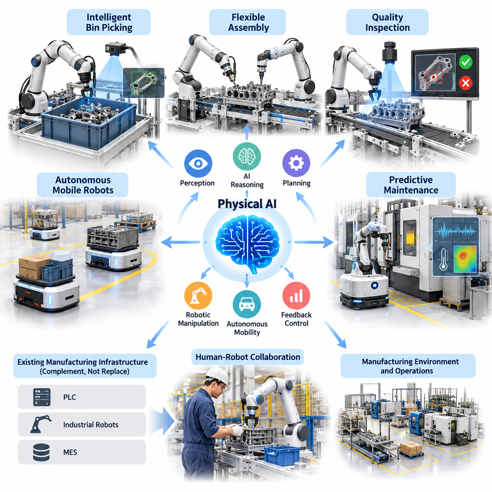{width="7.268055555555556in" height="7.268055555555556in"}

Modern manufacturing is undergoing a fundamental transformation as Physical Artificial Intelligence extends automation beyond fixed, repetitive operations toward adaptive, perception-driven, and increasingly autonomous production systems. Traditional industrial automation depends heavily on predefined sequences, structured environments, and precisely engineered processes. Physical AI introduces the ability to interpret changing conditions, make operational decisions, and execute physical actions within real manufacturing environments.

Physical AI combines machine perception, artificial intelligence, robotic manipulation, autonomous mobility, motion planning, and feedback control into integrated industrial systems. Unlike conventional software intelligence, which primarily processes digital information, Physical AI interacts directly with machines, materials, products, and human workers. Its effectiveness depends on understanding physical constraints, including geometry, contact forces, friction, payload capacity, equipment dynamics, and environmental uncertainty.

The transition from conventional automation to intelligent manufacturing does not eliminate programmable logic controllers, industrial robots, or established manufacturing execution systems. Instead, Physical AI adds adaptive intelligence to existing infrastructure. Deterministic controllers continue managing time-critical and safety-related operations, while AI-based components support perception, planning, anomaly interpretation, and flexible task execution. This layered architecture allows manufacturers to introduce autonomy without replacing entire production systems.

Manufacturing environments provide significant opportunities for Physical AI because production activities involve continuous interactions between physical objects, equipment, and operational workflows. Material transportation, machine loading, assembly, inspection, maintenance, and production scheduling frequently require adjustments to changing conditions. Physical AI systems can recognize these variations and respond through coordinated sensing, reasoning, and physical action, reducing dependence on manually programmed exceptions.

Autonomous Mobile Robots represent an important entry point for Physical AI adoption in factories. These systems transport raw materials, components, work-in-progress inventory, and finished products between production stations. By combining localization, mapping, obstacle detection, route planning, and fleet coordination, AMRs can operate within changing factory layouts. Integration with production management systems enables transportation requests to be generated according to actual manufacturing demand rather than fixed delivery schedules.

Mobile manipulation extends autonomous transportation by combining robotic mobility with articulated arms and intelligent grasping capabilities. A mobile manipulator can approach a machine, identify a component, determine a feasible grasp, and perform loading or unloading operations. Such systems are particularly relevant when production equipment is distributed across multiple locations or when manufacturing volumes do not justify dedicated stationary automation. Their practical performance depends on positioning accuracy, manipulation reliability, and recovery from operational failures.

Flexible assembly represents another important application because manufacturing processes increasingly require product variation and shorter production cycles. Conventional assembly automation often depends on specialized fixtures and carefully constrained part orientations. Physical AI can incorporate visual perception, force feedback, and learned manipulation policies to accommodate selected variations in component geometry and placement. However, high-precision assembly still requires careful mechanical design, calibrated sensing, and reliable contact control.

Intelligent bin picking and parts handling demonstrate how Physical AI can address uncertainty in object arrangement. Components placed randomly inside containers create challenges involving occlusion, overlapping geometry, and unpredictable grasp accessibility. Vision systems estimate object locations and orientations, while grasp-planning algorithms select feasible contact configurations. Robotic manipulators then execute retrieval actions using motion planning and feedback. Performance depends on object diversity, sensor quality, grasp stability, and the ability to detect unsuccessful attempts.

Quality inspection provides a complementary application in which Physical AI connects visual understanding with physical manufacturing operations. Cameras, depth sensors, thermal imaging, and other measurement technologies can identify surface defects, dimensional deviations, and abnormal process conditions. AI-based inspection systems support classification and anomaly detection, while robotic platforms position sensors or manipulate inspected products. Connecting inspection results with production equipment enables corrective actions and helps manufacturers identify recurring quality problems.

Predictive maintenance expands Physical AI from direct production activities into equipment reliability management. Industrial machines generate vibration, temperature, electrical, acoustic, and operational data that may reveal developing mechanical problems. Machine learning models can estimate abnormal behavior and support maintenance decisions before failures interrupt production. When integrated with mobile inspection robots or autonomous sensing platforms, condition monitoring can become a distributed physical intelligence capability across manufacturing facilities.

Human-robot collaboration is particularly important in manufacturing environments where complete automation is technically difficult or economically unjustified. Human workers contribute contextual understanding, dexterity, and judgment, while robots provide repeatability, physical assistance, and continuous monitoring. Physical AI can improve collaborative workflows through human detection, motion prediction, and adaptive task coordination. Nevertheless, safe collaboration requires independently validated protective measures and clearly defined operational boundaries.

Humanoid robots introduce the possibility of operating within factories originally designed around human dimensions and workflows. Their potential applications include material handling, machine interaction, component transfer, and selected repetitive tasks. Human-compatible reach, mobility, and manipulation may reduce certain infrastructure modifications. However, practical deployment remains constrained by manipulation robustness, balance, energy consumption, operational speed, safety assurance, and total ownership cost compared with specialized industrial robots.

Digital twins provide an important foundation for developing and operating intelligent manufacturing systems. A digital representation of production equipment, factory layouts, robotic mechanisms, and operational processes can support simulation, task validation, and performance analysis. Physical AI systems can use these environments to evaluate navigation strategies, manipulation sequences, and production scenarios before physical deployment. Continuous synchronization with factory data can also improve planning accuracy and reveal differences between expected and actual operations.

Multi-robot orchestration becomes increasingly important as factories deploy combinations of AMRs, manipulators, inspection robots, and conventional automated equipment. Independent optimization of individual robots may produce congestion, resource conflicts, or production bottlenecks. Coordinated systems therefore require task allocation, traffic management, resource scheduling, and communication with manufacturing execution systems. Effective orchestration aligns robotic activity with production priorities, machine availability, and material flow requirements.

Manufacturing data provides the foundation for continuously improving Physical AI capabilities. Robot trajectories, sensor observations, manipulation outcomes, production events, and human interventions can be collected as structured operational records. These datasets support model training, failure analysis, and policy refinement. A manufacturing data flywheel emerges when deployed systems generate useful experience, improved models are validated, and subsequent deployments benefit from accumulated operational knowledge.

The economic value of Physical AI must be evaluated through measurable manufacturing outcomes rather than technological sophistication alone. Relevant indicators include production throughput, cycle time, equipment utilization, labor productivity, defect rates, operational availability, and maintenance costs. Capital investment, software integration, energy consumption, supervision, and ongoing support must also be considered. A successful deployment delivers sustainable improvements under realistic operating conditions rather than only demonstrating isolated technical capabilities.

Safety, reliability, and integration remain decisive requirements for industrial adoption. Physical AI systems must operate around expensive equipment, moving machinery, valuable materials, and human personnel. Perception errors, communication failures, unexpected object interactions, and model uncertainty can create operational risks. Manufacturers therefore need validated safety architectures, runtime monitoring, controlled fallback behavior, cybersecurity protection, and systematic testing across expected and exceptional operating conditions.

The long-term significance of Physical AI lies in its potential to transform factories from collections of individually automated machines into coordinated, adaptive production environments. Achieving this transformation requires progressive integration of intelligent mobility, manipulation, perception, digital twins, industrial data platforms, and human supervision. Manufacturing organizations that combine technical capability with operational discipline can establish scalable foundations for more flexible, resilient, and economically productive industrial systems.

## 02.02. Material Transport and AMR Automation

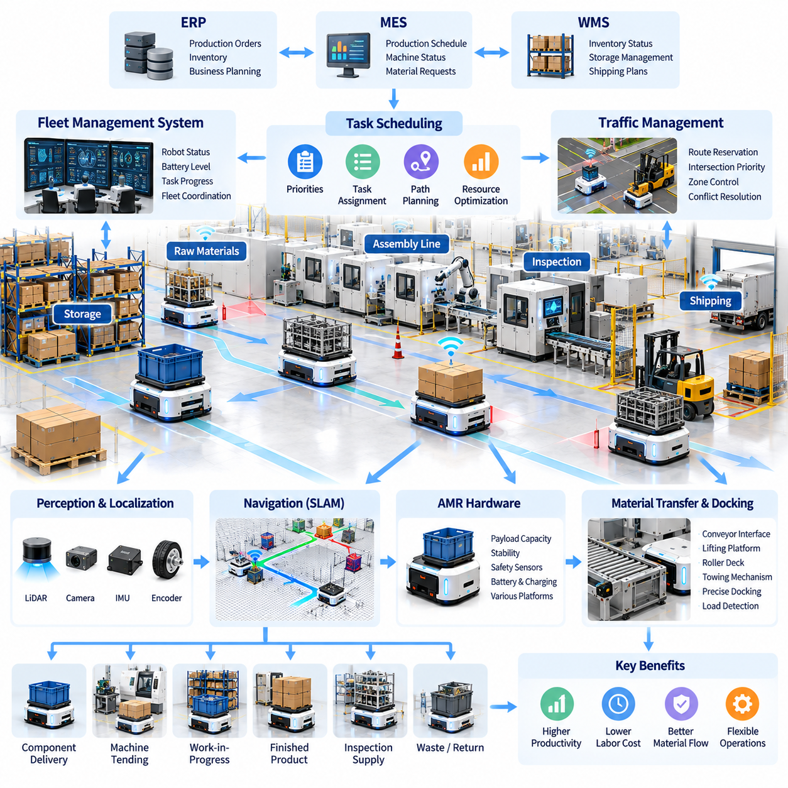{width="7.268055555555556in" height="7.268055555555556in"}

Material transport is a fundamental manufacturing operation that connects production equipment, storage areas, assembly stations, and shipping facilities. Traditional material handling relies on manual forklifts, fixed conveyors, and predefined transportation routes. Autonomous Mobile Robots (AMRs) introduce flexible, intelligent movement by combining environmental perception, autonomous navigation, task scheduling, and coordinated material delivery within dynamic industrial environments.

AMR automation transforms internal logistics from isolated transportation activities into an integrated component of manufacturing execution. Robots can deliver raw materials, components, work-in-progress inventory, and finished products according to production requirements. By connecting transportation decisions with machine status, inventory information, and manufacturing schedules, AMR systems reduce unnecessary movement and support more responsive material flow across factory operations.

Unlike Automated Guided Vehicles (AGVs), which traditionally follow predefined guidance infrastructure or constrained routes, AMRs can plan and adjust paths using onboard sensing and localization. LiDAR, cameras, inertial sensors, and wheel encoders provide information about the surrounding environment and robot motion. Navigation software combines these observations to estimate position, identify obstacles, and generate feasible routes while respecting operational and safety constraints.

Simultaneous Localization and Mapping (SLAM) provides an important technical foundation for autonomous factory navigation. SLAM algorithms construct or update environmental representations while estimating robot position within those representations. In manufacturing facilities, reliable localization must account for changing equipment layouts, moving pallets, temporary storage, reflective surfaces, and repetitive structural features that may introduce uncertainty into sensor measurements.

Material transport automation begins with identifying transportation tasks and their operational requirements. A task may involve collecting a container from a storage location, delivering components to an assembly line, or transferring finished products to an inspection station. Each assignment includes pickup and delivery locations, payload requirements, handling constraints, and operational priorities. Intelligent scheduling converts these requirements into executable missions for available robots.

Fleet Management Systems (FMS) coordinate multiple AMRs operating within shared factory environments. An FMS monitors robot locations, battery conditions, task progress, and operational availability while assigning missions according to production demand. Centralized or distributed scheduling algorithms can consider travel distance, robot capabilities, congestion, and delivery deadlines. Effective fleet coordination prevents unnecessary competition for shared resources and improves transportation efficiency.

Traffic management becomes increasingly important as the number of deployed AMRs grows. Narrow corridors, intersections, loading stations, and shared production areas can create congestion or deadlock conditions. Traffic coordination mechanisms use route reservations, intersection priorities, zone restrictions, and conflict resolution strategies to maintain orderly movement. These mechanisms must also accommodate human workers, manually operated vehicles, and unexpected environmental changes.

Payload characteristics strongly influence AMR mechanical design and operational performance. Manufacturing applications may require transportation of lightweight component bins, heavy industrial materials, precision assemblies, or large production fixtures. Robot selection must consider payload mass, center of gravity, floor conditions, acceleration limits, and stopping distance. Heavy-payload applications may require reinforced structures, specialized wheel arrangements, and additional stability monitoring.

Material transfer interfaces determine how effectively AMRs interact with production equipment and storage infrastructure. Robots may use conveyor modules, lifting platforms, roller decks, towing mechanisms, or customized docking devices to exchange materials. Reliable transfer requires accurate alignment, load detection, mechanical compatibility, and communication with connected equipment. Standardized interfaces can simplify deployment across multiple production stations and reduce integration complexity.

Docking accuracy is especially important when AMRs deliver materials directly to automated production equipment. Navigation systems provide approximate positioning, while local sensors and mechanical alignment mechanisms support precise final docking. Cameras, proximity sensors, fiducial markers, and contact-based references may improve repeatability. The docking process must verify successful positioning and load transfer before allowing subsequent manufacturing operations to proceed.

Integration with Manufacturing Execution Systems (MES), Enterprise Resource Planning (ERP), and Warehouse Management Systems (WMS) connects AMR transportation with broader factory operations. Production orders, inventory changes, and machine readiness signals can automatically trigger material delivery requests. Middleware and industrial communication interfaces translate business-level requirements into robot missions, enabling transportation activities to respond to actual production conditions.

Demand-aware material transport supports just-in-time manufacturing by delivering components when production stations require them. Instead of following fixed replenishment intervals, intelligent systems can monitor consumption rates, inventory thresholds, and production progress. Predictive scheduling may anticipate future material requirements and allocate transportation capacity accordingly. This approach can reduce intermediate inventory while limiting production interruptions caused by delayed deliveries.

Battery management and autonomous charging are essential for continuous AMR operations. Fleet scheduling must account for remaining battery capacity, charging availability, mission duration, and expected energy consumption. Robots can be directed toward charging stations during periods of lower transportation demand. Opportunity charging and intelligent charging schedules help maintain fleet availability, although charging infrastructure must be designed around realistic production workloads.

Physical AI enhances AMR automation by introducing adaptive decision-making beyond conventional navigation and task execution. Learning-based perception can improve recognition of changing environments, while predictive models can estimate congestion and transportation delays. Advanced systems may use historical mission data to refine scheduling strategies. However, safety-critical navigation and motion control still require deterministic safeguards and independently validated operational constraints.

Human interaction remains an important consideration because manufacturing AMRs frequently share working spaces with personnel. Robots must detect pedestrians, maintain appropriate separation distances, communicate intended movement, and respond safely to unexpected obstacles. Visual indicators, audible notifications, and clearly defined operating procedures support predictable interaction. Safety engineering must address both normal transportation activities and exceptional conditions such as sensor failures or emergency stops.

Operational reliability depends on the ability to detect and recover from transportation failures. Common problems include blocked routes, unsuccessful docking, misplaced containers, localization uncertainty, and communication interruptions. Recovery strategies may involve alternative route planning, repeated docking attempts, controlled mission cancellation, or operator intervention. Recording these events enables manufacturers to identify recurring failure patterns and improve system performance over time.

The economic performance of AMR automation depends on transportation throughput, fleet utilization, delivery reliability, and overall system cost. Important indicators include completed missions per hour, average transport cycle time, robot availability, empty travel distance, and labor hours saved. Capital expenditure, software integration, maintenance, charging infrastructure, and operational supervision must be included when evaluating total cost of ownership and investment returns.

Simulation and digital twins can support AMR deployment planning before physical installation. Virtual factory models allow engineers to evaluate robot quantities, route configurations, traffic policies, charging locations, and material delivery schedules. Simulation experiments can identify potential bottlenecks and estimate transportation capacity under different production scenarios. Real operational data can subsequently refine these models and support continuous fleet optimization.

The long-term development of AMR automation involves closer integration between autonomous transportation, robotic manipulation, production scheduling, and factory-wide intelligence. AMRs may increasingly coordinate with mobile manipulators, automated storage systems, and intelligent production equipment to execute complete material handling workflows. Such integration can transform internal logistics into an adaptive manufacturing capability that responds dynamically to changing production requirements.

Successful AMR adoption requires a systematic approach that combines operational analysis, robot selection, infrastructure integration, safety validation, and performance monitoring. Initial deployments should target transportation processes with measurable benefits and manageable environmental complexity. As operational experience accumulates, manufacturers can expand automation across additional workflows and facilities, establishing scalable foundations for intelligent, flexible, and resilient manufacturing logistics.

## 02.03. Machine Tending and Mobile Manipulation

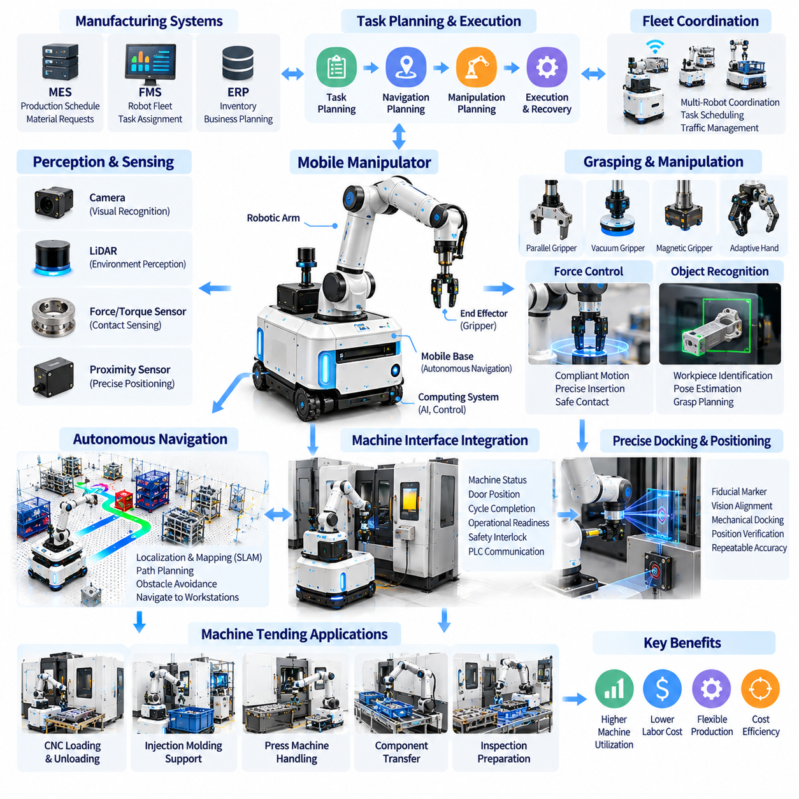{width="7.268055555555556in" height="7.268055555555556in"}

Machine tending is a fundamental manufacturing activity involving the loading, unloading, monitoring, and servicing of production equipment. Conventional automation typically uses fixed industrial manipulators positioned beside individual machines. Physical AI extends this approach through mobile manipulation, combining autonomous navigation, robotic arms, environmental perception, and intelligent task execution to support flexible machine operations across multiple production stations.

Mobile manipulators integrate an autonomous mobile base with one or more articulated robotic arms, end effectors, sensors, and computing systems. The mobile platform provides movement between machines, while the manipulator performs physical interactions with workpieces and equipment. Coordinated control allows the robot to approach a workstation, establish a suitable operating position, identify target objects, and execute manipulation tasks within mechanical and safety constraints.

Machine tending applications include CNC loading, injection molding support, press machine handling, component transfer, and automated inspection preparation. A typical operation involves retrieving an unfinished workpiece, positioning it inside a machine, initiating a processing cycle, and removing the completed component. Successful automation requires synchronization between robot actions, machine operating states, workpiece availability, and production scheduling requirements.

Physical AI enables machine tending systems to handle variations that conventional fixed automation may struggle to accommodate. Visual perception can identify workpiece positions, recognize machine interfaces, and estimate object orientations. Learning-based manipulation policies may support adjustments to different component geometries and handling conditions. These capabilities reduce dependence on precisely arranged materials, although reliable industrial operation still requires controlled interfaces and validated procedures.

Autonomous navigation is essential when a mobile manipulator serves multiple production machines. Localization and mapping algorithms estimate the robot position relative to factory infrastructure, while motion planners generate routes between workstations. Obstacle detection supports navigation around personnel, material carts, and temporary equipment. The navigation system must deliver the robot to a sufficiently accurate position for subsequent manipulation and docking operations.

Precise positioning represents a major technical challenge because navigation accuracy alone may not satisfy machine tending requirements. Small errors in mobile base alignment can create significant deviations at the robot end effector. Local vision systems, fiducial markers, proximity sensors, and mechanical docking references can improve final positioning. Calibration between the mobile base, robotic arm, sensors, and machine coordinate frames is necessary for repeatable operation.

Robotic grasping determines whether workpieces can be handled reliably throughout production cycles. Gripper selection depends on object geometry, material properties, surface conditions, weight, and required positioning accuracy. Parallel grippers, vacuum devices, magnetic tools, and adaptive robotic hands provide different handling capabilities. Intelligent grasp planning evaluates accessible contact locations, collision risks, and expected grasp stability before executing an action.

Force and torque sensing improves manipulation reliability during machine loading and unloading. Contact-rich operations require the robot to distinguish expected mechanical resistance from abnormal interference. Force-controlled insertion, compliant motion, and impedance control can compensate for limited positioning errors while protecting equipment and workpieces. These methods are especially important when placing components into fixtures, engaging mechanical interfaces, or handling precision assemblies.

Machine interface integration connects robotic actions with equipment operating states. Industrial controllers, programmable logic controllers, and machine communication protocols provide signals related to door position, spindle activity, cycle completion, and operational readiness. The robot must verify that the machine is in an appropriate state before performing physical interactions. Reliable handshaking prevents conflicting commands and supports coordinated execution between autonomous robots and production equipment.

Task planning coordinates navigation, manipulation, machine interaction, and material handling into complete operational sequences. A machine tending mission may require collecting raw materials, traveling to a workstation, confirming equipment readiness, loading a component, and transferring completed products. Hierarchical task planners can represent these activities as dependent actions with defined preconditions, execution states, and recovery procedures.

Mobile manipulation offers economic advantages when production volumes or equipment utilization do not justify dedicated robots at every workstation. A single mobile manipulator may serve several machines according to processing cycle times and operational demand. This shared-resource approach can improve capital efficiency, although travel time, docking duration, and scheduling conflicts may reduce theoretical productivity. Deployment planning must evaluate actual machine utilization and robot service capacity.

Fleet-level coordination becomes important when multiple mobile manipulators operate alongside autonomous transport robots. Fleet management systems can assign machines, prioritize urgent production tasks, and coordinate shared transportation corridors. Scheduling algorithms may consider machine cycle completion, robot availability, workpiece readiness, and expected travel time. Effective coordination reduces machine waiting periods and prevents competition for limited operational resources.

Digital twins and simulation environments support the development of machine tending applications before physical deployment. Virtual representations of robots, production machines, fixtures, and workpieces allow engineers to evaluate reachability, collision risks, cycle times, and task sequences. Simulation can also generate training data for perception and manipulation models. However, physical validation remains necessary because contact dynamics, sensor uncertainty, and mechanical tolerances may differ from simulated conditions.

Learning-based manipulation introduces opportunities for greater flexibility across manufacturing tasks. Demonstration learning, imitation learning, and reinforcement learning can help robots acquire manipulation strategies from recorded experience or simulated interaction. Vision-language-action models may eventually support task interpretation and generalized action generation. Nevertheless, industrial deployment requires careful evaluation of repeatability, failure behavior, and compatibility with deterministic safety systems.

Operational recovery is essential because machine tending involves complex interactions that may fail at several stages. A robot may encounter an incorrectly positioned workpiece, unsuccessful grasp, blocked fixture, incomplete machine cycle, or docking error. Recovery mechanisms should identify the failure condition and select a controlled response, such as repositioning, retrying, requesting operator assistance, or safely terminating the mission.

Safety engineering must address the interaction between mobile robots, manipulators, production machinery, and human workers. Hazard analysis should consider moving arms, pinch points, heavy workpieces, unexpected machine activation, and shared workspace traffic. Protective functions may include safety-rated monitoring, controlled stopping, interlocked machine interfaces, and restricted operating zones. AI-based perception can support awareness but should not replace validated safety functions.

Performance evaluation should consider both individual manipulation success and complete production workflow efficiency. Relevant metrics include machine loading time, unloading time, docking accuracy, manipulation success rate, machine idle time, and completed production cycles. System availability, recovery frequency, operator intervention, and maintenance requirements also influence practical performance. Measurements should reflect sustained factory operation rather than isolated demonstrations.

The business case for mobile machine tending depends on balancing automation benefits against system complexity and lifecycle costs. Capital expenditure includes mobile platforms, manipulators, sensors, grippers, charging infrastructure, and integration engineering. Operating expenses include maintenance, software support, energy, supervision, and equipment downtime. Return on investment should account for increased machine utilization, reduced manual handling, improved scheduling flexibility, and actual labor redeployment opportunities.

Future machine tending systems are expected to integrate increasingly capable perception, manipulation, and production reasoning. Mobile manipulators may adapt to different machine interfaces, recognize unfamiliar components, and coordinate with factory-wide scheduling platforms. Foundation models and accumulated operational data could reduce task-specific programming requirements. However, general-purpose capability will remain dependent on physical reliability, standardized interfaces, and rigorous industrial validation.

Successful deployment requires a phased engineering approach beginning with carefully selected machines and repeatable handling tasks. Initial systems should establish reliable navigation, docking, gripping, machine communication, and recovery before expanding operational complexity. As experience accumulates, manufacturers can extend mobile manipulation across additional workstations, creating flexible production environments in which intelligent robotic resources are dynamically allocated according to manufacturing demand.

## 02.04. Flexible Assembly and Generalist Manipulation

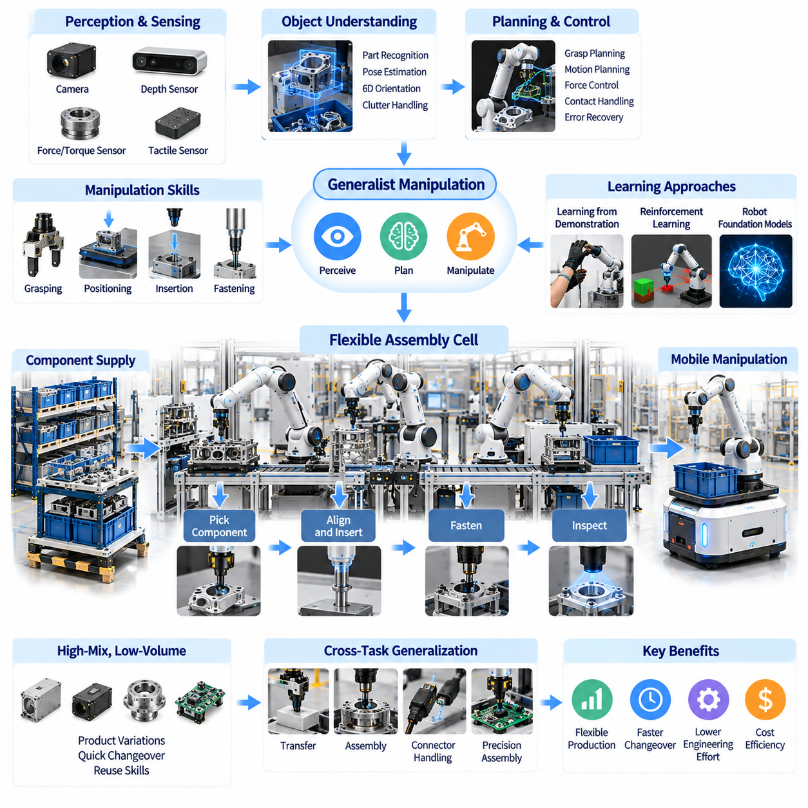{width="7.268055555555556in" height="7.268055555555556in"}

Flexible assembly represents an important evolution in manufacturing automation, enabling production systems to accommodate changing products, component variations, and smaller manufacturing batches. Traditional assembly lines rely on dedicated fixtures, fixed robot trajectories, and carefully controlled part presentation. Physical AI introduces perception-driven manipulation and adaptive decision-making, allowing robots to perform a broader range of assembly tasks under variable operating conditions.

Generalist manipulation extends robotic capabilities beyond a single predefined operation toward reusable skills applicable across different objects and tasks. Instead of programming every movement independently, robots can combine learned behaviors such as grasping, positioning, insertion, fastening, and object transfer. This approach aims to reduce engineering effort when production requirements change, although industrial reliability still depends on task-specific validation.

Flexible assembly systems combine robotic manipulators, machine vision, force sensing, motion planning, and intelligent control. Cameras and depth sensors estimate component positions and orientations, while force and torque sensors monitor physical interactions. Planning algorithms determine feasible manipulation sequences, and feedback controllers adjust movements during execution. The integration of these capabilities enables robots to respond to moderate variations in component placement.

High-mix, low-volume manufacturing provides a particularly relevant environment for flexible assembly. Frequent product changes make dedicated automation expensive because tooling, fixtures, and robot programs require repeated modifications. Generalist manipulation can support faster transitions between product variants by reusing common manipulation skills. Its economic value depends on reducing changeover effort without introducing excessive cycle time or operational uncertainty.

Object perception is a fundamental requirement because assembly robots must understand component geometry, orientation, and spatial relationships. Vision systems identify relevant features, estimate six-degree-of-freedom poses, and distinguish parts within cluttered workspaces. Learned perception models may improve recognition across product variations. However, reflective surfaces, occlusion, small tolerances, and visually similar components remain significant challenges.

Grasp planning connects visual understanding with physical object handling. A robot must select contact points that provide sufficient stability while preserving access to assembly features. Grasp selection depends on object geometry, mass distribution, surface friction, and downstream manipulation requirements. Adaptive grippers and dexterous robotic hands can expand handling flexibility, but specialized end effectors may remain preferable for demanding industrial operations.

Contact-rich assembly introduces challenges that cannot be solved through geometric positioning alone. Insertion, alignment, connector engagement, and fastening require controlled interaction forces and sensitivity to mechanical constraints. Force feedback, compliant control, and impedance control help robots accommodate small positioning errors. Successful execution requires detecting abnormal resistance and distinguishing correct engagement from jamming or unintended contact.

Assembly planning involves more than selecting individual robot motions. Complex products require ordered operations, dependency management, component verification, and coordination between tools and workstations. Hierarchical task planning can represent assembly procedures as sequences of reusable skills with defined preconditions and completion criteria. Physical AI may adapt execution when components are misplaced or intermediate operations require correction.

Learning from demonstration offers a practical method for teaching robots new assembly behaviors. Human operators can provide examples through teleoperation, kinesthetic guidance, or recorded manipulation trajectories. Imitation learning models extract behavioral patterns from these demonstrations and generate corresponding robot actions. Demonstration quality, task coverage, and differences between training and deployment environments strongly influence resulting performance.

Reinforcement learning provides another approach for developing manipulation skills through repeated interaction with simulated or physical environments. Robots can optimize actions according to objectives such as insertion success, contact stability, or assembly completion time. Simulation enables large-scale experimentation without exposing production equipment to unnecessary risk. Nevertheless, transferring learned policies to real machinery requires careful treatment of physical modeling errors.

Robot foundation models introduce the possibility of sharing manipulation knowledge across tasks, products, and robotic platforms. Vision-language-action models combine visual observations, language instructions, and action representations to generate task-relevant behaviors. These architectures may reduce dependence on manually programmed procedures. However, generalized model performance does not automatically guarantee the precision, consistency, or safety required in manufacturing.

Cross-task generalization is central to the concept of generalist manipulation. A robot trained on several assembly operations may reuse underlying capabilities when encountering related components or workflows. Transfer learning and fine-tuning can adapt existing models to new applications with less task-specific data. The effectiveness of this approach depends on similarities in object geometry, contact dynamics, robot embodiment, and operational constraints.

Mobile manipulation can extend flexible assembly beyond fixed production cells. A mobile manipulator may travel between workstations, collect components, perform selected assembly operations, and deliver partially completed products. This architecture supports shared robotic resources and reconfigurable production layouts. However, mobile positioning uncertainty, docking accuracy, and coordination between navigation and manipulation introduce additional engineering challenges.

Human-robot collaboration remains important because generalist robots cannot reliably perform every assembly operation. Human workers provide judgment, dexterity, and problem-solving abilities for difficult or unusual tasks, while robots handle repeatable operations and physically demanding activities. Collaborative workflows can dynamically allocate tasks according to capability and production conditions. Safe interaction requires validated protective functions and predictable robot behavior.

Digital twins support flexible assembly development by representing robotic systems, workpieces, fixtures, and production environments in simulation. Engineers can evaluate reachability, collision risks, assembly sequences, and potential process failures before deployment. Synthetic data may improve perception and manipulation training. Digital twin accuracy is particularly important when simulating contact forces, mechanical tolerances, and complex assembly interactions.

Operational robustness requires assembly robots to recognize unsuccessful actions and execute appropriate recovery procedures. Common failures include unstable grasps, incorrect component orientation, incomplete insertion, fastening errors, and unexpected contact. Recovery strategies may involve repositioning, controlled retries, alternative manipulation plans, or operator assistance. Reliable failure detection prevents minor errors from propagating into defective products or equipment damage.

Quality assurance must be integrated directly into intelligent assembly workflows. Vision inspection, force signatures, dimensional measurements, and process monitoring can verify whether each operation satisfies manufacturing requirements. Intermediate validation allows defects to be detected before subsequent assembly stages. Traceability systems can associate robot actions, sensor observations, and inspection results with individual products, supporting continuous quality improvement.

The economic value of flexible assembly depends on balancing adaptability with throughput, reliability, and system cost. Important indicators include changeover time, assembly cycle time, task success rate, equipment utilization, defect frequency, and engineering hours required for new products. Generalist manipulation may reduce reprogramming and tooling expenses, but additional sensors, computing resources, and validation activities can increase deployment costs.

Industrial deployment requires a structured progression from narrowly defined manipulation skills toward broader task coverage. Initial applications should prioritize operations with manageable tolerances, predictable contact conditions, and measurable production benefits. Validated skills can subsequently be combined into more complex workflows. Continuous monitoring and controlled model updates help maintain performance as product variants and operating conditions evolve.

The long-term objective of flexible assembly and generalist manipulation is to create production systems capable of adapting to changing manufacturing requirements without extensive mechanical or software redesign. Progress in perception, foundation models, tactile sensing, learning, and robotic control may expand the range of feasible assembly tasks. Sustainable industrial adoption will depend on combining generalized intelligence with precise engineering, dependable execution, and measurable operational value.

## 02.05. Bin Picking and Parts Handling

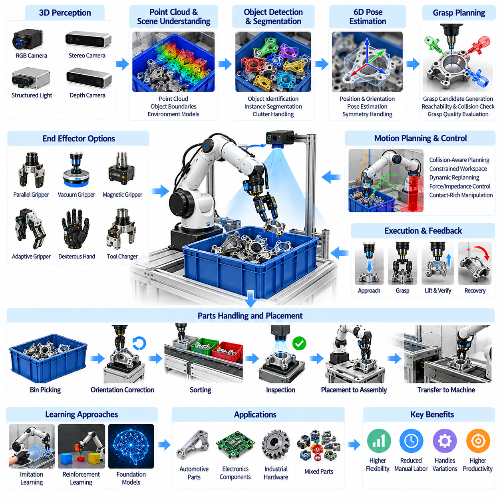{width="7.268055555555556in" height="7.268055555555556in"}

Bin picking and parts handling are essential manufacturing operations that involve identifying, grasping, transferring, and positioning components within production workflows. Traditional automation relies on structured feeders, predefined object orientations, and dedicated fixtures. Physical AI enables robots to handle randomly arranged parts by combining advanced perception, intelligent grasp planning, adaptive manipulation, and real-time feedback control.

Random bin picking presents significant challenges because components may overlap, become partially hidden, or occupy unpredictable orientations inside containers. Industrial parts often have reflective surfaces, irregular geometries, and limited accessible grasping regions. Robots must interpret complex visual scenes, identify individual objects, and determine whether a component can be safely retrieved without disturbing surrounding materials or damaging equipment.

Three-dimensional perception provides the foundation for intelligent bin picking systems. RGB cameras, stereo vision, structured-light sensors, and depth cameras generate information about object appearance and spatial geometry. Point clouds represent visible surfaces within the container, while perception algorithms estimate object boundaries, positions, and orientations. Sensor selection depends on component size, surface characteristics, required accuracy, and environmental conditions.

Object detection and segmentation allow robots to distinguish individual components within cluttered containers. Deep learning models can identify object categories, separate overlapping regions, and estimate visible object surfaces. Instance segmentation is particularly useful when multiple identical components occupy the same bin. However, recognition accuracy may decrease under severe occlusion, inconsistent illumination, reflective materials, or unfamiliar component configurations.

Six-degree-of-freedom pose estimation determines the position and orientation of objects relative to the robot coordinate system. Accurate pose estimation supports grasp planning, collision avoidance, and subsequent placement operations. Geometric matching, feature-based methods, and learning-based pose estimation can be applied depending on object characteristics. Symmetrical components and partially visible surfaces may produce multiple plausible poses that require additional reasoning.

Grasp planning converts perception results into executable manipulation actions. Candidate grasp configurations are evaluated according to contact geometry, accessibility, collision constraints, and expected stability. Parallel-jaw grippers, suction devices, magnetic tools, and adaptive hands provide different grasping mechanisms. The optimal grasp must consider not only successful retrieval but also the orientation and accessibility required for downstream manufacturing operations.

Grasp quality estimation predicts whether a selected grasp is likely to remain stable during lifting and transportation. Important factors include contact location, friction, object mass, center of gravity, and gripper force. Learning-based grasp models can evaluate candidate actions using visual and geometric features. Nevertheless, predicted grasp quality must be validated against actual contact behavior because material properties and sensor uncertainty can affect performance.

Motion planning connects the selected grasp with safe robot movement through constrained workspaces. The manipulator must approach the target without colliding with container walls, adjacent parts, fixtures, or nearby equipment. Collision-aware trajectory generation considers robot kinematics, joint limits, and available clearance. Dynamic replanning may be necessary when objects shift during retrieval or when the observed scene differs from the expected configuration.

Contact-rich manipulation requires adaptive control because physical interactions cannot always be predicted from visual information alone. Force and torque sensing can detect unexpected resistance, unstable contact, or interference during grasp execution. Compliant control and impedance control allow limited adjustments while protecting components and robotic equipment. These capabilities are particularly valuable when extracting tightly packed objects or handling delicate industrial parts.

Parts handling extends beyond retrieval to include orientation correction, sorting, inspection, and precise placement. A robot may transfer components from a bin to a conveyor, fixture, assembly station, or machine-loading interface. Some operations require regrasping or intermediate positioning to achieve the correct orientation. Integrated manipulation planning must therefore account for the complete handling sequence rather than optimizing individual grasp actions independently.

End-effector design strongly influences the range of components that a robotic system can handle. Specialized grippers may provide excellent reliability for particular part families, while adaptive grippers offer greater flexibility across varied geometries. Tool changers can support multiple gripping technologies within a single robotic cell. Selection requires balancing grasp success, cycle time, mechanical complexity, maintenance requirements, and the cost of accommodating new components.

Learning-based bin picking can reduce dependence on manually engineered perception and grasping rules. Imitation learning uses demonstrated handling examples, while reinforcement learning develops strategies through repeated interaction. Synthetic datasets and simulated grasp attempts can expand training coverage across object arrangements. However, differences in friction, contact dynamics, sensor noise, and object properties create challenges when transferring learned policies into production.

Robot foundation models may improve generalization across component categories and handling tasks. Vision-language-action architectures can potentially interpret task instructions and generate manipulation behaviors from visual observations. Such models may support adaptation to unfamiliar parts with reduced task-specific programming. Industrial applications nevertheless require controlled validation because generalized capabilities do not guarantee repeatability, precision, or safe execution.

Mobile manipulation extends bin picking beyond fixed robotic workcells. Mobile manipulators can travel between storage areas, production machines, and assembly stations to retrieve or deliver components. This approach supports flexible factory layouts and shared robotic resources. However, accurate docking, mobile-base stability, coordinate calibration, and reliable interaction with containers introduce additional challenges compared with stationary manipulation systems.

Operational recovery is essential because bin picking involves uncertainty in perception, grasp execution, and object movement. Failures may include incorrect object identification, unsuccessful suction, dropped components, collisions, or inaccessible remaining parts. Recovery strategies can involve rescanning the bin, selecting alternative grasp candidates, repositioning the robot, or requesting operator assistance. Automated failure detection prevents repeated unsuccessful actions from disrupting production.

Quality assurance and traceability can be integrated into parts handling workflows. Vision systems may inspect retrieved components for damage, contamination, incorrect geometry, or orientation errors before transferring them to subsequent operations. Sensor observations and handling outcomes can be recorded for process analysis. Connecting these records with manufacturing execution systems enables improved defect tracking, operational monitoring, and continuous optimization.

Performance evaluation should consider both manipulation reliability and complete handling productivity. Relevant metrics include successful picks per hour, grasp success rate, average cycle time, placement accuracy, recovery frequency, and system availability. Performance may vary substantially with bin fill level, component geometry, and object arrangement. Evaluation should therefore include representative production conditions rather than only favorable laboratory configurations.

The economic value of intelligent bin picking depends on reducing manual handling while maintaining sufficient throughput and reliability. System costs include manipulators, sensors, end effectors, computing resources, integration engineering, and maintenance. Additional expenses arise from component-specific training, calibration, and process validation. Return on investment should account for labor savings, reduced changeover effort, improved production continuity, and the cost of operational failures.

Simulation and digital twins support bin picking development by representing robot geometry, container configurations, component models, and grasp interactions. Engineers can evaluate sensor placement, reachability, collision risks, and expected handling sequences before deployment. Synthetic data generation provides varied object arrangements for perception training. Physical testing remains necessary because simulated contact and optical behavior may differ from real industrial conditions.

The long-term development of bin picking and parts handling aims to create robotic systems capable of manipulating diverse components with minimal reprogramming. Advances in three-dimensional perception, tactile sensing, adaptive grippers, foundation models, and closed-loop control may expand the range of practical applications. Successful industrial adoption will depend on combining flexible intelligence with reliable mechanical design, measurable productivity, and robust operational recovery.

## 02.06. Visual Inspection and Quality AI

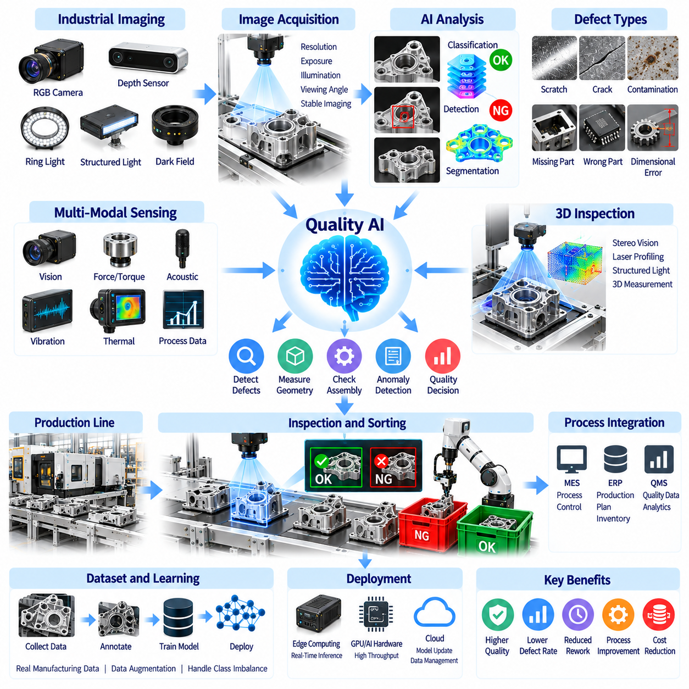{width="7.268055555555556in" height="7.268055555555556in"}

Visual inspection is a critical component of modern manufacturing quality assurance, enabling the detection of defects, dimensional deviations, and process abnormalities. Traditional inspection relies on human judgment, fixed machine vision rules, and dedicated measurement equipment. Physical AI extends these capabilities through learning-based perception, adaptive sensing, and intelligent decision-making, allowing inspection systems to operate across increasingly variable production conditions.

Quality AI combines computer vision, machine learning, industrial sensing, and manufacturing process knowledge to evaluate product conformity. Cameras capture surface appearance and geometric features, while AI models identify deviations from expected quality standards. Inspection decisions can be connected to production equipment, robotic handling systems, and quality management platforms, enabling automated sorting, corrective actions, and continuous process improvement.

Industrial visual inspection covers surface defects, assembly errors, missing components, dimensional inconsistencies, and contamination. Typical applications include detecting scratches on metal surfaces, cracks in molded parts, incorrect electronic components, and defective welds. Different defect categories require different imaging strategies and evaluation criteria. Reliable inspection must distinguish genuine quality problems from acceptable manufacturing variation.

Image acquisition strongly influences inspection performance because defects cannot be detected reliably when relevant visual information is missing. Camera resolution, lens selection, exposure settings, and viewing geometry determine the observable detail. Industrial lighting techniques such as diffuse illumination, structured lighting, and dark-field imaging improve defect visibility. Stable acquisition conditions reduce unwanted variation and support consistent model predictions.

Deep learning has expanded visual inspection beyond manually engineered image-processing rules. Convolutional neural networks and vision transformers can learn complex patterns associated with defects and acceptable product conditions. Classification models determine whether products satisfy quality requirements, while detection and segmentation models identify defect locations. Model selection depends on defect characteristics, annotation availability, inference speed, and required inspection accuracy.

Anomaly detection is particularly valuable when defective samples are rare or difficult to collect. Models trained primarily on acceptable products can identify observations that differ significantly from normal appearance. Reconstruction-based methods, feature embedding techniques, and self-supervised learning provide alternative approaches. However, unusual appearance does not always indicate a functional defect, so anomaly scores must be calibrated against manufacturing quality requirements.

Defect localization helps inspection systems identify the exact regions responsible for quality concerns. Object detection provides bounding regions around visible defects, while semantic and instance segmentation generate more detailed spatial descriptions. Pixel-level analysis can support defect size estimation and severity assessment. Accurate localization also enables downstream robotic systems to remove defective products, perform targeted reinspection, or initiate repair operations.

Three-dimensional inspection extends quality assessment beyond surface appearance. Stereo vision, laser profiling, structured-light scanning, and depth sensing can measure geometric deviations, component alignment, and assembly completeness. Three-dimensional point clouds support comparisons with reference geometry or digital product models. Measurement accuracy depends on sensor calibration, environmental stability, surface properties, and the required manufacturing tolerances.

Multimodal quality inspection combines visual observations with additional manufacturing signals. Force measurements, acoustic emissions, vibration, temperature, and process parameters can reveal defects that cameras cannot directly observe. Sensor fusion models integrate these signals to estimate product quality and process stability. Combining complementary information can improve diagnostic capability, although synchronization and data consistency introduce additional integration challenges.

Real-time inspection requires AI inference to operate within manufacturing cycle-time constraints. Edge computing systems can process camera streams close to production equipment, reducing communication latency and dependence on cloud infrastructure. Hardware acceleration supports complex vision models at industrial throughput rates. System design must balance inspection accuracy, computational requirements, response time, and operational reliability.

Quality inspection decisions involve tradeoffs between false acceptance and false rejection. False acceptance allows defective products to continue through production, while false rejection removes acceptable products and increases waste. Decision thresholds should reflect defect severity, inspection uncertainty, and manufacturing risk. Precision, recall, false-positive rates, and false-negative rates provide complementary measures of inspection performance.

Inspection datasets must represent realistic manufacturing conditions, including normal variation, defect diversity, lighting changes, and different production batches. Data annotation requires clear defect definitions and consistent labeling procedures. Class imbalance is common because acceptable products greatly outnumber defective examples. Data augmentation and synthetic defect generation can improve training coverage, but artificially generated defects must remain representative of real failure mechanisms.

Domain adaptation becomes important when inspection models are transferred between factories, product variants, or imaging configurations. Differences in cameras, illumination, materials, and manufacturing processes can reduce model accuracy. Fine-tuning, transfer learning, and adaptive calibration may improve performance under changed conditions. Continuous monitoring is necessary to identify data drift and prevent gradual deterioration in inspection reliability.

Physical AI connects visual inspection with robotic action rather than treating defect detection as an isolated software function. Robotic manipulators can reposition components, adjust camera viewpoints, or perform additional inspections when uncertainty remains high. Mobile inspection robots may visit multiple production stations and inspect large equipment. Coordinating perception, motion planning, and manipulation enables more flexible inspection workflows.

Closed-loop quality control uses inspection results to influence subsequent manufacturing operations. Detected defects may trigger process parameter adjustments, equipment checks, component rejection, or corrective assembly actions. Manufacturing execution systems can associate inspection outcomes with production orders and equipment states. Such feedback creates opportunities to prevent recurring defects rather than relying exclusively on final product screening.

Traceability is essential for understanding how defects emerge and propagate through production. Inspection records can include product identifiers, timestamps, image evidence, model versions, and measured quality indicators. Linking these records with process histories supports root-cause analysis and supplier quality investigations. Reliable traceability also enables retrospective evaluation when inspection models or acceptance criteria are updated.

Human oversight remains necessary when inspection decisions involve ambiguous defects, safety-critical components, or costly rejection consequences. Human-in-the-loop workflows can route uncertain cases to qualified inspectors for review. Their decisions may subsequently improve training datasets and model calibration. Explainable AI techniques can highlight influential image regions, but visual explanations should not be mistaken for proof of model correctness.

Validation of industrial Quality AI requires more than demonstrating high accuracy on a static test dataset. Evaluation should include production variability, rare defects, changing illumination, and realistic operating speeds. Measurement system analysis and repeatability studies help establish confidence in inspection outcomes. Model updates should undergo controlled verification before deployment, particularly when inspection results affect regulated or safety-critical products.

The economic value of intelligent visual inspection depends on reducing defects, inspection labor, scrap, rework, and production interruptions. Important performance indicators include defect detection rate, inspection cycle time, false rejection frequency, first-pass yield, and cost of poor quality. Investment requirements include sensors, computing hardware, integration, dataset preparation, and maintenance. Return on investment must reflect sustained operational improvements rather than laboratory accuracy alone.

The future of visual inspection and Quality AI involves increasingly adaptive systems that combine foundation models, multimodal sensing, robotic inspection, and manufacturing knowledge. These systems may learn from limited defect examples and adjust inspection strategies as products change. However, dependable deployment will continue to require calibrated measurements, representative datasets, controlled model updates, and rigorous quality validation.

## 02.07. Predictive Maintenance and Condition Monitoring

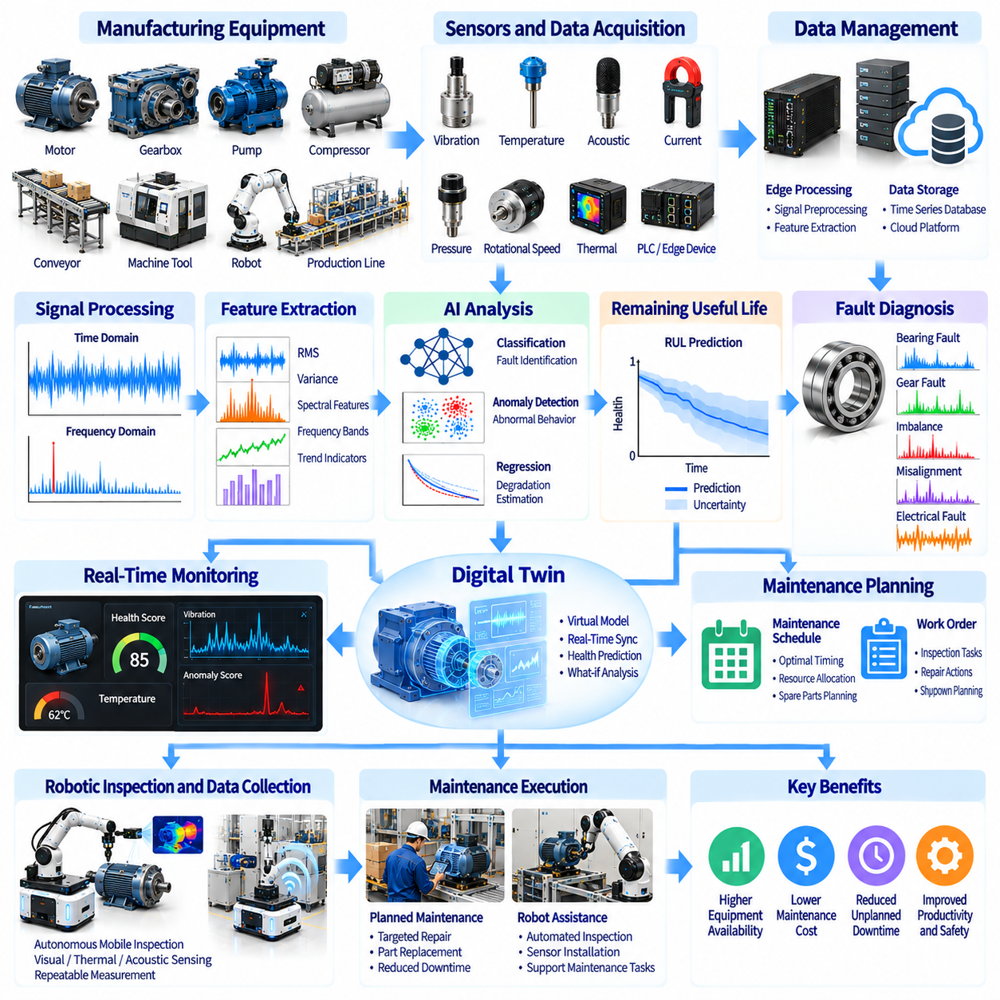{width="7.268055555555556in" height="7.268055555555556in"}

Predictive maintenance is an essential manufacturing capability that uses equipment data and analytical models to anticipate failures before they disrupt production. Traditional maintenance follows scheduled intervals or responds after breakdowns occur. Physical AI extends these approaches through continuous condition monitoring, intelligent diagnosis, and adaptive maintenance planning, enabling factories to improve equipment availability, operational safety, and production continuity.

Condition monitoring involves observing the physical and operational states of manufacturing equipment through sensors and control systems. Vibration, temperature, acoustic emissions, electrical current, pressure, and rotational speed provide information about machine health. These signals reveal changes associated with wear, misalignment, lubrication problems, and component degradation. Reliable monitoring requires appropriate sensor placement, calibration, and consistent data acquisition.

Manufacturing assets such as motors, gearboxes, bearings, pumps, compressors, conveyors, and robotic joints exhibit different failure characteristics. Bearing damage may produce distinctive vibration frequencies, while motor faults can alter electrical current signatures. Hydraulic problems may appear through pressure fluctuations or temperature changes. Effective monitoring therefore requires equipment-specific knowledge combined with data-driven analysis rather than relying on a single universal indicator.

Industrial data acquisition systems collect measurements from sensors, programmable logic controllers, and machine control networks. Edge devices can preprocess high-frequency signals before transmitting selected information to supervisory platforms. Time synchronization allows measurements to be associated with machine operating states and production events. Data quality depends on sampling frequency, sensor reliability, communication integrity, and accurate equipment metadata.

Signal processing transforms raw sensor measurements into useful indicators of equipment condition. Time-domain features include root mean square amplitude, variance, and peak values, while frequency-domain analysis identifies periodic vibration patterns. Spectral analysis and filtering help isolate mechanical fault signatures from background noise. Feature selection should reflect the physical mechanisms associated with each monitored component.

Machine learning enables condition monitoring systems to identify complex patterns that may be difficult to represent using fixed thresholds. Classification models can distinguish known fault categories, while regression models estimate degradation levels or future operating conditions. Unsupervised anomaly detection identifies deviations from learned normal behavior. Model performance depends on representative operating data, accurate labels, and the stability of production conditions.

Remaining useful life estimation predicts how long equipment may continue operating before reaching a defined failure or maintenance threshold. Prognostic models combine historical degradation patterns, current sensor observations, and operating conditions. Predictions are inherently uncertain because load, temperature, maintenance history, and usage intensity influence deterioration. Reliable systems should communicate prediction intervals rather than presenting remaining life as an exact value.

Physics-based models complement machine learning by representing mechanical wear, fatigue, thermal behavior, and component degradation. Hybrid approaches combine engineering equations with observed equipment data to improve interpretability and generalization. Physics-informed models may be particularly useful when failure examples are limited. However, their effectiveness depends on the accuracy of physical assumptions and the availability of relevant operating parameters.

Digital twins provide virtual representations of manufacturing equipment that can evolve with operational measurements. A digital twin may combine mechanical models, sensor histories, maintenance records, and predicted degradation states. Engineers can evaluate alternative operating conditions and maintenance scenarios without interrupting production. The practical value of a digital twin depends on model fidelity, data synchronization, and integration with maintenance decisions.

Anomaly detection supports early identification of equipment behavior that differs from expected operating patterns. Statistical methods, autoencoders, and time-series learning models can generate anomaly scores from sensor observations. However, changes in production speed, workload, or product type may resemble equipment faults. Context-aware monitoring must distinguish legitimate operating transitions from emerging mechanical problems to reduce unnecessary alarms.

Fault diagnosis extends anomaly detection by identifying likely causes of abnormal behavior. Diagnostic models can combine vibration signatures, temperature trends, control signals, and maintenance histories to distinguish competing failure hypotheses. Causal reasoning and engineering knowledge improve interpretation of correlated symptoms. Effective diagnosis should provide actionable evidence while acknowledging uncertainty when multiple fault mechanisms remain plausible.

Physical AI connects predictive analytics with robotic inspection and maintenance activities. Mobile robots equipped with cameras, thermal sensors, acoustic devices, or vibration probes can collect measurements from distributed factory equipment. Robotic manipulators may position sensors at repeatable inspection locations. Autonomous inspection expands monitoring coverage, although physical access, measurement consistency, and safety constraints must be carefully managed.

Maintenance planning converts predicted equipment conditions into operational decisions. Maintenance management systems can schedule inspections, component replacements, lubrication, or repairs according to estimated failure risk. Production schedules, spare-part availability, technician capacity, and equipment criticality influence the preferred intervention time. Optimized planning seeks to reduce unexpected downtime without creating excessive preventive maintenance costs.

Integration with manufacturing execution systems and enterprise maintenance platforms enables condition information to influence factory operations. Equipment alerts may trigger work orders, production rescheduling, or controlled shutdown procedures. Maintenance histories provide feedback for improving predictive models. Reliable integration requires standardized asset identifiers, consistent event records, cybersecurity controls, and clearly defined responsibilities between automated systems and human operators.

Model drift represents a significant challenge because equipment behavior changes as machines age, components are replaced, and production requirements evolve. A model trained under one operating regime may generate inaccurate predictions under another. Continuous evaluation can identify changes in sensor distributions and diagnostic performance. Model updates should follow controlled validation procedures to prevent unexpected changes in maintenance recommendations.

Maintenance decisions involve asymmetric risks because missed failures and unnecessary interventions have different consequences. A missed critical fault may cause equipment damage, production interruption, or safety hazards, while excessive alarms increase maintenance costs. Alert thresholds should reflect equipment criticality and failure severity. Evaluation metrics include detection delay, false-alarm rate, diagnostic accuracy, and the effectiveness of resulting maintenance actions.

Data governance and cybersecurity are important because condition monitoring connects operational technology with analytical infrastructure. Sensor streams and maintenance records may reveal sensitive production information. Access controls, network segmentation, secure communication, and audit trails help protect industrial systems. Predictive models should not directly override safety-critical machine controls without independently validated authorization and protective mechanisms.

The economic value of predictive maintenance depends on reducing unplanned downtime, repair expenses, spare-part waste, and secondary equipment damage. Key performance indicators include mean time between failures, mean time to repair, asset availability, maintenance cost, and avoided production losses. Return on investment must include sensor installation, software integration, model development, and ongoing support. Benefits should be measured against a credible maintenance baseline.

Implementation should begin with critical equipment where failure consequences are significant and relevant measurements are available. Initial projects can establish baseline operating behavior, validate fault indicators, and evaluate prediction quality using historical records. Maintenance teams should review model recommendations before automated scheduling is expanded. Gradual deployment supports operator confidence and provides evidence of operational value.

The future of predictive maintenance and condition monitoring involves increasingly integrated systems combining multimodal sensing, digital twins, foundation models, and autonomous robotic inspection. These technologies may improve diagnosis across diverse equipment and support more adaptive maintenance strategies. Sustainable industrial adoption will depend on trustworthy predictions, transparent uncertainty, secure system integration, and measurable improvements in manufacturing reliability.

## 02.08. Human Robot Collaboration

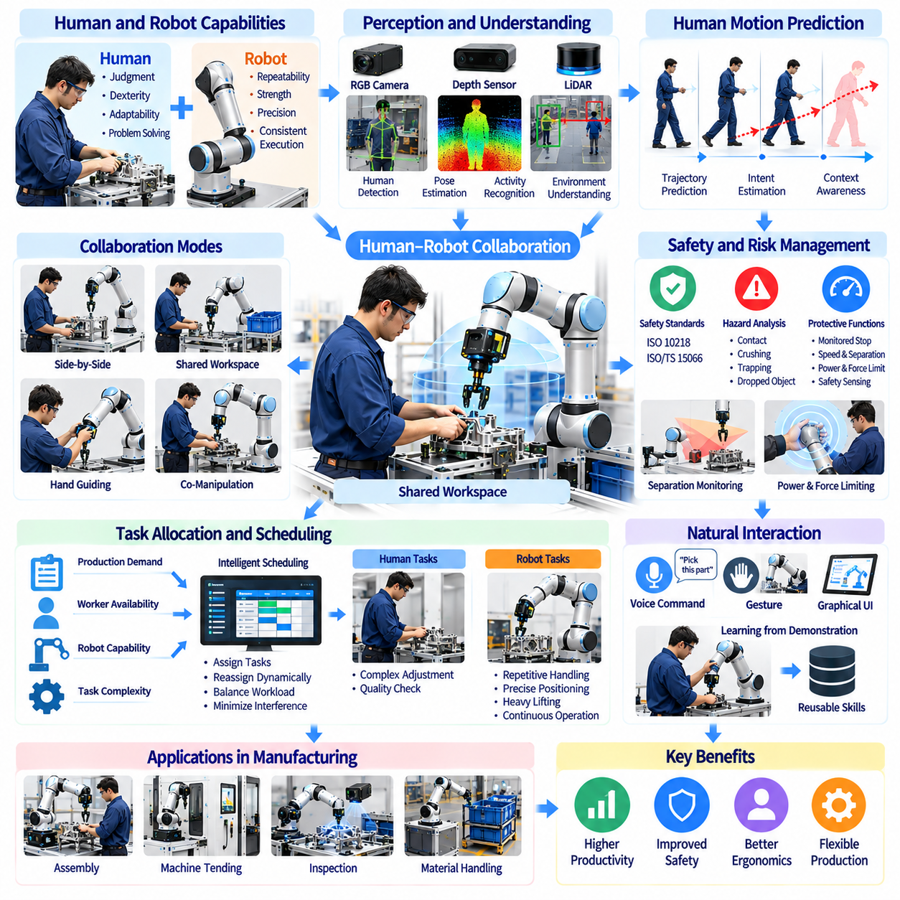{width="7.268055555555556in" height="7.268055555555556in"}

Human-robot collaboration is a major development in modern manufacturing, enabling human workers and robotic systems to contribute complementary capabilities within shared production environments. Humans provide judgment, dexterity, and adaptability, while robots deliver repeatability, physical assistance, and consistent execution. Physical AI extends collaboration through intelligent perception, adaptive planning, and context-aware behavior that responds to changing workplace conditions.

Collaborative manufacturing differs from conventional industrial automation because robots may operate near people rather than remaining inside permanently separated workcells. Applications include component assembly, material handling, machine tending, inspection, and ergonomic assistance. Effective collaboration requires clear task allocation, predictable robot motion, and engineered safety measures that reflect the actual hazards of each application.

Collaborative robots, commonly called cobots, are designed to support certain forms of human-robot interaction. Their hardware may incorporate force sensing, limited operating speeds, and protective control functions. However, a collaborative robot is not automatically safe under every operating condition. Safety depends on the complete application, including tooling, payload, workpiece geometry, robot motion, and the surrounding environment.

Human-robot collaboration can involve separate tasks within a shared workspace or direct interaction during a common operation. A robot may hold a component while a worker performs fastening, or a worker may prepare materials while the robot completes repetitive assembly. Task design should consider human skill, robotic precision, ergonomic requirements, and process dependencies to achieve useful cooperation without unnecessary interference.

Perception is essential for recognizing human presence, movement, and activity in collaborative workspaces. Cameras, depth sensors, laser scanners, and proximity sensors provide information about worker locations and surrounding obstacles. AI-based perception may estimate body poses, identify gestures, or infer activity patterns. However, safety-related detection functions must satisfy applicable performance requirements independently of unvalidated AI predictions.

Human motion prediction allows robots to anticipate likely worker movements and adjust their behavior accordingly. Learning-based models can analyze observed trajectories, body poses, and task context to estimate possible future actions. Such predictions may improve efficiency by reducing unnecessary waiting or abrupt stopping. Nevertheless, human behavior remains uncertain, so prediction should support rather than replace protective safety mechanisms.

Safe collaboration requires systematic hazard identification and risk assessment throughout the robot lifecycle. Relevant hazards include unintended contact, crushing, trapping, sharp tools, dropped objects, and unexpected equipment activation. Industrial guidance such as ISO 10218 and ISO/TS 15066 provides frameworks for collaborative robot safety. Appropriate protective measures must be selected and validated for the specific installation.

Collaborative operating methods include safety-rated monitored stopping, hand guiding, speed and separation monitoring, and power and force limiting. These methods address different interaction scenarios and impose different technical requirements. A system may combine several protective functions depending on its tasks. Selecting a collaborative mode does not eliminate the need to evaluate end effectors, workpieces, fixtures, and other machinery.

Speed and separation monitoring adjusts robot operation according to the distance between people and hazardous moving components. Safety-rated sensing and control functions establish protective separation distances based on relevant motion and stopping characteristics. Robots may slow down or stop as workers approach. Reliable implementation requires validated sensing coverage, response times, stopping performance, and consideration of foreseeable human movement.

Power and force limiting aims to reduce injury risks from certain forms of human-robot contact. Robot design, joint torque monitoring, compliant mechanisms, and motion control can limit interaction forces. Acceptable contact conditions depend on the affected body region, contact geometry, and application-specific risk assessment. Sharp tools, heavy payloads, and trapping hazards may remain unacceptable even when the robot itself has force-limiting capabilities.

Physical AI can improve collaborative task allocation by evaluating production demand, worker availability, robot capability, and task complexity. Intelligent scheduling systems may assign repetitive handling to robots while reserving complex adjustments for human operators. Dynamic reassignment can respond to delays or changing production priorities. However, task allocation should remain understandable to workers and compatible with established operational procedures.

Natural interaction methods can make collaborative robots easier to operate. Voice commands, gestures, graphical interfaces, and physical guidance provide alternatives to conventional robot programming. Vision-language models may interpret instructions and relate them to observed manufacturing conditions. Industrial systems should confirm ambiguous commands, restrict unauthorized actions, and prevent language-driven behavior from bypassing validated machine safety controls.

Learning from demonstration enables workers to teach robots selected tasks through guided movements or recorded examples. Imitation learning can convert these demonstrations into reusable manipulation policies. This approach may reduce programming effort for frequently changing assembly operations. However, learned behavior must be evaluated for repeatability, collision avoidance, and reliable performance before use in active production.

Ergonomic assistance is an important application of human-robot collaboration. Robots can support heavy component positioning, repetitive lifting, awkward reaching, and sustained material handling. Properly designed assistance may reduce physical workload and improve consistency. Ergonomic benefits should be evaluated through actual worker exposure and task analysis, since poorly designed collaboration can introduce new postural demands or operational stress.

Mobile manipulators extend collaboration across multiple factory locations. A mobile robot may deliver components, position a robotic arm beside a worker, or assist at temporary assembly stations. Navigation and manipulation must be coordinated with pedestrian movement and workstation requirements. Shared-space operation introduces additional challenges involving traffic management, docking accuracy, situational awareness, and emergency response.

Human factors strongly influence whether collaborative automation succeeds in practice. Workers must understand robot intentions, operating states, limitations, and expected responses to intervention. Clear status indicators, predictable trajectories, and accessible controls support appropriate trust. Training should address normal operation, abnormal conditions, recovery procedures, and the distinction between intelligent behavior and verified safety functions.

Performance evaluation should measure collaboration as a complete production process rather than focusing only on robot cycle time. Relevant indicators include combined task completion time, throughput, worker waiting time, intervention frequency, ergonomic exposure, and system availability. Safety incidents and near misses require systematic analysis. Improvements should be demonstrated under representative operating conditions involving actual human participation.

Economic evaluation must consider productivity gains alongside integration costs, training, maintenance, and workflow redesign. Collaborative systems may be valuable when full automation is impractical or product variation is high. However, reduced robot speed, protective stops, and coordination overhead can limit expected throughput. Return on investment should reflect sustainable operational benefits rather than assuming that human proximity automatically improves efficiency.

Deployment should begin with clearly defined collaborative tasks, documented hazards, and measurable operational objectives. Engineers should validate safety functions, establish human-machine interfaces, and test recovery behavior before production expansion. Worker feedback can identify practical difficulties that technical simulations overlook. Incremental implementation supports reliable integration and helps organizations develop effective collaborative operating practices.

The future of human-robot collaboration will involve increasingly capable perception, multimodal interaction, adaptive manipulation, and shared task planning. Physical AI may enable robots to interpret human intentions and provide more context-sensitive assistance. Nevertheless, successful industrial adoption will depend on combining intelligent adaptation with independently validated safety, transparent behavior, worker acceptance, and measurable manufacturing value.

## 02.09. Humanoids in Human Centered Factories

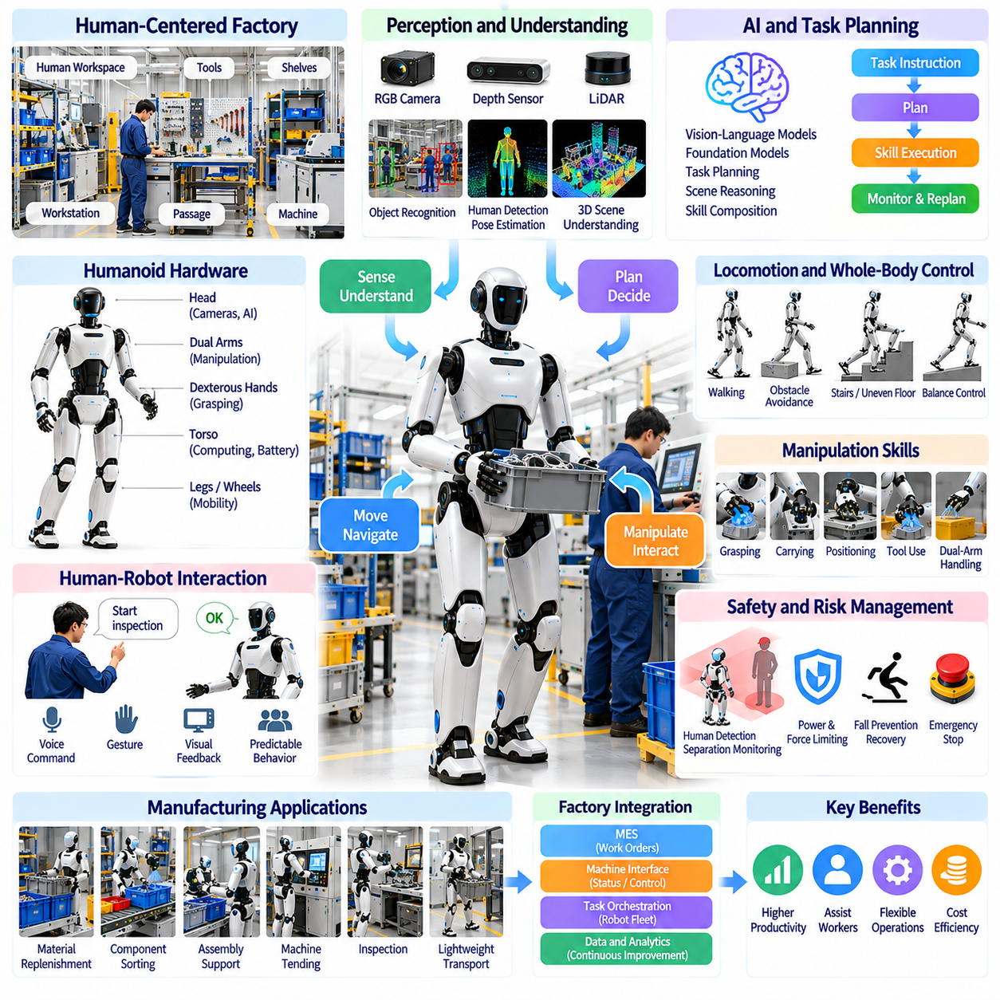{width="7.268055555555556in" height="7.268055555555556in"}

Humanoid robots represent an emerging approach to manufacturing automation designed around environments originally built for human workers. Unlike fixed industrial manipulators or specialized mobile platforms, humanoids combine upright mobility, articulated arms, and human-like reach. Physical AI enables these systems to perceive factory conditions, manipulate objects, and execute tasks within existing production infrastructure without requiring complete facility redesign.

Human-centered factories contain workstations, tools, shelves, passages, and control interfaces arranged around human physical capabilities. Humanoid morphology may provide advantages when interacting with these environments, particularly where equipment cannot be easily modified. However, human-like appearance does not guarantee operational efficiency. The value of humanoid deployment depends on whether its physical configuration provides practical benefits over simpler robotic alternatives.

A humanoid manufacturing system integrates locomotion, whole-body control, manipulation, perception, and task planning. Cameras and depth sensors provide environmental observations, while joint encoders and inertial sensors estimate body motion. Coordinated control manages balance and arm movement during physical tasks. Reliable operation requires these subsystems to function together despite disturbances, uncertain contacts, and changing workplace conditions.

Factory mobility presents significant challenges for bipedal robots because walking requires continuous balance and contact management. Uneven floors, cables, ramps, obstacles, and slippery surfaces can reduce stability. Locomotion controllers must coordinate foot placement, center-of-mass motion, and ground reaction forces. Wheeled humanoid configurations may offer greater efficiency on smooth floors, illustrating the importance of selecting morphology according to actual operating requirements.

Humanoid manipulation involves reaching, grasping, carrying, positioning, and interacting with industrial equipment. Dual-arm configurations can support coordinated handling of large or awkward components, while dexterous hands may operate certain human-designed tools. Whole-body motion planning must consider balance, payload distribution, joint limits, and collision avoidance. Precision assembly remains challenging because compliant structures and mobile bases introduce positioning uncertainty.

Potential manufacturing applications include material replenishment, component sorting, simple assembly, machine tending, and movement of lightweight containers. Humanoids may also support inspection or operate selected interfaces designed for human workers. Early deployments should prioritize bounded tasks with predictable objects and environments. Complex manipulation, heavy payload handling, and high-speed operations may remain better suited to dedicated industrial automation.

Perception enables humanoids to recognize workstations, tools, components, and human activity. Three-dimensional scene understanding supports object localization, obstacle avoidance, and manipulation planning. Vision-language models may connect natural-language instructions with observed factory conditions. However, visually plausible interpretations can still be incorrect, so critical operations require explicit verification of object identity, equipment state, and task completion.

Robot foundation models and vision-language-action architectures offer a pathway toward reusable humanoid skills. Training across demonstrations, teleoperation data, and simulation may support grasping, navigation, and sequential task execution. Cross-task transfer could reduce the need to program every operation independently. Nevertheless, learned policies must be adapted to the robot\'s embodiment and validated against manufacturing accuracy, reliability, and safety requirements.

Teleoperation provides a practical method for collecting demonstrations and supporting difficult humanoid tasks. Human operators can guide manipulation, resolve unusual situations, and generate training examples for future autonomy. Shared autonomy combines automated execution with selective human intervention. The resulting operational model must account for communication delays, operator workload, intervention frequency, and the cost of maintaining remote support capabilities.

Human-robot interaction is especially important because humanoids are expected to operate in environments occupied by production workers. Robots must communicate intentions, recognize nearby personnel, and behave predictably during shared activities. Voice interfaces, visual indicators, and structured task requests can improve coordination. Human-like movement may appear intuitive, but workers still require training to understand robot limitations and emergency procedures.

Safety engineering must address both conventional industrial hazards and risks associated with whole-body mobility. Falls, unexpected arm movement, unstable loads, pinch points, and loss of balance can create dangerous situations. Protective systems require appropriate sensing, controlled stopping, operating restrictions, and validated recovery behavior. AI-based perception and motion prediction should supplement independently verified safety functions rather than replace them.

Factory integration requires humanoids to communicate with production management and equipment control systems. Manufacturing execution systems can provide work orders, production priorities, and completion records. Machine interfaces may expose equipment status and authorized operating commands. Standardized communication and reliable task handshaking reduce ambiguity. Integration should prevent autonomous robots from bypassing established machine interlocks or operational permissions.

Task orchestration determines how humanoids cooperate with workers, autonomous mobile robots, and fixed industrial equipment. Scheduling systems may allocate tasks according to robot capability, location, battery state, and production urgency. A humanoid could retrieve components while an AMR handles bulk transportation. Such heterogeneous coordination is often more effective than expecting one robot type to perform every factory activity.

Energy efficiency and operational endurance remain important constraints. Bipedal locomotion, continuous balance control, manipulation, and onboard computing consume substantial power. Battery capacity influences operating duration, payload, and robot mass. Charging or battery replacement interrupts productive activity. Practical deployment must evaluate energy consumed per completed task, thermal limitations, maintenance intervals, and sustained availability across production shifts.

Reliability is a major obstacle to industrial adoption because manufacturing requires predictable performance over extended operating periods. Humanoids contain numerous actuators, joints, sensors, and mechanical interfaces that introduce potential failure points. Repeated contact, vibration, and unexpected impacts can accelerate wear. Preventive maintenance, condition monitoring, modular replacement, and robust fault recovery are essential for maintaining acceptable operating availability.

Digital twins and simulation support humanoid development by reproducing factory layouts, robot dynamics, and manipulation tasks. Engineers can test walking routes, reachability, collision avoidance, and task sequences before physical trials. Synthetic demonstrations may expand training coverage. However, simulation-to-real transfer remains difficult because friction, contact dynamics, actuator behavior, and human activity cannot always be modeled accurately.

Performance evaluation should distinguish technical demonstrations from economically useful factory operations. Relevant metrics include task success rate, cycle time, intervention frequency, operating availability, payload capability, and recovery duration. Long-horizon evaluation measures whether robots can complete repeated workflows without accumulating failures. Comparisons should include conventional robots and human-operated processes performing equivalent tasks under realistic conditions.

The business case for humanoid manufacturing depends on utilization, acquisition cost, maintenance, integration, supervision, and productive output. Human-compatible morphology may reduce infrastructure modification expenses, but mechanical complexity can increase total ownership costs. Return on investment should compare humanoids with fixed manipulators, mobile manipulators, and conventional automation. A humanoid is economically justified only when its flexibility delivers measurable operational value.

Deployment should begin with carefully selected tasks where human-oriented infrastructure creates genuine automation difficulties. Pilot programs can establish safe operating boundaries, collect performance data, and identify limitations in manipulation and mobility. Gradual expansion should follow demonstrated reliability rather than anticipated general intelligence. Worker participation and transparent performance reporting are important for building practical acceptance.

The long-term vision is a flexible robotic workforce capable of adapting to changing production requirements while using existing factory infrastructure. Advances in foundation models, tactile sensing, whole-body control, and learning from operational data may broaden humanoid capabilities. However, widespread adoption will depend on proven safety, dependable autonomy, competitive economics, and clear advantages over alternative robot morphologies.

## 02.10. Digital Twins and Adaptive Production

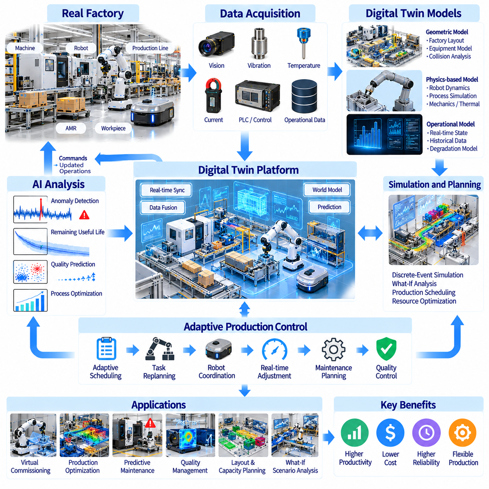{width="7.268055555555556in" height="7.268055555555556in"}

Digital twins are dynamic digital representations of physical manufacturing assets, processes, and production systems. Unlike static engineering models, they incorporate operational data to reflect changing factory conditions. Physical AI connects these representations with perception, prediction, planning, and robotic control. This integration supports adaptive production, where manufacturing operations respond intelligently to equipment states, product variation, and changing demand.

A manufacturing digital twin may represent an individual machine, robotic workstation, production line, or entire factory. Its structure combines geometric models, physical behavior, operating parameters, and historical observations. Different levels of fidelity serve different purposes, from equipment monitoring to factory-wide optimization. Effective twin design begins by identifying the decisions that the virtual representation must support.

Digital twin architectures connect physical equipment with computational models through industrial communication networks. Sensors, programmable logic controllers, robots, and manufacturing execution systems provide operational information. Data processing layers synchronize observations and update relevant model states. Reliable architectures require consistent timestamps, equipment identifiers, communication protocols, and mechanisms for handling missing or delayed measurements.

Geometric digital twins reproduce factory layouts, equipment dimensions, robot workspaces, and material flow paths. Three-dimensional models support collision analysis, workstation design, and robotic reachability evaluation. Engineers can examine alternative equipment arrangements before modifying physical facilities. However, geometric accuracy alone cannot predict production performance without representing timing, equipment behavior, and operational constraints.

Physics-based digital twins simulate mechanical motion, contact forces, thermal behavior, and other physical processes. Robot dynamics models can estimate actuator loads, joint motion, and interactions with workpieces. Process simulations may represent machining forces, assembly tolerances, or material deformation. Model fidelity must balance computational requirements with the accuracy needed for practical manufacturing decisions.

Operational digital twins incorporate real-time equipment conditions such as machine status, cycle time, energy consumption, and maintenance indicators. Streaming measurements update the virtual system as production progresses. Historical data provides context for detecting abnormal behavior and estimating future performance. The usefulness of these models depends on sensor coverage, data quality, and the ability to distinguish measurement noise from meaningful changes.

Adaptive production uses digital twin information to modify manufacturing decisions as conditions evolve. Production schedules may change when machines become unavailable or urgent orders arrive. Robots can adjust task sequences according to material availability or workstation congestion. Such adaptation requires coordination between predictive models, scheduling algorithms, and execution systems while respecting safety and process constraints.

Simulation-based planning allows manufacturers to evaluate alternative production strategies before applying them. A digital twin can compare equipment utilization, material flow, production throughput, and expected delays under different scenarios. Optimization algorithms search for configurations that improve operational objectives. Decisions should account for uncertainty because simulated performance may differ from actual factory behavior.

Discrete-event simulation is particularly useful for modeling manufacturing systems involving machines, buffers, transport resources, and production queues. Events represent processing completion, equipment failure, material arrival, or resource availability. These models reveal bottlenecks and interactions that are difficult to understand from isolated equipment metrics. Their accuracy depends on realistic process times, routing logic, and disturbance assumptions.

Robot digital twins support virtual commissioning, motion planning, and task validation before physical deployment. Engineers can test robot trajectories, collision avoidance, grasping sequences, and interactions with production equipment. Simulation may reduce commissioning time and equipment disruption. Nevertheless, simulated robot behavior must be validated against real-world actuator dynamics, calibration errors, contact uncertainty, and communication delays.

Physical AI extends digital twins through learned world models that predict how environments may change following robotic actions. Action-conditioned models can estimate future object positions, equipment states, or task outcomes. These predictions support planning under uncertainty and adaptation to unfamiliar situations. However, learned models require continuous evaluation because prediction errors can accumulate during extended operation.

Manufacturing digital twins also support predictive maintenance by combining sensor measurements with equipment degradation models. Changes in vibration, temperature, or electrical behavior can update estimates of component health. Maintenance schedules may then be coordinated with production demand and equipment availability. Integrating maintenance predictions with production planning reduces the risk of optimizing throughput while overlooking reliability.

Quality management benefits from digital twins that connect process parameters with inspection results. Measurements of dimensions, surface conditions, temperature, or applied forces can be associated with individual production steps. Analytical models may identify relationships between process variation and product defects. Adaptive quality control can recommend parameter adjustments, but changes require validation against established product specifications.

Multi-robot manufacturing systems introduce coordination challenges that digital twins can help address. Virtual factory models can represent robot locations, shared workspaces, transport routes, and resource conflicts. Fleet scheduling algorithms evaluate task allocation and traffic conditions before execution. A synchronized twin supports operational awareness, although real-time collision prevention must remain within appropriately validated control and safety systems.

Closed-loop adaptive production connects observation, prediction, decision-making, and physical execution. Factory sensors update digital twin states, analytical models evaluate possible outcomes, and optimization systems recommend actions. Approved decisions are transmitted to equipment controllers or production management systems. Feedback from actual execution allows the system to evaluate whether the intended improvement occurred.

Integration with manufacturing execution systems, enterprise resource planning, and industrial control platforms is essential for factory-wide adaptation. These systems provide work orders, inventory status, equipment availability, and production constraints. Standardized data models and interoperable interfaces reduce integration complexity. Access permissions and change management procedures must distinguish advisory recommendations from authorized operational commands.

Digital twin accuracy can deteriorate when equipment wears, production layouts change, or operating assumptions become outdated. Model calibration and continuous validation are therefore necessary. Differences between predicted and measured behavior can reveal parameter drift or incomplete process representations. Updating a twin should involve traceable model versions, documented assumptions, and verification against representative operating conditions.

Cybersecurity and data governance become critical when digital twins connect operational technology with enterprise and cloud infrastructure. Production data may reveal proprietary processes, equipment configurations, and sensitive operating patterns. Secure communication, access control, network segmentation, and audit logging reduce exposure. Safety-critical functions should remain protected from unauthorized model updates or automatically generated control actions.

The economic value of digital twins depends on measurable improvements in production efficiency, quality, equipment availability, and engineering productivity. Relevant metrics include throughput, overall equipment effectiveness, cycle time, scrap rate, energy consumption, and commissioning duration. Implementation costs include modeling, sensors, integration, computing, and maintenance. Return on investment should compare achieved benefits with a credible operational baseline.

The future of digital twins and adaptive production involves closer integration between physical simulation, multimodal sensing, foundation models, and autonomous manufacturing systems. Factories may increasingly evaluate alternative actions virtually before executing them physically. Achieving this vision requires trustworthy models, reliable data synchronization, validated control interfaces, and scalable system architectures that translate digital intelligence into measurable industrial performance.

## 02.11. Multi Robot Factory Orchestration

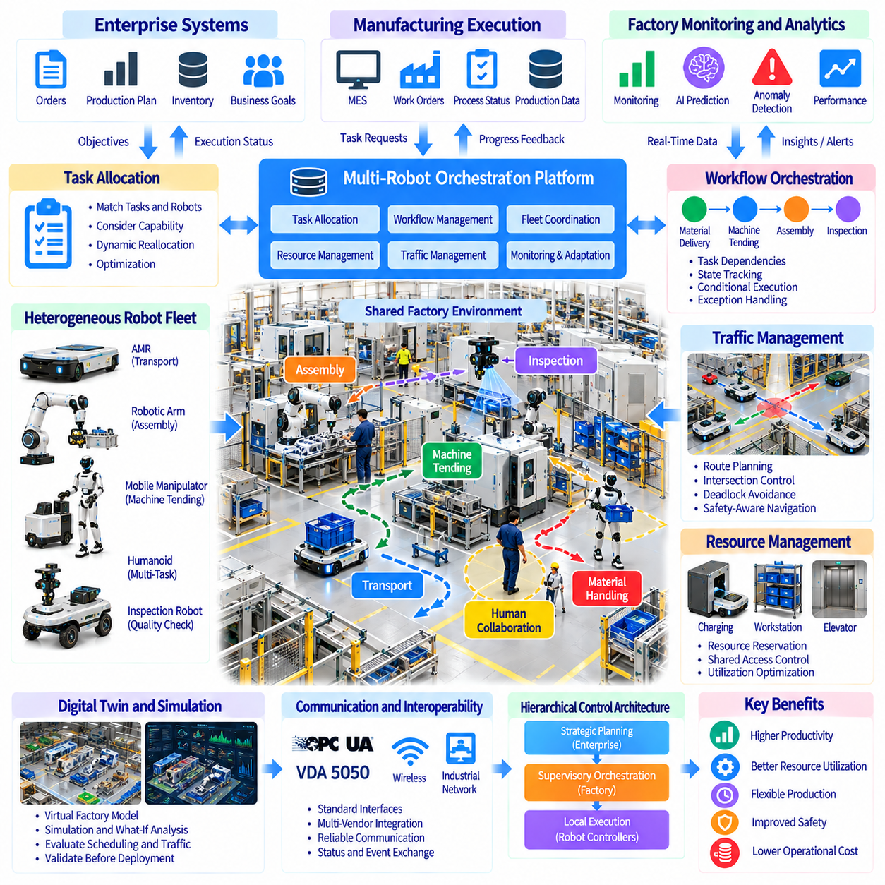{width="7.268055555555556in" height="7.268055555555556in"}

Multi-robot factory orchestration coordinates diverse robotic systems to execute manufacturing operations as an integrated production network. Autonomous mobile robots, manipulators, humanoids, and inspection robots contribute different capabilities. Physical AI enables these machines to share operational context, allocate tasks, and respond to changing factory conditions. Effective orchestration improves resource utilization, production continuity, and overall manufacturing flexibility.

Factory orchestration differs from conventional robot control because it manages interactions among multiple machines, production processes, and operational priorities. Individual robots execute local actions, while orchestration systems coordinate dependencies across workstations. A transport robot may deliver components before an assembly robot begins processing. Successful coordination requires consistent task states, resource availability information, and reliable execution feedback.

Heterogeneous robot fleets combine machines with different mobility, manipulation, payload, and sensing capabilities. Autonomous mobile robots transport materials, robotic arms perform precise operations, and mobile manipulators support distributed workstations. Specialized inspection robots collect quality information. Orchestration software must represent these capabilities explicitly to assign feasible tasks without assuming that all robots are interchangeable.

Task allocation determines which robot should perform each manufacturing activity. Optimization algorithms consider robot availability, location, payload capacity, required tools, and expected execution time. Dynamic allocation responds to equipment failures, urgent orders, and production delays. Effective scheduling balances local task efficiency with factory-wide objectives rather than simply assigning work to the nearest available robot.

Production workflows contain dependencies that constrain task execution. Material delivery may need to precede machine loading, while inspection must follow processing. Workflow engines represent these relationships through task graphs, state transitions, and completion conditions. Orchestration systems track progress and release downstream operations when prerequisites are satisfied. Reliable dependency management prevents incomplete or incorrectly sequenced production activities.

Fleet management systems coordinate mobile robot navigation, mission assignment, traffic control, and battery management. Factory orchestration extends these functions by linking transportation missions with production schedules and workstation readiness. A delivery request should reflect actual material demand rather than isolated movement instructions. Integration between fleet management and manufacturing execution systems helps prevent unnecessary transport and workstation congestion.

Multi-robot traffic management is essential in factories containing shared aisles, intersections, and loading zones. Route planners must consider robot dimensions, travel directions, occupied spaces, and temporary obstacles. Reservation-based coordination can regulate access to constrained areas. Deadlock detection and recovery are necessary when robots block one another. Safety-rated obstacle detection remains distinct from supervisory traffic optimization.

Shared resources create additional scheduling constraints because multiple robots may require the same workstation, charging station, elevator, or transfer interface. Resource management systems maintain availability states and allocate access according to operational priorities. Reservation mechanisms reduce conflicting assignments. However, excessive reservations can decrease utilization, so scheduling policies should balance predictability with flexible resource sharing.

Communication infrastructure connects robots, industrial controllers, and supervisory software. Wireless networks support mobile platforms, while wired industrial networks often connect fixed equipment. Middleware exchanges mission commands, status messages, and event notifications. Communication failures must be anticipated through timeouts, acknowledgments, and recovery procedures. Critical safety functions should not depend solely on ordinary network connectivity.

Interoperability becomes increasingly important when factories deploy robots from multiple manufacturers. Standardized interfaces can reduce dependence on proprietary fleet management software and simplify integration. Protocols such as OPC UA support industrial information exchange, while VDA 5050 addresses selected mobile robot fleet communication scenarios. Practical interoperability still requires compatible task semantics, equipment models, and validated system behavior.

Physical AI improves orchestration through perception-driven situational awareness and predictive decision-making. Shared environmental information can identify blocked routes, material shortages, or workstation delays. Learning-based models may estimate task duration and anticipate congestion. These predictions support proactive scheduling, but uncertain outputs should be monitored against actual execution results to prevent cascading operational errors.

Digital twins provide virtual representations of robot fleets, factory layouts, and production resources. Simulation can evaluate task allocation policies, traffic patterns, and equipment utilization before deployment. Engineers may test disruptions such as machine breakdowns or temporary aisle closures. A synchronized digital twin also supports operational monitoring, although its predictions require validation against measured factory performance.

Hierarchical control architectures separate strategic planning, supervisory coordination, and real-time execution. Enterprise systems define production objectives, orchestration platforms schedule resources, and robot controllers execute physical actions. This separation improves modularity and operational clarity. However, interfaces between layers must preserve task constraints, execution status, and authority boundaries to prevent conflicting commands.

Exception handling is central to reliable orchestration because factories experience equipment faults, blocked paths, missing materials, and incomplete tasks. Supervisory systems must detect abnormal conditions and determine whether to retry, reassign, pause, or escalate operations. Recovery procedures should preserve material traceability and production state consistency. Human intervention remains necessary when autonomous recovery cannot be performed safely.

Energy-aware orchestration considers battery state, charging availability, mission duration, and expected production demand. Scheduling algorithms can assign charging periods during low-demand intervals or redirect tasks to available robots. Battery limitations must be incorporated into mission feasibility checks. Poor charging coordination may create fleet-wide shortages even when the total number of robots appears sufficient.

Factory orchestration must integrate with manufacturing execution systems, warehouse management systems, enterprise resource planning, and industrial control equipment. These connections exchange production orders, inventory information, machine status, and material movement records. Consistent identifiers and event timestamps support traceability. Clearly defined interfaces prevent duplicate commands, incorrect inventory updates, and mismatched production records.

Safety and cybersecurity require coordinated governance across the entire robotic fleet. Robot operating zones, access permissions, emergency procedures, and maintenance states must remain consistent with factory policies. Authentication, network segmentation, and audit logs protect operational commands. Central orchestration should never override independently validated safety functions or bypass equipment interlocks during automated task execution.

Performance evaluation should measure factory-wide outcomes rather than isolated robot productivity. Relevant indicators include throughput, order completion time, fleet utilization, workstation waiting time, transport delay, and system availability. Congestion frequency and recovery duration reveal coordination weaknesses. Measurements should distinguish orchestration improvements from changes caused by production demand, staffing, or equipment configuration.

The economic value of multi-robot orchestration depends on improved production flow, reduced idle time, and better utilization of existing equipment. Software integration, network infrastructure, maintenance, and operational support contribute to total cost of ownership. Return on investment should compare coordinated operation with a realistic baseline. Scaling benefits are strongest when additional robots increase productive capacity without creating disproportionate congestion.

The future of multi-robot factory orchestration involves increasingly adaptive systems combining shared world models, predictive scheduling, digital twins, and heterogeneous robotic capabilities. Physical AI may enable robots to negotiate task assignments and respond collectively to disruptions. Industrial success will depend on interoperable architectures, reliable execution feedback, validated safety, and measurable improvements in factory-wide performance.

## 02.12. Manufacturing Data Flywheels

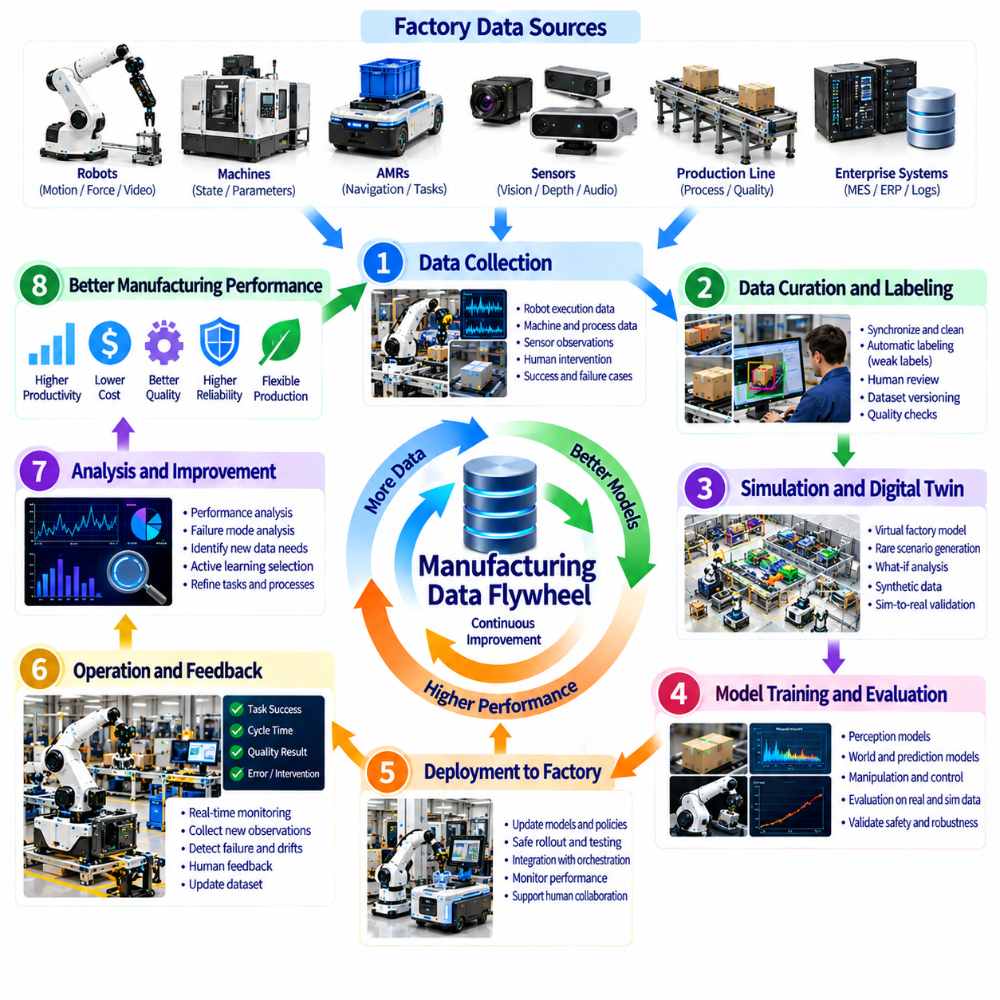{width="7.268055555555556in" height="7.268055555555556in"}

Manufacturing data flywheels are continuous improvement mechanisms that transform factory operations into reusable intelligence for Physical AI systems. Robots, machines, and production processes generate observations that support model training, evaluation, and optimization. Improved models enhance operational performance and produce additional experience. This repeating cycle connects data collection, learning, deployment, and feedback into a scalable manufacturing intelligence system.

Unlike conventional data pipelines that primarily store and analyze historical information, manufacturing data flywheels emphasize continuous operational learning. Every production cycle can reveal variations in materials, equipment behavior, and task execution. These observations become valuable when converted into structured training examples. A successful flywheel improves both the quality of manufacturing decisions and the efficiency of future data collection.

Manufacturing environments generate heterogeneous data from robotic controllers, cameras, force sensors, industrial equipment, and enterprise systems. Relevant information includes robot trajectories, machine states, process parameters, inspection results, and production outcomes. Integrating these sources requires consistent timestamps, equipment identifiers, and task context. Without synchronization, relationships between physical actions and manufacturing results become difficult to reconstruct.

Robot execution data forms a central component of Physical AI learning. Joint positions, actuator commands, end-effector poses, tactile measurements, and camera observations describe how robots interact with their surroundings. Task success indicators provide outcome information. Recording complete execution episodes enables engineers to examine successful behaviors, identify failures, and construct datasets for imitation learning and policy improvement.

Production context is essential because identical robot actions may produce different outcomes under different operating conditions. Material properties, component tolerances, machine settings, workstation layouts, and environmental conditions influence execution. Contextual metadata connects robot behavior with these variables. Such information allows learning systems to distinguish generalizable skills from behaviors that depend on specific manufacturing configurations.

Data collection strategies must balance information value with storage, bandwidth, and processing costs. Continuous recording provides broad coverage but generates substantial redundant information. Event-triggered collection prioritizes failures, interventions, unusual sensor readings, and task transitions. Adaptive sampling can preserve important operational details while reducing unnecessary data volume. Collection policies should reflect the learning objectives of the manufacturing system.

Failure data is especially valuable because it reveals limitations that successful demonstrations may conceal. Misaligned grasps, dropped components, unexpected collisions, and incomplete assembly operations expose weaknesses in perception and control. Recovery attempts provide additional evidence about system robustness. A balanced dataset should include successful execution, unsuccessful attempts, and corrective actions rather than filtering out every abnormal episode.

Human intervention creates another important learning signal. Operators may correct robot trajectories, resolve ambiguous situations, or complete tasks that autonomous systems cannot handle. Teleoperation and shared autonomy can record these corrective demonstrations. Comparing autonomous actions with human corrections helps identify policy deficiencies. However, intervention data must include sufficient context to explain why assistance was necessary.

Data curation transforms raw factory recordings into reliable learning resources. Processing pipelines synchronize sensor streams, remove corrupted segments, identify task boundaries, and attach outcome labels. Quality checks detect missing observations, inconsistent timestamps, and unreliable annotations. Dataset versioning preserves reproducibility. Effective curation prioritizes representative and informative examples rather than maximizing data volume without regard to quality.

Automated labeling can reduce the cost of preparing manufacturing datasets. Machine logs, equipment signals, and production records may provide weak supervision for identifying task completion and process states. Computer vision models can assist with object detection and event recognition. Human review remains necessary for ambiguous cases and safety-critical labels. Label quality directly influences the reliability of downstream learning.

Active learning directs attention toward examples that provide the greatest potential improvement. Models can identify uncertain predictions, unfamiliar objects, or poorly represented operating conditions. These cases are prioritized for annotation, simulation, or additional robot demonstrations. Targeted collection improves dataset efficiency. However, uncertainty estimates must be calibrated to avoid overlooking confident but systematically incorrect model behavior.

Simulation and digital twins extend manufacturing data flywheels by generating controlled experiences beyond those observed in production. Virtual environments can reproduce rare failures, alternative material properties, and modified workstation configurations. Synthetic data expands training coverage without disrupting factory operations. Nevertheless, simulation-generated behavior must be compared with real observations to manage simulation-to-real discrepancies.

Model training converts curated manufacturing data into improved perception, prediction, planning, and control capabilities. Vision models learn component recognition, while action policies learn manipulation and task execution. World models estimate how factory environments evolve following actions. Training pipelines should maintain separation between training and evaluation datasets. Improvements must be demonstrated through representative tests rather than assumed from lower training loss.

Evaluation gates determine whether updated models are suitable for industrial deployment. Offline benchmarks assess perception accuracy, task success, robustness, and computational requirements. Simulation tests examine behavior under controlled disturbances. Physical trials verify performance with actual equipment and materials. Safety-critical changes require additional validation. Model promotion should depend on predefined acceptance criteria and documented results.

Deployment strategies should minimize disruption to manufacturing operations. Shadow evaluation compares new model predictions with existing systems without granting control authority. Limited pilot deployments expose updated policies to selected tasks and operating conditions. Gradual rollout allows performance monitoring before wider adoption. Rollback mechanisms restore previously validated models when unexpected degradation or unsafe behavior appears.

Fleet-scale learning combines experiences from multiple robots, workstations, and manufacturing facilities. Distributed deployments expose models to different objects, lighting conditions, equipment configurations, and operator practices. Aggregated datasets can improve generalization when differences are properly represented. However, inconsistent hardware, calibration, and task definitions can introduce misleading patterns unless data provenance is preserved.

Operational monitoring closes the learning loop by comparing predicted behavior with actual manufacturing outcomes. Metrics include task success rate, cycle time, intervention frequency, defect rate, and equipment availability. Performance changes may indicate model drift, environmental variation, or mechanical degradation. Monitoring systems should distinguish learning-related improvements from changes in production demand, staffing, and equipment conditions.

Data governance protects the integrity and confidentiality of manufacturing information. Factory recordings may contain proprietary designs, production parameters, employee activity, and customer-related information. Access controls, encryption, retention policies, and audit trails reduce exposure. Data lineage connects training examples to their sources and permitted uses. Cross-factory learning must respect contractual restrictions and organizational boundaries.

The economics of manufacturing data flywheels depend on whether learning benefits exceed collection, annotation, computing, integration, and operational costs. Useful indicators include improvement per training cycle, intervention reduction, deployment reliability, and engineering effort saved. Data efficiency becomes especially important when physical demonstrations are expensive. The objective is sustained operational improvement rather than accumulating the largest possible dataset.

The long-term potential of manufacturing data flywheels lies in connecting robotic experience with production knowledge across increasingly diverse tasks. Foundation models, multimodal learning, digital twins, and fleet-scale feedback may accelerate skill transfer and adaptation. Sustainable progress requires high-quality data, trustworthy evaluation, controlled deployment, and measurable factory outcomes. A mature flywheel turns everyday production experience into continuously improving Physical AI capabilities.

## 02.13. Safety Reliability and Integration Challenges

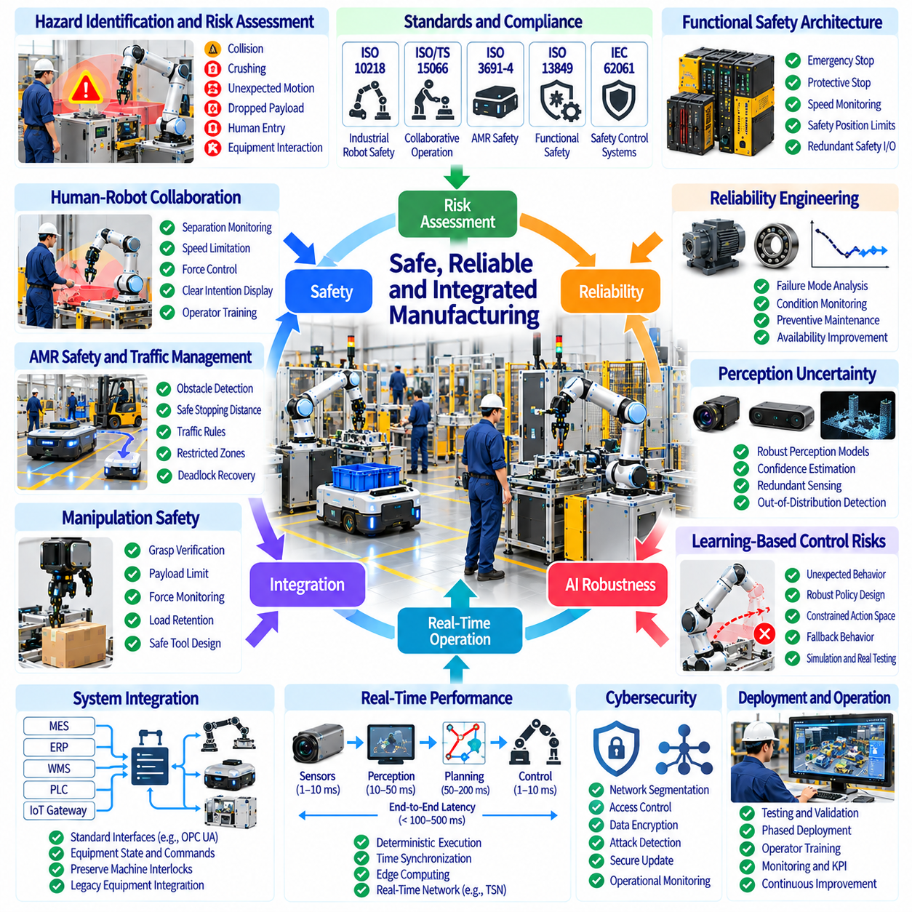{width="7.268055555555556in" height="7.268055555555556in"}

Safety, reliability, and system integration are fundamental requirements for deploying Physical AI in manufacturing environments. Industrial robots must operate predictably around workers, machinery, and valuable production assets. Unlike controlled demonstrations, factories introduce changing conditions, equipment failures, and operational constraints. Successful deployment requires coordinated engineering across mechanical design, intelligent control, safety systems, and production infrastructure.

Manufacturing safety begins with systematic hazard identification and risk assessment. Potential hazards include collisions, crushing, unexpected motion, dropped payloads, and uncontrolled equipment interactions. Risk analysis considers injury severity, exposure frequency, and the possibility of avoiding harm. Protective measures should prioritize inherently safe design, engineered safeguards, and validated operating procedures rather than relying exclusively on AI-based perception.

Industrial robot safety standards provide established frameworks for evaluating robotic applications. ISO 10218 addresses industrial robot and robot system safety, while ISO/TS 15066 provides guidance for collaborative robotic applications. ISO 3691-4 addresses relevant driverless industrial truck systems. Applying these frameworks requires careful interpretation of robot configuration, operating environment, intended use, and applicable regulatory obligations.

Functional safety ensures that critical protective functions remain dependable when faults occur. Emergency stopping, protective stopping, speed monitoring, and safety-rated position limits require appropriately designed control architectures. Standards such as ISO 13849 and IEC 62061 support safety-related control system engineering. Learned AI policies should remain subordinate to independently validated safety functions and must not bypass protective interlocks.

Human-robot collaboration introduces risks associated with shared workspaces and unpredictable human behavior. Collaborative operation requires appropriate separation monitoring, speed limitations, force control, and task-specific risk assessment. Workers may enter robot operating zones unexpectedly or misunderstand machine intentions. Visual indicators, predictable robot behavior, operator training, and accessible emergency controls improve coordination and reduce operational hazards.

Autonomous mobile robots face additional safety challenges because they navigate dynamic factory environments. Pedestrians, forklifts, temporary obstacles, and changing traffic patterns create uncertainty. Navigation systems must detect hazards and maintain appropriate stopping distances. Safety-rated protective devices should operate independently of higher-level route planning. Traffic rules, restricted zones, and validated recovery procedures support safe fleet operation.

Robot manipulation creates hazards when grippers, tools, and transported objects interact with people or equipment. Unexpected releases, excessive contact forces, unstable loads, and incorrect grasping can cause damage or injury. Payload limits, grasp verification, force monitoring, and mechanical retention features reduce risk. Safety evaluation must consider the complete robot-tool-workpiece system rather than examining the manipulator alone.

Reliability engineering addresses the ability of Physical AI systems to perform required functions consistently over extended operating periods. Mechanical wear, actuator degradation, sensor faults, communication interruptions, and software defects can reduce availability. Reliability analysis should examine failure modes, their consequences, and detection mechanisms. Preventive maintenance and condition monitoring support sustained production performance.

AI perception introduces uncertainty that differs from conventional deterministic automation. Vision models may misidentify components, fail under changing illumination, or overlook unusual obstacles. Distribution shifts can degrade performance without producing explicit software errors. Confidence estimation, redundant sensing, and operational boundary monitoring help identify unreliable predictions. Critical decisions require independent verification when perception uncertainty exceeds acceptable limits.

Learning-based control policies can exhibit unexpected behavior when encountering unfamiliar objects or physical conditions. Small errors in state estimation may accumulate during multi-step manipulation. Robust deployment requires constrained action spaces, validated fallback behaviors, and continuous performance monitoring. Simulation and adversarial testing can reveal weaknesses, but physical validation remains necessary because virtual environments cannot reproduce every industrial disturbance.

System integration connects Physical AI robots with manufacturing execution systems, programmable logic controllers, warehouse systems, and industrial equipment. Inconsistent communication protocols and incompatible data models can create operational failures. Interfaces must define commands, equipment states, task acknowledgments, and error handling. Integration should preserve established machine interlocks, production permissions, and traceability requirements.

Legacy manufacturing infrastructure presents practical integration difficulties because equipment may lack standardized interfaces or reliable digital status reporting. Retrofitting sensors and communication gateways can improve connectivity but introduces additional maintenance requirements. Engineers must evaluate compatibility with existing controllers and operating procedures. Integration strategies should minimize production disruption while maintaining cybersecurity and functional safety.

Real-time performance is essential when perception, planning, and control interact with physical machinery. Network latency, variable computing workloads, and delayed sensor measurements can undermine synchronization. Time-critical control functions should remain on appropriately designed local controllers. Edge computing can reduce communication delays, while cloud services support less time-sensitive analytics and model development.

Cybersecurity is inseparable from manufacturing safety when robots communicate across operational and enterprise networks. Unauthorized commands, compromised software updates, and manipulated sensor data can affect physical operations. Network segmentation, authentication, encryption, and secure update procedures reduce exposure. Security monitoring should address both information protection and the potential physical consequences of cyber incidents.

Operational resilience requires systems to respond safely to equipment faults, communication losses, power interruptions, and incomplete tasks. Recovery strategies may involve controlled stopping, task reassignment, human intervention, or restoration from a verified system state. Fault handling must preserve workpiece status and production records. Automated recovery should proceed only when operating conditions and safety requirements have been confirmed.

Validation and verification must cover individual components, integrated systems, and complete production workflows. Unit tests examine software behavior, while hardware-in-the-loop testing evaluates interactions with controllers and equipment. Factory acceptance testing verifies installation-specific requirements. Long-duration trials reveal intermittent failures, cumulative errors, and maintenance needs that short demonstrations may overlook.

Change management becomes critical when AI models, robot software, or factory layouts are updated. A model improvement in one task may introduce unexpected behavior elsewhere. Version control, regression testing, documented approvals, and rollback procedures support controlled deployment. Safety-related modifications require renewed assessment when they affect validated assumptions. Continuous learning must not imply uncontrolled changes to production systems.

Safety and reliability performance should be evaluated through measurable operational indicators. Relevant metrics include incident frequency, near misses, mean time between failures, mean time to repair, task success rate, and system availability. Recovery duration and human intervention frequency reveal hidden operational costs. Evaluation should distinguish robot faults from upstream equipment failures and broader production disruptions.

Economic integration challenges arise when safety engineering, commissioning, maintenance, and operational support require substantial resources. Initial robot acquisition costs represent only part of total ownership expenses. Production downtime, engineering customization, worker training, and recurring validation also influence profitability. Deployment planning should compare expected productivity improvements with realistic integration costs and operational risks.

The long-term success of Physical AI manufacturing depends on combining adaptive intelligence with disciplined industrial engineering. Advances in sensing, foundation models, simulation, and autonomous control can expand robotic capabilities. However, industrial adoption requires independently validated safety, predictable reliability, secure integration, and maintainable architectures. Trustworthy systems must demonstrate sustained performance under realistic factory conditions.

## 02.14. ROI and Productivity Metrics

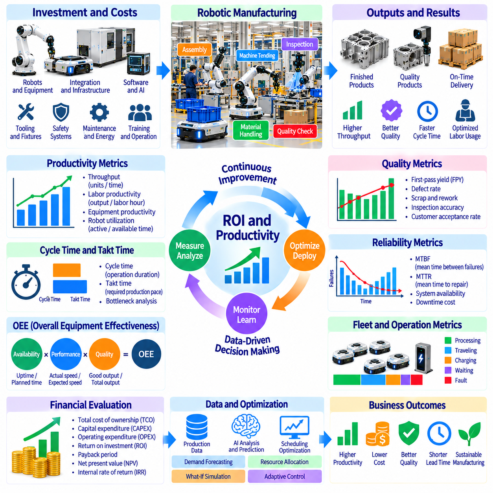{width="7.268055555555556in" height="7.268055555555556in"}

Return on investment and productivity metrics provide the economic foundation for evaluating Physical AI in manufacturing. Robotic automation must deliver measurable operational benefits rather than technological novelty alone. Financial performance depends on equipment costs, production output, labor requirements, quality, and reliability. Effective evaluation connects engineering performance with business outcomes through consistent measurements and realistic operating assumptions.

Manufacturing productivity measures how efficiently production resources generate usable output. Labor productivity relates production volume to working hours, while equipment productivity considers machine utilization and operating time. Physical AI may improve both by reducing repetitive handling and production interruptions. However, higher robot activity does not necessarily increase factory output when downstream bottlenecks remain unresolved.

Overall equipment effectiveness is a widely used indicator combining availability, performance, and quality. Availability reflects productive operating time, performance measures actual versus expected production speed, and quality represents acceptable output. Physical AI can improve these components through automated material handling, adaptive control, and inspection. OEE should be interpreted alongside throughput because local equipment improvements may not increase total production.

Cycle time measures the duration required to complete a manufacturing operation, while takt time represents the production pace needed to satisfy customer demand. Robotic automation may reduce cycle time through consistent execution and reduced manual handling. However, improvements must account for setup, recovery, and material waiting. Comparing cycle time with takt time helps identify whether automation supports the required production capacity.

Throughput measures the quantity of acceptable products completed within a defined period. It is particularly important because factory profitability often depends on finished output rather than individual robot utilization. Automated transport or machine tending may increase throughput by reducing equipment starvation. Evaluation should distinguish gross production volume from good output and consider whether demand can absorb additional capacity.

Labor productivity improvements require careful interpretation because automation changes work allocation rather than simply eliminating employees. Robots may perform repetitive transport, loading, or inspection while workers focus on supervision and exception handling. Economic models should include redeployment, training, and remaining human intervention. Labor savings are financially realized only when staffing costs decrease or productive capacity increases.

Robot utilization measures the proportion of available time spent performing productive tasks. High utilization can indicate efficient deployment, but excessive utilization may create queues and reduce recovery flexibility. Metrics should distinguish active processing, travel, charging, waiting, and fault states. Fleet-level analysis reveals whether additional robots improve throughput or merely increase congestion and operational complexity.

Reliability metrics strongly influence automation economics because unplanned downtime can eliminate expected productivity gains. Mean time between failures estimates operating duration between faults, while mean time to repair measures restoration time. System availability depends on both failure frequency and recovery speed. Evaluations should include software faults, sensor degradation, mechanical maintenance, and integration-related interruptions.

Quality-related productivity measures include first-pass yield, defect rate, scrap, and rework. Physical AI inspection and adaptive manipulation may improve consistency and detect problems earlier. Reduced defects lower material waste and avoid repeated processing. However, false rejection and missed defects introduce additional costs. Quality improvements should be measured against validated inspection standards and actual customer acceptance requirements.

Total cost of ownership includes expenses beyond the initial robot purchase. Integration engineering, safety systems, tooling, infrastructure changes, software licensing, maintenance, energy, and training contribute to lifecycle costs. Cloud computing and model updates may introduce recurring expenses. Accurate economic assessment should distinguish capital expenditure from operating expenditure and account for equipment replacement over the evaluation period.

Return on investment compares the net financial benefit of automation with the investment required to achieve it. Benefits may include labor savings, increased contribution from additional output, reduced defects, and lower downtime costs. Costs include implementation and ongoing operation. ROI calculations require a defined time horizon and consistent accounting assumptions. Gross revenue increases should not be mistaken for net economic gains.

Payback period measures the time required for accumulated net cash benefits to recover the initial investment. Shorter payback periods generally reduce exposure to technological and market uncertainty. However, payback alone ignores benefits occurring after recovery and may overlook the time value of money. Discounted cash flow methods provide a more complete evaluation when automation investments have long operating lifetimes.

Net present value discounts future cash flows to reflect their timing and the cost of capital. A positive NPV indicates that expected discounted benefits exceed investment costs under the selected assumptions. Internal rate of return provides another measure of investment attractiveness. Both methods depend on realistic estimates of utilization, operating expenses, equipment lifetime, and residual value.

A credible baseline is essential for measuring automation benefits. The comparison should document current labor hours, equipment availability, throughput, defect rates, and production costs before deployment. Seasonal demand, product mix, and staffing changes can distort results. Controlled pilot studies or comparable production lines help isolate automation effects. Without a consistent baseline, apparent productivity gains may reflect unrelated operational changes.

Scenario analysis evaluates financial performance under alternative assumptions about production demand, robot utilization, maintenance, and task success. Conservative, expected, and optimistic scenarios reveal the sensitivity of investment outcomes. Break-even analysis identifies the minimum utilization or productivity improvement needed to justify deployment. Such methods are particularly important for emerging Physical AI systems with limited long-term operating histories.

Manufacturing automation economics vary significantly by application. Autonomous mobile robots may generate value through reduced transport labor and improved material availability. Machine tending can increase productive spindle time, while inspection robots reduce quality-related losses. Humanoids and general-purpose manipulators may offer flexibility but introduce higher integration uncertainty. Each application requires metrics aligned with its actual operational contribution.

Scaling automation from a pilot to an entire factory changes both costs and benefits. Shared infrastructure and centralized orchestration may reduce marginal deployment costs. Conversely, traffic congestion, maintenance demand, and system integration complexity can increase with fleet size. Economic projections should reflect these nonlinear effects. Pilot results should not be multiplied directly by robot count without validating factory-wide constraints.

Data-driven improvement creates additional economic value when deployed robots generate information for future learning. Operational data may improve task success, reduce intervention frequency, and accelerate deployment to similar workstations. These benefits should be measured through actual performance changes rather than assumed future AI capabilities. Data collection, annotation, model training, and validation costs must also be included in lifecycle economics.

Investment decisions should incorporate operational risk alongside expected financial returns. Production disruption, safety incidents, vendor dependence, cybersecurity exposure, and uncertain maintenance requirements can affect project viability. Risk-adjusted analysis may include contingency budgets, staged deployment, and contractual service commitments. Financially attractive projections remain insufficient if operational reliability cannot be demonstrated.

The most useful ROI framework combines financial indicators with operational productivity and reliability metrics. Throughput, OEE, cycle time, quality yield, utilization, and intervention frequency explain how economic value is created. TCO, payback period, NPV, and ROI determine whether those improvements justify investment. Sustainable Physical AI adoption requires measurable benefits under realistic production conditions and continuous verification after deployment.

## 02.15. Manufacturing Automation ROI Model [w/Code]

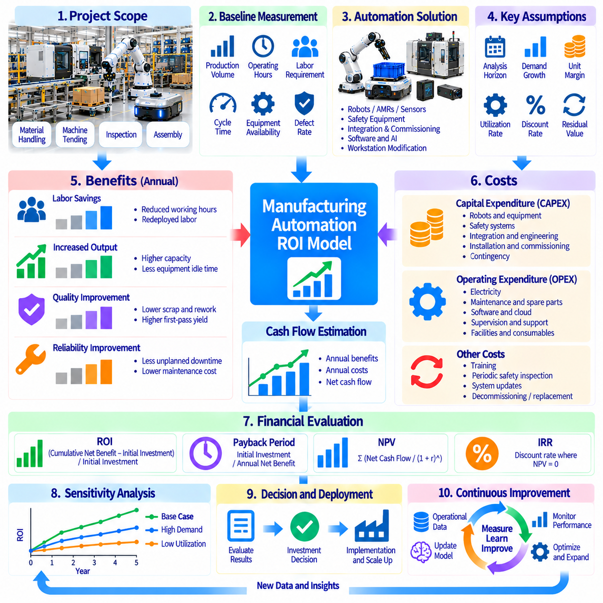{width="7.268055555555556in" height="7.268055555555556in"}

A manufacturing automation ROI model provides a structured framework for evaluating whether investments in Physical AI create measurable financial value. The model connects robotic capabilities with production output, labor costs, equipment availability, and operating expenses. It compares automated operations against a defined baseline over a specified investment horizon. Reliable analysis requires transparent assumptions, consistent financial definitions, and verifiable production data.

The first step is defining the automation project boundary and its intended economic contribution. A project may involve autonomous mobile robots, machine tending, robotic inspection, or flexible assembly. Each application creates value through different operational mechanisms. The model must identify affected processes, equipment, labor activities, and production constraints before estimating benefits or calculating financial returns.

Baseline measurements describe manufacturing performance before automation deployment. Relevant variables include annual production volume, operating hours, labor requirements, cycle time, equipment availability, and defect rates. Existing maintenance expenses and material handling costs should also be documented. Baseline data must reflect representative operating conditions rather than unusually favorable or unfavorable production periods.

Capital expenditure includes robot hardware, end effectors, sensors, safety equipment, charging infrastructure, and installation. Engineering expenses may cover software integration, workstation modification, commissioning, and initial validation. These costs establish the initial investment requirement. Contingency allowances should account for uncertain integration work, especially when deploying emerging robotic technologies into legacy factories.

Operating expenditure includes electricity, preventive maintenance, replacement parts, software subscriptions, computing resources, and technical support. Human supervision, remote intervention, and recurring safety inspections may create additional expenses. Some costs increase with robot operating hours, while others remain fixed. Separating variable and fixed expenses improves the accuracy of lifecycle cost estimates and scaling scenarios.

Labor savings should be calculated from actual changes in paid working hours or staffing requirements. Automation may reduce repetitive transport, machine loading, or inspection activities without eliminating entire positions. Redeployed employees can generate economic value through additional productive work. However, the model should not treat reassigned labor as direct cash savings unless measurable financial benefits are demonstrated.

Production capacity improvements create value when automation increases acceptable output and sufficient customer demand exists. Machine tending may reduce idle spindle time, while autonomous transport improves material availability. Additional units should be valued using incremental contribution margin rather than gross selling price. Capacity benefits must also consider upstream supply constraints, downstream bottlenecks, and product demand uncertainty.

Quality improvements contribute financial benefits through lower scrap, reduced rework, fewer warranty claims, and improved first-pass yield. Physical AI inspection can identify defects earlier, while adaptive manipulation may reduce process variation. Savings should be calculated using avoided material, processing, and service costs. Double counting must be prevented when quality improvements also increase the number of saleable products.

Reliability influences financial returns because downtime reduces productive capacity and may generate recovery expenses. Mean time between failures and mean time to repair help estimate system availability. The model should include robot faults, maintenance interruptions, communication failures, and integration-related downtime. Expected productivity benefits must be adjusted for realistic operating availability rather than assuming continuous successful execution.

Robot utilization determines how much productive work an installed system performs relative to its available operating time. Utilization depends on task demand, scheduling efficiency, charging, travel, and workstation readiness. Low utilization spreads fixed investment costs across fewer completed tasks. Economic models should therefore estimate productive hours and successful task completions instead of relying only on nominal robot capacity.

Annual gross benefits combine realized labor savings, incremental contribution margin, avoided quality losses, and other verified operating improvements. Annual net benefits are calculated by subtracting incremental operating expenses and relevant recurring costs. Benefit categories must remain mutually exclusive. The resulting cash-flow estimate provides the foundation for investment evaluation across the selected project lifetime.

Simple return on investment compares cumulative net gains with the initial investment over a defined period. A common formulation expresses ROI as cumulative net benefit minus initial investment, divided by initial investment. This measure provides an accessible financial summary but does not capture the timing of cash flows. Analysts should clearly state whether their ROI calculation includes residual value, taxes, and financing effects.

Payback period estimates how long accumulated net cash inflows require to recover the initial investment. When annual net cash benefits are constant, simple payback equals initial investment divided by annual net cash benefit. Uneven cash flows require cumulative yearly calculations. Payback is useful for evaluating capital recovery speed, but it does not measure total lifetime profitability or fully reflect investment risk.

Net present value evaluates the time value of money by discounting future net cash flows using an appropriate discount rate. Initial investment is subtracted from the present value of expected operating benefits and residual value. A positive NPV indicates financial attractiveness under the modeled assumptions. Internal rate of return provides a complementary metric, although unconventional cash-flow patterns can complicate interpretation.

Sensitivity analysis identifies which assumptions most strongly influence investment results. Labor cost, utilization, task success rate, production demand, maintenance expense, and equipment lifetime are common variables. Changing one assumption at a time reveals financial exposure. Scenario analysis combines multiple changes into conservative, expected, and optimistic cases, providing a more realistic view of uncertainty.

Break-even analysis determines the minimum operational performance required to justify automation. The model may calculate the robot utilization, annual completed tasks, or labor hours saved needed to achieve zero NPV or recover investment within a target period. These thresholds help define pilot acceptance criteria. Projects with unrealistic break-even requirements should be redesigned before committing substantial capital.

A practical ROI model should connect technical performance metrics directly with financial calculations. Task success rate determines effective completed operations, cycle time influences productive capacity, and availability limits annual operating hours. Intervention frequency affects supervision costs. This linkage allows engineers to translate measurable improvements in robotic performance into corresponding changes in economic outcomes.

Fleet-scale deployment requires additional modeling because costs and benefits may not increase proportionally with robot count. Shared charging infrastructure and orchestration software can reduce marginal costs, while traffic congestion and resource conflicts can limit throughput gains. Fleet simulations may estimate these effects. Expansion decisions should consider factory-wide productivity rather than multiplying pilot benefits by the number of robots.

Model governance is necessary because financial assumptions and operational conditions change throughout deployment. Actual performance data should replace initial estimates as pilot programs mature. Version-controlled models can document changes in robot costs, maintenance requirements, utilization, and production demand. Periodic reviews compare forecast benefits with realized outcomes and identify corrective actions when investment expectations are not achieved.

A robust manufacturing automation ROI model ultimately serves as both an investment decision tool and an operational improvement framework. It connects capital spending, lifecycle costs, production performance, and financial returns through transparent calculations. Physical AI investments should advance when validated operational evidence supports sustainable economic benefits. Continuous measurement ensures that financial projections remain aligned with actual manufacturing performance.
