**Volume 12. Physical AI Business and Industry Applications**

# Chapter 03. Logistics and Warehouse Applications

## 03.01. Physical AI in Logistics

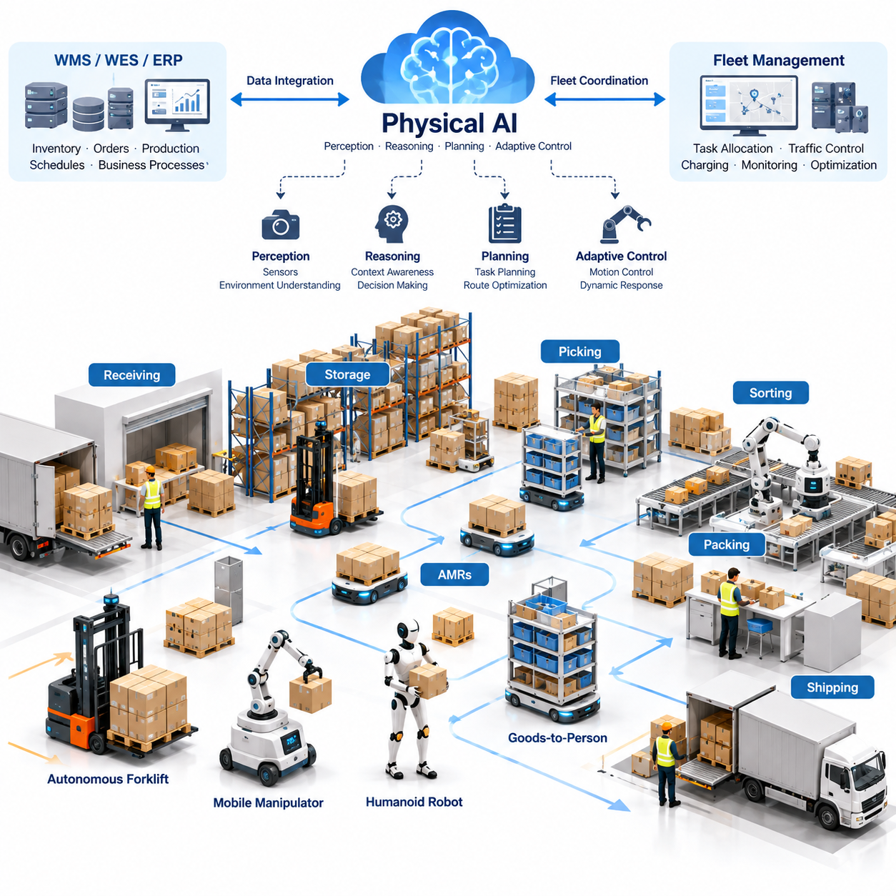{width="7.268055555555556in" height="7.268055555555556in"}

피지컬 AI(Physical AI)는 지능형 기계가 물리적 환경을 인식하고 이해하며 상호작용할 수 있도록 함으로써 물류 산업에 근본적인 변화를 가져오고 있다. 사전에 정의된 작업 순서를 실행하는 기존 자동화 시스템과 달리, 피지컬 AI는 인식(Perception), 추론(Reasoning), 계획(Planning), 적응형 제어(Adaptive Control)를 결합하여 변화하는 환경에서도 물류 작업을 수행한다. 이러한 능력은 고정된 설비 중심의 자동화를 넘어 유연하고 자율적인 물류 흐름을 가능하게 한다.

현대 물류 환경은 입고(Receiving), 보관(Storage), 운송(Transportation), 피킹(Picking), 분류(Sorting), 포장(Packing), 출하(Shipping), 배송(Distribution) 등 상호 연결된 활동으로 구성된다. 이러한 프로세스에서는 작업자, 장비, 재고 관리 시스템, 운송 자원 사이의 지속적인 협력이 필요하다. 피지컬 AI는 산업 물류에서 요구되는 효율성, 정확성, 신뢰성을 유지하면서 운영 환경의 변화에 대응할 수 있는 지능형 로봇 시스템을 제공한다.

기존 창고 자동화(Warehouse Automation)는 컨베이어(Conveyor), 자동 보관 및 반출 시스템(Automated Storage and Retrieval System, AS/RS), 고정형 로봇 매니퓰레이터(Fixed Robotic Manipulator), 규칙 기반 제어 구조(Rule-Based Control Architecture)에 크게 의존한다. 이러한 시스템은 구조화된 환경에서 우수한 성능을 제공하지만, 상당한 설비 투자와 운영 표준화가 필요하다. 피지컬 AI는 적응형 이동성(Adaptive Mobility), 지능형 조작(Intelligent Manipulation), 상황 인식 기반 의사결정(Context-Aware Decision-Making)을 도입하여 기존 자동화 기술을 보완한다.

자율이동로봇(Autonomous Mobile Robot, AMR)은 물류 분야에서 가장 널리 활용되는 피지컬 AI 구현 형태 중 하나이다. 이러한 로봇은 영구적으로 설치된 유도 설비 없이 입고 구역, 보관 장소, 생산라인, 출하 작업장 사이에서 자재를 운송한다. 자율주행 기능은 환경 센싱(Environmental Sensing), 위치 추정(Localization), 지도 작성(Mapping), 장애물 회피(Obstacle Avoidance), 경로 계획(Motion Planning)을 결합하여 동적으로 변화하는 시설 내부에서 작동한다.

피지컬 AI는 자율이동로봇의 기능을 단순한 자율주행 이상으로 확장한다. 지능형 이동 플랫폼(Intelligent Mobile Platform)은 운송 요청을 평가하고, 일시적인 장애물을 인식하며, 이동 경로를 조정하고, 다른 로봇과 움직임을 조율할 수 있다. 재고 우선순위, 작업장 가용성, 운영 제약조건에 관한 상황 정보를 활용함으로써 이러한 시스템은 단순한 운송 장비를 넘어 물류 의사결정에 기여할 수 있다.

창고 환경은 배치 구조, 장애물, 운영 조건이 지속적으로 변화하기 때문에 상당한 인식상의 어려움을 제공한다. 팔레트(Pallet)가 예상하지 못한 위치에 놓이거나, 작업자가 운송 통로를 횡단하거나, 임시 보관 구역으로 인해 사용 가능한 이동 경로가 변경될 수 있다. 피지컬 AI 시스템은 다중모달 센싱(Multimodal Sensing), 환경 해석(Environmental Interpretation), 주변 작업공간에 대한 내부 표현의 지속적인 갱신을 통해 이러한 문제에 대응한다.

라이다(LiDAR), 카메라(Camera), 깊이 센서(Depth Sensor), 관성측정장치(Inertial Measurement Unit, IMU), 휠 엔코더(Wheel Encoder)는 자율 물류 로봇에 상호 보완적인 정보를 제공한다. 센서 융합(Sensor Fusion)은 다양한 환경 조건에서 위치 추정, 장애물 감지, 공간 이해의 정확성을 향상시킨다. 고급 인식 모델(Advanced Perception Model)은 팔레트, 컨테이너, 선반, 지게차, 사람의 활동을 인식하여 로봇이 일반적인 기하학적 장애물과 운영상 의미 있는 객체를 구분하도록 지원한다.

조작(Manipulation)은 물류 분야에서 피지컬 AI의 또 다른 중요한 영역이다. 로봇 팔(Robotic Arm)과 모바일 매니퓰레이터(Mobile Manipulator)는 서로 다른 형태, 크기, 물리적 특성을 가진 물체를 대상으로 피킹, 배치, 분류, 자재 이송 작업을 수행할 수 있다. 비전 기반 파지 계획(Vision-Based Grasp Planning), 힘 피드백(Force Feedback), 적응형 운동 제어(Adaptive Motion Control)는 광범위한 수동 프로그래밍이나 특수 기계 장치가 필요한 물체의 변동성을 처리하도록 지원한다.

자율지게차(Autonomous Forklift)와 팔레트 운반 로봇(Pallet-Handling Robot)은 피지컬 AI를 고중량 자재 운송 영역으로 확장한다. 이러한 시스템은 적재물 안정성(Payload Stability), 포크 정렬(Fork Alignment), 하중 분포(Load Distribution), 차량 동역학(Vehicle Dynamics), 주변 공간 확보(Environmental Clearance)를 고려해야 한다. 높은 위치의 적재물, 상당한 차량 중량, 제한된 시야는 추가적인 안전 및 제어 문제를 발생시키므로 경량 자율이동로봇과는 다른 운영 요구사항을 가진다.

작업자 중심 물품 공급 자동화(Goods-to-Person Automation)는 모든 작업을 완전히 자율화하지 않더라도 피지컬 AI가 창고 생산성을 향상시킬 수 있음을 보여준다. 이동로봇은 재고 선반, 컨테이너, 보관 장치를 지정된 작업장으로 운송하여 작업자의 불필요한 보행을 줄인다. 지능형 운영 조정(Intelligent Orchestration)은 어떤 재고 자원을 이동시킬지, 언제 도착해야 하는지, 운송 활동을 작업자의 피킹 작업과 어떻게 조율할지를 결정한다.

휴머노이드 로봇(Humanoid Robot)은 원래 사람을 위해 설계된 물류 시설에서 다양한 작업을 수행할 가능성을 제공한다. 인간과 유사한 신체 구조(Anthropomorphic Structure)는 기존 선반, 카트, 컨테이너, 작업장과의 상호작용을 지원할 수 있다. 그러나 실제 도입 여부는 전문화된 로봇 대안과 비교하여 충분한 조작 신뢰성(Manipulation Reliability), 에너지 효율(Energy Efficiency), 운영 안전성(Operational Safety), 경제적 경쟁력(Economic Competitiveness)을 확보하는 데 달려 있다.

다중 로봇 협조(Multi-Robot Coordination)는 자율 물류 시스템이 개별 로봇에서 대규모 운영 차량군으로 확장될 때 필수적이다. 로봇 군집관리시스템(Fleet Management System, FMS)은 운송 작업을 할당하고, 교통 흐름을 관리하며, 로봇 가용성을 감시하고, 충전 활동을 조정한다. 피지컬 AI는 예측 기반 스케줄링(Predictive Scheduling), 혼잡 인식 경로 계획(Congestion-Aware Routing), 동적 작업 할당(Dynamic Task Assignment), 예기치 않은 운영 중단에 대한 적응형 대응을 통해 이러한 기능을 향상시킬 수 있다.

창고관리시스템(Warehouse Management System, WMS), 창고실행시스템(Warehouse Execution System, WES), 전사적자원관리(Enterprise Resource Planning, ERP) 플랫폼과의 통합은 물리적 로봇 작업을 보다 광범위한 비즈니스 프로세스와 연결한다. 재고 정보, 주문 우선순위, 생산 일정, 출하 기한은 자율적 의사결정에 필요한 상황 정보를 제공한다. 안정적인 통합을 위해서는 일관된 데이터 인터페이스, 운영 상태 동기화, 예외 처리, 기업용 소프트웨어와 로봇 제어 시스템 사이의 명확한 책임 구분이 필요하다.

디지털 트윈(Digital Twin)과 시뮬레이션 환경(Simulation Environment)은 물류 분야 피지컬 AI의 개발과 배포를 지원한다. 가상 창고 모델(Virtual Warehouse Model)을 활용하면 실제 시설을 변경하기 전에 교통 패턴, 로봇 구성, 보관 배치, 운영 정책을 평가할 수 있다. 시뮬레이션은 정상적인 창고 운영 중 재현하기 어렵거나 비용이 많이 드는 상황에서 로봇 학습(Robot Learning), 안전성 평가(Safety Evaluation), 성능 시험(Performance Testing)을 수행하는 데에도 활용된다.

물류 운영 과정에서 수집되는 데이터는 지속적인 개선의 기반을 제공한다. 로봇 이동 궤적(Robot Trajectory), 작업 완료 기록(Task Completion Record), 인식 관측 데이터(Perception Observation), 개입 이벤트(Intervention Event), 장비 상태(Equipment Condition)는 반복적인 비효율성과 고장 패턴을 파악하는 데 활용된다. 적절하게 정제되고 관리된 데이터셋은 모델 개선(Model Refinement), 예지보전(Predictive Maintenance), 운영 최적화(Operational Optimization), 자율 기능의 점진적인 확장을 지원한다.

물류 로봇은 작업자 및 기존 산업용 차량과 동일한 환경을 공유하는 경우가 많으므로 안전성(Safety)은 핵심 요구사항이다. 안전한 배포를 위해서는 적절한 속도 제어(Speed Control), 보호 센싱(Protective Sensing), 비상정지(Emergency Stopping), 충돌 회피(Collision Avoidance), 검증된 운영 경계(Validated Operational Boundaries)가 필요하다. 특히 고중량 적재물을 운송하거나 제한된 공간에서 사람과 상호작용할 때 학습 기반 지능(Learning-Based Intelligence)은 신뢰할 수 있는 안전 메커니즘 내부에서 작동해야 한다.

피지컬 AI의 경제적 가치(Economic Value)는 자율성 자체가 아니라 측정 가능한 운영 성과 개선에 의해 결정된다. 주요 성과지표(Key Performance Indicator, KPI)에는 운송 처리량(Transportation Throughput), 주문 처리 시간(Order Fulfillment Time), 피킹 정확도(Picking Accuracy), 장비 활용률(Equipment Utilization), 노동 생산성(Labor Productivity), 시스템 가용성(System Availability), 단위 처리 비용(Cost per Handled Unit)이 포함된다. 평가 과정에서는 통합 비용, 유지보수, 에너지 소비, 설비 변경, 전체 운영 수명주기에 걸친 총소유비용(Total Cost of Ownership, TCO)도 고려해야 한다.

확장성(Scalability)을 확보하려면 주문량, 제품 구성, 시설 배치, 로봇 운영 대수가 변화하더라도 물류 자동화가 효과적으로 유지되어야 한다. 모듈형 로봇 플랫폼(Modular Robotic Platform)과 상호운용 가능한 소프트웨어 아키텍처(Interoperable Software Architecture)는 시스템 확장의 복잡성을 줄일 수 있다. 그러나 운영 로봇 수가 증가하면 협조 제어, 통신 요구사항, 충전 제약, 교통 혼잡과 같은 문제가 발생하므로 시스템 수준의 계획이 필요하다.

실외 물류 환경(Outdoor Logistics Environment)은 피지컬 AI의 적용 범위를 물류 야드, 항만, 산업단지, 운송 터미널로 확장한다. 이러한 환경에서는 기상 조건, 불규칙한 노면, 변화하는 조명, 대형 차량, 사람이 운전하는 장비와의 복잡한 상호작용이 발생한다. 따라서 자율 물류 시스템은 실내와 실외의 경계를 넘나드는 운영 협조 능력과 함께 강건한 이동성(Robust Mobility) 및 환경 인식(Environmental Awareness)을 결합해야 한다.

라스트마일 배송(Last-Mile Delivery)과 항공 화물 운송(Aerial Cargo Transportation)은 지능형 물리 자동화의 추가적인 기회를 제공한다. 지상 배송 로봇(Ground Delivery Robot)과 무인항공시스템(Unmanned Aerial System, UAS)은 인프라, 규제, 적재물 특성, 운영 경제성이 허용되는 특정 운송 환경을 지원할 수 있다. 실제 도입을 위해서는 안정적인 자율주행, 안전한 화물 취급, 원격 감독(Remote Supervision), 기존 배송 네트워크와의 통합이 필요하다.

피지컬 AI 기반 물류(Physical AI-Enabled Logistics)로의 전환은 기존 자동화를 즉시 대체하기보다는 점진적인 통합을 통해 이루어질 가능성이 높다. 기업은 명확하게 정의된 운송 작업에서 시작하여 지능형 피킹 및 물품 취급 기능을 도입하고, 이후 통합된 로봇 군집 운영 조정(Fleet Orchestration)을 통해 시스템을 단계적으로 연결할 수 있다. 각 배포 단계에서 확보되는 운영 실적과 데이터는 후속 투자 및 기술 개선의 근거가 된다.

궁극적으로 피지컬 AI는 물류를 개별적으로 자동화된 프로세스의 집합에서 점차 적응 능력을 갖춘 지능형 물리 운영 네트워크(Intelligent Physical Operations Network)로 변화시킨다. 장기적인 중요성은 인식, 이동성, 조작, 협조, 기업 의사결정을 통합된 운영 체계(Unified Operational Framework)로 연결하는 데 있다. 성공적인 구현을 위해서는 기술적 역량과 안전성, 신뢰성, 상호운용성, 인력 통합(Workforce Integration), 지속 가능한 경제적 가치 사이의 균형이 필요하다.

## 03.02. Warehouse AMR and Internal Transport

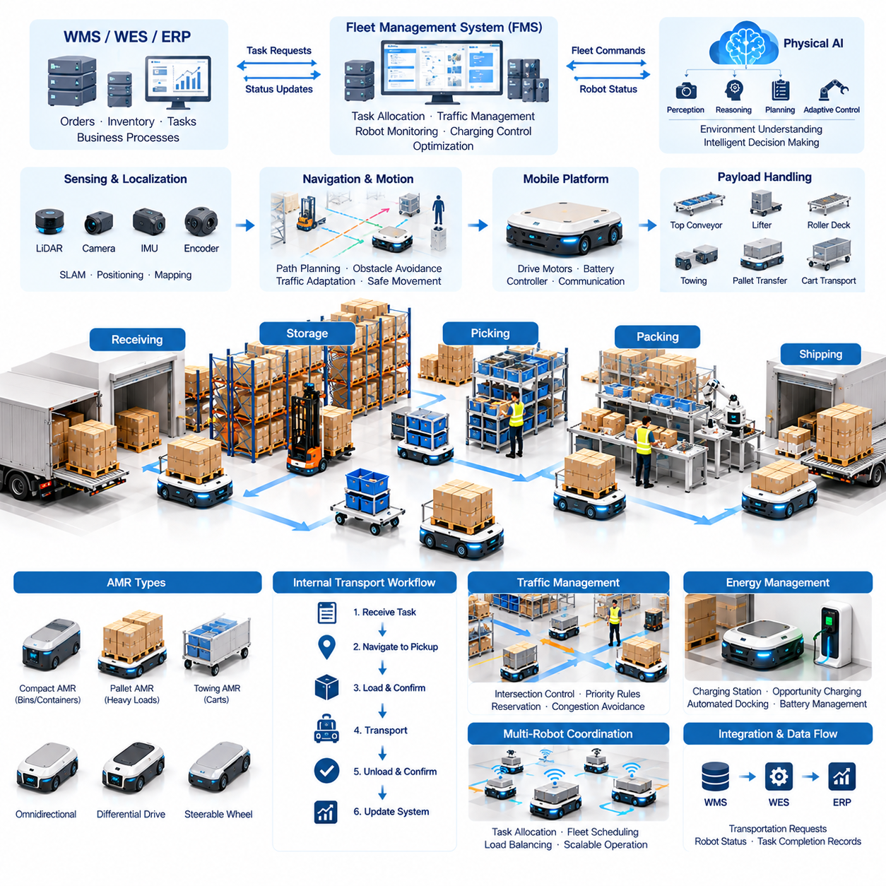{width="7.268055555555556in" height="7.268055555555556in"}

자율이동로봇(Autonomous Mobile Robot, AMR)은 유연하고 지능적인 내부 자재 운송을 가능하게 함으로써 현대 창고 자동화(Warehouse Automation)의 핵심 구성요소로 자리 잡고 있다. 일반적으로 사전에 정의된 경로를 따라 이동하는 기존 무인운반차(Automated Guided Vehicle, AGV)와 달리, AMR은 환경 인식(Environmental Perception), 위치 추정(Localization), 자율주행(Autonomous Navigation)을 활용하여 적절한 이동 경로를 결정한다. 이러한 적응성은 물리적 인프라를 대규모로 변경하지 않고도 창고 운송 작업 흐름을 조정할 수 있도록 한다.

창고 내부 운송(Internal Warehouse Transportation)은 입고 도크(Receiving Dock), 보관 장소(Storage Location), 피킹 작업장(Picking Station), 포장 구역(Packing Area), 출하 구역(Shipping Zone)을 연결한다. 이러한 이동 작업에는 반복적인 자재 이송이 포함되며, 이는 인력을 소모하고 운영 병목현상(Operational Bottleneck)을 발생시킨다. AMR은 팔레트(Pallet), 컨테이너(Container), 카트(Cart), 재고 단위(Inventory Unit)를 지정된 장소 사이에서 운송함으로써 작업자가 부가가치가 높은 업무에 집중할 수 있도록 지원한다.

창고용 AMR의 기본 아키텍처(Fundamental Architecture)는 이동 플랫폼(Mobile Platform), 센싱 시스템(Sensing System), 온보드 컴퓨팅(Onboard Computing), 내비게이션 소프트웨어(Navigation Software), 통신 인터페이스(Communication Interface)를 통합한다. 전기 구동 모터(Electric Drive Motor)는 이동성을 제공하고 배터리(Battery)는 운용 에너지를 공급한다. 임베디드 제어기(Embedded Controller)는 운동 및 안전 기능을 조정하며, 상위 컴퓨팅 플랫폼은 자율 운용에 필요한 인식, 위치 추정, 경로 계획, 작업 관리 알고리즘을 실행한다.

위치 추정(Localization)과 지도 작성(Mapping)은 안정적인 창고 자율주행을 위한 핵심 기능이다. 동시적 위치 추정 및 지도 작성(Simultaneous Localization and Mapping, SLAM)은 로봇이 자신의 위치를 추정하면서 환경 지도를 생성하거나 갱신할 수 있도록 한다. 시설 환경에 따라 라이다 기반 위치 추정(LiDAR-Based Localization)과 비전 기반 위치 추정(Vision-Based Localization)이 활용된다. 정확한 위치 정보는 AMR이 좁은 통로를 주행하고 작업장에 접근하며 지정된 상하역 위치에 도달하도록 지원한다.

창고 자율주행(Warehouse Navigation)은 동적 장애물(Dynamic Obstacle)과 변화하는 교통 상황에 지속적으로 적응해야 한다. 작업자, 지게차, 팔레트, 다른 이동로봇이 계획된 경로를 일시적으로 차단할 수 있다. AMR은 전역 경로 계획(Global Path Planning)과 국소 장애물 회피(Local Obstacle Avoidance)를 결합하여 안전한 이동을 유지한다. 고급 내비게이션 시스템은 대체 경로를 평가하고 주변 객체의 움직임을 예측하며 환경 제약조건과 운영 우선순위에 따라 주행 속도를 조절한다.

창고의 적용 분야에 따라 서로 다른 이동 플랫폼 구성(Mobile Platform Configuration)이 필요하다. 소형 AMR은 작은 컨테이너와 재고 보관함을 운송하며, 대형 플랫폼은 고중량 팔레트나 산업용 카트를 운반한다. 차동구동(Differential Drive), 전방향 구동(Omnidirectional Drive), 조향식 휠(Steerable Wheel) 구조는 서로 다른 기동 특성을 제공한다. 적절한 이동 구조를 선택하려면 적재 용량(Payload Capacity), 회전 반경(Turning Radius), 바닥 상태(Floor Condition), 위치 정밀도(Positioning Accuracy), 운영 비용(Operational Cost) 사이의 균형을 고려해야 한다.

적재물 취급 장치(Payload Handling Mechanism)는 AMR이 창고 자재와 상호작용하는 방식을 결정한다. 일반적인 구성에는 상부 장착형 컨베이어(Top-Mounted Conveyor), 리프팅 플랫폼(Lifting Platform), 롤러 데크(Roller Deck), 견인 인터페이스(Towing Interface), 팔레트 이송 장치(Pallet Transfer Mechanism)가 포함된다. 이러한 장치는 로봇이 고정 설비와 자재를 교환하거나 기존 카트를 운송하도록 지원한다. 로봇 플랫폼과 창고 설비 사이의 안정적인 자재 이송을 위해서는 기계적 인터페이스 호환성(Mechanical Interface Compatibility)이 필수적이다.

창고 내부 운송 작업 흐름(Internal Transportation Workflow)은 고정된 운영 작업장 사이의 반복적인 이동으로 구성되는 경우가 많다. AMR은 창고관리시스템(Warehouse Management System, WMS)으로부터 운송 요청을 수신하고, 픽업 위치로 이동하여 자재의 준비 상태를 확인한 다음 목적지로 적재물을 운송할 수 있다. 이후 작업 완료 정보가 상위 관리 시스템으로 전송된다. 이러한 협조 작업 흐름은 수동 운송을 줄이면서 자재 이동에 대한 추적성(Traceability)을 유지한다.

로봇 군집관리시스템(Fleet Management System, FMS)은 동일한 창고에서 운용되는 여러 AMR을 통합적으로 조정한다. 이러한 시스템은 운송 작업을 할당하고, 로봇 상태를 감시하며, 교통 흐름을 관리하고, 충전 일정을 조정한다. 효과적인 군집 관리(Fleet Management)는 불필요한 혼잡을 방지하고 가용 로봇 사이의 작업 부하를 균형 있게 분배한다. 중앙집중식 협조 제어(Centralized Coordination)는 운송 거리, 작업 우선순위, 로봇 가용성을 고려하여 운영 효율성을 향상시킬 수 있다.

창고 로봇 군집의 규모가 확대될수록 교통 관리(Traffic Management)의 중요성이 증가한다. 좁은 통로, 교차로, 엘리베이터, 공용 상하역 작업장은 로봇 사이의 이동 충돌을 발생시킬 수 있다. 예약 기반 교통 제어(Reservation-Based Traffic Control), 우선순위 규칙(Priority Rule), 혼잡 인식 경로 계획(Congestion-Aware Routing)은 예측 가능한 이동을 유지하는 데 기여한다. 일부 시스템은 분산형 협조 제어(Distributed Coordination)를 사용하며, 다른 시스템은 일관된 운영 동작을 보장하기 위해 중앙집중식 교통 관리(Centralized Traffic Management)에 의존한다.

창고용 AMR은 기존 기업 정보 시스템 및 자동화 시스템과 통합되어야 한다. 창고관리시스템(Warehouse Management System, WMS)은 재고 및 주문 정보를 제공하고, 창고실행시스템(Warehouse Execution System, WES)은 운영 작업 흐름을 조정한다. 전사적자원관리(Enterprise Resource Planning, ERP) 플랫폼은 창고 활동을 보다 광범위한 비즈니스 프로세스와 연결한다. 표준화된 인터페이스(Standardized Interface)는 운송 요청, 로봇 상태, 작업 완료 기록이 이러한 시스템 사이에서 전달되도록 지원한다.

피지컬 AI(Physical AI)는 더욱 정교한 환경 이해(Environmental Understanding)와 적응형 의사결정(Adaptive Decision-Making)을 도입하여 창고용 AMR의 기능을 향상시킨다. 학습 기반 인식 모델(Learning-Based Perception Model)은 운영 객체를 인식하고 일시적인 장애물과 영구적인 구조물을 구분할 수 있다. 예측 모델(Predictive Model)은 교통 상황과 운송 지연을 추정할 수 있다. 이러한 기능은 자율 로봇이 고정된 내비게이션 규칙에만 의존하지 않고 운영 환경의 변화에 지능적으로 대응하도록 한다.

에너지 관리(Energy Management)는 창고 로봇 군집의 생산성에 직접적인 영향을 미친다. AMR은 일반적으로 주기적인 충전이 필요한 충전식 배터리(Rechargeable Battery)를 사용한다. 기회 충전(Opportunity Charging)은 운영 대기시간에 에너지를 보충하도록 하며, 자동 도킹(Automated Docking)은 무인 충전을 지원한다. 지능형 충전 스케줄링(Intelligent Charging Scheduling)은 배터리 충전 상태(Battery State of Charge), 작업 긴급도, 충전소 가용성, 예상 작업량을 고려하여 불필요한 운영 중단을 줄인다.

창고용 AMR은 작업자 및 기존 산업용 차량과 동일한 공간을 공유하는 경우가 많으므로 안전 공학(Safety Engineering)이 필수적이다. 보호 센서(Protective Sensor), 비상정지 장치(Emergency Stopping Mechanism), 속도 제한(Speed Limitation), 충돌 회피(Collision Avoidance) 기능은 운영 위험을 감소시킨다. 상위 AI 알고리즘이 예상하지 못한 상황에 직면하더라도 안전 등급 제어 시스템(Safety-Rated Control System)은 신뢰성 있게 작동해야 한다. 안전한 배포를 위해서는 적절한 검증과 운영 절차가 필요하다.

창고 배치 구조(Warehouse Layout)는 AMR의 성능에 상당한 영향을 미친다. 통로 폭(Aisle Width), 바닥 품질(Floor Quality), 보관 설비 배치(Storage Arrangement), 작업장 위치(Workstation Placement), 보행자 이동 흐름(Pedestrian Traffic)은 사용 가능한 운송 경로를 결정한다. 수동 지게차 중심으로 설계된 시설은 자율주행을 지원하기 위해 일부 조정이 필요할 수 있다. 시뮬레이션(Simulation)과 디지털 트윈(Digital Twin) 기술은 실제 배포 전에 경로 효율성, 교통 혼잡, 군집 운송 능력을 평가하도록 지원한다.

AMR의 생산성 향상 효과는 로봇의 주행 속도만이 아니라 조정된 작업 흐름 설계(Coordinated Workflow Design)에 달려 있다. 공차 이동(Empty Travel)을 줄이고 대기시간(Waiting Time)을 최소화하며 작업 할당(Task Allocation)을 개선하면 실질적인 운송 처리 능력을 크게 높일 수 있다. 창고 운영자는 시간당 완료 작업 수(Completed Missions per Hour), 평균 배송 시간(Average Delivery Time), 로봇 활용률(Robot Utilization), 시스템 가용성(System Availability)을 평가하여 자율 운송이 시설 전체의 성능을 향상시키는지 확인해야 한다.

로봇 군집 규모 산정(Fleet Sizing)은 운송 수요와 가용 로봇의 처리 능력 사이의 균형을 요구한다. 로봇 수가 부족하면 배송 지연과 작업장 자재 공급 부족(Workstation Starvation)이 발생하며, 지나치게 많은 로봇은 초기 투자비(Capital Expenditure)와 교통 혼잡을 증가시킨다. 분석 모델(Analytical Model)과 시뮬레이션은 이동 거리, 상하역 시간, 작업 요청 도착률(Task Arrival Rate), 충전 요구사항, 예상 운영 가용성을 활용하여 필요한 로봇 수량을 추정할 수 있다.

유지보수(Maintenance)와 신뢰성(Reliability)은 창고의 연속 운영에서 중요한 고려사항이다. 구동 부품(Drive Component), 휠(Wheel), 배터리(Battery), 센서(Sensor), 리프팅 장치(Lifting Mechanism)는 반복적인 운송 작업으로 인해 마모된다. 상태 감시(Condition Monitoring)와 예지보전(Predictive Maintenance)은 고장이 운영을 중단시키기 전에 발생 가능한 문제를 식별할 수 있다. 원격 진단(Remote Diagnostics), 소프트웨어 업데이트(Software Update), 체계적인 유지보수 절차는 장기간에 걸쳐 로봇 군집의 가용성을 유지하도록 지원한다.

AMR을 성공적으로 배포하려면 로봇 엔지니어, 창고 운영자, 정보기술 담당자, 안전 담당자 사이의 긴밀한 협력이 필요하다. 초기 도입은 일반적으로 픽업 및 배송 위치가 명확하게 정의된 반복 운송 경로에 집중한다. 시범 운영(Pilot Deployment)은 보다 복잡한 작업 흐름으로 확장하기 전에 자율주행 신뢰성(Navigation Reliability), 시스템 통합 성능(Integration Performance), 작업자와의 상호작용(Worker Interaction), 운영 경제성(Operational Economics)에 관한 실증 자료를 제공한다.

창고용 AMR의 경제성 평가(Economic Assessment)는 초기 투자(Capital Investment), 시스템 통합 비용(Integration Expense), 유지보수(Maintenance), 소프트웨어 라이선스(Software Licensing), 에너지 소비(Energy Consumption), 운영 지원(Operational Support)을 고려해야 한다. 기대 효과에는 수동 운송 작업 감소, 자재 추적성 향상, 작업 일정의 유연성 증가, 배송 성능의 일관성 개선이 포함된다. 총소유비용(Total Cost of Ownership, TCO)과 투자수익률(Return on Investment, ROI) 분석은 도입이 지속 가능한 비즈니스 가치를 창출하는지 판단하도록 지원한다.

미래의 창고용 AMR은 더욱 발전된 인식(Perception), 예측 계획(Predictive Planning), 협력 지능(Collaborative Intelligence)을 통합할 것으로 예상된다. 모바일 매니퓰레이터(Mobile Manipulator), 자율지게차(Autonomous Forklift), 이기종 로봇 군집(Heterogeneous Robotic Fleet)과의 통합은 보다 포괄적인 자재 취급 자동화를 가능하게 할 수 있다. 공유 환경 모델(Shared Environmental Model)과 적응형 군집 운영 조정(Adaptive Fleet Orchestration)은 운송, 보관, 주문 처리 활동 전반의 협조 능력을 향상시킬 수 있다.

궁극적으로 창고용 AMR은 노동집약적인 보조 활동이었던 내부 운송을 지능적이고 통합적으로 조정되는 운영 서비스(Intelligent and Coordinated Operational Service)로 전환한다. 그 효과는 신뢰성 높은 이동 하드웨어(Reliable Mobility Hardware), 자율주행(Autonomous Navigation), 군집 관리(Fleet Management), 기업용 소프트웨어(Enterprise Software), 안전 공학(Safety Engineering)의 통합에 달려 있다. 피지컬 AI 기술이 성숙함에 따라 이러한 시스템은 유연하고 데이터 기반으로 운영되는 창고의 핵심적인 적응형 구성요소로 발전할 수 있다.

## 03.03. Towing and Heavy Payload Logistics

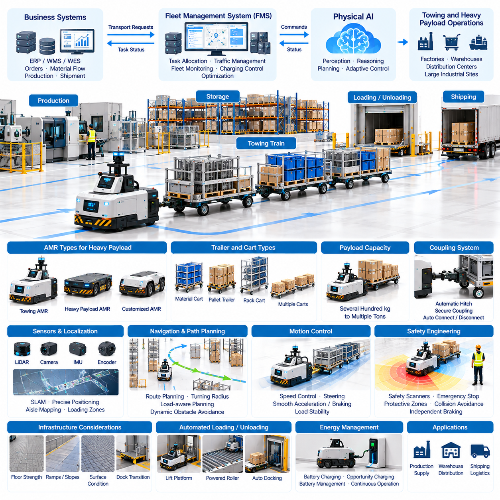{width="7.268055555555556in" height="7.268055555555556in"}

견인 및 고중량 물류(Towing and Heavy Payload Logistics)는 산업용 창고, 제조시설, 물류센터에서 피지컬 AI(Physical AI)가 적용되는 중요한 분야이다. 경량 자재 운송과 달리 고중량 운송 작업에는 안정성(Stability), 위치 정밀도(Positioning Accuracy), 운영 안전성(Operational Safety)을 유지하면서 대규모 하중을 이동시킬 수 있는 로봇 시스템이 필요하다. 지능형 견인 로봇(Intelligent Towing Robot)과 고중량 자율이동로봇(Heavy-Duty Autonomous Mobile Robot, AMR)은 자율주행 기술과 견고한 기계 구조, 고급 운동 제어 기술을 결합한다.

산업용 견인 시스템(Industrial Towing System)은 생산 구역, 창고, 상하역 작업장 사이에서 카트(Cart), 트레일러(Trailer), 자재 랙(Material Rack), 바퀴가 장착된 컨테이너(Wheeled Container)를 운송한다. 하나의 자율 견인 차량(Autonomous Towing Vehicle)이 여러 대의 연결된 카트를 견인하여 상당한 양의 자재를 이동시키는 운송 열차(Transportation Train)를 구성할 수 있다. 이러한 방식은 반복적인 지게차 이동을 줄이고, 운송 요청을 통합하며, 대규모 산업시설 전체의 자재 흐름 효율성(Material Flow Efficiency)을 향상시킬 수 있다.

고중량 자율이동로봇(Heavy Payload AMR)은 기계적 구성에 따라 수백 킬로그램에서 수 톤에 이르는 하중을 운송하도록 설계된다. 이러한 플랫폼은 일반적으로 보강된 섀시 구조(Reinforced Chassis Structure), 고토크 구동 모터(High-Torque Drive Motor), 산업용 감속기(Industrial Gearbox), 특수 휠 어셈블리(Specialized Wheel Assembly)를 사용한다. 설계 과정에서는 구조적 변형(Structural Deformation), 하중 분포(Load Distribution), 바닥 하중 한계(Floor Loading Limit), 가속·제동·회전 중 발생하는 동적 힘(Dynamic Force)을 고려해야 한다.

견인 능력(Towing Capacity)은 운송되는 질량이 주로 연결된 카트나 트레일러의 바퀴에 의해 지지된다는 점에서 직접 적재 용량(Direct Payload Capacity)과 차이가 있다. 견인 로봇은 구름 저항(Rolling Resistance), 경사로(Gradient), 가속 요구조건(Acceleration Demand)을 극복할 수 있는 충분한 견인력(Tractive Force)을 생성해야 한다. 따라서 허용 견인 질량(Allowable Towing Mass)은 모터 출력뿐 아니라 휠 마찰력(Wheel Friction), 바닥 상태(Floor Condition), 연결 장치의 기하학적 구조(Coupling Geometry), 차량 접지력(Vehicle Traction), 제동 성능(Braking Capability)에 의해 결정된다.

고중량 적재물을 견인할 때는 차량 동역학(Vehicle Dynamics)이 특히 중요하다. 가속, 감속, 선회, 비상제동은 연결된 트레일러 시스템 전체에 상당한 힘을 발생시킬 수 있다. 관절형 카트(Articulated Cart)는 불리한 조건에서 궤적 이탈(Off-Tracking), 진동(Oscillation), 잭나이핑(Jackknifing) 현상을 나타낼 수 있다. 따라서 피지컬 AI 시스템은 주행 궤적을 계획하고 움직임을 제어할 때 견인 차량과 트레일러의 결합 동역학(Combined Dynamics)을 함께 고려해야 한다.

기계적 연결 시스템(Mechanical Coupling System)은 자율 견인 로봇과 운송 카트 사이의 물리적 연결을 제공한다. 일반적인 설계에는 자동 히치 장치(Automatic Hitch Mechanism), 견인봉(Drawbar), 잠금 핀(Locking Pin), 전자식 연결 상태 감시 인터페이스(Electronically Monitored Coupling Interface)가 포함된다. 안정적인 연결을 위해서는 정확한 정렬(Accurate Alignment), 확실한 체결(Secure Engagement), 연결 상태 유지에 대한 확인이 필요하다. 자동 연결 및 분리(Automated Coupling and Decoupling)는 반복 운송 작업에서 수동 개입을 더욱 줄일 수 있다.

고중량 이동 플랫폼(Heavy-Duty Mobile Platform)은 차동구동(Differential Drive), 사륜 조향(Four-Wheel Steering), 전방향 구동(Omnidirectional Drive), 독립 구동 휠(Independently Driven Wheel) 구조를 사용할 수 있다. 각 구조는 기동성(Maneuverability), 접지력(Traction), 하중 취급(Load Handling) 측면에서 서로 다른 장점을 제공한다. 사륜 조향은 제한된 공간에서 정밀한 이동을 지원하며, 독립적으로 제어되는 구동 모듈(Drive Module)은 변화하는 적재 조건에서 접지력 관리와 차량 안정성을 향상시킬 수 있다.

대형 차량은 이동 여유 공간이 제한되므로 정확한 위치 추정(Localization)이 고중량 운송에서 필수적이다. 라이다(LiDAR), 카메라(Camera), 관성 센서(Inertial Sensor), 휠 엔코더(Wheel Encoder), 위치 추정 마커(Localization Marker)를 결합하여 차량의 위치와 방향을 추정할 수 있다. 지도 작성 시스템(Mapping System)은 통로 크기, 회전 여유 공간(Turning Clearance), 상하역 구역(Loading Zone), 출입 제한 구역(Restricted Area)을 표현해야 한다. 장애물이나 고정 설비 근처에서 운행할 때는 위치 추정 불확실성(Localization Uncertainty)을 고려해야 한다.

고중량 로봇의 경로 계획(Path Planning)은 두 위치 사이의 최단 경로를 찾는 것 이상의 기능을 요구한다. 계획 알고리즘은 차량 크기, 트레일러 관절 운동(Trailer Articulation), 최소 회전 반경(Minimum Turning Radius), 정지 거리(Stopping Distance), 적재물 안정성(Load Stability)을 고려해야 한다. 무부하 로봇에 적합한 경로라도 긴 카트 열차를 견인하거나 고중량 적재물을 운반할 때는 부적합할 수 있다. 하중 인식 경로 계획(Load-Aware Planning)은 운영 신뢰성을 향상시키고 시설과의 간섭을 줄인다.

운동 제어 시스템(Motion Control System)은 적재 조건에 따라 차량 속도, 조향, 가속, 제동을 조절한다. 고중량 적재물은 관성(Inertia)을 증가시키고 정지 거리를 상당히 늘릴 수 있다. 적응형 제어기(Adaptive Controller)는 추정된 적재 질량(Estimated Payload Mass), 휠 접지력(Wheel Traction), 차량 동역학을 활용하여 운동 프로파일(Motion Profile)을 조정할 수 있다. 부드러운 가속과 감속은 불안정한 자재, 정밀 장비, 민감한 산업용 부품을 운송할 때 특히 중요하다.

안전 공학(Safety Engineering)은 자율 고중량 물류(Autonomous Heavy Payload Logistics)의 기본 요구사항이다. 높은 차량 질량은 충돌 및 기계적 고장의 잠재적 피해를 증가시킨다. 안전 등급 스캐너(Safety-Rated Scanner), 비상정지 시스템(Emergency Stopping System), 보호 구역(Protective Zone), 독립 제동 장치(Independent Braking Mechanism)는 운영 위험을 줄이는 데 기여한다. 인식 시스템이나 상위 AI 소프트웨어에서 예상하지 못한 동작 또는 통신 장애가 발생하더라도 안전 기능은 정상적으로 유지되어야 한다.

창고 인프라(Warehouse Infrastructure)는 고중량 로봇 운영에 추가적인 제약조건을 부과한다. 바닥 강도(Floor Strength), 표면 평탄도(Surface Flatness), 신축 이음부(Expansion Joint), 경사로(Ramp), 배수로(Drainage Channel), 상하역 도크 연결 구간(Loading Dock Transition)은 차량 성능에 영향을 미친다. 고중량 로봇은 접촉 하중(Contact Force)을 분산하기 위해 특수 휠이나 서스펜션 시스템(Suspension System)이 필요할 수 있다. 시설 평가는 정적 하중(Static Load)과 동적 휠 하중(Dynamic Wheel Load)이 모두 허용 구조 한계 이내에 있는지 확인해야 한다.

자동 상하역(Automated Loading and Unloading)은 고중량 운송에서 유휴시간(Idle Time)을 최소화하는 중요한 기능이다. 리프트 플랫폼(Lift Platform), 동력 롤러(Powered Roller), 팔레트 인터페이스(Pallet Interface), 자동 도킹 장치(Automated Docking Mechanism)는 로봇과 고정 설비 사이의 자재 이송을 지원한다. 기계적 간섭과 불안정한 하중 이송을 방지하려면 정밀한 정렬(Precise Alignment)이 필요하다. 센서와 인터록(Interlock)은 적재물 위치, 이송 완료, 안전한 출발 조건을 확인해야 한다.

로봇 군집관리시스템(Fleet Management System, FMS)은 산업시설 전체에서 견인 로봇과 고중량 AMR을 통합적으로 조정한다. 작업 할당(Task Assignment)은 적재 요구조건, 로봇 용량, 운송 거리, 배터리 상태, 장비 가용성을 고려해야 한다. 군집 운영 조정(Fleet Orchestration)은 교통 제한과 상하역 작업장 접근도 관리할 수 있다. 고중량 차량은 혼잡과 운영 충돌을 방지하기 위해 전용 경로(Dedicated Route) 또는 별도의 일정 우선순위(Scheduling Priority)가 필요할 수 있다.

창고관리시스템(Warehouse Management System, WMS), 창고실행시스템(Warehouse Execution System, WES), 전사적자원관리(Enterprise Resource Planning, ERP) 플랫폼과의 통합은 고중량 자재 운송을 재고 및 생산 작업 흐름과 연결한다. 운송 요청(Transportation Request)은 생산 일정(Production Schedule), 자재 보충 요구(Replenishment Requirement), 출하 작업(Shipping Operation)에 따라 생성될 수 있다. 상태 갱신(Status Update)은 자재 위치, 배송 진행 상황, 장비 활용률(Equipment Utilization)에 대한 가시성을 제공한다.

피지컬 AI는 예측 기반 인식(Predictive Perception)과 적응형 계획(Adaptive Planning)을 통해 고중량 물류를 개선할 수 있다. 학습 기반 모델(Learning-Based Model)은 변화하는 교통 상황을 파악하고, 적재 구성을 인식하며, 운송 지연을 추정할 수 있다. 적절한 센싱과 검증이 뒷받침되면 예측 제어(Predictive Control)는 불확실한 마찰 조건이나 적재물 특성을 고려할 수 있다. 이러한 기능은 결정론적 안전 시스템(Deterministic Safety System)을 대체하는 것이 아니라 기존 산업용 제어 보호 기능을 보완한다.

고중량 운송에는 상당한 견인력과 가속 출력이 필요하므로 에너지 소비(Energy Consumption)가 중요한 고려사항이다. 배터리 용량(Battery Capacity), 모터 효율(Motor Efficiency), 구동계 손실(Drivetrain Loss), 운영 일정(Operating Schedule)은 달성 가능한 운용시간을 결정한다. 적절한 조건에서는 회생제동(Regenerative Braking)을 통해 차량 운동에너지의 일부를 회수할 수 있다. 지능형 충전 전략(Intelligent Charging Strategy)은 운송 수요, 배터리 수명, 충전 인프라, 운영 연속성 사이의 균형을 유지해야 한다.

적재 중량과 운전 강도가 증가할수록 신뢰성(Reliability)과 유지보수(Maintenance) 요구사항도 증가한다. 구동 모터(Drive Motor), 감속기(Gearbox), 휠 어셈블리(Wheel Assembly), 베어링(Bearing), 제동 시스템(Braking System), 연결 장치(Coupling Mechanism)는 반복적인 기계적 응력을 받는다. 상태 감시(Condition Monitoring)는 온도, 진동, 전류 소비, 부품 마모를 추적할 수 있다. 예지보전(Predictive Maintenance)은 장비 가동 중단이나 운송 안전성 저하가 발생하기 전에 잠재적인 고장을 식별하도록 지원한다.

운영 성능(Operational Performance)은 완료된 운송 작업 수(Completed Transport Missions), 운송된 적재물 질량(Delivered Payload Mass), 운송 주기 시간(Transportation Cycle Time), 로봇 군집 활용률(Fleet Utilization), 시스템 가용성(System Availability)을 활용하여 평가해야 한다. 추가 지표에는 톤·거리당 에너지 소비량(Energy Consumption per Transported Ton-Distance), 공차 이동 비율(Empty Travel Ratio), 상하역 작업장 대기시간(Loading Station Waiting Time)이 포함된다. 이러한 지표는 단순한 로봇 투입 대수 증가나 명목상 적재 용량 확대와 실제 생산성 향상을 구분하는 데 도움이 된다.

경제적 타당성(Economic Feasibility)은 운송 수요, 장비 투자, 인프라 요구사항, 운영 비용 절감 사이의 관계에 따라 결정된다. 고중량 AMR은 일반적으로 경량 로봇보다 고가의 기계 부품과 높은 수준의 안전 설계가 필요하다. 그러나 상당한 하중을 운송할 수 있으므로 반복적인 수동 운송을 줄이고 생산 연속성(Production Continuity)을 향상시킬 수 있다. 총소유비용(Total Cost of Ownership, TCO)과 투자수익률(Return on Investment, ROI) 분석에는 유지보수, 시스템 통합, 에너지, 수명주기 지원 비용(Lifecycle Support Cost)이 포함되어야 한다.

성공적인 배포(Deployment)는 일반적으로 적재물 특성(Payload Characteristics), 경로 형상(Route Geometry), 시설 조건(Facility Conditions), 운송 빈도(Transportation Frequency)에 대한 상세한 평가에서 시작된다. 시범 운영(Pilot Operation)은 실제 최대 적재 조건(Representative Maximum-Load Conditions)에서 접지력, 제동, 도킹 정확도(Docking Accuracy), 장애물 대응, 비상 상황 동작을 검증해야 한다. 점진적인 확장은 더욱 복잡한 운송 시나리오를 도입하기 전에 군집 스케줄링, 안전 절차, 시스템 통합을 개선할 수 있도록 한다.

미래의 고중량 물류 시스템은 공유 환경 모델(Shared Environmental Model), 고급 예측 제어(Advanced Predictive Control), 이기종 로봇 군집(Heterogeneous Robot Fleet) 사이의 협조 운용을 통합할 수 있다. 지능형 견인 로봇(Intelligent Towing Robot), 자율지게차(Autonomous Forklift), 고중량 AMR은 통합 물류 네트워크(Unified Logistics Network) 내부에서 협력할 수 있다. 자율성 향상은 신뢰성 높은 기계 설계, 검증된 안전 아키텍처(Validated Safety Architecture), 상호운용 가능한 소프트웨어(Interoperable Software), 지속적인 운영 학습(Continuous Operational Learning)에 달려 있다.

궁극적으로 견인 및 고중량 물류는 피지컬 AI가 자율 이동성(Autonomous Mobility)을 까다로운 산업 운송 작업으로 확장하는 방식을 보여준다. 그 가치는 고용량 기계 플랫폼(High-Capacity Mechanical Platform)에 환경 인식, 자율주행, 하중 인식 제어(Load-Aware Control), 군집 협조(Fleet Coordination), 기업 정보 시스템(Enterprise System)을 통합하는 데서 창출된다. 이러한 기술을 적절하게 설계하고 배포하면 자재 흐름의 신뢰성을 높이고, 운송 병목현상을 줄이며, 확장 가능한 산업 자동화(Scalable Industrial Automation)를 지원할 수 있다.

## 03.04. Autonomous Forklifts and Pallet Handling

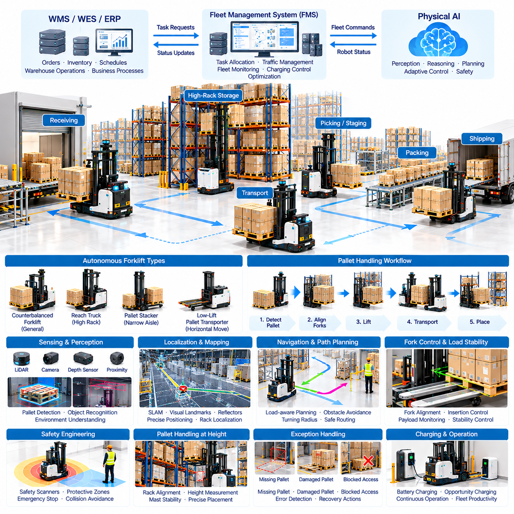{width="7.268055555555556in" height="7.268055555555556in"}

자율지게차(Autonomous Forklift)는 창고 및 산업 물류 분야에서 피지컬 AI(Physical AI)의 중요한 기술적 발전을 나타낸다. 이러한 시스템은 지능형 환경 인식(Intelligent Perception), 자율주행(Autonomous Navigation), 정밀 조작(Precision Manipulation), 차량 제어(Vehicle Control)를 결합하여 작업자의 지속적인 조작 없이 팔레트를 운송한다. 기존 지게차와 달리 자율지게차는 검증된 안전 운용 범위 내에서 변화하는 창고 환경에 적응하면서 운송 작업을 수행할 수 있다.

팔레트 취급(Pallet Handling)은 창고, 물류센터, 제조시설에서 수행되는 기본적인 물류 활동이다. 팔레트(Pallet)는 원자재(Raw Material), 완제품(Finished Product), 중간 재고(Intermediate Inventory)를 입고 도크(Receiving Dock), 보관 랙(Storage Rack), 생산 구역(Production Area), 출하 작업장(Shipping Station) 사이에서 운반하는 데 사용된다. 이러한 이동 작업을 자동화하면 반복적인 수동 운전을 줄이고, 자재 추적성(Material Traceability)을 향상시키며, 상호 연결된 물류 작업 전반에서 더욱 일관된 운송 작업 흐름을 지원할 수 있다.

자율지게차 아키텍처(Autonomous Forklift Architecture)는 산업용 차량 플랫폼(Industrial Vehicle Platform)에 센싱(Sensing), 컴퓨팅(Computing), 통신(Communication), 제어 시스템(Control System)을 통합한다. 전기 구동 모터(Electric Traction Motor)는 추진력을 제공하며, 유압식 또는 전기기계식 리프팅 장치(Hydraulic or Electromechanical Lifting Mechanism)는 포크의 상승 높이를 제어한다. 온보드 프로세서(Onboard Processor)는 위치 추정, 환경 인식, 경로 계획 알고리즘을 실행하고, 임베디드 제어기(Embedded Controller)는 조향, 제동, 리프팅 및 기타 안전 필수 차량 기능을 제어한다.

다양한 지게차 구성(Forklift Configuration)은 카운터밸런스 지게차(Counterbalanced Forklift), 리치트럭(Reach Truck), 팔레트 스태커(Pallet Stacker), 저상형 팔레트 운반차(Low-Lift Pallet Transporter) 등 서로 다른 물류 요구사항을 지원한다. 카운터밸런스 차량은 일반적인 팔레트 운송을 담당하며, 리치트럭은 높은 랙에서의 작업을 지원한다. 팔레트 스태커는 좁은 보관 환경에 적합하고, 저상형 차량은 수평 이동에 중점을 둔다. 차량 선택은 적재물 크기, 랙 높이, 통로 구조, 요구 처리량(Throughput)에 따라 결정된다.

자율지게차는 팔레트, 보관 랙, 작업자, 이동 장비 주변에서 운행하므로 환경 인식(Environmental Perception)이 필수적이다. 라이다(LiDAR), 카메라(Camera), 깊이 센서(Depth Sensor), 근접 감지기(Proximity Detector)는 장애물과 사용 가능한 공간에 대한 정보를 제공한다. 센서 융합(Sensor Fusion)은 객체 인식(Object Recognition)과 공간 이해(Spatial Understanding)를 향상시킬 수 있다. 인식 알고리즘은 안정적인 팔레트 취급을 위해 팔레트 삽입구, 랙 구조물, 바닥 표시, 일시적인 장애물을 구분해야 한다.

위치 추정(Localization)과 지도 작성(Mapping)은 자율지게차가 창고 시설 내부에서 자신의 위치를 파악하도록 한다. 환경 요구사항에 따라 라이다 기반 위치 추정(LiDAR-Based Localization), 시각적 랜드마크(Visual Landmark), 반사판(Reflector), 동시적 위치 추정 및 지도 작성(Simultaneous Localization and Mapping, SLAM) 기술을 활용할 수 있다. 정확한 위치 추정은 작은 오차로도 포크 정렬 불량(Fork Misalignment)이나 기계적 간섭(Mechanical Interference)이 발생할 수 있는 팔레트 픽업 위치와 보관 랙 주변에서 특히 중요하다.

팔레트 감지(Pallet Detection)는 대상 적재물의 위치(Position), 방향(Orientation), 크기(Dimension), 접근 가능성(Accessibility)을 식별하는 과정이다. 비전 기반 모델(Vision-Based Model)은 팔레트의 기하학적 구조(Pallet Geometry)를 추정할 수 있으며, 깊이 센싱(Depth Sensing)은 포크 삽입 위치(Fork Insertion Location)를 결정하는 데 도움을 준다. 팔레트가 손상되거나 부분적으로 가려지거나 불규칙하게 배치되면 감지가 더욱 어려워진다. 따라서 강건한 팔레트 취급(Robust Pallet Handling)을 위해서는 불확실성 추정(Uncertainty Estimation)과 안전하지 않은 픽업 시도를 거부하는 절차가 필요하다.

포크 정렬(Fork Alignment)은 차량이 팔레트 삽입구에 대해 포크를 정확하게 배치해야 하므로 중요한 조작 과제(Manipulation Challenge)이다. 자율 제어기(Autonomous Controller)는 차량 이동, 조향각(Steering Angle), 포크 높이(Fork Elevation), 삽입 깊이(Insertion Depth)를 협조적으로 제어한다. 작은 위치 오차도 팔레트를 손상시키거나 적재물을 불안정하게 만들 수 있다. 시각 및 기하학적 피드백(Visual and Geometric Feedback)을 활용하는 폐루프 제어(Closed-Loop Control)는 픽업과 적재 작업 중 정렬 정확도를 향상시킨다.

적재물 안정성(Load Stability)은 자율지게차의 안전한 운행에 직접적인 영향을 미친다. 적재 질량(Payload Mass), 무게중심(Center of Gravity), 리프팅 높이(Lifting Height), 차량 가속도(Vehicle Acceleration)는 전복 위험(Tipping Risk)과 제동 특성(Braking Behavior)에 영향을 준다. 제어기는 차량과 적재물을 결합한 무게중심(Combined Center of Gravity)을 고려해야 한다. 특히 적재물이 높게 들어 올려져 있거나 하중이 불균일하게 분포된 경우 과도한 선회 속도나 급제동은 불안정성을 발생시킬 수 있다.

자율 팔레트 운송(Autonomous Pallet Transportation)에는 일반적인 지점 간 자율주행(Point-to-Point Navigation)을 넘어 하중 인식 경로 계획(Load-Aware Path Planning)이 필요하다. 차량 크기, 포크 돌출 길이(Fork Extension), 적재물 돌출부(Load Overhang), 회전 반경(Turning Radius), 정지 거리(Stopping Distance)는 경로의 실행 가능성에 영향을 미친다. 경로 계획 알고리즘은 운송 중인 팔레트 주변에 충분한 여유 공간을 확보하면서 장애물을 회피해야 한다. 높거나 무거운 적재물을 운송할 때는 운동 제약조건(Motion Constraint)이 더욱 엄격해진다.

고층 랙 팔레트 취급(High-Rack Pallet Handling)은 추가적인 위치 정밀도와 제어 기능을 요구한다. 리치트럭(Reach Truck)과 스태커(Stacker)는 마스트 안정성(Mast Stability)을 유지하면서 적재물을 높은 보관 위치에 정렬해야 한다. 랙 형상(Rack Geometry), 선반 여유 공간(Shelf Clearance), 포크 처짐(Fork Deflection), 적재 위치 정확도(Load Placement Accuracy)는 높이가 증가할수록 더욱 중요해진다. 자동화 작업에는 랙 위치 추정(Rack Localization), 높이 측정(Height Measurement), 제어된 리프팅 궤적(Controlled Lifting Trajectory)이 필요할 수 있다.

자동 픽업 및 적재 작업 흐름(Automated Pickup and Placement Workflow)은 환경 인식, 위치 조정, 포크 삽입, 리프팅, 운송, 하역을 협조적으로 수행하는 순서로 구성된다. 각 단계에서는 이전 작업이 올바르게 완료되었는지 확인해야 한다. 적재물 감지 센서(Load-Presence Sensor), 포크 위치 피드백(Fork-Position Feedback), 시각 검사(Visual Inspection)는 이러한 확인 과정을 지원할 수 있다. 팔레트가 없거나 손상되었거나 접근할 수 없거나 잘못 배치된 경우에는 예외 처리(Exception Handling)가 필요하다.

피지컬 AI는 학습 기반 객체 인식(Learned Object Recognition), 적응형 운동 계획(Adaptive Motion Planning), 상황 인식 기반 의사결정(Context-Aware Decision-Making)을 통해 지게차의 자율성을 향상시킨다. 기계학습 모델(Machine Learning Model)은 팔레트의 다양한 형태를 식별하고 적절한 취급 전략(Handling Strategy)을 추정할 수 있다. 예측 알고리즘(Predictive Algorithm)은 주변 교통 상황을 예상하고 운송 계획을 조정할 수 있다. 그러나 학습 기반 기능은 검증된 안전 제어(Validated Safety Control)와 차량 운용 한계(Vehicle Operating Limit) 내에서 작동해야 한다.

로봇 군집관리시스템(Fleet Management System, FMS)은 자율지게차를 자율이동로봇(Autonomous Mobile Robot, AMR), 창고 운송 장비(Warehouse Transporter), 기존 자재 취급 장비(Conventional Material-Handling Equipment)와 통합적으로 조정한다. 작업 할당(Task Allocation)은 차량 용량, 적재 요구사항, 목적지 가용성, 운송 우선순위를 고려한다. 교차로, 상하역 도크, 공용 통로에서는 교통 협조(Traffic Coordination)가 특히 중요하다. 통합 군집 운영 조정(Integrated Fleet Orchestration)은 대기시간을 줄이고 차량 간 이동 충돌을 방지할 수 있다.

창고관리시스템(Warehouse Management System, WMS)과 창고실행시스템(Warehouse Execution System, WES)은 자율 팔레트 취급에 필요한 운영 명령을 제공한다. 재고 기록(Inventory Record)은 팔레트 위치, 보관 목적지, 출하 우선순위를 식별한다. 시스템 통합 인터페이스(Integration Interface)는 운송 요청(Transportation Request), 작업 상태(Task Status), 완료 확인(Completion Confirmation)을 교환한다. 실제 팔레트 이동과 창고 시스템에 기록된 거래 정보가 일치하지 않을 때 발생하는 재고 불일치(Inventory Discrepancy)를 방지하려면 신뢰성 높은 동기화(Reliable Synchronization)가 필요하다.

지게차는 상당한 차량 질량과 이동 가능하며 높은 위치까지 상승하는 적재물을 함께 취급하므로 안전 공학(Safety Engineering)에 대한 요구 수준이 특히 높다. 안전 등급 스캐너(Safety-Rated Scanner), 보호 감지 구역(Protective Detection Zone), 비상정지(Emergency Stopping), 제어된 제동(Controlled Braking)은 충돌 위험을 줄이는 데 기여한다. 하중 감시(Load Monitoring)와 속도 제한(Speed Restriction)은 불안정성 위험을 추가로 감소시킨다. 안전 검증(Safety Validation)은 의도된 운용 환경에서 무부하 상태와 적재 상태를 모두 고려해야 한다.

자율지게차가 작업자 및 수동 운전 차량과 공간을 공유하는 시설에서는 인간-로봇 상호작용(Human-Robot Interaction)이 여전히 중요하다. 보행자 횡단 구역(Pedestrian Crossing), 사각지대가 있는 모서리(Blind Corner), 상하역 작업장(Loading Station)에서는 예측 가능한 로봇 동작이 요구된다. 시각적 표시장치(Visual Indicator), 청각 경고(Audible Warning), 통제된 운용 구역(Controlled Operating Zone), 명확한 개입 절차(Intervention Procedure)는 안전한 공존을 지원한다. 운영 정책은 비정상 상황과 수동 복구(Manual Recovery) 과정에서의 책임을 명확하게 정의해야 한다.

창고 인프라(Warehouse Infrastructure)는 자율지게차 배포(Autonomous Forklift Deployment)에 상당한 영향을 미친다. 바닥 평탄도(Floor Flatness), 랙 정렬(Rack Alignment), 팔레트 품질(Pallet Quality), 통로 폭(Aisle Width), 조명 조건(Lighting Condition)은 자율주행과 적재물 취급 성능에 영향을 준다. 시설에는 표준화된 팔레트 배치 구역(Standardized Pallet Placement Zone), 개선된 바닥 표시(Floor Marking), 통신 인프라(Communication Infrastructure)가 필요할 수 있다. 환경의 일관성(Environmental Consistency)은 운영 신뢰성에 직접적인 영향을 미치므로 현장 준비 상태를 로봇 성능과 함께 평가해야 한다.

디지털 트윈(Digital Twin)과 시뮬레이션(Simulation)은 실제 배포 전에 자율지게차의 동작을 평가할 수 있도록 한다. 가상 환경(Virtual Environment)은 창고 배치, 교통 패턴, 팔레트 위치, 차량 동역학(Vehicle Dynamics)을 재현한다. 엔지니어는 회전 여유 공간(Turning Clearance), 랙 접근성(Rack Accessibility), 군집 혼잡(Fleet Congestion), 운송 처리 능력(Transportation Capacity)을 분석할 수 있다. 시뮬레이션은 비정상적인 상황의 시험도 지원하지만, 안전 필수 작업(Safety-Critical Operation)에 대해서는 실제 환경에서의 물리적 검증(Physical Validation)이 여전히 필요하다.

에너지 관리(Energy Management)는 자율지게차 군집의 가용성과 생산성에 영향을 미친다. 전기 차량(Electric Vehicle)은 주행, 리프팅, 컴퓨팅, 센싱에 필요한 전력을 공급할 수 있는 배터리 시스템(Battery System)을 요구한다. 자동 충전(Automated Charging)과 기회 충전(Opportunity Charging)은 수동 개입을 줄일 수 있다. 충전 일정(Charging Schedule)은 충분한 운송 능력을 유지하기 위해 배터리 상태(Battery Condition), 운영 수요(Operational Demand), 작업 수행 시간(Mission Duration), 충전기 가용성(Charger Availability)을 고려해야 한다.

유지보수(Maintenance) 대상에는 구동 시스템(Drive System), 조향 장치(Steering Mechanism), 유압 부품(Hydraulic Component), 리프팅 마스트(Lifting Mast), 포크(Fork), 센서(Sensor), 제동 장치(Braking Equipment)가 포함된다. 반복적인 리프팅과 운송 작업은 기계적 마모(Mechanical Wear)와 잠재적인 정렬 오차(Alignment Error)를 발생시킨다. 상태 감시(Condition Monitoring)는 비정상적인 진동(Vibration), 온도(Temperature), 유압(Hydraulic Pressure), 전력 소비(Electrical Consumption)를 식별할 수 있다. 예방보전(Preventive Maintenance)과 예지보전(Predictive Maintenance)은 장기적인 운영 신뢰성을 지원한다.

운영 성능(Operational Performance)은 시간당 팔레트 이동 횟수(Pallet Moves per Hour), 픽업 성공률(Pickup Success Rate), 적재 정확도(Placement Accuracy), 작업 완료 시간(Mission Completion Time), 군집 가용성(Fleet Availability)을 활용하여 측정해야 한다. 추가 지표에는 작업자 개입 빈도(Intervention Frequency), 랙 취급 오류(Rack Handling Error), 에너지 소비(Energy Consumption), 안전 관련 정지(Safety-Related Stoppage)가 포함된다. 이러한 지표는 자율지게차가 안정적이고 예측 가능한 자재 취급 작업을 유지하면서 창고 생산성을 향상시키는지 보여준다.

경제적 타당성(Economic Feasibility)은 장비 비용(Equipment Cost), 시스템 통합 복잡성(Integration Complexity), 운영시간(Operating Hours), 인력 요구사항(Labor Requirement), 달성 가능한 활용률(Achievable Utilization)에 따라 결정된다. 자율지게차는 반복적인 운전 작업을 줄이고 운송의 일관성을 향상시킬 수 있지만, 도입 과정에서 소프트웨어, 유지보수, 인프라 비용이 추가된다. 총소유비용(Total Cost of Ownership, TCO)과 투자수익률(Return on Investment, ROI) 분석은 수명주기 비용(Lifecycle Cost), 운영 비용 절감(Operational Savings), 예상 시스템 가용성(Expected System Availability)을 고려해야 한다.

성공적인 배포는 적합한 팔레트 취급 작업 흐름(Pallet-Handling Workflow)을 식별하고 대표적인 운영 조건(Representative Operating Conditions)에서 차량의 기능을 검증하는 것에서 시작된다. 시범 사업(Pilot Project)은 팔레트 감지(Pallet Detection), 포크 정렬(Fork Alignment), 적재물 안정성(Load Stability), 자율주행 신뢰성(Navigation Reliability), 시스템 통합(System Integration)을 평가해야 한다. 점진적인 확장(Gradual Expansion)은 더욱 까다로운 창고 작업을 자동화하기 전에 안전 절차, 예외 처리, 군집 협조를 개선하도록 지원한다.

궁극적으로 자율지게차는 지능형 이동성(Intelligent Mobility)과 정밀 팔레트 조작(Precision Pallet Manipulation)을 연결하여 피지컬 AI를 핵심적인 창고 자재 취급 작업으로 확장한다. 실제적인 가치는 신뢰성 높은 차량 하드웨어(Reliable Vehicle Hardware), 환경 인식(Environmental Perception), 하중 인식 제어(Load-Aware Control), 기업용 소프트웨어(Enterprise Software), 검증된 안전 시스템(Validated Safety System)을 통합하는 데 달려 있다. 이러한 기능이 발전함에 따라 자율 팔레트 취급(Autonomous Pallet Handling)은 통합 물류 자동화(Integrated Logistics Automation)의 더욱 유연하고 적응적인 구성요소로 발전할 수 있다.

## 03.05. Goods to Person and Order Fulfillment

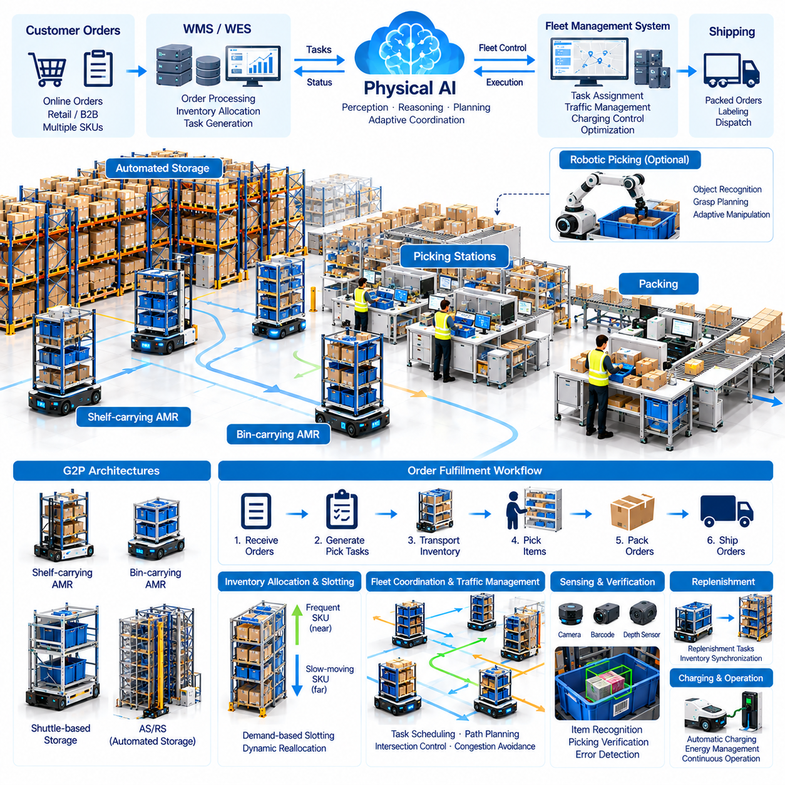{width="7.268055555555556in" height="7.268055555555556in"}

상품-작업자 방식(Goods-to-Person, G2P) 자동화는 재고를 작업자 또는 로봇 피킹 작업장(Robotic Picking Station)으로 직접 이동시켜 창고의 주문 이행(Order Fulfillment) 방식을 혁신한다. 작업자가 보관 통로를 이동하는 대신 지능형 운송 시스템(Intelligent Transportation System)이 선반(Shelf), 빈(Bin), 컨테이너(Container)를 지정된 작업장으로 운송한다. 이러한 방식은 불필요한 보행을 줄이고, 피킹 생산성(Picking Productivity)을 향상시키며, 더욱 일관된 주문 이행 작업을 가능하게 한다.

기존의 작업자-상품 방식(Person-to-Goods, P2G) 작업 흐름에서는 창고 작업자가 제품 위치를 확인하고, 보관 구역을 이동하며, 재고를 직접 꺼내야 한다. 이러한 활동은 수천 개의 재고관리단위(Stock Keeping Unit, SKU)를 보유한 시설에서 상당한 시간을 소비한다. 상품-작업자 시스템(Goods-to-Person System)은 재고 수요를 중심으로 자동 보관(Automated Storage), 로봇 운송(Robotic Transportation), 작업장 운영(Workstation Operation)을 조정하여 이러한 이동 방식을 반대로 전환한다.

피지컬 AI(Physical AI)는 환경 인식(Environmental Perception), 자율 이동성(Autonomous Mobility), 지능형 스케줄링(Intelligent Scheduling), 적응형 협조(Adaptive Coordination)를 통해 G2P 자동화를 향상시킨다. 자율이동로봇(Autonomous Mobile Robot, AMR)은 변화하는 교통 상황에 대응하면서 보관 위치와 피킹 작업장 사이에서 재고 자원을 운송한다. 상위 운영 조정 소프트웨어(Orchestration Software)는 주문 이행 우선순위를 충족하기 위해 어떤 재고 단위를 언제 이동시켜야 하는지 결정한다.

현대 창고에서는 선반 운반 로봇(Shelf-Carrying Robot), 빈 운송 시스템(Bin Transportation System), 셔틀 기반 보관 시스템(Shuttle-Based Storage), 자동 보관 및 검색 시스템(Automated Storage and Retrieval System, AS/RS) 등 다양한 G2P 아키텍처(G2P Architecture)가 사용된다. 선반 운반 AMR은 보관 랙 전체를 들어 올려 운송하는 반면, 빈 기반 시스템은 개별 컨테이너를 전달한다. 각 아키텍처는 보관 밀도(Storage Density), 검색 속도(Retrieval Speed), 인프라 요구사항(Infrastructure Requirement), 운영 유연성(Operational Flexibility) 측면에서 서로 다른 장단점을 제공한다.

주문 이행(Order Fulfillment)은 고객 주문(Customer Order)을 접수하고 이를 실행 가능한 창고 작업(Warehouse Task)으로 변환하면서 시작된다. 창고관리시스템(Warehouse Management System, WMS)은 필요한 제품, 수량, 보관 위치를 식별한다. 창고실행시스템(Warehouse Execution System, WES)은 재고 검색과 작업장 활동을 조정한다. 로봇 군집관리시스템(Fleet Management System, FMS)은 작업 우선순위와 운영 제약조건에 따라 사용 가능한 로봇에 운송 작업을 할당한다.

재고 배치(Inventory Allocation)는 G2P 시스템 성능에 상당한 영향을 미친다. 자주 요청되는 제품은 과도한 운송 없이 접근할 수 있는 위치에 배치하고, 이동 빈도가 낮은 재고는 상대적으로 접근성이 낮은 보관 위치에 배치할 수 있다. 지능형 슬롯팅 알고리즘(Intelligent Slotting Algorithm)은 수요 빈도(Demand Frequency), 제품 간 연관성(Product Relationship), 재고 보충 요구사항(Replenishment Requirement), 보관 용량(Storage Capacity)을 분석한다. 동적 재고 배치(Dynamic Inventory Placement)는 검색 거리를 줄이고 전체 처리량(Throughput)을 향상시킬 수 있다.

주문 배치 처리(Order Batching)는 자동화된 주문 이행에서 또 다른 핵심 최적화 메커니즘(Optimization Mechanism)이다. 여러 고객 주문에서 동일한 제품을 요구할 수 있으므로 하나의 재고 컨테이너가 작업장을 한 번 방문하는 동안 여러 주문을 처리할 수 있다. 지능형 배치 알고리즘(Intelligent Batching Algorithm)은 제품 수요, 납기(Deadline), 작업장 처리 능력(Workstation Capacity)에 따라 호환 가능한 주문을 그룹화한다. 효과적인 배치 처리는 중복 재고 이동을 줄이고 피킹 효율성(Picking Efficiency)을 향상시킨다.

피킹 작업장(Picking Station)은 자동화된 재고 운송과 주문 준비(Order Preparation) 사이의 운영 인터페이스(Operational Interface)를 형성한다. 로봇은 선반이나 컨테이너를 인체공학적으로 설계된 작업장(Ergonomically Designed Workstation)으로 운송하고, 작업자는 필요한 품목을 식별하여 꺼낸다. 픽투라이트 시스템(Pick-to-Light System), 바코드 스캐너(Barcode Scanner), 시각적 안내 인터페이스(Visual Guidance Interface)는 작업 정확도를 향상시킬 수 있다. 작업장 설계는 작업자 생산성, 안전성, 재고 보충 접근성, 자재 흐름(Material Flow) 사이의 균형을 고려해야 한다.

로봇 피킹(Robotic Picking)은 G2P 환경에서 추가적인 자동화 기회를 제공한다. 비전 유도 매니퓰레이터(Vision-Guided Manipulator)는 빈 내부의 객체를 식별하고, 파지 구성(Grasp Configuration)을 추정하며, 선택된 품목을 주문 컨테이너로 이동시킬 수 있다. 피지컬 AI 모델은 다양한 제품에 대한 객체 인식(Object Recognition)과 적응형 파지 계획(Adaptive Grasp Planning)을 지원한다. 그러나 변형 가능한 포장재(Deformable Packaging), 반사 표면(Reflective Surface), 밀집된 객체(Dense Object)는 여전히 신뢰성 높은 자율 피킹을 어렵게 만드는 요소이다.

인식 시스템(Perception System)은 재고 식별과 취급 정확도를 검증하는 데 필수적이다. 카메라(Camera), 바코드 판독기(Barcode Reader), 깊이 센서(Depth Sensor), 중량 측정(Weight Measurement)은 제품 선택을 확인하고 불일치를 감지할 수 있다. 다중모달 센싱(Multimodal Sensing)은 라벨이 손상되거나 객체가 부분적으로 가려진 경우에도 인식 신뢰도를 향상시킨다. 검증 메커니즘(Verification Mechanism)은 피킹 오류(Picking Error)를 줄이고 주문 이행 과정 전반에서 정확한 재고 기록(Inventory Record)을 유지하도록 지원한다.

로봇 군집 협조(Robot Fleet Coordination)는 재고가 적절한 시간에 작업장에 도착하는지를 결정한다. 로봇이 과도하게 도착하면 혼잡(Congestion)과 작업장 대기열(Workstation Queue)이 발생하고, 공급이 부족하면 작업자가 대기하게 된다. 군집 운영 조정(Fleet Orchestration)은 운송 작업 할당, 경로 가용성(Route Availability), 작업장 준비 상태(Workstation Readiness), 로봇 충전 요구사항을 균형 있게 관리한다. 예측 기반 스케줄링(Predictive Scheduling)은 수요 변동을 예상하고 운영 중단을 줄일 수 있다.

교통 관리(Traffic Management)는 고밀도 G2P 시설에서 점점 더 중요해진다. 로봇은 좁은 통로, 보관 구역 교차로, 작업장 진입 경로를 자주 공유한다. 혼잡 인식 경로 설정(Congestion-Aware Routing), 교차로 예약(Intersection Reservation), 협조 이동 정책(Coordinated Movement Policy)은 교착상태(Deadlock)를 방지하는 데 도움이 된다. 효율적인 교통 제어(Traffic Control)는 개별 로봇의 이동시간만 최적화하는 것이 아니라 전체 시스템 처리량(System Throughput)까지 고려해야 한다.

보관 밀도(Storage Density)와 접근성(Accessibility)은 중요한 아키텍처 설계 절충관계(Architectural Tradeoff)를 형성한다. 밀집된 보관 구조는 공간 활용률(Space Utilization)을 높이지만 추가적인 컨테이너 재배치(Container Reshuffling)나 검색 이동이 필요할 수 있다. 접근성이 높은 배치는 검색 복잡성(Retrieval Complexity)을 줄이는 대신 더 넓은 바닥 면적을 소비한다. 피지컬 AI 기반 최적화(Physical AI-Assisted Optimization)는 재고 수요, 로봇 용량, 시설 형상(Facility Geometry), 예상 주문 특성(Expected Order Profile)을 활용하여 이러한 상충 목표를 평가할 수 있다.

재고 보충 작업(Replenishment Operation)은 재고 부족을 방지하기 위해 주문 이행과 동기화되어야 한다. 입고 제품은 수령, 식별, 적절한 보관 자원 할당 과정을 거친다. 자동 운송 시스템(Automated Transportation System)은 보충 컨테이너나 선반을 사용 가능한 위치로 이동시킨다. 지능형 재고 보충 스케줄링(Intelligent Replenishment Scheduling)은 진행 중인 피킹 및 출고 운송 작업과의 간섭을 최소화하면서 중요한 재고를 우선적으로 보충한다.

실제 창고 운영은 완벽하게 예측 가능한 순서로 진행되는 경우가 드물기 때문에 예외 처리(Exception Handling)가 필수적이다. 제품 누락(Missing Product), 포장 손상(Damaged Packaging), 잘못된 재고 기록(Incorrect Inventory Record), 경로 차단(Blocked Route), 작업장 사용 불가(Unavailable Workstation)는 주문 이행을 중단시킬 수 있다. 피지컬 AI 시스템은 비정상 상태(Abnormal Condition)를 감지하고 시정 조치(Corrective Action)를 제안할 수 있다. 신뢰성 높은 복구 절차(Recovery Procedure)는 자율적으로 해결할 수 있는 상황과 작업자 개입(Human Intervention)이 필요한 상황을 구분해야 한다.

디지털 트윈(Digital Twin)과 시뮬레이션 환경(Simulation Environment)은 G2P 시스템 설계와 운영 최적화를 지원한다. 가상 창고 모델(Virtual Warehouse Model)은 보관 배치, 로봇 이동, 작업장 처리 능력, 주문 도착 패턴(Order Arrival Pattern)을 재현한다. 시뮬레이션(Simulation)은 실제 배포 전에 로봇 군집 규모(Fleet Size), 재고 배치, 주문 배치 정책(Batching Policy), 혼잡 위험(Congestion Risk)을 평가할 수 있다. 시나리오 시험(Scenario Testing)은 수요 급증(Demand Peak)이나 장비 고장(Equipment Failure) 상황에서 시스템의 동작을 파악하는 데도 도움이 된다.

확장성(Scalability)은 주문량, 재고 다양성(Inventory Diversity), 로봇 군집 규모가 증가할 때 협조된 성능을 유지하는 능력에 달려 있다. 작업장 처리 능력이나 보관 접근성이 제한 요소(Limiting Factor)가 되면 로봇을 추가하더라도 처리량이 자동으로 증가하지 않는다. 시스템 수준 최적화(System-Level Optimization)는 운송, 검색, 피킹, 포장(Packing), 재고 보충 전반의 병목현상(Bottleneck)을 식별해야 한다. 모듈형 아키텍처(Modular Architecture)는 인프라가 허용하는 범위에서 점진적인 확장을 지원한다.

에너지 관리(Energy Management)는 지속적인 재고 운송을 수행하는 로봇의 가용성(Robot Availability)에 영향을 미친다. 자동 충전소(Automated Charging Station)와 기회 충전 전략(Opportunity Charging Strategy)은 수동 배터리 취급을 줄인다. 충전 일정(Charging Schedule)은 로봇 활용률(Robot Utilization), 예상 수요(Anticipated Demand), 배터리 상태(Battery Condition), 사용 가능한 충전 용량(Charging Capacity)을 고려해야 한다. 충전 작업이 적절하게 조정되지 않으면 주문 이행이 집중되는 시간대에 운송 능력이 감소할 수 있다.

운영 성능(Operational Performance)은 시간당 피킹 주문 행 수(Order Lines Picked per Hour), 피킹 정확도(Picking Accuracy), 주문 처리 주기 시간(Order Cycle Time), 작업장 활용률(Workstation Utilization), 재고 검색 지연시간(Inventory Retrieval Latency)을 통해 평가한다. 추가 지표에는 로봇 활용률(Robot Utilization), 공차 이동 거리(Empty Travel Distance), 혼잡 지연(Congestion Delay), 시스템 가용성(System Availability)이 포함된다. 이러한 지표는 개별 운송 작업의 속도 향상에 그치지 않고 전체 주문 이행 성능(End-to-End Fulfillment Performance)이 실제로 개선되는지를 보여준다.

경제성 평가(Economic Evaluation)는 로봇 장비(Robotic Equipment), 보관 인프라(Storage Infrastructure), 작업장 설치(Workstation Installation), 소프트웨어 통합(Software Integration), 유지보수(Maintenance), 운영 지원(Operational Support)을 고려해야 한다. 기대 효과에는 작업자 보행시간 감소(Reduced Walking Time), 재고 보관 밀도 향상(Improved Inventory Density), 피킹 생산성 증가(Higher Picking Productivity), 더욱 예측 가능한 주문 완료가 포함될 수 있다. 총소유비용(Total Cost of Ownership, TCO)과 투자수익률(Return on Investment, ROI) 분석에는 수요 변동성(Demand Variability), 인력 요구사항(Labor Requirement), 예상 시스템 활용률(Expected System Utilization)을 반영해야 한다.

재고 운송이 고도로 자동화되더라도 인간적 요소(Human Factors)는 여전히 중요하다. 작업장 인체공학(Workstation Ergonomics), 작업자 교육(Operator Training), 시각적 안내(Visual Guidance), 작업 부하 분배(Workload Distribution)는 생산성과 작업자 복지(Employee Well-Being)에 영향을 미친다. 피지컬 AI는 예측 가능한 인간-로봇 상호작용(Human-Robot Interaction)을 지원하고 과도한 작업 강도(Work Intensity)를 유발하지 않아야 한다. 효과적인 배포(Effective Deployment)는 자동화 효율성과 실질적인 근무 조건, 명확한 운영 책임을 결합한다.

미래의 G2P 시스템은 이동로봇(Mobile Robot), 로봇 매니퓰레이터(Robotic Manipulator), 예측 재고 모델(Predictive Inventory Model), 더욱 지능적인 창고 운영 조정(Intelligent Warehouse Orchestration)을 결합할 수 있다. 공유 운영 데이터(Shared Operational Data)는 재고 배치, 주문 배치 처리, 작업 할당(Task Allocation)의 지속적인 개선을 지원할 수 있다. 환경 인식과 조작 능력(Manipulation Capability)이 발전함에 따라 더 많은 피킹 작업이 자율화되고, 작업자는 예외 상황과 복잡한 취급 작업을 감독하는 역할을 수행할 수 있다.

궁극적으로 상품-작업자 방식 자동화(Goods-to-Person Automation)는 재고, 정보, 로봇 자원의 협조된 이동을 통해 피지컬 AI가 창고 주문 이행을 어떻게 혁신할 수 있는지 보여준다. 그 효과는 자율 운송(Autonomous Transportation), 지능형 스케줄링(Intelligent Scheduling), 정확한 재고 관리(Accurate Inventory Management), 신뢰성 높은 피킹 프로세스(Reliable Picking Process), 기업용 소프트웨어(Enterprise Software)를 통합하는 데 달려 있다. 성공적인 도입은 운영 유연성(Operational Flexibility)을 향상시키면서 확장 가능하고 경제적으로 지속 가능한 주문 이행(Scalable and Economically Sustainable Order Fulfillment)을 지원한다.

## 03.06. Mobile Manipulation for Picking

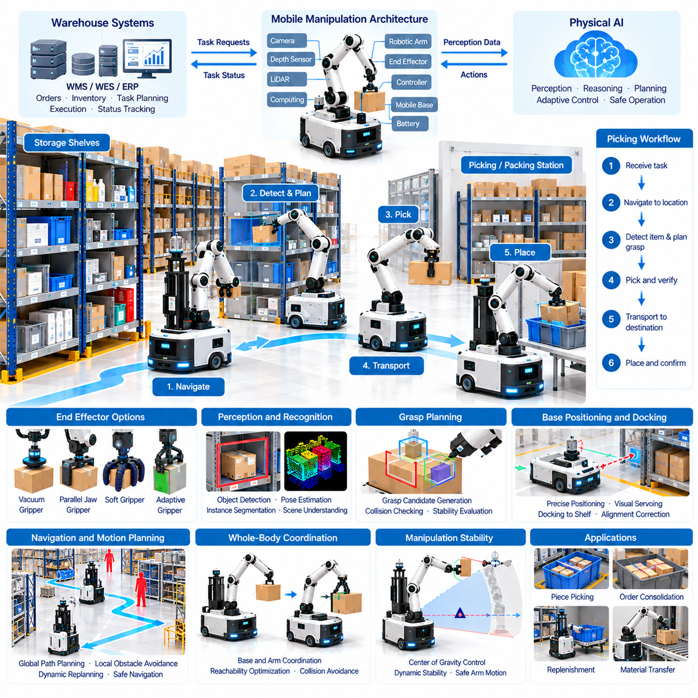{width="7.268055555555556in" height="7.268055555555556in"}

피킹을 위한 이동형 매니퓰레이션(Mobile Manipulation for Picking)은 자율 이동성(Autonomous Mobility)과 로봇 객체 조작(Robotic Object Handling)을 결합하여 창고 자동화의 범위를 단순 운송 이상으로 확장한다. 이동형 매니퓰레이터(Mobile Manipulator)는 일반적으로 자율이동로봇(Autonomous Mobile Robot, AMR), 로봇 팔(Robotic Arm), 말단효과기(End Effector), 인식 센서(Perception Sensor), 온보드 컴퓨팅(Onboard Computing)을 통합한다. 이러한 구조는 모든 피킹 작업을 고정된 작업장에서 수행하지 않고도 로봇이 보관 위치 사이를 이동하고, 목표 제품을 식별하며, 품목을 집어 올릴 수 있도록 한다.

기존의 창고 피킹(Traditional Warehouse Picking)은 작업자가 통로를 이동하면서 선반(Shelf), 빈(Bin), 랙(Rack)에서 제품을 수동으로 수집하는 방식에 크게 의존한다. 이동형 매니퓰레이션은 로봇 피킹 기능을 재고 보관 위치로 직접 이동시켜 이러한 작업 흐름을 변화시킨다. 이러한 시스템은 개별 품목 피킹(Piece Picking), 주문 통합(Order Consolidation), 재고 보충(Inventory Replenishment), 자재 이송(Material Transfer)을 지원하면서 반복적인 이동을 줄이고 자동화 적용 범위를 확대할 수 있다.

이동형 매니퓰레이터의 기계적 아키텍처(Mechanical Architecture)는 이동성(Mobility), 조작 도달 범위(Manipulation Reach), 적재 용량(Payload Capacity), 안정성(Stability) 사이의 균형을 유지해야 한다. 이동 플랫폼(Mobile Base)은 운송 기능을 제공하고, 로봇 팔은 작업 공간(Workspace) 내부에서 말단효과기의 위치를 결정한다. 로봇 팔의 길이, 관절 구성(Joint Configuration), 장착 높이(Mounting Height), 플랫폼 크기는 접근 가능한 피킹 위치를 결정한다. 기계 설계에서는 조작 중 발생하는 진동(Vibration), 구조적 처짐(Structural Deflection), 동적 하중(Dynamic Load)도 고려해야 한다.

창고 피킹에 사용되는 로봇 팔은 일반적으로 여러 개의 관절형 조인트(Articulated Joint)를 사용하여 다양한 방향에서 객체에 접근한다. 6자유도 또는 7자유도 매니퓰레이터(Six- or Seven-Degree-of-Freedom Manipulator)는 선반과 컨테이너 주변에서 유연한 위치 제어를 제공할 수 있다. 그러나 도달 범위가 증가하면 구조적 복잡성이 높아지고 실제 적재 용량이 감소할 수 있다. 적절한 로봇 팔을 선택하려면 작업 공간의 기하학적 구조(Workspace Geometry), 객체 특성(Object Characteristics), 요구 피킹 속도(Required Picking Speed)를 일치시켜야 한다.

말단효과기(End Effector)는 이동형 매니퓰레이터가 다양한 제품을 얼마나 안정적으로 파지(Grasp)할 수 있는지를 결정한다. 진공 그리퍼(Vacuum Gripper)는 표면이 매끄럽고 비교적 단단한 포장 제품에 효과적이며, 평행 조 그리퍼(Parallel-Jaw Gripper)는 적절한 파지 표면을 가진 객체를 취급할 수 있다. 적응형 그리퍼(Adaptive Gripper)와 소프트 그리퍼(Soft Gripper)는 불규칙한 형상에 대한 추가적인 유연성을 제공한다. 도구 선택에서는 객체 질량, 표면 질감, 파손 가능성, 포장 변형, 파지 해제 요구사항을 고려해야 한다.

환경 인식(Environmental Perception)은 이동형 매니퓰레이터가 선반, 빈, 장애물, 목표 제품을 식별하도록 한다. RGB 카메라(RGB Camera), 깊이 카메라(Depth Camera), 라이다(LiDAR), 근접 센서(Proximity Sensor)는 주변 작업 공간에 대한 상호 보완적인 정보를 제공한다. 인식 모델(Perception Model)은 객체의 종류, 위치, 방향, 가시 표면(Visible Surface)을 추정한다. 제품이 서로 겹치거나 라벨이 가려지거나 조명 조건이 변화하면 강건한 인식(Robust Perception)을 구현하기 어려워진다.

객체 인식(Object Recognition)과 자세 추정(Pose Estimation)은 자율 피킹(Autonomous Picking)의 핵심 기술이다. 비전 모델(Vision Model)은 요청된 제품을 식별하고 보관 구획(Storage Compartment) 내부에서 객체의 공간적 관계(Spatial Relationship)를 추정한다. 인스턴스 분할(Instance Segmentation)은 복잡하게 적재된 빈 내부의 개별 객체를 구분할 수 있으며, 깊이 추정(Depth Estimation)은 3차원 위치 추정(Three-Dimensional Localization)을 지원한다. 잘못된 식별은 피킹 오류나 주변 제품의 손상으로 이어질 수 있으므로 신뢰도 추정(Confidence Estimation)이 중요하다.

파지 계획(Grasp Planning)은 인식 결과를 실행 가능한 조작 동작(Manipulation Action)으로 변환한다. 알고리즘은 후보 접촉 위치(Candidate Contact Location), 접근 방향(Approach Direction), 충돌 위험(Collision Risk), 예상 파지 안정성(Expected Grasp Stability)을 평가한다. 학습 기반 파지 예측(Learning-Based Grasp Prediction)은 다양한 제품 형상에 대한 성능을 향상시킬 수 있다. 그러나 파지 선택에서는 마찰(Friction), 객체 변형(Object Deformation), 흡착 품질(Suction Quality), 말단효과기의 한계 등 물리적 제약조건(Physical Constraint)을 고려해야 한다.

이동 플랫폼의 위치 결정(Mobile Base Positioning)은 조작 성능에 상당한 영향을 미친다. 로봇 팔의 도달 범위가 충분하더라도 차량 정렬이 부정확하면 성공적인 파지가 불가능하거나 선반과 충돌할 수 있다. 위치 추정(Localization)과 도킹 알고리즘(Docking Algorithm)은 목표 보관 구조물에 대해 로봇의 위치를 조정한다. 시각 서보 제어(Visual Servoing)와 폐루프 보정(Closed-Loop Correction)은 조작 전후 및 조작 중 발생하는 작은 위치 오차를 보상할 수 있다.

전신 협조 제어(Whole-Body Coordination)는 이동 플랫폼의 움직임과 로봇 팔의 동작을 통합한다. 자율주행(Navigation)과 매니퓰레이션(Manipulation)을 완전히 분리된 작업으로 취급하는 대신 협조 계획(Coordinated Planning)을 통해 플랫폼 배치(Base Placement), 로봇 팔 도달 가능성(Arm Reachability), 충돌 회피(Collision Avoidance)를 최적화할 수 있다. 일부 플랫폼은 정지한 후에만 조작을 수행하지만, 다른 플랫폼은 물체 취급 중 신중하게 제어된 이동을 지원한다. 적절한 전략은 안정성, 작업 복잡성, 안전 요구사항에 따라 결정된다.

로봇 팔이 이동 플랫폼의 지지 영역(Support Area) 바깥으로 확장될 때 조작 안정성(Manipulation Stability)이 매우 중요해진다. 로봇 팔의 움직임과 적재 질량은 차량 안정성을 감소시킬 수 있는 힘과 모멘트(Force and Moment)를 발생시킨다. 제어기는 무게중심 변화(Center-of-Gravity Change), 휠 접촉 조건(Wheel Contact Condition), 허용 가속도(Allowable Acceleration)를 고려해야 한다. 무겁거나 높은 위치에 있는 객체를 취급할 때는 로봇 팔 구성 제한(Restricted Arm Configuration), 이동 속도 감소(Reduced Motion Speed), 추가 안정화 장치(Stabilization Mechanism)가 필요할 수 있다.

피킹 실행(Picking Execution)은 일반적으로 자율주행, 목표 감지(Target Detection), 접근 계획(Approach Planning), 파지(Grasping), 검증(Verification), 품목 이송(Item Transfer)의 순서로 진행된다. 각 단계는 후속 의사결정을 위한 피드백(Feedback)을 제공한다. 힘 센싱(Force Sensing), 진공 압력 감시(Vacuum Pressure Monitoring), 시각 검사(Visual Inspection)는 성공적인 파지 여부를 확인할 수 있다. 객체가 미끄러지거나 접근할 수 없는 경우 시스템은 다른 파지 방법을 시도하거나 작업자의 지원을 요청할 수 있다.

충돌 회피(Collision Avoidance)는 자율주행 위험뿐 아니라 조작 과정에서 발생하는 장애물도 처리해야 한다. 이동 플랫폼이 정지한 상태에서도 로봇 팔은 선반 모서리, 주변 제품, 보관 컨테이너 또는 인근 작업자와 충돌할 수 있다. 운동 계획 알고리즘(Motion Planning Algorithm)은 전체 조작 궤적(Manipulation Trajectory)에 걸쳐 로봇의 기하학적 구조(Robot Geometry)와 사용 가능한 여유 공간(Available Clearance)을 평가한다. 안전 제약조건(Safety Constraint)은 접근, 파지, 인출, 품목 배치 과정 전반에서 지속적으로 적용되어야 한다.

피지컬 AI(Physical AI)는 다중모달 학습(Multimodal Learning), 적응형 매니퓰레이션(Adaptive Manipulation), 상황 인식 기반 의사결정(Context-Aware Decision-Making)을 통해 이동형 피킹 성능을 향상시킨다. 비전-언어-행동 모델(Vision-Language-Action Model, VLA)은 작업 명령(Task Instruction)을 시각적 관측(Visual Observation) 및 로봇 행동(Robotic Action)과 연결할 수 있다. 시연 학습(Learning from Demonstrations)과 운영 경험(Operational Experience)을 통한 학습은 다양한 객체에 대한 취급 능력을 향상시킬 수 있다. 그러나 학습된 정책(Learned Policy)은 산업 현장에 배포하기 전에 체계적인 검증(Systematic Validation)과 독립적인 안전 메커니즘(Independent Safety Mechanism)을 필요로 한다.

창고 작업 계획(Warehouse Task Planning)은 이동형 매니퓰레이터가 어떤 제품을 어떤 순서로 집어야 하는지를 결정한다. 주문 우선순위(Order Priority), 재고 위치(Inventory Location), 로봇 기능(Robot Capability), 이동 거리(Travel Distance)는 작업 할당(Task Assignment)에 영향을 미친다. 지능형 스케줄링(Intelligent Scheduling)은 가까운 위치의 피킹 요청을 그룹화하여 불필요한 이동을 줄일 수 있다. 창고관리시스템(Warehouse Management System, WMS) 및 창고실행시스템(Warehouse Execution System, WES)과의 통합은 실제 작업과 재고 기록(Inventory Record) 사이의 일관성을 유지한다.

로봇 군집관리시스템(Fleet Management System, FMS)은 공유 창고 환경에서 여러 이동형 매니퓰레이터와 운송 로봇을 협조적으로 운영한다. 군집 스케줄링(Fleet Scheduling)은 로봇 가용성(Robot Availability), 피킹 기능(Picking Capability), 배터리 상태(Battery Condition), 작업장 수요(Workstation Demand)를 고려한다. 교통 관리(Traffic Management)는 좁은 통로와 교차로에서 충돌 및 이동 간섭을 방지한다. 이기종 로봇 군집 협조(Heterogeneous Fleet Coordination)는 어려운 조작 작업을 특수 로봇에 할당하고, 단순 운송 작업은 기존 AMR에 맡길 수 있다.

다양한 재고 취급(Handling Diverse Inventory)은 이동형 매니퓰레이션의 주요 과제로 남아 있다. 제품은 형상(Shape), 질량(Mass), 포장(Packaging), 강성(Rigidity), 표면 특성(Surface Property)이 서로 다르다. 투명 재질(Transparent Material), 반사 포장재(Reflective Packaging), 유연한 봉투(Flexible Bag), 밀집된 품목(Tightly Packed Item)은 인식과 파지를 어렵게 만든다. 따라서 범용 피킹(General-Purpose Picking)을 위해서는 폭넓은 객체 대응 능력(Broad Object Coverage), 강건한 센싱(Robust Sensing), 적응형 그리퍼(Adaptable Gripper), 지원하지 않는 조건을 안정적으로 인식하는 전략이 필요하다.

인간-로봇 협업(Human-Robot Collaboration)은 완전 자율화(Full Autonomy)가 경제적 또는 기술적으로 정당화되지 않는 상황에서 실용적인 접근법을 제공한다. 로봇은 반복적인 피킹 작업을 수행하고, 작업자는 특이한 객체, 손상된 포장재, 복잡한 복구 상황을 처리할 수 있다. 원격 지원(Remote Assistance)과 원격조작(Teleoperation)은 모든 로봇 위치에 인력을 배치하지 않고도 일부 장애를 해결하도록 지원한다. 작업자 개입 기록(Intervention Record)은 향후 자율 성능을 개선하기 위한 중요한 데이터도 제공한다.

시뮬레이션(Simulation)과 디지털 트윈(Digital Twin)은 창고 배치, 보관 구조물, 로봇 동역학(Robot Dynamics), 피킹 시나리오(Picking Scenario)를 재현하여 개발을 지원한다. 엔지니어는 실제 배포 전에 도달 가능성(Reachability), 충돌 회피(Collision Avoidance), 파지 전략(Grasp Strategy), 군집 상호작용(Fleet Interaction)을 평가할 수 있다. 합성 데이터(Synthetic Data)는 인식 모델의 학습 범위(Perception Training Coverage)를 확대할 수 있다. 그러나 시뮬레이션과 실제 객체 동작 사이의 차이로 인해 물리적 시험(Physical Testing)과 학습 기반 조작 정책의 신중한 검증이 필요하다.

운영 성능(Operational Performance)은 시간당 성공적인 피킹 횟수(Successful Picks per Hour), 파지 성공률(Grasp Success Rate), 품목 손상률(Item Damage Rate), 작업자 개입 빈도(Intervention Frequency), 작업 완료 시간(Task Completion Time)을 통해 평가해야 한다. 추가 지표에는 자율주행 효율성(Navigation Efficiency), 로봇 활용률(Robot Utilization), 에너지 소비(Energy Consumption), 시스템 가용성(System Availability)이 포함된다. 성능 분석에서는 실제 생산성 저하 원인을 식별하기 위해 인식 실패(Perception Failure), 파지 실패(Grasp Failure), 주행 지연(Navigation Delay), 작업 흐름 중단(Workflow Interruption)을 구분해야 한다.

경제적 타당성(Economic Feasibility)은 로봇 하드웨어 비용(Robot Hardware Cost), 시스템 통합 요구사항(Integration Requirement), 달성 가능한 피킹 속도(Achievable Picking Speed), 운영시간(Operating Hours), 재고 특성(Inventory Characteristics)에 따라 결정된다. 이동형 매니퓰레이터는 반복적인 수동 피킹을 줄이고 기존 보관 환경까지 자동화를 확장할 수 있다. 그러나 로봇 팔, 인식 시스템, 그리퍼, 유지보수에는 추가 비용이 발생한다. 총소유비용(Total Cost of Ownership, TCO)과 투자수익률(Return on Investment, ROI) 분석에는 현실적인 피킹 성공률과 작업자 개입 요구사항을 반영해야 한다.

성공적인 배포(Successful Deployment)는 로봇의 조작 능력(Manipulation Capability)에 적합한 제품 범주(Product Category)와 보관 위치(Storage Location)를 선정하는 것에서 시작된다. 시범 시험(Pilot Testing)은 대표적인 운영 조건(Representative Operating Conditions)에서 객체 인식, 파지 신뢰성(Grasp Reliability), 플랫폼 위치 결정(Base Positioning), 충돌 회피, 복구 절차(Recovery Procedure)를 평가해야 한다. 점진적인 확장(Gradual Expansion)은 더욱 까다로운 피킹 작업을 도입하기 전에 재고 대응 범위(Inventory Coverage)를 확대하고, 작업 할당을 최적화하며, 운영 안전성(Operational Safety)을 검증할 수 있도록 한다.

미래의 이동형 매니퓰레이션 시스템은 파운데이션 모델(Foundation Model), 고급 촉각 센싱(Advanced Tactile Sensing), 적응형 말단효과기(Adaptive End Effector), 협조 전신 제어(Coordinated Whole-Body Control)를 결합할 수 있다. 향상된 일반화 능력(Generalization Capability)은 제품별 프로그래밍(Product-Specific Programming)의 필요성을 줄일 수 있으며, 군집 규모 학습(Fleet-Scale Learning)은 새로운 재고에 대한 적응 속도를 높일 수 있다. 이러한 발전은 데이터 기반 지능(Data-Driven Intelligence)을 신뢰성 높은 하드웨어, 물리적 추론(Physical Reasoning), 검증된 산업 안전 아키텍처(Validated Industrial Safety Architecture)와 결합하는 데 달려 있다.

궁극적으로 피킹을 위한 이동형 매니퓰레이션(Mobile Manipulation for Picking)은 자율주행(Autonomous Navigation), 로봇 매니퓰레이션(Robotic Manipulation), 지능형 창고 운영 조정(Intelligent Warehouse Orchestration)이 융합되는 분야이다. 그 가치는 로봇이 컨테이너나 선반을 단순히 운송하는 것을 넘어 재고와 직접 상호작용할 수 있도록 하는 데 있다. 환경 인식, 파지 기술, 시스템 통합(System Integration)이 발전함에 따라 이동형 매니퓰레이터는 더욱 유연하고 확장 가능하며 자율성이 높은 창고 주문 이행(Warehouse Fulfillment) 작업을 지원할 수 있다.

## 03.07. Sorting Packing and Parcel Handling

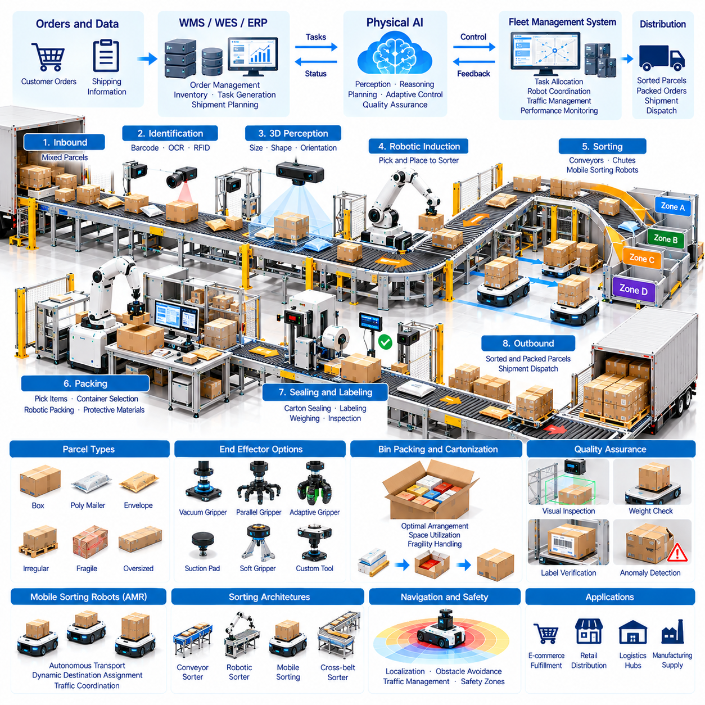{width="7.268055555555556in" height="7.268055555555556in"}

분류(Sorting), 포장(Packing), 소포 취급(Parcel Handling)은 창고 주문 이행(Warehouse Order Fulfillment)과 물류 유통 운영(Distribution Operation)의 핵심 단계이다. 이러한 프로세스는 피킹된 재고를 올바르게 분류하고 보호하여 배송 준비가 완료된 포장물로 전환한다. 피지컬 AI(Physical AI)는 환경 인식(Perception), 로봇 매니퓰레이션(Robotic Manipulation), 자율 운송(Autonomous Transportation), 지능형 의사결정(Intelligent Decision-Making)을 결합하여 반복 작업을 자동화하면서 정확도, 처리량(Throughput), 운영 유연성(Operational Flexibility)을 향상시킨다.

소포 분류(Parcel Sorting)는 배송 정보(Shipping Information), 고객 요구사항(Customer Requirements), 유통 네트워크 조건(Distribution Network Conditions)에 따라 각 포장물의 적절한 목적지 또는 처리 경로를 결정한다. 기존 시스템은 컨베이어(Conveyor), 바코드 스캐너(Barcode Scanner), 기계식 분기 장치(Mechanical Diverter)에 의존한다. 피지컬 AI는 지능형 객체 인식(Intelligent Object Recognition), 적응형 경로 설정(Adaptive Routing), 다양한 크기와 형상 및 포장 특성을 가진 소포의 로봇 취급(Robotic Handling)을 통해 이러한 기능을 확장한다.

자동 분류 아키텍처(Automated Sorting Architecture)에는 컨베이어 기반 분류기(Conveyor-Based Sorter), 로봇 투입 작업장(Robotic Induction Station), 이동형 분류 로봇(Mobile Sorting Robot), 자율 소포 운송 시스템(Autonomous Parcel Transportation System)이 포함된다. 컨베이어 시스템은 고정 경로에서 높은 처리량을 제공하는 반면, 이동로봇은 유연한 목적지 할당(Destination Assignment)과 시설 재구성(Facility Reconfiguration)을 지원한다. 하이브리드 아키텍처(Hybrid Architecture)는 고정 인프라와 자율로봇을 결합하여 처리 용량, 운영 적응성, 투자 요구사항 사이의 균형을 유지한다.

소포 식별(Parcel Identification)은 신뢰성 높은 분류 작업의 기본 요구사항이다. 바코드 판독기(Barcode Reader), 광학문자인식(Optical Character Recognition, OCR), 카메라(Camera), 무선주파수식별(Radio-Frequency Identification, RFID) 시스템은 배송 식별자(Shipment Identifier)와 경로 정보를 추출할 수 있다. 다중모달 인식(Multimodal Perception)은 손상된 라벨, 불규칙한 포장, 부분적으로 가려진 코드를 인식하는 데 도움이 된다. 잘못된 경로 지정과 배송 추적 오류를 방지하려면 식별 신뢰도(Identification Confidence)를 지속적으로 감시해야 한다.

3차원 환경 인식(Three-Dimensional Perception)은 로봇 시스템이 소포의 크기, 방향, 접근 가능한 파지 표면(Accessible Grasping Surface)을 추정하도록 한다. RGB-D 카메라(RGB-D Camera), 구조광 센서(Structured-Light Sensor), 깊이 추정 모델(Depth Estimation Model)은 조작 계획(Manipulation Planning)에 필요한 기하학적 정보(Geometric Information)를 제공한다. 정확한 치수 측정(Dimension Measurement)은 배송 분류와 포장 의사결정도 지원한다. 소포가 서로 겹치거나 변형되거나 반사 및 투명 재질을 포함하는 경우 인식이 어려워진다.

로봇 소포 투입(Robotic Parcel Induction)은 혼합 적재 구역(Mixed Loading Area)에서 들어오는 포장물을 컨베이어 또는 분류 플랫폼으로 이송하는 작업이다. 매니퓰레이터(Manipulator)는 개별 소포를 식별하고, 적절한 파지 위치(Grasp Location)를 선택하며, 알맞은 간격과 방향으로 포장물을 배치해야 한다. 진공 그리퍼(Vacuum Gripper)와 적응형 기계식 그리퍼(Adaptive Mechanical Gripper)는 서로 다른 포장 유형을 지원한다. 안정적인 투입 작업에는 환경 인식, 운동 계획(Motion Planning), 충돌 회피(Collision Avoidance), 배치 검증(Placement Verification)의 협조가 필요하다.

분류 로봇(Sorting Robot)은 투입 지점(Induction Point)과 목적지 슈트(Destination Chute) 사이에서 개별 소포를 운송할 수 있다. 자율이동로봇(Autonomous Mobile Robot, AMR)은 지정된 경로를 주행하고 포장물을 할당된 배출 위치(Discharge Location)로 전달한다. 이러한 작업에는 정확한 위치 추정(Localization), 교통 협조(Traffic Coordination), 상위 공정 장비(Upstream Processing Equipment)와의 동기화(Synchronization)가 필요하다. 동적 작업 할당(Dynamic Task Allocation)은 목적지별 물량과 배송 우선순위가 변화할 때 분류 용량을 재분배할 수 있다.

포장 자동화(Packing Automation)는 적절한 용기를 선택하고, 품목을 배치하며, 보호 자재(Protective Material)를 적용하여 선택된 제품을 안전한 운송 상태로 준비한다. 지능형 포장 시스템(Intelligent Packing System)은 제품 크기, 파손 가능성(Fragility), 중량, 호환성(Compatibility)을 분석한다. 피지컬 AI는 용기 선택(Container Selection), 객체 배치(Object Placement), 포장 검증(Packaging Verification)을 지원할 수 있다. 효과적인 포장은 자재 소비량, 제품 보호, 처리 속도, 배송 비용 사이의 균형을 유지해야 한다.

빈 패킹(Bin Packing)과 카토나이제이션(Cartonization)은 자동 주문 이행에서 중요한 최적화 문제(Optimization Problem)이다. 알고리즘은 제한된 용기 공간(Container Volume) 내부에 여러 제품을 어떻게 배치할지 결정한다. 기하학적 제약조건(Geometric Constraint), 적층 강도(Stacking Strength), 방향 제한(Orientation Restriction), 손상 민감도(Damage Sensitivity)는 실행 가능한 배치에 영향을 미친다. 불규칙한 객체와 불확실한 물리적 특성을 처리할 때 학습 기반 방법(Learning-Based Method)은 기존 최적화 기법(Conventional Optimization)을 보완할 수 있다.

로봇 포장(Robotic Packing)은 다양한 형상과 기계적 특성(Mechanical Characteristics)을 가진 제품을 정밀하게 조작해야 한다. 단단한 상자(Rigid Box)는 일반적으로 유연한 봉투(Flexible Bag), 깨지기 쉬운 품목(Fragile Item), 불규칙한 상품(Irregular Merchandise)보다 파지와 위치 조정이 쉽다. 적응형 말단효과기(Adaptive End Effector), 힘 센싱(Force Sensing), 유연 순응 제어(Compliant Control)는 취급 신뢰성을 향상시킬 수 있다. 복잡한 포장 작업에는 여러 단계의 조작, 임시 고정 장치(Temporary Fixture), 협조 로봇 팔(Coordinated Robotic Arm)이 필요할 수 있다.

자동 봉함(Automated Sealing), 라벨 부착(Labeling), 중량 측정(Weighing)은 소포 준비 과정의 중요한 단계를 완성한다. 상자 봉함기(Carton Sealing Machine), 라벨 부착기(Label Applicator), 통합 중량 측정 시스템(Integrated Weighing System)은 로봇 포장 작업장과 연계하여 작동할 수 있다. 비전 검사(Vision Inspection)는 라벨 위치, 포장 밀봉 상태(Package Closure), 눈에 보이는 손상을 검증한다. 데이터 동기화(Data Synchronization)는 측정된 포장 특성과 배송 식별자가 올바른 고객 주문에 대응하도록 보장한다.

피지컬 AI는 자동 시각 검사(Automated Visual Inspection)와 이상 감지(Anomaly Detection)를 통해 품질보증(Quality Assurance)을 지원한다. 카메라와 학습된 인식 모델(Learned Perception Model)은 손상된 상자, 잘못된 라벨, 누락된 품목, 불규칙한 포장 형상을 식별할 수 있다. 중량 검증(Weight Verification)은 잠재적인 포장 오류를 감지하는 추가적인 방법을 제공한다. 여러 검증 신호(Verification Signal)를 결합하면 신뢰성이 향상되고 유통 네트워크로 유입되는 불량 배송품(Defective Shipment)을 줄일 수 있다.

소포 취급 시스템(Parcel Handling System)은 포장물의 크기, 질량, 강성(Stiffness), 표면 마찰력(Surface Friction)의 상당한 차이를 수용해야 한다. 작은 봉투(Small Envelope), 유연한 배송 봉투(Flexible Mailer), 단단한 상자(Rigid Carton), 초대형 포장물(Oversized Package)은 서로 다른 조작 전략(Manipulation Strategy)을 요구한다. 로봇은 객체가 자신의 취급 능력(Handling Capability)을 초과하는 상황을 인식해야 한다. 지원되지 않거나 불확실한 경우에는 안전하지 않은 동작을 수행하는 대신 적절한 장비나 작업자에게 전달해야 한다.

창고실행시스템(Warehouse Execution System, WES)은 주문 우선순위(Order Priority)와 배송 마감시간(Shipment Deadline)에 따라 분류, 포장, 소포 이동을 조정한다. 창고관리시스템(Warehouse Management System, WMS)은 재고와 주문 기록을 유지하며, 운송 시스템(Transportation System)은 운송업체의 경로 지정 요구사항(Carrier Routing Requirement)을 제공한다. 통합 소프트웨어(Integrated Software)는 포장물 식별 정보, 목적지, 처리 상태, 완료 확인을 교환하여 주문 이행과 배송 작업 전반의 일관성을 유지한다.

로봇 군집관리시스템(Fleet Management System, FMS)은 공유 시설 내에서 이동형 분류 로봇과 소포 운송 플랫폼을 협조적으로 운영한다. 작업 할당(Task Assignment)은 로봇 가용성(Robot Availability), 목적지 수요(Destination Demand), 이동 거리(Travel Distance), 배터리 상태(Battery Condition)를 고려한다. 교통 관리(Traffic Management)는 투입 작업장, 배출 위치, 좁은 통로 주변의 혼잡을 줄인다. 시스템 전체 운영 조정(System-Wide Orchestration)은 개별 로봇의 이동 효율성보다 전체 소포 흐름(Parcel Flow)을 최적화해야 한다.

동적 경로 설정(Dynamic Routing)은 배송 물량이 변동하거나 처리 장비를 사용할 수 없을 때 중요해진다. 예측 알고리즘(Predictive Algorithm)은 목적지 수요, 대기열 증가(Queue Growth), 예상 처리 지연(Expected Processing Delay)을 추정할 수 있다. 분류 작업 할당(Sorting Assignment)은 사용 가능한 자원 사이에서 작업 부하(Workload)를 균형 있게 분산하도록 조정될 수 있다. 적응형 스케줄링(Adaptive Scheduling)은 계절적 수요 급증(Seasonal Peak), 운송업체 접수 마감시간(Carrier Cutoff Period), 예상하지 못한 운영 장애(Operational Disruption) 상황에서도 서비스 수준(Service Level)을 유지하도록 지원한다.

안전 공학(Safety Engineering)은 로봇 팔, 컨베이어, 이동 플랫폼, 작업자 사이의 상호작용을 고려해야 한다. 보호 센싱(Protective Sensing), 비상정지(Emergency Stopping), 통제된 접근 구역(Controlled Access Zone), 장비 인터록(Equipment Interlock)은 충돌과 끼임 위험(Entanglement Hazard)을 줄인다. 이동 중인 소포는 낙하물(Falling Object)이나 불안정한 적재(Unstable Stacking)를 통해 추가적인 위험을 발생시킬 수 있다. 안전 기능(Safety Function)은 검증되지 않은 학습 기반 의사결정과 독립적으로 유지되어야 한다.

소포는 판독할 수 없는 라벨(Unreadable Label), 손상된 포장(Damaged Packaging), 잘못된 치수(Incorrect Dimension), 일치하지 않는 배송 기록(Inconsistent Shipment Record)을 가진 상태로 도착할 수 있으므로 예외 처리(Exception Handling)가 필수적이다. 자동화 시스템은 정상 작업을 방해하지 않으면서 이러한 상태를 감지하고 해당 포장물을 분리해야 한다. 작업자 검토 작업장(Human Review Station)과 복구 작업 흐름(Recovery Workflow)은 통제된 문제 해결을 제공한다. 예외 데이터(Exception Data)는 인식 및 취급 알고리즘의 지속적인 개선에도 활용될 수 있다.

디지털 트윈(Digital Twin)과 시뮬레이션 환경(Simulation Environment)은 분류 및 포장 시설의 설계를 지원한다. 가상 모델(Virtual Model)은 컨베이어 처리 용량(Conveyor Capacity), 로봇 이동, 포장물 도착 패턴(Package Arrival Pattern), 작업장 처리 시간(Workstation Processing Time), 목적지별 물량 분포(Destination Distribution)를 재현한다. 엔지니어는 실제 배포 전에 혼잡, 장비 활용률(Equipment Utilization), 처리량 제한(Throughput Limitation)을 평가할 수 있다. 시뮬레이션은 수요 급증과 장비 고장 시나리오에 대한 용량 계획(Capacity Planning)도 지원한다.

에너지 관리(Energy Management)와 유지보수(Maintenance)는 자동 소포 취급 시스템의 장기적인 가용성(Long-Term Availability)에 영향을 미친다. 이동로봇은 협조된 충전(Coordinated Charging)이 필요하며, 컨베이어, 로봇 팔, 포장 기계는 정기적인 점검(Regular Inspection)이 필요하다. 상태 감시(Condition Monitoring)는 모터 과열(Motor Overheating), 비정상 진동(Abnormal Vibration), 그리퍼 마모(Gripper Wear), 센서 성능 저하(Sensor Degradation)를 식별할 수 있다. 예지보전(Predictive Maintenance)은 예상하지 못한 가동 중단을 줄이고 안정적인 주문 이행 작업을 지원한다.

운영 성능(Operational Performance)은 시간당 분류 소포 수(Parcels Sorted per Hour), 포장 주기 시간(Packing Cycle Time), 경로 지정 정확도(Routing Accuracy), 배송품 손상률(Shipment Damage Rate), 주문 완료 시간(Order Completion Time)을 활용하여 평가해야 한다. 추가 지표에는 로봇 활용률(Robot Utilization), 예외 발생 빈도(Exception Frequency), 포장 자재 소비량(Packaging Material Consumption), 장비 가용성(Equipment Availability)이 포함된다. 분류 속도가 향상되더라도 포장이나 배송이 주요 병목현상(Bottleneck)으로 남아 있다면 효과가 제한될 수 있으므로 종단 간 성능 지표(End-to-End Metric)가 필요하다.

경제적 타당성(Economic Feasibility)은 소포 물량(Parcel Volume), 제품 다양성(Product Diversity), 시설 구성(Facility Configuration), 인력 요구사항(Labor Requirement), 자동화 투자(Automation Investment)에 따라 결정된다. 고처리량 고정식 분류 시스템(High-Throughput Fixed Sorting System)은 안정적인 처리 패턴에 적합할 수 있으며, 로봇 솔루션(Robotic Solution)은 변화하는 수요에 대한 유연성을 제공한다. 총소유비용(Total Cost of Ownership, TCO)과 투자수익률(Return on Investment, ROI) 분석에는 장비, 소프트웨어 통합, 유지보수, 에너지, 운영 비용 절감(Operational Savings)을 포함해야 한다.

성공적인 배포(Successful Deployment)는 소포 특성(Parcel Characteristics), 도착률(Arrival Rate), 목적지별 물량 분포(Destination Distribution), 기존 작업 흐름의 제약조건(Workflow Constraint)을 분석하는 것에서 시작된다. 시범 시험(Pilot Testing)은 식별 정확도(Identification Accuracy), 파지 신뢰성(Grasp Reliability), 분류 성능(Sorting Performance), 포장 품질(Packing Quality), 예외 복구(Exception Recovery)를 검증해야 한다. 점진적인 확장(Gradual Expansion)은 진행 중인 주문 이행 작업에 대한 영향을 최소화하면서 시스템 협조와 안전 절차를 개선하도록 지원한다.

미래의 분류 및 포장 시스템은 비전-언어-행동 모델(Vision-Language-Action Model, VLA), 고급 촉각 센싱(Advanced Tactile Sensing), 적응형 그리퍼(Adaptive Gripper), 예측 기반 창고 운영 조정(Predictive Warehouse Orchestration)을 통합할 수 있다. 이러한 기술은 익숙하지 않은 포장물(Unfamiliar Package)의 취급 능력을 향상시키고 더욱 유연한 조작 전략을 지원할 수 있다. 군집 규모 학습(Fleet-Scale Learning)은 운영 안전성과 품질 요구사항이 독립적으로 검증된다는 전제하에 인식 및 복구 능력을 더욱 향상시킬 수 있다.

궁극적으로 분류, 포장, 소포 취급(Sorting, Packing, and Parcel Handling)은 피지컬 AI가 로봇 환경 인식(Robotic Perception)과 매니퓰레이션(Manipulation)을 지능형 물류 실행(Intelligent Logistics Execution)과 어떻게 연결할 수 있는지 보여준다. 그 가치는 포장물 식별(Package Identification), 자재 취급(Material Handling), 품질 검증(Quality Verification), 운송(Transportation), 기업 정보 시스템(Enterprise Information System)을 협조적으로 통합하는 데서 창출된다. 효과적인 통합은 배송 정확도(Shipment Accuracy)를 향상시키고, 처리 병목현상(Processing Bottleneck)을 줄이며, 확장 가능하고 적응적인 유통 운영(Scalable and Adaptable Distribution Operation)을 지원할 수 있다.

## 03.08. Humanoid Robots for Logistics

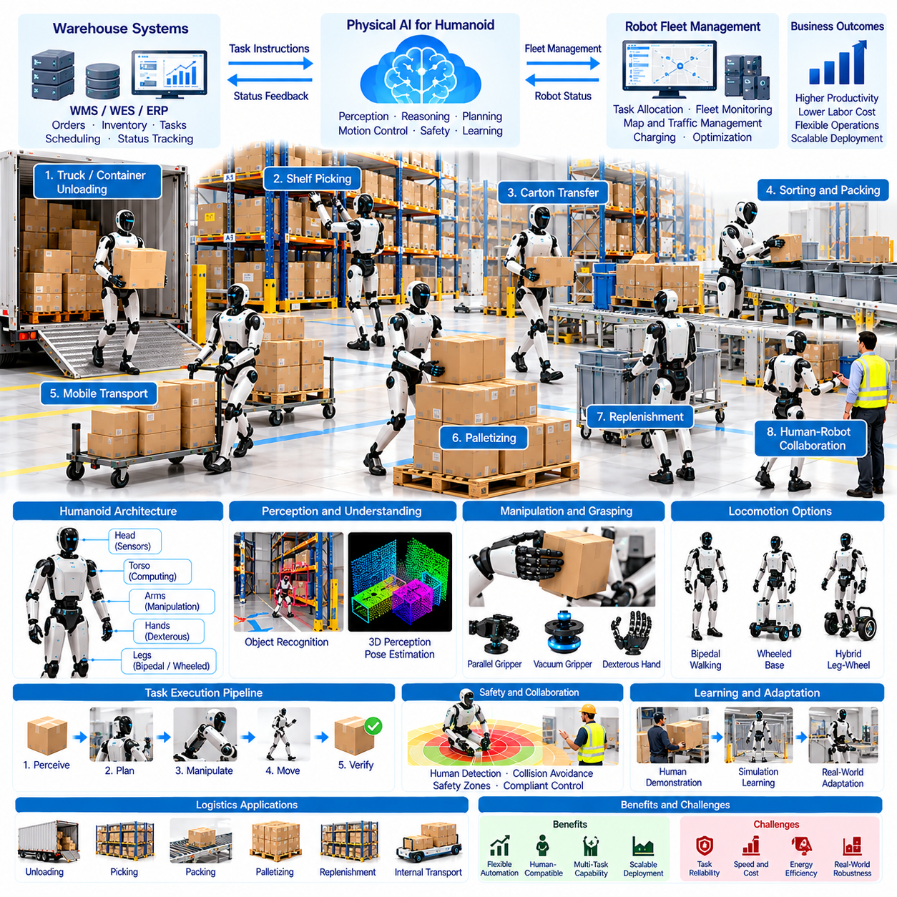{width="7.268055555555556in" height="7.268055555555556in"}

휴머노이드 로봇(Humanoid Robot)은 주로 인간 작업자를 중심으로 설계된 물류 환경에서 피지컬 AI(Physical AI)를 구현하기 위한 새로운 접근 방식이다. 인간과 유사한 신체 구조(Human-Like Body Structure)는 이족보행 이동성(Bipedal Mobility), 관절형 로봇 팔(Articulated Arm), 정교한 로봇 손(Dexterous Hand), 통합 인식 시스템(Integrated Perception System)을 결합한다. 특수 목적 창고 로봇과 달리 휴머노이드는 기존 시설, 도구, 작업 흐름을 활용하여 대규모 인프라 재설계 없이 다양한 물리적 작업을 수행하는 것을 목표로 한다.

물류 시설에는 기존 자동화 장비로 처리하기 어려운 작업이 여전히 많이 존재한다. 작업자는 컨테이너 하역(Container Unloading), 상자 이송(Carton Transfer), 제품 인출(Product Retrieval), 선반 보충(Shelf Replenishment), 불규칙한 자재 취급(Irregular Material Handling)을 수행한다. 휴머노이드 로봇은 범용 매니퓰레이션(General-Purpose Manipulation)을 통해 일부 작업을 자동화할 수 있는 잠재적인 플랫폼을 제공한다. 실제 효과는 작업 신뢰성(Task Reliability), 운영 속도(Operating Speed), 적재 용량(Payload Capacity), 안전성(Safety)에 따라 결정된다.

휴머노이드 로봇의 기계적 아키텍처(Mechanical Architecture)는 일반적으로 몸통(Torso), 두 개의 팔(Arms), 관절형 손(Articulated Hands), 하체 이동 시스템(Lower-Body Locomotion System)으로 구성된다. 다수의 자유도(Degrees of Freedom, DoF)는 로봇이 객체에 접근하고 자세를 조정하며 사람이 접근할 수 있는 높이에서 장비와 상호작용하도록 한다. 그러나 이러한 유연성은 구조적 복잡성(Structural Complexity), 액추에이터 성능(Actuator Performance), 균형 제어(Balance Control), 에너지 소비(Energy Consumption)와 관련된 문제를 발생시킨다.

이족보행(Bipedal Locomotion)은 휴머노이드 로봇이 인간의 이동을 기준으로 설계된 좁은 통로(Narrow Passage), 바닥 높이 변화(Floor Transition), 장애물(Obstacle)이 있는 환경을 이동할 수 있도록 한다. 동적 보행(Dynamic Walking)은 신체 자세(Body Posture), 지면 접촉(Ground Contact), 질량중심 운동(Center-of-Mass Motion)을 지속적으로 추정해야 한다. 물체를 운반하면 적재 하중(Payload Force)이 로봇의 균형과 이동 특성을 변화시키므로 안정적인 작동이 더욱 어려워진다.

일부 물류용 휴머노이드 로봇은 기존 다리 구조 대신 바퀴형 하체(Wheeled Lower Body) 또는 하이브리드 이동 아키텍처(Hybrid Locomotion Architecture)를 사용할 수 있다. 바퀴형 플랫폼(Wheeled Platform)은 일반적으로 평탄한 산업용 바닥에서 더 높은 에너지 효율(Energy Efficiency)과 안정성(Stability)을 제공한다. 다리형 시스템(Legged System)은 지형이나 접근 제약조건 때문에 바퀴 이동이 어려운 환경에서 장점을 가질 수 있다. 적절한 로봇 형태(Morphology)를 선택하려면 인간과 유사한 보행이 항상 필요하다고 가정하기보다 시설 조건을 평가해야 한다.

매니퓰레이션 능력(Manipulation Capability)은 물류용 휴머노이드 로봇의 가치를 결정하는 핵심 요소이다. 두 개의 로봇 팔(Dual Robotic Arms)은 객체 들어 올리기(Object Lifting), 상자 이송(Carton Transfer), 물체 배치(Placement Operation)를 협조적으로 수행할 수 있다. 정교한 로봇 손(Dexterous Hands)은 손잡이, 컨테이너, 도구, 불규칙한 제품과의 상호작용을 지원할 수 있다. 효과적인 조작을 위해서는 적절한 파지 계획(Grasp Planning), 힘 조절(Force Regulation), 협조 팔 동작(Coordinated Arm Motion)이 필요하며, 특히 객체의 중량 분포(Weight Distribution)가 불확실할 때 더욱 중요하다.

전신 제어(Whole-Body Control)는 물리적 작업을 수행하는 동안 로봇의 팔, 몸통, 하체를 협조적으로 제어한다. 상자를 들어 올릴 때 로봇은 균형을 유지하기 위해 자세(Posture)와 접촉력(Contact Force)을 조정해야 한다. 운동 계획(Motion Planning)은 관절 제한(Joint Limit), 액추에이터 토크(Actuator Torque), 충돌 회피(Collision Avoidance), 적재물 안정성(Payload Stability)을 고려해야 한다. 이러한 협조 제어(Coordinated Control)는 팔 뻗기(Reaching), 허리 굽히기(Bending), 방향 전환(Turning), 서로 다른 높이 사이의 물체 이송에서 특히 중요하다.

환경 인식(Environmental Perception)은 휴머노이드 로봇이 객체, 사람, 장비, 작업 공간의 상태를 인식하도록 한다. 카메라(Camera), 깊이 센서(Depth Sensor), 관성측정장치(Inertial Measurement Unit, IMU), 힘 센서(Force Sensor)는 상호 보완적인 정보를 제공한다. 인식 모델(Perception Model)은 객체의 식별 정보(Object Identity), 위치(Location), 방향(Orientation), 접근 가능한 파지 표면(Accessible Grasp Surface)을 추정한다. 신뢰성 높은 성능을 위해서는 가림 현상(Occlusion), 조명 변화(Changing Illumination), 복잡한 적재 상태(Clutter), 예상하지 못한 객체 배치에 대응해야 한다.

비전-언어-행동 모델(Vision-Language-Action Model, VLA)은 자연어 명령(Natural-Language Instruction)을 환경 인식과 로봇 행동에 연결하는 잠재적인 프레임워크를 제공한다. 선택된 상자를 임시 적치 구역(Staging Area)으로 이동하라는 창고 작업 명령은 자율주행(Navigation), 객체 식별(Identification), 파지(Grasping), 배치(Placement) 동작으로 분해할 수 있다. 파운데이션 모델(Foundation Model)은 작업 일반화(Task Generalization)를 향상시킬 수 있지만, 실제 물리적 실행에는 검증된 제어 정책(Validated Control Policy)과 명시적인 안전 제약조건(Explicit Safety Constraint)이 여전히 필요하다.

인간 시연 학습(Learning from Human Demonstrations)은 휴머노이드 물류 작업 능력을 개발하기 위한 또 다른 접근법이다. 원격조작(Teleoperation), 모션 캡처(Motion Capture), 모방학습(Imitation Learning)은 객체 취급과 협조 동작의 예시 데이터를 생성할 수 있다. 강화학습(Reinforcement Learning)과 시뮬레이션(Simulation)은 제어 전략(Control Strategy)을 추가로 개선할 수 있다. 그러나 시뮬레이션 환경과 실제 물리적 환경 사이의 차이로 인해 학습된 행동(Learned Behavior)을 운영 중인 창고에 배포하기 전에 신중한 시험이 필요하다.

상자 취급(Carton Handling)은 많은 물류 작업이 반복적인 상자 들어 올리기와 이송으로 구성되기 때문에 유망한 적용 분야이다. 휴머노이드 로봇은 컨베이어(Conveyor), 팔레트(Pallet), 카트(Cart), 선반(Shelving Location) 사이에서 상자를 이동시킬 수 있다. 성능은 포장물의 기하학적 구조(Package Geometry), 중량(Weight), 적재 배열(Stacking Arrangement), 사용 가능한 여유 공간(Available Clearance)에 따라 달라진다. 안정적인 취급을 위해서는 불안정한 하중(Unstable Load)을 감지하고, 견고한 파지(Secure Grasp)를 유지하며, 배치 과정에서 손상을 방지해야 한다.

트럭 및 컨테이너 하역(Truck and Container Unloading)은 더욱 까다로운 적용 분야이다. 포장물은 밀집하게 적재되거나 불규칙하게 쌓여 있거나 편안하게 접근하기 어려운 위치에 놓여 있을 수 있다. 로봇은 접근 가능한 객체를 식별하고, 안전한 인출 순서(Safe Removal Sequence)를 결정하며, 변화하는 적재 구성(Load Configuration)에 적응해야 한다. 제한된 이동 공간(Limited Maneuvering Space)과 불확실한 포장물 안정성(Package Stability)은 자동화를 복잡하게 만들므로 감독 기반 운영(Supervised Operation)과 구조화된 작업 선정(Structured Task Selection)이 실용적인 초기 접근법이 될 수 있다.

주문 피킹(Order Picking)과 재고 보충(Replenishment)도 휴머노이드 로봇을 적용할 수 있는 분야이다. 로봇은 선반에서 제품을 인출하고, 품목을 컨테이너에 배치하며, 재고 보관 위치를 보충할 수 있다. 인간 환경과 호환되는 도달 범위(Human-Compatible Reach)와 조작 능력은 기존 보관 인프라의 활용을 지원한다. 그러나 작업이 매우 반복적이고 기하학적으로 제한된 경우에는 특수 목적 이동형 매니퓰레이터(Specialized Mobile Manipulator)나 고정식 로봇 시스템(Fixed Robotic System)이 휴머노이드보다 높은 성능을 제공할 수 있다.

인간-로봇 협업(Human-Robot Collaboration)은 휴머노이드 로봇이 작업자 및 기존 장비와 물류 시설을 공유할 가능성이 높기 때문에 중요하다. 로봇은 안전거리(Safe Separation)를 유지하고, 작업 의도(Operational Intention)를 전달하며, 주변 인간 활동에 예측 가능하게 반응해야 한다. 안전 등급 센싱(Safety-Rated Sensing), 비상정지(Emergency Stopping), 통제된 동작 제한(Controlled Movement Limit)이 여전히 필요하다. 범용 인공지능 의사결정(General-Purpose AI Decision-Making)은 독립적으로 검증된 보호 기능(Independently Validated Protective Function)을 대체할 수 없다.

작업 계획(Task Planning)은 휴머노이드 로봇이 물류 작업의 우선순위를 어떻게 정하고 실행할지를 결정한다. 창고관리시스템(Warehouse Management System, WMS)과 창고실행시스템(Warehouse Execution System, WES)은 재고 정보(Inventory Information), 작업 지시(Work Order), 운영 우선순위(Operational Priority)를 제공한다. 작업 운영 조정 소프트웨어(Task Orchestration Software)는 이러한 요구사항을 실행 가능한 로봇 임무(Executable Robot Mission)로 변환한다. 효과적인 계획은 객체 접근성(Object Accessibility), 로봇 기능(Robot Capability), 운송 거리(Transportation Distance), 예상 작업 시간(Expected Task Duration)을 고려해야 한다.

로봇 군집관리시스템(Fleet Management System, FMS)은 휴머노이드 로봇을 자율이동로봇(Autonomous Mobile Robot, AMR), 자율주행 지게차(Autonomous Forklift), 기타 창고 장비와 함께 협조적으로 운영할 수 있다. 휴머노이드는 매니퓰레이션 작업을 수행하고, 특수 목적 이동 플랫폼(Specialized Mobile Platform)은 무겁거나 반복적인 하중을 운송할 수 있다. 협조 스케줄링(Coordinated Scheduling)은 불필요한 보행을 줄이고 자원 활용률(Resource Utilization)을 향상시킨다. 이기종 로봇 군집 아키텍처(Heterogeneous Fleet Architecture)는 모든 작업에 휴머노이드를 투입하는 것보다 전체적인 효율성이 높을 수 있다.

에너지 효율(Energy Efficiency)은 물류용 휴머노이드 로봇 적용에서 여전히 중요한 한계이다. 보행(Walking), 균형 유지(Balancing), 물체 들어 올리기(Lifting), 지속적인 환경 인식(Continuous Perception)에는 상당한 전력이 필요하다. 배터리 용량(Battery Capacity)은 운영 지속시간(Operating Duration)에 영향을 미치며, 액추에이터 효율(Actuator Efficiency)은 발열(Heat Generation)과 지속 성능(Sustained Performance)을 결정한다. 충전 일정(Charging Schedule)과 배터리 교체 전략(Battery Replacement Strategy)은 작업 부하 강도(Workload Intensity), 열적 한계(Thermal Limit), 예비 로봇(Backup Robot)의 가용성을 고려해야 한다.

휴머노이드는 수많은 액추에이터(Actuator), 관절(Joint), 센서(Sensor), 기계적 인터페이스(Mechanical Interface)를 포함하므로 신뢰성(Reliability)과 유지보수(Maintenance)가 어려운 과제이다. 반복적인 들어 올리기와 이동은 여러 구성요소에 마모(Wear)를 발생시킨다. 상태 감시(Condition Monitoring)는 비정상 온도(Abnormal Temperature), 관절 마찰(Joint Friction), 진동(Vibration), 액추에이터 성능 저하(Actuator Performance Degradation)를 감지할 수 있다. 산업 현장 배포(Industrial Deployment)에는 유지보수가 용이한 하드웨어(Maintainable Hardware), 확보하기 쉬운 예비 부품(Accessible Spare Parts), 예측 가능한 복구 절차(Predictable Recovery Procedure)가 필요하다.

운영 성능(Operational Performance)은 시간당 성공 작업 수(Successful Tasks per Hour), 조작 성공률(Manipulation Success Rate), 작업자 개입 빈도(Intervention Frequency), 작업 완료 시간(Task Completion Time), 시스템 가용성(System Availability)을 사용하여 측정해야 한다. 추가 지표에는 에너지 소비(Energy Consumption), 적재 용량 제한(Payload Limitation), 안전 관련 정지(Safety-Related Stoppage), 객체 손상률(Object Damage Rate)이 포함된다. 이러한 지표는 인간 작업 흐름(Human Workflow) 및 특수 목적 로봇 대안(Specialized Robotic Alternative)과 비교하여 휴머노이드 배포가 측정 가능한 장점을 제공하는 영역을 판단해야 한다.

경제적 타당성(Economic Feasibility)은 도입 비용(Acquisition Cost), 유지보수(Maintenance), 시스템 통합(Integration), 운영시간(Operating Hours), 달성 가능한 자율 작업 범위(Autonomous Task Coverage)에 따라 결정된다. 휴머노이드가 여러 작업을 수행할 수 있는 능력은 장비 활용률(Equipment Utilization)을 높일 수 있지만, 범용 기능(General-Purpose Capability)이 자동으로 경제적 우위(Economic Superiority)를 보장하지는 않는다. 총소유비용(Total Cost of Ownership, TCO)과 투자수익률(Return on Investment, ROI) 분석에는 현실적인 작업 속도(Task Speed), 감독 요구사항(Supervision Requirement), 운영 신뢰성(Operational Reliability)을 반영해야 한다.

성공적인 배포(Successful Deployment)는 예측 가능한 객체(Predictable Object), 제한적인 환경 변화(Limited Environmental Variation), 관리 가능한 안전 위험(Manageable Safety Risk)을 가진 구조화된 작업(Structured Task)부터 시작해야 한다. 시범 프로젝트(Pilot Project)는 통제된 조건에서 상자 취급(Carton Handling), 선반 보충(Shelf Replenishment), 작업장 보조(Workstation Assistance)를 평가할 수 있다. 점진적인 확장(Gradual Expansion)을 통해 운영자는 복잡하거나 무감독 작업(Unsupervised Operation)을 시도하기 전에 실패 데이터(Failure Data)를 수집하고, 조작 정책(Manipulation Policy)을 개선하며, 복구 절차(Recovery Procedure)를 확립할 수 있다.

디지털 트윈(Digital Twin)과 시뮬레이션(Simulation)은 창고 배치(Warehouse Layout), 로봇 동역학(Robot Dynamics), 객체 상호작용(Object Interaction), 작업 순서(Task Sequence)를 모델링하여 휴머노이드 개발을 지원한다. 가상 시험(Virtual Testing)은 다양한 시나리오에서 도달 가능성(Reachability), 균형(Balance), 파지(Grasping), 충돌 회피(Collision Avoidance)를 평가할 수 있다. 합성 시연 데이터(Synthetic Demonstration)는 학습 효율(Learning Efficiency)을 향상시킬 수 있다. 그러나 접촉력(Contact Force), 재료 특성(Material Property), 예상하지 못한 외란(Unexpected Disturbance)을 완벽하게 재현하기는 어렵기 때문에 실제 물리적 검증(Physical Validation)이 필수적이다.

미래의 물류용 휴머노이드 시스템은 다중모달 파운데이션 모델(Multimodal Foundation Model), 촉각 센싱(Tactile Sensing), 개선된 액추에이터(Improved Actuator), 군집 규모 학습(Fleet-Scale Learning)을 결합할 수 있다. 배포된 로봇 사이의 경험 공유(Shared Experience)는 객체 취급과 작업 적응(Task Adaptation)을 개선할 수 있다. 더 높은 자율성(Autonomy)을 확보하려면 일반화(Generalization), 물리적 추론(Physical Reasoning), 안전성 보증(Safety Assurance), 운영 신뢰성(Operational Reliability)의 발전이 필요하다. 특수 목적 로봇과 휴머노이드는 모든 상황에서 서로 대체되기보다는 상호 보완적인 역할을 유지할 가능성이 높다.

궁극적으로 물류용 휴머노이드 로봇(Humanoid Robots for Logistics)은 인간 중심의 산업 환경(Human-Centered Industrial Environment)에서 작동하려는 피지컬 AI의 목표를 보여준다. 그 잠재력은 유연한 이동성(Flexible Mobility), 범용 매니퓰레이션(General-Purpose Manipulation), 지능형 환경 인식(Intelligent Perception), 적응형 작업 실행(Adaptive Task Execution)을 결합하는 데 있다. 지속 가능한 도입(Sustainable Adoption)은 기존 창고 시스템과 효과적으로 통합하면서 신뢰할 수 있는 성능(Dependable Performance), 경제적 가치(Economic Value), 검증된 안전성(Validated Safety)을 입증하는 데 달려 있다.

## 03.09. Yard Port and Outdoor Logistics

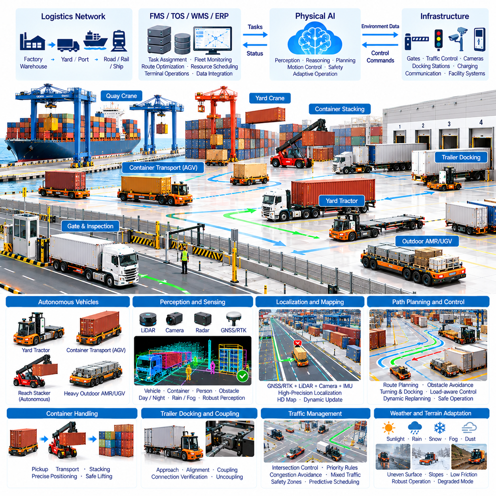{width="7.268055555555556in" height="7.268055555555556in"}

야드(Yard), 항만(Port), 야외 물류(Outdoor Logistics)는 피지컬 AI(Physical AI)의 적용 범위를 통제된 창고 환경에서 다양한 지형(Terrain), 기상 조건(Weather Condition), 교통 상황(Traffic Condition)이 존재하는 대규모 산업 공간으로 확장한다. 이러한 작업에는 컨테이너 운송(Container Transportation), 트레일러 이동(Trailer Movement), 화물 취급(Cargo Handling), 장비 협조(Equipment Coordination)가 포함된다. 자율 시스템(Autonomous System)은 기존 자동화 기술을 적용하기 어려운 환경에서 자재 흐름(Material Flow)을 개선하고, 반복적인 운전 작업을 줄이며, 더욱 안전한 운영을 지원할 수 있다.

물류 야드(Logistics Yard)는 트레일러 대기(Trailer Staging), 상차(Loading), 하차(Unloading), 차량 배차(Vehicle Dispatch)를 통해 창고, 물류센터(Distribution Center), 운송 네트워크(Transportation Network)를 연결한다. 항만 터미널(Port Terminal)은 선박, 보관 구역, 트럭, 철도 시스템 사이에서 컨테이너를 관리한다. 두 환경 모두 차량, 하역 장비(Lifting Equipment), 작업자 사이의 협조가 필요하다. 피지컬 AI는 환경 인식 기반 자율성(Perception-Driven Autonomy)과 지능형 스케줄링(Intelligent Scheduling)을 도입하여 상호 연결된 작업 흐름을 개선한다.

자율주행 야드 트랙터(Autonomous Yard Tractor)는 야외 물류 자동화(Outdoor Logistics Automation)의 중요한 적용 분야이다. 이러한 차량은 주차 구역(Parking Area), 하역 도크(Loading Dock), 검사장(Inspection Station) 사이에서 트레일러를 이동시킨다. 자율주행 시스템(Navigation System)은 트레일러의 기하학적 구조(Trailer Geometry), 회전 반경(Turning Radius), 연결 상태(Coupling Condition), 제한된 조향 공간(Restricted Maneuvering Space)을 고려해야 한다. 신뢰성 높은 자동화를 위해서는 정밀한 위치 결정(Precise Positioning), 장애물 감지(Obstacle Detection), 도크 작업(Dock Operation)과의 협조가 필요하다.

자율주행 터미널 트랙터(Autonomous Terminal Tractor)와 컨테이너 운송 차량(Container Transport Vehicle)은 항만 시설 전반에서 반복적인 화물 이동을 수행한다. 무인운반차량(Automated Guided Vehicle, AGV)은 일반적으로 구조화된 경로(Structured Route)를 따라 이동하며, 보다 유연한 자율주행 플랫폼(Autonomous Platform)은 변화하는 교통 상황에 적응할 수 있다. 차량 선택은 적재 요구사항(Payload Requirement), 운행 속도(Operating Speed), 인프라 가용성(Infrastructure Availability), 터미널 배치(Terminal Layout)에 따라 결정된다. 대용량 화물 운송에는 강건한 제동 제어(Braking Control)와 운동 제어(Motion Control)가 필요하다.

야외 위치 추정(Outdoor Localization)은 환경적 특징과 센서 조건이 변화하기 때문에 실내 창고의 위치 결정(Indoor Warehouse Positioning)보다 어렵다. 위성항법시스템(Global Navigation Satellite System, GNSS), 실시간 이동측위(Real-Time Kinematic, RTK), 라이다(LiDAR), 카메라(Camera), 관성 센서(Inertial Sensor)는 상호 보완적인 정보를 제공한다. 센서 융합(Sensor Fusion)은 크레인(Crane), 컨테이너(Container), 건물(Building), 기타 대형 구조물에 의해 위성 신호가 차단되는 상황에서 위치 추정(Position Estimation)을 개선한다.

환경 인식(Environmental Perception)은 트럭, 컨테이너, 보행자(Pedestrian), 장비, 도로 경계(Road Boundary), 임시 장애물(Temporary Obstacle)을 인식해야 한다. 라이다와 카메라 기반 감지 시스템(Camera-Based Detection System)은 주변 활동에 대한 공간 정보(Spatial Information)와 의미 정보(Semantic Information)를 제공한다. 야외 로봇은 강한 햇빛, 어둠, 비, 안개, 먼지가 존재하는 조건에서도 작동해야 한다. 따라서 신뢰성 높은 인식을 위해서는 센서 이중화(Sensor Redundancy), 불확실성 추정(Uncertainty Estimation), 변화하는 조건에 대한 성능 검증(Performance Validation)이 필요하다.

야외 물류의 경로 계획(Path Planning)은 차량 크기(Vehicle Dimension), 회전 제약조건(Turning Constraint), 노면 상태(Surface Condition), 다른 교통 주체와의 상호작용을 고려해야 한다. 대형 차량은 일반적인 창고 로봇보다 넓은 회전 공간과 긴 정지 거리(Stopping Distance)가 필요하다. 운동 계획기(Motion Planner)는 모든 주행 동작에서 장애물과의 여유 거리(Obstacle Clearance)와 차량 안정성(Vehicle Stability)을 평가해야 한다. 경로가 차단되거나 운영 우선순위가 변경되면 동적 재계획(Dynamic Replanning)이 필요해진다.

컨테이너 취급(Container Handling)은 운송 차량과 안벽 크레인(Quay Crane), 야드 크레인(Yard Crane), 리치 스태커(Reach Stacker) 등의 하역 장비 사이의 협조를 필요로 한다. 자율 운송 플랫폼(Autonomous Transport Platform)은 정확한 시간과 위치에 환적 지점(Transfer Location)에 도착해야 한다. 하나의 하위 시스템(Subsystem)에서 발생한 지연은 터미널 전체의 장비 활용률(Equipment Utilization)을 감소시킬 수 있다. 통합 스케줄링(Integrated Scheduling)은 컨테이너 인수(Container Pickup), 운송(Transportation), 적재(Stacking), 선적(Loading) 작업을 동기화하도록 지원한다.

자동 적재 크레인(Automated Stacking Crane)과 로봇 컨테이너 취급 장비(Robotic Container Handling Equipment)는 피지컬 AI를 중량물 조작(Heavy-Duty Material Manipulation) 분야로 확장한다. 이러한 시스템은 컨테이너 위치를 식별하고, 인양 상태(Lifting Condition)를 감시하며, 보관 블록(Storage Block) 내부의 이동을 조정한다. 컨테이너 하중(Container Load)이 무겁고 작업 여유 공간(Operating Clearance)이 제한될 수 있으므로 정밀 제어(Precise Control)가 필수적이다. 안전 시스템(Safety System)은 인양 한계(Lifting Limit)와 제한 작업 구역(Restricted Work Zone)을 독립적으로 감시해야 한다.

트레일러 도킹(Trailer Docking)과 연결(Coupling)은 추가적인 조작 및 정렬 문제를 발생시킨다. 자율주행 차량은 트레일러에 정확하게 접근하고 운송 전에 기계적 연결(Mechanical Connection)을 검증해야 한다. 센서는 연결 장치의 체결 상태(Coupling Engagement), 트레일러 위치(Trailer Position), 연결 상태(Connection Status)를 감시할 수 있다. 자동 도킹 시스템(Automated Docking System)은 안전하지 않은 차량 이동을 방지하기 위해 창고 출입문(Warehouse Door), 상하차 장비(Loading Equipment), 시설 제어 시스템(Facility Control System)과의 신뢰성 높은 통신도 필요하다.

야외 물류 작업장의 노면에는 경사(Slope), 포트홀(Pothole), 불균일한 포장면(Uneven Pavement), 고인 물(Standing Water), 느슨한 자재(Loose Material)가 존재할 수 있다. 이러한 조건은 견인력(Traction), 제동 거리(Braking Distance), 차량 안정성에 영향을 미친다. 자율 제어기(Autonomous Controller)는 주행 가능성(Traversability)을 추정하고 사용 가능한 마찰력(Available Friction)과 적재 조건(Payload Condition)에 따라 속도를 조정해야 한다. 중량물 운송(Heavy-Load Operation)에서는 전복 위험(Rollover Risk), 적재물 이동(Load Shifting), 정지 성능(Stopping Performance)에 특별한 주의가 필요하다.

기상 적응(Weather Adaptation)은 야외 운영 신뢰성(Outdoor Operational Reliability)을 유지하는 데 필수적이다. 비와 눈은 가시성(Visibility)과 타이어 접지력(Tire Traction)을 감소시킬 수 있으며, 안개와 먼지는 광학 센싱(Optical Sensing)의 성능을 저하시킬 수 있다. 극한 온도(Extreme Temperature)는 배터리(Battery), 전자 장치(Electronics), 유압 시스템(Hydraulic System)에 영향을 미친다. 운영 정책(Operational Policy)은 허용 가능한 환경 조건(Acceptable Environmental Condition), 성능 저하 운전 모드(Degraded Operating Mode), 신뢰성 높은 자율주행을 유지할 수 없을 때의 안전 정지 절차(Safe Shutdown Procedure)를 정의해야 한다.

교통 관리(Traffic Management)는 공유 야외 시설에서 자율주행 차량, 수동 운전 트럭(Manually Operated Truck), 보행자, 산업 장비의 이동을 조정한다. 교차로(Intersection), 상하차 구역(Loading Zone), 좁은 통로(Narrow Passage)는 잠재적인 충돌 상황을 발생시킨다. 중앙집중형 또는 분산형 협조 시스템(Centralized or Distributed Coordination System)은 이동 우선순위(Movement Priority)를 할당하고 핵심 구역(Critical Area)을 예약할 수 있다. 안전한 운영을 위해서는 명확한 교통 규칙(Traffic Rule), 예측 가능한 로봇 행동(Predictable Robot Behavior), 신뢰성 높은 비상 대응 메커니즘(Emergency Response Mechanism)이 필요하다.

로봇 군집관리시스템(Fleet Management System, FMS)은 운송 임무(Transportation Mission)를 할당하고 차량 가용성(Vehicle Availability), 충전(Charging), 경로 선택(Route Selection)을 조정한다. 터미널운영시스템(Terminal Operating System, TOS)은 컨테이너 위치(Container Location), 선박 일정(Vessel Schedule), 하역 우선순위(Handling Priority)를 제공한다. 이러한 플랫폼 사이의 통합은 실제 운영 수요(Operational Demand)에 따라 운송 작업을 수행하도록 한다. 잘못된 컨테이너 할당(Container Assignment)은 후속 배송 프로세스(Downstream Shipping Process)를 방해할 수 있으므로 데이터 일관성(Data Consistency)이 필수적이다.

피지컬 AI는 선박 도착(Vessel Arrival), 트럭 예약(Truck Appointment), 컨테이너 체류시간(Container Dwell Time), 장비 가용성(Equipment Availability)을 분석하여 예측 기반 스케줄링(Predictive Scheduling)을 지원할 수 있다. 수요 예측(Demand Forecast)은 차량과 하역 장비를 어디에 배치해야 하는지 결정하는 데 도움이 된다. 동적 작업 할당(Dynamic Task Allocation)은 공차 이동(Empty Travel)과 장비 대기시간(Equipment Waiting Time)을 줄일 수 있다. 효과적인 운영 조정(Orchestration)은 개별 차량의 활용률을 최대화하기보다 터미널 전체 처리량(Terminal-Wide Throughput)을 최적화해야 한다.

다중 로봇 협조(Multi-Robot Coordination)는 야외 물류 로봇 군집이 확장될수록 더욱 중요해진다. 자율주행 트랙터(Autonomous Tractor), 컨테이너 운반차(Container Carrier), 검사 로봇(Inspection Robot), 서비스 차량(Service Vehicle)은 도로와 작업 구역을 공유할 수 있다. 이기종 로봇 군집 관리(Heterogeneous Fleet Management)는 속도(Speed), 적재 용량(Payload), 기동성(Maneuverability), 작업 능력(Task Capability)의 차이를 고려해야 한다. 공유 지도(Shared Map)와 교통 정보(Traffic Information)는 혼잡과 이동 충돌을 줄이면서 협조 성능을 향상시킨다.

안전 공학(Safety Engineering)은 야외 물류에 중량 차량(Heavy Vehicle), 매달린 하중(Suspended Load), 인간과 기계가 혼재된 교통(Mixed Human-Machine Traffic)이 포함되므로 특히 중요하다. 기능 안전 아키텍처(Functional Safety Architecture)는 비상정지(Emergency Stopping), 속도 감시(Speed Supervision), 충돌 방지(Collision Prevention), 안전 상태 전환(Safe-State Transition)을 포함해야 한다. 지오펜싱(Geofencing)은 위험 구역(Hazardous Zone)에 대한 접근을 제한할 수 있다. 학습 기반 AI 정책(Learned AI Policy)은 독립적으로 검증된 안전 경계(Safety Boundary)와 확립된 운영 절차(Operational Procedure) 내부에서 작동해야 한다.

사이버보안(Cybersecurity)과 통신 신뢰성(Communication Reliability)도 자율주행 야드 및 항만 운영에 영향을 미친다. 차량은 무선 네트워크(Wireless Network)를 통해 임무 명령(Mission Command), 위치 정보(Position Information), 운영 상태(Operational Status)를 교환한다. 통신 중단(Communication Interruption)이 발생하면 제어되지 않은 이동 대신 사전에 정의된 대체 동작(Fallback Behavior)을 수행해야 한다. 보안 인증(Secure Authentication), 네트워크 분리(Network Segmentation), 이벤트 기록(Event Logging)은 로봇 군집 운영을 보호하고 사고 조사(Incident Investigation)를 지원한다.

디지털 트윈(Digital Twin)은 야드 배치(Yard Layout), 항만 장비(Port Equipment), 교통 흐름(Traffic Flow), 컨테이너 이동(Container Movement)을 가상으로 표현한다. 시뮬레이션(Simulation)은 실제 배포 전에 경로 구성(Route Configuration), 로봇 군집 규모(Fleet Size), 크레인 활용률(Crane Utilization), 혼잡(Congestion)을 평가할 수 있다. 시나리오 시험(Scenario Testing)은 선박 물동량 집중(Vessel Peak)이나 장비 고장(Equipment Failure) 상황에서 병목현상(Bottleneck)을 식별하도록 지원한다. 그러나 시뮬레이션 성능은 실제 차량 동역학(Vehicle Dynamics)과 환경 조건(Environmental Condition)을 기준으로 검증해야 한다.

운영 성능(Operational Performance)은 시간당 컨테이너 처리 횟수(Container Moves per Hour), 트레일러 이송 시간(Trailer Transfer Time), 차량 활용률(Vehicle Utilization), 공차 이동 거리(Empty Travel Distance), 장비 대기시간(Equipment Waiting Time)을 통해 측정해야 한다. 추가 지표에는 에너지 소비(Energy Consumption), 안전 관련 정지(Safety-Related Stoppage), 작업 완료 신뢰성(Task Completion Reliability), 시스템 가용성(System Availability)이 포함된다. 크레인 처리 용량(Crane Capacity)이 제한 요소로 남아 있다면 차량 이동 속도 향상이 터미널 처리량 증가로 직접 이어지지 않을 수 있으므로 종단 간 성능 지표(End-to-End Metric)가 필요하다.

경제적 타당성(Economic Feasibility)은 화물 물동량(Cargo Volume), 시설 배치(Facility Layout), 운영시간(Operating Hours), 인프라 투자(Infrastructure Investment), 인력 요구사항(Labor Requirement)에 따라 결정된다. 자율주행 차량은 반복적인 운전 작업을 줄이고 자산 활용률(Asset Utilization)을 향상시킬 수 있지만, 시스템 통합(Integration)과 유지보수(Maintenance)에는 상당한 비용이 발생한다. 총소유비용(Total Cost of Ownership, TCO)과 투자수익률(Return on Investment, ROI) 분석에는 장비, 연결성(Connectivity), 인프라 변경(Infrastructure Change), 안전 공학(Safety Engineering), 운영 비용 절감(Operational Savings)을 포함해야 한다.

배포(Deployment)는 일반적으로 통제된 경로(Controlled Route), 예측 가능한 환적 지점(Predictable Transfer Point), 명확하게 정의된 운영 경계(Operational Boundary)에서 시작된다. 시범 프로그램(Pilot Program)은 위치 추정(Localization), 장애물 감지(Obstacle Detection), 도킹 정확도(Docking Accuracy), 교통 상호작용(Traffic Interaction), 비상 절차(Emergency Procedure)를 검증해야 한다. 점진적인 확장(Gradual Expansion)은 다양한 기상 조건과 작업 부하(Workload)에서 신뢰성을 평가하도록 한다. 운영 전환(Operational Transition) 과정에서는 인간 감독(Human Supervision)과 구조화된 예외 처리(Structured Exception Handling)가 여전히 중요하다.

미래의 야외 물류 시스템은 예측 세계 모델(Predictive World Model), 고급 센서 융합(Advanced Sensor Fusion), 자율 중장비(Autonomous Heavy Equipment), 군집 규모 학습(Fleet-Scale Learning)을 결합할 수 있다. 차량, 크레인, 인프라, 기업 정보 시스템(Enterprise Information System) 사이의 통합이 강화되면 전체 물류 네트워크(Logistics Network)의 협조 성능이 향상될 수 있다. 이러한 발전은 다양한 환경 조건에서 강건한 환경 인식(Robust Perception), 신뢰성 높은 제어(Reliable Control), 상호운용성(Interoperability), 독립적으로 검증된 안전성(Independently Verified Safety)에 달려 있다.

궁극적으로 야드, 항만, 야외 물류(Yard, Port, and Outdoor Logistics)는 피지컬 AI가 창고를 넘어 복잡한 운송 및 자재 취급 작업(Transportation and Material Handling Operation)을 자동화할 수 있음을 보여준다. 그 가치는 자율 이동성(Autonomous Mobility), 중량물 매니퓰레이션(Heavy-Load Manipulation), 지능형 스케줄링(Intelligent Scheduling), 산업 정보 시스템(Industrial Information System)을 연결하는 데서 창출된다. 성공적인 구현은 대규모 물류 인프라(Large-Scale Logistics Infrastructure) 전반에서 화물 처리량(Cargo Throughput), 장비 활용률(Equipment Utilization), 운영 회복탄력성(Operational Resilience), 안전성(Safety)을 향상시킬 수 있다.

## 03.10. Autonomous Last Mile and Campus Logistics

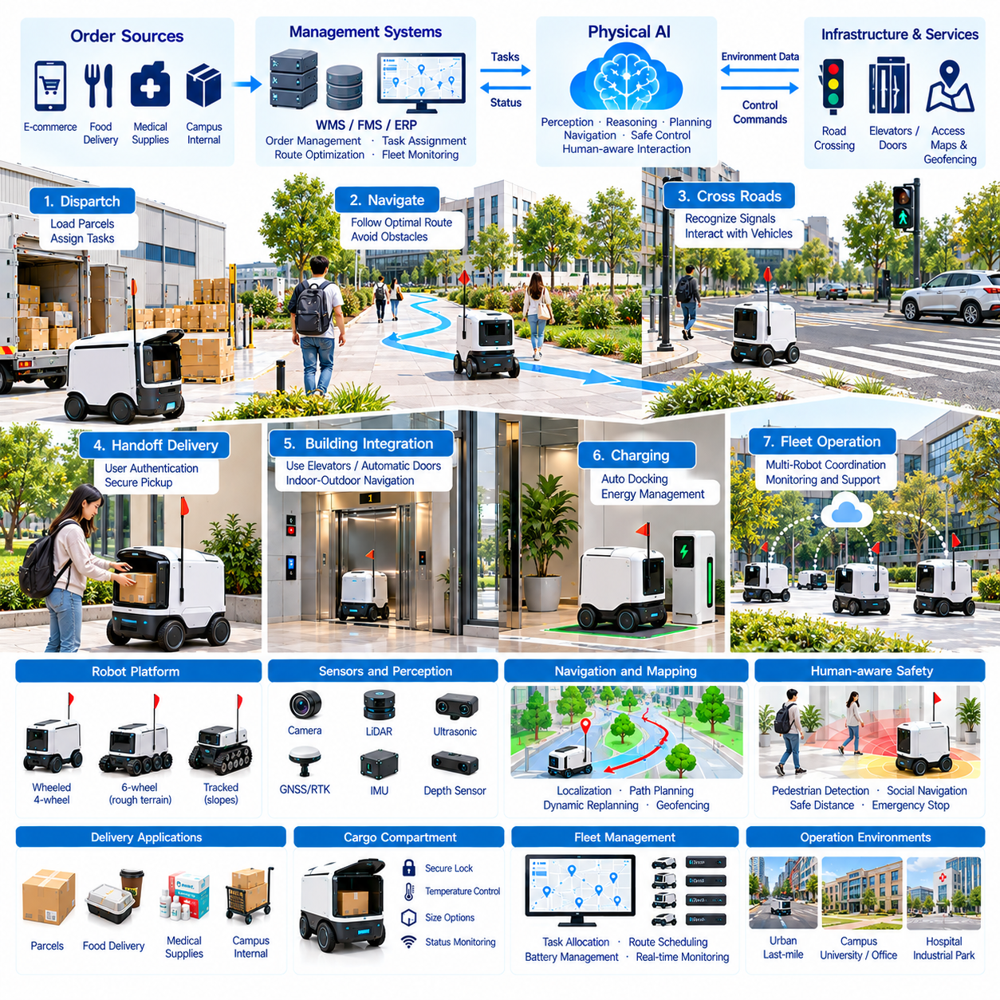{width="7.268055555555556in" height="7.268055555555556in"}

자율주행 라스트마일 물류(Autonomous Last-Mile Logistics)와 캠퍼스 물류(Campus Logistics)는 피지컬 AI(Physical AI)의 적용 범위를 창고와 물류센터에서 보행자 중심 환경(Pedestrian-Oriented Environment)으로 확장한다. 이러한 응용 분야에는 비교적 짧은 거리에서 택배(Parcel), 식사(Meal), 의료용품(Medical Supply), 내부 자재(Internal Material)를 운송하는 작업이 포함된다. 자율 배송 로봇(Autonomous Delivery Robot)은 자율주행(Navigation), 환경 인식(Perception), 작업 계획(Task Planning), 원격 감독(Remote Supervision)을 결합하여 반복적인 운송 작업을 줄이고 서비스 가용성(Service Availability)을 향상시킨다.

라스트마일 배송(Last-Mile Delivery)은 물류 거점(Distribution Point)과 최종 수령자(Recipient) 사이의 마지막 운송 단계를 의미한다. 기존 배송 방식은 특히 소량 주문(Small Order)과 빈번한 배송 목적지(Frequent Destination)를 처리할 때 인간 배송원(Human Courier)에 크게 의존한다. 자율주행 로봇은 배송 밀도(Delivery Density), 인프라(Infrastructure), 규제(Regulation)가 적합한 특정 경로에서 서비스를 제공할 수 있다. 경제적 가치(Economic Value)는 배송 빈도(Delivery Frequency), 이동 거리(Travel Distance), 적재 용량(Payload Capacity), 성공적인 물품 인도(Successful Handoff)에 따라 결정된다.

캠퍼스 물류(Campus Logistics)는 대학교(University), 병원(Hospital), 산업단지(Industrial Park), 기업 시설(Corporate Facility), 주거 단지(Residential Community) 내부의 운송을 포함한다. 이러한 환경에는 반복적인 이동 경로(Recurring Route)와 예측 가능한 배송 목적지(Predictable Delivery Destination)가 존재하는 경우가 많다. 로봇은 건물(Building), 접수 구역(Reception Area), 실험실(Laboratory), 식당 시설(Dining Facility), 보관 장소(Storage Location)를 연결할 수 있다. 통제된 접근(Controlled Access)과 협조적인 인프라(Coordinated Infrastructure)는 제한이 없는 도시 배송 환경보다 배포를 단순화할 수 있다.

지상 배송 로봇(Ground Delivery Robot)은 일반적으로 밀폐형 화물 적재함(Enclosed Cargo Compartment)을 갖춘 소형 바퀴형 플랫폼(Compact Wheeled Platform)을 사용한다. 기계적 설계(Mechanical Design)는 적재 공간(Payload Volume), 기동성(Maneuverability), 안정성(Stability), 에너지 효율(Energy Efficiency) 사이의 균형을 고려한다. 4륜 또는 6륜 구조(Four-Wheel or Six-Wheel Configuration)는 불균일한 노면에서 향상된 접지력(Traction)을 제공할 수 있다. 차량 크기(Vehicle Dimension)는 보행로(Pedestrian Pathway), 좁은 통로(Narrow Passage), 경사로(Ramp), 지정된 횡단 위치(Designated Crossing Location)를 통과할 수 있도록 설계되어야 한다.

환경 인식(Environmental Perception)은 배송 로봇이 보행자(Pedestrian), 자전거(Bicycle), 차량(Vehicle), 연석(Curb), 임시 장애물(Temporary Obstacle)을 인식하도록 한다. 카메라(Camera), 라이다(LiDAR), 초음파 센서(Ultrasonic Sensor), 깊이 센서(Depth Sensor)는 상호 보완적인 관측 정보(Complementary Observation)를 제공한다. 인식 알고리즘(Perception Algorithm)은 주변 객체를 분류하고 움직임을 추정한다. 신뢰성 높은 운영을 위해서는 부분적으로 가려진 장애물(Partially Obscured Obstacle)을 인식하고, 혼잡하거나 변화하는 환경에서 위험한 상호작용을 발생시키지 않도록 적응해야 한다.

위치 추정(Localization)과 지도 작성(Mapping)은 캠퍼스 및 도시 배송 경로를 주행하는 데 필수적이다. 위성항법시스템(Global Navigation Satellite System, GNSS), 시각 주행거리 추정(Visual Odometry), 라이다 지도 작성(LiDAR Mapping), 관성 센싱(Inertial Sensing)은 센서 융합(Sensor Fusion)을 통해 결합할 수 있다. 높은 건물이나 지붕이 있는 보행로 근처에서는 위성 기반 위치 결정(Satellite Positioning)의 신뢰성이 저하될 수 있다. 따라서 강건한 위치 추정(Robust Localization)을 위해서는 대체 환경 기준 정보(Alternative Environmental Reference)와 지속적인 불확실성 감시(Continuous Uncertainty Monitoring)가 필요하다.

경로 계획(Route Planning)은 단순한 기하학적 거리(Geometric Distance) 이상의 요소를 고려해야 한다. 보행자 밀도(Pedestrian Density), 보도 폭(Sidewalk Width), 노면 품질(Surface Quality), 횡단 구역(Crossing), 경사(Slope), 출입 제한 구역(Restricted Zone)은 실제 이동 시간(Practical Travel Time)에 영향을 미친다. 전역 경로 계획기(Global Planner)는 실행 가능한 배송 경로를 선택하고, 지역 경로 계획기(Local Planner)는 움직이는 장애물에 대응한다. 적응형 자율주행(Adaptive Navigation)은 운영 경계(Operational Boundary)를 준수하면서 임시 공사 구간, 혼잡한 보행로, 차단된 출입구를 우회할 수 있다.

인간 인지형 자율주행(Human-Aware Navigation)은 배송 로봇이 보행자와 공간을 공유하기 때문에 특히 중요하다. 로봇은 적절한 안전거리(Appropriate Separation)를 유지하고, 사람 근처에서 속도를 제한하며, 예측하기 어려운 움직임을 피해야 한다. 사회적 자율주행 모델(Social Navigation Model)은 보행자의 이동과 일반적인 상호작용 패턴(Interaction Pattern)을 추정할 수 있다. 그러나 학습된 행동(Learned Behavior)은 독립적으로 검증된 충돌 방지(Collision Prevention) 및 비상정지(Emergency Stopping) 기능의 제약조건을 따라야 한다.

도로 횡단(Road Crossing)과 차량과의 상호작용(Vehicle Interaction)은 추가적인 안전 문제를 발생시킨다. 배송 로봇은 교통신호(Traffic Signal), 접근 차량(Approaching Vehicle), 안전한 횡단 기회(Safe Crossing Opportunity)를 인식해야 한다. 일부 배포 환경에서는 로봇의 이동을 감독하에 이루어지는 횡단(Supervised Crossing)이나 지정 경로(Designated Route)로 제한한다. 운영 설계(Operational Design)는 지역 교통 규정(Local Traffic Regulation), 가시성 제한(Visibility Limitation), 지연되거나 잘못된 횡단 판단(Incorrect Crossing Decision)의 결과를 고려해야 한다.

화물 적재함(Cargo Compartment)은 운송 물품을 보호하고 수령자의 접근을 통제한다. 전자 잠금장치(Electronic Lock), 인증 시스템(Authentication System), 적재함 센서(Compartment Sensor)는 안전한 배송(Secure Delivery)을 지원한다. 식사, 의약품(Pharmaceutical), 민감한 물품(Sensitive Material)의 운송에는 온도 제어 적재함(Temperature-Controlled Compartment)이 필요할 수 있다. 화물 감시(Package Monitoring)는 무단 접근(Unauthorized Access), 예상하지 못한 움직임(Unexpected Movement), 배송 완료(Delivery Completion)를 감지할 수 있지만, 보안 기능(Security Feature)은 비용과 에너지 소비를 함께 고려해야 한다.

배송 물품 인도(Delivery Handoff)는 서비스 경험(Service Experience)의 핵심 요소이다. 수령자는 도착 알림(Arrival Notification)을 받고 애플리케이션(Application)이나 승인된 인증 수단(Authorized Credential)을 사용하여 적재함을 열 수 있다. 로봇은 작업을 종료하기 전에 화물이 수령되었는지 확인해야 한다. 인도 실패(Failed Handoff)가 발생하면 대기(Waiting), 재배송 일정 조정(Rescheduling), 물품 반환(Returning Items), 고객 지원 연락(Contacting Support)에 대한 절차가 필요하다. 신뢰성 높은 고객 상호작용(Customer Interaction)은 자율주행만큼 중요하다.

캠퍼스 로봇(Campus Robot)은 엘리베이터(Elevator), 자동문(Automatic Door), 출입통제시스템(Access Control System), 건물관리 플랫폼(Building Management Platform)과 통합될 수 있다. 실내외 통합 자율주행(Indoor-Outdoor Navigation)은 서로 다른 위치 추정 방식(Localization Method)과 환경 조건 사이의 전환을 필요로 한다. 엘리베이터 연동(Elevator Coordination)은 스케줄링(Scheduling)과 통신(Communication) 요구사항을 발생시킨다. 건물 인터페이스(Building Interface)를 사용할 수 없는 경우 배송 작업 흐름(Delivery Workflow)은 지정된 인계 지점(Designated Transfer Point)이나 인간의 지원(Human Assistance)을 활용할 수 있다.

로봇 군집관리시스템(Fleet Management System, FMS)은 서비스 지역(Service Region) 전반에서 여러 배송 로봇을 협조적으로 운영한다. 작업 할당(Task Assignment)은 배송 우선순위(Delivery Priority), 로봇 위치(Robot Location), 배터리 상태(Battery State), 적재 용량(Cargo Capacity), 예상 이동 시간(Expected Travel Time)을 고려한다. 군집 스케줄링(Fleet Scheduling)은 함께 처리할 수 있는 주문을 묶고 목적지 사이의 수요를 균형 있게 분배할 수 있다. 운영 로봇 수가 증가할수록 혼잡 관리(Congestion Management)와 충전 조정(Charging Coordination)이 더욱 중요해진다.

수요 인지형 물류(Demand-Aware Logistics)는 위치와 시간대에 따른 주문 패턴(Order Pattern)을 예측하여 서비스 효율(Service Efficiency)을 향상시킨다. 식사 배송(Meal Delivery)은 점심시간에 집중될 수 있으며, 캠퍼스 물품 배송(Campus Supply Delivery)은 기관의 운영 일정(Institutional Schedule)을 따를 수 있다. 예측 알고리즘(Predictive Algorithm)은 예상 수요 근처에 가용 로봇(Available Robot)을 사전 배치할 수 있다. 동적 작업 할당(Dynamic Task Allocation)은 공차 이동(Empty Travel)과 대기시간(Waiting Time)을 줄이지만, 예측 오류(Prediction Error)가 서비스 약속(Service Commitment)이나 운영 안전성(Operational Safety)을 훼손해서는 안 된다.

원격 감독(Remote Supervision)은 자율주행 로봇이 익숙하지 않은 상황에 직면했을 때 운영 지원(Operational Support)을 제공한다. 원격조작자(Teleoperator)는 차단된 경로(Blocked Route), 위치 추정 실패(Localization Failure), 어려운 보행자 상호작용(Difficult Pedestrian Interaction)을 검토할 수 있다. 시스템은 원격 지원(Remote Assistance), 감독형 자율주행(Supervised Autonomy), 직접 원격조작(Direct Teleoperation)을 구분해야 한다. 통신 두절(Communication Loss)이 발생하면 사전에 정의된 안전 대응(Safe Response)을 수행해야 하며, 개입 기록(Intervention Record)은 향후 자율주행 성능 개선에 활용될 수 있다.

기상 조건(Weather Condition)과 지형(Terrain)은 야외 배송(Outdoor Delivery)에 상당한 어려움을 발생시킨다. 비, 눈, 얼음, 물웅덩이(Puddle), 불균일한 포장면(Uneven Pavement)은 접지력(Traction)과 센서 신뢰성(Sensor Reliability)에 영향을 미칠 수 있다. 소형 로봇(Small Robot)은 특히 연석(Curb), 급경사(Steep Slope), 노면 불연속 구간(Surface Discontinuity)에 민감하다. 제어기(Controller)는 주행 가능성(Traversability)을 평가하고 운행 속도(Operating Speed)를 조정해야 한다. 악천후(Severe Weather)에서는 경로 제한(Route Restriction), 서비스 가용성 축소(Reduced Service Availability), 일시적인 운영 중단(Temporary Suspension)이 필요할 수 있다.

에너지 관리(Energy Management)는 배송 로봇이 충전 사이에 얼마나 오랫동안 운영될 수 있는지를 결정한다. 배터리 소비(Battery Consumption)는 이동 거리(Travel Distance), 적재물 질량(Payload Mass), 지형(Terrain), 온도(Temperature), 온보드 컴퓨팅(Onboard Computing)에 따라 달라진다. 군집 스케줄링(Fleet Scheduling)은 충전 가능 여부(Charging Availability)와 안전한 복귀를 위한 예비 에너지(Reserve Energy)를 고려해야 한다. 배터리 상태 감시(Battery Health Monitoring)와 예방 정비(Preventive Maintenance)는 장기간 운영에서 예측 가능한 서비스 용량(Service Capacity)을 유지하도록 지원한다.

피지컬 AI는 다중모달 환경 인식(Multimodal Perception), 예측 세계 모델(Predictive World Model), 적응형 의사결정(Adaptive Decision-Making)을 통해 배송 자율성(Delivery Autonomy)을 향상시킬 수 있다. 비전-언어-행동 모델(Vision-Language-Action Model, VLA) 접근법은 상황에 따른 명령(Contextual Instruction)을 해석하고 비정상적인 배송 상황(Unusual Delivery Situation)을 처리하는 데 활용될 수 있다. 로봇 군집 경험 학습(Learning from Fleet Experience)은 경로 선택(Route Selection)과 장애물 대응(Obstacle Response)을 개선할 수 있다. 그러나 모델 일반화(Model Generalization)는 실제 환경의 안전 요구사항(Real-World Safety Requirement)에 따라 검증되어야 한다.

안전성(Safety), 개인정보 보호(Privacy), 사이버보안(Cybersecurity)은 자율 배송 시스템(Autonomous Delivery System)에 대한 사회적 수용성(Public Acceptance)에 영향을 미친다. 사람 근처에서 작동하는 로봇에는 신뢰성 높은 장애물 감지(Dependable Obstacle Detection), 통제된 속도(Controlled Speed), 접근 가능한 비상 절차(Accessible Emergency Procedure)가 필요하다. 카메라와 위치 기록(Location Record)은 민감한 정보(Sensitive Information)를 수집할 수 있다. 보안 통신(Secure Communication), 데이터 최소화(Data Minimization), 접근통제(Access Control), 투명한 운영 정책(Transparent Operational Policy)은 사용자를 보호하고 책임 있는 배포(Responsible Deployment)를 지원한다.

운영 성능(Operational Performance)은 시간당 성공 배송 건수(Successful Deliveries per Hour), 평균 배송 시간(Average Delivery Time), 정시 배송률(On-Time Delivery Rate), 자율 완료율(Autonomous Completion Rate)을 사용하여 평가해야 한다. 추가 지표에는 개입 빈도(Intervention Frequency), 고객 대기시간(Customer Waiting Time), 에너지 소비(Energy Consumption), 로봇 군집 가용성(Fleet Availability)이 포함된다. 운송 효율(Transportation Efficiency)만으로 배송 성공을 판단할 수 없으므로 서비스 품질 지표(Service Quality Metric)에는 인도 실패(Failed Handoff), 화물 손상(Cargo Damage), 고객 불만(Customer Complaint)을 반영해야 한다.

경제적 타당성(Economic Feasibility)은 로봇 도입 비용(Robot Acquisition Cost), 유지보수(Maintenance), 감독(Supervision), 충전 인프라(Charging Infrastructure), 배송 수요 밀도(Delivery Demand Density)에 따라 결정된다. 높은 활용률(High Utilization)은 고정비(Fixed Cost)를 더 많은 배송 건수에 분산할 수 있지만, 낮은 주문량(Low Order Volume)은 재무적 성과(Financial Performance)를 약화시킬 수 있다. 총소유비용(Total Cost of Ownership, TCO)과 투자수익률(Return on Investment, ROI) 분석은 현실적인 작업 부하 가정(Realistic Workload Assumption)을 바탕으로 자율 배송 운영과 기존 배송원 서비스(Conventional Courier Service)를 비교해야 한다.

배포(Deployment)는 일반적으로 지도화된 경로(Mapped Route)와 협조적인 시설 운영자(Cooperative Facility Operator)가 존재하는 지리적으로 제한된 환경(Geographically Limited Environment)에서 시작된다. 시범 프로그램(Pilot Program)은 보행자 상호작용(Pedestrian Interaction), 장애물 회피(Obstacle Avoidance), 위치 추정(Localization), 화물 보안(Cargo Security), 배송 물품 인도 절차(Delivery Handoff Procedure)를 검증한다. 점진적인 확장(Gradual Expansion)을 통해 다양한 교통 및 기상 조건에서 성능을 평가할 수 있다. 서비스 범위를 확대하기 전에 규제 준수(Regulatory Compliance)와 지역사회 수용성(Community Acceptance)을 확보해야 한다.

미래의 자율 배송 네트워크(Autonomous Delivery Network)는 창고(Warehouse), 마이크로 풀필먼트 센터(Micro-Fulfillment Center), 캠퍼스 시설(Campus Facility), 지역 인계 거점(Neighborhood Transfer Point)을 연결할 수 있다. 로봇은 자율주행 차량(Autonomous Vehicle) 및 다른 운송 플랫폼(Transportation Platform)과 협조하여 복합 운송 배송(Multimodal Delivery)을 수행할 수 있다. 공유 군집 지능(Shared Fleet Intelligence)은 스케줄링(Scheduling)과 경로 적응(Route Adaptation)을 개선할 수 있다. 광범위한 도입(Broader Adoption)은 상호운용성(Interoperability), 신뢰성 높은 자율성(Reliable Autonomy), 인프라 접근성(Infrastructure Access), 지속 가능한 운영 경제성(Sustainable Operating Economics)에 따라 결정될 것이다.

궁극적으로 자율주행 라스트마일 및 캠퍼스 물류(Autonomous Last-Mile and Campus Logistics)는 피지컬 AI가 인간 생활 환경(Human Environment) 내부에서 직접 운송 서비스를 제공할 수 있음을 보여준다. 그 가치는 안전한 자율 이동성(Safe Autonomous Mobility), 보안이 확보된 화물 취급(Secure Cargo Handling), 지능형 군집 운영 조정(Intelligent Fleet Orchestration), 신뢰성 높은 고객 상호작용(Reliable Customer Interaction)을 결합하는 데 있다. 성공적인 배포는 반복적인 배송 작업을 줄이고, 지역 물류 접근성(Local Logistics Accessibility)을 향상시키며, 확장 가능한 단거리 물류 유통(Scalable Short-Distance Distribution)을 지원할 수 있다.

## 03.11. Aerial and Cargo Robot Logistics

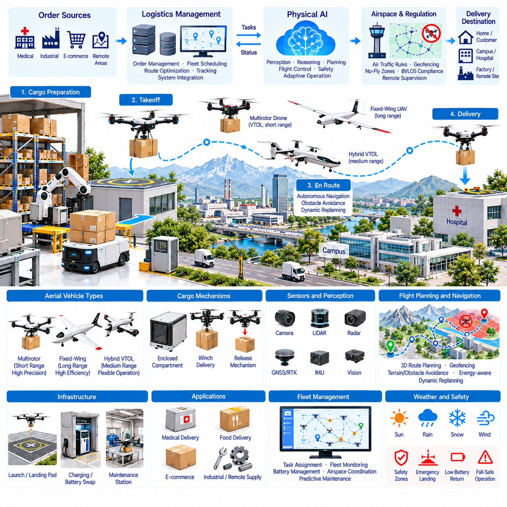{width="7.268055555555556in" height="7.268055555555556in"}

항공 및 화물 로봇 물류(Aerial and Cargo Robot Logistics)는 피지컬 AI(Physical AI)를 3차원 운송(Three-Dimensional Transportation) 영역으로 확장하여 기존 지상 배송(Ground Delivery)이 느리거나 어려운 지역 사이에서 물품을 자율적으로 이동할 수 있도록 한다. 이러한 시스템은 무인항공기(Unmanned Aerial Vehicle, UAV), 지능형 화물 취급(Intelligent Cargo Handling), 자율 항법(Autonomous Navigation), 로봇 군집 협조(Fleet Coordination)를 결합한다. 주요 적용 분야에는 의료 물품 배송(Medical Delivery), 산업용 운송(Industrial Transport), 원격지 물자 공급(Remote Supply Operation), 시간 민감형 물류(Time-Sensitive Distribution)가 포함된다.

항공 물류(Aerial Logistics)는 비행체가 양력(Lift), 추진력(Propulsion), 안정성(Stability), 에너지 소비(Energy Consumption)를 지속적으로 관리해야 한다는 점에서 지상 운송과 차이가 있다. 멀티로터 드론(Multirotor Drone)은 수직 이착륙(Vertical Takeoff and Landing), 제자리 비행(Hovering), 정밀 위치 제어(Precise Positioning)를 제공하며, 고정익 항공기(Fixed-Wing Aircraft)는 장거리 운송에서 더 높은 효율성을 제공한다. 하이브리드 수직이착륙 플랫폼(Hybrid Vertical Takeoff and Landing Platform)은 두 구조의 장점 일부를 결합하지만 기계적 복잡성(Mechanical Complexity)이 증가한다.

적재 용량(Payload Capacity)은 항공 화물 운송(Aerial Cargo Transportation)의 근본적인 제약조건이다. 비행체의 총중량(Total Vehicle Mass)에는 배터리(Battery), 추진 장치(Propulsion Component), 센서(Sensor), 제어 전자장치(Control Electronics), 화물 적재함(Cargo Container), 운송 물품(Transported Goods)이 포함된다. 적재 중량(Payload)을 증가시키면 일반적으로 비행 지속시간(Endurance)이 감소하거나 더 큰 추진 동력(Propulsion Power)이 필요하다. 효과적인 시스템 설계(System Design)는 실제 화물 중량(Useful Cargo Mass), 비행거리(Flight Range), 예비 에너지(Reserve Energy), 구조적 안전 여유(Structural Safety Margin) 사이의 균형을 고려해야 한다.

화물 부착 및 분리 장치(Cargo Attachment and Release Mechanism)는 신뢰성 높은 항공 배송(Aerial Delivery)에 핵심적인 요소이다. 화물은 밀폐형 적재함(Enclosed Compartment)에 보관하거나 항공기 하부에 고정할 수 있으며, 제어형 윈치 시스템(Controlled Winch System)을 이용하여 지상으로 내릴 수도 있다. 각 방식은 공기역학적 항력(Aerodynamic Drag), 무게중심(Center of Gravity), 비행 안정성(Flight Stability)에 영향을 미친다. 의도하지 않은 화물 분리(Unintended Cargo Separation)를 방지하려면 안전한 잠금장치(Secure Locking), 하중 검증(Load Verification), 통제된 분리 절차(Controlled Release Procedure)가 필요하다.

비행 제어 시스템(Flight Control System)은 바람(Wind), 적재 중량 변화(Changing Payload Mass), 환경 외란(Environmental Disturbance)에 대응하면서 항공기의 안정성을 유지한다. 멀티로터 제어기(Multirotor Controller)는 개별 모터의 추력(Motor Thrust)을 조절하여 위치(Position)와 자세(Orientation)를 제어한다. 화물의 움직임(Cargo Movement)은 특히 매달린 하중(Suspended Load)을 운송할 때 추가적인 동적 힘(Dynamic Force)을 발생시킬 수 있다. 고급 제어 알고리즘(Advanced Control Algorithm)은 액추에이터 제한(Actuator Limit)과 구조적 한계(Structural Limit)를 준수하면서 이러한 영향을 고려해야 한다.

자율 항법(Autonomous Navigation)은 위성항법시스템(Global Navigation Satellite System, GNSS), 관성측정장치(Inertial Measurement Unit, IMU), 카메라(Camera), 기타 위치 센서(Positioning Sensor)를 통합한다. 센서 융합(Sensor Fusion)은 상태 추정(State Estimation)을 개선하고 정확한 경로 추종(Route Following)을 지원한다. 도시 환경(Urban Environment)에서는 위성 신호 간섭(Satellite Interference)이나 시야 제한(Restricted Visibility)이 발생할 수 있다. 신뢰성 높은 항법을 위해서는 위치 추정 불확실성(Localization Uncertainty)을 감시하고 위치 결정 품질(Positioning Quality)이 저하될 때 안전한 대체 절차(Safe Fallback Procedure)를 유지해야 한다.

항공 환경 인식(Aerial Perception)은 건물(Building), 식생(Vegetation), 전력선(Power Line), 다른 항공기(Other Aircraft), 예상하지 못한 장애물(Unexpected Obstacle)을 식별해야 한다. 카메라(Camera), 레이더(Radar), 라이다(LiDAR), 협력형 추적 시스템(Cooperative Tracking System)은 비행체 크기와 임무 요구사항(Mission Requirement)에 따라 상호 보완적인 정보를 제공할 수 있다. 탐지 및 회피(Detect-and-Avoid) 기능은 특히 비가시권 비행(Beyond Visual Line of Sight, BVLOS)에서 중요하다. 이러한 기능의 성능은 실제 환경 및 운영 조건(Operational Condition)에서 검증되어야 한다.

비행 경로 계획(Flight Planning)은 공역 제한(Airspace Restriction), 지형 고도(Terrain Elevation), 장애물 회피 여유(Obstacle Clearance), 기상 조건(Weather Condition), 비상 착륙 가능 구역(Emergency Landing Area)을 고려한다. 지상 로봇과 달리 항공기는 3차원 궤적(Three-Dimensional Trajectory)과 지속적인 에너지 요구량(Continuous Energy Requirement)을 평가해야 한다. 임무 계획기(Mission Planner)는 고도 제한(Altitude Limit), 운항 허가(Operational Permission), 예비 전력(Reserve Power)을 반영해야 한다. 기상 조건이나 공역 가용성(Airspace Availability)이 변화하면 동적 재계획(Dynamic Replanning)이 필요하다.

기상 조건(Weather Condition)은 항공 물류의 신뢰성(Aerial Logistics Reliability)에 상당한 영향을 미친다. 강풍(Strong Wind)은 제어 부담(Control Effort)과 에너지 소비를 증가시키며, 비(Rain), 결빙(Icing), 극한 온도(Extreme Temperature)는 항공기 성능(Aircraft Performance)을 위협할 수 있다. 적재 중량(Payload Mass)과 공기역학적 구성(Aerodynamic Configuration)도 환경 적응 능력(Environmental Tolerance)에 영향을 미친다. 운영자는 측정 가능한 기상 한계(Weather Limit)를 설정하고 안전한 비행을 유지할 수 없는 경우 임무 지연(Delay), 우회(Diversion), 종료(Termination)를 위한 절차를 수립해야 한다.

배송 인프라(Delivery Infrastructure)에는 이륙장(Launch Pad), 착륙 스테이션(Landing Station), 충전 시설(Charging Facility), 화물 환적 지점(Cargo Transfer Point), 유지보수 구역(Maintenance Area)이 포함된다. 자동 도킹(Automated Docking)은 정확한 위치 결정(Accurate Positioning)과 항공기 및 지상 장비 사이의 신뢰성 높은 통신(Reliable Communication)을 필요로 한다. 일부 시스템은 운항 준비시간(Turnaround Time)을 줄이기 위해 배터리 교환(Battery Swapping)을 사용한다. 인프라 설계는 작업자가 프로펠러(Propeller)와 움직이는 기계장치(Moving Machinery)로부터 보호받도록 하면서 화물 취급 지연(Handling Delay)을 최소화해야 한다.

의료 및 긴급 물류(Medical and Emergency Logistics)는 배송 속도(Delivery Speed)가 특히 높은 가치를 제공할 수 있기 때문에 유망한 적용 분야이다. 항공 로봇(Aerial Robot)은 허가된 시설 사이에서 검사 검체(Laboratory Sample), 의약품(Medicine), 혈액 제제(Blood Product), 응급 물품(Emergency Supply)을 운송할 수 있다. 임무 계획(Mission Planning)은 화물 무결성(Cargo Integrity), 온도 제어(Temperature Control), 추적성(Traceability), 배송 확인(Delivery Confirmation)을 고려해야 한다. 민감한 물품(Sensitive Material)은 추가적인 취급 절차(Handling Procedure)와 관련 규정(Applicable Regulation)의 준수가 필요하다.

산업용 화물 물류(Industrial Cargo Logistics)는 공장(Factory), 창고(Warehouse), 해양 시설(Offshore Facility), 원격 작업 현장(Remote Work Site)을 연결할 수 있다. 드론(Drone)은 별도의 지상 운송 수단 없이 경량 예비 부품(Lightweight Spare Part), 도구(Tool), 검사 장비(Inspection Equipment)를 배송할 수 있다. 그러나 항공기 선택(Aircraft Selection)은 적재 중량(Payload), 운송 거리(Distance), 착륙 접근성(Landing Access), 환경 노출(Environmental Exposure)에 따라 결정된다. 중량 화물 적용(Heavy Cargo Application)에는 훨씬 높은 인양 능력(Lifting Capacity)과 엄격한 운영 제어(Operational Control)가 필요하다.

화물 로봇(Cargo Robot)은 지상 기반 자율이동로봇(Autonomous Mobile Robot, AMR) 및 자율주행 차량(Autonomous Vehicle)과 협력할 수도 있다. 지상 플랫폼(Ground Platform)은 화물을 항공 이륙 지점(Aerial Launch Point)까지 운송하고, 드론은 선택된 배송 구간(Delivery Segment)을 수행할 수 있다. 협조적인 화물 인계(Coordinated Transfer)는 불필요한 취급을 줄이고 물류 서비스 범위(Logistics Coverage)를 확장한다. 성공적인 통합을 위해서는 공유 배송 식별자(Shared Shipment Identifier), 동기화된 도착 시간(Synchronized Arrival Time), 검증된 화물 인계 절차(Verified Cargo Handoff Procedure)가 필요하다.

로봇 군집관리시스템(Fleet Management System, FMS)은 항공기 할당(Aircraft Assignment), 배터리 가용성(Battery Availability), 임무 스케줄링(Mission Scheduling), 유지보수 요구사항(Maintenance Requirement)을 조정한다. 동일 지역에서 운항하는 여러 드론은 분리 관리(Separation Management)와 충돌 회피(Conflict Avoidance)가 필요하다. 무인항공기 교통관리(Uncrewed Aircraft System Traffic Management, UTM) 서비스는 이용 가능한 환경에서 공역 조정(Airspace Coordination)을 지원할 수 있다. 군집 스케줄링(Fleet Scheduling)은 배송 수요(Delivery Demand)와 운항 제한(Operational Flight Restriction)을 함께 고려해야 한다.

수요 인지형 작업 할당(Demand-Aware Task Allocation)은 배송 물량(Shipment Volume), 배송 긴급도(Delivery Urgency), 지역별 서비스 요구사항(Regional Service Requirement)을 예측하여 항공 로봇 군집의 활용률(Fleet Utilization)을 향상시킬 수 있다. 알고리즘(Algorithm)은 배터리 예비량(Battery Reserve)을 유지하면서 인접 항공기를 우선순위가 높은 임무(High-Priority Mission)에 할당할 수 있다. 함께 운송할 수 있는 화물을 통합(Shipment Consolidation)하면 불필요한 비행을 줄일 수 있다. 그러나 최적화(Optimization)는 배송 속도만을 중시하기보다 적재 한계(Payload Limit), 비행 허가(Flight Permission), 안전 제약조건(Safety Constraint)을 준수해야 한다.

원격 감독(Remote Supervision)은 불확실하거나 예외적인 상황(Exceptional Situation)을 처리하는 데 여전히 중요하다. 운영자(Operator)는 항법 이상(Navigation Anomaly), 예상하지 못한 착륙 조건(Unexpected Landing Condition), 임무 중단(Mission Interruption)을 검토할 수 있다. 통신 링크(Communication Link)는 항공기와 지상 관제소(Ground Station) 사이에서 원격측정 데이터(Telemetry), 임무 상태(Mission Status), 제어 정보(Control Information)를 전송한다. 통신 두절(Loss of Communication)이 발생하면 상황에 따라 안전하게 대기(Holding), 복귀(Returning), 착륙(Landing)하는 등 사전에 정의된 비상 대응 동작(Predefined Contingency Behavior)을 수행해야 한다.

에너지 관리(Energy Management)는 달성 가능한 비행거리(Flight Range), 적재 용량(Payload Capacity), 임무 수행 빈도(Mission Frequency)를 결정한다. 배터리 성능(Battery Performance)은 온도(Temperature), 방전율(Discharge Rate), 노화(Aging), 반복 충전 주기(Repeated Charging Cycle)에 따라 달라진다. 비행 계획(Flight Planning)에는 경로 이탈(Deviation)과 비상 상황(Contingency)에 대비한 충분한 예비 에너지(Sufficient Energy Reserve)가 포함되어야 한다. 예측 기반 배터리 상태 감시(Predictive Battery Health Monitoring)는 성능 저하를 식별하고 운송 임무 중 예상하지 못한 전력 부족(Unexpected Power Limitation)의 위험을 줄일 수 있다.

피지컬 AI는 예측 세계 모델(Predictive World Model), 다중모달 환경 인식(Multimodal Perception), 적응형 제어(Adaptive Control)를 통해 항공 자율성(Aerial Autonomy)을 향상시킬 수 있다. 학습 기반 시스템(Learning-Based System)은 장애물 해석(Obstacle Interpretation), 착륙 지점 평가(Landing-Site Assessment), 임무 계획(Mission Planning)을 개선할 수 있다. 시뮬레이션(Simulation)은 다양한 바람, 적재 중량, 센서 조건에서 시험을 지원한다. 그러나 비행 중 발생하는 고장은 항공기 자체를 넘어 주변 환경에 위험을 초래할 수 있으므로 학습 기반 구성요소(Learned Component)는 엄격한 검증(Rigorous Validation)이 필요하다.

안전 공학(Safety Engineering)은 추진 장치 고장(Propulsion Failure), 항법 오류(Navigation Error), 화물 분리 장치 고장(Cargo Release Fault), 사람 또는 인프라와의 의도하지 않은 상호작용(Unintended Interaction)을 다루어야 한다. 이중화 센싱(Redundant Sensing), 고장 감지(Fault Detection), 비상 착륙 전략(Emergency Landing Strategy), 운영 지오펜싱(Operational Geofencing)은 위험을 줄일 수 있다. 사이버보안(Cybersecurity)은 통신과 임무 명령(Mission Command)을 무단 간섭(Unauthorized Interference)으로부터 보호한다. 적용 가능한 항공 규정(Applicable Aviation Rule)은 배포에 필요한 운항 승인(Operational Approval)과 제한사항(Operational Limitation)을 결정한다.

운영 성능(Operational Performance)은 성공적인 배송(Successful Delivery), 비행 완료율(Flight Completion Rate), 적재 활용률(Payload Utilization), 운항 준비시간(Turnaround Time), 배송 건당 에너지 소비량(Energy Consumed per Shipment)을 통해 측정해야 한다. 추가 지표에는 개입 빈도(Intervention Frequency), 유지보수 중단시간(Maintenance Downtime), 기상 관련 운항 취소(Weather-Related Cancellation), 화물 손상(Cargo Damage)이 포함된다. 항공 배송과 지상 운송 대안(Ground Alternative)을 비교하려면 비행시간(Flight Time)만 고려하기보다 전체 배송 작업 흐름(Complete Delivery Workflow)을 평가해야 한다.

경제적 타당성(Economic Feasibility)은 항공기 도입 비용(Aircraft Acquisition Cost), 배터리 교체(Battery Replacement), 유지보수(Maintenance), 운영 인력(Staffing), 보험(Insurance), 인프라(Infrastructure), 규제 준수(Regulatory Compliance)에 따라 결정된다. 감독(Supervision)과 운영 제한(Operational Restriction)이 상당한 경우 짧은 비행시간이 자동으로 낮은 배송 비용(Lower Delivery Cost)을 보장하지는 않는다. 총소유비용(Total Cost of Ownership, TCO)과 투자수익률(Return on Investment, ROI) 분석에는 현실적인 활용률(Utilization), 적재 수요(Payload Demand), 서비스 가용성(Service Availability)을 반영해야 한다.

배포(Deployment)는 명확하게 정의된 경로(Clearly Defined Route), 적합한 착륙 구역(Suitable Landing Area), 관리 가능한 적재 중량(Manageable Payload), 확립된 운영 절차(Established Operating Procedure)를 기반으로 시작해야 한다. 시범 프로그램(Pilot Program)은 비행 성능(Flight Performance), 화물 보안(Cargo Security), 통신 신뢰성(Communication Reliability), 비상 대응(Emergency Response)을 검증할 수 있다. 점진적인 확장(Gradual Expansion)은 다양한 기상 조건과 운영 수요(Operational Demand)에 대한 실증 자료(Evidence)를 제공한다. 규제 승인(Regulatory Authorization)과 입증된 안전 성능(Demonstrated Safety Performance)은 광범위한 상업 운영(Broader Commercial Operation)을 위한 전제조건이다.

미래의 항공 물류(Future Aerial Logistics)는 대형 화물 항공기(Larger Cargo Aircraft), 자율주행 지상 차량(Autonomous Ground Vehicle), 지능형 환적 스테이션(Intelligent Transfer Station), 협조형 운송 네트워크(Coordinated Transportation Network)를 결합할 수 있다. 추진 효율(Propulsion Efficiency), 배터리(Battery), 센싱(Sensing), 군집 지능(Fleet Intelligence)의 발전은 적용 가능한 분야를 확대할 수 있다. 향상된 자율성(Greater Autonomy)은 더욱 복잡한 임무(Complex Mission)를 지원할 수 있지만, 확장성(Scalability)은 공역 통합(Airspace Integration), 신뢰성 높은 인프라(Dependable Infrastructure), 지속적으로 검증된 운영 안전성(Verified Operational Safety)에 따라 결정될 것이다.

궁극적으로 항공 및 화물 로봇 물류(Aerial and Cargo Robot Logistics)는 피지컬 AI가 도로와 기존 창고 인프라를 넘어 자율 운송(Autonomous Transportation)을 확장할 수 있음을 보여준다. 그 가치는 3차원 이동성(Three-Dimensional Mobility), 지능형 화물 관리(Intelligent Cargo Management), 적응형 임무 계획(Adaptive Mission Planning), 협조형 로봇 군집 운영(Coordinated Fleet Operation)을 결합하는 데 있다. 지속 가능한 도입(Sustainable Adoption)을 위해서는 항공기 성능(Aircraft Capability)을 적합한 물류 작업(Logistics Task)에 연결하면서 안전성(Safety), 신뢰성(Reliability), 규제(Regulation), 경제적 성과(Economic Performance) 사이의 균형을 유지해야 한다.

## 03.12. Fleet Management and Warehouse Orchestration

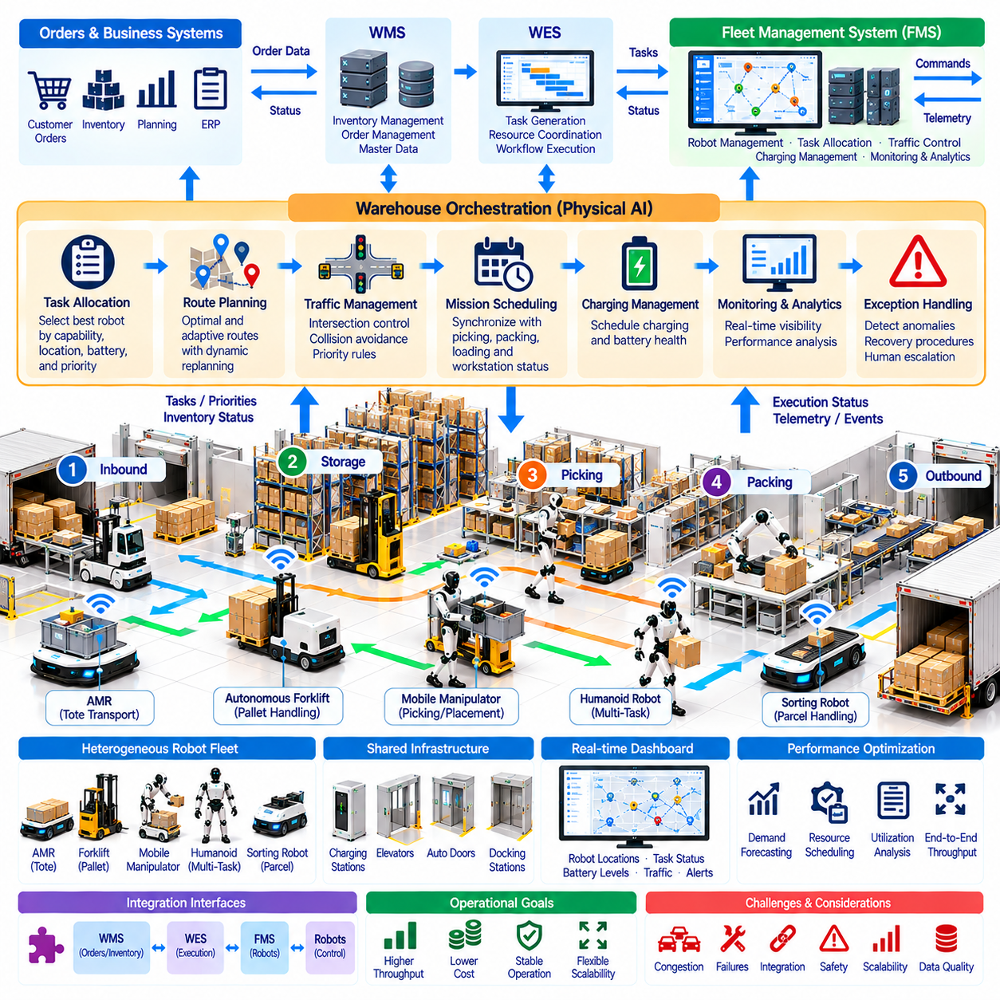{width="7.268055555555556in" height="7.268055555555556in"}

로봇 군집 관리(Fleet Management)와 창고 운영 오케스트레이션(Warehouse Orchestration)은 현대 물류 시설(Modern Logistics Facility) 전반에서 피지컬 AI(Physical AI) 시스템을 조정하는 데 필수적인 요소이다. 창고에 자율이동로봇(Autonomous Mobile Robot, AMR), 자율주행 지게차(Autonomous Forklift), 매니퓰레이터(Manipulator), 휴머노이드 로봇(Humanoid Robot)이 도입됨에 따라 개별 로봇의 지능(Individual Robot Intelligence)은 통합 운영 프레임워크(Unified Operational Framework)와 연결되어야 한다. 효과적인 오케스트레이션(Orchestration)은 로봇의 기능(Robot Capability), 운송 작업(Transportation Task), 재고 이동(Inventory Movement), 창고 운영 우선순위(Warehouse Priority)를 통합한다.

로봇 군집관리시스템(Fleet Management System, FMS)은 로봇의 임무(Robot Mission), 가용성(Availability), 자율주행(Navigation), 충전(Charging), 운영 상태(Operational Status)를 감독한다. 창고 운영 오케스트레이션(Warehouse Orchestration)은 개별 차량의 관리를 넘어 전체 자재 흐름(Material Flow)과 상호 의존적인 프로세스(Interdependent Process)를 조정한다. 이러한 구분이 중요한 이유는 로봇 이동(Robot Movement)만 최적화하더라도 피킹(Picking), 보관(Storage), 포장(Packing) 작업이 서로 연결되지 않으면 창고 처리량(Warehouse Throughput)의 향상을 보장할 수 없기 때문이다.

오케스트레이션 아키텍처(Orchestration Architecture)는 일반적으로 창고관리시스템(Warehouse Management System, WMS), 창고실행시스템(Warehouse Execution System, WES), 군집 제어기(Fleet Controller), 개별 로봇(Individual Robot)을 연결한다. WMS 플랫폼은 재고(Inventory)와 주문 정보(Order Information)를 관리하며, WES 플랫폼은 운영 실행(Operational Execution)을 조정한다. FMS는 운송 요구사항(Transportation Requirement)을 로봇 임무(Robot Mission)로 변환하고 실행을 감시하며, 상위 시스템(Higher-Level System)에 상태 업데이트(Status Update)를 전달한다.

작업 할당(Task Allocation)은 각 운송 또는 조작 요청(Transportation or Manipulation Request)을 어떤 로봇이 수행할지 결정한다. 할당 알고리즘(Assignment Algorithm)은 로봇 위치(Robot Location), 적재 용량(Payload Capacity), 배터리 상태(Battery State), 장비 호환성(Equipment Compatibility), 작업 우선순위(Task Priority)를 고려한다. 가까운 로봇이라도 남은 에너지(Remaining Energy)나 취급 능력(Handling Capability)이 충분하지 않으면 최적의 선택이 아닐 수 있다. 효과적인 작업 할당은 즉각적인 응답시간(Response Time)과 전체 로봇 군집 생산성(Fleet-Wide Productivity) 사이의 균형을 유지한다.

창고 환경(Warehouse Environment)에서는 서로 다른 이동성과 조작 능력을 갖춘 이기종 로봇 군집(Heterogeneous Robot Fleet)이 점차 증가하고 있다. 자율이동로봇(AMR)은 토트(Tote)를 운송하고, 자율주행 지게차(Autonomous Forklift)는 팔레트(Pallet)를 취급하며, 모바일 매니퓰레이터(Mobile Manipulator)는 피킹(Picking)이나 배치(Placement) 작업을 수행한다. 오케스트레이션 소프트웨어(Orchestration Software)는 이러한 기능적 차이(Functional Difference)를 이해하고 호환 가능한 임무(Compatible Mission)를 할당해야 한다. 공통 인터페이스(Shared Interface)는 로봇별 제어 요구사항(Robot-Specific Control Requirement)을 유지하면서 시스템 통합 복잡성(Integration Complexity)을 줄인다.

교통 관리(Traffic Management)는 공유 창고 공간(Shared Warehouse Space)에서 운영되는 로봇 사이의 혼잡(Congestion)과 충돌 가능성(Conflict)을 방지한다. 교차로(Intersection), 좁은 통로(Narrow Aisle), 엘리베이터(Elevator), 적재 스테이션(Loading Station)은 잠재적인 병목 구간(Bottleneck)을 형성한다. 중앙집중식 조정(Centralized Coordination)은 주요 구역(Critical Area)을 예약하고 이동 우선순위(Movement Priority)를 조절하며 경로를 변경할 수 있다. 그러나 작업자(Human Worker)나 예상하지 못한 물체(Unexpected Object)가 계획된 이동 경로에 진입할 수 있으므로 지역 장애물 회피(Local Obstacle Avoidance) 기능도 필요하다.

동적 경로 계획(Dynamic Route Planning)은 창고 조건(Warehouse Condition)과 운영 수요(Operational Demand)의 변화에 대응한다. 로봇은 차단된 통로(Blocked Aisle), 장비 고장(Equipment Failure), 일시적인 안전 제한(Temporary Safety Restriction)에 직면할 수 있다. 오케스트레이션 시스템(Orchestration System)은 교통 밀도(Traffic Density)와 임무 긴급도(Mission Urgency)를 고려하면서 대체 경로(Alternative Route)를 식별해야 한다. 경로 재계획(Replanning)은 일관된 지도 정보(Consistent Map Information)를 유지하고 다른 이동 로봇과 새로운 충돌 가능성이 발생하지 않도록 해야 한다.

임무 스케줄링(Mission Scheduling)은 운송 작업을 상위 및 하위 창고 활동(Upstream and Downstream Warehouse Activity)과 조정한다. 작업대(Workstation)가 준비되기 전에 로봇이 도착하면 유용한 작업을 수행하지 못한 상태로 중요한 공간을 점유할 수 있다. 반대로 자재 배송(Material Delivery)이 지연되면 피킹(Picking)이나 포장(Packing) 작업이 중단될 수 있다. 이벤트 기반 스케줄링(Event-Driven Scheduling)은 장비 준비 상태(Equipment Readiness), 주문 우선순위(Order Priority), 작업 완료 신호(Task Completion Signal)를 활용하여 상호 연결된 프로세스를 동기화한다.

충전 관리(Charging Management)는 로봇 군집 가용성(Fleet Availability)과 지속적인 창고 운영 성능(Sustained Warehouse Performance)에 직접적인 영향을 미친다. 로봇마다 배터리 용량(Battery Capacity), 에너지 소비 패턴(Energy Consumption Pattern), 충전 요구사항(Charging Requirement)이 다르다. FMS는 예상 작업 부하(Expected Workload), 배터리 상태(Battery Health), 운영 우선순위(Operational Priority)에 따라 충전을 계획해야 한다. 수요가 낮은 시간대의 기회 충전(Opportunity Charging)은 충분한 예비 운영 능력(Reserve Capacity)이 유지되는 경우 운영 중단을 줄일 수 있다.

예외 처리(Exception Handling)는 실제 창고에서 예측하기 어려운 운영 장애(Operational Disturbance)가 발생하기 때문에 필요하다. 로봇은 접근할 수 없는 픽업 지점(Inaccessible Pickup Point), 누락된 컨테이너(Missing Container), 위치 추정 실패(Localization Failure), 기계적 고장(Mechanical Fault)에 직면할 수 있다. 오케스트레이션 플랫폼(Orchestration Platform)은 예외 상황(Exception)을 분류하고 복구 절차(Recovery Procedure)를 시작하며, 해결되지 않은 문제를 운영자(Operator)에게 전달해야 한다. 복구 조치(Recovery Action)의 책임을 명확히 정의하면 개별 장애(Isolated Failure)가 전체 작업 흐름(Broader Workflow)을 방해하는 것을 방지할 수 있다.

실시간 모니터링(Real-Time Monitoring)은 로봇 위치(Robot Location), 임무 진행 상태(Mission Progress), 교통 상황(Traffic Condition), 시스템 가용성(System Availability)에 대한 가시성(Visibility)을 제공한다. 운영 대시보드(Operational Dashboard)는 작업 대기열(Task Queue), 배터리 잔량(Battery Level), 고장 알림(Fault Notification), 장비 활용률(Equipment Utilization)을 표시할 수 있다. 과거 이벤트 기록(Historical Event Record)은 문제 해결(Troubleshooting)과 성능 분석(Performance Analysis)을 지원한다. 여러 시스템에서 발생하는 이벤트를 정확히 해석하려면 일관된 타임스탬프(Consistent Timestamp)와 표준화된 상태 정의(Standardized Status Definition)가 필수적이다.

피지컬 AI는 예측 기반 스케줄링(Predictive Scheduling), 수요 예측(Demand Forecasting), 적응형 자원 할당(Adaptive Resource Allocation)을 통해 오케스트레이션을 개선할 수 있다. 머신러닝 모델(Machine Learning Model)은 작업 소요시간(Task Duration), 혼잡 위험(Congestion Risk), 미래 운송 수요(Future Transportation Demand)를 추정할 수 있다. 이러한 예측은 로봇의 사전 재배치(Robot Repositioning)와 임무 우선순위(Mission Priority) 조정에 활용된다. 그러나 최적화 의사결정(Optimization Decision)은 운영 제약조건(Operational Constraint), 안전 요구사항(Safety Requirement), 가용 데이터의 신뢰성(Data Reliability)을 준수해야 한다.

창고 운영 오케스트레이션(Warehouse Orchestration)은 개별 로봇 효율(Individual Robot Efficiency)이 아니라 전체 물류 프로세스의 성능(End-to-End Logistics Performance)을 최적화해야 한다. 로봇 군집의 활용률(Fleet Utilization)이 높더라도 핵심 작업대(Critical Workstation)에 자재 부족(Material Shortage)이 발생하면 전체 운영 성과는 저하될 수 있다. 시스템 수준 최적화(System-Level Optimization)는 주문 완료(Order Completion), 작업대 처리량(Workstation Throughput), 재고 가용성(Inventory Availability), 운송 지연(Transportation Delay)을 고려한다. 조정된 의사결정(Coordinated Decision)은 로봇 활동(Robot Activity)을 실제 창고의 비즈니스 목표(Warehouse Business Objective)와 일치시킨다.

시스템 통합 신뢰성(Integration Reliability)은 명확하게 정의된 통신 인터페이스(Communication Interface)와 일관된 운영 의미 체계(Operational Semantics)에 따라 결정된다. 응용 프로그래밍 인터페이스(Application Programming Interface, API), 이벤트 메시지(Event Message), 표준화된 임무 상태(Standardized Mission State)는 WMS, WES, FMS, 로봇 사이의 정보 교환(Information Exchange)을 가능하게 한다. 중복 명령(Duplicate Command), 지연된 응답 확인(Delayed Acknowledgment), 네트워크 중단(Network Interruption)에 대해서는 명시적인 처리 절차가 필요하다. 따라서 신뢰성 높은 오케스트레이션은 트랜잭션 일관성(Transactional Consistency), 장애 복구(Fault Recovery), 지속적인 시스템 모니터링(Continuous System Monitoring)을 결합해야 한다.

## 03.13. Demand Aware Task Allocation

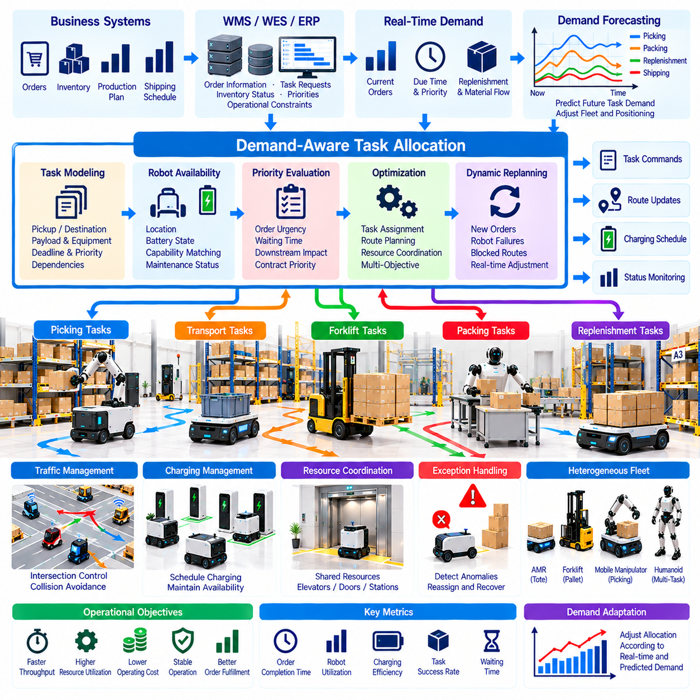{width="7.268055555555556in" height="7.268055555555556in"}

수요 인지형 작업 할당(Demand-Aware Task Allocation)은 피지컬 AI(Physical AI) 물류 시스템이 고정된 일정(Fixed Schedule)이 아니라 변화하는 운영 요구사항(Operational Requirement)에 따라 작업을 할당할 수 있도록 한다. 창고 수요(Warehouse Demand)는 주문 유입(Order Arrival), 재고 이동(Inventory Movement), 생산 주기(Production Cycle), 출하 마감시간(Shipping Deadline)에 따라 변동한다. 지능형 작업 할당(Intelligent Task Allocation)은 실시간 수요 정보(Real-Time Demand Information)와 로봇 가용성(Robot Availability)을 연결하여 운송 및 화물 취급 자원(Transportation and Handling Resource)이 창고 운영 우선순위(Warehouse Priority)에 동적으로 대응하도록 한다.

기존 작업 할당(Traditional Task Allocation)은 사전에 정의된 규칙(Predefined Rule), 고정 구역(Fixed Zone), 선입선출 방식의 스케줄링(First-Come-First-Served Scheduling)에 의존하는 경우가 많다. 이러한 접근법은 비교적 단순하지만 작업 부하(Workload)가 불균등해지거나 긴급 주문(Urgent Order)이 발생하면 성능이 저하될 수 있다. 수요 인지형 작업 할당(Demand-Aware Task Allocation)은 작업 긴급도(Task Urgency), 자원 가용성(Resource Availability), 후속 공정 요구사항(Downstream Requirement)을 지속적으로 평가한다. 그 목적은 개별 로봇의 이동 거리(Travel Distance)를 최소화하는 데 그치지 않고 전체 물류 성능(Overall Logistics Performance)을 향상시키는 것이다.

수요 정보(Demand Information)는 창고관리시스템(Warehouse Management System, WMS), 창고실행시스템(Warehouse Execution System, WES), 전사적 자원관리(Enterprise Resource Planning, ERP), 생산 제어 플랫폼(Production Control Platform)에서 생성된다. 이러한 시스템은 주문 우선순위(Order Priority), 재고 요구사항(Inventory Requirement), 재고 보충 요청(Replenishment Request), 예상 출하 일정(Expected Shipment Schedule)을 제공한다. 로봇 군집관리시스템(Fleet Management System, FMS)은 이러한 정보를 로봇 상태(Robot Status)와 결합하여 운영 목표(Operational Objective)에 부합하는 실행 가능한 작업 할당(Executable Assignment)을 생성한다.

작업 수요(Task Demand)는 픽업 위치(Pickup Location), 배송 목적지(Delivery Destination), 적재 요구사항(Payload Requirement), 마감시간(Deadline), 처리 의존관계(Processing Dependency)를 설명하는 구조화된 속성(Structured Attribute)으로 표현할 수 있다. 추가 속성에는 고객 우선순위(Customer Priority), 장비 호환성(Equipment Compatibility), 예상 취급시간(Expected Handling Duration)이 포함될 수 있다. 표준화된 작업 설명(Standardized Task Description)을 통해 할당 알고리즘(Allocation Algorithm)은 서로 다른 유형의 요청(Heterogeneous Request)을 비교하고 운영상 이점(Operational Benefit)이 가장 큰 작업 할당을 식별할 수 있다.

로봇 가용성(Robot Availability)은 차량이 현재 유휴 상태(Idle State)인지 여부만으로 결정되지 않는다. 관련 요소에는 위치(Location), 배터리 상태(Battery State), 적재 용량(Payload Capacity), 기계적 상태(Mechanical Condition), 주행 접근성(Navigation Accessibility), 예정된 유지보수(Scheduled Maintenance)가 포함된다. 로봇이 물리적으로 사용 가능한 상태이더라도 특정 작업에 적합하지 않을 수 있다. 수요 인지형 시스템(Demand-Aware System)은 후보 로봇(Candidate Robot)을 선택하기 전에 이러한 제약조건(Constraint)을 평가하여 안정적으로 완료할 수 없는 작업이 할당되는 것을 방지한다.

작업 우선순위 결정(Task Prioritization)은 제한된 로봇 자원(Robotic Resource)을 경쟁 관계에 있는 물류 요청(Competing Logistics Request) 사이에 어떻게 배분할 것인지를 결정한다. 긴급 출하 주문(Urgent Shipping Order), 생산라인 자재 보충(Production-Line Replenishment), 안전 관련 자재 이동(Safety-Related Material Movement)은 서로 다른 서비스 수준(Service Level)을 요구할 수 있다. 우선순위 모델(Priority Model)은 마감시간(Deadline), 대기시간(Waiting Time), 후속 공정 영향(Downstream Impact), 계약상 의무(Contractual Commitment)를 결합할 수 있다. 동적 우선순위 결정(Dynamic Prioritization)은 낮은 우선순위 작업(Low-Priority Task)이 무기한 지연되는 현상도 방지해야 한다.

수요 예측(Demand Forecasting)은 미래 작업 부하 패턴(Future Workload Pattern)을 추정함으로써 작업 할당 범위를 현재 작업 대기열(Immediate Task Queue) 이상으로 확장한다. 과거 주문 기록(Historical Order Record), 교대근무 일정(Shift Schedule), 계절적 변동(Seasonal Fluctuation), 생산 계획(Production Plan)은 유용한 예측 신호(Predictive Signal)를 제공한다. 머신러닝 모델(Machine Learning Model)은 창고 구역별 작업 발생률(Task Arrival Rate)을 추정할 수 있다. 예상하지 못한 수요 변화(Unexpected Demand Change)는 예측 기반 작업 할당(Predictive Assignment)의 효과를 감소시킬 수 있으므로 예측 정확도(Forecast Accuracy)를 지속적으로 감시해야 한다.

예측 기반 로봇 배치(Predictive Robot Positioning)는 미래 작업이 발생할 가능성이 높은 위치 근처에 가용 로봇(Available Robot)을 배치한다. 예를 들어 입고 화물(Inbound Shipment)이 도착하기 전에 로봇을 입고 도크(Receiving Dock) 근처로 이동시키거나, 주문량 증가가 예상되는 시간대에 포장 스테이션(Packing Station)으로 접근시킬 수 있다. 이러한 전략은 예측이 정확할 때 응답시간(Response Time)을 줄인다. 그러나 과도한 재배치(Excessive Repositioning)는 불필요한 이동(Unnecessary Travel)과 에너지 소비(Energy Consumption)를 발생시키므로 신중한 비용 편익 평가(Cost-Benefit Evaluation)가 필요하다.

동적 작업 할당(Dynamic Task Allocation)은 로봇(Robot), 작업(Task), 운영 제약조건(Operational Constraint)을 포함하는 최적화 문제(Optimization Problem)로 정식화할 수 있다. 할당 비용(Assignment Cost)에는 이동 시간(Travel Time), 에너지 소비(Energy Consumption), 마감시간 위반 페널티(Deadline Penalty), 혼잡 노출(Congestion Exposure), 장비 적합성(Equipment Suitability)이 포함될 수 있다. 최적화 방법(Optimization Method)에는 수리적 계획법(Mathematical Programming), 경매 기반 조정(Auction-Based Coordination), 휴리스틱 스케줄링(Heuristic Scheduling)이 있다. 알고리즘 선택(Algorithm Selection)은 로봇 군집 규모(Fleet Size), 계산 자원 한계(Computational Limit), 응답시간 요구사항(Response-Time Requirement)에 따라 결정된다.

다중 로봇 협조(Multi-Robot Coordination)는 여러 작업이 공용 경로(Shared Route), 적재 스테이션(Loading Station), 엘리베이터(Elevator), 좁은 통로(Narrow Aisle)를 놓고 경쟁할 때 특히 중요하다. 여러 로봇을 동일한 목적지(Same Destination)에 할당하면 개별 이동 시간 추정치(Individual Travel Estimate)가 감소하더라도 혼잡(Congestion)이 증가할 수 있다. 따라서 수요 인지형 작업 할당은 교통 상황(Traffic Condition)과 공유 자원 가용성(Shared-Resource Availability)을 반영해야 한다. 협조형 스케줄링(Coordinated Scheduling)은 병목 현상(Bottleneck)을 방지하고 실질적인 창고 처리량(Effective Warehouse Throughput)을 향상시키는 데 도움이 된다.

작업 의존관계(Task Dependency)는 작업 할당 결정이 창고 운영 순서(Sequence of Warehouse Operation)를 준수하도록 요구한다. 필요한 물품이 도착하기 전에는 포장 작업(Packing Task)을 진행할 수 없으며, 생산 설비(Production Equipment)가 자재 부족(Material Shortage)으로 중단되기 전에 생산 자재 보충(Production Replenishment)이 이루어져야 한다. 의존관계 인지형 스케줄링(Dependency-Aware Scheduling)은 전체 작업 흐름(Broader Workflow)에서 핵심 작업(Critical Task)을 식별한다. 이러한 관계에 따라 로봇을 할당하면 작업대 유휴시간(Workstation Idle Time)을 줄이고 주문 완료 신뢰성(Order Completion Reliability)을 향상시킬 수 있다.

에너지 인지형 작업 할당(Energy-Aware Allocation)은 로봇이 충분한 배터리 예비량(Battery Reserve)을 유지하면서 할당된 임무(Assigned Mission)를 완료할 수 있는지 고려한다. 높은 우선순위의 작업(High-Priority Task)은 긴급 마감시간(Urgent Deadline)을 충족할 수 있다면 에너지 소비가 더 많은 로봇을 선택하는 것이 정당화될 수 있다. 충전 일정(Charging Schedule)도 예측된 수요 집중 시간대(Predicted Demand Peak)에 대응해야 한다. 작업 할당(Task Assignment)과 에너지 관리(Energy Management)를 통합하면 지속적인 운영 활동(Sustained Operational Activity)이 발생하는 기간에도 로봇 군집 가용성(Fleet Availability)을 유지하는 데 도움이 된다.

실시간 재계획(Real-Time Replanning)은 운영 조건(Operational Condition)이 예상과 다르게 변화할 때 작업 할당 시스템(Allocation System)이 대응하도록 한다. 새로운 긴급 주문(New Urgent Order), 로봇 고장(Robot Failure), 차단된 경로(Blocked Route), 작업대 지연(Delayed Workstation)은 작업 재할당(Reassignment)을 필요로 할 수 있다. 이벤트 기반 업데이트(Event-Driven Update)는 전체 일정을 다시 생성하지 않고도 작업 우선순위(Task Priority)와 로봇 선택(Robot Selection)을 변경할 수 있다. 진행 중인 임무(Ongoing Mission)를 방해하는 과도한 재할당(Excessive Reassignment)을 방지하기 위해서는 안정화 메커니즘(Stability Mechanism)이 필요하다.

성능 평가(Performance Evaluation)는 주문 완료시간(Order Completion Time), 작업 대기시간(Task Waiting Time), 로봇 활용률(Robot Utilization), 마감시간 준수율(Deadline Compliance), 창고 처리량(Warehouse Throughput)을 고려해야 한다. 추가 지표에는 공차 이동 거리(Empty Travel Distance), 에너지 소비(Energy Consumption), 혼잡 지연(Congestion Delay), 작업 할당 계산시간(Assignment Computation Time)이 포함된다. 개별 성능 지표(Individual Metric)의 개선은 시스템 수준 목표(System-Level Objective)와 상충할 수 있다. 따라서 효과적인 수요 인지형 작업 할당은 서비스 품질(Service Quality), 효율성(Efficiency), 운영 신뢰성(Operational Reliability)을 종합적으로 평가해야 한다.

## 03.14. Integration with WMS WES ERP and FMS

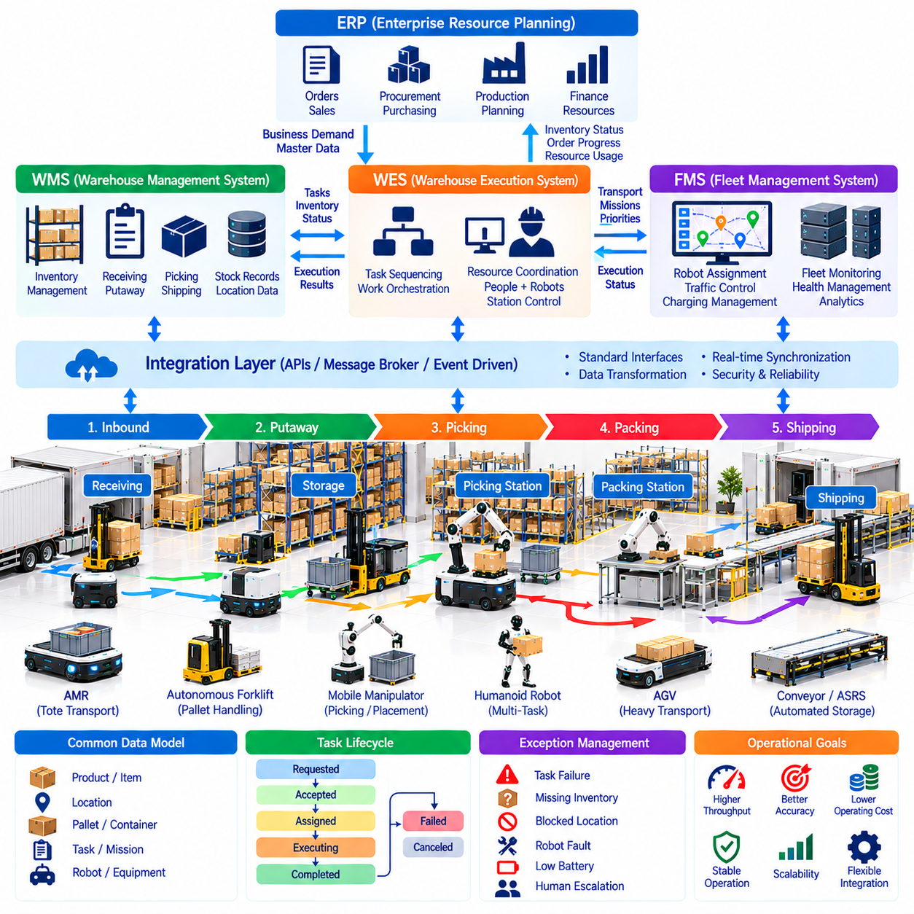{width="7.268055555555556in" height="7.268055555555556in"}

창고관리시스템(Warehouse Management System, WMS), 창고실행시스템(Warehouse Execution System, WES), 전사적 자원관리(Enterprise Resource Planning, ERP), 로봇 군집관리시스템(Fleet Management System, FMS)의 통합은 피지컬 AI(Physical AI) 물류를 위한 디지털 기반(Digital Foundation)을 구축한다. 이러한 플랫폼은 비즈니스 계획(Business Planning), 창고 운영(Warehouse Operations), 자율주행 로봇 실행(Autonomous Robot Execution)을 연결한다. 효과적인 시스템 통합(System Integration)은 일관된 정보 교환(Consistent Information Exchange), 조정된 의사결정(Coordinated Decision), 물류 환경 전반의 신뢰성 높은 자재 이동(Reliable Material Movement)을 가능하게 한다.

ERP 플랫폼은 구매(Purchasing), 판매(Sales), 재무(Finance), 생산 계획(Production Planning), 자원 할당(Resource Allocation)과 같은 기업 수준의 프로세스(Enterprise-Level Process)를 관리한다. ERP는 고객 주문(Customer Order), 조달 일정(Procurement Schedule), 목표 재고 수준(Inventory Target) 등 창고 활동에 영향을 미치는 비즈니스 요구사항(Business Requirement)을 제공한다. 창고 시스템(Warehouse System)과의 통합은 자율 물류 운영(Autonomous Logistics Operation)이 독립적인 자동화 프로젝트(Isolated Automation Project)로 기능하는 것이 아니라 조직 전체의 우선순위(Organizational Priority)를 지원하도록 한다.

WMS 플랫폼은 재고 위치(Inventory Location), 재고 수량(Stock Quantity), 입고(Receiving), 적치(Putaway), 피킹(Picking), 출하(Shipping) 활동을 관리한다. WMS는 자재가 어디에 보관되어 있으며 주문이 어떻게 처리되어야 하는지에 대한 운영 기록(Operational Record)을 유지한다. 로봇 시스템(Robotic System)과 통합되면 WMS는 운송 요구사항(Transportation Requirement)을 생성하고 재고 이동(Inventory Movement)의 완료 확인(Confirmation)을 수신한다. 정확한 동기화(Accurate Synchronization)는 물리적 재고(Physical Stock)와 디지털 기록(Digital Record) 사이의 불일치(Discrepancy)를 방지한다.

WES 플랫폼은 작업자(Human Worker), 로봇(Robot), 컨베이어(Conveyor), 자동화 설비(Automated Equipment) 사이에서 창고 작업 흐름(Warehouse Workflow)의 실행을 조정한다. WES는 창고 운영 우선순위(Warehouse Priority)를 실제 운영 순서(Operational Sequence)로 변환하고 처리 스테이션(Processing Station) 사이의 작업 부하(Workload)를 균형 있게 분배한다. 시스템 아키텍처(System Architecture)에 따라 WES 기능은 WMS 또는 FMS와 일부 중복될 수 있다. 따라서 상충하는 명령(Conflicting Command)과 중복된 스케줄링 결정(Duplicated Scheduling Decision)을 방지하려면 명확한 책임 경계(Responsibility Boundary)를 정의해야 한다.

FMS 플랫폼은 임무 할당(Mission Assignment), 교통 조정(Traffic Coordination), 로봇 상태 감시(Robot Status Monitoring), 충전 스케줄링(Charging Scheduling)을 통해 자율주행 로봇 군집(Autonomous Robot Fleet)을 관리한다. FMS는 차량의 기능(Vehicle Capability)과 안전 제약조건(Safety Constraint)을 준수하면서 운송 요청(Transportation Request)을 실행 가능한 로봇 동작(Executable Robot Action)으로 변환한다. WES 및 WMS와의 통합을 통해 로봇 군집 운영(Fleet Operation)은 변화하는 창고 우선순위(Warehouse Priority)에 대응할 수 있다. 로봇 수준 제어기(Robot-Level Controller)는 지역 자율주행(Local Navigation)과 즉각적인 안전 대응(Immediate Safety Response)에 대한 책임을 유지한다.

일반적인 시스템 통합 작업 흐름(Integration Workflow)은 ERP 시스템이 고객 수요(Customer Demand) 또는 생산 요구사항(Production Requirement)을 기록하면서 시작된다. WMS는 재고(Inventory)를 식별하고 창고 작업(Warehouse Activity)을 생성하며, WES는 실행 우선순위(Execution Priority)와 작업 순서(Task Sequence)를 결정한다. FMS는 적합한 로봇(Suitable Robot)을 선택하고 운송 임무(Transportation Mission)를 감독한다. 작업 완료 이벤트(Completion Event)는 통합 계층(Integration Layer)을 통해 상위 시스템으로 전달되어 재고 기록(Inventory Record)과 주문 상태(Order Status)가 동기화된 상태를 유지하도록 한다.

시스템 인터페이스(System Interface)는 일반적으로 응용 프로그래밍 인터페이스(Application Programming Interface, API), 메시지 브로커(Message Broker), 이벤트 기반 통신(Event-Driven Communication)을 사용한다. REST 인터페이스(REST Interface)는 구조화된 요청(Structured Request)을 지원하며, 비동기 메시징(Asynchronous Messaging)은 지속적인 폴링(Continuous Polling) 없이 시스템 간 상태 변화(Status Change)를 교환할 수 있도록 한다. 통신 아키텍처(Communication Architecture)는 명령(Command), 수신 확인(Acknowledgment), 운영 이벤트(Operational Event)를 구분해야 한다. 신뢰성 높은 인터페이스(Reliable Interface)를 위해서는 버전 관리(Version Control), 인증(Authentication), 명확하게 정의된 메시지 형식(Message Format)이 필요하다.

표준화된 데이터 모델(Standardized Data Model)은 기업용 플랫폼(Enterprise Platform)과 로봇 플랫폼(Robotics Platform)이 동일한 객체(Object)를 서로 다르게 표현하는 경우가 많기 때문에 필요하다. 제품 식별자(Product Identifier), 팔레트 참조 정보(Pallet Reference), 보관 위치(Storage Location), 로봇 임무(Robot Mission), 장비 상태(Equipment State)는 일관되게 매핑(Mapping)되어야 한다. 공통 정보 모델(Shared Information Model)은 시스템 간 모호성(Ambiguity)을 줄인다. 데이터 변환 서비스(Data Transformation Service)는 필수적인 운영 의미(Operational Meaning)와 추적성(Traceability)을 유지하면서 공급업체별 데이터 형식(Vendor-Specific Format)을 변환할 수 있다.

작업 수명주기 관리(Task Lifecycle Management)는 운송 요청(Transportation Request)이 생성부터 완료까지 어떤 과정을 거치는지 정의한다. 일반적인 상태에는 요청됨(Requested), 수락됨(Accepted), 할당됨(Assigned), 실행 중(Executing), 완료됨(Completed), 실패함(Failed), 취소됨(Canceled)이 포함된다. 각 상태 전이(State Transition)에는 권한이 부여된 책임 주체(Authorized Owner)와 정의된 이벤트 기록(Event Record)이 있어야 한다. 일관된 수명주기 의미 체계(Lifecycle Semantics)는 중복 실행(Duplicate Execution)을 방지하고, 진행 중인 임무(Active Mission)에서 시스템이 재시작되거나 통신이 중단될 때 복구(Recovery)를 가능하게 한다.

실시간 동기화(Real-Time Synchronization)는 로봇이 동적인 창고 환경(Dynamic Warehouse Environment)에서 운영될 때 특히 중요하다. 재고 이동(Inventory Movement), 작업대 가용성(Workstation Availability), 로봇 위치(Robot Location), 장비 고장(Equipment Fault)은 수초 이내에 변화할 수 있다. 이벤트 기반 업데이트(Event-Driven Update)는 오케스트레이션 플랫폼(Orchestration Platform)이 운영 변화(Operational Change)에 신속하게 대응하도록 지원한다. 그러나 모든 기업 업무 트랜잭션(Enterprise Transaction)이 즉각적인 동기화를 필요로 하는 것은 아니므로 인터페이스 설계(Interface Design)는 업데이트 주기(Update Frequency)를 비즈니스 중요도(Business Criticality)에 맞추어야 한다.

예외 관리(Exception Management)는 창고 및 로봇 프로세스(Warehouse and Robotic Process)가 예상대로 진행되지 않을 때 복구 작업(Recovery Action)을 조정한다. 누락된 팔레트(Missing Pallet), 차단된 픽업 위치(Blocked Pickup Location), 배송 실패(Unsuccessful Delivery), 로봇 고장(Robot Fault)은 서로 다른 시정 조치(Corrective Action)를 필요로 할 수 있다. 시스템 통합 작업 흐름(Integration Workflow)은 각 예외 상황(Exception)의 책임 시스템(Responsible System)과 복구 완료 확인(Recovery Confirmation) 방법을 식별해야 한다. 문제 상향 보고 절차(Escalation Procedure)는 해결되지 않은 로봇 장애(Unresolved Robotic Failure)가 부정확한 재고 기록(Inaccurate Inventory Record)이나 주문 기록(Order Record)을 발생시키는 것을 방지한다.

시스템 통합 아키텍처(Integration Architecture)는 운영 복원력(Operational Resilience)과 사이버보안(Cybersecurity)도 지원해야 한다. 네트워크 중단(Network Interruption), 중복 메시지(Duplicated Message), 지연된 응답(Delayed Response), 일시적인 시스템 장애(Temporary System Outage)가 위험한 로봇 동작(Unsafe Robot Behavior)이나 일관성이 없는 트랜잭션(Inconsistent Transaction)을 발생시켜서는 안 된다. 메시지 영속성(Message Persistence), 멱등 처리(Idempotent Processing), 접근통제(Access Control), 감사 로그(Audit Logging)는 신뢰성(Reliability)을 향상시킨다. 안전 필수 로봇 기능(Safety-Critical Robot Function)은 상위 기업 시스템과의 연결(Higher-Level Enterprise Connectivity)과 독립적으로 유효하게 작동해야 한다.

시설에 이기종 로봇(Heterogeneous Robot)과 자동화 기술(Automation Technology)이 도입될수록 확장 가능한 시스템 통합(Scalable Integration)의 중요성이 증가한다. 표준 인터페이스(Standard Interface)는 자율이동로봇(Autonomous Mobile Robot, AMR), 자율주행 지게차(Autonomous Forklift), 매니퓰레이터(Manipulator), 컨베이어(Conveyor), 보관 시스템(Storage System) 사이의 연결을 단순화할 수 있다. 모듈형 어댑터(Modular Adapter)는 공급업체 고유 프로토콜(Proprietary Vendor Protocol)에 대한 의존성을 줄인다. 효과적인 상호운용성(Interoperability)은 조직이 모든 기업 시스템 연결(Enterprise Connection)을 재설계하지 않고도 자동화 기능(Automation Capability)을 확장할 수 있도록 한다.

성능 모니터링(Performance Monitoring)은 로봇 수준 지표(Robot-Level Metric)를 창고 및 기업 운영 성과(Warehouse and Enterprise Outcome)와 연결해야 한다. FMS 데이터는 임무 소요시간(Mission Duration), 활용률(Utilization), 충전(Charging), 운영 개입(Intervention)을 설명하며, WMS와 WES 데이터는 재고 정확도(Inventory Accuracy), 주문 완료(Order Completion), 작업 흐름 처리량(Workflow Throughput)을 나타낸다. ERP 정보는 비용(Cost)과 서비스 이행 약속(Service Commitment)에 대한 비즈니스 맥락(Business Context)을 제공한다. 통합 분석(Unified Analytics)은 운영 목표(Operational Objective)와 재무 목표(Financial Objective)를 함께 고려하는 최적화(Optimization)를 지원한다.

## 03.15. Logistics KPIs TCO and Throughput

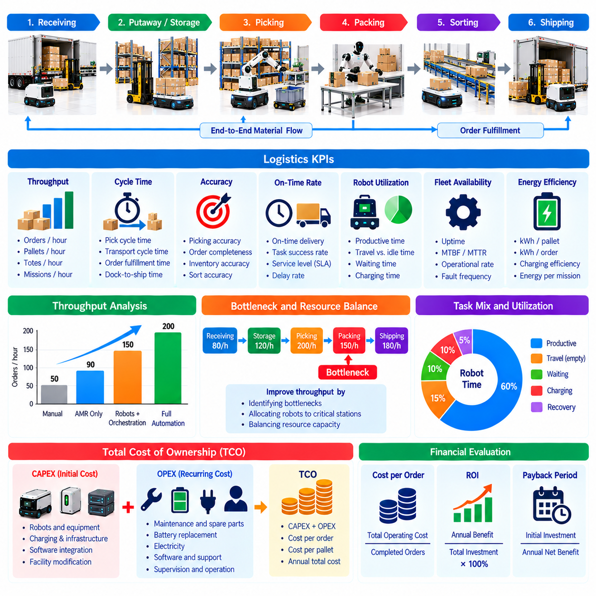{width="7.268055555555556in" height="7.268055555555556in"}

물류 핵심성과지표(Key Performance Indicator, KPI), 총소유비용(Total Cost of Ownership, TCO), 처리량(Throughput)은 피지컬 AI(Physical AI) 도입을 평가하기 위한 정량적 기반(Quantitative Foundation)을 제공한다. 자율이동로봇(Autonomous Mobile Robot, AMR), 로봇 지게차(Robotic Forklift), 자동화 화물 취급 시스템(Automated Handling System)은 측정 가능한 운영 가치(Measurable Operational Value)를 입증해야 한다. 평가는 로봇 성능(Robot Performance)을 창고 생산성(Warehouse Productivity), 서비스 품질(Service Quality), 재무적 지속가능성(Financial Sustainability), 장기적인 비즈니스 목표(Long-Term Business Objective)와 연결해야 한다.

물류 핵심성과지표(Logistics KPI)는 창고 자원(Warehouse Resource)이 입고 자재(Incoming Material)와 고객 주문(Customer Order)을 완료된 작업(Completed Operation)으로 얼마나 효과적으로 전환하는지 측정한다. 일반적인 지표에는 시간당 처리 주문 수(Orders Processed per Hour), 운송 팔레트 수(Pallets Transported), 피킹 정확도(Picking Accuracy), 배송 완료시간(Delivery Completion Time), 장비 가용성(Equipment Availability)이 포함된다. 지표는 시설(Facility)과 운영 기간(Operating Period) 전반에서 일관되게 정의되어야 한다. 명확한 측정 범위(Measurement Boundary)는 수작업 방식(Manual Workflow)과 자동화 작업 흐름(Automated Workflow) 사이에서 잘못된 비교가 발생하는 것을 방지한다.

처리량(Throughput)은 지정된 기간(Specified Period) 동안 완료된 물류 작업량(Quantity of Logistics Work)을 나타낸다. 처리량은 시간당 주문(Order), 상자(Carton), 토트(Tote), 팔레트(Pallet), 운송 임무(Transportation Mission)의 수로 측정할 수 있다. 로봇 임무 처리량(Robot Mission Throughput)은 개별 이동(Individual Movement)이 반드시 고객 주문 완료(Completed Customer Order)로 이어지는 것은 아니므로 창고 처리량(Warehouse Throughput)과 구분된다. 따라서 시스템 평가(System Evaluation)는 운송 활동(Transportation Activity)과 실제 주문 이행 결과(Actual Fulfillment Output)를 구별해야 한다.

창고 처리량(Warehouse Throughput)은 로봇 속도(Robot Speed)만이 아니라 상호 연결된 처리 단계(Interconnected Processing Stage)에 의해 제한된다. 입고(Receiving), 보관(Storage), 피킹(Picking), 운송(Transportation), 분류(Sorting), 포장(Packing)은 상호 의존적인 프로세스(Dependent Process)로 작동한다. 특정 작업대(Workstation)에서 발생하는 병목 현상(Bottleneck)은 다른 장비의 활용률(Equipment Utilization)이 낮더라도 전체 생산량(Total Output)을 제한할 수 있다. 피지컬 AI 오케스트레이션(Physical AI Orchestration)은 이러한 제약조건(Constraint)을 식별하고 전체 자재 흐름(End-to-End Material Flow)을 개선하도록 자원을 할당해야 한다.

로봇 활용률(Robot Utilization)은 사용 가능한 운영 시간(Available Operating Time) 중 생산적인 활동(Productive Activity)을 수행하는 시간의 비율을 측정한다. 높은 활용률(High Utilization)은 효율적인 자원 사용(Efficient Resource Use)을 의미할 수 있지만, 지나치게 높은 활용률(Excessive Utilization)은 혼잡(Congestion)을 발생시키고 운영 유연성(Operational Flexibility)을 감소시킬 수 있다. 생산적인 이동(Productive Movement)은 공차 이동(Empty Travel), 대기(Waiting), 충전(Charging), 복구(Recovery)와 구분되어야 한다. 균형 잡힌 활용률(Balanced Utilization)은 수요 집중 시간대(Demand Peak)와 예상하지 못한 운영 중단(Unexpected Disruption)에 대응할 수 있는 예비 용량(Reserve Capacity)을 제공한다.

사이클 타임(Cycle Time)은 정의된 물류 프로세스(Defined Logistics Process)를 완료하는 데 필요한 경과시간(Elapsed Duration)을 측정한다. 운송 사이클 타임(Transportation Cycle Time)에는 작업 할당(Task Assignment), 픽업 지점까지의 이동(Travel to Pickup), 적재(Loading), 적재 상태 이동(Loaded Movement), 하역(Unloading), 완료 확인(Confirmation)이 포함될 수 있다. 주문 이행 사이클 타임(Order Fulfillment Cycle Time)에는 추가적인 창고 작업(Warehouse Activity)이 포함된다. 사이클 타임을 세부 구성요소(Component)로 분해하면 지연(Delay)이 로봇 자율주행(Robot Navigation), 작업대 가용성(Workstation Availability), 시스템 조정(System Coordination) 중 어디에서 발생하는지 식별하는 데 도움이 된다.

서비스 품질 핵심성과지표(Service Quality KPI)는 자동화 시스템(Automation System)이 운영상 약속(Operational Commitment)을 얼마나 신뢰성 있게 이행하는지 평가한다. 정시 배송률(On-Time Delivery Rate), 작업 성공률(Task Success Rate), 피킹 정확도(Picking Accuracy), 주문 완전성(Order Completeness)은 중요한 지표이다. 예외 발생 빈도(Exception Frequency)와 인간 개입 요구사항(Human Intervention Requirement)은 처리량만으로는 파악하기 어려운 취약점(Weakness)을 보여준다. 성능 평가(Performance Evaluation)는 수요 집중 시간대(Peak Demand), 교대근무 전환(Shift Transition), 장비 장애(Equipment Disturbance) 상황에서의 서비스 일관성(Service Consistency)을 고려해야 한다.

로봇 군집 가용성(Fleet Availability)은 예정된 운영 시간(Scheduled Operating Time) 중 로봇이 할당된 임무(Assigned Mission)를 수행할 수 있는 상태에 있는 시간의 비율을 나타낸다. 가용성(Availability)은 기계적 고장(Mechanical Failure), 소프트웨어 오류(Software Fault), 충전(Charging), 유지보수(Maintenance), 통신 중단(Communication Interruption)의 영향을 받는다. 평균고장간격(Mean Time Between Failures, MTBF)과 평균수리시간(Mean Time To Repair, MTTR)은 추가적인 신뢰성 정보(Reliability Information)를 제공한다. 높은 가용성(High Availability)은 예측 가능한 용량 계획(Capacity Planning)과 서비스 연속성(Service Continuity)을 지원한다.

에너지 효율(Energy Efficiency)은 운영 비용(Operating Cost)과 로봇 군집 생산성(Fleet Productivity)에 모두 영향을 미친다. 유용한 측정 지표에는 운송 팔레트당 에너지 소비량(Energy Consumed per Transported Pallet), 완료 주문당 에너지 소비량(Energy Consumed per Completed Order), 운송 임무당 에너지 소비량(Energy Consumed per Transportation Mission)이 포함된다. 배터리 충전 손실(Battery Charging Loss), 대기 전력 소비(Standby Consumption), 환경 조건(Environmental Condition)도 관련성이 있는 경우 반영해야 한다. 에너지 인지형 스케줄링(Energy-Aware Scheduling)은 불필요한 이동(Unnecessary Movement)과 충전 충돌(Charging Conflict)을 줄일 수 있지만, 절감 효과(Savings)는 실제 운영 산출량(Actual Operational Output)을 기준으로 평가해야 한다.

총소유비용(Total Cost of Ownership, TCO)은 물류 자동화 시스템(Logistics Automation System)을 구매하고 도입하며 운영, 유지보수하고 최종적으로 교체하는 데 발생하는 누적 비용(Cumulative Cost)을 의미한다. 초기 비용(Initial Cost)에는 로봇(Robot), 충전 스테이션(Charging Station), 안전 장비(Safety Equipment), 소프트웨어 통합(Software Integration), 시설 개조(Facility Modification)가 포함된다. 반복 비용(Recurring Expense)에는 유지보수(Maintenance), 배터리(Battery), 소프트웨어 구독료(Software Subscription), 운영 감독(Supervision), 전력(Electricity), 보험(Insurance), 기술 지원(Technical Support)이 포함된다.

총소유비용 분석(TCO Analysis)은 자본적 지출(Capital Expenditure, CAPEX)과 운영비용(Operating Expenditure, OPEX)을 구분해야 한다. CAPEX에는 일반적으로 장비 구매(Equipment Purchase), 설치(Installation), 인프라(Infrastructure), 초기 시스템 통합(Initial Integration)이 포함된다. OPEX에는 지속적인 인건비(Labor Cost), 에너지 비용(Energy Cost), 수리비(Repair Cost), 소프트웨어 서비스(Software Service), 운영 지원(Operational Support)이 포함된다. 감가상각(Depreciation)은 회계상 결과(Accounting Result)에 영향을 미치지만 추가적인 현금 지출(Additional Cash Payment)은 아니다. 일관된 비용 처리(Consistent Cost Treatment)는 재무적 비교(Financial Comparison)에서 이중 계산(Double Counting)을 방지한다.

완료 물류 단위당 비용(Cost per Completed Logistics Unit)은 재무적 지출(Financial Expenditure)을 생산적인 산출량(Productive Output)과 연결한다. 이 지표는 동일한 기간(Same Period)에 발생한 관련 운영 비용(Relevant Operating Cost)을 성공적으로 완료된 주문(Order), 팔레트(Pallet), 임무(Mission)의 수로 나누어 계산할 수 있다. 분모(Denominator)는 비교 대상(Alternative) 사이에서 동등한 서비스 결과(Equivalent Service Outcome)를 나타내야 한다. 로봇 운영 비용(Robot Operating Cost)이 낮더라도 운영 감독(Supervision), 인프라(Infrastructure), 후속 공정 지연(Downstream Delay)이 상당하면 전체 주문 이행 비용(Fulfillment Cost)이 낮아진다고 보장할 수 없다.

투자수익률(Return on Investment, ROI)은 자동화(Automation)를 통해 얻는 경제적 편익(Economic Benefit)을 투입된 자원(Committed Resource)과 비교한다. 편익에는 반복적인 인력 작업 감소(Reduced Repetitive Labor), 처리량 증가(Increased Throughput), 화물 취급 오류 감소(Fewer Handling Errors), 서비스 가용성 향상(Improved Service Availability)이 포함될 수 있다. 그러나 예상 절감액(Projected Savings)은 달성 가능한 활용률(Achievable Utilization)과 실제 프로세스 재설계(Actual Process Redesign)에 따라 달라진다. 재무 모델(Financial Model)은 측정 가능한 비용 절감(Measurable Cost Reduction)과 즉각적인 현금 절감(Immediate Cash Saving)으로 이어지지 않는 생산성 향상(Productivity Improvement)을 구분해야 한다.

투자 회수기간(Payback Period)은 누적 순현금 편익(Cumulative Net Cash Benefit)이 초기 투자금(Initial Investment)을 회수하는 데 필요한 기간을 추정한다. 할인현금흐름 분석(Discounted Cash Flow, DCF)은 미래 현금흐름(Future Cash Flow)의 발생 시점(Timing)과 위험(Risk)을 추가로 고려한다. 순현재가치(Net Present Value, NPV)는 정의된 계획 기간(Planning Horizon)에 걸쳐 서로 다른 도입 전략(Deployment Strategy)을 비교하는 데 활용할 수 있다. 민감도 분석(Sensitivity Analysis)은 수요 변동성(Demand Variability), 유지보수 비용(Maintenance Cost), 인건비 가정(Labor Assumption), 장비 교체 주기(Equipment Replacement Interval)를 검토해야 한다.

## 03.16. Logistics Fleet Economics Model [w/Code]

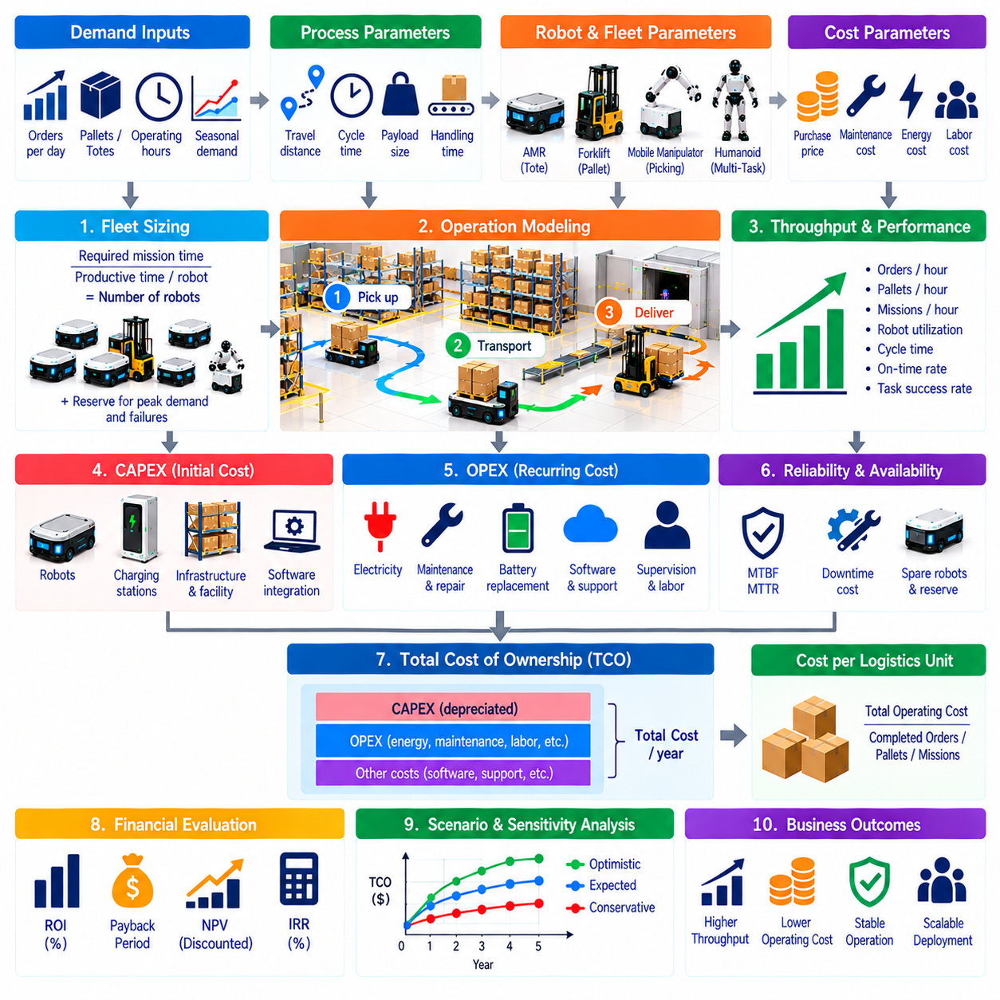{width="7.268055555555556in" height="7.268055555555556in"}

물류 로봇 군집 경제성 모델(Logistics Fleet Economics Model)은 피지컬 AI(Physical AI) 로봇 군집의 재무적 성과(Financial Performance)와 운영 성능(Operational Performance)을 평가하기 위한 정량적 프레임워크(Quantitative Framework)를 제공한다. 이 모델은 로봇 도입 비용(Robot Acquisition Cost), 군집 운영 용량(Fleet Capacity), 인력 요구사항(Labor Requirement), 유지보수 비용(Maintenance Expense), 물류 처리량(Logistics Throughput)을 연결한다. 또한 자율 운영(Autonomous Operation)이 지속 가능한 총비용(Total Cost)으로 기존과 동등하거나 향상된 서비스를 제공할 수 있는지 추정하여 투자 의사결정(Investment Decision)을 지원한다.

로봇 군집 경제성(Fleet Economics)은 로봇이 수행해야 하는 운영 작업 부하(Operational Workload)를 정의하는 것에서 시작한다. 주요 입력 변수(Input Variable)에는 일일 운송 임무(Daily Transportation Mission), 운영 시간(Operating Hour), 평균 이동 거리(Average Travel Distance), 적재 요구사항(Payload Requirement), 계절적 수요 변동(Seasonal Demand Fluctuation)이 포함된다. 군집 용량(Fleet Capacity)은 운영 변동성(Operational Variability)에 대응해야 하므로 모델은 평균 작업 부하(Average Workload)와 최대 수요(Peak Demand)를 구분해야 한다. 정확한 수요 가정(Demand Assumption)은 과잉 투자(Overinvestment)나 용량 부족(Insufficient Capacity)을 방지하는 데 필수적이다.

로봇 군집 규모 산정(Robot Fleet Sizing)은 물류 수요(Logistics Demand)를 안정적인 운영에 필요한 차량 대수(Number of Vehicles)로 변환한다. 기본적인 추정 방법(Basic Estimation Method)은 전체 요구 임무 시간(Total Required Mission Time)을 로봇 한 대당 가용 생산 시간(Productive Time Available per Robot)으로 나누는 것이다. 생산 시간(Productive Time)에서는 충전(Charging), 유지보수(Maintenance), 대기(Waiting), 예상 중단시간(Expected Interruption)을 제외한다. 최대 수요(Peak Demand)와 장비 고장(Equipment Failure)에 대응하기 위해 추가적인 예비 용량(Reserve Capacity)이 필요할 수 있다. 따라서 군집 규모 산정은 이론적인 최대 성능(Theoretical Maximum Performance)이 아니라 달성 가능한 활용률(Achievable Utilization)을 반영해야 한다.

임무 사이클 타임(Mission Cycle Time)은 로봇 군집 경제성(Fleet Economics)의 핵심 변수(Central Variable)이다. 여기에는 픽업 지점까지의 이동(Travel to Pickup), 적재(Loading), 적재 상태 운송(Loaded Transportation), 하역(Unloading), 완료 확인(Confirmation), 예상 대기시간(Expected Waiting Period)이 포함된다. 평균 사이클 타임(Average Cycle Time)에 임무 수행량(Mission Volume)을 곱하면 전체 운송 작업 부하(Total Transportation Workload)가 결정된다. 혼잡(Congestion)과 작업대 지연(Workstation Delay)은 바쁜 시간대에 사이클 타임을 증가시켜 로봇 군집의 실질적인 처리 용량(Effective Fleet Capacity)을 감소시킬 수 있으므로 변동성(Variability)을 고려해야 한다.

자본적 지출(Capital Expenditure, CAPEX)에는 로봇 구매(Robot Purchase), 충전 장비(Charging Equipment), 인프라 개조(Infrastructure Modification), 안전 시스템(Safety System), 초기 소프트웨어 통합(Initial Software Integration)이 포함된다. 배포 비용(Deployment Cost)에는 지도 작성(Mapping), 시운전 및 초기 설정(Commissioning), 운영자 교육(Operator Training), 인수 시험(Acceptance Testing)도 포함될 수 있다. 이러한 지출은 적절한 투자 항목(Investment Category)에 배분되어야 한다. 군집 확장 시나리오(Fleet Expansion Scenario)는 새로운 로봇이 모두 독립적으로 운영된다고 가정하지 않고 추가적인 인프라 용량(Additional Infrastructure Capacity)을 고려해야 한다.

운영비용(Operating Expenditure, OPEX)에는 전력(Electricity), 예방 정비(Preventive Maintenance), 수리(Repair), 배터리 교체(Battery Replacement), 소프트웨어 구독료(Software Subscription), 통신 연결(Connectivity), 기술 지원(Technical Support)이 포함된다. 운송 작업이 자동화되더라도 원격 감독(Remote Supervision)과 현장 개입(Onsite Intervention)으로 인해 지속적인 인건비(Labor Expense)가 발생할 수 있다. 운영비용은 현실적인 가동 주기(Duty Cycle)와 장비 신뢰성(Equipment Reliability)을 기준으로 추정해야 한다. 고정비(Fixed Expense)와 변동비(Variable Expense)를 구분하면 활용률(Utilization)에 따라 군집 경제성이 어떻게 변화하는지 설명할 수 있다.

인력 경제성(Labor Economics)은 자동화된 작업 흐름(Automated Workflow)을 실제로 대체하거나 지원하는 인간의 작업(Human Activity)과 비교해야 한다. 로봇은 반복적인 운송 작업(Repetitive Transportation)을 줄일 수 있지만 적재(Loading), 하역(Unloading), 예외 처리(Exception Handling), 감독(Supervision) 업무는 그대로 남을 수 있다. 인건비 절감(Labor Saving)은 단순히 로봇 대수(Robot Count)에 직원 임금(Employee Wage)을 곱하는 방식이 아니라 실제로 절감 가능한 근로시간(Recoverable Working Hour)을 반영해야 한다. 인력 재배치(Redeployment), 교대근무 대응(Shift Coverage), 서비스 확장(Service Expansion)은 별도의 재무적 처리(Financial Treatment)가 필요한 편익을 창출할 수 있다.

처리량 경제성(Throughput Economics)은 유용한 물류 작업(Useful Logistics Work)을 완료하는 데 발생하는 비용을 측정한다. 임무당 비용(Cost per Mission), 팔레트 이동당 비용(Cost per Pallet Movement), 주문 이행당 비용(Cost per Fulfilled Order)은 서로 다른 평가 관점(Alternative Perspective)을 제공한다. 선택한 측정 단위(Selected Unit)는 평가 대상 비즈니스 프로세스(Business Process)와 일치해야 한다. 운송 임무당 비용(Transportation Cost per Mission)이 낮더라도 후속 공정(Downstream Operation)에 제약이 남아 있다면 그 가치는 제한적일 수 있다. 따라서 전체 공정 처리량(End-to-End Throughput)은 핵심 평가 목표(Primary Evaluation Objective)로 유지되어야 한다.

로봇 군집 활용률(Fleet Utilization)은 완료된 임무(Completed Mission)에 고정비(Fixed Cost)가 어떻게 배분되는지에 영향을 미친다. 일반적으로 활용률(Higher Utilization)이 높아지면 작업당 자본비용(Capital Cost per Task)이 감소하지만, 최대 용량(Maximum Capacity)에 근접한 운영은 혼잡(Congestion)과 서비스 지연(Service Delay)을 증가시킬 수 있다. 모델은 사이클 타임 변동성(Cycle-Time Variability)과 예비 용량 요구사항(Reserve Requirement)을 활용률과 함께 평가해야 한다. 지속 가능한 경제성(Sustainable Economics)은 일반적으로 운영 유연성(Operational Flexibility)을 제거하지 않으면서 충분한 생산 활동(Productive Activity)을 유지하는 데 달려 있다.

배터리 및 충전 경제성(Battery and Charging Economics)은 자본 투자 요구사항(Capital Requirement)과 생산 용량(Productive Capacity)에 모두 영향을 미친다. 충전 스테이션(Charging Station)은 투자가 필요하며 충전 시간(Charging Time)은 로봇 가용성(Robot Availability)을 감소시킨다. 배터리 노화(Battery Aging)는 교체 비용(Replacement Cost)을 발생시키고 사용 가능한 운영 시간(Usable Operating Hour)을 줄일 수 있다. 기회 충전(Opportunity Charging)과 자동 도킹(Automated Docking)은 적절하게 스케줄링될 경우 로봇 군집 생산성(Fleet Productivity)을 향상시킬 수 있다. 모델은 충전 인프라(Charging Infrastructure)를 전체 운영 시스템(Complete Operating System)의 일부로 고려해야 한다.

신뢰성 경제성(Reliability Economics)은 고장(Failure), 수리(Repair), 운영 중단(Operational Interruption)이 발생시키는 재무적 영향을 반영한다. 평균고장간격(Mean Time Between Failures, MTBF)과 평균수리시간(Mean Time To Repair, MTTR)은 장비 가용성(Equipment Availability)을 추정하는 데 도움이 된다. 예상하지 못한 가동 중단(Unexpected Downtime)은 예비 로봇(Spare Robot), 수작업 운송(Manual Transportation), 주문 이행 지연(Delayed Fulfillment)을 필요로 할 수 있다. 유지보수 계획(Maintenance Planning)은 이러한 위험을 줄일 수 있지만 신뢰성 가정(Reliability Assumption)은 낙관적인 공급업체 사양(Vendor Specification)이 아니라 실제 운영 근거(Operating Evidence)를 바탕으로 해야 한다.

재무 평가(Financial Evaluation)는 자율 로봇 군집(Autonomous Fleet)을 명확하게 정의된 기준 운영 모델(Baseline Operating Model)과 비교한다. 기준 모델(Baseline Model)은 수작업 운송(Manual Transportation), 기존 자동화(Existing Automation), 하이브리드 프로세스(Hybrid Process)를 나타낼 수 있다. 증분 현금흐름(Incremental Cash Flow)에는 제안된 배포(Deployment)에 기인하는 회피 비용(Avoided Cost), 추가 비용(Additional Expense), 투자(Investment)가 포함된다. 투자 회수기간(Payback Period), 순현재가치(Net Present Value, NPV), 투자수익률(Return on Investment, ROI)은 재무적 매력도(Financial Attractiveness)를 평가하는 상호 보완적인 지표를 제공한다.

시나리오 분석(Scenario Analysis)은 서로 다른 운영 조건(Operational Condition)에서 경제적 결과(Economic Result)가 어떻게 변화하는지 검증한다. 수요 증가(Demand Growth), 인건비 상승(Labor Cost Increase), 로봇 가용성 감소(Reduced Robot Availability), 유지보수 비용 증가(Higher Maintenance Expense)는 결과에 상당한 영향을 미칠 수 있다. 보수적 시나리오(Conservative Scenario), 예상 시나리오(Expected Scenario), 낙관적 시나리오(Optimistic Scenario)는 불확실성(Uncertainty)을 파악하는 데 도움이 된다. 민감도 분석(Sensitivity Analysis)은 군집 규모(Fleet Size), 임무당 비용(Cost per Mission), 투자 회수(Investment Recovery)에 가장 큰 영향을 미치는 가정(Assumption)을 식별한다.

실용적인 로봇 군집 경제성 모델(Practical Fleet Economics Model)은 운영 시뮬레이션(Operational Simulation)과 재무 계산(Financial Calculation)을 통합해야 한다. 시뮬레이션(Simulation)은 현실적인 작업 부하(Realistic Workload)에서 임무 완료(Mission Completion), 혼잡(Congestion), 충전 수요(Charging Demand), 군집 가용성(Fleet Availability)을 추정한다. 이러한 결과는 비용 및 현금흐름 계산(Cost and Cash-Flow Calculation)의 입력 데이터(Input Data)가 된다. 실제 배포 데이터(Actual Deployment Data)와 지속적으로 비교하면 모델 보정(Model Calibration)이 가능해지고, 피지컬 AI 물류 운영(Physical AI Logistics Operation)이 확장됨에 따라 더욱 신뢰성 높은 투자 계획(Investment Planning)을 수립할 수 있다.
