**Volume 12. Physical AI Business and Industry Applications**

# Chapter 04. Healthcare Applications

## 04.01. Physical AI in Healthcare

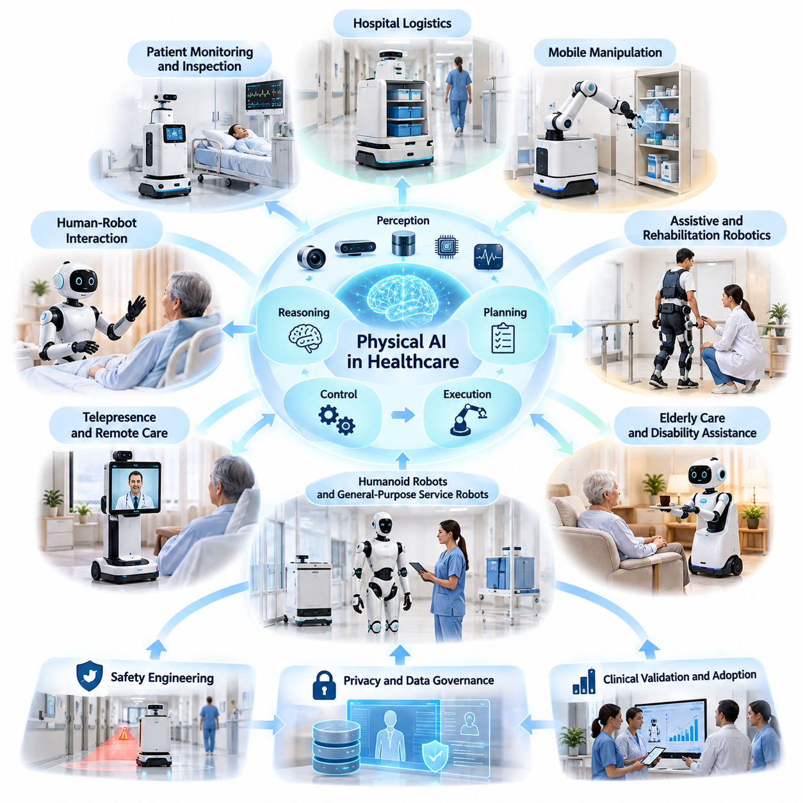{width="7.268055555555556in" height="7.268055555555556in"}

의료 분야의 피지컬 인공지능(Physical AI)은 인공지능(Artificial Intelligence), 로봇공학(Robotics), 센싱(Sensing), 자율 제어(Autonomous Control)를 의료 및 돌봄 환경에 통합하는 기술을 의미한다. 주로 디지털 정보를 분석하는 기존 의료 인공지능과 달리, 피지컬 인공지능은 환자, 의료진, 의료 장비 및 물리적 환경과 직접 상호작용한다. 핵심 목적은 지능형 연산(Intelligent Computation)을 안전하고 유용하며 측정 가능한 물리적 행동(Physical Actions)으로 전환하는 것이다.

의료 환경(Healthcare Environments)은 복잡한 업무 흐름(Workflows), 취약한 환자, 엄격한 안전 요구사항(Safety Requirements), 지속적으로 변화하는 환경 조건이 결합되어 있어 자율 시스템(Autonomous Systems)에 특별한 과제를 제시한다. 병원, 재활센터, 요양시설 및 가정 돌봄 환경에서는 공유 공간을 자율적으로 이동하고, 인간의 활동을 인식하며, 물체를 조작하고, 예기치 않은 상황에 적절하게 대응할 수 있는 지능형 기계(Intelligent Machines)가 필요하다.

의료 피지컬 인공지능의 기본 아키텍처(Architecture)는 인지(Perception), 추론(Reasoning), 계획(Planning), 제어(Control), 물리적 실행(Physical Execution)을 통합한다. 카메라(Camera), 깊이 센서(Depth Sensors), 라이다(LiDAR), 힘 센서(Force Sensors), 생리학적 모니터링 장치(Physiological Monitoring Devices)는 환경과 환자 상태에 관한 정보를 제공한다. 인공지능 모델(AI Models)은 이러한 관측 정보를 해석하고 시스템 상태를 추정하여 이동 플랫폼(Mobile Platforms), 로봇 매니퓰레이터(Robotic Manipulators), 보조 기구(Assistive Mechanisms)를 통해 실행할 행동을 생성한다.

병원 물류(Hospital Logistics)는 의료시설에서 의약품, 의료 소모품, 검사 검체, 식사, 린넨 및 장비를 지속적으로 운반해야 하므로 가장 실용적인 적용 분야 중 하나이다. 자율이동로봇(Autonomous Mobile Robots, AMR)은 부서 간 물품을 운송하면서 반복적인 운반 업무를 줄일 수 있다. 성공적인 도입을 위해서는 신뢰성 높은 자율주행(Autonomous Navigation), 안전한 적재물 취급(Payload Handling), 기존 병원 운영체계와의 조정 및 연계가 필요하다.

이동형 매니퓰레이션(Mobile Manipulation)은 로봇이 물리적 물체와 직접 상호작용하도록 함으로써 의료 자동화의 범위를 단순 운송 이상으로 확장한다. 이동형 매니퓰레이터(Mobile Manipulator)는 자율 이동 기능과 로봇 팔(Robotic Arms), 그리퍼(Grippers), 인지 시스템(Perception Systems)을 결합하여 의료 물품 회수, 용기 이동, 장비 준비 등의 작업을 수행한다. 이러한 기능에는 정밀한 객체 인식(Object Recognition), 충돌 회피(Collision Avoidance), 힘 제어(Force Control), 변화하는 작업 공간에 대한 적응 능력이 필요하다.

보조 및 재활 로봇공학(Assistive and Rehabilitation Robotics)은 피지컬 인공지능을 인간의 이동성, 기능 회복 및 일상생활 활동에 직접 적용한다. 로봇 외골격(Robotic Exoskeletons), 지능형 재활 장치(Intelligent Rehabilitation Devices), 보조 매니퓰레이터(Assistive Manipulators)는 개인별 요구에 따라 제어된 물리적 지원을 제공할 수 있다. 적응형 제어 알고리즘(Adaptive Control Algorithms)은 측정된 수행 능력에 따라 움직임 보조 수준을 조정하며, 치료 결정과 적절한 감독에 대한 책임은 의료 전문가가 유지한다.

고령자 돌봄(Elderly Care)과 장애인 지원(Disability Assistance)은 인간 중심 피지컬 인공지능(Human-Centered Physical AI)의 또 다른 중요한 적용 분야이다. 지능형 이동 장치(Intelligent Mobility Devices)와 서비스 로봇(Service Robots)은 물체 회수, 운송, 주변 환경과의 상호작용 및 일상 활동을 지원할 수 있다. 이러한 시스템은 신체 능력, 의사소통 선호도, 생활환경의 차이를 수용해야 한다. 효과적인 지원은 인간관계나 돌봄 서비스를 불필요하게 대체하지 않으면서 개인의 독립성을 강화하는 방향으로 설계되어야 한다.

휴머노이드 로봇(Humanoid Robots)과 범용 서비스 로봇(General-Purpose Service Robots)은 인간을 위해 설계된 환경에서 다양한 활동을 수행할 가능성을 제공한다. 인간 친화적 형태(Human-Compatible Morphology)는 기존 가구, 출입문, 작업대 및 장비 주변에서 로봇이 작동하는 데 도움이 될 수 있다. 그러나 인간과 유사한 외형만으로 실질적인 가치가 확보되지는 않는다. 신뢰성(Reliability), 작업 성능(Task Performance), 안전성(Safety), 유지보수성(Maintainability), 운영 비용(Operational Cost)이 해당 플랫폼의 적합성을 결정한다.

환자 모니터링(Patient Monitoring)과 자율 점검(Autonomous Inspection)은 의료 피지컬 인공지능의 또 다른 활용 영역을 형성한다. 환경 및 의료 센싱 기술(Medical Sensing Technologies)을 탑재한 이동형 시스템은 관측 정보를 수집하고, 장비 상태를 점검하거나, 운영상의 이상을 식별할 수 있다. 이러한 기능에서는 자동화된 관측(Automated Observation)과 임상적 해석(Clinical Interpretation)을 명확하게 구분해야 한다. 의료적 판단과 개입은 검증된 절차와 적절한 전문가 감독에 따라 수행되어야 한다.

원격 현장감(Telepresence)과 원격 돌봄 로봇공학(Remote-Care Robotics)은 물리적 이동 기능과 통신 기술을 결합하여 의료 전문가의 활동 범위를 확장한다. 원격 조작(Remote Operation) 또는 부분 자율화(Partial Autonomy)가 적용된 플랫폼은 의료 공간을 이동하면서 환자와 의료진 사이에 영상 및 음성 연결을 제공할 수 있다. 이러한 시스템은 개인정보 보호(Privacy), 통신 연결성(Connectivity), 주행 안전성(Navigation Safety), 인간 감독(Human Supervision)이 적절하게 확보될 때 의료 상담과 일상적인 의사소통에 대한 접근성을 향상시킬 수 있다.

인간-로봇 상호작용(Human-Robot Interaction, HRI)은 의료 로봇이 질병, 통증, 스트레스 또는 이동 능력 저하를 경험하는 사람들과 가까운 거리에서 작동하기 때문에 특히 중요하다. 로봇의 행동은 이해하기 쉽고 예측 가능하며 인간을 존중해야 한다. 음성 인터페이스(Speech Interfaces), 시각적 표시(Visual Indicators), 제스처 인식(Gesture Recognition), 다중모달 상호작용(Multimodal Interaction)은 의사소통을 개선할 수 있지만, 중요한 명령에는 확인 절차(Confirmation Mechanisms)가 필요하다. 또한 로봇은 불확실성이 높아 인간의 개입이 필요한 상황을 인식해야 한다.

안전 공학(Safety Engineering)은 기존 로봇의 위험 요소와 의료 환경에 특화된 위험을 모두 다루어야 한다. 충돌 방지(Collision Prevention), 속도 제한(Speed Limitations), 비상 정지(Emergency Stopping), 안전한 물체 조작(Safe Manipulation), 고장 복구(Fault Recovery)는 필수적인 기술 역량이다. 추가적으로 감염 예방(Infection Prevention), 오염 관리(Contamination Control), 환자 식별(Patient Identification), 안전한 물품 취급(Secure Material Handling)이 고려되어야 한다. 위험 평가(Risk Assessment)는 평균적인 작업 성공률에만 의존하지 않고 오류가 발생했을 때의 결과까지 고려해야 한다.

개인정보 보호(Privacy)와 데이터 거버넌스(Data Governance)는 로봇 시스템이 환자의 영상, 음성, 위치, 움직임 또는 의료정보를 수집할 때 매우 중요해진다. 의료 피지컬 인공지능에는 통제된 데이터 수집(Controlled Data Collection), 적절한 동의 또는 법적 권한, 접근 제한(Access Restrictions), 암호화(Encryption), 감사 가능한 데이터 처리(Auditable Processing)가 필요하다. 학습 및 운영 데이터셋(Datasets)은 민감도에 따라 관리되어야 하며, 보존 기간, 2차 활용, 책임 있는 모델 개선에 관한 명확한 정책이 마련되어야 한다.

병원 정보시스템(Hospital Information Systems) 및 운영 업무 흐름(Operational Workflows)과의 통합은 지속 가능한 도입을 위해 필수적이다. 로봇은 일정 관리 시스템(Scheduling Systems), 전자의무기록(Electronic Health Records, EHR), 재고관리 플랫폼(Inventory Platforms), 건물 인프라(Building Infrastructure), 군집 로봇 관리 소프트웨어(Fleet Management Software)와 승인된 정보를 교환해야 할 수 있다. 상호운용성(Interoperability)은 작업의 조정과 실행을 가능하게 하지만, 시스템 인터페이스는 사이버보안(Cybersecurity), 데이터 무결성(Data Integrity), 책임 추적성(Accountability), 통신 장애 시 운영 연속성을 보장해야 한다.

임상 검증(Clinical Validation)과 운영 평가(Operational Evaluation)는 서로 다른 목적을 가지면서도 상호보완적인 역할을 수행한다. 임상 검증은 시스템이 의도된 의료 용도에 대해 안전하고 효과적인지를 평가하는 반면, 운영 평가는 실제 의료 업무 흐름에서의 성능을 측정한다. 주요 성과 지표(Performance Indicators)에는 작업 완료율(Task Completion Rate), 배송 정확도(Delivery Accuracy), 개입 빈도(Intervention Frequency), 가용성(Availability), 응답 시간(Response Time), 의료진 업무 부담(Staff Workload), 환자 경험(Patient Experience), 안전 관련 사고 발생 여부가 포함된다.

의료 피지컬 인공지능의 경제적 가치(Economic Value)는 개별 수작업을 대체하는 것 이상의 요소에 의해 결정된다. 잠재적 이점에는 서비스 가용성(Service Availability) 향상, 운송 지연 감소, 물류 운영의 일관성 개선, 의료 전문가가 환자 진료에 집중할 수 있는 시간 확보가 포함된다. 이러한 이점은 초기 도입 비용(Acquisition Costs), 시스템 통합 비용(Integration Expenses), 유지보수(Maintenance), 인프라 변경(Infrastructure Modifications), 교육훈련(Training), 사이버보안 및 지속적인 기술 지원 비용과 비교하여 평가해야 한다.

도입 전략(Adoption Strategies)은 명확하게 정의된 활용 사례(Use Cases), 측정 가능한 요구사항(Measurable Requirements), 관리 가능한 운영 위험(Operational Risks)에서 출발해야 한다. 구조화된 환경에서 반복적으로 수행되는 물류 작업은 초기 도입에 적합할 수 있지만, 환자와 직접 접촉하는 응용 분야는 일반적으로 더 광범위한 검증이 요구된다. 시범사업(Pilot Projects)은 성능 기준선(Performance Baselines)을 설정하고, 실패 조건(Failure Conditions)을 기록하며, 사용자 피드백(User Feedback)을 수집하고, 확대 도입 이전에 안정적인 운영을 입증해야 한다.

의료 피지컬 인공지능의 장기적인 발전은 다중모달 파운데이션 모델(Multimodal Foundation Models), 적응형 로봇 제어(Adaptive Robotic Control), 공유 환경 이해(Shared Environmental Understanding), 전문화된 로봇들의 협력 군집(Coordinated Robot Fleets)을 중심으로 이루어질 것이다. 이러한 기술은 다양한 의료 작업에 대한 유연성을 향상시킬 수 있지만, 일반화 능력(Generalization)은 현실적인 조건에서 검증되어야 한다. 신뢰성 있는 도입은 물리적 안전장치(Physical Safeguards), 검증된 행동(Validated Behavior), 책임 있는 인간 감독에 지속적으로 의존한다.

궁극적으로 의료 피지컬 인공지능은 단순한 자율 로봇(Autonomous Robots)의 집합이 아니라 지능형 물리 서비스 인프라(Intelligent Physical Service Infrastructure)로 이해되어야 한다. 성공 여부는 기술적 역량(Technical Capabilities)을 임상적 우선순위(Clinical Priorities), 인간의 요구(Human Needs), 운영 요구사항(Operational Requirements), 지속 가능한 비즈니스 모델(Sustainable Business Models)과 얼마나 효과적으로 연계하는지에 달려 있다. 핵심 목표는 인간의 존엄성(Human Dignity), 전문적 책임(Professional Responsibility), 환자의 신뢰(Patient Trust)를 유지하면서 더욱 안전하고 접근성이 높으며 효율적인 의료 서비스를 지원하는 것이다.

## 04.02. Hospital Logistics and Delivery Robots

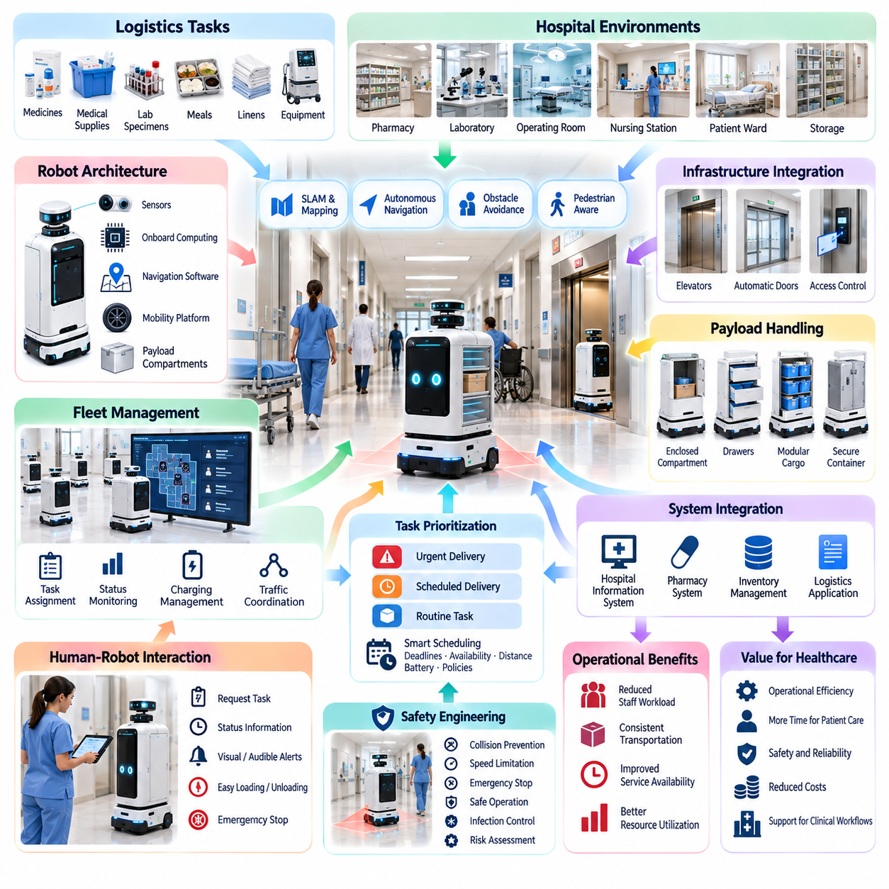{width="7.268055555555556in" height="7.268055555555556in"}

병원 물류 및 배송 로봇(Hospital Logistics and Delivery Robots)은 의료 분야에서 피지컬 인공지능(Physical AI)을 상업적으로 적용하기에 가장 실용적인 분야 중 하나이다. 병원은 약국, 검사실, 수술실, 간호사실, 보관시설 및 병동을 연결하는 복잡한 내부 운송 네트워크(Internal Transportation Networks)를 운영한다. 자율 배송 로봇(Autonomous Delivery Robots)은 반복적인 물품 운송을 자동화하면서 운송의 일관성, 운영 가시성(Operational Visibility), 의료진의 임상 업무 수행 가능 시간을 향상시킬 수 있다.

기존 병원 물류(Hospital Logistics)는 부서 간 물품을 운송하는 간호사, 운반 담당자, 의료 기술자 및 지원 인력에 크게 의존한다. 이러한 활동에는 반복적인 보행, 대기, 수작업 운반 및 여러 장소 사이의 업무 조정이 포함된다. 피지컬 인공지능은 운송 요청을 수행하고, 공용 복도를 자율적으로 이동하며, 지속적인 인간 조작에 대한 의존도를 줄이면서 의료 물품을 배송할 수 있는 자율이동로봇(Autonomous Mobile Robots, AMR)을 제공한다.

병원 배송 로봇은 일반적으로 이동 플랫폼(Mobility Platforms), 환경 센서(Environmental Sensors), 온보드 컴퓨팅(Onboard Computing), 자율주행 소프트웨어(Navigation Software), 보안 적재함(Secure Payload Compartments)을 통합한 자율이동로봇 아키텍처(Autonomous Mobile Robot Architecture)를 사용한다. 인지 시스템(Perception Systems)은 라이다(LiDAR), 깊이 카메라(Depth Cameras), 초음파 센서(Ultrasonic Sensors), 휠 오도메트리(Wheel Odometry) 등을 결합한다. 이를 통해 위치 추정(Localization), 장애물 감지(Obstacle Detection), 경로 계획(Path Planning), 안전한 이동 제어가 가능해진다.

병원의 자율주행(Autonomous Navigation)은 산업용 창고에서의 자율주행과 상당한 차이가 있다. 병원 복도에는 휠체어(Wheelchairs), 환자 운반 침대(Stretchers), 의료 카트(Medical Carts), 임시 장비 및 예측하기 어려운 보행자의 움직임이 존재한다. 로봇은 이러한 변화하는 환경을 지속적으로 해석하면서 적절한 안전거리를 유지해야 한다. 동적 장애물 회피(Dynamic Obstacle Avoidance), 보행자 인식 기반 이동 계획(Pedestrian-Aware Motion Planning), 보수적인 속도 제어(Conservative Speed Control)는 안정적인 운영을 위한 핵심 요소이다.

동시적 위치 추정 및 지도 작성(Simultaneous Localization and Mapping, SLAM)은 병원 자율 이동의 기반 기술이다. 로봇은 복도, 교차로, 출입문, 엘리베이터 및 지정된 배송 위치를 나타내는 공간 지도(Spatial Maps)를 생성하거나 활용한다. 위치 추정 알고리즘(Localization Algorithms)은 센서 관측 정보와 지도 정보를 이용하여 로봇의 위치를 계산한다. 신뢰성 있는 자율주행을 위해서는 환경 변화, 일시적인 장애물, 반사 표면 및 센서 가시성이 제한된 영역에 대한 대응 능력도 필요하다.

병원 배송 업무에서는 여러 층과 출입이 제한된 부서 사이를 이동해야 하는 경우가 많다. 엘리베이터 연동(Elevator Integration)을 통해 자율 시스템은 엘리베이터를 호출하고, 안전하게 승하차하며, 목적지 층에 도착한 후 자율주행을 계속할 수 있다. 자동문 인터페이스(Automatic Door Interfaces)와 출입통제 시스템(Access-Control Systems)은 허가된 구역으로의 이동을 지원한다. 이러한 통합에는 로봇 소프트웨어와 병원 건물 인프라(Building Infrastructure) 사이의 조정된 통신이 필요하다.

적재물 취급(Payload Handling)은 운송 물품의 크기, 무게, 민감도 및 보안 요구사항이 크게 다를 수 있기 때문에 의료 물류 로봇의 핵심 요구사항이다. 배송 플랫폼(Delivery Platforms)에는 밀폐형 적재함(Enclosed Compartments), 탈착식 용기(Removable Containers), 서랍(Drawers), 모듈형 화물 구조(Modular Cargo Structures) 등이 적용될 수 있다. 기구 설계(Mechanical Design)는 의도하지 않은 개방을 방지하고 운송 물품을 보호하며, 인체공학적인 적재 및 하역 절차(Ergonomic Loading and Unloading Procedures)를 지원해야 한다.

의료 물류(Healthcare Logistics)에는 운영 우선순위와 취급 요구사항이 서로 다른 운송 작업이 포함된다. 정기 배송(Routine Deliveries)은 부서별 수요에 따라 예약할 수 있지만, 긴급 요청(Urgent Requests)은 즉각적인 작업 할당이 필요할 수 있다. 지능형 스케줄링 시스템(Intelligent Scheduling Systems)은 배송 기한, 로봇 가용성, 이동 거리, 배터리 상태 및 운영 제한사항을 평가한다. 우선순위 관리(Priority Management)는 병원 정책과 기존 임상 업무 흐름(Clinical Workflows)에 부합해야 한다.

군집 관리 시스템(Fleet Management Systems, FMS)은 병원 내 공유 환경에서 운영되는 여러 배송 로봇을 조정한다. 중앙 집중식 운영 소프트웨어(Centralized Orchestration Software)는 작업을 할당하고, 로봇 상태를 모니터링하며, 충전 일정을 관리하고, 잠재적인 교통 충돌을 해결한다. 군집 수준의 지능(Fleet-Level Intelligence)은 중복 이동을 줄이고 자원 활용률(Resource Utilization)을 향상시킬 수 있다. 효과적인 조정을 위해서는 통신 중단, 로봇 사용 불가 및 예상치 못한 혼잡 상황에 대응하는 기능도 필요하다.

교통 관리(Traffic Management)는 자율 로봇의 수가 증가할수록 더욱 중요해진다. 좁은 복도, 엘리베이터 입구, 적재 장소 및 혼잡한 교차로는 여러 로봇이 공유하는 병목 구간(Bottlenecks)이 될 수 있다. 다중 로봇 협조 알고리즘(Multi-Robot Coordination Algorithms)은 제한된 공간에 대한 접근을 제어하고 교착상태(Deadlocks)를 방지할 수 있다. 교통 운영 정책(Traffic Policies)은 보행자 안전, 응급 의료 이동 및 필수 임상시설에 대한 접근성을 우선적으로 보장해야 한다.

병원 물류 로봇은 직관적이고 예측 가능한 인터페이스(Intuitive and Predictable Interfaces)를 통해 의료 종사자와 상호작용해야 한다. 직원들은 터치스크린 단말기(Touchscreen Terminals), 모바일 애플리케이션(Mobile Applications), 통합 병원 시스템(Integrated Hospital Systems)을 이용하여 배송을 요청할 수 있다. 로봇은 시각적 표시(Visual Indicators), 음성 알림(Audible Notifications), 디지털 메시지(Digital Messages)를 통해 작동 상태를 전달할 수 있다. 명확한 상호작용 절차는 적재, 하역, 비상 정지 및 수동 개입 과정에서 발생하는 혼란을 줄인다.

시스템 통합(System Integration)은 자율 배송이 일상적인 병원 운영의 일부가 될 것인지, 독립적인 자동화 실험에 머무를 것인지를 결정한다. 병원 정보시스템(Hospital Information Systems), 재고관리 플랫폼(Inventory Management Platforms), 약국 시스템(Pharmacy Systems), 물류 애플리케이션(Logistics Applications)은 로봇 군집 관리 소프트웨어(Robot Fleet Software)와 승인된 작업 정보를 교환할 수 있다. 표준화된 인터페이스(Standardized Interfaces)와 이벤트 기반 통신(Event-Based Communication)은 자동 요청 생성, 배송 확인, 재고 갱신 및 운영 추적성(Operational Traceability)을 지원한다.

안전 공학(Safety Engineering)은 배송 로봇이 취약한 환자와 중요한 의료 장비 가까이에서 작동하기 때문에 필수적이다. 시스템에는 충돌 방지(Collision Prevention), 보호 정지(Protective Stopping), 속도 제한(Speed Limitation), 장애물 감지(Obstacle Detection), 비상 개입(Emergency Intervention) 기능이 필요하다. 인지 시스템이나 통신 시스템에 장애가 발생하더라도 안전 기능은 유지되어야 한다. 도입 절차에서는 대피 경로(Evacuation Routes), 감염 관리(Infection Control), 응급 의료 접근성(Emergency Clinical Access)도 고려해야 한다.

사이버보안(Cybersecurity)과 정보 거버넌스(Information Governance)는 배송 로봇이 병원 네트워크에 연결될 때 매우 중요하다. 보안 인증(Secure Authentication), 암호화 통신(Encrypted Communication), 역할 기반 접근 제어(Role-Based Access Control), 소프트웨어 업데이트 관리(Software Update Management)는 로봇 운영을 보호하는 데 도움이 된다. 배송 기록(Delivery Records)에는 부서, 환자 또는 의료 활동에 관한 민감한 정보가 포함될 수 있다. 데이터 수집 및 보존 정책(Data Collection and Retention Policies)은 운영 책임성을 유지하면서 불필요한 정보 노출을 최소화해야 한다.

운영 신뢰성(Operational Reliability)은 이상적인 조건에서 자율주행에 성공하는 것만으로 확보되지 않는다. 로봇은 경로 차단, 위치 추정 불확실성(Localization Uncertainty), 엘리베이터 지연, 도킹 실패(Docking Failures), 예상하지 못한 적재물 상태에 대응해야 한다. 복구 전략(Recovery Strategies)에는 경로 재계획(Route Replanning), 제어된 대기(Controlled Waiting), 원격 지원(Remote Assistance), 지정된 안전 위치로의 복귀가 포함될 수 있다. 안정적인 예외 처리(Exception Handling)는 개별 로봇의 장애가 병원 전체 업무 흐름에 영향을 미치는 것을 방지한다.

배터리 관리(Battery Management)와 자율 충전(Autonomous Charging)은 병원 배송 로봇 군집의 실질적인 가용성에 영향을 미친다. 로봇은 잔여 에너지를 추정하고, 운송 요구사항을 예측하며, 중요한 배송을 방해하지 않도록 충전 일정을 계획해야 한다. 자동 도킹 시스템(Automatic Docking Systems)은 수동 개입을 줄이며, 군집 수준의 충전 조정(Fleet-Level Charging Coordination)은 여러 로봇의 동시 가동 중단을 방지한다. 배터리 상태 모니터링(Battery Health Monitoring)은 예방 정비(Preventive Maintenance)와 수명주기 계획(Lifecycle Planning)도 지원한다.

성능 평가(Performance Evaluation)는 운송 효율성뿐 아니라 안전성, 신뢰성 및 직원 경험(Staff Experience)을 함께 고려해야 한다. 주요 지표에는 시간당 배송 완료 건수(Completed Deliveries per Hour), 평균 배송 시간(Average Delivery Time), 작업 성공률(Task Success Rate), 로봇 활용률(Robot Utilization), 개입 빈도(Intervention Frequency), 시스템 가용성(System Availability)이 포함된다. 추가적으로 대기 시간(Waiting Time), 이동 거리(Travel Distance), 에너지 소비(Energy Consumption), 업무 흐름 방해(Workflow Disruption)를 측정할 수 있으며, 이러한 지표는 도입 이전에 설정한 기준선(Predeployment Baselines)과 비교해야 한다.

병원 배송 로봇의 경제적 타당성(Economic Justification)은 총소유비용(Total Cost of Ownership, TCO)과 물류 개선으로 창출되는 측정 가능한 가치에 따라 결정된다. 로봇 구매 비용(Acquisition Costs), 인프라 통합 비용(Infrastructure Integration Costs), 소프트웨어 라이선스(Software Licensing), 유지보수(Maintenance), 충전 장비(Charging Equipment), 기술 지원(Technical Support)을 고려해야 한다. 경제적 이점은 직접적인 인력 대체보다는 반복 운송 업무 감소, 서비스 일관성 향상 및 의료 인력의 효율적인 배치에서 발생할 수 있다.

도입 전략(Deployment Strategies)은 일반적으로 반복적인 운송 경로, 예측 가능한 배송 일정 및 명확하게 지정된 적재 장소에서 시작하는 것이 효과적이다. 시범 운영(Pilot Operations)을 통해 병원은 자율주행 성능, 직원 수용성(Staff Acceptance), 배송 신뢰성(Delivery Reliability), 인프라 호환성(Infrastructure Compatibility)을 검증할 수 있다. 부서와 층을 단계적으로 확대하면 더욱 복잡한 운영을 도입하기 전에 군집 스케줄링(Fleet Scheduling), 안전 절차(Safety Procedures), 예외 관리(Exception Management)를 개선할 수 있다.

미래의 병원 물류 플랫폼(Hospital Logistics Platforms)은 고급 다중모달 인지(Advanced Multimodal Perception), 예측 기반 작업 스케줄링(Predictive Task Scheduling), 의미 기반 자율주행(Semantic Navigation), 학습 기반 군집 최적화(Learning-Based Fleet Optimization)를 통합할 수 있다. 이동형 매니퓰레이터(Mobile Manipulators)와의 연계를 통해 일부 적재 및 하역 작업도 자동화할 수 있다. 그러나 자율성 확대(Broader Autonomy)는 검증된 안전 메커니즘(Validated Safety Mechanisms)과 신뢰성 있는 업무 흐름 통합(Workflow Integration)을 기반으로 해야 한다. 궁극적인 목표는 환자 진료(Patient Care)와 운영 연속성(Operational Continuity)을 보호하면서 병원 효율성을 향상시키는 통합 로봇 물류 인프라(Coordinated Robotic Logistics Infrastructure)를 구축하는 것이다.

## 04.03. Medicine Linen and Supply Transport

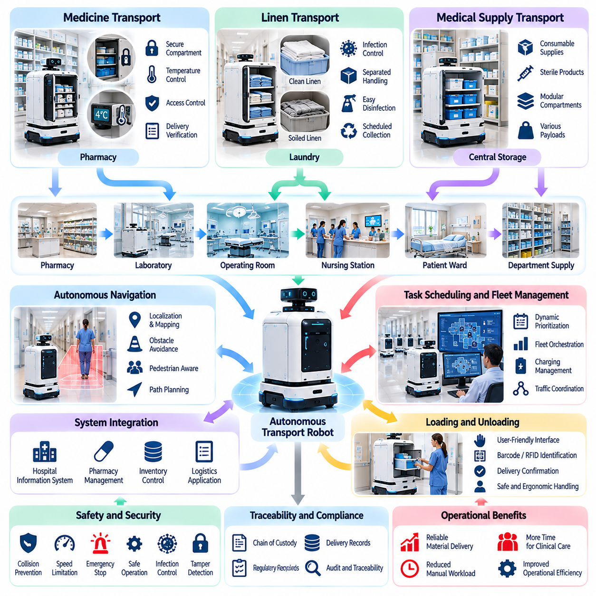{width="7.268055555555556in" height="7.268055555555556in"}

의약품, 린넨 및 의료 물품 운송(Medicine, Linen, and Medical Supply Transport)은 현대 의료시설에서 핵심적인 운영 기능을 담당한다. 병원에서는 의약품(Pharmaceuticals), 청결 직물(Clean Textiles), 멸균 기구(Sterile Instruments), 일회용 의료 재료(Disposable Materials), 임상 장비(Clinical Equipment)를 보관 구역과 진료 부서 사이에서 지속적으로 이동시킨다. 피지컬 인공지능(Physical AI)은 이러한 운송 활동을 더욱 자동화하고, 추적 가능하며, 변화하는 임상 수요에 신속하게 대응할 수 있도록 지원한다.

의약품 운송(Medicine Transportation)은 의약품이 온도, 취급 조건, 무단 접근 및 배송 지연에 민감할 수 있기 때문에 특히 엄격한 관리가 필요하다. 자율이동로봇(Autonomous Mobile Robots, AMR)은 병원 약국과 지정된 임상 장소 사이에서 의약품 용기를 운송할 수 있다. 보안 적재함(Secure Compartments), 접근 통제(Controlled Access), 배송 검증 메커니즘(Delivery Verification Mechanisms)은 의약품의 무결성(Material Integrity)과 운영 책임성(Operational Accountability)을 유지하는 데 기여한다.

의약품 배송 업무 흐름(Medication Delivery Workflows)은 정기적인 의약품 보충(Routine Pharmaceutical Replenishment)과 긴급 임상 요청(Urgent Clinical Requests)을 구분해야 한다. 정기 배송은 사전에 정의된 경로를 따를 수 있지만, 시간에 민감한 주문은 동적 우선순위 지정(Dynamic Prioritization)과 신속한 작업 배정(Rapid Dispatch)이 필요하다. 지능형 작업 할당 시스템(Intelligent Task Allocation Systems)은 배송 긴급도, 로봇 가용성, 이동 거리 및 목적지 접근성을 평가하여 더욱 예측 가능한 의약품 공급을 지원한다.

통제 의약품(Controlled Substances)과 고가 의약품(High-Value Medications)은 추가적인 보안 요구사항을 수반한다. 로봇 운송 시스템(Robotic Transport Systems)에는 전자 잠금장치(Electronic Locks), 인증된 접근(Authenticated Access), 변조 감지(Tamper Detection), 상세 거래 기록(Detailed Transaction Records)이 적용될 수 있다. 각 운송 과정에서는 승인된 담당자와 배송 이벤트를 식별하는 인수인계 추적 기록(Chain of Custody)을 유지해야 한다. 이러한 통제는 관련 의약품 규정과 병원 의약품 관리 정책에 따라 운영되어야 한다.

온도 민감성 의약품(Temperature-Sensitive Pharmaceuticals)은 운송 전 과정에서 환경적 보호가 필요하다. 단열 적재함(Insulated Compartments), 온도 모니터링 센서(Temperature Monitoring Sensors), 특수 용기(Specialized Containers)는 지정된 보관 조건을 유지하는 데 도움이 된다. 로봇 시스템은 온도 이력(Temperature Histories)을 기록하고 허용 범위를 초과하면 경고를 생성할 수 있다. 운송 검증(Transport Validation)에서는 배송 시간, 환경 노출 및 개별 의약품의 특성을 고려해야 한다.

병원 린넨 운송(Hospital Linen Transportation)은 청결 침구(Clean Bedding), 환자복(Patient Garments), 수건(Towels), 수술용 직물(Surgical Textiles), 사용된 직물류의 지속적인 이동을 포함한다. 청결 린넨(Clean Linen)과 오염 린넨(Soiled Linen)은 오염 위험을 줄이기 위해 서로 다른 취급 절차를 따른다. 자율 운송 로봇(Autonomous Transport Robots)은 세탁시설, 보관실, 간호사실 및 임상 부서 사이의 정기적인 수거와 공급을 지원하면서 반복적인 수작업 운반을 줄일 수 있다.

감염 예방(Infection Prevention)은 린넨 운송 자동화(Linen Transport Automation)의 핵심 설계 고려사항이다. 청결 물품과 오염 물품은 전용 용기(Dedicated Containers), 적재함(Compartments), 운영 업무 흐름(Operational Workflows)을 통해 물리적으로 분리되어야 한다. 로봇 표면은 적절한 세척 및 소독 절차(Cleaning and Disinfection Procedures)를 지원해야 한다. 경로 계획(Route Planning)과 적재 작업(Loading Practices)은 불필요한 노출과 교차 오염(Cross-Contamination)을 방지하도록 병원의 감염관리 정책(Infection-Control Policies)을 따라야 한다.

의료 물품 운송(Medical Supply Transportation)은 일회용 장갑(Disposable Gloves), 마스크(Masks), 주사기(Syringes), 드레싱 재료(Dressings), 진단용 부속품(Diagnostic Accessories) 및 기타 소모품(Consumable Products)을 포함한다. 이러한 물품은 중앙 보관시설(Central Storage Facilities)에서 부서별 물품 보관실과 치료 구역으로 자주 공급된다. 자율 배송 플랫폼(Autonomous Delivery Platforms)은 정기적인 수요 또는 재고 기반 요청(Inventory-Triggered Requests)에 따라 물품을 보충하여 필요한 재료의 가용성을 유지하도록 지원한다.

멸균 의료 물품(Sterile Medical Supplies)은 포장 무결성(Packaging Integrity)을 보호하고 검증된 멸균 상태(Validated Sterile Condition)를 유지할 수 있는 취급 방식이 필요하다. 로봇 시스템은 적재 및 운송 중 과도한 진동(Excessive Vibration), 압착(Crushing), 습기 노출(Moisture Exposure), 부적절한 접촉(Inappropriate Contact)을 방지해야 한다. 밀폐형 화물 모듈(Enclosed Cargo Modules)과 통제된 취급 절차(Controlled Handling Procedures)는 환경적 위험을 줄일 수 있다. 배송 과정에서는 멸균 포장이 손상되지 않았는지도 확인해야 한다.

적재물 구성(Payload Configuration)은 병원 물품별 자율 운송 플랫폼(Autonomous Transport Platforms)의 적합성에 큰 영향을 미친다. 의약품 운송 장치(Medication Carriers)는 보안과 환경 제어(Environmental Control)를 우선시할 수 있지만, 린넨 운송 플랫폼(Linen Platforms)은 더 큰 적재 용량(Cargo Volume)이 필요하다. 의료 물품 배송 로봇(Supply Delivery Robots)에는 모듈형 선반(Modular Shelving), 탈착식 보관함(Removable Bins), 조절식 적재함(Adjustable Compartments)이 유용할 수 있다. 플랫폼 선정에서는 적재 중량, 부피, 적재 작업의 인체공학성(Loading Ergonomics), 운영 유연성(Operational Flexibility)을 고려해야 한다.

자율주행(Autonomous Navigation)은 운송 기능을 병원 전체 환경과 연결한다. 배송 로봇(Delivery Robots)은 환자, 방문객 및 의료 장비를 회피하면서 복도, 엘리베이터, 자동문 및 공용 임상 공간을 이동해야 한다. 위치 추정(Localization), 장애물 감지(Obstacle Detection), 동적 경로 계획(Dynamic Path Planning)은 안전한 이동을 가능하게 한다. 자율주행 정책(Navigation Policies)은 출입 제한 구역(Restricted Areas), 응급 이동(Emergency Traffic), 일시적인 운영 변경사항을 수용해야 한다.

운송 일정 관리(Transport Scheduling)는 수요 인식 기반 군집 운영(Demand-Aware Fleet Orchestration)을 통해 개선될 수 있다. 병원 부서에서는 환자 점유율(Patient Occupancy), 임상 시술(Clinical Procedures), 일일 운영 일정(Daily Operating Schedules)에 따라 물품 소비 패턴이 변화한다. 피지컬 인공지능 시스템은 배송 요청(Delivery Requests)을 가용 재고(Available Inventory) 및 운송 능력(Transportation Capacity)과 결합할 수 있다. 예측 기반 일정 관리(Predictive Scheduling)는 적절한 보충 주기를 유지하면서 불필요한 운송 횟수를 줄일 수 있다.

약국 관리 시스템(Pharmacy Management Systems), 재고관리 시스템(Inventory Control Systems), 병원 정보시스템(Hospital Information Systems)과의 통합은 자동화된 물품 공급(Automated Material Distribution)을 지원한다. 승인된 소프트웨어 인터페이스(Authorized Software Interfaces)는 운송 요청을 생성하고, 픽업 및 배송 위치를 식별하며, 거래 기록(Transaction Records)을 갱신할 수 있다. 바코드 스캔(Barcode Scanning), 무선주파수 식별(Radio Frequency Identification, RFID), 전자 확인(Electronic Confirmation)은 추적성(Traceability)을 향상시킬 수 있다. 시스템 통합은 데이터 무결성(Data Integrity)을 유지하고 민감한 정보에 대한 무단 접근을 방지해야 한다.

적재 및 하역(Loading and Unloading)은 운송 자동화가 반드시 수작업 물품 취급(Manual Material Handling)을 완전히 제거하는 것은 아니기 때문에 중요한 운영 고려사항이다. 직원들은 로봇 적재함(Robot Compartments)에 용기를 넣고 지정된 목적지에서 회수할 수 있다. 향후 이동형 매니퓰레이션 시스템(Mobile Manipulation Systems)은 일부 물품 이송 작업을 자동화할 수 있다. 그러나 자동 취급(Automated Handling)에는 신뢰성 높은 객체 인식(Object Recognition), 파지 계획(Grasp Planning), 힘 제어(Force Control), 물품별 제약조건 검증(Validation of Material-Specific Constraints)이 필요하다.

배송 검증(Delivery Verification)은 운송된 물품이 적절한 조건에서 의도된 목적지에 도착했음을 입증하는 정보를 제공한다. 확인 방법에는 인증된 적재함 개방(Authenticated Compartment Opening), 바코드 스캔(Barcode Scanning), 전자 서명(Electronic Signatures), 부서별 수령 시스템(Departmental Receiving Systems)과의 통합이 포함될 수 있다. 거래 기록(Transaction Records)은 배송 시간, 예외 상황 및 책임자를 식별할 수 있다. 신뢰성 높은 검증은 재고 정확성(Inventory Accuracy)과 운영 책임성(Operational Accountability)을 지원한다.

예외 처리(Exception Handling)는 배송 과정에서 수령자 부재(Unavailable Recipients), 경로 차단(Blocked Routes), 접근 제한(Access Restrictions), 장비 고장(Equipment Failures)이 발생할 때 필수적이다. 로봇은 비정상 상태(Abnormal Conditions)를 감지하고 사전에 정의된 복구 절차(Recovery Procedures)를 실행해야 한다. 물품의 민감도에 따라 보안 대기(Secure Waiting), 대체 경로 이동(Alternate Routing), 감독하의 개입(Supervised Intervention), 출발 부서로의 복귀(Return to Originating Department) 등이 적용될 수 있다. 중요한 배송에는 명확하게 정의된 상위 대응 절차(Escalation Procedures)가 필요하다.

군집 관리 시스템(Fleet Management Systems, FMS)은 의약품, 린넨 및 일반 의료 물품 운송 업무 전반에 걸쳐 운송 자원을 조정한다. 중앙 집중식 일정 관리(Centralized Scheduling)는 적재물 호환성(Payload Compatibility), 작업 긴급도(Task Urgency), 위치(Location), 배터리 상태(Battery Condition)에 따라 로봇을 할당할 수 있다. 공유 군집 운영(Shared Fleet Operations)은 활용률(Utilization)을 향상시킬 수 있지만, 서로 호환되지 않는 물품은 분리하여 운송해야 한다. 효과적인 운영 조정(Effective Orchestration)은 효율성, 보안, 감염 예방 및 서비스 신뢰성 사이의 균형을 유지한다.

운영 성능(Operational Performance)은 측정 가능한 운송 및 서비스 지표(Transportation and Service Indicators)를 사용하여 평가해야 한다. 주요 지표에는 배송 완료율(Delivery Completion Rate), 평균 운송 시간(Average Transport Time), 물품 취급 오류(Material Handling Errors), 개입 빈도(Intervention Frequency), 로봇 활용률(Robot Utilization), 시스템 가용성(System Availability)이 포함된다. 의약품 운송에는 추가적인 보안 및 온도 준수 지표(Security and Temperature Compliance Measures)가 필요할 수 있다. 린넨 및 의료 물품 운송에서는 처리량(Throughput), 보충 신뢰성(Replenishment Reliability), 오염 방지(Contamination Prevention)를 중요하게 평가할 수 있다.

경제적 이점(Economic Benefits)은 반복적인 운송 활동을 줄이고, 물품 가용성(Material Availability)을 향상시키며, 병원 인력의 효율적인 배치를 지원하는 데서 발생한다. 재무 평가(Financial Evaluation)에는 로봇 구매 비용(Robot Acquisition), 인프라 통합(Infrastructure Integration), 소프트웨어(Software), 유지보수(Maintenance), 충전 시스템(Charging Systems), 운영 감독(Operational Supervision)이 포함되어야 한다. 총소유비용(Total Cost of Ownership, TCO)은 배송 일관성(Delivery Consistency), 직원 업무 부담(Staff Workload), 물류 성능(Logistics Performance)의 측정 가능한 개선 효과와 비교해야 한다.

의약품, 린넨 및 의료 물품 운송의 장기적인 발전은 더욱 통합된 자율 물류 플랫폼(Integrated Autonomous Logistics Platforms)을 중심으로 이루어질 것이다. 예측 수요 모델(Predictive Demand Models), 지능형 군집 조정(Intelligent Fleet Coordination), 보안 물품 추적(Secure Material Tracking), 이동형 매니퓰레이션(Mobile Manipulation)은 더욱 광범위한 자동화를 가능하게 할 수 있다. 성공적인 도입은 검증된 안전 절차(Validated Safety Procedures), 신뢰성 높은 병원 시스템 통합(Hospital System Integration), 임상 운영과 환자 진료를 보호하는 물품별 취급 요구사항(Material-Specific Handling Requirements)을 충족하는 데 달려 있다.

## 04.04. Mobile Manipulation in Hospitals

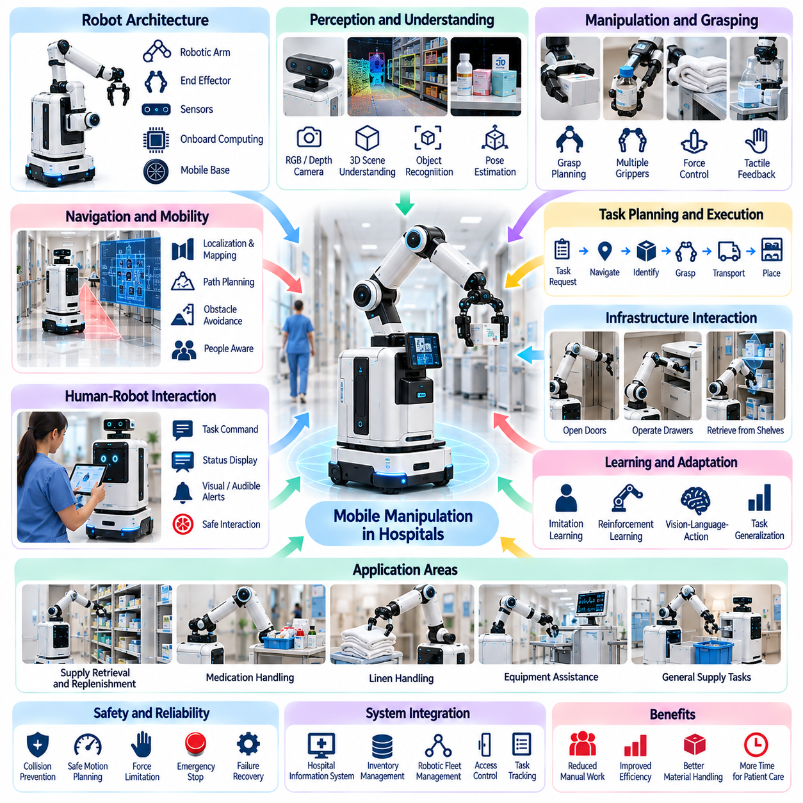{width="7.268055555555556in" height="7.268055555555556in"}

병원 내 이동형 매니퓰레이션(Mobile Manipulation in Hospitals)은 자율 이동(Autonomous Mobility), 로봇 팔(Robotic Arms), 지능형 인지(Intelligent Perception), 적응형 제어(Adaptive Control)를 결합하여 의료 환경 전반에서 물리적 작업을 수행하는 기술이다. 주로 물품을 운송하는 기존 배송 로봇(Delivery Robots)과 달리, 이동형 매니퓰레이터(Mobile Manipulators)는 물체, 장비 및 작업대와 직접 상호작용할 수 있다. 이러한 기능은 병원 자동화를 단순 운송에서 유연한 물품 취급(Material Handling)과 운영 지원(Operational Assistance)으로 확장한다.

병원용 이동형 매니퓰레이터(Hospital Mobile Manipulator)는 일반적으로 자율 이동 플랫폼(Autonomous Mobile Base), 하나 이상의 로봇 팔(Robotic Arms), 엔드 이펙터(End Effectors), 환경 센서(Environmental Sensors), 온보드 컴퓨팅 시스템(Onboard Computing Systems)으로 구성된다. 이동 플랫폼은 부서 간 자율주행을 담당하고, 매니퓰레이터는 특정 위치에서 물리적 상호작용을 수행한다. 이동과 조작의 협조 제어(Coordinated Control)는 로봇이 작업대에 접근하고 로봇 팔의 위치를 조정하여 제한된 공간에서 작업을 수행하도록 한다.

병원 환경(Hospital Environments)은 구조화된 산업시설(Structured Industrial Facilities)과 다른 조작상의 과제를 제시한다. 의료 물품은 형상, 포장, 무게 및 취급 민감도가 다양하며, 작업 공간에는 이동 가능한 가구와 사람의 활동이 빈번하게 존재한다. 로봇은 물체를 인식하고 위치를 추정하며, 안전성(Safety)과 물품 무결성(Material Integrity)을 손상시키지 않으면서 변화하는 조건에 맞게 파지 전략(Grasping Strategies)을 조정해야 한다.

인지 시스템(Perception Systems)은 신뢰성 높은 이동형 매니퓰레이션의 기반을 제공한다. RGB 카메라(RGB Cameras), 깊이 센서(Depth Sensors), 힘 센서(Force Sensors), 촉각 피드백 메커니즘(Tactile Feedback Mechanisms)은 로봇이 물체를 식별하고 공간적 관계를 추정하도록 지원한다. 3차원 장면 이해(Three-Dimensional Scene Understanding)는 선반, 용기, 손잡이 및 장애물의 감지를 가능하게 한다. 센서 융합(Sensor Fusion)은 가림 현상(Occlusion), 반사(Reflections), 환경적 불확실성(Environmental Uncertainty)으로 개별 측정값이 영향을 받을 때 강건성(Robustness)을 향상시킨다.

객체 인식(Object Recognition)과 자세 추정(Pose Estimation)은 의료 물품을 조작하는 데 특히 중요하다. 로봇은 시각적으로 유사한 용기를 구별하고, 적절한 파지 영역(Grasping Regions)을 식별하며, 접촉하기 전에 물체의 방향을 추정해야 한다. 비전-언어 모델(Vision-Language Models, VLM)은 작업 지시의 의미적 해석(Semantic Interpretation)을 지원할 수 있으며, 기하학적 인지(Geometric Perception)는 정밀한 공간 정보를 제공한다. 식별 오류(Identification Errors)에 대해서는 명확한 감지 및 복구 절차가 필요하다.

파지 계획(Grasp Planning)은 로봇의 엔드 이펙터(End Effector)가 물체에 접촉하고 안정적으로 잡는 방법을 결정한다. 병원 물품에는 단단한 용기(Rigid Containers), 유연한 포장재(Flexible Packaging), 원통형 병(Cylindrical Bottles), 불규칙한 형상의 기구(Irregularly Shaped Instruments)가 포함될 수 있다. 이러한 물체에는 서로 다른 그리퍼(Grippers)와 조작 전략(Manipulation Strategies)이 필요할 수 있다. 힘 제한 파지(Force-Limited Grasping)와 촉각 피드백(Tactile Feedback)은 운송 및 배치 과정에서 압착, 미끄러짐 또는 손상을 방지하는 데 도움이 된다.

전신 협조 제어(Whole-Body Coordination)는 이동 플랫폼과 로봇 팔이 함께 작동해야 할 때 필수적이다. 로봇은 도달 가능성(Reachability)을 높이고, 충돌을 회피하거나, 조작 중 안정성(Stability)을 유지하기 위해 이동 플랫폼의 위치를 변경할 수 있다. 동작 계획(Motion Planning)은 관절 한계(Joint Limits), 작업 공간 제약(Workspace Constraints), 적재 중량(Payload Mass), 주변 사람들의 움직임을 고려해야 한다. 협조 계획(Coordinated Planning)은 로봇 팔의 움직임만으로 수행할 수 없는 작업을 가능하게 한다.

병원용 이동형 매니퓰레이터는 보관 위치에서 승인된 물품을 가져와 지정된 용기나 선반에 배치함으로써 물품 회수 및 보충(Supply Retrieval and Replenishment)을 지원할 수 있다. 이러한 응용에는 재고 기록(Inventory Records)과의 통합 및 보관 위치의 정확한 식별이 필요하다. 자동 보충(Automated Replenishment)은 반복적인 물품 취급을 줄일 수 있지만, 신뢰성 있는 도입은 표준화된 포장(Standardized Packaging), 접근 가능한 공간 배치(Accessible Layouts), 검증된 배치 절차(Verified Placement Procedures)에 달려 있다.

의약품 관련 조작(Medication-Related Manipulation)은 잘못된 물품 선택이나 배치가 심각한 임상적 위험(Clinical Risks)을 초래할 수 있기 때문에 추가적인 안전장치(Safeguards)가 필요하다. 로봇은 통제된 조건에서 밀봉된 의약품 용기(Sealed Medication Containers)나 운송 트레이(Transport Trays)를 취급할 수 있지만, 의약품 식별(Medication Identification)과 승인(Authorization)은 독립적으로 검증되어야 한다. 의약품이나 제한 물품(Restricted Materials)을 다루는 작업에서는 보안 접근(Secure Access), 추적 가능한 거래 기록(Traceable Transactions), 인간 감독(Human Supervision)이 특히 중요하다.

린넨 및 일반 물품 취급(Linen and General Supply Handling)은 크기가 크거나 상대적으로 민감도가 낮은 물체를 조작할 수 있는 기회를 제공한다. 이동형 매니퓰레이터는 포장된 린넨(Packaged Linens)을 이동시키고, 지정된 용기를 수거하거나, 표준화된 물품 보관함(Standardized Supply Bins)을 정리할 수 있다. 유연한 직물(Flexible Textiles)은 파지와 이동 과정에서 형상이 변하기 때문에 여전히 어려운 조작 대상이다. 신뢰성 높은 직물 조작(Textile Manipulation)에는 변형 가능 물체 인지(Deformable-Object Perception), 적응형 파지(Adaptive Grasping), 정밀한 접촉력 제어(Contact Force Control)가 필요하다.

병원 인프라(Hospital Infrastructure)와의 상호작용은 이동형 매니퓰레이션의 실용성을 확장한다. 로봇은 호환 가능한 캐비닛 문을 열고, 지정된 손잡이를 조작하며, 선반에서 물품을 가져오거나, 자동 보관 장비(Automated Storage Equipment)와 상호작용해야 할 수 있다. 이러한 활동에는 정확한 정렬(Accurate Alignment), 힘 감지(Force Sensing), 기계적 제약조건(Mechanical Constraints)에 대한 이해가 필요하다. 인프라 인터페이스(Infrastructure Interfaces)는 불필요한 조작 복잡성을 줄이는 방향으로 설계되어야 한다.

작업 계획(Task Planning)은 상위 수준의 임상 지원 요청(Clinical Support Requests)을 실행 가능한 로봇 행동(Robotic Actions)과 연결한다. 물품 용기를 가져오라는 명령은 자율주행(Navigation), 객체 식별(Object Identification), 접근(Approach), 파지(Grasping), 운송(Transportation), 배치(Placement) 작업으로 분해되어야 한다. 계층적 계획기(Hierarchical Planners)는 실행 결과를 모니터링하면서 이러한 단계를 조정할 수 있다. 물체가 없거나 환경이 변화하는 경우에는 실패 감지(Failure Detection)와 재계획(Replanning)이 필요하다.

학습 기반 매니퓰레이션(Learning-Based Manipulation)은 다양한 물체와 작업을 처리할 수 있는 잠재적인 방법을 제공한다. 모방학습(Imitation Learning)은 인간의 시연(Human Demonstrations)으로부터 조작 정책(Manipulation Policies)을 학습할 수 있으며, 강화학습(Reinforcement Learning)은 통제된 시뮬레이션(Controlled Simulation)을 통해 특정 행동을 개선할 수 있다. 비전-언어-행동 모델(Vision-Language-Action Models, VLA)은 시각적 관측(Visual Observations)과 언어 지시(Language Instructions)를 로봇 행동(Robotic Actions)에 연결할 수 있다. 그러나 학습된 정책(Learned Policies)은 안전에 민감한 병원 환경에 적용하기 전에 광범위한 검증이 필요하다.

인간-로봇 협업(Human-Robot Collaboration)은 로봇이 간호사, 의료 기술자, 약사 및 지원 인력과 함께 작동하는 경우가 많기 때문에 이동형 매니퓰레이션의 핵심 요소이다. 시스템은 의도된 행동(Intended Actions)을 전달하고 인간의 지원이 필요한 상황을 인식해야 한다. 공유 작업 공간(Shared Workspaces)에서는 예측 가능한 동작(Predictable Motion), 보수적인 힘 제한(Conservative Force Limits), 접근하기 쉬운 비상 제어장치(Emergency Controls)가 요구된다. 인간 작업자는 자율 행동(Autonomous Behavior)을 중단하거나 재정의할 수 있는 권한을 유지해야 한다.

로봇이 자율 이동과 물리적 조작을 결합하면 안전 요구사항(Safety Requirements)은 더욱 복잡해진다. 위험 요소에는 의도하지 않은 접촉(Unintended Contact), 물체 낙하(Dropped Objects), 불안정한 적재물(Unstable Payloads), 과도한 파지력(Excessive Gripping Force), 로봇 팔과 주변 장비 사이의 충돌(Collisions)이 포함된다. 위험 감소(Risk Reduction)를 위해서는 이동 플랫폼, 매니퓰레이터 및 엔드 이펙터 전반에 걸친 협조 안전 모니터링(Coordinated Safety Monitoring)이 필요하다. 보호 기능(Protective Functions)은 통신 또는 인지 시스템에 장애가 발생하더라도 유지되어야 한다.

감염 예방(Infection Prevention)과 환경 적합성(Environmental Compatibility)은 필수적인 설계 고려사항이다. 로봇 표면, 그리퍼 및 적재물 인터페이스(Payload Interfaces)는 적절한 세척 및 소독 절차(Cleaning and Disinfection Procedures)를 견딜 수 있어야 한다. 멸균 물품(Sterile Materials)이나 오염 물품(Contaminated Materials)과의 접촉에는 명확하게 정의된 취급 경계(Handling Boundaries)가 필요하다. 기계 부품(Mechanical Components)은 세척하기 어려운 영역을 최소화해야 하며, 운영 업무 흐름(Operational Workflows)은 청결 환경과 오염 환경 사이의 부적절한 물품 이동을 방지해야 한다.

시스템 통합(System Integration)은 이동형 매니퓰레이터가 독립적인 로봇 시연(Robotic Demonstrations)에 머무르지 않고 병원 운영에 참여하도록 한다. 작업 요청(Task Requests)은 재고관리 시스템(Inventory Management Systems), 물류 소프트웨어(Logistics Software), 승인된 병원 애플리케이션(Authorized Hospital Applications)에서 발생할 수 있다. 군집 관리 플랫폼(Fleet Management Platforms)은 로봇 가용성(Robot Availability), 충전(Charging), 운송 작업 할당(Transportation Assignments)을 조정할 수 있다. 거래 기록(Transaction Records)에는 작업 완료, 개입 이벤트(Intervention Events), 관련 물품 이동 정보가 포함되어야 한다.

운영 신뢰성(Operational Reliability)은 조작 실패(Manipulation Failures)로부터 효과적으로 복구할 수 있는 능력에 달려 있다. 물체가 예기치 않게 이동하거나, 파지 시도가 실패하거나, 목표 위치에 접근할 수 없는 상황이 발생할 수 있다. 로봇은 이러한 조건을 인식하고 재시도(Retrying), 위치 재조정(Repositioning), 지원 요청(Requesting Assistance), 작업 종료(Task Termination)와 같은 안전한 대응을 선택해야 한다. 복구 정책(Recovery Policies)은 반복적인 위험 행동을 방지하고 미완료 작업에 대한 책임 추적성(Accountability)을 유지해야 한다.

성능 평가(Performance Evaluation)는 실제 병원 환경에서 이동성과 조작 능력을 모두 측정해야 한다. 주요 지표에는 작업 성공률(Task Success Rate), 파지 신뢰성(Grasp Reliability), 배치 정확도(Placement Accuracy), 실행 시간(Execution Time), 개입 빈도(Intervention Frequency), 시스템 가용성(System Availability)이 포함된다. 안전 관련 이벤트(Safety Events), 물품 손상(Material Damage), 업무 흐름 방해(Workflow Disruption)도 기록해야 한다. 다양한 물체, 부서 및 운영 조건에 대한 평가는 실질적인 일반화 능력(Practical Generalization)의 근거를 제공한다.

병원 이동형 매니퓰레이션의 경제적 가치(Economic Value)는 추가적인 조작 기능이 복잡성과 비용 증가를 정당화할 수 있는지에 달려 있다. 로봇 팔, 고급 센서(Advanced Sensors), 컴퓨팅 하드웨어(Computing Hardware), 시스템 통합 및 유지보수는 총소유비용(Total Cost of Ownership, TCO)을 증가시킨다. 기대 효과에는 반복적인 물품 취급 감소, 물품 가용성(Supply Availability) 향상, 운영 유연성(Operational Flexibility) 확대가 포함될 수 있다. 도입 결정은 기술적 정교함(Technological Sophistication) 자체보다 측정 가능한 업무 흐름 개선(Measurable Workflow Improvements)을 우선해야 한다.

미래의 병원용 이동형 매니퓰레이터는 범용 로봇 파운데이션 모델(General-Purpose Robotic Foundation Models), 다중모달 인지(Multimodal Perception), 정교한 로봇 손(Dexterous Hands), 적응형 전신 제어(Adaptive Whole-Body Control)를 결합할 수 있다. 이러한 발전은 로봇이 취급할 수 있는 물품과 작업대의 범위를 확장할 수 있다. 그럼에도 임상 안전성(Clinical Safety), 신뢰성 높은 운영(Dependable Operation), 인간 감독(Human Oversight)은 계속해서 기본 요구사항으로 유지될 것이다. 장기적인 목표는 환자 안전(Patient Safety)과 운영 연속성(Operational Continuity)을 보장하면서 의료진을 지원하는 유연한 로봇 보조 시스템(Flexible Robotic Assistants)을 구축하는 것이다.

## 04.05. Assistive and Rehabilitation Robotics

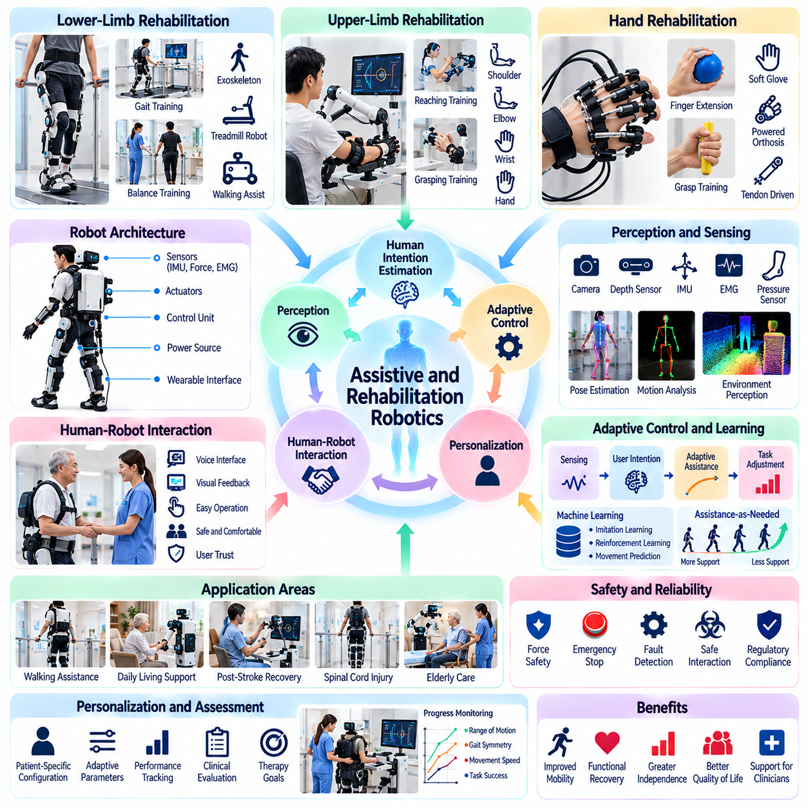{width="7.268055555555556in" height="7.268055555555556in"}

보조 및 재활 로봇공학(Assistive and Rehabilitation Robotics)은 인간의 이동성(Human Mobility), 기능 회복(Functional Recovery), 독립적인 생활(Independent Living)을 지원하는 피지컬 인공지능(Physical AI)의 주요 응용 분야이다. 이러한 시스템은 로봇 메커니즘(Robotic Mechanisms), 지능형 센싱(Intelligent Sensing), 적응형 제어(Adaptive Control), 인간 중심 상호작용(Human-Centered Interaction)을 결합하여 물리적 지원을 제공한다. 주요 목적은 재활 전문가를 지원하면서 환자의 안전(Patient Safety), 자율성(Autonomy), 존엄성(Dignity)을 유지하고 개인의 신체적 능력을 향상시키는 것이다.

보조 로봇공학(Assistive Robotics)은 신체적 제약(Physical Limitations)을 보완하는 데 중점을 두는 반면, 재활 로봇공학(Rehabilitation Robotics)은 체계적인 치료 활동(Structured Therapeutic Activities)을 통해 기능적 능력(Functional Abilities)을 회복하거나 개선하는 데 중점을 둔다. 두 분야는 목적이 다르지만 인간과 로봇 시스템 사이의 긴밀한 상호작용(Human-Robot Interaction)에 의존한다. 피지컬 인공지능은 개인의 요구사항과 관측된 수행 능력에 따라 보조 수준(Assistance Levels), 움직임 궤적(Movement Trajectories), 제어 전략(Control Strategies)을 조정할 수 있도록 한다.

로봇 외골격(Robotic Exoskeletons)은 보조 및 재활 로봇공학에서 가장 대표적인 기술 중 하나이다. 착용형 기계 구조물(Wearable Mechanical Structures)은 하지(Lower Limbs), 상지(Upper Limbs) 또는 특정 관절의 움직임을 지지하거나 유도한다. 액추에이터(Actuators)는 제어된 힘과 토크(Forces and Torques)를 발생시키며, 센서(Sensors)는 관절 위치(Joint Positions), 움직임 속도(Movement Velocity), 상호작용 힘(Interaction Forces)을 측정한다. 적절한 보조 수준은 사용자의 능력, 장치 정렬(Device Alignment), 임상적 목표(Clinical Objectives)에 따라 결정된다.

하지 재활 로봇(Lower-Limb Rehabilitation Robots)은 보행 연습(Walking Practice), 균형 훈련(Balance Training), 반복적인 보행 운동(Repetitive Gait Exercises)을 지원한다. 이러한 시스템에는 착용형 외골격(Wearable Exoskeletons), 트레드밀 기반 로봇 장치(Treadmill-Based Robotic Devices), 이동형 보행 보조 플랫폼(Mobile Walking Assistance Platforms)이 포함될 수 있다. 지능형 제어기(Intelligent Controllers)는 보행 단계(Gait Phase), 환자 참여도(Patient Participation), 측정된 안정성(Measured Stability)에 따라 움직임 지원을 조정한다. 효과는 적절한 환자 선정, 개인 맞춤형 치료, 임상 감독(Clinical Supervision)에 달려 있다.

상지 재활 로봇공학(Upper-Limb Rehabilitation Robotics)은 어깨(Shoulder), 팔꿈치(Elbow), 손목(Wrist), 손(Hand)의 기능 회복을 목표로 한다. 로봇 장치는 체계적인 운동 과정에서 팔 뻗기(Reaching), 파지(Grasping), 들어 올리기(Lifting), 협응된 팔 움직임(Coordinated Arm Movements)을 유도할 수 있다. 센서는 움직임 정확도(Movement Accuracy), 관절 가동 범위(Range of Motion), 상호작용 힘(Interaction Forces)을 측정한다. 적응형 보조(Adaptive Assistance)는 움직임이 어렵거나 불안정할 때 지원을 제공하면서 환자의 능동적인 참여를 가능하게 한다.

손 재활(Hand Rehabilitation)과 보조 파지 시스템(Assistive Grasping Systems)은 인간의 손이 많은 관절을 포함하고 복잡한 움직임을 수행하기 때문에 특히 정밀한 상호작용이 필요하다. 소프트 로봇 장갑(Soft Robotic Gloves), 힘줄 구동 메커니즘(Tendon-Driven Mechanisms), 동력 보조기(Powered Orthoses)는 손가락 신전(Finger Extension), 굴곡(Flexion), 파지(Grasping)를 지원할 수 있다. 제어 시스템은 손의 형상(Hand Geometry), 근력(Muscle Strength), 관절 운동성(Joint Mobility)의 차이를 수용하면서 과도한 압력이나 의도하지 않은 움직임을 방지해야 한다.

인간 의도 추정(Human Intention Estimation)은 지능형 보조 로봇공학(Intelligent Assistive Robotics)의 핵심 기능이다. 시스템은 움직임 패턴(Motion Patterns), 상호작용 힘(Interaction Forces), 근전도 신호(Electromyography Signals, EMG), 기타 생리학적 측정값(Physiological Measurements)을 해석하여 사용자가 의도한 행동을 추정할 수 있다. 이러한 관측 정보는 보조 시점(Assistance Timing)과 보조 강도(Assistance Intensity)를 결정하는 데 활용된다. 그러나 의도 인식(Intention Recognition)에는 불확실성이 존재하므로 보수적인 제어 전략(Conservative Control Strategies)과 사용자가 로봇 행동을 거부하거나 중단할 수 있는 메커니즘이 필요하다.

적응형 제어(Adaptive Control)는 재활 장치가 치료 과정에서 변화하는 환자의 능력에 대응할 수 있도록 한다. 필요 기반 보조 전략(Assistance-as-Needed Strategies)은 수행 능력이 정의된 기준값(Defined Thresholds)보다 낮아질 때 지원을 제공하면서 자발적인 움직임(Voluntary Movement)을 장려한다. 제어기는 힘(Force), 임피던스(Impedance), 궤적 유도(Trajectory Guidance), 운동 난이도(Exercise Difficulty)를 조정할 수 있다. 이러한 적응은 임상적으로 승인된 한계 내에서 이루어져야 하며, 재활 진행 상태에 대한 전문가의 평가를 대체해서는 안 된다.

물리적 인간-로봇 상호작용(Physical Human-Robot Interaction)은 로봇 장치와 인체 사이의 기계적 접촉(Mechanical Contact)을 세심하게 관리해야 한다. 힘 감지(Force Sensing), 순응형 구동(Compliant Actuation), 임피던스 제어(Impedance Control), 기계적 안전 한계(Mechanical Safety Limits)는 부상 위험을 줄이는 데 도움이 된다. 부드러운 접촉 인터페이스(Soft Interfaces)와 인체공학적 부착 구조(Ergonomic Attachment Structures)는 적절한 해부학적 부위에 접촉 압력(Contact Pressure)을 분산시킨다. 안전한 작동은 올바른 착용(Fitting), 보정(Calibration), 불편감에 대한 지속적인 모니터링에도 달려 있다.

개인 맞춤화(Personalization)는 신체 상태(Physical Condition), 신체 치수(Body Dimensions), 움직임 능력(Movement Capacity), 치료 목표(Therapeutic Goals)에 따라 재활 요구사항이 달라지기 때문에 필수적이다. 피지컬 인공지능 시스템은 환자별 측정값(Patient-Specific Measurements)을 활용하여 보조 매개변수(Assistance Parameters)와 운동 프로그램(Exercise Programs)을 설정할 수 있다. 장기적인 수행 데이터(Longitudinal Performance Data)는 움직임 품질(Movement Quality)이나 지구력(Endurance)의 변화를 보여줄 수 있다. 그러나 개인 맞춤화 알고리즘은 의미 있는 개선과 측정 잡음(Measurement Noise), 일시적인 변동(Temporary Fluctuations)을 구별해야 한다.

재활 로봇공학은 환자의 행동과 환경 조건을 함께 관측하기 위해 다중모달 인지(Multimodal Perception)를 점차 도입하고 있다. 카메라(Cameras), 관성측정장치(Inertial Measurement Units, IMU), 압력 센서(Pressure Sensors), 착용형 생리학적 센서(Wearable Physiological Sensors)는 상호보완적인 정보를 제공한다. 센서 융합(Sensor Fusion)은 자세(Posture), 보행 대칭성(Gait Symmetry), 움직임 시점(Movement Timing), 작업 수행(Task Execution)의 추정을 지원한다. 신뢰성 높은 해석을 위해서는 센서 보정과 개인별 움직임 변동성(Individual Movement Variability)을 고려해야 한다.

기계학습(Machine Learning)은 움직임 분류(Movement Classification), 보조 예측(Assistance Prediction), 재활 작업 적응(Rehabilitation Task Adaptation)을 개선할 수 있는 기회를 제공한다. 지도학습(Supervised Learning)은 기록된 움직임 데이터에서 패턴을 식별할 수 있으며, 강화학습(Reinforcement Learning)은 시뮬레이션(Simulation)에서 특정 제어 정책(Control Policies)을 최적화할 수 있다. 학습 기반 시스템(Learning-Based Systems)은 환자의 행동, 신체 능력, 상호작용 동역학(Interaction Dynamics)이 개인과 재활 세션마다 크게 달라지기 때문에 신중하게 평가되어야 한다.

로봇 보조 치료(Robot-Assisted Therapy)는 측정 가능하고 일관된 움직임 매개변수(Movement Parameters)를 기반으로 반복 훈련(Repetitive Training)을 지원할 수 있다. 반복은 많은 재활 프로그램에서 중요하지만, 로봇 보조의 임상적 가치(Clinical Value)는 능동적인 참여(Active Participation)와 의미 있는 치료 목표(Meaningful Therapeutic Goals)에 달려 있다. 지능형 시스템은 작업 난이도를 조정하고 수행 피드백(Performance Feedback)을 제공하여 참여도를 높일 수 있다. 로봇은 임상 치료 전략(Clinical Treatment Strategies)을 독립적으로 결정하기보다는 보완하는 역할을 해야 한다.

보조 이동 로봇(Assistive Mobile Robots)은 착용형 장치를 넘어 사용자가 주변 환경과 상호작용하도록 물리적 지원을 확장한다. 이동형 매니퓰레이터(Mobile Manipulators)는 물체 회수(Object Retrieval), 개인 소지품 운송(Transportation of Personal Belongings), 접근 가능한 위치로의 물품 배치(Item Positioning)를 수행할 수 있다. 이러한 시스템은 자율주행(Navigation), 객체 인식(Object Recognition), 파지 계획(Grasp Planning), 사용자 의사소통(User Communication)을 결합한다. 효과적인 활용을 위해서는 신뢰성 높은 작업 수행과 다양한 신체적·인지적 능력을 수용하는 인터페이스가 필요하다.

가정 기반 재활(Home-Based Rehabilitation)은 병원과 전문 클리닉 외부로 치료 활동을 확장할 수 있는 기회를 제공한다. 소형 로봇 장치(Compact Robotic Devices)와 원격 모니터링 시스템(Remotely Monitored Systems)은 익숙한 생활환경에서 처방된 운동(Prescribed Exercises)을 지원할 수 있다. 피지컬 인공지능은 움직임 수행(Movement Execution)에 대한 피드백을 제공하고 선택된 성능 지표(Performance Indicators)를 기록할 수 있다. 가정 도입에는 간편한 조작(Simplified Operation), 강건한 안전 메커니즘(Robust Safety Mechanisms), 보안 통신(Secure Communication), 명확하게 정의된 임상적 상위 대응 절차(Clinical Escalation Procedures)가 필요하다.

임상 평가(Clinical Evaluation)는 보조 및 재활 로봇이 의미 있는 효과를 제공하는지 판단하기 위해 필요하다. 추적 정확도(Tracking Accuracy), 보조력(Assistance Force), 작업 완료(Task Completion), 장치 신뢰성(Device Reliability)과 같은 기술적 지표(Technical Metrics)는 기능적 결과(Functional Outcomes) 및 환자 보고 평가(Patient-Reported Measures)와 함께 분석되어야 한다. 통제 연구(Controlled Studies)는 이동성(Mobility), 독립성(Independence), 편안함(Comfort), 삶의 질(Quality of Life)을 평가할 수 있다. 연구 결과는 환자 집단(Patient Populations), 중재 기간(Intervention Duration), 연구 설계(Study Design)에 따라 해석되어야 한다.

안전 및 규제 요구사항(Safety and Regulatory Requirements)은 장치의 기능(Device Function), 의도된 의료 용도(Intended Medical Use), 물리적 상호작용 수준(Degree of Physical Interaction)에 따라 달라진다. 위험 관리(Risk Management)는 과도한 관절 부하(Excessive Joint Loading), 기계적 정렬 불량(Mechanical Misalignment), 낙상(Falls), 피부 압박(Skin Pressure), 액추에이터 고장(Actuator Failures), 의도하지 않은 움직임(Unintended Movement)을 다루어야 한다. 비상 정지(Emergency Stopping), 기계적 제약(Mechanical Constraints), 감독하의 복구 절차(Supervised Recovery Procedures)는 중요한 안전장치이다. 임상 도입에는 적절한 검증과 관련 의료기기 규정(Medical Device Regulations)의 준수가 필요하다.

데이터 개인정보 보호(Data Privacy)와 윤리적 고려사항(Ethical Considerations)은 재활 시스템이 움직임, 장애, 생리학적 상태 및 치료 진행 상황에 관한 민감한 정보를 수집할 수 있기 때문에 특히 중요하다. 안전한 저장(Secure Storage), 접근 제어(Access Control), 사전 동의(Informed Consent), 책임 있는 데이터 거버넌스(Responsible Data Governance)가 필요하다. 사용자는 자동화된 보조(Automated Assistance)의 기능과 한계를 이해해야 한다. 인간의 자율성(Human Autonomy)과 로봇 개입(Robotic Intervention)을 거부할 수 있는 권리는 핵심 설계 원칙으로 유지되어야 한다.

보조 및 재활 로봇공학의 경제적 가치(Economic Value)는 임상적 효과(Clinical Effectiveness), 활용률(Utilization), 유지보수 요구사항(Maintenance Requirements), 의료 서비스 제공 체계(Care Delivery)와의 통합에 달려 있다. 잠재적 이점에는 더욱 일관된 훈련(Consistent Training), 접근성 향상(Improved Accessibility), 돌봄 제공자의 신체적 부담 감소(Reduced Physical Demands on Caregivers)가 포함된다. 그러나 장비 비용(Equipment Costs), 착용 조정 절차(Fitting Procedures), 전문가 감독(Professional Supervision), 기술 지원(Technical Support)에는 상당한 비용이 발생할 수 있다. 도입 결정에서는 운영 효율성과 함께 측정 가능한 환자 치료 결과(Patient Outcomes)를 고려해야 한다.

미래의 보조 및 재활 로봇은 다중모달 파운데이션 모델(Multimodal Foundation Models), 고급 소프트 액추에이터(Advanced Soft Actuators), 적응형 움직임 예측(Adaptive Movement Prediction), 개인 맞춤형 학습 시스템(Personalized Learning Systems)을 통합할 수 있다. 이러한 기술은 더욱 자연스러운 상호작용(Natural Interaction)과 임상 및 일상 환경 전반에 걸친 폭넓은 보조 기능을 지원할 수 있다. 그러나 신뢰성 높은 물리적 안전성(Dependable Physical Safety), 입증된 임상적 이점(Demonstrated Clinical Benefit), 전문가 감독(Professional Oversight)은 계속해서 필수적이다. 장기적인 목표는 신뢰할 수 있는 로봇 보조(Trustworthy Robotic Assistance)를 통해 인간의 능력과 독립성을 강화하는 것이다.

## 04.06. Elderly and Disability Assistance

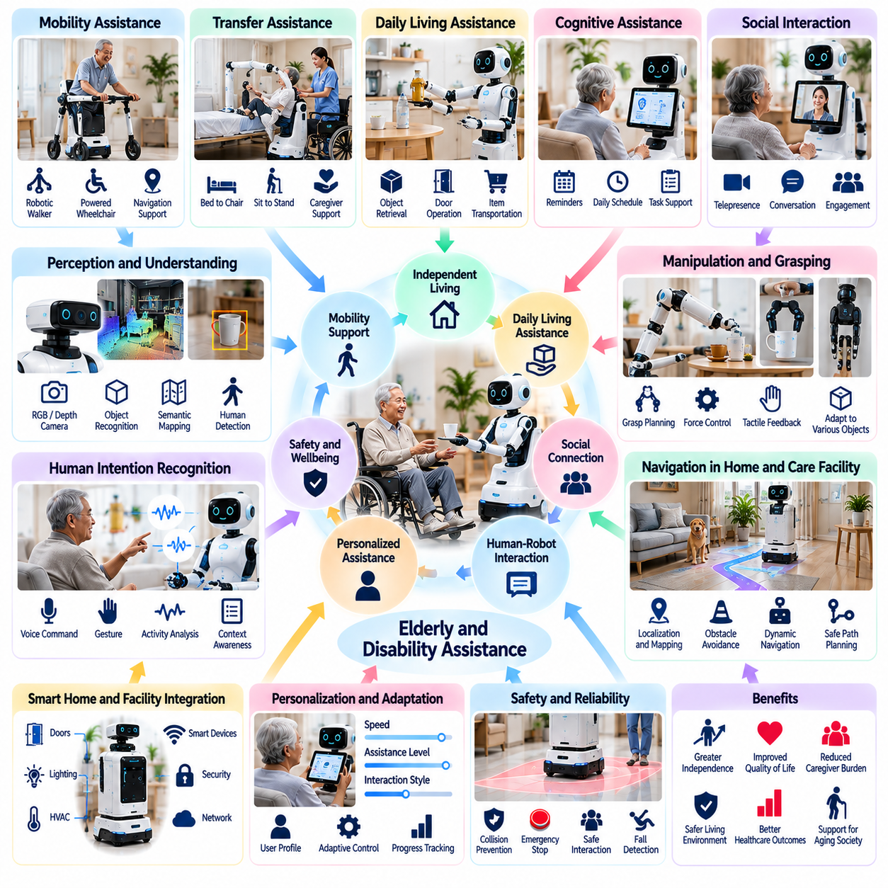{width="7.268055555555556in" height="7.268055555555556in"}

고령자 및 장애인 지원(Elderly and Disability Assistance)은 독립적인 생활(Independent Living), 개인 이동성(Personal Mobility), 일상 활동(Daily Activities)을 지원하는 피지컬 인공지능(Physical AI)의 중요한 응용 분야이다. 고령 인구(Aging Populations)와 신체적 또는 인지적 제약(Physical or Cognitive Limitations)이 있는 사람들은 다양한 수준의 지원이 필요할 수 있다. 지능형 로봇 시스템(Intelligent Robotic Systems)은 인지(Perception), 이동성(Mobility), 매니퓰레이션(Manipulation), 인간 중심 상호작용(Human-Centered Interaction)을 결합하여 개인의 자율성(Personal Autonomy)과 존엄성(Dignity)을 유지하면서 실질적인 지원을 제공한다.

보조 로봇(Assistive Robots)은 인간관계나 전문적인 돌봄(Professional Care)을 대체하는 것이 아니라 돌봄 제공자(Caregivers)를 보완하도록 설계된다. 주요 기능에는 물체 회수(Object Retrieval), 개인 물품 운송(Personal Item Transportation), 이동 지원(Mobility Support), 의사소통 지원(Communication Assistance)이 포함될 수 있다. 효과적인 지원을 위해서는 개인의 선호도(Individual Preferences), 신체적 능력(Physical Capabilities), 환경 조건(Environmental Conditions)에 대한 이해가 필요하다. 로봇은 예측 가능하고 접근성이 높으며 사용자의 지시에 적절하게 반응해야 한다.

일상생활 지원(Daily Living Assistance)은 가정용 물품에 손을 뻗어 가져오기, 물품 운반, 호환 가능한 문 열기, 자주 사용하는 물건 정리 등의 활동에 중점을 둔다. 이동형 매니퓰레이터(Mobile Manipulators)는 실내 환경을 자율주행하면서 로봇 팔(Robotic Arms)과 그리퍼(Grippers)를 이용해 특정 물리적 작업을 수행할 수 있다. 신뢰성 높은 작동을 위해서는 객체 인식(Object Recognition), 파지 계획(Grasp Planning), 장애물 회피(Obstacle Avoidance), 사람 주변에서의 정밀한 접촉력 관리(Contact Force Management)가 필요하다.

이동 지원(Mobility Assistance)은 보행 능력 저하(Reduced Walking Ability), 균형 유지의 어려움(Balance Difficulties), 지구력 감소(Limited Endurance)를 경험하는 사람들에게 특히 유용하다. 로봇 보행 보조기(Robotic Walkers), 동력 이동 장치(Powered Mobility Devices), 지능형 휠체어(Intelligent Wheelchairs)는 가정과 돌봄 시설에서의 이동을 지원할 수 있다. 자율주행 시스템(Navigation Systems)은 장애물 감지(Obstacle Detection)와 경로 안내(Route Guidance)를 제공할 수 있으며, 공유 제어(Shared Control)는 사용자가 이동 결정과 목적지 선택에 대한 권한을 유지하도록 한다.

이동 및 자세 전환 지원(Transfer Assistance)은 침대, 의자, 휠체어 및 기타 지지면(Support Surfaces) 사이에서 이루어지는 신체적으로 부담이 큰 이동을 다룬다. 로봇 이승 보조 장치(Robotic Transfer Devices)는 돌봄 제공자의 업무 부담(Caregiver Workload)을 줄이고 제어된 기계적 지지(Controlled Mechanical Support)를 제공할 수 있다. 그러나 안전한 이동을 위해서는 신체 자세(Body Position), 체중 분포(Weight Distribution), 균형(Balance), 개인별 의학적 제한사항(Medical Restrictions)을 신중하게 평가해야 한다. 움직임에 상당한 부상 위험이 수반되는 경우에는 인간 감독(Human Supervision)이 필수적이다.

낙상 예방 및 대응(Fall Prevention and Response)은 낙상이 심각한 부상과 독립성 감소를 초래할 수 있기 때문에 고령자 지원의 주요 관심사이다. 로봇 시스템은 환경 센서(Environmental Sensors), 착용형 장치(Wearable Devices), 움직임 분석(Movement Analysis)을 결합하여 잠재적인 위험이나 비정상적인 활동을 식별할 수 있다. 감지 시스템(Detection Systems)은 경고를 생성하거나 사전에 정의된 지원 절차(Predefined Assistance Procedures)를 시작할 수 있다. 실제 사고를 놓치는 미감지(Missed Events)와 불필요한 경보(Unnecessary Alarms)를 줄이기 위해 시스템 성능을 검증해야 한다.

개인 맞춤형 지원(Personal Assistance)은 악력 감소(Reduced Hand Strength), 관절 움직임 제한(Restricted Joint Movement), 시각 장애(Impaired Vision), 청각 장애(Limited Hearing) 등 다양한 신체적 능력에 적응해야 한다. 사용자 인터페이스(User Interfaces)는 음성 명령(Voice Commands), 터치 제어(Touch Controls), 제스처(Gestures), 접근성 지원 의사소통 장치(Accessible Communication Devices)를 제공할 수 있다. 다중모달 상호작용(Multimodal Interaction)은 사용자가 적합한 제어 방식을 선택하도록 한다. 인터페이스 설계에서는 피로(Fatigue), 감각적 제약(Sensory Limitations), 기능적 능력의 변화(Changes in Functional Capability)를 고려해야 한다.

인지 지원(Cognitive Assistance)은 기억력 저하(Memory Difficulties), 주의력 감소(Reduced Attention), 일상 작업 구성의 어려움(Daily Task Organization Challenges)을 경험하는 사람들을 지원할 수 있다. 로봇은 예정된 활동(Scheduled Activities), 약속(Appointments), 일상적인 가사 작업(Routine Household Tasks)에 대한 알림(Reminders)을 제공할 수 있다. 상황 인식 시스템(Context-Aware Systems)은 사용자 선호도에 따라 알림 시점(Notification Timing)과 제시 방식(Presentation)을 조정할 수 있다. 이러한 지원은 과도한 알림(Excessive Prompting)을 피해야 하며, 중요한 의료적 결정(Consequential Medical Decisions)을 독립적으로 내려서는 안 된다.

사회적 보조 로봇(Socially Assistive Robots)은 의사소통(Communication), 구조화된 활동(Structured Activities), 가족이나 돌봄 제공자와의 교류(Engagement)를 촉진할 수 있다. 대화형 인터페이스(Conversational Interfaces)와 원격 현장감 기능(Telepresence Functions)은 원격 상호작용(Remote Interaction)과 지원 서비스 접근을 가능하게 한다. 그러나 사용자가 느끼는 동반자 관계(Perceived Companionship)를 인간의 감정적 이해(Human Emotional Understanding)와 혼동해서는 안 된다. 시스템은 자신의 기능을 투명하게 설명하고 부적절한 정서적 의존(Inappropriate Emotional Dependence)을 유도하지 않아야 한다.

피지컬 인공지능은 보조 로봇이 가구(Furniture), 개인 소지품(Personal Belongings), 반려동물(Pets), 이동하는 사람들(Moving People)이 존재하는 복잡한 실내 환경을 해석하도록 한다. 의미 기반 지도 작성(Semantic Mapping)은 침실(Bedrooms), 주방(Kitchens), 욕실(Bathrooms)과 같은 기능적 공간을 식별한다. 동적 자율주행(Dynamic Navigation)은 일시적인 장애물(Temporary Obstacles)과 변화하는 공간 배치(Changing Layouts)에 적응한다. 로봇은 좁은 통로(Narrow Passages), 혼잡한 공간(Crowded Spaces), 사용자가 예측하기 어렵게 움직일 수 있는 구역에서 보수적으로 작동해야 한다.

인간 의도 인식(Human Intention Recognition)은 음성 요청(Spoken Requests), 제스처(Gestures), 움직임 패턴(Movement Patterns), 상황 정보(Contextual Information)를 해석하여 보조 시스템의 반응성을 향상시킬 수 있다. 사용자가 손이 닿지 않는 물체를 반복적으로 잡으려 할 때 로봇은 지원이 필요하다고 추론할 수 있다. 그러나 추정된 의도(Inferred Intentions)에는 여전히 불확실성이 존재한다. 시스템은 사생활을 침해할 가능성이 있거나 신체적으로 중요한 결과를 초래할 수 있는 행동을 실행하기 전에 사용자 확인(User Confirmation)을 요청해야 한다.

개인 맞춤화(Personalization)는 지원 요구사항이 개인마다 크게 다르고 시간이 지나면서 변화할 수 있기 때문에 필수적이다. 로봇은 사용자 선호도(User Preferences)에 따라 이동 속도(Movement Speed), 의사소통 방식(Communication Style), 작업 우선순위(Task Priorities), 물리적 보조 수준(Physical Assistance Levels)을 조정할 수 있다. 장기적인 관측(Longitudinal Observations)은 활동 패턴(Activity Patterns)이나 작업 수행 능력(Task Performance)의 변화를 보여줄 수 있다. 적응 과정(Adaptation)은 투명하고 되돌릴 수 있어야 하며, 사용자 또는 돌봄 제공자의 승인(Authorization)을 받아야 한다.

스마트홈 인프라(Smart Home Infrastructure)와의 통합은 연결된 문(Connected Doors), 조명(Lighting), 환경 제어장치(Environmental Controls), 통신 시스템(Communication Systems)을 통해 로봇 지원을 확장할 수 있다. 로봇은 승인된 장치(Authorized Devices)와 협력하여 일상 활동을 단순화하고 접근성(Accessibility)을 향상시킬 수 있다. 상호운용성(Interoperability)을 위해서는 신뢰성 높은 통신 프로토콜(Communication Protocols), 보안 인증(Secure Authentication), 적절한 권한 관리(Permission Management)가 필요하다. 네트워크 연결(Network Connectivity)이 중단되더라도 핵심 기능(Critical Functions)은 유지되어야 한다.

돌봄 시설(Care Facilities)에서는 보조 로봇이 서로 다른 요구사항을 가진 여러 입소자(Residents)를 지원할 수 있기 때문에 추가적인 요구사항이 발생한다. 군집 조정(Fleet Coordination)은 작업 긴급도(Task Urgency), 위치(Location), 가용 기능(Available Capabilities)에 따라 로봇을 할당할 수 있다. 직원 인터페이스(Staff Interfaces)는 명확한 작업 상태(Task Status)와 개입 요청(Intervention Requests)을 제공해야 한다. 공유 운영(Shared Operation)은 개인정보(Personal Information)를 보호하고 사용자, 목적지 및 지원 지시(Assistance Instructions) 사이의 혼동을 방지해야 한다.

물리적 안전성(Physical Safety)은 로봇이 고령자나 장애인 가까이에서 작동할 때 가장 기본적인 요구사항이다. 잠재적 위험(Potential Hazards)에는 충돌(Collisions), 불안정한 지지(Unstable Support), 과도한 접촉력(Excessive Contact Forces), 예상하지 못한 움직임(Unexpected Movement)이 포함된다. 안전공학(Safety Engineering)에는 순응형 메커니즘(Compliant Mechanisms), 속도 제한(Speed Limits), 장애물 감지(Obstacle Detection), 비상 정지(Emergency Stopping), 신뢰성 높은 고장 처리(Reliable Fault Handling)가 포함되어야 한다. 지원 기능은 개인의 취약성(Individual Vulnerability)을 고려하되 개인의 자유(Personal Freedom)를 불필요하게 제한해서는 안 된다.

개인정보 보호(Privacy)와 데이터 거버넌스(Data Governance)는 보조 로봇이 사적인 생활공간(Private Living Spaces)에서 영상(Video), 음성(Audio), 위치(Location), 움직임(Movement), 행동 정보(Behavioral Information)를 수집할 수 있기 때문에 중요하다. 데이터 수집(Data Collection)은 정당한 지원 목적(Legitimate Assistance Purposes)으로 제한되어야 하며 사전 동의(Informed Consent)에 기반해야 한다. 안전한 저장(Secure Storage), 접근 제어(Access Controls), 데이터 보존 정책(Retention Policies), 투명한 모니터링 관행(Transparent Monitoring Practices)은 사용자를 보호하는 데 도움이 된다. 민감한 관측 정보(Sensitive Observations)는 적절한 승인 없이 공유되어서는 안 된다.

신뢰성(Reliability)과 유지보수성(Maintainability)은 보조 로봇이 일상생활을 지원할 수 있는지를 결정하는 중요한 요소이다. 장치는 변화하는 환경에서도 일관되게 작동해야 하며, 자율주행(Navigation), 매니퓰레이션(Manipulation), 통신(Communication) 장애가 발생했을 때 안전하게 복구해야 한다. 배터리 관리(Battery Management), 충전 접근성(Charging Accessibility), 청소(Cleaning), 기술 지원(Technical Support)에 대한 실질적인 계획이 필요하다. 사용자와 돌봄 제공자는 자동화가 실패했을 때 간편하게 지원을 요청할 수 있어야 한다.

고령자 및 장애인 지원에 대한 평가(Evaluation)는 독립성(Independence), 접근성(Accessibility), 편안함(Comfort), 삶의 질(Quality of Life)에서 나타나는 의미 있는 개선을 강조해야 한다. 기술적 지표(Technical Indicators)에는 작업 성공률(Task Success), 자율주행 신뢰성(Navigation Reliability), 개입 빈도(Intervention Frequency), 시스템 가용성(System Availability)이 포함된다. 사용자 만족도(User Satisfaction), 돌봄 제공자의 업무 부담(Caregiver Workload), 지속적인 사용(Sustained Adoption)은 추가적인 평가 근거를 제공한다. 평가는 다양한 참여자(Diverse Participants)와 실제 가정 또는 돌봄 환경(Realistic Home or Care Environments)을 포함해야 한다.

경제적 및 조직적 도입(Economic and Organizational Adoption)은 장치의 가격 적정성(Device Affordability), 설치 복잡성(Installation Complexity), 교육 요구사항(Training Requirements), 지속적인 서비스 비용(Ongoing Service Costs)에 달려 있다. 기대 효과에는 반복적인 돌봄 업무 감소(Reduced Repetitive Caregiver Tasks), 접근성 향상(Improved Accessibility), 독립적인 활동 기회 확대(Greater Opportunities for Independent Activity)가 포함될 수 있다. 그러나 로봇의 가치를 단순한 인건비 절감(Labor Savings)만으로 평가해서는 안 된다. 사용자 복지(User Well-Being), 안전성(Safety), 자율성(Autonomy), 공평한 지원 접근성(Equitable Access to Assistance)도 가치 평가에 반영되어야 한다.

미래의 고령자 및 장애인 지원 시스템은 범용 로봇 파운데이션 모델(General-Purpose Robotic Foundation Models), 다중모달 인지(Multimodal Perception), 정교한 매니퓰레이션(Dexterous Manipulation), 개인 맞춤형 적응 제어(Personalized Adaptive Control)를 통합할 수 있다. 이러한 기능은 가정, 병원 및 장기요양시설(Long-Term Care Facilities) 전반에서 더욱 유연한 지원을 가능하게 할 수 있다. 성공적인 도입을 위해서는 신뢰성 높은 안전성(Dependable Safety), 윤리적인 데이터 관리(Ethical Data Practices), 접근성 높은 인터페이스(Accessible Interfaces), 지속적인 인간 감독(Human Oversight)이 필요하다. 장기적인 목표는 신뢰할 수 있는 물리적 지원(Trustworthy Physical Assistance)을 통해 개인의 역량과 자립성을 강화하는 것이다.

## 04.07. Humanoid Assistants and Service Robots

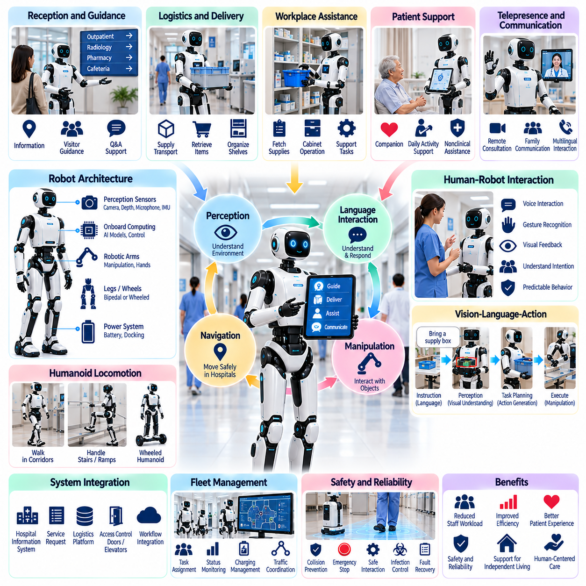{width="7.268055555555556in" height="7.268055555555556in"}

휴머노이드 보조 로봇 및 서비스 로봇(Humanoid Assistants and Service Robots)은 자율 이동(Autonomous Mobility), 인지(Perception), 매니퓰레이션(Manipulation), 자연스러운 인간 상호작용(Natural Human Interaction)을 결합하는 병원 내 피지컬 인공지능(Physical AI)의 새로운 응용 분야이다. 이러한 시스템은 실질적인 서비스 활동을 통해 의료진(Healthcare Personnel), 환자(Patients), 방문객(Visitors)을 지원하도록 설계된다. 로봇의 가치는 단순히 인간의 외형이나 움직임을 재현하는 것이 아니라 유용한 작업을 안전하고 신뢰성 있게 수행하는 능력에 달려 있다.

휴머노이드 형태(Humanoid Morphology)는 원래 인간 작업자를 위해 설계된 환경과의 호환성(Compatibility)을 제공할 수 있다. 병원의 복도(Corridors), 출입문(Doors), 엘리베이터(Elevators), 안내 데스크(Counters), 선반(Shelves), 작업대(Workstations)는 일반적으로 인간의 신체 치수와 접근성 요구사항(Accessibility Requirements)을 반영한다. 관절형 로봇 팔(Articulated Arms)과 인간 수준의 도달 범위(Human-Scale Reach)를 갖춘 로봇은 기존 인프라와 상호작용할 수 있다. 그러나 휴머노이드 구조는 기계적 복잡성(Mechanical Complexity), 균형 유지 요구사항(Balance Requirements), 상당한 제어상의 과제(Control Challenges)를 수반한다.

병원 서비스 로봇(Hospital Service Robots)은 접수 지원(Reception Assistance), 방문객 안내(Visitor Guidance), 정보 제공(Information Delivery), 일부 물류 활동(Logistical Activities)을 수행할 수 있다. 로봇은 진료 부서(Clinical Departments)로 가는 길을 안내하고, 일상적인 절차(Routine Procedures)를 설명하거나, 승인된 경로(Approved Routes)를 따라 방문객을 동행할 수 있다. 이러한 응용에는 신뢰성 높은 위치 추정(Localization), 음성 상호작용(Speech Interaction), 주변 사람에 대한 인식(Awareness of Surrounding People)이 필요하다. 부적절한 임상 조언(Inappropriate Clinical Advice)이나 승인되지 않은 행동(Unauthorized Actions)을 방지하기 위해 서비스 범위(Service Boundaries)를 명확하게 정의해야 한다.

휴머노이드 보조 로봇(Humanoid Assistants)은 경량 의료 물품 운송(Transporting Lightweight Supplies), 표준화된 용기 회수(Retrieving Standardized Containers), 지정된 작업 구역 정리(Organizing Designated Work Areas)와 같은 비임상 작업(Nonclinical Tasks)을 지원할 수 있다. 이동형 매니퓰레이션(Mobile Manipulation)은 선반, 캐비닛 및 서비스 카운터와의 상호작용을 가능하게 한다. 작업 선정(Task Selection)은 검증된 로봇의 기능과 환경적 제약조건(Environmental Constraints)을 반영해야 한다. 고위험 임상 시술(High-Risk Clinical Procedures)과 환자의 직접적인 신체 취급(Direct Patient Handling)에는 훨씬 높은 수준의 검증 근거와 안전장치가 필요하다.

인지 시스템(Perception Systems)은 휴머노이드 로봇이 동적인 병원 환경(Dynamic Hospital Environments)을 이해하도록 한다. 카메라(Cameras), 깊이 센서(Depth Sensors), 마이크로폰(Microphones), 고유수용감각 센서(Proprioceptive Sensors)는 물체, 사람, 장애물 및 로봇 자세(Robot Posture)에 관한 정보를 제공한다. 다중모달 센서 융합(Multimodal Sensor Fusion)은 공간 인식(Spatial Awareness)과 상호작용을 지원한다. 강건한 인지(Robust Perception)는 혼잡한 복도, 반사 표면(Reflective Surfaces), 변화하는 조명(Changing Lighting), 부분적으로 가려진 물체(Partially Occluded Objects)에 대응할 수 있어야 한다.

자연어 상호작용(Natural Language Interaction)은 환자, 방문객 및 병원 직원에게 접근성 높은 인터페이스(Accessible Interface)를 제공한다. 음성 인식(Speech Recognition)과 언어 모델(Language Models)은 요청을 해석하고, 승인된 정보성 질문에 답변하며, 작업 지시(Task Instructions)를 명확하게 할 수 있다. 다국어 지원(Multilingual Support)은 다양한 의료 환경에서 접근성을 향상시킬 수 있다. 그러나 대화형 시스템(Conversational Systems)은 불확실성(Uncertainty)을 인식해야 하며, 생성된 응답(Generated Responses)을 검증된 의료 지침(Verified Medical Guidance)인 것처럼 제시해서는 안 된다.

비전-언어-행동 모델(Vision-Language-Action Models, VLA)은 언어 지시(Verbal Instructions)와 시각적 관측(Visual Observations)을 로봇 행동(Robotic Behavior)에 연결하는 잠재적인 아키텍처(Architecture)를 제공한다. 승인된 의료 물품을 가져오라는 명령은 객체 식별(Object Identification), 자율주행(Navigation), 파지(Grasping), 배송(Delivery) 행동으로 변환될 수 있다. 이러한 시스템은 실제 환경 관측(Real Environmental Observations)에 기반한 행동 연결(Grounding)이 필요하다. 안전에 중요한 행동(Safety-Critical Actions)은 검증된 정책(Verified Policies), 권한(Permissions), 실행 모니터링(Execution Monitoring)에 의해 제한되어야 한다.

휴머노이드 보행(Humanoid Locomotion)은 의료 환경에서 상당한 기술적 과제를 제시한다. 이족보행 로봇(Bipedal Robots)은 바닥, 문턱(Thresholds), 경사로(Ramps), 혼잡한 공간을 이동하면서 균형(Balance)을 유지해야 한다. 낙상(Falls)이나 예상하지 못한 움직임(Unexpected Movements)은 취약한 환자(Vulnerable Patients)에게 위험을 초래할 수 있다. 바퀴형 휴머노이드 플랫폼(Wheeled Humanoid Platforms)은 많은 병원 작업에서 더 높은 안정성(Stability)과 에너지 효율성(Energy Efficiency)을 제공할 수 있다. 로봇 형태 선정(Morphology Selection)은 인간과의 외형적 유사성보다 운영 요구사항(Operational Requirements)을 우선해야 한다.

매니퓰레이션 능력(Manipulation Capabilities)은 휴머노이드 보조 로봇이 의미 있는 물리적 작업을 수행할 수 있는지를 결정한다. 로봇 손(Robotic Hands)과 로봇 팔(Robotic Arms)은 서로 다른 형상, 무게 및 표면 특성(Surface Properties)을 가진 물체를 취급해야 한다. 파지 계획(Grasp Planning), 힘 제어(Force Control), 촉각 센싱(Tactile Sensing)은 미끄러짐(Slipping), 압착(Crushing), 의도하지 않은 접촉(Unintended Contact)을 방지하는 데 도움이 된다. 병원 도입에서는 조작 불확실성(Manipulation Uncertainty)을 줄일 수 있는 표준화된 용기(Standardized Containers)와 작업대(Workstations)가 유용하다.

전신 제어(Whole-Body Control)는 물리적 상호작용 과정에서 이동(Locomotion), 로봇 팔 움직임(Arm Movement), 자세(Posture), 균형(Balance)을 조정한다. 휴머노이드 로봇은 선반에 손을 뻗거나 물체를 운반하면서 신체 위치를 변경해야 할 수 있다. 동작 계획(Motion Planning)은 관절 한계(Joint Limits), 질량 중심(Center of Mass), 적재물 분포(Payload Distribution), 주변 사람들을 고려해야 한다. 협조 제어(Coordinated Control)는 매니퓰레이션 과정에서 발생하는 힘이 전체 안정성(Overall Stability)에 영향을 미칠 때 특히 중요하다.

인간-로봇 상호작용(Human-Robot Interaction)은 예측 가능한 행동(Predictable Behavior)과 로봇 의도(Robot Intentions)에 대한 명확한 의사소통을 요구한다. 시각적 표시장치(Visual Indicators), 음성 메시지(Speech Messages), 제어된 움직임 패턴(Controlled Movement Patterns)은 사람들이 로봇의 다음 행동을 이해하도록 도울 수 있다. 로봇은 지원 요청(Requests for Assistance)을 인식하고 작업 중단(Interruptions)에 적절하게 대응해야 한다. 또한 이동성이 제한된 환자(Limited Mobility), 감각 장애(Sensory Impairments)가 있는 환자, 예상하지 못한 움직임에 민감한 환자의 특성을 고려해야 한다.

사회적 상호작용 능력(Social Interaction Capabilities)은 환자 참여(Patient Engagement)와 방문객 지원(Visitor Assistance)을 촉진할 수 있지만, 휴머노이드 외형(Humanoid Appearance)은 비현실적인 기대(Unrealistic Expectations)를 유발할 수 있다. 사용자는 로봇이 인간의 판단력(Human Judgment), 공감 능력(Empathy), 임상적 전문성(Clinical Competence)을 갖추고 있다고 가정할 수 있다. 책임 있는 인터페이스 설계(Responsible Interface Design)는 시스템의 실제 기능과 한계를 명확하게 전달해야 한다. 로봇은 자동화된 응답(Automated Responses)을 전문적인 의료 평가(Professional Medical Assessments)인 것처럼 표현해서는 안 된다.

병원 업무 흐름 통합(Hospital Workflow Integration)은 휴머노이드 보조 로봇이 운영 효율성(Operational Efficiency)에 기여할 수 있는지를 결정한다. 서비스 요청(Service Requests)은 접수 시스템(Reception Systems), 물류 플랫폼(Logistics Platforms), 승인된 직원 인터페이스(Authorized Staff Interfaces)에서 발생할 수 있다. 작업 관리 소프트웨어(Task Management Software)는 우선순위(Priorities), 목적지(Destinations), 완료 기록(Completion Records)을 조정할 수 있다. 병원 정보시스템(Hospital Information Systems)과의 통합에는 적절한 접근 제어(Access Controls)와 행정 기능(Administrative Functions) 및 임상 기능(Clinical Functions)의 신중한 분리가 필요하다.

여러 서비스 로봇이 병원 부서 전반에서 운영될 때 군집 관리(Fleet Management)가 중요해진다. 중앙 집중식 조정(Central Coordination)은 로봇 기능(Robot Capabilities), 위치(Location), 배터리 상태(Battery Condition), 서비스 긴급도(Service Urgency)에 따라 작업을 할당할 수 있다. 공유 지도(Shared Maps)와 교통 운영 정책(Traffic Policies)은 혼잡을 줄이는 데 도움이 된다. 휴머노이드 로봇은 자율이동로봇(Autonomous Mobile Robots, AMR)과 함께 작동할 수 있으므로 상호운용 가능한 일정 관리(Interoperable Scheduling)와 명확하게 정의된 운영 책임(Operational Responsibilities)이 필요하다.

물리적 안전성(Physical Safety)은 임상 환경에서 휴머노이드 로봇을 도입하기 위한 핵심 요구사항이다. 잠재적 위험(Potential Hazards)에는 균형 상실(Loss of Balance), 충돌(Collisions), 과도한 접촉력(Excessive Contact Forces), 물체 낙하(Dropped Objects), 예상하지 못한 로봇 팔 움직임(Unexpected Arm Movements)이 포함된다. 보호 조치(Protective Measures)에는 속도 제한(Speed Restrictions), 순응형 구동(Compliant Actuation), 충돌 모니터링(Collision Monitoring), 비상 정지(Emergency Stopping), 통제된 복구 절차(Controlled Recovery Procedures)가 포함될 수 있다. 안전성 검증(Safety Validation)은 실제 병원 운영 조건을 반영해야 한다.

개인정보 보호(Privacy)와 정보보안(Information Security)은 서비스 로봇이 음성(Speech), 영상(Images), 위치 데이터(Location Data), 개인 요청(Personal Requests)을 처리할 수 있기 때문에 특별한 주의가 필요하다. 환자 정보(Patient Information)는 필요한 경우에만 명시적인 승인을 받아 접근해야 한다. 데이터 최소화(Data Minimization), 암호화(Encryption), 인증(Authentication), 데이터 보존 정책(Retention Policies)은 책임 있는 운영을 지원한다. 대중과 직접 상호작용하는 로봇(Public-Facing Robots)은 음성이나 디스플레이를 통해 기밀정보(Confidential Information)가 우발적으로 공개되는 것을 방지해야 한다.

운영 신뢰성(Operational Reliability)은 변화하는 병원 환경에서 일관된 성능을 유지하는 능력에 달려 있다. 로봇은 차단된 경로(Blocked Routes), 이용할 수 없는 목적지(Unavailable Destinations), 파지 실패(Failed Grasps), 통신 중단(Communication Interruptions), 배터리 부족(Low Battery Conditions)을 감지해야 한다. 복구 전략(Recovery Strategies)에는 재계획(Replanning), 직원 지원 요청(Requesting Staff Assistance), 안전한 작업 종료(Safely Terminating Tasks)가 포함될 수 있다. 서비스 장애(Service Failures)가 병원 업무 흐름을 방해할 수 있는 경우에는 명확한 상위 대응 절차(Escalation Procedures)가 필수적이다.

성능 평가(Performance Evaluation)는 기술적 시연(Technical Demonstrations)과 지속적인 운영 능력(Sustained Operational Capability)을 구분해야 한다. 주요 평가 지표에는 작업 완료율(Task Completion Rate), 자율주행 성공률(Navigation Success), 매니퓰레이션 신뢰성(Manipulation Reliability), 상호작용 정확도(Interaction Accuracy), 개입 빈도(Intervention Frequency), 시스템 가용성(System Availability)이 포함된다. 인간의 수용성(Human Acceptance), 업무 흐름 방해(Workflow Disruption), 안전사고(Safety Incidents)도 평가해야 한다. 장기간의 현장 시험(Long-Duration Trials)은 통제된 환경에서의 개별 시연보다 강력한 근거를 제공한다.

경제적 타당성(Economic Feasibility)은 로봇의 기능(Robot Capabilities), 구매 비용(Acquisition Costs), 통합 비용(Integration Expenses), 측정 가능한 서비스 효과(Measurable Service Benefits) 사이의 관계에 달려 있다. 휴머노이드 플랫폼(Humanoid Platforms)에는 고가의 액추에이터(Actuators), 센서(Sensors), 컴퓨팅 시스템(Computing Systems), 전문 유지보수(Specialized Maintenance)가 필요할 수 있다. 병원은 이를 더 단순한 바퀴형 로봇(Wheeled Robots)이나 고정형 자동화 솔루션(Fixed Automation Solutions)과 비교해야 한다. 추가적인 유연성(Additional Flexibility)이 의미 있는 운영 가치(Operational Value)를 창출할 때 도입이 정당화될 수 있다.

미래의 휴머노이드 보조 로봇은 범용 로봇 파운데이션 모델(General-Purpose Robotic Foundation Models), 향상된 정교한 매니퓰레이션(Improved Dexterous Manipulation), 다중모달 추론(Multimodal Reasoning), 적응형 전신 제어(Adaptive Whole-Body Control)의 발전으로부터 혜택을 받을 수 있다. 이러한 기술은 하나의 공통 로봇 플랫폼(Common Robotic Platform)이 수행할 수 있는 병원 서비스 작업의 범위를 확장할 수 있다. 그러나 기술 발전은 신뢰성 높은 안전공학(Reliable Safety Engineering), 임상 업무 흐름 검증(Clinical Workflow Validation), 인간 감독(Human Oversight)에 의해 뒷받침되어야 한다.

휴머노이드 보조 로봇 및 서비스 로봇의 장기적인 역할은 적절한 물리적 작업(Physical Tasks)과 정보 제공 작업(Informational Tasks)을 처리하여 의료 전문가(Healthcare Professionals)를 보완하는 것이다. 성공적인 시스템은 유용한 자율성(Useful Autonomy), 투명한 기능적 한계(Transparent Limitations), 신뢰성 높은 운영(Dependable Operation), 환자 요구사항에 대한 존중(Respect for Patient Needs)을 결합할 것이다. 피지컬 인공지능은 임상 전문성(Clinical Expertise)을 대체하기보다 불필요한 업무 부담(Avoidable Workload)을 줄이고 서비스 접근성(Service Accessibility)을 향상시키면서 환자 진료(Patient Care)에 대한 인간의 책임(Human Responsibility)을 유지해야 한다.

## 04.08. Patient Monitoring and Autonomous Inspection

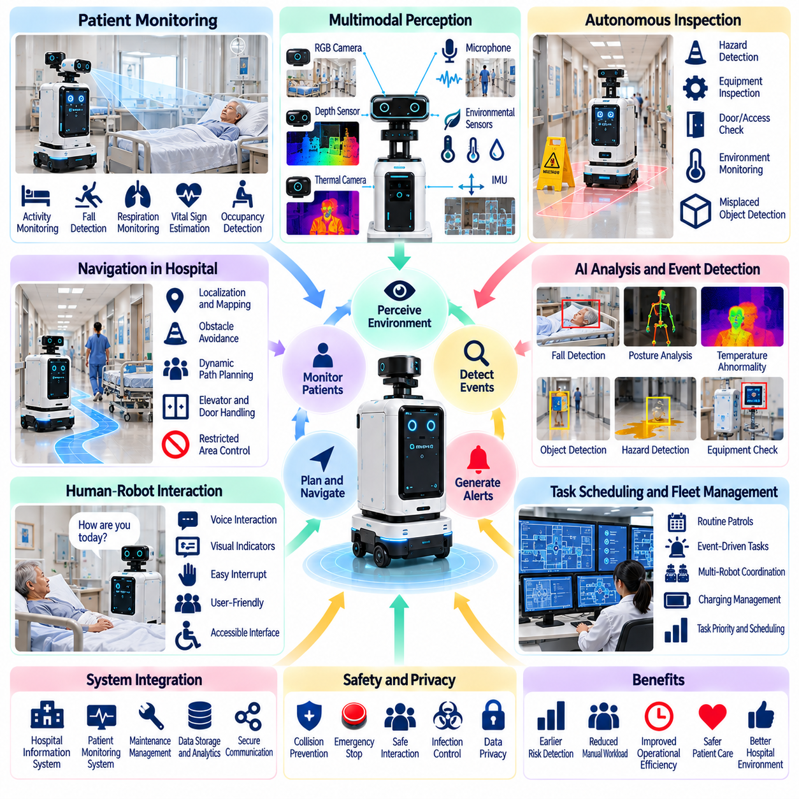{width="7.268055555555556in" height="7.268055555555556in"}

환자 모니터링 및 자율 점검(Patient Monitoring and Autonomous Inspection)은 의료 환경에서 피지컬 인공지능(Physical AI)의 중요한 응용 분야이다. 이러한 시스템은 이동형 로봇공학(Mobile Robotics), 지능형 센싱(Intelligent Sensing), 환경 인지(Environmental Perception), 자동화 분석(Automated Analysis)을 결합하여 임상 관찰(Clinical Observation)과 시설 운영(Facility Operations)을 지원한다. 주요 목적은 임상적 책임(Clinical Responsibility)과 환자 안전(Patient Safety)을 유지하면서 정보 가용성(Information Availability)을 향상시키고, 잠재적 위험(Potential Risks)을 식별하며, 반복적인 점검 업무 부담(Repetitive Inspection Workloads)을 줄이는 것이다.

환자 모니터링 로봇(Patient Monitoring Robots)은 카메라(Cameras), 열 센서(Thermal Sensors), 깊이 센서(Depth Sensors), 연결된 의료기기(Connected Medical Devices)를 통해 특정 관측 정보(Observations)를 수집할 수 있다. 시스템의 의도된 용도(Intended Use)에 따라 환자의 움직임(Patient Movement), 자세(Posture), 병실 점유 상태(Room Occupancy), 환경 조건(Environmental Conditions)을 관찰할 수 있다. 로봇의 이동성(Robotic Mobility)은 서로 다른 위치에서 측정할 수 있도록 한다. 그러나 관측 결과는 독립적인 의학적 진단(Medical Diagnoses)으로 간주하기보다 검증된 임상 업무 흐름(Validated Clinical Workflows) 내에서 해석되어야 한다.

자율 점검(Autonomous Inspection)은 개별 환자에 대한 로봇 모니터링을 병실(Hospital Rooms), 복도(Corridors), 장비 구역(Equipment Areas), 공용 시설(Shared Facilities)로 확장한다. 이동형 로봇(Mobile Robots)은 예정된 경로(Scheduled Routes)를 따라 이동하면서 환경 조건을 관찰하고 운영상의 이상 상태(Operational Abnormalities)를 식별할 수 있다. 점검 활동에는 통행로 차단(Blocked Passages), 잘못 배치된 장비(Misplaced Equipment), 방치된 물체(Unattended Objects), 비정상적인 실내 상태(Unusual Room Conditions)의 감지가 포함될 수 있다. 이러한 기능은 예방 정비(Preventive Maintenance)와 운영 상황 인식(Operational Awareness)을 지원한다.

다중모달 인지(Multimodal Perception)는 신뢰성 높은 환자 모니터링과 점검의 기반을 제공한다. RGB 카메라(RGB Cameras), 깊이 센서(Depth Sensors), 열화상 장치(Thermal Imaging), 마이크로폰(Microphones), 환경 센서(Environmental Sensors)는 상호보완적인 정보를 수집한다. 센서 융합(Sensor Fusion)은 관련 이벤트(Relevant Events)와 배경 활동(Background Activity)을 구분하는 데 도움이 된다. 신뢰성 높은 운영을 위해서는 정밀한 보정(Calibration)과 가림 현상(Occlusion), 조명 변화(Lighting Variation), 반사 표면(Reflective Surfaces), 센서 잡음(Sensor Noise), 임상 환경 간 차이(Differences Between Clinical Environments)를 고려해야 한다.

환자 움직임 모니터링(Patient Movement Monitoring)은 활동 패턴(Activity Patterns)의 변화, 장시간 비활동(Prolonged Inactivity), 잠재적으로 위험한 침대 이탈 시도(Unsafe Attempts to Leave a Bed)를 식별하는 데 도움이 될 수 있다. 비전 기반 자세 추정(Vision-Based Posture Estimation)과 움직임 분석(Movement Analysis)은 사전에 정의된 경고 조건(Predefined Alert Conditions)을 지원할 수 있다. 그러나 움직임 관측만으로는 추가 평가 없이 임상적 원인(Clinical Causes)을 신뢰성 있게 규명할 수 없다. 경고 임계값(Alert Thresholds)은 대상 환자 집단(Intended Population)에 맞게 검증되어야 하며 간호 절차(Nursing Procedures)와 연계되어야 한다.

낙상 감지(Fall Detection)와 낙상 위험 모니터링(Fall-Risk Monitoring)은 입원 환자가 이동 능력 저하(Impaired Mobility), 근력 약화(Weakness), 지남력 장애(Disorientation)를 경험할 수 있기 때문에 중요한 응용 분야이다. 로봇 시스템은 움직임 궤적(Movement Trajectories), 자세 전환(Posture Transitions), 비정상 이벤트(Unusual Events)를 분석하여 낙상 가능성을 식별할 수 있다. 신속한 알림(Rapid Notification)은 의료진의 적시 대응(Timely Staff Response)을 지원한다. 감지 성능(Detection Performance)은 오경보(False Alarms), 미감지(Missed Events), 환자 행동의 변동성(Variations in Patient Behavior)을 고려하여 평가해야 한다.

비접촉 생리학적 모니터링(Contactless Physiological Monitoring)은 적절한 조건에서 호흡 운동(Respiratory Motion)이나 피부 표면 온도(Skin-Surface Temperature)와 같은 특정 지표를 추정할 수 있다. 카메라(Cameras), 레이더 센서(Radar Sensors), 열화상 장치(Thermal Imaging)는 추가적인 장치를 신체에 부착하지 않고 비접촉 관측(Noncontact Observations)을 제공할 수 있다. 측정 정확도(Measurement Accuracy)는 센서 배치(Sensor Placement), 환경 간섭(Environmental Interference), 환자의 움직임(Patient Movement)에 따라 달라진다. 이러한 시스템의 출력이 의료적 결정(Medical Decisions)에 활용되기 위해서는 사전에 임상적 검증(Clinical Validation)이 필요하다.

자율 점검 로봇(Autonomous Inspection Robots)은 액체 유출(Spills), 장애물(Obstacles), 개방된 출입 지점(Open Access Points), 비정상적인 장비 상태(Abnormal Equipment Conditions)를 감지하여 병원 환경 안전(Hospital Environmental Safety)을 지원할 수 있다. 시각적 점검(Visual Inspection)은 눈에 보이는 위험을 식별할 수 있으며, 특수 센서(Specialized Sensors)는 온도(Temperature), 습도(Humidity), 공기질 지표(Air-Quality Indicators)를 측정할 수 있다. 자동 보고(Automated Reporting)는 유지보수 담당자가 시정 조치(Corrective Actions)의 우선순위를 결정하도록 지원한다. 점검 로봇은 필수적인 인간 안전 점검(Human Safety Checks)을 대체하는 수단으로 간주되어서는 안 된다.

의료기기 점검(Medical Equipment Inspection)은 외부 표시장치(External Indicators), 장비 위치(Equipment Locations), 특정 작동 상태(Operational States)를 관찰하는 활동을 포함할 수 있다. 로봇은 잘못 배치된 장치(Misplaced Devices), 접근 방해(Obstructed Access), 눈에 보이는 경고 신호(Visible Warning Signals)를 식별할 수 있다. 승인된 장비 인터페이스(Authorized Equipment Interfaces)와의 통합은 추가적인 상태 정보(Status Information)를 제공할 수 있다. 그러나 자동 점검(Automated Inspection)은 의료기기에 요구되는 인증된 유지보수(Certified Maintenance), 교정(Calibration), 기술적 시험(Technical Testing)을 대체할 수 없다.

자율주행 신뢰성(Navigation Reliability)은 점검 로봇이 환자, 임상 인력(Clinical Personnel), 민감한 장비(Sensitive Equipment) 근처에서 작동하기 때문에 필수적이다. 자율 시스템(Autonomous Systems)은 충돌과 불필요한 방해를 피하면서 좁은 복도(Narrow Corridors), 출입구(Doorways), 사용 중인 병실(Occupied Rooms)을 이동해야 한다. 위치 추정(Localization), 장애물 감지(Obstacle Detection), 동적 경로 계획(Dynamic Path Planning)은 안전한 이동을 지원한다. 로봇은 출입 제한 구역(Restricted Zones), 응급 이동 경로(Emergency Routes), 환자 진료 활동(Patient-Care Activities)을 존중해야 한다.

점검 일정 관리(Inspection Scheduling)는 병원의 우선순위(Hospital Priorities)와 운영 조건(Operational Conditions)을 반영해야 한다. 정기 순찰(Routine Patrols)은 사전에 정의된 간격(Predefined Intervals)을 따를 수 있으며, 이벤트 기반 점검(Event-Triggered Inspections)은 보고된 이상 상태(Reported Abnormalities)나 특정 서비스 요청(Service Requests)에 대응한다. 지능형 일정 관리(Intelligent Scheduling)는 위치(Location), 긴급도(Urgency), 로봇 가용성(Robot Availability), 배터리 상태(Battery Condition)를 고려할 수 있다. 시간에 민감한 모니터링 작업(Time-Sensitive Monitoring Tasks)에는 자원을 사용할 수 없을 때의 우선순위 지정(Prioritization)과 상위 대응(Escalation)에 관한 명확한 규칙이 필요하다.

이벤트 감지 시스템(Event Detection Systems)은 센서 관측(Sensor Observations)을 운영상 의미 있는 정보(Operationally Meaningful Information)로 변환한다. 기계학습 모델(Machine Learning Models)은 물체를 분류하고, 움직임 패턴을 인식하며, 예상된 조건에서 벗어난 편차(Deviations)를 식별할 수 있다. 시간적 분석(Temporal Analysis)은 지속적인 이상 상태(Persistent Abnormalities)와 일시적인 변화(Brief Changes)를 구별할 수 있다. 그러나 불확실한 관측(Uncertain Observations)에 대해서는 중요한 조치를 시작하기 전에 신뢰도 평가(Confidence Assessment)와 적절한 인간 검증(Human Verification)이 필요하다.

인간-로봇 상호작용(Human-Robot Interaction)은 모니터링 로봇이 병실에 들어가거나 임상 작업 공간(Clinical Workspaces)에 접근할 때 필요하다. 로봇은 적절한 시각적 또는 청각적 신호(Visual or Audible Signals)를 통해 자신의 존재와 예정된 활동(Intended Activity)을 알려야 한다. 환자와 의료진은 어떤 정보가 수집되는지, 어떻게 지원을 요청하거나 점검을 중단할 수 있는지 이해해야 한다. 상호작용 설계(Interaction Design)는 감각 장애(Sensory Impairments)와 환자 선호도(Patient Preferences)를 고려해야 한다.

병원 정보시스템(Hospital Information Systems)과의 통합은 모니터링 관측 결과를 승인된 임상 및 운영 업무 흐름(Authorized Clinical and Operational Workflows)과 연결할 수 있다. 관련 경고(Relevant Alerts)는 간호사실(Nursing Stations), 유지보수 시스템(Maintenance Systems), 지정된 대응 담당자(Designated Response Personnel)에게 전달될 수 있다. 데이터 인터페이스(Data Interfaces)는 정확한 타임스탬프(Timestamps), 장치 식별(Device Identification), 이벤트 맥락(Event Context)을 유지해야 한다. 임상 기록(Clinical Records)은 검증되고 적절하게 승인된 절차를 통해서만 갱신되어야 한다.

경고 관리(Alert Management)는 과도한 알림이 업무 부담을 증가시키고 경보 피로(Alarm Fatigue)를 유발할 수 있기 때문에 중요한 설계 과제이다. 모니터링 시스템은 심각도(Severity), 신뢰도(Confidence), 운영 관련성(Operational Relevance)에 따라 이벤트의 우선순위를 결정해야 한다. 상위 대응 절차(Escalation Procedures)는 책임 담당자(Responsible Personnel)와 예상 대응(Expected Responses)을 명확하게 식별해야 한다. 성능 평가(Performance Evaluation)는 단순히 이벤트 감지 횟수를 늘리는 것이 아니라 경고가 적시 개입(Timely Intervention)을 개선하는지를 고려해야 한다.

개인정보 보호(Privacy Protection)는 환자 모니터링이 민감한 임상 공간(Sensitive Clinical Spaces)에서 지속적이거나 반복적인 관찰을 포함할 수 있기 때문에 특히 중요하다. 영상(Video), 음성(Audio), 생리학적 측정값(Physiological Measurements), 위치 정보(Location Information)에는 적절한 보호 조치(Safeguards)가 필요하다. 데이터 최소화(Data Minimization), 접근 제어(Access Controls), 암호화(Encryption), 데이터 보존 정책(Retention Policies)은 불필요한 정보 노출(Unnecessary Exposure)을 줄이는 데 도움이 된다. 모니터링 관행(Monitoring Practices)은 관련 규정(Applicable Regulations)을 준수하고 환자의 동의(Patient Consent)와 존엄성(Dignity)을 존중해야 한다.

사이버보안(Cybersecurity)은 연결된 센서(Connected Sensors), 이동형 로봇(Mobile Robots), 병원 네트워크(Hospital Networks), 모니터링 플랫폼(Monitoring Platforms)을 보호하기 위해 필요하다. 무단 접근(Unauthorized Access)은 민감한 정보를 노출하거나 로봇 운영을 방해할 수 있다. 보안 인증(Secure Authentication), 소프트웨어 업데이트(Software Updates), 네트워크 분할(Network Segmentation), 이벤트 로깅(Event Logging)은 시스템 보호를 지원한다. 안전 필수 기능(Safety-Critical Functions)은 통신 중단(Communication Interruptions)이나 의심스러운 보안 사고(Suspected Security Incidents)가 발생하더라도 적절하게 통제되어야 한다.

운영 신뢰성(Operational Reliability)을 확보하려면 로봇이 센서 고장(Sensor Failures), 위치 추정 오류(Localization Errors), 차단된 경로(Blocked Routes), 접근할 수 없는 모니터링 목적지(Unavailable Monitoring Destinations)를 인식해야 한다. 복구 전략(Recovery Strategies)에는 재보정(Recalibration), 대체 경로 이동(Alternate Navigation), 감독하의 개입(Supervised Intervention), 안전한 작업 종료(Safe Task Termination)가 포함될 수 있다. 시스템은 미완료 점검(Incomplete Inspections)과 검증된 관측(Verified Observations)을 구별해야 한다. 명확한 고장 보고(Fault Reporting)는 임상 및 기술 담당자가 정보의 부재를 정상 상태로 오인하지 않고 대응하도록 한다.

임상적 검증(Clinical Validation)은 모니터링 기능이 의도된 목적(Intended Purposes)에 대해 충분히 정확하고 유용한지를 입증해야 한다. 평가 지표(Evaluation Measures)에는 민감도(Sensitivity), 특이도(Specificity), 오경보 빈도(False-Alert Frequency), 감지 지연시간(Detection Latency), 의료진 대응 시간(Staff Response Time)이 포함될 수 있다. 운영 점검 지표(Operational Inspection Metrics)에는 경로 완료율(Route Completion), 점검 범위(Inspection Coverage), 개입 빈도(Intervention Frequency), 시스템 가용성(System Availability)이 포함된다. 연구는 실제 환자 집단(Realistic Patient Populations)과 병원 운영 조건(Hospital Conditions)을 반영해야 한다.

경제성 평가(Economic Evaluation)는 로봇 하드웨어(Robotic Hardware), 센서 통합(Sensor Integration), 소프트웨어(Software), 사이버보안(Cybersecurity), 유지보수(Maintenance), 직원 감독(Staff Supervision)을 고려해야 한다. 잠재적 이점에는 점검 일관성(Inspection Consistency) 향상, 운영 문제의 조기 식별(Earlier Identification of Operational Problems), 반복적인 모니터링 작업 감소(Reduced Repetitive Monitoring Tasks)가 포함된다. 그러나 경고 처리 업무 증가(Increased Alert Workload)와 시스템 통합 복잡성(Integration Complexity)이 예상 절감 효과를 상쇄할 수 있다. 도입은 입증된 임상적 또는 운영적 가치(Demonstrated Clinical or Operational Value)를 기반으로 결정되어야 한다.

미래의 환자 모니터링 및 자율 점검 시스템은 다중모달 파운데이션 모델(Multimodal Foundation Models), 예측 분석(Predictive Analytics), 이동형 센싱(Mobile Sensing), 적응형 작업 계획(Adaptive Task Planning)을 결합할 수 있다. 이러한 기술은 상황적 이해(Contextual Understanding)를 향상시키고 더욱 신속하게 대응하는 점검 업무 흐름(Responsive Inspection Workflows)을 가능하게 할 수 있다. 그러나 불확실성 관리(Uncertainty Management), 검증된 성능(Validated Performance), 개인정보 보호(Privacy Protection), 인간 감독(Human Oversight)은 계속해서 필수적인 요소로 유지될 것이다. 장기적인 목표는 전문적인 임상 판단(Professional Clinical Judgment)을 대체하지 않으면서 병원의 상황 인식 능력(Hospital Situational Awareness)을 강화하는 것이다.

## 04.09. Telepresence and Remote Care

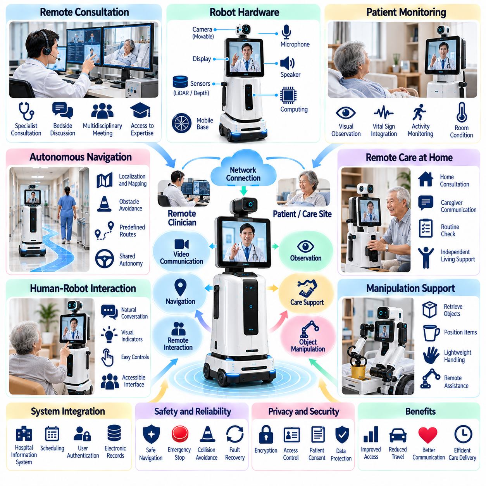{width="7.268055555555556in" height="7.268055555555556in"}

원격 현장 참여(Telepresence)와 원격 돌봄(Remote Care)은 의료 전문가(Medical Professionals)가 물리적으로 현장에 존재하지 않아도 의료 서비스를 제공할 수 있도록 확장하는 피지컬 인공지능(Physical AI)의 중요한 응용 분야이다. 이동형 로봇 플랫폼(Mobile Robotic Platforms)은 영상 통신(Video Communication), 자율주행(Autonomous Navigation), 환경 센싱(Environmental Sensing), 원격 상호작용(Remote Interaction)을 결합한다. 이러한 시스템은 의료진(Clinicians)과 돌봄 제공자(Caregivers)가 병원, 재활센터(Rehabilitation Centers), 주거 환경(Residential Environments)에서 원격으로 환자를 관찰하고 의사소통하며 특정 돌봄 활동을 조정할 수 있도록 한다.

원격 현장 참여 로봇(Telepresence Robots)은 일반적으로 이동형 베이스(Mobile Base), 카메라(Cameras), 마이크로폰(Microphones), 스피커(Speakers), 디스플레이(Displays), 네트워크 통신 시스템(Network Communication Systems)을 통합한다. 원격 조작자(Remote Operators)는 시청각 연결(Audiovisual Connections)을 설정하고 지정된 환경에서 로봇을 이동시킬 수 있다. 조절 가능한 카메라 방향(Camera Orientation)과 위치(Positioning)는 상호작용 중 시야 확보를 향상시킨다. 신뢰성 높은 운영을 위해서는 안정적인 연결성(Stable Connectivity), 직관적인 제어(Intuitive Controls), 환자와 임상 장비 주변에서의 안전한 자율주행(Safe Navigation)이 필요하다.

원격 임상 상담(Remote Clinical Consultation)은 로봇 원격 현장 참여(Robotic Telepresence)의 주요 응용 분야이다. 의사(Physicians)와 전문의(Specialists)는 동일한 장소로 이동하지 않고도 환자 및 현지 의료진(Local Healthcare Personnel)과 의사소통할 수 있다. 이동형 플랫폼(Mobile Platforms)은 원격 참여자(Remote Participants)가 서로 다른 공간을 관찰하고 고정형 영상 단말기(Stationary Video Terminals)보다 자연스럽게 상호작용할 수 있도록 한다. 그러나 원격 상담(Remote Consultations)은 확립된 임상 프로토콜(Clinical Protocols)과 적용 가능한 전문적 요구사항(Professional Requirements)의 범위 내에서 이루어져야 한다.

병원 원격 현장 참여(Hospital Telepresence)는 전문의 상담(Specialist Consultations), 다학제 협력(Multidisciplinary Coordination), 지리적으로 분리된 부서 간 의사소통(Communication Between Geographically Separated Departments)을 지원할 수 있다. 원격 전문의(Remote Specialist)는 승인된 시청각 채널(Authorized Audiovisual Channels)을 통해 병상 옆 논의(Bedside Discussions)에 참여하거나 특정 임상 활동(Clinical Activities)을 관찰할 수 있다. 이러한 기능은 전문 의료 서비스에 대한 접근성(Access to Expertise)을 향상시킬 수 있다. 그러나 원격 현장 참여는 직접적인 임상 접촉(Direct Clinical Contact)이 필요한 신체검사(Physical Examinations)나 의료 시술(Procedures)을 대체할 수 없다.

자율주행(Autonomous Navigation)은 이동형 원격 현장 참여 플랫폼(Mobile Telepresence Platforms)을 원격으로 제어하는 데 필요한 운영 부담(Operational Burden)을 줄인다. 로봇은 사전에 정의된 경로(Predefined Routes)를 사용하여 지정된 병실(Designated Rooms), 간호사실(Nursing Stations), 상담 구역(Consultation Areas) 사이를 이동할 수 있다. 위치 추정(Localization), 장애물 감지(Obstacle Detection), 동적 경로 계획(Dynamic Path Planning)은 안전한 이동을 지원한다. 원격 조작자는 적절한 감독 제어(Supervisory Control)를 유지해야 하며, 필요할 때 로봇을 정지시키거나 경로를 변경할 수 있어야 한다.

공유 자율성(Shared Autonomy)은 원격 인간 제어(Remote Human Control)와 로봇의 자체 지능(Local Robotic Intelligence)을 결합한다. 조작자는 목적지(Destinations)나 이동 의도(Movement Intentions)를 지정하고, 로봇 내부 시스템(Onboard Systems)은 장애물 회피(Obstacle Avoidance)와 정밀 위치 제어(Precise Positioning)를 처리할 수 있다. 이러한 접근법은 지속적인 수동 조향(Continuous Manual Steering)과 통신 부담(Communication Demands)을 줄인다. 효과적인 공유 제어(Shared Control)를 위해서는 특히 네트워크 상태(Network Conditions)가 악화될 때 자율 행동과 조작자 지시 행동(Operator-Directed Behavior) 사이의 예측 가능한 전환(Predictable Transitions)이 필요하다.

통신 지연시간(Communication Latency)은 원격 로봇 운영(Remote Robotic Operation)의 주요 기술적 제약조건이다. 조작자 명령(Operator Commands), 로봇 움직임(Robot Movement), 시각적 피드백(Visual Feedback) 사이의 지연은 제어 정밀도(Control Precision)를 낮추고 충돌 위험(Collision Risks)을 증가시킬 수 있다. 로컬 안전 제어기(Local Safety Controllers)는 네트워크 성능(Network Performance)에 의존하지 않고 즉각적인 장애물 회피(Immediate Obstacle Avoidance)를 처리해야 한다. 통신 아키텍처(Communication Architectures)는 허용 가능한 시청각 상호작용 품질(Audiovisual Interaction Quality)을 유지하면서 중요한 제어 신호(Critical Control Signals)를 우선 처리해야 한다.

원격 환자 관찰(Remote Patient Observation)은 임상 담당자(Clinical Personnel)와 환자(Patients)의 승인을 받은 경우 특정 모니터링 활동(Monitoring Activities)을 지원할 수 있다. 원격 현장 참여 플랫폼(Telepresence Platforms)은 환자 자세(Patient Posture), 병실 상태(Room Conditions), 의사소통 요구사항(Communication Needs)을 시각적으로 확인할 수 있도록 한다. 연결된 의료기기(Connected Medical Devices)는 승인된 인터페이스(Approved Interfaces)를 통해 추가 측정값(Additional Measurements)을 제공할 수 있다. 원격 관측(Remote Observations)은 기존 모니터링 시스템(Established Monitoring Systems)을 보완해야 하며, 독립적으로 임상 상태(Clinical Status)를 결정해서는 안 된다.

원격 현장 참여 응용(Telepresence Applications)은 장기요양시설(Long-Term Care Facilities)과 생활지원시설(Assisted Living Environments)로 확장될 수 있다. 원격 돌봄 제공자(Remote Caregivers)는 입소자(Residents)와 의사소통하고, 일상적인 지원 요청(Routine Assistance Requests)을 평가하거나, 현장 지원(In-Person Support)을 조정할 수 있다. 이동형 플랫폼(Mobile Platforms)은 적절한 접근 정책(Access Policies)에 따라 공용 공간(Shared Spaces)과 개별 병실(Individual Rooms) 사이를 이동할 수 있다. 이러한 시스템의 도입은 개인의 사생활(Personal Privacy), 입소자의 선호도(Resident Preferences), 원격 평가(Remote Assessment)의 한계를 존중해야 한다.

가정 기반 원격 돌봄(Home-Based Remote Care)은 이동 능력에 제한이 있는 사람(Individuals with Mobility Limitations), 만성적인 돌봄이 필요한 사람(Individuals with Chronic Care Needs), 의료시설 접근이 제한된 사람(Individuals with Restricted Access to Healthcare Facilities)을 지원할 기회를 제공한다. 로봇 원격 현장 참여(Robotic Telepresence)는 정기 상담(Scheduled Consultations)과 돌봄 제공자와의 의사소통(Communication with Caregivers)을 촉진할 수 있다. 승인된 가정용 센서(Authorized Home Sensors)와의 통합은 상황 정보(Contextual Information)를 제공할 수 있다. 그러나 가정 내 운영(Home Operation)에는 신뢰성 높은 연결성(Reliable Connectivity), 접근성 높은 인터페이스(Accessible Interfaces), 명확하게 정의된 비상 대응 절차(Emergency Response Procedures)가 필요하다.

인간-로봇 상호작용(Human-Robot Interaction)은 원격 돌봄 시스템(Remote Care Systems)의 효과에 큰 영향을 미친다. 환자는 원격 조작자(Remote Operator)가 언제 연결되어 있는지, 어떤 정보가 전송되는지, 상호작용을 어떻게 종료할 수 있는지 이해해야 한다. 명확한 시청각 표시장치(Audiovisual Indicators)와 접근성 높은 제어 장치(Accessible Controls)는 충분한 정보를 바탕으로 한 참여(Informed Participation)를 지원한다. 인터페이스 설계(Interface Design)는 청각 장애(Hearing Impairment), 시각적 제한(Visual Limitations), 인지적 차이(Cognitive Differences), 개인별 의사소통 선호도(Individual Communication Preferences)를 고려해야 한다.

원격 현장 참여 시스템(Telepresence Systems)은 로봇 매니퓰레이션(Robotic Manipulation)을 통합하여 원격 상호작용(Remote Interaction)을 관찰과 의사소통 이상의 영역으로 확장할 수 있다. 이동형 매니퓰레이터(Mobile Manipulators)는 경량 물체(Lightweight Objects)를 가져오거나, 통신 장치(Communication Devices)의 위치를 조정하거나, 승인된 지원 작업(Approved Support Tasks)을 수행할 수 있다. 이러한 기능은 추가적인 안전 및 제어 요구사항(Safety and Control Requirements)을 수반한다. 환자에 대한 직접적인 신체 지원(Direct Physical Assistance)에는 검증된 메커니즘(Validated Mechanisms), 적절한 감독(Appropriate Supervision), 엄격한 운영 범위(Strict Operational Boundaries)가 필요하다.

병원 정보시스템(Hospital Information Systems)과의 통합은 일정 관리(Scheduling), 사용자 인증(User Authentication), 상담 기록(Consultation Records), 승인된 통신 업무 흐름(Authorized Communication Workflows)을 지원한다. 원격 현장 참여 세션(Telepresence Sessions)은 임상 응용 프로그램(Clinical Applications)을 통해 시작되거나 지정된 직원(Designated Staff)에 의해 조정될 수 있다. 접근 권한(Access Permissions)은 전문적 책임(Professional Responsibilities)과 환자 동의(Patient Consent)를 반영해야 한다. 시스템 인터페이스(System Interfaces)는 원격 상호작용에 관한 정확한 기록(Accurate Records of Remote Interactions)을 유지하면서 민감한 정보(Sensitive Information)를 보호해야 한다.

사이버보안(Cybersecurity)과 개인정보 보호(Privacy Protection)는 원격 현장 참여 플랫폼(Telepresence Platforms)이 시청각 데이터(Audiovisual Data)를 전송하고 민감한 임상 환경(Sensitive Clinical Environments)에 접근할 수 있기 때문에 필수적이다. 암호화(Encryption), 인증된 세션(Authenticated Sessions), 역할 기반 접근 제어(Role-Based Access Control), 안전한 장치 관리(Secure Device Management)는 정보 노출 위험(Exposure Risks)을 줄인다. 승인되지 않은 카메라 활성화(Unauthorized Camera Activation)나 원격 이동(Remote Movement)을 방지해야 한다. 데이터 보존 및 녹화 정책(Data Retention and Recording Policies)은 투명해야 하며 적용 가능한 의료 규정(Healthcare Regulations)과 일치해야 한다.

운영 안전성(Operational Safety)을 확보하려면 로봇이 환자 진료(Patient Care)나 응급 활동(Emergency Activities)을 방해하지 않으면서 공용 공간(Shared Spaces)을 이동해야 한다. 잠재적 위험(Potential Hazards)에는 충돌(Collisions), 접근 경로 차단(Blocked Access Routes), 예상하지 못한 움직임(Unexpected Movement), 장비 접촉(Equipment Contact)이 포함된다. 속도 제한(Speed Limits), 장애물 감지(Obstacle Detection), 비상 정지(Emergency Stopping), 출입 제한 구역 관리(Restricted-Zone Management)는 보호 조치(Protective Measures)를 제공한다. 원격 운영(Remote Operation)은 로컬 안전 기능(Local Safety Functions)이나 확립된 병원 접근 제한(Hospital Access Restrictions)을 우회해서는 안 된다.

시스템 신뢰성(System Reliability)은 통신 장애(Communication Failures), 배터리 소진(Depleted Batteries), 센서 고장(Sensor Faults), 이용할 수 없는 목적지(Unavailable Destinations)에 효과적으로 대응하는 능력에 달려 있다. 원격 제어(Remote Control)의 신뢰성이 저하되면 로봇은 안전 상태(Safe State)로 전환해야 한다. 복구 절차(Recovery Procedures)에는 이동 정지(Stopping Movement), 통신 재연결(Reconnecting Communication), 지정된 위치로 복귀(Returning to a Designated Location), 현장 지원 요청(Requesting Local Assistance)이 포함될 수 있다. 중요한 환자 진료 업무 흐름(Critical Care Workflows)에는 로봇 원격 현장 참여가 불가능할 때 사용할 대체 수단(Alternatives)이 필요하다.

여러 원격 현장 참여 로봇(Telepresence Robots)이 서로 다른 부서나 돌봄 시설(Care Facilities)에 서비스를 제공하는 경우 군집 관리(Fleet Management)가 중요해진다. 중앙 집중식 일정 관리(Centralized Scheduling)는 상담 요청(Consultation Requests), 로봇 가용성(Robot Availability), 충전(Charging), 이동 우선순위(Movement Priorities)를 조정할 수 있다. 작업 할당(Task Allocation)은 근접성(Proximity), 통신 요구사항(Communication Requirements), 서비스 긴급도(Service Urgency)를 고려할 수 있다. 공유 운영(Shared Operations)에서는 승인되지 않은 세션 접근(Unauthorized Session Access)과 동시 요청(Simultaneous Requests) 사이의 충돌을 방지해야 한다.

임상적 검증(Clinical Validation)은 로봇 원격 현장 참여(Robotic Telepresence)가 의도된 사용 사례(Intended Use Cases)에서 접근성(Access), 의사소통 품질(Communication Quality), 진료 조정(Care Coordination)을 개선하는지 평가해야 한다. 관련 지표에는 상담 완료율(Consultation Completion), 연결 신뢰성(Connection Reliability), 상호작용 지연시간(Interaction Latency), 환자 만족도(Patient Satisfaction), 의료진 수용성(Clinician Acceptance)이 포함된다. 운영 평가(Operational Evaluation)는 자율주행 성공률(Navigation Success), 개입 빈도(Intervention Frequency), 시스템 가용성(System Availability)을 검토해야 한다. 연구는 의사소통 접근성 향상(Improved Communication Access)과 입증된 임상적 결과(Demonstrated Clinical Outcomes)를 구분해야 한다.

경제성 평가(Economic Evaluation)는 로봇 구매 비용(Robot Acquisition), 네트워크 인프라(Network Infrastructure), 소프트웨어 구독(Software Subscriptions), 사이버보안(Cybersecurity), 유지보수(Maintenance), 직원 지원(Staff Support)을 고려해야 한다. 잠재적 이점에는 이동 요구사항 감소(Reduced Travel Requirements), 전문의 접근성 향상(Improved Specialist Accessibility), 시설 간 더욱 유연한 협력(More Flexible Coordination Across Facilities)이 포함된다. 그러나 재무적 가치(Financial Value)는 활용률(Utilization), 업무 흐름 통합(Workflow Integration), 신뢰성 높은 서비스 제공(Reliable Service Delivery)에 달려 있다. 비용 절감(Cost Savings)은 진료 품질(Care Quality)과 환자 경험(Patient Experience)을 함께 고려하여 평가해야 한다.

미래의 원격 현장 참여 및 원격 돌봄 플랫폼(Telepresence and Remote Care Platforms)은 다중모달 인공지능(Multimodal AI), 자율주행(Autonomous Navigation), 지능형 작업 계획(Intelligent Task Planning), 적응형 인간-로봇 상호작용(Adaptive Human-Robot Interaction)을 통합할 수 있다. 향상된 인지(Improved Perception)와 공유 자율성(Shared Autonomy)은 조작자 업무 부담(Operator Workload)을 줄이고 더욱 신속하게 대응하는 서비스(Responsive Services)를 지원할 수 있다. 그러나 임상적 책임(Clinical Accountability), 환자 동의(Patient Consent), 사이버보안(Cybersecurity), 신뢰성 높은 로컬 안전성(Dependable Local Safety)은 계속해서 필수적인 요소로 유지될 것이다. 장기적인 목표는 신뢰할 수 있는 로봇 연결성(Trustworthy Robotic Connectivity)을 통해 인간 중심 의료(Human-Centered Healthcare)를 확장하는 것이다.

## 04.10. Human Robot Interaction in Clinical Environments

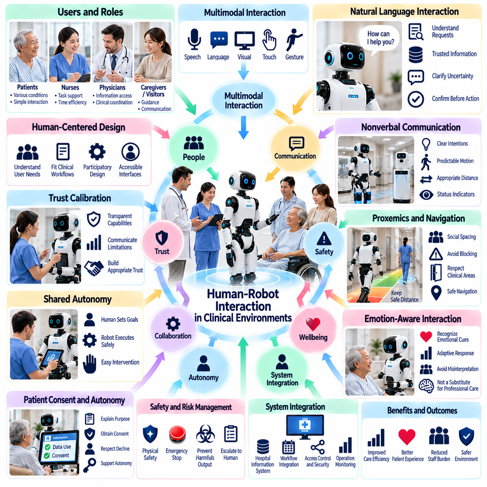{width="7.268055555555556in" height="7.268055555555556in"}

임상 환경에서의 인간-로봇 상호작용(Human-Robot Interaction in Clinical Environments)은 의료 분야에서 피지컬 인공지능(Physical AI)을 안전하고 효과적으로 도입하기 위한 핵심 기반이다. 로봇은 까다로운 운영 조건(Operational Conditions)에서 환자(Patients), 의사(Physicians), 간호사(Nurses), 돌봄 제공자(Caregivers), 방문객(Visitors)과 의사소통하고 협력해야 한다. 성공적인 상호작용(Successful Interaction)을 위해서는 자연스러운 대화(Natural Conversation) 이상의 능력이 필요하다. 이는 예측 가능한 행동(Predictable Behavior), 투명한 의도(Transparent Intentions), 적절한 자율성(Appropriate Autonomy), 임상적 책임(Clinical Responsibilities)에 대한 존중에 달려 있다.

임상 환경(Clinical Environments)은 사용자의 신체적 능력(Physical Ability), 의학적 상태(Medical Condition), 인지 능력(Cognitive Capacity), 정서적 상태(Emotional State)가 서로 다르기 때문에 고유한 상호작용 과제(Interaction Challenges)를 제시한다. 환자는 통증(Pain), 피로(Fatigue), 불안(Anxiety), 감각 장애(Sensory Impairments)를 경험할 수 있다. 의료 전문가(Healthcare Professionals)는 시간적 압박(Time Pressure) 속에서 업무를 수행하는 경우가 많다. 로봇 인터페이스(Robotic Interfaces)는 추가적인 혼란(Confusion), 불필요한 업무 부담(Unnecessary Workload), 안전하지 않은 기대(Unsafe Expectations)를 유발하지 않으면서 이러한 차이에 적응해야 한다.

인간 중심 설계(Human-Centered Design)는 각 참여자의 역할(Roles)과 요구사항(Needs)을 이해하는 것에서 시작된다. 간호사는 신속한 작업 할당(Rapid Task Assignment)을 필요로 할 수 있고, 의사는 검증된 정보(Verified Information)에 대한 접근을 요구할 수 있으며, 환자는 간단한 의사소통 방식(Simple Communication Methods)을 선호할 수 있다. 상호작용 업무 흐름(Interaction Workflows)은 사용자가 로봇의 한계(Robotic Limitations)에 맞추도록 강요하기보다 실제 임상 절차(Clinical Procedures)를 반영해야 한다. 의료진이 참여하는 참여형 설계(Participatory Design)는 실질적인 요구사항(Practical Requirements)을 파악하는 데 도움이 된다.

다중모달 상호작용(Multimodal Interaction)은 음성(Speech), 시각적 디스플레이(Visual Displays), 제스처(Gestures), 터치 인터페이스(Touch Interfaces), 환경적 단서(Environmental Cues)를 결합하여 의사소통을 지원한다. 서로 다른 상호작용 방식(Interaction Modalities)은 사용자와 상황에 따라 상호보완적인 이점을 제공한다. 음성은 핸즈프리 요청(Hands-Free Requests)을 가능하게 하며, 시각적 인터페이스(Visual Interfaces)는 작업 세부사항(Task Details)을 확인하는 데 도움이 된다. 시스템은 소음(Noise), 장애(Disability), 언어 장벽(Language Barriers), 임상적 제한(Clinical Restrictions)으로 접근성이 제한되는 경우 대체 상호작용 채널(Alternative Interaction Channels)을 제공해야 한다.

자연어 이해(Natural Language Understanding)는 로봇이 일반적인 임상 언어(Clinical Language)나 일상적인 대화 언어(Conversational Language)로 표현된 요청을 해석할 수 있도록 한다. 언어 모델(Language Models)은 작업 명확화(Task Clarification), 정보 검색(Information Retrieval), 대화 관리(Dialogue Management)를 지원할 수 있다. 그러나 생성된 응답(Generated Responses)은 승인된 정보 출처(Approved Information Sources)에 근거해야 한다. 로봇은 모호한 지시(Ambiguous Instructions)를 인식하고, 불확실성(Uncertainty)을 전달하며, 중요한 결과를 초래할 수 있는 행동(Consequential Actions)을 실행하기 전에 확인(Confirmation)을 요청해야 한다.

병원에서의 음성 상호작용(Speech Interaction)은 주변 대화(Background Conversations), 경보음(Alarms), 장비 소음(Equipment Noise), 개인정보 보호 요구사항(Privacy Requirements)을 고려해야 한다. 자동 음성 인식(Automatic Speech Recognition)은 사용자가 마스크(Masks)를 착용하거나 작은 목소리로 말할 때 신뢰성이 저하될 수 있다. 마이크 배치(Microphone Placement), 잡음 제거(Noise Reduction), 문맥 기반 처리(Contextual Processing)는 인식 성능(Recognition Performance)을 향상시킬 수 있다. 중요한 명령(Critical Commands)은 인식 신뢰도(Recognition Confidence)가 충분하지 않을 경우 확인 메커니즘(Confirmation Mechanisms)이나 대체 인터페이스(Alternative Interfaces)를 사용해야 한다.

비언어적 의사소통(Nonverbal Communication)은 공유 임상 공간(Shared Clinical Spaces)을 이동하는 로봇에 필수적이다. 이동 속도(Movement Speed), 정지 행동(Stopping Behavior), 방향(Orientation), 접근 거리(Approach Distance)는 로봇의 의도(Robotic Intentions)를 전달한다. 조명 표시(Lights), 디스플레이(Displays), 간단한 제스처(Simple Gestures)는 작업 상태(Task Status)나 예정된 움직임(Upcoming Movement)을 나타낼 수 있다. 이러한 신호는 일관되고 이해하기 쉬워야 한다. 물리적 안전 메커니즘(Physical Safety Mechanisms)이 올바르게 작동하더라도 예상하지 못한 움직임(Unexpected Motion)이나 모호한 행동(Ambiguous Behavior)은 신뢰(Trust)를 저하시킬 수 있다.

대인 공간학(Proxemics)은 사람들이 상호작용 과정에서 대인 거리(Interpersonal Distance)와 공간적 행동(Spatial Behavior)을 어떻게 해석하는지를 설명한다. 로봇은 환자, 의료진, 의료 장비(Medical Equipment)와 적절한 거리를 유지해야 한다. 허용 가능한 거리(Acceptable Distances)는 임상 활동(Clinical Activities), 병실의 공간적 제약(Room Constraints), 개인별 선호도(Individual Preferences)에 따라 달라진다. 자율주행 경로 계획기(Navigation Planners)는 사회적 거리(Social Spacing)를 고려하고 병상(Beds), 응급 장비(Emergency Equipment), 자주 사용하는 작업 구역(Frequently Used Work Areas)에 대한 접근을 방해하지 않아야 한다.

공유 자율성(Shared Autonomy)은 인간과 로봇이 각자의 능력에 따라 책임을 분담하도록 한다. 의료 종사자(Healthcare Workers)는 목표(Goals)를 지정하고, 로봇은 자율주행(Navigation)이나 일상적인 매니퓰레이션(Routine Manipulation)을 처리할 수 있다. 상황이 검증된 자율 기능(Validated Autonomous Capabilities)의 범위를 벗어나면 인간의 개입(Human Intervention)이 필요하다. 인터페이스는 누가 시스템을 제어하는지, 어떤 행동이 허용되는지, 제어권(Control)을 어떻게 이전하거나 철회할 수 있는지를 명확하게 표시해야 한다.

신뢰 보정(Trust Calibration)은 사용자가 로봇의 능력을 과대평가하거나 과소평가할 수 있기 때문에 특히 중요하다. 인간과 유사한 외형(Humanlike Appearance), 유창한 음성(Fluent Speech), 확신에 찬 응답(Confident Responses)은 지능(Intelligence)에 대한 과장된 인상(Exaggerated Impression)을 형성할 수 있다. 반대로 익숙하지 않은 움직임(Unfamiliar Movements)은 신뢰성 높은 시스템에 대한 확신을 감소시킬 수 있다. 적절한 신뢰(Appropriate Trust)는 로봇이 자신의 기능(Capabilities), 한계(Limitations), 불확실성(Uncertainty), 운영 상태(Operational Status)를 정확하게 전달할 때 형성된다.

환자 동의(Patient Consent)와 개인의 자율성(Personal Autonomy)은 모니터링(Monitoring), 의사소통(Communication), 신체적 지원(Physical Assistance)을 포함하는 상호작용의 기본 원칙이 되어야 한다. 환자는 로봇의 목적(Purpose)과 정보가 기록(Recorded)되거나 전송(Transmitted)되는지 이해해야 한다. 해당되는 경우 환자는 참여를 거부(Decline Participation)하거나 인간의 지원(Human Assistance)을 요청할 수 있어야 한다. 인지 장애(Cognitive Impairment), 의사소통의 어려움(Communication Difficulties), 응급 상황(Emergency Circumstances)이 충분한 설명에 근거한 동의(Informed Consent)에 영향을 미치는 경우 특별한 고려가 필요하다.

감정 인식 기반 상호작용(Emotion-Aware Interaction)은 로봇이 관찰 가능한 불편함(Discomfort)이나 혼란(Confusion)의 징후에 적절하게 대응하도록 도울 수 있다. 얼굴 표정(Facial Expressions), 음성 특성(Speech Characteristics), 행동 단서(Behavioral Cues)는 제한적인 상황 정보(Contextual Information)를 제공할 수 있다. 그러나 추론된 감정 상태(Inferred Emotional States)는 불확실하며 개인과 문화에 따라 달라질 수 있다. 로봇은 감정 예측(Emotional Predictions)을 확립된 사실(Established Facts)로 제시하거나 자동화된 응답(Automated Responses)으로 전문적인 심리 평가(Professional Psychological Assessment)를 대체해서는 안 된다.

상호작용 안전성(Interaction Safety)은 물리적 보호(Physical Protection)와 유해한 의사소통(Harmful Communication)의 예방을 모두 포함한다. 로봇은 충돌(Collisions), 과도한 접촉력(Excessive Contact Forces), 예상하지 못한 매니퓰레이션(Unexpected Manipulation)을 방지해야 한다. 또한 오해를 유발하는 의료적 설명(Misleading Medical Statements), 승인되지 않은 정보 공개(Unauthorized Disclosures), 부적절한 작업 실행(Inappropriate Task Execution)을 예방해야 한다. 안전 아키텍처(Safety Architectures)는 대화형 지능(Conversational Intelligence)과 검증된 제어 기능(Verified Control Functions)을 분리하고, 즉각적인 정지(Immediate Stopping)와 상위 대응 메커니즘(Escalation Mechanisms)을 제공해야 한다.

임상 업무 흐름 통합(Clinical Workflow Integration)을 위해서는 로봇 상호작용(Robotic Interactions)이 확립된 책임 체계(Established Responsibilities)와 의사소통 채널(Communication Channels)에 부합해야 한다. 서비스 요청(Service Requests), 작업 확인(Task Confirmations), 완료 알림(Completion Notifications)은 기존 업무를 중복시키지 않으면서 승인된 담당자(Authorized Personnel)에게 전달되어야 한다. 로봇은 작업 중단(Interruptions)과 변화하는 우선순위(Changing Priorities)를 인식해야 한다. 효과적인 통합(Effective Integration)은 불필요한 조정 업무(Unnecessary Coordination)를 줄이면서 임상적 결정(Clinical Decisions)이 자격을 갖춘 인간의 감독(Qualified Human Supervision) 아래 유지되도록 한다.

접근성(Accessibility)과 포용적 설계(Inclusive Design)는 다양한 신체적 및 인지적 능력(Physical and Cognitive Abilities)을 가진 환자에게 필수적이다. 인터페이스에는 조절 가능한 음량(Adjustable Speech Volume), 읽기 쉬운 텍스트(Readable Text), 단순화된 명령(Simplified Commands), 다국어 의사소통(Multilingual Communication), 보조 입력 방식(Assistive Input Methods)이 필요할 수 있다. 상호작용 시간(Interaction Timing)은 느린 응답(Slower Responses)과 제한된 움직임(Limited Movement)을 수용해야 한다. 접근성 시험(Accessibility Testing)은 표준화된 실험실 시연(Standardized Laboratory Demonstrations)에만 의존하지 않고 대표성 있는 사용자(Representative Users)를 참여시켜야 한다.

개인정보 보호(Privacy)와 사이버보안(Cybersecurity)은 사람들이 임상 로봇(Clinical Robots)과 상호작용하는 방식에 영향을 미친다. 음성 녹음(Voice Recordings), 카메라 관측(Camera Observations), 신원 정보(Identity Information), 상호작용 기록(Interaction Histories)에는 민감한 환자 데이터(Sensitive Patient Data)가 포함될 수 있다. 인증(Authentication), 접근 제어(Access Controls), 암호화(Encryption), 데이터 최소화(Data Minimization)는 이러한 자원을 보호해야 한다. 로봇은 녹화 상태(Recording Status)와 연결 상태(Connection Status)를 명확하게 전달하고, 승인되지 않은 사용자(Unauthorized Users)가 임상 기능(Clinical Functions)에 접근하지 못하도록 해야 한다.

인간-로봇 상호작용 평가(Evaluation of Human-Robot Interaction)는 기술적 성능(Technical Performance)과 임상 사용성(Clinical Usability), 인간공학적 요소(Human Factors)를 결합해야 한다. 관련 지표에는 작업 성공률(Task Success), 지시 인식 정확도(Instruction Recognition Accuracy), 상호작용 시간(Interaction Duration), 사용자 업무 부담(User Workload), 인지된 신뢰(Perceived Trust), 개입 빈도(Intervention Frequency)가 포함된다. 안전사고(Safety Incidents), 오해(Misunderstandings), 업무 흐름 방해(Workflow Disruptions)도 평가해야 한다. 연구는 실제와 유사한 환경(Realistic Environments)과 대표성 있는 환자 및 의료진 집단(Representative Patient and Staff Populations)을 포함해야 한다.

교육훈련(Training)과 조직적 준비도(Organizational Readiness)는 성공적인 도입에 큰 영향을 미친다. 의료진은 로봇 기능(Robot Capabilities), 작업 할당(Task Assignment), 비상 정지(Emergency Stopping), 고장 복구(Failure Recovery)에 관한 실질적인 교육(Practical Instruction)을 받아야 한다. 환자와 방문객은 예상되는 로봇 행동(Expected Behavior)에 대한 간단한 설명을 통해 도움을 받을 수 있다. 명확한 운영 절차(Operational Procedures)와 지정된 지원 담당자(Designated Support Personnel)는 불확실성을 줄인다. 지속적인 피드백(Continuous Feedback)은 실험실 시험(Laboratory Testing)에서 발견하지 못한 인터페이스 문제(Interface Problems)를 식별할 수 있다.

미래의 임상 상호작용 시스템(Clinical Interaction Systems)은 다중모달 파운데이션 모델(Multimodal Foundation Models), 개인화된 대화(Personalized Dialogue), 상황 인식 기반 추론(Context-Aware Reasoning), 적응형 로봇 행동(Adaptive Robotic Behavior)을 통합할 수 있다. 이러한 기능은 다양한 의료 작업(Healthcare Tasks)에서 더욱 자연스러운 의사소통(Natural Communication)과 유연한 협력(Flexible Cooperation)을 지원할 수 있다. 그러나 대화 유창성(Conversational Fluency)의 향상이 임상적 역량(Clinical Competence)을 입증하는 것은 아니다. 검증(Validation), 투명성(Transparency), 개인정보 보호(Privacy Protection), 인간 감독(Human Oversight)은 핵심 설계 원칙(Core Design Principles)으로 유지되어야 한다.

임상 환경에서 인간-로봇 상호작용(Human-Robot Interaction)의 장기적인 목표는 인간과 지능형 기계(Intelligent Machines) 사이에 신뢰할 수 있는 협력(Dependable Collaboration)을 구축하는 것이다. 피지컬 인공지능(Physical AI)은 환자의 존엄성(Patient Dignity), 전문적 권한(Professional Authority), 운영 안전성(Operational Safety)을 유지하면서 의료 관행(Healthcare Practices)에 적응해야 한다. 성공적인 시스템은 인간과 얼마나 유사하게 보이는지가 아니라 진료 제공(Care Delivery)을 얼마나 효과적으로 지원하고, 업무 부담(Workload)을 줄이며, 환자와 의료 전문가(Healthcare Professionals)의 경험(Experience)을 개선하는지를 기준으로 평가될 것이다.

## 04.11. Safety Privacy and Data Governance

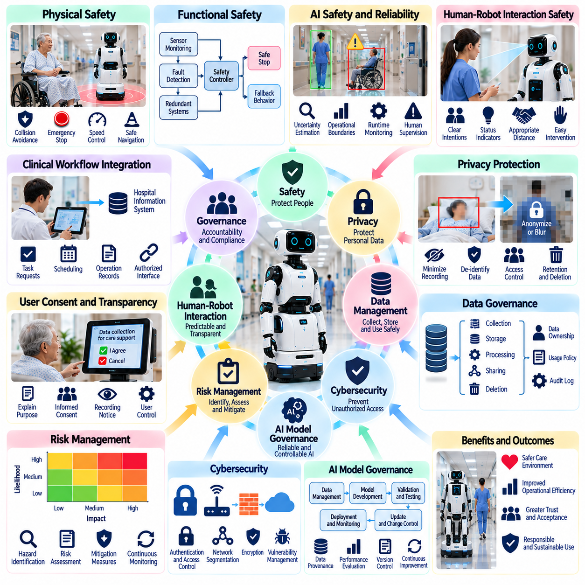{width="7.268055555555556in" height="7.268055555555556in"}

안전성(Safety), 개인정보 보호(Privacy), 데이터 거버넌스(Data Governance)는 의료 환경에서 피지컬 인공지능(Physical AI)을 도입하기 위한 기본적인 요구사항이다. 로봇은 환자(Patients), 의료진(Medical Personnel), 민감한 의료 장비(Sensitive Equipment), 기밀정보(Confidential Information)와 상호작용하므로 기존 자동화(Conventional Automation)를 넘어서는 위험을 발생시킨다. 책임 있는 도입(Responsible Deployment)을 위해서는 로봇 시스템의 전체 수명주기(Robotic System Lifecycle)에 걸쳐 인간의 안전과 복지(Human Welfare)를 보호하는 공학적 설계(Engineering), 임상 감독(Clinical Oversight), 사이버보안(Cybersecurity), 조직적 정책(Organizational Policies)의 유기적인 연계가 필요하다.

물리적 안전성(Physical Safety)은 자율주행(Autonomous Navigation), 매니퓰레이션(Manipulation), 인간과의 접촉(Human Contact)에 관련된 위험요인(Hazards)을 식별하는 것에서 시작된다. 병원 로봇(Hospital Robots)은 취약한 환자(Vulnerable Patients), 혼잡한 복도(Crowded Corridors), 의료기기(Medical Devices), 예측하기 어려운 움직임(Unpredictable Movement)에 직면할 수 있다. 위험성 평가(Risk Assessments)는 충돌력(Collision Forces), 물체 낙하(Falling Objects), 불안정한 움직임(Unstable Motion), 응급 이동 경로 차단(Obstructed Emergency Routes)을 고려해야 한다. 보호 조치(Protective Measures)는 실제 운영 조건(Realistic Operating Conditions)에서 발생할 수 있는 피해의 심각도(Severity)와 발생 가능성(Likelihood)을 반영해야 한다.

기능 안전 공학(Functional Safety Engineering)은 부품이나 소프트웨어에 고장이 발생하더라도 허용 가능한 위험 수준(Acceptable Risk)을 유지하는 메커니즘을 구축한다. 안전 등급 센서(Safety-Rated Sensors), 비상 정지(Emergency Stopping), 속도 제한(Speed Restrictions), 보호 이격(Protective Separation), 고장 모니터링(Fault Monitoring)은 위험한 행동(Hazardous Behavior)을 줄일 수 있다. 독립적인 안전 기능(Independent Safety Functions)은 확률적 인공지능 예측(Probabilistic AI Predictions)에 전적으로 의존해서는 안 된다. 시스템 검증(System Validation)은 예측 가능한 고장(Foreseeable Failures)과 비정상 조건(Abnormal Conditions)에서도 보호 메커니즘(Protective Mechanisms)이 효과적으로 작동하는지 확인해야 한다.

인공지능 특화 안전성(AI-Specific Safety)은 인지 오류(Perception Errors), 불확실한 예측(Uncertain Predictions), 예상하지 못한 의사결정(Unexpected Decisions)과 관련된 과제를 제시한다. 기계학습 모델(Machine Learning Models)은 익숙하지 않은 조명(Unfamiliar Lighting), 비정상적인 환자 움직임(Unusual Patient Movement), 변화하는 병원 배치(Changing Hospital Layouts)에서 다르게 작동할 수 있다. 신뢰도 추정(Confidence Estimation), 운영 범위(Operational Boundaries), 실행 중 모니터링(Runtime Monitoring), 보수적인 대체 행동(Conservative Fallback Actions)은 불확실성을 관리하는 데 도움이 된다. 고위험 의사결정(High-Risk Decisions)은 검증된 규칙(Verified Rules)과 자격을 갖춘 인간의 감독(Qualified Human Supervision)을 받아야 한다.

인간-로봇 상호작용 안전성(Human-Robot Interaction Safety)을 확보하려면 로봇이 자신의 의도(Intentions)를 전달하고 사람에게 예측 가능한 방식으로 대응해야 한다. 명확한 이동 신호(Clear Movement Signals), 접근성 높은 비상 제어 장치(Accessible Emergency Controls), 적절한 대인 거리(Appropriate Interpersonal Distances)는 혼란과 물리적 위험을 줄인다. 이동 능력이 제한된 환자(Patients with Mobility Limitations)나 인지 장애가 있는 환자(Patients with Cognitive Impairments)에게는 추가적인 안전장치(Additional Safeguards)가 필요할 수 있다. 로봇은 도움이 필요한 상황을 인식해야 하며, 침묵(Silence)이나 비활동(Inactivity)을 동의(Consent)로 간주해서는 안 된다.

개인정보 보호(Privacy Protection)는 의료 로봇(Healthcare Robots)이 영상(Images), 음성(Audio), 생리학적 관측 정보(Physiological Observations), 신원 정보(Identity Information), 위치 이력(Location Histories)을 수집할 수 있기 때문에 필수적이다. 이러한 정보는 환자, 직원, 방문객에 관한 민감한 세부사항(Sensitive Details)을 드러낼 수 있다. 데이터 수집(Data Collection)은 정당한 운영 목적(Legitimate Operational Purposes)이나 임상적 목적(Clinical Purposes)에 필요한 범위로 제한되어야 한다. 시스템은 불필요한 기록(Unnecessary Recording)을 피하고 어떤 정보가 왜 수집되는지 이해하기 쉬운 설명(Understandable Explanations)을 제공해야 한다.

환자 동의(Patient Consent)와 투명성(Transparency)은 책임 있는 로봇 모니터링(Robotic Monitoring)과 상호작용(Interaction)의 핵심 요소이다. 개인은 카메라(Cameras), 마이크로폰(Microphones), 연결된 센서(Connected Sensors)가 활성화되어 있는지, 자신의 정보가 어떻게 사용되는지 이해해야 한다. 동의 절차(Consent Procedures)는 적용 가능한 법적 요구사항(Legal Requirements)과 임상적 요구사항(Clinical Requirements)을 반영해야 한다. 적절한 경우 환자는 참여(Participation), 기록(Recording), 인간에 의한 대체 서비스(Human Alternatives)에 관하여 실질적인 선택권(Meaningful Choices)을 가져야 한다.

데이터 거버넌스(Data Governance)는 로봇 시스템에서 생성된 정보의 수집(Collection), 처리(Processing), 저장(Storage), 공유(Sharing), 삭제(Deletion)에 관한 책임을 정의한다. 병원과 기술 공급업체(Technology Providers)는 데이터 소유권(Data Ownership), 접근 권한(Access Permissions), 보존 기간(Retention Periods), 책임성(Accountability)을 명확하게 설정해야 한다. 거버넌스 프레임워크(Governance Frameworks)는 운영 원격측정 데이터(Operational Telemetry)와 개인을 식별할 수 있는 임상 정보(Identifiable Clinical Information)를 구분해야 한다. 모든 데이터 처리 활동(Data-Processing Activities)에는 문서화된 목적(Documented Purpose)과 승인된 근거(Authorized Basis)가 있어야 한다.

데이터 최소화(Data Minimization)는 정의된 작업(Defined Task)에 필요한 정보만 수집함으로써 개인정보 노출 위험(Privacy Exposure)을 줄인다. 배송 로봇(Delivery Robot)은 상세한 환자 기록(Detailed Patient Records)에 접근하지 않고도 목적지(Destination)와 작업 상태(Task Status)만으로 운영할 수 있다. 온디바이스 처리(On-Device Processing)는 이벤트 결과(Event Results)만 필요한 경우 원본 영상(Raw Video)이나 음성(Raw Audio)의 전송을 제한할 수 있다. 비식별화(De-Identification)와 집계(Aggregation)는 일부 위험을 줄일 수 있지만, 특정 상황에서는 재식별(Re-Identification)이 여전히 가능하다.

사이버보안(Cybersecurity)은 로봇 하드웨어(Robotic Hardware), 소프트웨어(Software), 통신 네트워크(Communication Networks), 연결된 병원 시스템(Connected Hospital Systems)을 무단 접근(Unauthorized Access)이나 악의적인 조작(Manipulation)으로부터 보호한다. 잠재적 위협(Potential Threats)에는 자격증명 탈취(Credential Theft), 악성 명령(Malicious Commands), 랜섬웨어(Ransomware), 손상된 소프트웨어 업데이트(Compromised Software Updates)가 포함된다. 안전한 인증(Secure Authentication), 암호화(Encryption), 네트워크 분할(Network Segmentation), 취약점 관리(Vulnerability Management)는 필수적인 통제 수단(Essential Controls)이다. 보안 아키텍처(Security Architecture)는 특정 구성요소가 침해되었을 때 발생하는 영향을 최소화해야 한다.

로봇 데이터 파이프라인(Robotic Data Pipelines)은 수집(Collection), 전송(Transmission), 저장(Storage), 분석(Analysis)의 전 과정에서 보호되어야 한다. 센서 기록(Sensor Recordings), 작업 로그(Task Logs), 모델 입력(Model Inputs), 운영 메타데이터(Operational Metadata)에는 기밀정보(Confidential Information)가 포함될 수 있다. 접근 권한은 최소 권한 원칙(Least-Privilege Principles)을 따라야 하며, 적절한 로깅(Logging)과 감사 가능성(Auditability)을 확보해야 한다. 암호화(Encryption)와 안전한 인터페이스(Secure Interfaces)는 기밀성(Confidentiality)과 무결성(Integrity)을 유지하는 데 도움이 된다. 외부 서비스(External Services)로의 데이터 전송에는 명시적인 거버넌스(Explicit Governance)와 계약상 보호 조치(Contractual Safeguards)가 필요하다.

클라우드 컴퓨팅(Cloud Computing)과 엣지 컴퓨팅(Edge Computing)은 서로 다른 거버넌스 고려사항(Governance Considerations)을 수반한다. 엣지 처리(Edge Processing)는 지연시간(Latency)과 민감한 정보의 불필요한 노출(Unnecessary Exposure)을 줄일 수 있으며, 클라우드 플랫폼(Cloud Platforms)은 로봇 군집 분석(Fleet Analytics)과 모델 개선(Model Improvement)을 지원할 수 있다. 배포 아키텍처(Deployment Architecture)는 데이터 소재지(Data Residency), 네트워크 신뢰성(Network Reliability), 접근 제어(Access Control), 복구 요구사항(Recovery Requirements)을 고려해야 한다. 임상 안전 기능(Clinical Safety Functions)은 클라우드 연결(Cloud Connectivity)이 불가능해지는 경우에도 적절하게 보호되어야 한다.

인공지능 모델 거버넌스(AI Model Governance)는 데이터셋(Datasets)의 보호를 넘어 모델 개발(Model Development), 검증(Validation), 배포(Deployment), 업데이트(Updates)를 관리하는 영역으로 확장된다. 학습 데이터 출처(Training Data Provenance), 데이터셋 품질(Dataset Quality), 모델 버전(Model Versions), 평가 결과(Evaluation Results)는 문서화되어야 한다. 운영 환경(Operating Environments)이나 환자 집단(Patient Populations)이 변화하면 모델을 재평가(Reassessment)해야 할 수 있다. 자동 업데이트(Automated Updates)는 안전에 중요한 임상 업무 흐름(Safety-Critical Clinical Workflows)에 검증되지 않은 행동(Unverified Behavior)을 도입해서는 안 된다.

편향(Bias)과 공정성(Fairness)은 인공지능 인지 및 상호작용 시스템(AI Perception and Interaction Systems)의 성능이 환자 집단에 따라 달라질 수 있기 때문에 중요하다. 연령(Age), 이동 능력(Mobility), 외형(Appearance), 언어(Language), 장애(Disability)의 차이는 모델 성능(Model Performance)에 영향을 미칠 수 있다. 평가 데이터셋(Evaluation Datasets)은 의도된 사용자(Intended Users)와 운영 조건(Operating Conditions)을 대표해야 한다. 성능 격차(Performance Disparities)는 도입 전에 조사하고 해결해야 하며, 특히 오류가 의료 접근성(Access to Care)이나 환자 안전(Patient Safety)에 영향을 미칠 수 있는 경우 더욱 중요하다.

규제 준수(Regulatory Compliance)는 로봇의 의도된 목적(Intended Purpose), 기능(Functions), 관할권(Jurisdiction)에 따라 달라진다. 물류 로봇(Logistics Robot), 환자 모니터링 시스템(Patient Monitoring System), 의료적 중재(Medical Interventions)를 수행하는 로봇은 서로 다른 요구사항의 적용을 받을 수 있다. 적용 가능한 의료기기 규정(Medical-Device Regulations), 개인정보 보호법(Privacy Laws), 사이버보안 의무(Cybersecurity Obligations), 안전 표준(Safety Standards)을 평가해야 한다. 규제 준수 계획(Compliance Planning)은 기술 개발(Technical Development)이 완료된 이후가 아니라 시스템 설계(System Design) 단계에서 시작되어야 한다.

사고 관리(Incident Management)는 조직이 안전 또는 보안 장애(Safety or Security Failures)를 감지(Detect), 보고(Report), 조사(Investigate), 대응(Respond)하는 방법을 정의한다. 관련 사건(Relevant Events)에는 충돌(Collisions), 승인되지 않은 데이터 접근(Unauthorized Data Access), 잘못된 경고(Incorrect Alerts), 예상하지 못한 로봇 행동(Unexpected Robotic Actions)이 포함될 수 있다. 감사 로그(Audit Logs)와 사고 기록(Incident Records)은 근본 원인 분석(Root-Cause Analysis)과 시정 조치(Corrective Measures)를 지원한다. 보고 책임(Reporting Responsibilities)과 상위 대응 절차(Escalation Procedures)는 일상적인 운영(Routine Deployment)을 시작하기 전에 정의되어야 한다.

로봇의 행동(Robotic Actions)이 임상적 결정(Clinical Decisions)이나 환자의 건강과 복지(Patient Well-Being)에 영향을 미칠 수 있는 경우 인간 감독(Human Oversight)은 필수적이다. 승인된 담당자(Authorized Personnel)는 시스템의 한계(System Limitations)를 이해하고, 의미 있는 경고(Meaningful Alerts)를 수신하며, 개입할 수 있는 능력(Ability to Intervene)을 유지해야 한다. 의사결정에 대한 책임(Responsibility for Decisions)이 병원(Hospitals), 운영자(Operators), 기술 공급업체(Technology Suppliers) 사이에서 모호해져서는 안 된다. 명확한 책임성(Clear Accountability)은 안전한 운영(Safe Operation)과 자동화 시스템(Automated Systems)의 장애 발생 시 적절한 대응을 지원한다.

운영 거버넌스(Operational Governance)는 시스템 신뢰성(System Reliability), 안전 성능(Safety Performance), 개인정보 보호 준수(Privacy Compliance), 사이버보안 상태(Cybersecurity Posture)에 대한 지속적인 모니터링(Continuous Monitoring)을 요구한다. 유지보수 일정(Maintenance Schedules), 소프트웨어 패치(Software Patching), 접근 권한 검토(Access Reviews), 정기적인 위험 재평가(Periodic Risk Reassessments)는 병원 운영에 통합되어야 한다. 성과 지표(Performance Indicators)에는 안전사고(Safety Incidents), 개입 빈도(Intervention Frequency), 보안 이벤트(Security Events), 정책 위반(Policy Violations)이 포함될 수 있다. 거버넌스는 로봇 기능(Robot Capabilities)과 도입 규모(Deployment Scale)가 확대됨에 따라 발전해야 한다.

경제적 및 조직적 고려사항(Economic and Organizational Considerations)은 안전 및 개인정보 보호 프로그램(Safety and Privacy Programs)의 지속가능성(Sustainability)에 영향을 미친다. 규제 준수 활동(Compliance Activities), 사이버보안 인프라(Cybersecurity Infrastructure), 임상적 검증(Clinical Validation), 직원 교육(Staff Training), 사고 대응(Incident Response)에는 지속적인 비용(Ongoing Costs)이 발생한다. 이러한 지출은 총소유비용(Total Cost of Ownership, TCO) 평가에 포함되어야 한다. 거버넌스에 대한 투자 부족(Underinvestment in Governance)은 단기적인 비용 절감 효과를 초과하는 운영 중단(Operational Disruptions), 법적 위험(Legal Exposure), 환자 신뢰 상실(Loss of Patient Trust)을 초래할 수 있다.

미래의 피지컬 인공지능 시스템(Physical AI Systems)은 더욱 자율적인 의사결정(Autonomous Decision-Making), 다중모달 파운데이션 모델(Multimodal Foundation Models), 로봇 군집 간 공유 학습(Shared Learning Across Robotic Fleets)을 통합할 수 있다. 이러한 기능은 설명 가능성(Explainability), 데이터 계보(Data Lineage), 실행 중 안전 보장(Runtime Assurance), 통제된 모델 업데이트(Controlled Model Updates)의 중요성을 높일 것이다. 개인정보 보호 학습(Privacy-Preserving Learning)과 보안 컴퓨팅(Secure Computation)은 일부 위험을 줄일 수 있다. 그러나 기술적 안전장치(Technical Safeguards)는 집행 가능한 조직적 및 규제적 프레임워크(Enforceable Organizational and Regulatory Frameworks) 내에서 작동해야 한다.

안전성(Safety), 개인정보 보호(Privacy), 데이터 거버넌스(Data Governance)의 장기적인 목표는 의료 로봇공학(Healthcare Robotics)을 신뢰할 수 있고(Trustworthy), 책임성이 있으며(Accountable), 임상적으로 적절한(Clinically Appropriate) 기술로 만드는 것이다. 성공적인 도입(Successful Deployment)을 위해서는 유용한 자율성(Useful Autonomy)과 인권(Human Rights), 환자의 존엄성(Patient Dignity), 전문적 책임(Professional Responsibility) 사이의 균형이 필요하다. 피지컬 인공지능(Physical AI)은 기밀성(Confidentiality)이나 안전성(Safety)을 훼손하지 않으면서 의료 운영(Healthcare Operations)을 개선해야 한다. 지속가능한 도입(Sustainable Adoption)은 검증 가능한 보호 조치(Verifiable Protections), 투명한 거버넌스(Transparent Governance), 지속적인 인간 감독(Continuous Human Oversight)에 달려 있다.

## 04.12. Hospital System and Workflow Integration

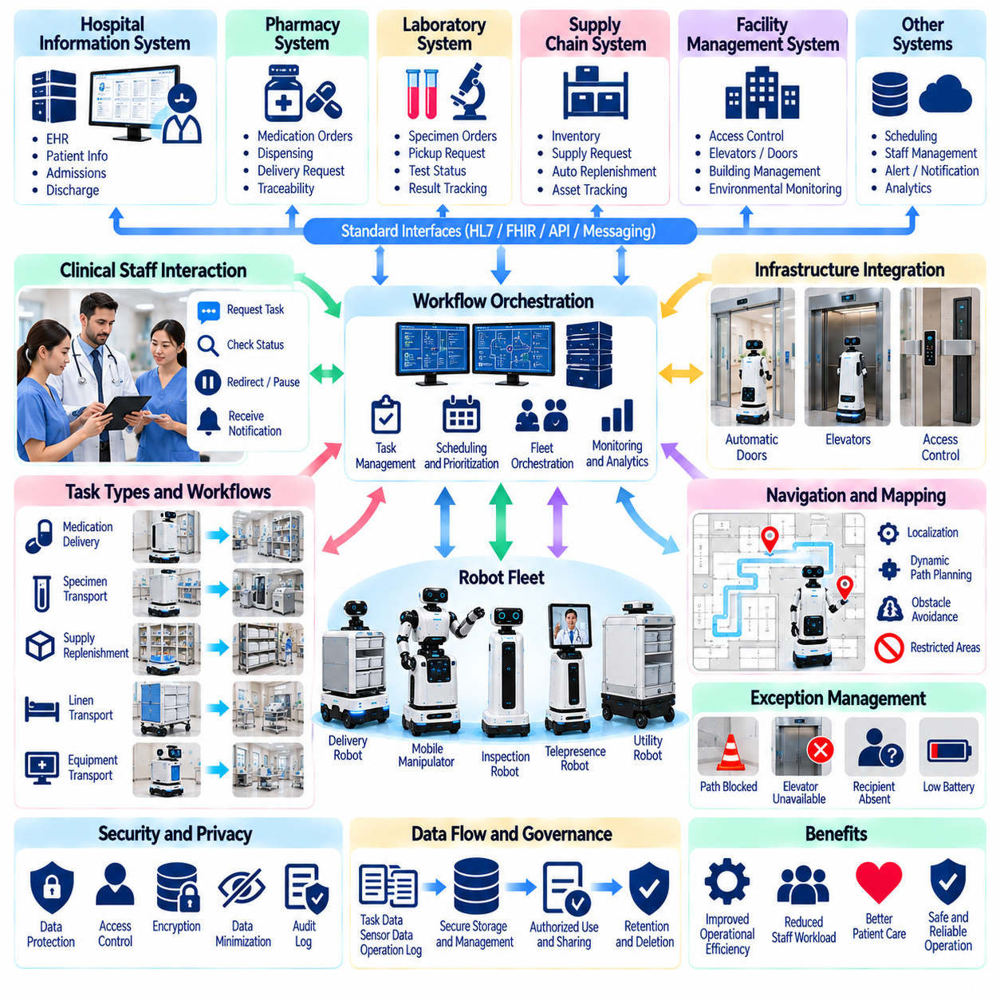{width="7.268055555555556in" height="7.268055555555556in"}

병원 시스템 및 업무 흐름 통합(Hospital System and Workflow Integration)은 피지컬 인공지능(Physical AI) 로봇을 독립적인 자동화 도구(Isolated Automation Tools)에서 신뢰할 수 있는 의료 운영(Healthcare Operations)의 구성요소로 전환하기 위한 필수 조건이다. 로봇은 임상 의료진(Clinical Staff), 정보시스템(Information Systems), 시설 인프라(Facility Infrastructure), 기존 업무 절차(Established Procedures)와 협력해야 한다. 성공적인 통합(Successful Integration)을 위해서는 기술적 상호운용성(Technical Interoperability), 운영적 정합성(Operational Alignment), 명확한 책임성(Clear Accountability)이 필요하다. 궁극적인 목표는 환자 진료(Patient Care)를 방해하지 않으면서 서비스 제공(Service Delivery)을 개선하는 것이다.

병원은 상호 연결된 임상 업무 흐름(Clinical Workflows), 행정 업무 흐름(Administrative Workflows), 물류 업무 흐름(Logistical Workflows)을 통해 운영된다. 환자 입원(Patient Admissions), 의약품 배포(Medication Distribution), 검사실 검체 운송(Laboratory Transport), 장비 관리(Equipment Management), 퇴원 절차(Discharge Activities)에는 여러 부서가 관여한다. 로봇은 작업 간 의존관계(Task Dependencies)와 조직적 우선순위(Organizational Priorities)를 이해해야 한다. 통합은 직원의 업무 부담(Staff Workload)을 증가시키거나 의사소통 공백(Communication Gaps)을 발생시키는 별도의 절차(Parallel Procedures)를 도입하기보다 실제 운영 프로세스(Operational Processes)를 반영해야 한다.

병원 정보시스템(Hospital Information Systems)은 로봇 업무 흐름 통합(Robotic Workflow Integration)을 위한 디지털 기반(Digital Foundation)을 제공한다. 전자의무기록(Electronic Health Records, EHR), 병원 정보시스템(Hospital Information Systems, HIS), 검사실 정보시스템(Laboratory Information Systems), 약국 플랫폼(Pharmacy Platforms)은 서로 다른 운영 데이터(Operational Data)를 관리한다. 로봇 응용 프로그램(Robotic Applications)은 표준화된 인터페이스(Standardized Interfaces)를 통해 승인된 작업 정보(Authorized Task Information)를 교환할 수 있다. 임상 기록(Clinical Records)에 대한 접근은 로봇의 승인된 기능(Approved Function)과 운영 책임(Operational Responsibilities)에 필요한 범위로 제한되어야 한다.

상호운용성(Interoperability)은 로봇이 기존 병원 응용 프로그램(Hospital Applications) 및 장치(Devices)와 정보를 교환할 수 있도록 한다. 응용 프로그램 프로그래밍 인터페이스(Application Programming Interfaces, APIs), 메시징 시스템(Messaging Systems), 의료 데이터 표준(Healthcare Data Standards)은 이기종 플랫폼(Heterogeneous Platforms) 간 통신을 지원한다. HL7(Health Level Seven)과 FHIR(Fast Healthcare Interoperability Resources) 같은 표준은 특정 임상 정보 교환(Clinical Information Exchanges)을 촉진할 수 있다. 그러나 통합 요구사항(Integration Requirements)은 의도된 사용 사례(Intended Use Case), 시스템 기능(System Capabilities), 기관의 거버넌스 정책(Institutional Governance Policies)에 따라 달라진다.

업무 흐름 오케스트레이션(Workflow Orchestration)은 임상 요청(Clinical Requests)과 로봇 작업 실행(Robotic Task Execution)을 연결한다. 간호사는 물품 배송(Supply Delivery)을 요청할 수 있고, 검사실 시스템(Laboratory System)은 검체 운송(Specimen Transport)을 시작할 수 있으며, 약국 업무 흐름(Pharmacy Workflow)은 의약품 배포(Medication Distribution)를 실행하도록 요청할 수 있다. 오케스트레이션 플랫폼(Orchestration Platform)은 승인된 요청(Approved Requests)을 실행 가능한 로봇 임무(Executable Robot Missions)로 변환한다. 운영 연속성(Operational Continuity)을 유지하기 위해 작업 상태(Task Status), 완료 확인(Completion Confirmations), 예외 상황(Exceptions)은 요청을 생성한 원래 시스템(Originating System)으로 전달되어야 한다.

작업 우선순위 결정(Task Prioritization)은 병원 업무마다 긴급성(Urgency)과 임상적 중요도(Clinical Importance)가 다르기 때문에 필요하다. 일상적인 린넨 운송(Routine Linen Transport)이 시간에 민감한 검사실 배송(Time-Sensitive Laboratory Deliveries)이나 응급 운영(Emergency Operations)을 방해해서는 안 된다. 일정 관리 시스템(Scheduling Systems)은 마감시간(Deadlines), 로봇 가용성(Robot Availability), 이동 거리(Travel Distance), 서비스 요구사항(Service Requirements)을 고려할 수 있다. 우선순위 정책(Priority Policies)은 병원 운영자(Hospital Operators)가 수립해야 하며, 자율 최적화(Autonomous Optimization)가 임상 안전성(Clinical Safety)이나 기관의 절차(Institutional Procedures)를 우선하지 못하도록 해야 한다.

로봇 군집 관리 시스템(Fleet Management Systems)과의 통합은 여러 로봇이 운영 자원(Operational Resources)을 공유할 수 있도록 한다. 중앙 집중식 플랫폼(Centralized Platforms)은 임무 할당(Mission Allocation), 로봇 가용성 모니터링(Robot Availability Monitoring), 충전 조정(Charging Coordination), 교통 충돌 해결(Traffic Conflict Resolution)을 수행할 수 있다. 서로 다른 로봇 유형(Robot Types)은 고유한 작업 수행 능력(Task Capabilities)과 운영 제한사항(Operating Restrictions)을 가질 수 있다. 군집 오케스트레이션(Fleet Orchestration)은 이기종 플랫폼(Heterogeneous Platforms)을 지원하면서 일관된 보고(Reporting), 권한 관리(Authorization), 비상 관리 절차(Emergency Management Procedures)를 유지해야 한다.

물리적 인프라 통합(Physical Infrastructure Integration) 역시 신뢰성 높은 병원 내 이동(Hospital Mobility)을 위해 중요하다. 로봇은 자동문(Automatic Doors), 엘리베이터(Elevators), 보안 복도(Secured Corridors), 지정된 보관 구역(Designated Storage Areas)에 대한 승인된 접근(Authorized Access)이 필요할 수 있다. 건물 관리 시스템(Building Management Systems, BMS)과 출입 통제 플랫폼(Access Control Platforms)은 이러한 상호작용을 조정할 수 있다. 인터페이스는 승인되지 않은 이동(Unauthorized Movement)을 방지하고 비상 접근(Emergency Access)을 보장해야 한다. 인프라 장애(Infrastructure Failures)가 발생하면 제어되지 않는 로봇 행동(Uncontrolled Robotic Behavior)이 아니라 안전한 대체 수단(Safe Alternatives)이 실행되어야 한다.

실내 위치 추정(Indoor Localization)과 지도 작성(Mapping)은 복잡하고 빈번하게 변화하는 병원 환경(Hospital Environments)에 대응해야 한다. 임시 장비(Temporary Equipment), 환자 침대(Patient Beds), 청소 작업(Cleaning Operations), 건설 작업(Construction Activities)은 자율주행 조건(Navigation Conditions)을 변화시킬 수 있다. 로봇에는 지속적으로 관리되는 지도(Maintained Maps), 신뢰성 높은 위치 추정(Reliable Localization), 동적 장애물 회피(Dynamic Obstacle Avoidance)가 필요하다. 허용된 경로(Permitted Routes)나 출입 제한 구역(Restricted Areas)의 변경사항은 관련 시스템 간에 동기화(Synchronization)되어야 한다. 자율주행 성능(Navigation Performance)은 운영 중단(Operational Disruptions) 상황에서도 예측 가능해야 한다.

의약품 및 검체 업무 흐름(Medication and Specimen Workflows)에는 추가적인 추적 가능성(Traceability)과 보안(Security)이 필요하다. 의약품(Pharmaceuticals), 검사실 검체(Laboratory Samples), 민감한 물품(Sensitive Materials)을 운송하는 로봇은 식별 기록(Identification Records), 관리 이력(Custody Records), 배송 기록(Delivery Records)을 유지해야 한다. 보안 적재함(Secure Compartments)과 승인된 인계 절차(Authorized Handover Procedures)가 필요할 수 있다. 약국 및 검사실 시스템(Pharmacy and Laboratory Systems)과의 통합은 올바른 목적지(Correct Destination)와 수령자(Recipient)를 확인하고 문서화된 예외 처리(Documented Exception Handling)를 지원해야 한다.

이동형 매니퓰레이션(Mobile Manipulation)은 로봇이 캐비닛(Cabinets), 카트(Carts), 의료 기구(Instruments), 자동 보관 시스템(Automated Storage Systems)과 상호작용할 때 추가적인 통합 요구사항(Integration Requirements)을 발생시킨다. 작업 실행(Task Execution)은 호환 가능한 물리적 인터페이스(Compatible Physical Interfaces), 물체 식별(Object Identification), 검증된 매니퓰레이션 절차(Validated Manipulation Procedures)에 의존한다. 업무 흐름 소프트웨어(Workflow Software)는 성공적인 작업(Successful Actions)과 부분 완료(Partial Completion), 실패(Failure)를 구분해야 한다. 장비 상태(Equipment Conditions)나 환경적 불확실성(Environmental Uncertainty)이 검증된 기능(Validated Capabilities)을 초과하는 경우 인간의 개입(Human Intervention)이 가능해야 한다.

인간-로봇 협업(Human-Robot Collaboration)을 위해서는 간호사(Nurses), 기술자(Technicians), 의사(Physicians), 지원 인력(Support Personnel)의 책임에 부합하는 인터페이스가 필요하다. 작업 요청(Task Requests)은 간단해야 하며, 알림(Notifications)은 과도한 방해(Excessive Interruptions) 없이 관련 상태(Relevant Status)를 전달해야 한다. 직원은 임무(Missions)를 일시 정지(Pause), 경로 변경(Redirect), 취소(Cancel)하는 방법을 이해해야 한다. 로봇 업무 흐름(Robotic Workflows)은 기존 임상 권한(Clinical Authority)을 유지해야 하며, 이미 바쁜 의료 종사자(Healthcare Workers)에게 드러나지 않는 추가 조정 책임(Hidden Coordination Responsibilities)을 전가해서는 안 된다.

예외 관리(Exception Management)는 병원 운영(Hospital Operations)이 완벽하게 예측 가능한 일정에 따라 진행되는 경우가 드물기 때문에 필수적이다. 목적지(Destination)를 사용할 수 없거나, 엘리베이터(Elevator)가 고장 나거나, 요청된 수령자(Recipient)가 부재중일 수 있다. 로봇은 기존 의사소통 채널(Established Communication Channels)을 통해 예외 상황(Exceptions)을 보고하고 적절한 지원(Appropriate Assistance)을 요청해야 한다. 복구 절차(Recovery Procedures)는 단순한 운영상 불편(Operational Inconvenience)과 임상적으로 중요한 지연(Clinically Significant Delays)을 구분해야 한다. 중요한 작업(Critical Tasks)에는 문서화된 대체 업무 흐름(Documented Fallback Workflows)이 필요하다.

사이버보안(Cybersecurity)과 개인정보 보호 통제(Privacy Controls)는 모든 통합 인터페이스(Integration Interfaces)에 적용되어야 한다. 인증(Authentication), 역할 기반 권한 부여(Role-Based Authorization), 암호화(Encryption), 감사 로깅(Audit Logging)은 임상 시스템(Clinical Systems)과 로봇 명령(Robotic Commands)을 보호하는 데 도움이 된다. 네트워크 분할(Network Segmentation)은 운영 기술(Operational Technology, OT)과 병원 정보 네트워크(Hospital Information Networks) 사이의 위험 노출을 제한할 수 있다. 통합 서비스(Integration Services)는 환자 정보(Patient Information)에 대한 접근을 최소화해야 한다. 보안 사고(Security Incidents)가 승인되지 않은 로봇 제어(Unauthorized Robot Control)나 필수 임상 기능(Essential Clinical Functions)의 손상으로 이어져서는 안 된다.

데이터 동기화(Data Synchronization)와 운영 관측 가능성(Operational Observability)은 시스템 간 신뢰성 높은 협력을 지원한다. 임무 식별자(Mission Identifiers), 타임스탬프(Timestamps), 로봇 상태(Robot Status), 배송 확인(Delivery Confirmations), 예외 기록(Exception Records)은 일관성을 유지해야 한다. 모니터링 대시보드(Monitoring Dashboards)는 서비스 성능(Service Performance)과 시스템 가용성(System Availability)에 대한 가시성(Visibility)을 제공할 수 있다. 데이터 품질 관리(Data Quality Controls)는 누락된 이벤트(Missing Events), 중복 이벤트(Duplicated Events), 지연된 이벤트(Delayed Events)를 감지해야 한다. 신뢰성 높은 기록(Reliable Records)은 문제 해결(Troubleshooting), 운영 분석(Operational Analysis), 책임성(Accountability)도 지원한다.

도입(Deployment)은 상세한 업무 흐름 매핑(Workflow Mapping)과 통제된 시범 운영(Controlled Pilot Operations)에서 시작해야 한다. 병원은 작업 책임자(Task Owners), 시스템 의존관계(System Dependencies), 물리적 제약조건(Physical Constraints), 측정 가능한 성공 기준(Measurable Success Criteria)을 식별해야 한다. 초기 도입(Initial Deployments)에서는 자율성(Autonomy)이나 서비스 범위(Service Coverage)를 확대하기 전에 인터페이스(Interfaces)와 인간의 업무 절차(Human Procedures)를 검증해야 한다. 시뮬레이션(Simulation)과 단계적 시험(Staged Testing)은 통합 문제(Integration Problems)를 발견하는 데 도움이 된다. 확대 도입(Expansion Decisions)은 입증된 운영 신뢰성(Demonstrated Operational Reliability)과 임상적 수용성(Clinical Acceptance)에 근거해야 한다.

성능 평가(Performance Evaluation)는 로봇 효율성(Robotic Efficiency)과 병원 전체의 업무 흐름 성과(Hospital-Wide Workflow Outcomes)를 함께 검토해야 한다. 관련 지표에는 배송 완료(Delivery Completion), 응답시간(Response Time), 직원 개입(Staff Intervention), 장비 가용성(Equipment Availability), 서비스 중단(Service Disruptions)이 포함된다. 로봇 활용률(Robot Utilization)의 향상이 반드시 임상 운영(Clinical Operations)의 개선으로 이어지는 것은 아니다. 평가에는 직원 업무 부담(Staff Workload), 환자 경험(Patient Experience), 안전사고(Safety Incidents), 자동화가 관련 부서(Adjacent Departments)에 미치는 영향도 고려되어야 한다.

장기 유지보수(Long-Term Maintenance)를 위해서는 소프트웨어 버전(Software Versions), 인터페이스(Interfaces), 인프라 변경사항(Infrastructure Changes), 조직적 절차(Organizational Procedures)를 통합적으로 관리해야 한다. 병원 응용 프로그램(Hospital Applications)이나 출입 통제 시스템(Access Systems)의 업데이트는 로봇 운영(Robotic Operations)을 방해할 수 있다. 형상 관리(Configuration Management), 회귀 시험(Regression Testing), 문서화된 변경 승인(Documented Change Approval)은 통합 위험(Integration Risks)을 줄인다. 지원 책임(Support Responsibilities)은 병원 정보기술팀(Hospital IT Teams), 임상 부서(Clinical Departments), 시설 운영자(Facility Operators), 로봇 기술 공급업체(Robotic Technology Providers) 사이에서 명확하게 분담되어야 한다.

경제적 가치(Economic Value)는 통합된 로봇 시스템(Integrated Robotics)이 개별 작업(Isolated Tasks)이 아니라 전체 업무 흐름(Complete Workflows)을 얼마나 개선할 수 있는지에 달려 있다. 구매 비용(Acquisition Costs), 통합 엔지니어링(Integration Engineering), 인프라 업그레이드(Infrastructure Upgrades), 교육훈련(Training), 유지보수(Maintenance), 사이버보안(Cybersecurity)은 총소유비용(Total Cost of Ownership, TCO)을 구성한다. 잠재적 이점(Potential Benefits)에는 운송 업무 부담 감소(Reduced Transport Workload), 신속한 물품 이동(Faster Material Movement), 자원 조정 개선(Improved Resource Coordination)이 포함된다. 재무적 평가(Financial Assessments)는 활용률(Utilization), 신뢰성(Reliability), 측정 가능한 운영 성과(Measurable Operational Outcomes)를 고려해야 한다.

미래의 병원 통합 아키텍처(Hospital Integration Architectures)는 피지컬 인공지능(Physical AI), 지능형 업무 흐름 오케스트레이션(Intelligent Workflow Orchestration), 디지털 트윈(Digital Twins), 예측 기반 자원 관리(Predictive Resource Management)를 결합할 수 있다. 상황 인식 시스템(Context-Aware Systems)은 변화하는 임상 수요(Clinical Demand)와 시설 상태(Facility Conditions)에 맞춰 로봇 서비스(Robotic Services)를 조정할 수 있다. 그러나 자율 최적화(Autonomous Optimization)는 검증된 안전 규칙(Verified Safety Rules), 개인정보 보호 요구사항(Privacy Requirements), 인간의 권한(Human Authority)에 의해 제한되어야 한다. 장기적인 목표는 로봇이 의료 서비스 제공(Healthcare Delivery)에 협력하는 파트너(Coordinated Partners)로 작동하는 신뢰성 높은 병원 생태계(Dependable Hospital Ecosystem)를 구축하는 것이다.

## 04.13. Clinical Validation and Operational Evidence

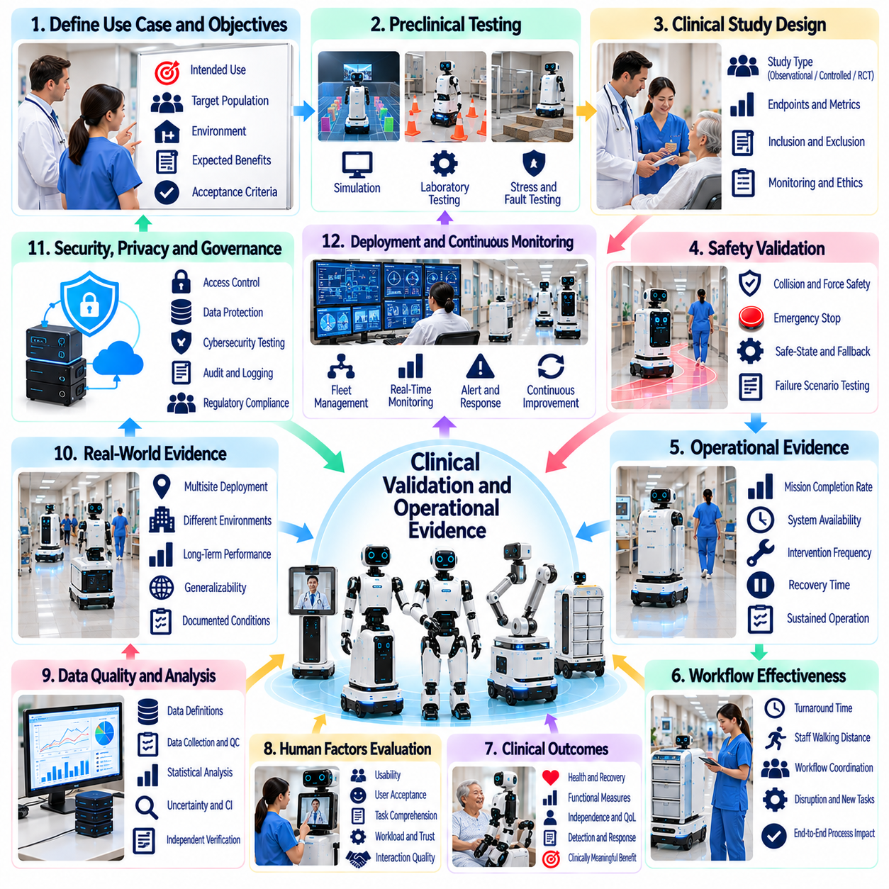{width="7.268055555555556in" height="7.268055555555556in"}

임상적 검증(Clinical Validation)과 운영 실증(Operational Evidence)은 피지컬 인공지능(Physical AI) 시스템이 의료 분야에서 안전하고 효과적이며 측정 가능한 가치(Measurable Value)를 제공하는지 판단하기 위한 필수 요소이다. 성공적인 실험실 시연(Laboratory Demonstrations)만으로 임상적 적합성(Clinical Suitability)이 입증되는 것은 아니다. 로봇은 환자(Patients), 의료 전문가(Healthcare Professionals), 의료 장비(Equipment), 복잡한 업무 흐름(Complex Workflows)이 포함된 실제적인 조건에서 평가되어야 한다. 실증 자료(Evidence)는 기술적 성능(Technical Performance)을 임상적 요구사항(Clinical Needs), 운영 신뢰성(Operational Reliability), 환자 안전(Patient Safety)과 연결해야 한다.

임상적 검증(Clinical Validation)은 로봇 시스템의 의도된 사용 목적(Intended Use), 대상 집단(Target Population), 운영 환경(Operating Environment), 기대 효과(Expected Benefits)를 정의하는 것에서 시작된다. 병원 배송 로봇(Hospital Delivery Robot)은 재활 로봇(Rehabilitation Robot)이나 환자 모니터링 플랫폼(Patient Monitoring Platform)과 서로 다른 검증 자료(Evidence)를 필요로 한다. 평가 목표(Evaluation Objectives)는 시스템의 실제 책임과 기능(Actual Responsibilities)을 반영해야 한다. 명확한 수용 기준(Acceptance Criteria)은 기술적 실현 가능성(Technical Feasibility)과 임상적으로 의미 있는 성능(Clinically Meaningful Performance), 안전한 일상 운영(Safe Routine Operation)을 구분하는 데 도움이 된다.

전임상 시험(Preclinical Testing)은 로봇이 실제 의료 환경에 투입되기 전에 초기 검증 기반(Initial Validation Foundation)을 제공한다. 시뮬레이션(Simulation), 실험실 실험(Laboratory Experiments), 통제된 시험(Controlled Trials)은 자율주행(Navigation), 매니퓰레이션(Manipulation), 인지(Perception), 고장 복구(Fault Recovery)를 평가할 수 있다. 시험 시나리오(Test Scenarios)에는 예측 가능한 위험요인(Foreseeable Hazards)과 까다로운 운영 조건(Challenging Operating Conditions)이 포함되어야 한다. 그러나 시뮬레이션에서의 성공(Simulated Success)은 환자 행동(Patient Behavior), 의료진의 업무 중단(Staff Interruptions), 환경적 변동성(Environmental Variability), 실제 임상적 결과(Real Clinical Consequences)를 완전히 재현할 수 없다.

임상 연구 설계(Clinical Study Design)는 의도된 응용 분야(Intended Application)와 관련된 위험(Risks) 및 성능 주장(Claims)에 부합해야 한다. 관찰 연구(Observational Studies)는 실현 가능성(Feasibility)과 업무 흐름 특성(Workflow Characteristics)을 확인하는 데 활용될 수 있으며, 통제된 비교 연구(Controlled Comparative Studies)는 특정 이점(Specific Benefits)을 평가할 수 있다. 환자 결과(Patient Outcomes)에 영향을 미치는 중재(Interventions)를 평가할 때는 무작위 시험(Randomized Trials)이 적절할 수 있다. 연구 프로토콜(Study Protocols)은 평가변수(Endpoints), 포함 기준(Inclusion Criteria), 모니터링 절차(Monitoring Procedures), 교란 요인(Confounding Factors)을 처리하는 방법을 정의해야 한다.

안전성 검증(Safety Validation)은 정상 운영(Normal Operation)과 합리적으로 예측 가능한 고장(Reasonably Foreseeable Failures)을 모두 평가한다. 관련 위험요인(Relevant Hazards)에는 충돌(Collisions), 과도한 접촉력(Excessive Contact Forces), 잘못된 배송(Incorrect Deliveries), 통신 장애(Communication Failures), 오해를 유발하는 시스템 출력(Misleading System Outputs)이 포함된다. 시험에서는 비상 정지(Emergency Stopping), 보호 이격(Protective Separation), 안전 상태 전환(Safe-State Transitions), 인간 개입 메커니즘(Human Intervention Mechanisms)을 검증해야 한다. 안전성 실증 자료(Safety Evidence)는 자율 기능(Autonomous Capabilities)이 불확실성(Uncertainty)에 직면하더라도 보호 기능(Protective Functions)이 신뢰성 있게 유지된다는 것을 입증해야 한다.

운영 실증(Operational Evidence)은 단발성 시연(Isolated Demonstrations)이 아니라 지속적인 사용(Sustained Use) 과정에서 로봇 시스템의 성능을 측정한다. 중요한 지표에는 임무 완료율(Mission Completion Rate), 시스템 가용성(System Availability), 개입 빈도(Intervention Frequency), 복구 시간(Recovery Time), 서비스 중단(Service Interruptions)이 포함된다. 성능은 서로 다른 근무 교대조(Shifts), 부서(Departments), 환경 조건(Environmental Conditions)에 걸쳐 평가되어야 한다. 장기 모니터링(Longitudinal Monitoring)은 단기간의 시범 프로그램(Short Pilot Programs)에서 발견하지 못한 신뢰성 문제(Reliability Problems)를 드러낼 수 있다.

업무 흐름 효과성(Workflow Effectiveness)은 병원 로봇 평가(Hospital Robotics Evaluation)의 핵심 구성요소이다. 로봇은 개별 작업(Individual Tasks)을 더 빠르게 실행하는 데 그치지 않고 전체 서비스 프로세스(Complete Service Processes)를 개선해야 한다. 측정 항목에는 배송 소요시간(Delivery Turnaround Time), 직원 이동 거리(Staff Walking Distance), 작업 조정 노력(Task Coordination Effort), 업무 흐름 중단(Workflow Disruptions)이 포함될 수 있다. 평가에서는 다른 업무로 전가된 작업(Displaced Work), 드러나지 않는 감독 요구사항(Hidden Supervision Requirements), 자동화(Automation)로 인해 새롭게 발생하는 책임(New Responsibilities)도 식별해야 한다.

로봇 시스템이 환자 건강(Patient Health)이나 치료 효과(Treatment Effectiveness)에 영향을 미친다고 주장하는 경우 임상 결과 평가(Clinical Outcome Evaluation)가 필요하다. 재활 로봇(Rehabilitation Robots)은 기능 회복 지표(Functional Recovery Measures)를 통해 평가할 수 있으며, 보조 시스템(Assistive Systems)은 독립성(Independence)과 삶의 질(Quality of Life)을 기준으로 평가할 수 있다. 모니터링 로봇(Monitoring Robots)은 감지 성능(Detection Performance)과 대응 업무 흐름(Response Workflows)에 관한 실증 자료가 필요하다. 운영 개선(Operational Improvements)은 이를 뒷받침하는 데이터(Supporting Data) 없이 입증된 임상적 이점(Proven Clinical Benefits)으로 제시되어서는 안 된다.

인간공학적 요소 평가(Human Factors Evaluation)는 환자와 의료 전문가가 로봇 시스템을 이해하고, 조작하며, 적절하게 신뢰할 수 있는지를 검토한다. 관련 지표에는 사용성(Usability), 업무 부담(Workload), 작업 이해도(Task Comprehension), 인지된 안전성(Perceived Safety), 사용자 수용성(User Acceptance)이 포함된다. 시험에는 서로 다른 능력(Abilities)과 임상적 책임(Clinical Responsibilities)을 가진 대표성 있는 참여자(Representative Participants)가 포함되어야 한다. 인간-로봇 상호작용 실패(Human-Robot Interaction Failures)는 로봇의 기본 기능(Underlying Robotic Functions)이 올바르게 작동하더라도 효과성을 저하시킬 수 있다.

데이터 품질(Data Quality)과 측정 타당성(Measurement Validity)은 임상 실증 자료(Clinical Evidence)의 신뢰성(Credibility)에 큰 영향을 미친다. 센서(Sensors), 운영 로그(Operational Logs), 임상 기록(Clinical Records), 사용자 설문(User Surveys)은 불완전하거나 일관성이 없는 관측 결과(Incomplete or Inconsistent Observations)를 생성할 수 있다. 평가 프로토콜(Evaluation Protocols)은 데이터 정의(Data Definitions), 수집 방법(Collection Methods), 품질 관리(Quality Controls)를 명시해야 한다. 누락된 이벤트(Missing Events), 일관되지 않은 타임스탬프(Inconsistent Timestamps), 선택적 결과 보고(Selective Reporting)는 결론을 왜곡할 수 있다. 독립적인 검증(Independent Verification)은 보고된 성능(Reported Performance)에 대한 신뢰도를 높인다.

통계 분석(Statistical Analysis)은 의미 있는 개선(Meaningful Improvements)과 무작위 변동(Random Variation) 또는 운영상 교란 요인(Operational Confounding)을 구분해야 한다. 표본 크기(Sample Size), 연구 기간(Study Duration), 기준 성능(Baseline Performance), 결과 변동성(Outcome Variability)은 해석에 영향을 미친다. 비교 평가(Comparative Evaluations)는 인력 배치(Staffing), 환자 집단(Patient Populations), 병원 활동(Hospital Activity)의 차이를 고려해야 한다. 신뢰구간(Confidence Intervals)과 민감도 분석(Sensitivity Analyses)은 불확실성(Uncertainty)을 명확히 하는 데 도움이 된다. 한 시설(Facility)에서 얻은 긍정적인 결과(Positive Results)가 다른 시설에도 자동으로 일반화(Generalization)되는 것은 아니다.

실제 환경 실증(Real-World Evidence)은 다양한 임상 환경(Clinical Environments)에서의 일상적인 운영(Routine Deployment)을 평가함으로써 통제된 연구(Controlled Studies)를 보완한다. 병원은 건축 구조(Architecture), 인력 배치(Staffing), 정보시스템(Information Systems), 운영 관행(Operational Practices)에서 차이가 있다. 다기관 평가(Multisite Evaluation)는 이러한 차이 속에서도 로봇 성능(Robotic Performance)이 일관되게 유지되는지 확인할 수 있다. 실증 자료(Evidence)는 도입 조건(Deployment Conditions)과 구현 방식의 차이(Implementation Differences)를 문서화해야 한다. 일반화 가능성(Generalizability)은 시험 환경(Tested Environments)과 의도된 적용 환경(Intended Applications)의 유사성에 달려 있다.

사이버보안(Cybersecurity), 개인정보 보호(Privacy), 데이터 거버넌스(Data Governance) 역시 임상 도입(Clinical Deployment) 과정에서 검증되어야 한다. 시험에서는 접근 제어(Access Controls), 통신 보호(Communication Protection), 감사 기록(Audit Records), 보안 사고 대응(Responses to Security Incidents)을 평가해야 한다. 환자 정보(Patient Information)는 적용 가능한 법적 요구사항(Legal Requirements)과 기관의 요구사항(Institutional Requirements)에 따라 처리되어야 한다. 데이터 거버넌스 실증 자료(Data Governance Evidence)는 적절한 수집(Collection), 보존(Retention), 삭제(Deletion) 관행을 입증해야 한다. 기술적 성능(Technical Performance)이 우수하더라도 허용할 수 없는 개인정보 보호 또는 보안 위험(Unacceptable Privacy or Security Risks)을 정당화할 수는 없다.

규제 실증 요구사항(Regulatory Evidence Requirements)은 의도된 사용 목적(Intended Use), 위험 등급(Risk Classification), 관할권(Jurisdiction)에 따라 달라진다. 치료적 기능(Therapeutic Functions)이나 진단적 기능(Diagnostic Functions)을 수행하는 의료 로봇(Medical Robots)은 공식적인 임상 평가(Formal Clinical Evaluation)와 규제 승인(Regulatory Authorization)이 필요할 수 있다. 물류 및 서비스 로봇(Logistics and Service Robots)은 서로 다른 평가 절차(Assessment Pathways)를 따를 수 있다. 개발자는 설계 관리(Design Controls), 위험 관리(Risk Management), 검증(Verification), 타당성 확인(Validation) 활동을 문서화해야 한다. 규제 준수(Regulatory Compliance)는 운영 가치(Operational Value)에 관한 광범위한 실증 자료와 구분되어야 한다.

경제성 평가(Economic Evaluation)는 관찰된 이점(Observed Benefits)이 구매 및 운영 비용(Acquisition and Operating Costs)을 정당화하는지 판단한다. 관련 비용에는 하드웨어(Hardware), 시스템 통합(Integration), 유지보수(Maintenance), 교육훈련(Training), 사이버보안(Cybersecurity), 인간 감독(Human Supervision)이 포함된다. 이점에는 운송 업무 부담 감소(Reduced Transport Workload), 서비스 가용성 향상(Improved Service Availability), 효율적인 자원 활용(More Efficient Resource Utilization)이 포함될 수 있다. 비용 효과성 분석(Cost-Effectiveness Analysis)은 측정된 결과(Measured Outcomes)와 투명한 가정(Transparent Assumptions)을 사용해야 한다. 단기 생산성 향상(Short-Term Productivity Gains)이 장기적인 총소유비용(Long-Term Ownership Costs)을 반영하는 것은 아닐 수 있다.

시범 도입(Pilot Deployment)은 통제된 시험(Controlled Testing)과 일상 운영(Routine Operations) 사이의 체계적인 전환(Structured Transition)을 제공한다. 초기 연구(Initial Studies)는 제한된 서비스 구역(Limited Service Areas), 책임 담당자(Responsible Personnel), 운영 범위(Operational Boundaries), 중단 기준(Stopping Criteria)을 정의해야 한다. 성능 검토(Performance Reviews)는 자율주행 실패(Navigation Failures), 인터페이스 문제(Interface Problems), 업무 흐름 충돌(Workflow Conflicts)을 식별할 수 있다. 확대 도입(Expansion)은 안전성(Safety)과 신뢰성(Reliability)에 관한 문서화된 실증 자료(Documented Evidence)를 확보한 이후에 이루어져야 한다. 시범 운영의 성공(Pilot Success)을 병원 전체에 제한 없이 도입할 수 있는 준비 상태(Unrestricted Readiness for Hospital-Wide Deployment)로 해석해서는 안 된다.

도입 이후 모니터링(Post-Deployment Monitoring)은 소프트웨어(Software), 환경(Environments), 업무 흐름(Workflows)이 변화함에 따라 로봇 성능(Robotic Performance)도 달라질 수 있기 때문에 필요하다. 모델 업데이트(Model Updates), 센서 성능 저하(Sensor Degradation), 인프라 변경(Infrastructure Modifications), 환자 요구사항 변화(Changing Patient Needs)는 새로운 위험(New Risks)을 발생시킬 수 있다. 지속적인 모니터링(Continuous Monitoring)은 안전 이벤트(Safety Events), 운영 성능(Operational Performance), 새롭게 나타나는 고장 패턴(Emerging Failure Patterns)을 추적해야 한다. 중대한 변경사항(Significant Changes)은 재검증(Renewed Validation)을 필요로 할 수 있다. 사고 조사(Incident Investigation)와 시정 조치(Corrective Actions)는 지속적인 개선(Continuous Improvement)을 지원해야 한다.

실증 자료의 투명성(Evidence Transparency)은 병원(Hospitals), 규제기관(Regulators), 임상의(Clinicians), 기술 공급업체(Technology Providers)가 평가 결과(Evaluation Results)를 적절하게 해석할 수 있도록 한다. 보고서(Reports)는 의도된 사용 목적(Intended Use), 연구 방법(Study Methods), 운영 조건(Operating Conditions), 한계(Limitations), 관찰된 결과(Observed Outcomes)를 설명해야 한다. 부정적인 결과(Negative Findings)와 운영 실패(Operational Failures)도 도입 위험(Deployment Risks)을 이해하는 데 중요한 자료이다. 성공적인 시연(Successful Demonstrations)만을 선택적으로 제시하면 잘못된 기대(Misleading Expectations)를 형성할 수 있다. 재현 가능한 방법(Reproducible Methods)과 문서화된 가정(Documented Assumptions)은 의사결정의 품질(Decision Quality)을 향상시킨다.

미래의 임상적 검증(Future Clinical Validation)은 디지털 트윈(Digital Twins), 시뮬레이션 기반 시험(Simulation-Based Testing), 자동화된 안전 모니터링(Automated Safety Monitoring), 로봇 군집 규모의 운영 분석(Fleet-Scale Operational Analytics)을 결합할 수 있다. 이러한 접근법은 실증 자료 수집(Evidence Collection)을 가속화하고 드물게 발생하는 고장 조건(Rare Failure Conditions)을 식별하는 데 도움이 될 수 있다. 그러나 합성 실증 자료(Synthetic Evidence)가 실제 의료 환경(Actual Healthcare Environments)에서의 관찰을 완전히 대체할 수는 없다. 임상적 성능 주장(Clinical Claims)에는 앞으로도 적절한 인간 중심 평가(Human-Centered Evaluation), 규제적 고려(Regulatory Consideration), 독립적인 검토(Independent Scrutiny)가 필요하다.

임상적 검증(Clinical Validation)과 운영 실증(Operational Evidence)의 장기적인 목표는 의료 분야에서 피지컬 인공지능(Physical AI)을 도입하기 위한 신뢰할 수 있는 기반(Trustworthy Foundations)을 확립하는 것이다. 성공적인 시스템(Successful Systems)은 기술적 능력(Technical Capability)뿐만 아니라 지속적인 안전성(Sustained Safety), 업무 흐름 적합성(Workflow Compatibility), 의미 있는 이점(Meaningful Benefits)을 입증해야 한다. 실증 기반 도입(Evidence-Based Deployment)은 환자를 보호하고, 의료 전문가(Healthcare Professionals)를 지원하며, 책임 있는 투자(Responsible Investment)를 안내한다. 신뢰성 높은 임상 로봇공학(Reliable Clinical Robotics)은 시스템 전체 수명주기(System Lifecycle)에 걸친 지속적인 평가(Continuous Evaluation)에 달려 있다.

## 04.14. Healthcare Value and Adoption Framework

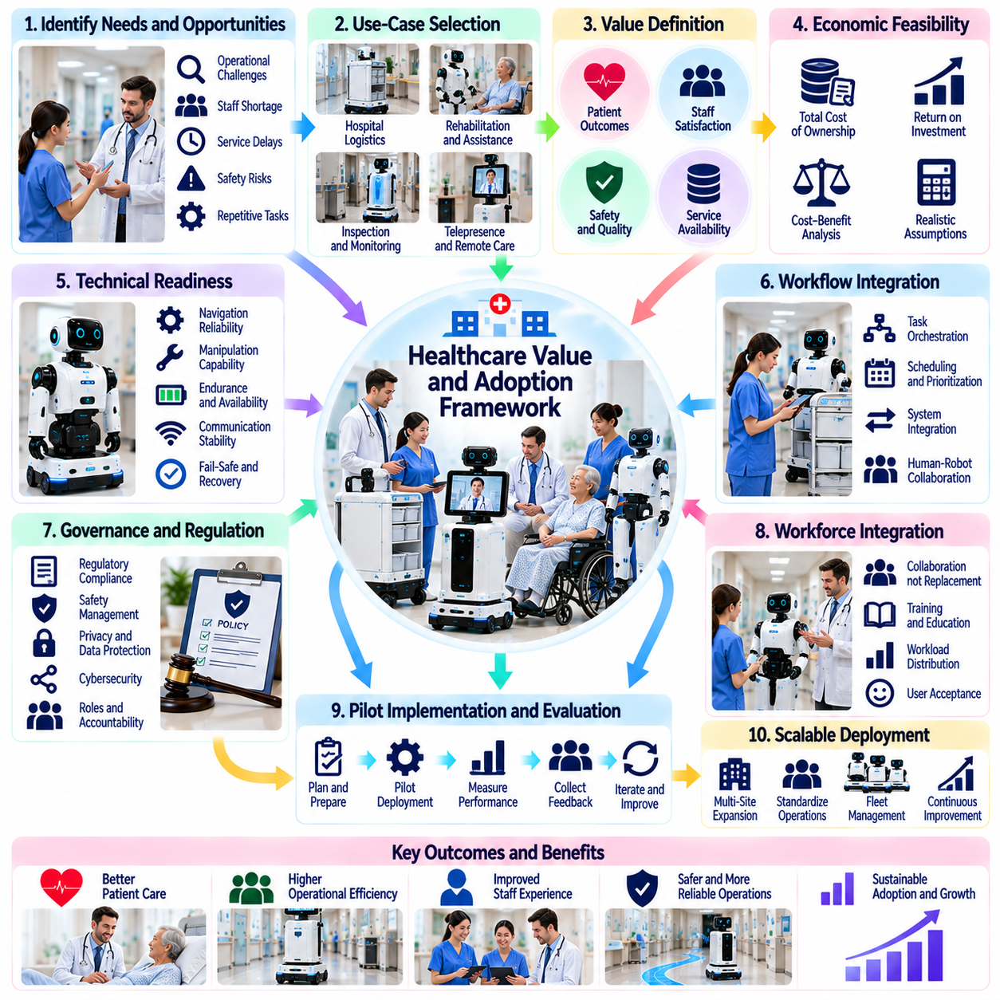{width="7.268055555555556in" height="7.268055555555556in"}

의료 가치 및 도입 프레임워크(Healthcare Value and Adoption Frameworks)는 피지컬 인공지능(Physical AI)이 임상 및 운영 환경(Clinical and Operational Environments) 전반에서 지속가능한 이점(Sustainable Benefits)을 제공할 수 있는 영역을 판단하기 위한 체계적인 접근법(Structured Approach)을 제공한다. 성공적인 도입(Successful Adoption)을 위해서는 첨단 로봇 기능(Advanced Robotic Capabilities) 이상의 요소가 필요하다. 병원은 환자 결과(Patient Outcomes), 인력 수요(Workforce Needs), 재무적 실현 가능성(Financial Feasibility), 조직적 준비도(Organizational Readiness)를 평가해야 한다. 핵심 목표는 로봇 투자(Robotic Investment)를 측정 가능한 의료 우선순위(Measurable Healthcare Priorities)와 책임 있는 서비스 제공(Responsible Service Delivery)에 연계하는 것이다.

가치 창출(Value Creation)은 로봇공학(Robotics)이 효과적으로 해결할 수 있는 운영 문제(Operational Problems)를 식별하는 것에서 시작된다. 병원은 인력 부족(Staff Shortages), 반복적인 운송 작업(Repetitive Transport Tasks), 서비스 지연(Service Delays), 증가하는 진료 복잡성(Increasing Care Complexity)과 관련된 과제에 직면하고 있다. 피지컬 인공지능(Physical AI)은 일상적인 업무 부담(Routine Workload)을 줄이고 자원 조정(Resource Coordination)을 개선할 수 있다. 그러나 제안된 각 응용 분야(Proposed Application)는 로봇 기능(Robotic Functions), 기존 업무 흐름의 한계(Existing Workflow Limitations), 의료 성과(Healthcare Performance)의 의미 있는 개선 사이에 명확한 연관성이 있음을 입증해야 한다.

의료 가치(Healthcare Value)는 직접적인 재무적 절감(Direct Financial Savings)을 넘어선다. 로봇은 서비스 가용성(Service Availability)을 향상시키고, 근로자의 신체적 부담(Physical Strain on Workers)을 줄이며, 더욱 일관된 작업 수행(Consistent Task Execution)을 지원할 수 있다. 환자 경험(Patient Experience), 직원 만족도(Staff Satisfaction), 안전성(Safety), 진료 연속성(Continuity of Care)도 전체적인 가치(Overall Value)에 기여한다. 평가 프레임워크(Evaluation Frameworks)는 이러한 다양한 가치 차원(Multiple Value Dimensions)을 인정해야 한다. 운영 비용(Operating Costs)을 절감하더라도 임상적 위험(Clinical Risk)이나 직원 업무 부담(Staff Burden)을 증가시키는 시스템은 성공적이라고 평가할 수 없다.

사용 사례 선정(Use-Case Selection)은 요구사항(Requirements)이 명확하고, 작업 빈도(Task Frequency)가 충분하며, 운영 위험(Operational Risk)을 관리할 수 있는 작업을 우선해야 한다. 병원 물류(Hospital Logistics), 내부 배송(Internal Delivery), 환경 점검(Environmental Inspection), 특정 재활 활동(Selected Rehabilitation Activities)은 서로 다른 도입 기회(Adoption Opportunities)를 제공할 수 있다. 각 응용 분야에는 작업 복잡성(Task Complexity), 환경적 변동성(Environmental Variability), 인간 감독(Human Supervision)에 대한 평가가 필요하다. 초기 도입(Early Deployments)은 환자 안전(Patient Safety)을 훼손하지 않으면서 이점을 측정할 수 있는 업무 흐름(Workflows)을 우선해야 한다.

경제적 실현 가능성(Economic Feasibility)은 구현 비용(Implementation Costs)과 입증된 운영상 이점(Demonstrated Operational Benefits) 사이의 관계에 달려 있다. 총소유비용(Total Cost of Ownership, TCO)에는 로봇 구매(Robot Acquisition), 소프트웨어(Software), 시스템 통합(Integration), 유지보수(Maintenance), 사이버보안(Cybersecurity), 교육훈련(Training), 인프라 변경(Infrastructure Modifications)이 포함된다. 재무 모델(Financial Models)은 가동 중단시간(Downtime)과 감독 인력 비용(Supervisory Labor)도 고려해야 한다. 투자수익률(Return on Investment, ROI) 추정에는 현실적인 활용률 가정(Realistic Utilization Assumptions)을 사용해야 하며, 잠재적인 인건비 절감(Potential Labor Savings)을 자동적인 인력 감축(Automatic Workforce Reductions)으로 간주해서는 안 된다.

운영 생산성(Operational Productivity)은 개별 로봇 성능 지표(Isolated Robot Performance Metrics)가 아니라 업무 흐름 수준(Workflow Level)에서 평가해야 한다. 엘리베이터(Elevators), 인계 절차(Handovers), 일정 관리(Scheduling)가 병목현상(Bottlenecks)을 발생시키는 경우 자율주행 속도(Faster Navigation)가 빨라지더라도 병원 처리량(Hospital Throughput)이 반드시 개선되는 것은 아니다. 관련 지표에는 작업 완료시간(Task Completion Time), 직원 이동 거리(Staff Walking Distance), 서비스 가용성(Service Availability), 개입 빈도(Intervention Frequency)가 포함된다. 생산성 향상(Productivity Gains)은 부서 간 협력적인 서비스 제공(Coordinated Service Delivery)을 개선할 때 의미 있는 가치를 갖는다.

임상적 가치(Clinical Value)를 입증하려면 로봇의 의도된 기능(Intended Function)에 적합한 실증 자료(Evidence)가 필요하다. 재활 시스템(Rehabilitation Systems)은 기능 개선(Functional Improvement)을 통해 평가할 수 있으며, 보조 로봇(Assistive Robots)은 독립성(Independence)과 환자 참여(Patient Participation)를 지원할 수 있다. 물류 로봇(Logistics Robots)은 임상적 효과(Clinical Effects)가 독립적으로 입증되지 않는 한 주로 운영상 이점(Operational Benefits)을 창출한다. 도입 의사결정(Adoption Decisions)은 과장된 가치 주장(Exaggerated Value Claims)을 방지하기 위해 기술적 성능(Technical Performance), 운영 효율성(Operational Efficiency), 검증된 환자 결과(Verified Patient Outcomes)를 구분해야 한다.

조직적 준비도(Organizational Readiness)는 도입 성공(Adoption Success)을 결정하는 주요 요인이다. 병원에는 경영진의 지원(Leadership Support), 명확하게 할당된 책임(Clearly Assigned Responsibilities), 신뢰성 높은 정보기술 인프라(Reliable IT Infrastructure), 적절한 유지보수 역량(Maintenance Capabilities)이 필요하다. 임상 부서(Clinical Departments)는 업무 흐름 설계(Workflow Design)와 운영 계획(Operational Planning)에 참여해야 한다. 로봇이 익숙하지 않은 절차(Unfamiliar Procedures)나 불명확한 책임(Unclear Accountability)을 도입하면 저항(Resistance)이 발생할 수 있다. 초기 이해관계자 참여(Early Stakeholder Engagement)는 수용성(Acceptance)을 높이고 도입 전에 장애요인(Barriers)을 식별하는 데 도움이 된다.

인력 통합(Workforce Integration)은 단순한 노동력 대체(Labor Replacement)보다 협업(Collaboration)을 강조해야 한다. 로봇은 반복적인 운송(Repetitive Transport)이나 모니터링 지원 작업(Monitoring Support Tasks)을 담당할 수 있으며, 의료 전문가(Healthcare Professionals)는 임상적 판단(Clinical Judgment)과 대인 관계에 관한 책임(Interpersonal Responsibilities)을 유지한다. 교육훈련(Training)은 로봇 기능(Robotic Capabilities), 한계(Limitations), 개입 절차(Intervention Procedures), 예상되는 업무 흐름(Expected Workflows)을 설명해야 한다. 도입 전략(Adoption Strategies)은 업무 부담 분배(Workload Distribution)의 변화를 측정하고 자동화(Automation)가 숨겨진 감독 요구사항(Hidden Supervision Demands)을 발생시키지 않도록 해야 한다.

기술적 준비도(Technology Readiness)는 실제 병원 환경(Actual Hospital Conditions)을 기준으로 평가해야 한다. 자율주행 신뢰성(Navigation Reliability), 매니퓰레이션 정확도(Manipulation Accuracy), 배터리 지속시간(Battery Endurance), 통신 안정성(Communication Stability), 시스템 가용성(System Availability)은 도입 실현 가능성(Deployment Feasibility)에 영향을 미친다. 로봇은 환자(Patients), 의료 장비(Medical Equipment), 변화하는 장애물(Changing Obstacles) 주변에서 안전하게 작동해야 한다. 기술 평가(Technical Evaluation)에는 고장 복구(Failure Recovery)와 기존 인프라(Existing Infrastructure)와의 통합도 포함되어야 한다. 실험실에서 입증된 기능(Demonstrated Laboratory Capability)만으로 일상적인 운영 도입(Routine Adoption)의 적합성이 확보되는 것은 아니다.

상호운용성(Interoperability)은 구현 비용(Implementation Cost)과 장기적인 확장성(Long-Term Scalability)에 모두 영향을 미친다. 로봇 플랫폼(Robotic Platforms)은 병원 정보시스템(Hospital Information Systems), 군집 관리 소프트웨어(Fleet Management Software), 엘리베이터(Elevators), 자동문(Doors), 출입 통제 서비스(Access Control Services)와 연결되어야 할 수 있다. 표준화된 인터페이스(Standardized Interfaces)는 통합 복잡성(Integration Complexity)과 공급업체 의존성(Vendor Dependence)을 줄일 수 있다. 병원은 데이터 이식성(Data Portability), 업그레이드 호환성(Upgrade Compatibility), 운영 연속성(Operational Continuity)을 평가해야 한다. 독점적인 통합 장벽(Proprietary Integration Barriers)은 시간이 지남에 따라 경제적 가치(Economic Value)를 저하시킬 수 있다.

거버넌스(Governance)와 규제 정합성(Regulatory Alignment)은 도입 프레임워크(Adoption Framework)의 필수 요소이다. 요구사항(Requirements)은 의도된 사용 목적(Intended Use), 임상적 위험(Clinical Risk), 관할권(Jurisdiction)에 따라 달라진다. 안전 관리(Safety Management), 개인정보 보호(Privacy Protection), 사이버보안(Cybersecurity), 환자 동의(Patient Consent)는 운영 확대(Operational Expansion) 이전에 해결되어야 한다. 병원은 기술 공급업체(Technology Providers), 임상 사용자(Clinical Users), 관리자(Administrators) 사이의 책임성(Accountability)을 명확하게 확립해야 한다. 거버넌스 메커니즘(Governance Mechanisms)은 자율성(Autonomy)과 도입 규모(Deployment Scale)가 증가하더라도 효과적으로 유지되어야 한다.

조달 평가(Procurement Evaluation)는 구매 가격(Purchase Price)만이 아니라 수명주기 성능(Lifecycle Performance)을 고려해야 한다. 공급업체 신뢰성(Vendor Reliability), 유지보수 대응(Maintenance Response), 소프트웨어 지원(Software Support), 예비 부품 가용성(Spare Parts Availability), 사이버보안 관행(Cybersecurity Practices)은 장기적인 소유비용(Long-Term Ownership Costs)에 영향을 미친다. 서비스 수준 협약(Service-Level Agreements, SLAs)은 가용성 목표(Availability Targets)와 지원 책임(Support Responsibilities)을 정의할 수 있다. 병원은 유사한 도입 사례(Comparable Deployments)의 실증 자료(Evidence)를 요청하고 데이터 소유권(Data Ownership), 시스템 업데이트(System Updates), 운영 연속성(Operational Continuity)에 관한 계약 조항(Contractual Provisions)을 검토해야 한다.

시범 프로그램(Pilot Programs)은 대규모 투자(Large-Scale Investment) 이전에 불확실성(Uncertainty)을 줄이기 위한 실질적인 수단을 제공한다. 초기 도입(Initial Deployments)에서는 측정 가능한 목표(Measurable Objectives), 제한된 운영 범위(Limited Operational Boundaries), 정의된 책임(Defined Responsibilities)을 설정해야 한다. 평가에서는 작업 성공(Task Success), 사용자 수용성(User Acceptance), 안전 이벤트(Safety Events), 통합상의 어려움(Integration Difficulties)을 기록해야 한다. 확대 도입 의사결정(Expansion Decisions)은 홍보용 시연(Promotional Demonstrations)이 아니라 관찰된 성능(Observed Performance)에 근거해야 한다. 성공하지 못한 시범 운영(Unsuccessful Pilots)도 도입 전략(Adoption Strategies)을 개선하는 데 유용한 정보를 제공할 수 있다.

규모 확장(Scaling)을 위해서는 로봇 군집(Robotic Fleets), 인프라 용량(Infrastructure Capacity), 직원 교육훈련(Staff Training), 운영 정책(Operational Policies)을 통합적으로 관리해야 한다. 한 대의 로봇으로 달성한 성능(Performance)이 수십 대의 로봇이 엘리베이터(Elevators), 복도(Corridors), 충전 자원(Charging Resources)을 공유할 때도 유지되는 것은 아니다. 군집 수준의 일정 관리(Fleet-Level Scheduling)와 교통 관리(Traffic Management)는 점점 더 중요해진다. 병원은 도입 규모가 확대됨에 따라 혼잡(Congestion), 유지보수 수요(Maintenance Demand), 예외 처리(Exception Handling)를 평가해야 한다. 표준화된 절차(Standardized Procedures)는 일관된 서비스 품질(Consistent Service Quality)을 지원한다.

비즈니스 모델(Business Models)은 의료기관(Healthcare Organizations)이 재무적 위험(Financial Risk)과 운영 위험(Operational Risk)을 분담하는 방식에 영향을 미친다. 직접 구매(Direct Purchasing)는 자산 소유권(Asset Ownership)을 제공하지만 초기 자본(Upfront Capital)과 내부 지원(Internal Support)이 필요하다. 리스(Leasing)와 서비스형 로봇(Robotics-as-a-Service, RaaS) 계약은 지출을 정기적인 비용(Recurring Payments)과 계약 기반 서비스(Contracted Services) 중심으로 전환할 수 있다. 각 모델은 유지보수(Maintenance), 업그레이드(Upgrades), 사이버보안(Cybersecurity), 성능(Performance)에 관한 서로 다른 책임을 수반한다. 비즈니스 모델 선정(Selection)은 활용 패턴(Utilization Patterns)과 기관의 재무적 제약(Institutional Financial Constraints)을 반영해야 한다.

가치 측정(Value Measurement)은 재무적 지표(Financial Indicators), 운영 지표(Operational Indicators), 임상 지표(Clinical Indicators), 인간 중심 지표(Human-Centered Indicators)를 결합해야 한다. 임무당 비용(Cost per Completed Mission), 시스템 가동시간(System Uptime), 절감된 직원 업무시간(Staff Time Released), 사용자 만족도(User Satisfaction), 안전사고(Safety Incidents)는 상호보완적인 관점을 제공한다. 신뢰할 수 있는 비교(Credible Comparisons)를 위해서는 기준선 측정(Baseline Measurements)이 필요하다. 장기 평가(Longitudinal Evaluation)는 초기 도입 이후에도 이점(Benefits)이 지속되는지 확인해야 한다. 투명한 보고(Transparent Reporting)는 지속가능한 개선(Sustainable Improvements)과 일시적인 도입 효과(Temporary Implementation Effects)를 구분하는 데 도움이 된다.

도입 장벽(Adoption Barriers)에는 높은 통합 비용(High Integration Costs), 불확실한 의료비 보상(Uncertain Reimbursement), 제한된 임상 실증 자료(Limited Clinical Evidence), 사이버보안 우려(Cybersecurity Concerns), 업무 흐름 변화에 대한 저항(Resistance to Workflow Changes)이 포함된다. 분절된 병원 시스템(Fragmented Hospital Systems)과 일관되지 않은 기술 표준(Inconsistent Technical Standards)은 도입을 더욱 복잡하게 만들 수 있다. 효과적인 전략(Effective Strategies)은 단계적 구현(Staged Implementation), 이해관계자 참여(Stakeholder Participation), 현실적인 성능 약속(Realistic Performance Commitments)을 통해 이러한 장애요인을 해결한다. 초기 도입(Early Adoption)에서는 자율성 극대화(Maximizing Autonomy)보다 위험 감소(Risk Reduction)가 더 중요한 경우가 많다.

미래의 의료 분야 도입(Future Healthcare Adoption)은 더욱 발전된 피지컬 인공지능 파운데이션 모델(Physical AI Foundation Models), 공유 로봇 플랫폼(Shared Robotic Platforms), 지능형 업무 흐름 오케스트레이션(Intelligent Workflow Orchestration)의 혜택을 받을 수 있다. 향상된 일반화 능력(Improved Generalization)은 로봇이 더욱 폭넓은 작업 포트폴리오(Broader Task Portfolios)를 수행하고 활용률(Utilization)을 높일 수 있도록 한다. 그러나 자율성(Greater Autonomy)의 증가는 추가적인 검증(Validation)과 거버넌스 요구사항(Governance Requirements)을 수반한다. 경제적 이점(Economic Advantages)은 미래 기술 역량(Future Technological Capability)에 대한 가정이 아니라 신뢰성 높은 실제 환경 성능(Reliable Real-World Performance)을 통해 입증되어야 한다.

지속가능한 의료 도입 프레임워크(Sustainable Healthcare Adoption Framework)는 임상적 우선순위(Clinical Priorities), 운영 요구사항(Operational Requirements), 기술적 준비도(Technical Readiness), 재무적 가치(Financial Value), 책임 있는 거버넌스(Responsible Governance)를 연결한다. 성공적인 피지컬 인공지능 도입(Successful Physical AI Deployment)은 환자의 존엄성(Patient Dignity)과 전문적 책임성(Professional Accountability)을 보호하면서 의료 서비스 제공(Healthcare Delivery)을 개선해야 한다. 도입(Adoption)은 일회성 기술 구매(One-Time Technology Purchase)가 아니라 지속적인 조직 혁신(Continuous Organizational Transformation)으로 이해하는 것이 적절하다. 장기적인 성공(Long-Term Success)은 측정 가능한 이점(Measurable Benefits), 신뢰성 높은 운영(Dependable Operations), 지속적인 신뢰(Sustained Trust)에 달려 있다.
