**Volume 12. Physical AI Business and Industry Applications**


# Chapter 05. Agriculture Applications

##  

## 05.01. Physical AI in Agriculture

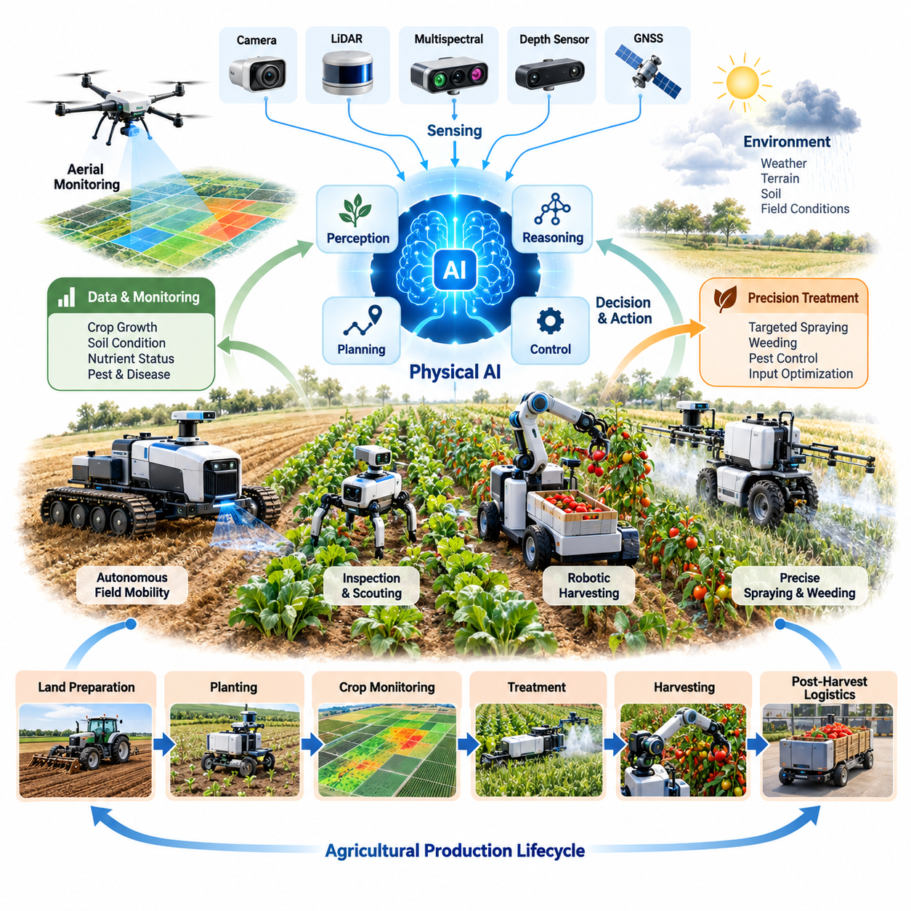{width="7.268055555555556in" height="7.268055555555556in"}

Physical AI in agriculture represents the integration of artificial intelligence, robotics, sensing, and autonomous control into agricultural production systems. Unlike conventional farm automation, which follows predefined operating sequences, Physical AI enables machines to perceive environmental conditions, interpret biological variability, make context-dependent decisions, and execute physical actions. This capability transforms agricultural equipment into adaptive systems capable of operating in complex and changing environments.

Agricultural environments present distinctive challenges for intelligent machines because crops, soil, terrain, weather, and biological processes continuously change. A robot operating in a field must distinguish crops from weeds, recognize obstacles, estimate ground conditions, and respond to unexpected events. These requirements make agriculture an important application domain for embodied intelligence, where perception, reasoning, locomotion, manipulation, and environmental interaction must function together.

The transition toward Physical AI is driven by labor shortages, rising production costs, increasing demand for food, and the need for more sustainable agricultural practices. Traditional mechanization improves productivity through powerful equipment and repetitive operations, but many agricultural activities still depend on human judgment and manual dexterity. Intelligent agricultural robots can extend automation into tasks requiring selective intervention, delicate handling, and continuous adaptation.

Physical AI applications span the agricultural production lifecycle, from land preparation and planting to crop monitoring, treatment, harvesting, and post-harvest logistics. Autonomous tractors and mobile robots provide field mobility, while robotic manipulators perform crop-specific interactions. Aerial platforms collect environmental observations, and coordinated robotic fleets distribute tasks across large production areas. These technologies collectively support more responsive agricultural operations.

Perception is a foundational capability because agricultural robots must interpret environments containing irregular shapes, variable illumination, overlapping vegetation, and partially hidden objects. Cameras, depth sensors, LiDAR, multispectral imaging, and positioning systems provide complementary observations. AI models transform these measurements into estimates of crop condition, object location, terrain accessibility, and operational risk, allowing robots to make decisions based on current field conditions.

Agricultural autonomy requires more than recognizing objects or navigating predefined routes. Intelligent systems must connect environmental understanding with task objectives and physical constraints. A harvesting robot, for example, must identify a mature fruit, estimate its accessibility, select a suitable grasping strategy, and avoid damaging surrounding branches. Successful execution depends on coordinated perception, motion planning, force control, and continuous feedback.

Autonomous field mobility introduces challenges that differ substantially from indoor robotics. Agricultural vehicles encounter uneven ground, mud, slopes, vegetation, irrigation infrastructure, and changing traction conditions. Localization and navigation systems must remain reliable when satellite positioning is degraded or visual landmarks are inconsistent. Physical AI combines geometric mapping, terrain classification, predictive control, and adaptive path planning to support robust movement.

Crop scouting and monitoring provide an important entry point for agricultural intelligence. Mobile robots and aerial platforms can collect repeated observations of plant growth, soil conditions, nutrient deficiencies, and potential disease symptoms. AI-based interpretation converts these observations into spatially organized information that supports targeted interventions. Continuous monitoring can improve the timeliness of agricultural decisions while reducing dependence on infrequent manual inspections.

Precision treatment demonstrates how agricultural perception can directly influence physical intervention. Rather than applying chemicals uniformly, intelligent systems can identify localized weeds, pests, or crop stress and determine where treatment is appropriate. Robotic sprayers then adjust nozzle activation, application position, or delivery rate according to detected conditions. This approach can reduce unnecessary inputs while maintaining treatment effectiveness when detection and application accuracy are sufficient.

Autonomous harvesting represents one of the most demanding agricultural applications because biological products vary in shape, maturity, position, and mechanical sensitivity. Robotic systems must combine visual recognition with compliant manipulation and task-specific end effectors. Harvesting performance depends not only on picking speed but also on successful detection, damage avoidance, accessibility, and recovery from unsuccessful attempts. These factors strongly influence commercial feasibility.

The morphology of agricultural robots must reflect the physical characteristics of their operating environments. Wheeled platforms offer efficient movement on accessible terrain, while tracked systems may provide improved traction on softer ground. Quadruped robots can potentially traverse irregular areas that constrain conventional vehicles. Manipulator configurations depend on crop geometry, working height, required reach, payload, and the mechanical properties of agricultural products.

Aerial robotics complements ground-based agricultural systems by providing rapid observation over large geographic areas. Drones equipped with imaging sensors can support crop assessment, irrigation analysis, and field mapping. Ground robots can subsequently use these observations to prioritize inspection or treatment locations. Combining aerial intelligence with terrestrial intervention creates opportunities for coordinated agricultural workflows that connect broad-area perception with localized physical action.

Multi-robot agricultural operations extend autonomy from individual machines to coordinated production systems. Different robots may specialize in scouting, spraying, harvesting, transport, or infrastructure inspection. Fleet coordination allocates tasks according to robot availability, location, energy reserves, and agricultural priorities. Shared maps and operational data allow individual machines to contribute to a common understanding of field conditions and work progress.

Agricultural environments also require adaptation across weather conditions and seasonal cycles. Rainfall changes soil bearing capacity, sunlight influences visual perception, and crop growth modifies navigable spaces. Seasonal transitions alter the tasks, tools, and operating parameters required by agricultural machines. Physical AI systems must therefore incorporate environmental uncertainty and support recalibration, policy adaptation, and operational restrictions when conditions exceed validated limits.

Learning-based approaches can improve agricultural robotics by using field observations and execution outcomes to refine perception and control. Data collected during successful operations, failures, and human interventions provides valuable information about agricultural variability. Simulation and synthetic data can supplement real-world training, although biological complexity and environmental uncertainty create significant simulation-to-reality challenges. Reliable deployment requires validation under representative field conditions.

Foundation models and vision-language-action architectures offer potential pathways toward more flexible agricultural robots. Such models may connect visual observations, natural-language instructions, and physical actions within a shared learning framework. However, agricultural deployment requires specialized adaptation to crop morphology, field conditions, manipulation constraints, and safety requirements. General-purpose intelligence alone cannot replace task-specific validation and reliable low-level control.

Farm data integration is essential for converting isolated robotic capabilities into coordinated agricultural management. Robot observations can be combined with geographic information, weather records, crop histories, and equipment telemetry. Digital twins may represent field geometry, crop development, machine status, and planned operations. These integrated representations support operational planning, resource allocation, performance analysis, and evaluation of alternative agricultural strategies.

Safety and reliability are particularly important because agricultural robots operate near workers, animals, valuable crops, and powerful machinery. Risk management must address collisions, unstable terrain, unintended chemical application, equipment malfunction, and unexpected human presence. Effective systems combine environmental monitoring, operational boundaries, emergency stopping, fault detection, and safe fallback behaviors. Human supervision remains necessary when autonomous capabilities are insufficient.

The economics of agricultural Physical AI depend on equipment utilization, labor substitution, operating costs, crop value, and seasonal demand. Unlike continuously operating industrial facilities, many farms experience concentrated periods of activity followed by lower utilization. Robot acquisition costs, maintenance, transportation, charging, and supervision must therefore be evaluated against achievable productivity improvements. Commercial viability depends on the complete operating model rather than robot performance alone.

Agricultural automation may be delivered through equipment ownership, leasing, managed services, or Robotics-as-a-Service arrangements. Service-based models can reduce initial investment requirements for farms that cannot justify purchasing specialized robots. However, providers must manage seasonal demand, transportation between sites, equipment maintenance, and operational support. Scalable business models require reliable technology together with sufficient utilization and economically sustainable service delivery.

The adoption of Physical AI will vary across agricultural sectors because operating conditions and economic incentives differ. Large-scale row-crop farming may prioritize autonomous mobility and precision treatment, while orchards and greenhouses may emphasize perception-guided manipulation. High-value crops can justify more sophisticated robotic systems when reduced damage or improved harvesting consistency generates sufficient value. Deployment strategies must reflect local farming practices and infrastructure.

Ultimately, Physical AI introduces a transition from mechanized agricultural equipment toward adaptive, data-driven agricultural systems. Its value lies in connecting environmental perception, intelligent decision-making, and reliable physical execution with measurable production outcomes. Progress will depend on robust field autonomy, biological understanding, affordable hardware, interoperable data platforms, and sustainable economics. Agriculture may become a major domain for demonstrating Physical AI operating beyond structured industrial environments.

농업 분야의 피지컬 인공지능(Physical AI)은 인공지능(Artificial Intelligence), 로봇공학(Robotics), 센싱(Sensing), 자율 제어(Autonomous Control)를 농업 생산 시스템(Agricultural Production Systems)에 통합하는 기술을 의미한다. 사전에 정의된 작업 순서를 수행하는 기존 농업 자동화(Agricultural Automation)와 달리, 피지컬 인공지능은 기계가 환경 조건을 인식하고 생물학적 변동성을 해석하며 상황에 적합한 의사결정을 수행하도록 한다. 이를 통해 농업 장비는 복잡하고 변화하는 환경에서 적응적으로 작동하는 지능형 시스템(Intelligent Systems)으로 발전한다.

농업 환경(Agricultural Environments)은 작물(Crops), 토양(Soil), 지형(Terrain), 기상(Weather), 생물학적 과정(Biological Processes)이 지속적으로 변화하기 때문에 지능형 기계에 독특한 기술적 과제를 제시한다. 농경지에서 작동하는 로봇은 작물과 잡초를 구분하고 장애물을 인식하며 지면 상태를 추정하고 예상하지 못한 상황에 대응해야 한다. 이러한 요구사항으로 인해 농업은 인식(Perception), 추론(Reasoning), 이동(Locomotion), 조작(Manipulation), 환경 상호작용(Environmental Interaction)이 통합적으로 작동해야 하는 체화 지능(Embodied Intelligence)의 중요한 응용 분야가 된다.

피지컬 인공지능으로의 전환은 노동력 부족(Labor Shortages), 생산비 상승(Rising Production Costs), 식량 수요 증가(Increasing Food Demand), 지속 가능한 농업(Sustainable Agriculture)의 필요성에 의해 촉진되고 있다. 기존 기계화(Mechanization)는 강력한 장비와 반복 작업을 통해 생산성을 향상시키지만, 많은 농업 활동은 여전히 인간의 판단력과 정교한 수작업에 의존한다. 지능형 농업 로봇(Intelligent Agricultural Robots)은 선택적 개입(Selective Intervention), 섬세한 취급(Delicate Handling), 지속적인 환경 적응(Continuous Adaptation)이 필요한 작업까지 자동화 범위를 확장할 수 있다.

피지컬 인공지능의 농업 응용(Agricultural Applications)은 토지 준비(Land Preparation)와 파종(Planting)부터 작물 모니터링(Crop Monitoring), 처리(Treatment), 수확(Harvesting), 수확 후 물류(Post-Harvest Logistics)에 이르는 전체 농업 생산 주기(Agricultural Production Lifecycle)를 포괄한다. 자율주행 트랙터(Autonomous Tractors)와 이동 로봇(Mobile Robots)은 농경지 이동 기능을 제공하며, 로봇 매니퓰레이터(Robotic Manipulators)는 작물별 물리적 작업을 수행한다. 항공 플랫폼(Aerial Platforms)은 환경 정보를 수집하고 협업 로봇 군집(Coordinated Robotic Fleets)은 넓은 생산 지역에 작업을 분산한다.

인식(Perception)은 농업 로봇이 불규칙한 형태, 가변적인 조명(Variable Illumination), 중첩된 식생(Overlapping Vegetation), 부분적으로 가려진 객체(Partially Hidden Objects)를 포함하는 환경을 해석해야 하므로 핵심적인 기반 기술이다. 카메라(Cameras), 깊이 센서(Depth Sensors), 라이다(LiDAR), 다중분광 영상(Multispectral Imaging), 위치 측정 시스템(Positioning Systems)은 상호 보완적인 관측 정보를 제공한다. 인공지능 모델(AI Models)은 이러한 측정값을 작물 상태, 객체 위치, 지형 통과 가능성(Terrain Accessibility), 운영 위험(Operational Risk)에 대한 추정 정보로 변환한다.

농업 자율성(Agricultural Autonomy)은 단순한 객체 인식(Object Recognition)이나 사전 정의된 경로 탐색을 넘어서는 능력을 요구한다. 지능형 시스템은 환경 이해(Environmental Understanding)를 작업 목표(Task Objectives)와 물리적 제약조건(Physical Constraints)에 연결해야 한다. 예를 들어 수확 로봇(Harvesting Robot)은 성숙한 과일을 식별하고 접근 가능성을 추정하며 적절한 파지 전략(Grasping Strategy)을 선택하고 주변 가지의 손상을 방지해야 한다. 성공적인 작업 수행은 인식, 동작 계획(Motion Planning), 힘 제어(Force Control), 연속 피드백(Continuous Feedback)의 협력에 달려 있다.

자율 농경지 이동(Autonomous Field Mobility)은 실내 로봇공학(Indoor Robotics)과 상당히 다른 기술적 과제를 제시한다. 농업 차량은 불균일한 지면, 진흙, 경사면, 식생, 관개 시설(Irrigation Infrastructure), 변화하는 접지 조건(Traction Conditions)에 직면한다. 위성 위치 측정(Satellite Positioning)의 성능이 저하되거나 시각적 랜드마크(Visual Landmarks)가 불안정한 상황에서도 위치 추정(Localization)과 내비게이션(Navigation)은 신뢰성을 유지해야 한다. 피지컬 인공지능은 기하학적 지도 작성(Geometric Mapping), 지형 분류(Terrain Classification), 예측 제어(Predictive Control), 적응형 경로 계획(Adaptive Path Planning)을 결합한다.

작물 정찰(Crop Scouting)과 모니터링(Monitoring)은 농업 지능(Agricultural Intelligence)을 도입하는 중요한 출발점이다. 이동 로봇과 항공 플랫폼은 식물 성장(Plant Growth), 토양 상태(Soil Conditions), 영양 결핍(Nutrient Deficiencies), 잠재적 질병 증상(Disease Symptoms)에 관한 반복적인 관측 정보를 수집할 수 있다. 인공지능 기반 해석(AI-Based Interpretation)은 이러한 관측값을 공간적으로 구성된 정보(Spatially Organized Information)로 변환하여 표적 개입(Targeted Interventions)을 지원한다. 지속적인 모니터링은 농업 의사결정의 적시성을 개선하고 수동 점검에 대한 의존도를 낮출 수 있다.

정밀 처리(Precision Treatment)는 농업 환경 인식이 물리적 개입(Physical Intervention)에 직접적인 영향을 미치는 방식을 보여준다. 지능형 시스템은 화학물질을 균일하게 살포하는 대신 국소적인 잡초(Weeds), 해충(Pests), 작물 스트레스(Crop Stress)를 식별하고 처리가 필요한 위치를 결정할 수 있다. 이후 로봇 분무기(Robotic Sprayers)는 감지된 조건에 따라 노즐 작동(Nozzle Activation), 살포 위치(Application Position), 공급량(Delivery Rate)을 조정한다. 감지 및 살포 정확도가 충분하다면 불필요한 농업 투입재(Agricultural Inputs)를 줄이면서 처리 효과를 유지할 수 있다.

자율 수확(Autonomous Harvesting)은 생물학적 생산물(Biological Products)의 형태, 성숙도(Maturity), 위치, 기계적 민감도(Mechanical Sensitivity)가 다양하기 때문에 가장 어려운 농업 응용 분야 중 하나이다. 로봇 시스템은 시각 인식(Visual Recognition), 유연한 조작(Compliant Manipulation), 작업 특화 말단장치(Task-Specific End Effectors)를 결합해야 한다. 수확 성능은 단순한 수확 속도뿐 아니라 감지 성공률(Detection Success Rate), 손상 방지(Damage Avoidance), 접근 가능성(Accessibility), 실패 작업 복구(Failure Recovery)에 의해 결정된다. 이러한 요소는 상업적 실현 가능성(Commercial Feasibility)에 직접적인 영향을 미친다.

농업 로봇의 형태(Morphology)는 작동 환경의 물리적 특성을 반영해야 한다. 바퀴형 플랫폼(Wheeled Platforms)은 접근 가능한 지형에서 효율적인 이동을 제공하며, 궤도형 시스템(Tracked Systems)은 연약 지반에서 향상된 견인력(Traction)을 제공할 수 있다. 사족보행 로봇(Quadruped Robots)은 기존 차량의 이동이 제한되는 불규칙한 지형을 통과할 가능성이 있다. 매니퓰레이터 구성(Manipulator Configurations)은 작물의 기하학적 구조(Crop Geometry), 작업 높이(Working Height), 도달 거리(Reach), 적재하중(Payload), 농산물의 기계적 특성(Mechanical Properties)에 따라 결정된다.

항공 로봇공학(Aerial Robotics)은 넓은 지리적 영역에 대한 신속한 관측 기능을 제공하여 지상 기반 농업 시스템(Ground-Based Agricultural Systems)을 보완한다. 영상 센서(Imaging Sensors)를 장착한 드론(Drones)은 작물 평가(Crop Assessment), 관개 분석(Irrigation Analysis), 농경지 지도 작성(Field Mapping)을 지원할 수 있다. 지상 로봇은 이러한 관측 결과를 활용하여 점검 또는 처리 위치의 우선순위를 결정할 수 있다. 항공 지능(Aerial Intelligence)과 지상 개입(Terrestrial Intervention)의 결합은 광역 인식(Broad-Area Perception)과 국소적 물리 작업(Localized Physical Action)을 연결하는 협업 농업 작업흐름(Coordinated Agricultural Workflows)을 가능하게 한다.

다중 로봇 농업 운영(Multi-Robot Agricultural Operations)은 개별 기계의 자율성을 협업 생산 시스템(Coordinated Production Systems)으로 확장한다. 서로 다른 로봇은 작물 정찰, 살포, 수확, 운송, 기반시설 점검(Infrastructure Inspection) 등의 작업에 특화될 수 있다. 군집 조정(Fleet Coordination)은 로봇 가용성(Robot Availability), 위치(Location), 잔여 에너지(Energy Reserves), 농업 작업 우선순위(Agricultural Priorities)에 따라 작업을 할당한다. 공유 지도(Shared Maps)와 운영 데이터(Operational Data)를 통해 개별 기계는 농경지 상태와 작업 진행 상황에 대한 공통 이해(Common Understanding)에 기여한다.

농업 환경은 기상 조건(Weather Conditions)과 계절 주기(Seasonal Cycles)에 따른 적응도 요구한다. 강우(Rainfall)는 토양 지지력(Soil Bearing Capacity)을 변화시키고, 햇빛(Sunlight)은 시각 인식에 영향을 미치며, 작물 성장(Crop Growth)은 이동 가능한 공간(Navigable Spaces)을 변경한다. 계절 변화(Seasonal Transitions)는 농업 기계에 필요한 작업, 도구, 운영 매개변수(Operating Parameters)를 변화시킨다. 따라서 피지컬 인공지능 시스템은 환경 불확실성(Environmental Uncertainty)을 고려하고 재보정(Recalibration), 정책 적응(Policy Adaptation), 운영 제한(Operational Restrictions)을 지원해야 한다.

학습 기반 접근법(Learning-Based Approaches)은 농경지 관측(Field Observations)과 작업 수행 결과(Execution Outcomes)를 활용하여 인식 및 제어 성능을 개선할 수 있다. 성공적인 작업, 실패 사례(Failures), 인간 개입(Human Interventions) 과정에서 수집된 데이터는 농업 환경의 변동성에 관한 중요한 정보를 제공한다. 시뮬레이션(Simulation)과 합성 데이터(Synthetic Data)는 실제 환경 학습(Real-World Training)을 보완할 수 있지만, 생물학적 복잡성(Biological Complexity)과 환경 불확실성은 시뮬레이션-현실 전이(Simulation-to-Reality Transfer)에 상당한 어려움을 발생시킨다. 신뢰할 수 있는 배포를 위해서는 대표적인 농경지 조건에서의 검증(Validation)이 필요하다.

파운데이션 모델(Foundation Models)과 시각-언어-행동 아키텍처(Vision-Language-Action Architectures)는 더욱 유연한 농업 로봇을 구현하기 위한 잠재적 기술 경로를 제공한다. 이러한 모델은 시각적 관측(Visual Observations), 자연어 명령(Natural-Language Instructions), 물리적 행동(Physical Actions)을 공유 학습 프레임워크(Shared Learning Framework) 안에서 연결할 수 있다. 그러나 농업 현장 배포(Field Deployment)를 위해서는 작물 형태(Crop Morphology), 농경지 조건(Field Conditions), 조작 제약조건(Manipulation Constraints), 안전 요구사항(Safety Requirements)에 대한 특화된 적응이 필요하다. 범용 지능(General-Purpose Intelligence)만으로는 작업별 검증과 신뢰할 수 있는 저수준 제어(Low-Level Control)를 대체할 수 없다.

농장 데이터 통합(Farm Data Integration)은 개별 로봇 기능을 통합 농업 관리(Integrated Agricultural Management)로 전환하는 데 필수적이다. 로봇 관측 데이터는 지리정보(Geographic Information), 기상 기록(Weather Records), 작물 이력(Crop Histories), 장비 원격측정 데이터(Equipment Telemetry)와 결합될 수 있다. 디지털 트윈(Digital Twins)은 농경지 형상(Field Geometry), 작물 발달(Crop Development), 기계 상태(Machine Status), 계획된 작업(Planned Operations)을 표현할 수 있다. 이러한 통합 표현(Integrated Representations)은 운영 계획, 자원 할당, 성능 분석, 대안적 농업 전략 평가를 지원한다.

안전성(Safety)과 신뢰성(Reliability)은 농업 로봇이 작업자, 동물, 고가의 작물, 강력한 기계장비 주변에서 작동하기 때문에 특히 중요하다. 위험 관리(Risk Management)는 충돌(Collisions), 불안정한 지형(Unstable Terrain), 의도하지 않은 화학물질 살포(Unintended Chemical Application), 장비 오작동(Equipment Malfunction), 예상하지 못한 사람의 출현(Unexpected Human Presence)을 다루어야 한다. 효과적인 시스템은 환경 모니터링(Environmental Monitoring), 운영 경계(Operational Boundaries), 비상 정지(Emergency Stopping), 고장 감지(Fault Detection), 안전 대체 동작(Safe Fallback Behaviors)을 결합한다. 자율 기능이 충분하지 않은 상황에서는 인간 감독(Human Supervision)이 여전히 필요하다.

농업 피지컬 인공지능의 경제성(Economics)은 장비 활용률(Equipment Utilization), 노동력 대체(Labor Substitution), 운영비용(Operating Costs), 작물 가치(Crop Value), 계절적 수요(Seasonal Demand)에 의해 결정된다. 지속적으로 운영되는 산업시설과 달리 많은 농장은 특정 기간에 작업이 집중되고 이후 활용률이 낮아지는 특성을 가진다. 따라서 로봇 도입비용(Robot Acquisition Costs), 유지보수(Maintenance), 운송(Transportation), 충전(Charging), 감독(Supervision) 비용을 달성 가능한 생산성 향상(Productivity Improvements)과 비교해야 한다. 상업적 실현 가능성은 로봇 성능만이 아니라 전체 운영 모델(Operating Model)에 의해 결정된다.

농업 자동화(Agricultural Automation)는 장비 소유(Equipment Ownership), 리스(Leasing), 관리형 서비스(Managed Services), 서비스형 로봇(Robotics-as-a-Service, RaaS) 등의 방식으로 제공될 수 있다. 서비스 기반 모델(Service-Based Models)은 특수 목적 로봇(Specialized Robots)의 직접 구매를 정당화하기 어려운 농장의 초기 투자 부담(Initial Investment Requirements)을 줄일 수 있다. 그러나 서비스 제공업체(Service Providers)는 계절적 수요, 현장 간 운송, 장비 유지보수, 운영 지원을 관리해야 한다. 확장 가능한 비즈니스 모델(Scalable Business Models)은 신뢰할 수 있는 기술과 충분한 활용률, 경제적으로 지속 가능한 서비스 제공을 동시에 요구한다.

피지컬 인공지능의 도입(Adoption)은 운영 조건과 경제적 유인(Economic Incentives)이 서로 다르기 때문에 농업 부문별로 차이를 보일 것이다. 대규모 노지 작물 재배(Large-Scale Row-Crop Farming)는 자율 이동(Autonomous Mobility)과 정밀 처리(Precision Treatment)를 우선시할 수 있으며, 과수원(Orchards)과 온실(Greenhouses)은 인식 기반 조작(Perception-Guided Manipulation)에 더 집중할 수 있다. 고부가가치 작물(High-Value Crops)은 손상 감소(Reduced Damage)나 수확 일관성 향상(Improved Harvesting Consistency)이 충분한 경제적 가치를 창출할 경우 더욱 정교한 로봇 시스템을 정당화할 수 있다. 배포 전략(Deployment Strategies)은 지역별 농업 관행(Local Farming Practices)과 기반시설(Infrastructure)을 반영해야 한다.

궁극적으로 피지컬 인공지능은 기계화된 농업 장비(Mechanized Agricultural Equipment)를 적응형 데이터 기반 농업 시스템(Adaptive Data-Driven Agricultural Systems)으로 전환하는 기술적 변화를 가져온다. 그 가치는 환경 인식(Environmental Perception), 지능형 의사결정(Intelligent Decision-Making), 신뢰할 수 있는 물리적 작업 수행(Reliable Physical Execution)을 측정 가능한 생산 성과(Measurable Production Outcomes)와 연결하는 데 있다. 향후 발전은 견고한 농경지 자율성(Robust Field Autonomy), 생물학적 이해(Biological Understanding), 경제적인 하드웨어(Affordable Hardware), 상호운용 가능한 데이터 플랫폼(Interoperable Data Platforms), 지속 가능한 경제성(Sustainable Economics)에 달려 있다. 농업은 구조화된 산업 환경(Structured Industrial Environments)을 넘어 피지컬 인공지능의 실제 운영 능력을 입증하는 주요 분야로 발전할 수 있다.

##  

## 05.02. Autonomous Field Mobility

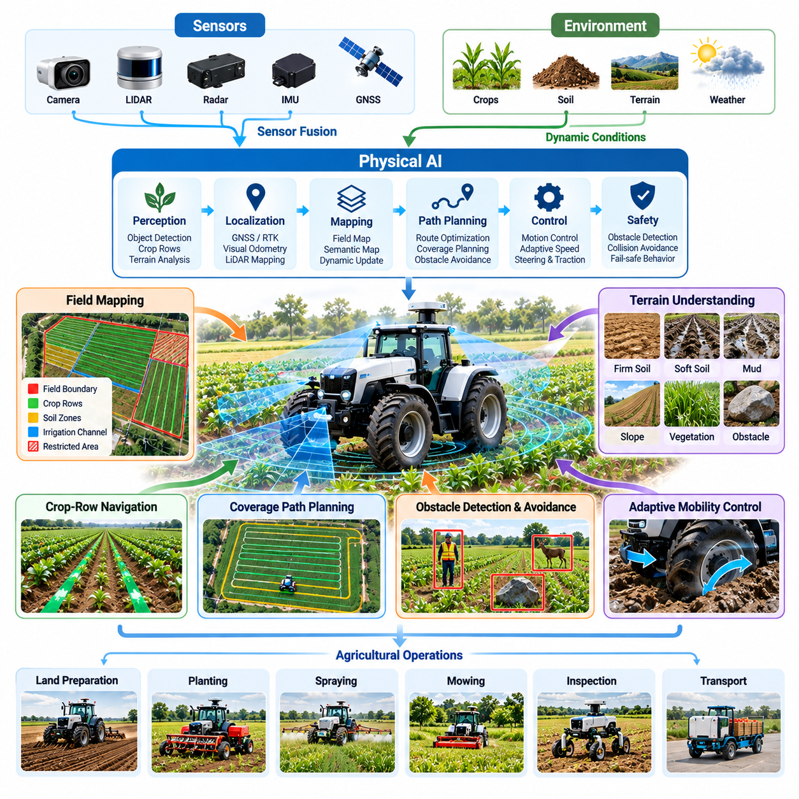{width="7.268055555555556in" height="7.268055555555556in"}

Autonomous field mobility refers to the ability of agricultural machines to navigate and operate across farmland without continuous human steering or direct control. Unlike autonomous mobility in structured factories, agricultural navigation must accommodate irregular terrain, changing soil conditions, vegetation, and uncertain boundaries. Physical AI combines environmental perception, localization, planning, and adaptive control to support reliable movement during agricultural operations.

Agricultural fields are highly variable operating environments where mobility performance depends on soil texture, moisture, slope, crop density, and weather conditions. A route that is traversable under dry conditions may become hazardous after rainfall. Autonomous machines must therefore continuously evaluate terrain accessibility rather than rely exclusively on predefined maps. This environmental adaptability distinguishes intelligent field mobility from conventional automated guidance.

The architecture of autonomous field mobility typically integrates sensing, localization, mapping, path planning, motion control, and safety supervision. Cameras, LiDAR, radar, inertial measurement units, and satellite positioning systems provide complementary observations. Sensor fusion combines these measurements to estimate vehicle position, orientation, surrounding obstacles, and terrain characteristics. The resulting environmental representation supports navigation decisions and vehicle control.

Localization is particularly important because agricultural robots frequently operate across large areas with limited artificial landmarks. Global Navigation Satellite Systems, including RTK-GNSS, can provide precise positioning when correction signals and satellite visibility are sufficient. However, tree canopies, terrain obstructions, and communication interruptions can degrade accuracy. Visual odometry, inertial navigation, and LiDAR-based localization provide complementary capabilities under challenging conditions.

Field mapping extends beyond representing geometric boundaries and obstacles. Agricultural navigation maps may include crop rows, irrigation channels, soil zones, slopes, access roads, and restricted areas. Semantic mapping associates these physical features with operational meaning, allowing robots to distinguish traversable corridors from sensitive crop regions. Dynamic map updates help maintain consistency between planned routes and actual field conditions.

Crop-row navigation is a fundamental capability for autonomous agricultural vehicles operating in orchards, vineyards, and row-crop fields. Robots must identify row geometry, maintain appropriate lateral alignment, and avoid damaging vegetation. Camera-based perception and LiDAR measurements can estimate corridor boundaries even when plant structures are irregular. Adaptive guidance algorithms compensate for row curvature, missing plants, and variations in spacing.

Terrain understanding is essential for preventing mobility failures caused by unstable ground or insufficient traction. Soil moisture, surface deformation, vegetation coverage, and wheel slip influence vehicle movement. Physical AI systems can estimate traversability using visual observations, geometric measurements, and vehicle response data. These estimates support decisions about speed, route selection, and whether particular terrain should be avoided.

Motion planning in agricultural environments must account for both navigation efficiency and agronomic constraints. The shortest route may not be suitable when it crosses planted areas, increases soil compaction, or violates machinery turning limitations. Intelligent planners consider field boundaries, crop-row structure, vehicle dimensions, turning radius, and implement configuration. Route optimization can reduce unnecessary travel while preserving crop integrity.

Coverage path planning is particularly important for agricultural tasks such as planting, spraying, mowing, and soil treatment. These operations require systematic traversal of designated areas with controlled overlap and minimal omission. Autonomous planners generate coverage patterns based on field geometry, implement width, and operational constraints. Effective coverage planning improves resource utilization while reducing repeated passes and unnecessary soil disturbance.

Vehicle dynamics significantly influence autonomous mobility because agricultural machines operate under variable loading and ground-contact conditions. Wheel slip, lateral drift, suspension movement, and changing payload distribution can affect tracking accuracy. Adaptive controllers adjust steering, propulsion, and operating speed according to estimated vehicle behavior. Model-based control and learning-based compensation can improve stability when environmental conditions differ from nominal assumptions.

Autonomous agricultural mobility must support different vehicle morphologies and propulsion configurations. Conventional tractors, compact wheeled robots, tracked platforms, and articulated vehicles exhibit different steering characteristics and terrain capabilities. Their navigation systems must incorporate vehicle-specific kinematics, dimensions, ground clearance, and traction limits. Physical AI provides a common perception and decision framework while allowing specialized control strategies.

Obstacle detection is essential because agricultural fields may contain workers, animals, equipment, fallen branches, rocks, and unexpected objects. Autonomous systems must identify obstacles and estimate whether they are stationary or moving. Perception models and tracking algorithms support collision avoidance through speed adjustment, stopping, or route modification. Safety-critical decisions require conservative behavior when object classification or environmental understanding is uncertain.

Weather and illumination create additional challenges for field perception and navigation. Strong sunlight, shadows, fog, rain, dust, and seasonal vegetation changes can reduce sensor reliability. Robust mobility systems combine complementary sensing modalities and monitor measurement confidence. When environmental conditions exceed validated operating limits, the robot should reduce speed, request assistance, or enter a safe operational state.

Field mobility also depends on effective interaction between navigation and agricultural implements. A tractor performing precision spraying must maintain a suitable trajectory while coordinating implement activation and application timing. Harvesting platforms must position themselves accurately relative to crop structures and robotic manipulators. Integrated planning considers vehicle motion, implement geometry, and task execution to achieve consistent agricultural performance.

Energy management becomes increasingly important as agricultural robots operate across large fields and remote locations. Battery-powered platforms must consider remaining energy, terrain resistance, travel distance, and charging accessibility. Autonomous scheduling can incorporate energy constraints into route planning and task allocation. For hybrid or combustion-powered machines, fuel consumption and operating efficiency similarly influence mission planning.

Multi-robot field mobility introduces coordination requirements when several autonomous machines share agricultural spaces. Robots must avoid conflicting routes, maintain safe separation, and coordinate access to narrow passages or service stations. Fleet management systems can distribute coverage areas and update assignments based on progress and machine availability. Shared localization and operational maps support coordinated movement without requiring continuous centralized control.

Simulation and digital twins provide useful environments for developing and evaluating autonomous agricultural mobility. Virtual fields can represent terrain geometry, crop layouts, obstacles, and vehicle dynamics. Developers can test navigation strategies across diverse operating conditions before physical deployment. However, soil deformation, vegetation interaction, and weather-dependent traction remain difficult to reproduce accurately, requiring extensive real-world validation.

Operational reliability depends on the ability to detect navigation failures and recover safely. Localization drift, blocked routes, wheel slip, sensor degradation, and communication loss can interrupt autonomous missions. Runtime monitoring identifies deviations between expected and observed behavior. Recovery strategies may include stopping, relocalization, route replanning, remote assistance, or controlled return to a designated safe location.

The economic value of autonomous field mobility depends on labor savings, equipment utilization, operational precision, and reduced downtime. Reliable navigation can extend operating hours and support more consistent agricultural workflows, provided safety and environmental conditions permit. However, sensor costs, positioning infrastructure, maintenance, supervision, and field preparation affect total ownership costs. Commercial adoption requires measurable improvements over conventional equipment operation.

Ultimately, autonomous field mobility provides the physical foundation for intelligent agricultural operations. Crop monitoring, precision treatment, harvesting, and field logistics all depend on reliable movement through complex outdoor environments. Advances in multimodal perception, terrain-aware planning, adaptive control, and fleet coordination will progressively expand agricultural autonomy. Successful systems must combine intelligent navigation with safety, operational robustness, and economically sustainable deployment.

자율 농경지 이동(Autonomous Field Mobility)은 농업 기계가 지속적인 인간의 조향이나 직접적인 제어 없이 농경지를 탐색하고 작업을 수행하는 능력을 의미한다. 구조화된 공장 환경의 자율 이동과 달리, 농업 내비게이션(Agricultural Navigation)은 불규칙한 지형, 변화하는 토양 상태, 식생, 불확실한 경계 조건에 대응해야 한다. 피지컬 인공지능(Physical AI)은 환경 인식(Environmental Perception), 위치 추정(Localization), 경로 계획(Planning), 적응형 제어(Adaptive Control)를 결합하여 농업 작업 중 신뢰할 수 있는 이동을 지원한다.

농경지(Agricultural Fields)는 토양의 질감(Soil Texture), 수분(Moisture), 경사(Slope), 작물 밀도(Crop Density), 기상 조건(Weather Conditions)에 따라 이동 성능이 달라지는 매우 가변적인 운영 환경이다. 건조한 조건에서 통과할 수 있는 경로도 강우 이후에는 위험해질 수 있다. 따라서 자율 기계(Autonomous Machines)는 사전에 정의된 지도에만 의존하지 않고 지형의 통과 가능성(Terrain Accessibility)을 지속적으로 평가해야 한다. 이러한 환경 적응성(Environmental Adaptability)은 지능형 농경지 이동을 기존 자동 유도(Automated Guidance) 기술과 구별하는 핵심 요소이다.

자율 농경지 이동의 아키텍처(Architecture)는 일반적으로 센싱(Sensing), 위치 추정(Localization), 지도 작성(Mapping), 경로 계획(Path Planning), 운동 제어(Motion Control), 안전 감독(Safety Supervision)을 통합한다. 카메라(Cameras), 라이다(LiDAR), 레이더(Radar), 관성 측정 장치(Inertial Measurement Units), 위성 위치 측정 시스템(Satellite Positioning Systems)은 상호 보완적인 관측 정보를 제공한다. 센서 융합(Sensor Fusion)은 이러한 측정값을 결합하여 차량의 위치, 자세, 주변 장애물, 지형 특성을 추정한다. 생성된 환경 표현(Environmental Representation)은 내비게이션 의사결정과 차량 제어를 지원한다.

위치 추정(Localization)은 농업 로봇이 인공적인 랜드마크(Artificial Landmarks)가 제한된 넓은 지역에서 자주 작동하기 때문에 특히 중요하다. 실시간 이동측위 기반 위성항법 시스템(RTK-GNSS)을 포함한 전 지구 위성항법 시스템(Global Navigation Satellite Systems)은 보정 신호(Correction Signals)와 위성 가시성(Satellite Visibility)이 충분할 때 정밀한 위치 정보를 제공할 수 있다. 그러나 나무 수관(Tree Canopies), 지형 장애물(Terrain Obstructions), 통신 중단(Communication Interruptions)은 정확도를 저하시킬 수 있다. 시각적 주행거리 추정(Visual Odometry), 관성 항법(Inertial Navigation), 라이다 기반 위치 추정(LiDAR-Based Localization)은 어려운 조건에서 상호 보완적인 기능을 제공한다.

농경지 지도 작성(Field Mapping)은 기하학적 경계(Geometric Boundaries)와 장애물을 표현하는 수준을 넘어선다. 농업 내비게이션 지도(Agricultural Navigation Maps)에는 작물 재배열(Crop Rows), 관개 수로(Irrigation Channels), 토양 구역(Soil Zones), 경사면(Slopes), 진입 도로(Access Roads), 제한 구역(Restricted Areas)이 포함될 수 있다. 의미론적 지도 작성(Semantic Mapping)은 이러한 물리적 특징에 운영상 의미를 부여하여 로봇이 통과 가능한 이동 통로(Traversable Corridors)와 보호해야 할 작물 구역(Sensitive Crop Regions)을 구분하도록 한다. 동적 지도 갱신(Dynamic Map Updates)은 계획된 경로와 실제 농경지 상태 사이의 일관성을 유지하는 데 기여한다.

작물 재배열 추종 주행(Crop-Row Navigation)은 과수원(Orchards), 포도원(Vineyards), 줄뿌림 작물 재배지(Row-Crop Fields)에서 작동하는 자율 농업 차량의 기본 기능이다. 로봇은 재배열의 기하학적 구조(Row Geometry)를 식별하고 적절한 횡방향 정렬(Lateral Alignment)을 유지하며 식생 손상을 방지해야 한다. 카메라 기반 인식(Camera-Based Perception)과 라이다 측정(LiDAR Measurements)은 식물 구조가 불규칙한 경우에도 이동 통로의 경계(Corridor Boundaries)를 추정할 수 있다. 적응형 유도 알고리즘(Adaptive Guidance Algorithms)은 재배열의 곡률(Row Curvature), 식물 누락(Missing Plants), 재배 간격 변화(Spacing Variations)를 보정한다.

지형 이해(Terrain Understanding)는 불안정한 지면이나 부족한 견인력(Insufficient Traction)으로 발생하는 이동 실패를 방지하는 데 필수적이다. 토양 수분(Soil Moisture), 표면 변형(Surface Deformation), 식생 피복(Vegetation Coverage), 바퀴 미끄러짐(Wheel Slip)은 차량 이동에 영향을 미친다. 피지컬 인공지능 시스템은 시각적 관측(Visual Observations), 기하학적 측정(Geometric Measurements), 차량 반응 데이터(Vehicle Response Data)를 활용하여 지형 통과 가능성(Traversability)을 추정할 수 있다. 이러한 추정 결과는 주행 속도, 경로 선택, 특정 지형의 회피 여부에 관한 의사결정을 지원한다.

농업 환경의 운동 계획(Motion Planning)은 내비게이션 효율성(Navigation Efficiency)과 농업적 제약조건(Agronomic Constraints)을 동시에 고려해야 한다. 최단 경로(Shortest Route)가 작물 재배 구역을 가로지르거나 토양 다짐(Soil Compaction)을 증가시키거나 농기계의 회전 제한(Turning Limitations)을 위반한다면 적절하지 않을 수 있다. 지능형 경로 계획기(Intelligent Planners)는 농경지 경계(Field Boundaries), 재배열 구조(Crop-Row Structure), 차량 치수(Vehicle Dimensions), 회전 반경(Turning Radius), 작업 장치 구성(Implement Configuration)을 고려한다. 경로 최적화(Route Optimization)는 작물의 건전성을 유지하면서 불필요한 이동을 줄일 수 있다.

영역 커버리지 경로 계획(Coverage Path Planning)은 파종(Planting), 살포(Spraying), 제초(Mowing), 토양 처리(Soil Treatment)와 같은 농업 작업에서 특히 중요하다. 이러한 작업은 지정된 영역을 체계적으로 이동하면서 중복 작업(Overlap)을 제어하고 누락(Omission)을 최소화해야 한다. 자율 경로 계획기(Autonomous Planners)는 농경지 형상(Field Geometry), 작업 장치 폭(Implement Width), 운영 제약조건(Operational Constraints)을 기반으로 영역 커버리지 패턴(Coverage Patterns)을 생성한다. 효과적인 커버리지 경로 계획은 반복 주행(Repeated Passes)과 불필요한 토양 교란(Soil Disturbance)을 줄이면서 자원 활용 효율성(Resource Utilization)을 향상시킨다.

차량 동역학(Vehicle Dynamics)은 농업 기계가 가변적인 적재 조건(Variable Loading Conditions)과 지면 접촉 조건(Ground-Contact Conditions)에서 작동하기 때문에 자율 이동에 상당한 영향을 미친다. 바퀴 미끄러짐(Wheel Slip), 횡방향 편차(Lateral Drift), 서스펜션 움직임(Suspension Movement), 적재하중 분포 변화(Payload Distribution Changes)는 경로 추종 정확도(Tracking Accuracy)에 영향을 줄 수 있다. 적응형 제어기(Adaptive Controllers)는 추정된 차량 거동(Vehicle Behavior)에 따라 조향(Steering), 추진력(Propulsion), 주행 속도(Operating Speed)를 조정한다. 모델 기반 제어(Model-Based Control)와 학습 기반 보상(Learning-Based Compensation)은 환경 조건이 기준 가정(Nominal Assumptions)과 다를 때 안정성을 개선할 수 있다.

자율 농업 이동(Autonomous Agricultural Mobility)은 다양한 차량 형태(Vehicle Morphologies)와 추진 구성(Propulsion Configurations)을 지원해야 한다. 기존 트랙터(Conventional Tractors), 소형 바퀴형 로봇(Compact Wheeled Robots), 궤도형 플랫폼(Tracked Platforms), 굴절식 차량(Articulated Vehicles)은 서로 다른 조향 특성(Steering Characteristics)과 지형 이동 능력(Terrain Capabilities)을 가진다. 각 내비게이션 시스템은 차량별 운동학(Vehicle-Specific Kinematics), 치수(Dimensions), 지상고(Ground Clearance), 견인력 한계(Traction Limits)를 반영해야 한다. 피지컬 인공지능은 공통 인식 및 의사결정 프레임워크(Common Perception and Decision Framework)를 제공하면서 특화된 제어 전략(Specialized Control Strategies)을 허용한다.

장애물 감지(Obstacle Detection)는 농경지에 작업자(Workers), 동물(Animals), 장비(Equipment), 떨어진 나뭇가지(Fallen Branches), 암석(Rocks), 예상하지 못한 물체(Unexpected Objects)가 존재할 수 있기 때문에 필수적이다. 자율 시스템은 장애물을 식별하고 정지 상태인지 이동 중인지 추정해야 한다. 인식 모델(Perception Models)과 추적 알고리즘(Tracking Algorithms)은 속도 조절(Speed Adjustment), 정지(Stopping), 경로 수정(Route Modification)을 통한 충돌 회피(Collision Avoidance)를 지원한다. 안전 필수 의사결정(Safety-Critical Decisions)은 객체 분류(Object Classification)나 환경 이해가 불확실할 때 보수적인 동작(Conservative Behavior)을 요구한다.

기상(Weather)과 조명(Illumination)은 농경지 인식 및 내비게이션에 추가적인 어려움을 발생시킨다. 강한 햇빛(Strong Sunlight), 그림자(Shadows), 안개(Fog), 비(Rain), 먼지(Dust), 계절적 식생 변화(Seasonal Vegetation Changes)는 센서 신뢰성(Sensor Reliability)을 저하시킬 수 있다. 견고한 이동 시스템(Robust Mobility Systems)은 상호 보완적인 센싱 방식(Complementary Sensing Modalities)을 결합하고 측정 신뢰도(Measurement Confidence)를 모니터링한다. 환경 조건이 검증된 운영 한계(Validated Operating Limits)를 초과하면 로봇은 속도를 줄이거나 지원을 요청하거나 안전 운영 상태(Safe Operational State)로 전환해야 한다.

농경지 이동(Field Mobility)은 내비게이션과 농업 작업 장치(Agricultural Implements) 사이의 효과적인 상호작용에도 의존한다. 정밀 살포(Precision Spraying)를 수행하는 트랙터는 작업 장치의 작동(Implement Activation)과 살포 시점(Application Timing)을 조정하면서 적절한 주행 궤적(Trajectory)을 유지해야 한다. 수확 플랫폼(Harvesting Platforms)은 작물 구조(Crop Structures)와 로봇 매니퓰레이터(Robotic Manipulators)에 대해 정확한 위치를 확보해야 한다. 통합 계획(Integrated Planning)은 차량 움직임(Vehicle Motion), 작업 장치 형상(Implement Geometry), 작업 실행(Task Execution)을 함께 고려하여 일관된 농업 작업 성능(Agricultural Performance)을 달성한다.

에너지 관리(Energy Management)는 농업 로봇이 넓은 농경지와 원격 지역(Remote Locations)에서 작동함에 따라 더욱 중요해진다. 배터리 구동 플랫폼(Battery-Powered Platforms)은 잔여 에너지(Remaining Energy), 지형 저항(Terrain Resistance), 이동 거리(Travel Distance), 충전 접근성(Charging Accessibility)을 고려해야 한다. 자율 일정 계획(Autonomous Scheduling)은 에너지 제약조건(Energy Constraints)을 경로 계획과 작업 할당(Task Allocation)에 반영할 수 있다. 하이브리드 또는 내연기관 기반 기계(Hybrid or Combustion-Powered Machines)의 경우에도 연료 소비(Fuel Consumption)와 운영 효율성(Operating Efficiency)이 임무 계획(Mission Planning)에 영향을 미친다.

다중 로봇 농경지 이동(Multi-Robot Field Mobility)은 여러 자율 기계가 농업 공간을 공유할 때 협업 조정 요구사항(Coordination Requirements)을 발생시킨다. 로봇은 경로 충돌(Conflicting Routes)을 방지하고 안전거리(Safe Separation)를 유지하며 좁은 통로(Narrow Passages)나 서비스 스테이션(Service Stations)에 대한 접근을 조정해야 한다. 군집 관리 시스템(Fleet Management Systems)은 작업 영역(Coverage Areas)을 분배하고 진행 상황과 기계 가용성(Machine Availability)에 따라 작업 할당을 갱신할 수 있다. 공유 위치 정보(Shared Localization)와 운영 지도(Operational Maps)는 지속적인 중앙집중식 제어(Continuous Centralized Control) 없이 협업 이동을 지원한다.

시뮬레이션(Simulation)과 디지털 트윈(Digital Twins)은 자율 농업 이동을 개발하고 평가하기 위한 유용한 환경을 제공한다. 가상 농경지(Virtual Fields)는 지형 형상(Terrain Geometry), 작물 배치(Crop Layouts), 장애물(Obstacles), 차량 동역학(Vehicle Dynamics)을 표현할 수 있다. 개발자는 실제 배포(Physical Deployment)에 앞서 다양한 운영 조건에서 내비게이션 전략(Navigation Strategies)을 시험할 수 있다. 그러나 토양 변형(Soil Deformation), 식생 상호작용(Vegetation Interaction), 기상 조건에 따른 견인력(Weather-Dependent Traction)은 정확한 재현이 어렵기 때문에 광범위한 실제 환경 검증(Real-World Validation)이 필요하다.

운영 신뢰성(Operational Reliability)은 내비게이션 실패(Navigation Failures)를 감지하고 안전하게 복구하는 능력에 달려 있다. 위치 추정 드리프트(Localization Drift), 차단된 경로(Blocked Routes), 바퀴 미끄러짐(Wheel Slip), 센서 성능 저하(Sensor Degradation), 통신 손실(Communication Loss)은 자율 임무(Autonomous Missions)를 중단시킬 수 있다. 실행 중 모니터링(Runtime Monitoring)은 예상된 거동(Expected Behavior)과 관측된 거동(Observed Behavior) 사이의 편차를 식별한다. 복구 전략(Recovery Strategies)에는 정지, 위치 재추정(Relocalization), 경로 재계획(Route Replanning), 원격 지원(Remote Assistance), 지정된 안전 위치로의 제어된 복귀(Controlled Return)가 포함될 수 있다.

자율 농경지 이동의 경제적 가치(Economic Value)는 노동비 절감(Labor Savings), 장비 활용률(Equipment Utilization), 작업 정밀도(Operational Precision), 가동 중단시간 감소(Reduced Downtime)에 따라 결정된다. 신뢰할 수 있는 내비게이션은 안전성과 환경 조건이 허용하는 범위에서 운영 시간을 연장하고 더욱 일관된 농업 작업흐름(Agricultural Workflows)을 지원할 수 있다. 그러나 센서 비용(Sensor Costs), 위치 측정 기반시설(Positioning Infrastructure), 유지보수(Maintenance), 감독(Supervision), 농경지 준비(Field Preparation)는 총소유비용(Total Cost of Ownership)에 영향을 미친다. 상업적 도입(Commercial Adoption)을 위해서는 기존 장비 운영 대비 측정 가능한 개선 효과(Measurable Improvements)가 필요하다.

궁극적으로 자율 농경지 이동(Autonomous Field Mobility)은 지능형 농업 운영(Intelligent Agricultural Operations)을 위한 물리적 기반(Physical Foundation)을 제공한다. 작물 모니터링(Crop Monitoring), 정밀 처리(Precision Treatment), 수확(Harvesting), 농경지 물류(Field Logistics)는 모두 복잡한 야외 환경(Complex Outdoor Environments)에서의 신뢰할 수 있는 이동에 의존한다. 다중모달 인식(Multimodal Perception), 지형 인지 경로 계획(Terrain-Aware Planning), 적응형 제어(Adaptive Control), 군집 조정(Fleet Coordination)의 발전은 농업 자율성(Agricultural Autonomy)의 적용 범위를 점진적으로 확대할 것이다. 성공적인 시스템은 지능형 내비게이션(Intelligent Navigation)을 안전성, 운영 견고성(Operational Robustness), 경제적으로 지속 가능한 배포(Economically Sustainable Deployment)와 결합해야 한다.

##  

## 05.03. Crop Scouting and Field Monitoring

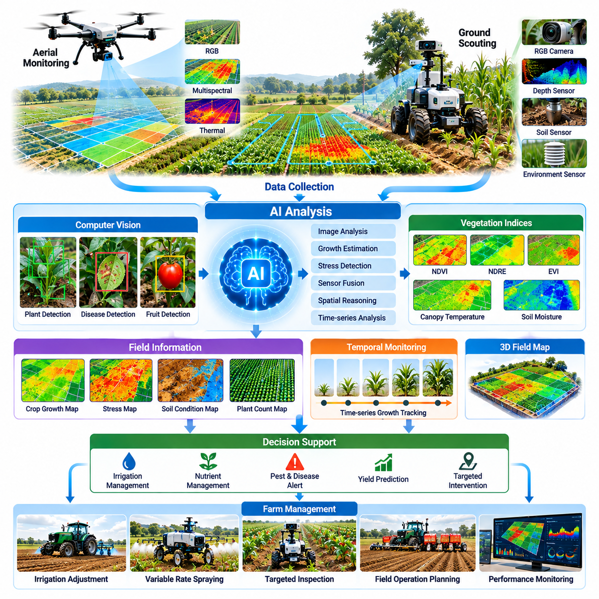{width="7.268055555555556in" height="7.268055555555556in"}

Crop scouting and field monitoring represent essential applications of Physical AI in agriculture, enabling continuous observation and intelligent assessment of crop conditions throughout the growing season. Traditional scouting depends on periodic human inspections, which may overlook localized problems or rapidly developing changes. Autonomous robots and intelligent sensing platforms provide systematic data collection, allowing farmers to identify emerging issues and make timely management decisions.

Agricultural monitoring requires understanding the complex relationships among crop growth, soil conditions, weather, irrigation, nutrients, pests, and diseases. These factors vary across locations and change throughout the production cycle. Physical AI combines mobile sensing, environmental interpretation, and spatial reasoning to transform raw field observations into actionable information. The objective is to support decisions that improve productivity, resource efficiency, and crop health.

Autonomous ground robots provide close-range observations that complement conventional field inspections. Equipped with cameras, depth sensors, environmental instruments, and positioning systems, these platforms navigate between crop rows while collecting detailed measurements. Their proximity to plants enables inspection of leaves, stems, fruits, and soil surfaces that may be difficult to observe from above. Repeated missions provide consistent records of crop development.

Aerial monitoring platforms extend agricultural observation across large geographic areas. Drones equipped with RGB, multispectral, or thermal cameras can collect imagery for assessing vegetation patterns, canopy temperature, and spatial variability. Aerial observations are particularly useful for identifying regions requiring closer investigation. Combining drone surveys with ground-based robotic inspection connects broad-area monitoring with detailed plant-level assessment.

Sensor selection depends on the biological characteristics of crops and the monitoring objectives. RGB cameras capture visible appearance, while multispectral sensors measure reflectance across selected wavelength bands. Thermal cameras estimate surface temperature, and soil sensors measure moisture or other environmental properties. Integrating complementary measurements improves the interpretation of crop conditions, although sensor calibration and environmental context remain essential.

Computer vision enables agricultural robots to identify plants, distinguish crop structures, and detect visible abnormalities. Object detection, semantic segmentation, and instance segmentation can locate individual plants, leaves, fruits, and suspected damaged regions. Deep learning models extract patterns from agricultural imagery, supporting automated assessment of crop development. Performance depends on representative training data and robustness to field variability.

Crop growth monitoring involves estimating plant height, canopy coverage, leaf area, growth stage, and population density. These indicators help characterize crop development and identify differences across production areas. Three-dimensional reconstruction and depth sensing can provide geometric measurements, while repeated visual observations reveal temporal changes. Reliable growth estimation requires consistent measurement procedures and consideration of crop-specific characteristics.

Vegetation indices provide useful indicators of plant reflectance patterns and potential physiological changes. The Normalized Difference Vegetation Index, for example, compares near-infrared and red reflectance to characterize vegetation response. However, index values may be influenced by soil background, illumination, canopy structure, and growth stage. Physical AI systems should interpret these measurements alongside environmental information rather than treat them as definitive diagnoses.

Early detection of crop stress is a major objective of intelligent field monitoring. Water limitations, nutrient imbalance, disease, pest activity, and temperature extremes may produce overlapping visual symptoms. AI models can identify abnormal patterns and prioritize suspicious regions for further inspection. Nevertheless, reliable diagnosis often requires additional measurements, agronomic knowledge, or laboratory confirmation to distinguish among possible causes.

Soil and irrigation monitoring connect crop observations with the environmental conditions influencing plant development. Mobile sensing platforms can collect measurements of soil moisture, temperature, and selected chemical properties. These observations may be combined with fixed sensor networks and irrigation records to estimate spatial variability. Intelligent monitoring supports more targeted water management while recognizing uncertainty in sensor coverage and soil conditions.

Georeferenced field monitoring transforms isolated observations into spatially organized agricultural information. GNSS positioning, visual localization, and mapping algorithms associate measurements with specific field locations. Geographic information systems can then represent crop conditions, detected anomalies, and inspection histories. Accurate spatial registration is important because positioning errors may cause observations to be assigned to incorrect plants or management zones.

Temporal monitoring adds another dimension by tracking changes across repeated observation cycles. Comparing measurements over time can reveal growth trends, emerging stress, and responses to agricultural interventions. Time-series analysis must account for seasonal development, changing illumination, sensor differences, and observation intervals. Physical AI can use historical context to distinguish persistent abnormalities from temporary environmental fluctuations.

Autonomous scouting missions require intelligent navigation and task planning. Robots must determine which areas to inspect, select accessible routes, and allocate sensing time according to monitoring priorities. Adaptive mission planning can increase inspection frequency in regions showing unusual conditions. This approach improves information collection efficiency compared with repeatedly surveying every location at the same resolution.

Active perception allows monitoring robots to adjust their sensing behavior according to uncertainty and task requirements. A robot may approach a suspicious plant, change its viewing angle, or collect additional measurements before making an assessment. This interaction between perception and physical movement distinguishes embodied agricultural monitoring from passive image analysis. The resulting observations can improve confidence while reducing unnecessary data collection.

Data quality management is essential because agricultural observations are affected by motion blur, occlusion, lighting variation, dust, and sensor degradation. Automated pipelines can evaluate image quality, detect missing measurements, and identify inconsistent timestamps or locations. Calibration records and metadata help preserve measurement reliability. Poor-quality observations should be flagged rather than silently incorporated into crop condition estimates.

Field monitoring data can support machine learning systems that improve through repeated agricultural operations. Human-verified observations, confirmed disease cases, and treatment outcomes provide valuable supervision for model development. Data curation must preserve variation across crop varieties, growth stages, seasons, and geographic regions. Models trained on narrow datasets may perform poorly when deployed under unfamiliar agricultural conditions.

Edge computing enables agricultural robots to process selected observations directly in the field. Onboard inference can identify obstacles, detect anomalies, and trigger additional inspection without continuous network connectivity. Cloud platforms can support large-scale analysis, historical storage, and model updates when communication is available. Effective architectures balance computational requirements, energy consumption, communication limitations, and operational latency.

Integration with farm management systems converts monitoring results into practical agricultural workflows. Detected anomalies can generate inspection requests, treatment recommendations, or prioritized work orders. Digital twins may combine crop observations with field geometry, weather records, and equipment activities. However, automated recommendations should include confidence estimates and remain subject to appropriate agronomic validation before physical intervention.

The economic value of crop scouting depends on monitoring coverage, inspection frequency, detection accuracy, and the usefulness of resulting decisions. Automated observation can reduce repetitive inspection labor and potentially limit losses through earlier intervention. However, equipment costs, data processing, maintenance, and false alarms influence overall value. Benefits should be evaluated against measurable improvements in crop outcomes and operational efficiency.

Ultimately, crop scouting and field monitoring establish an information foundation for intelligent agricultural automation. Reliable observations support precision treatment, autonomous harvesting, irrigation management, and coordinated farm operations. Physical AI transforms monitoring from periodic visual inspection into a continuous process of sensing, interpretation, and targeted action. Its long-term success depends on trustworthy data, robust autonomy, agronomic relevance, and demonstrable economic value.

작물 정찰(Crop Scouting)과 농경지 모니터링(Field Monitoring)은 농업 분야 피지컬 인공지능(Physical AI)의 핵심 응용 분야로, 재배 기간(Growing Season) 전반에 걸쳐 작물 상태를 지속적으로 관찰하고 지능적으로 평가할 수 있도록 한다. 기존의 작물 정찰은 주기적인 인력 점검(Human Inspections)에 의존하기 때문에 국소적인 문제나 빠르게 진행되는 변화를 놓칠 수 있다. 자율 로봇(Autonomous Robots)과 지능형 센싱 플랫폼(Intelligent Sensing Platforms)은 체계적인 데이터 수집(Systematic Data Collection)을 제공하여 농업 생산자가 발생 초기의 문제를 식별하고 적시에 관리 의사결정(Management Decisions)을 수행하도록 지원한다.

농업 모니터링(Agricultural Monitoring)은 작물 성장(Crop Growth), 토양 상태(Soil Conditions), 기상(Weather), 관개(Irrigation), 영양분(Nutrients), 해충(Pests), 질병(Diseases) 사이의 복잡한 관계를 이해해야 한다. 이러한 요소는 위치에 따라 달라지고 생산 주기(Production Cycle) 전반에 걸쳐 변화한다. 피지컬 인공지능은 이동형 센싱(Mobile Sensing), 환경 해석(Environmental Interpretation), 공간 추론(Spatial Reasoning)을 결합하여 원시 농경지 관측 데이터(Raw Field Observations)를 실행 가능한 정보(Actionable Information)로 변환한다. 그 목적은 생산성(Productivity), 자원 효율성(Resource Efficiency), 작물 건강(Crop Health)을 향상시키는 의사결정을 지원하는 것이다.

자율 지상 로봇(Autonomous Ground Robots)은 기존 농경지 점검(Field Inspections)을 보완하는 근거리 관측(Close-Range Observations)을 제공한다. 카메라(Cameras), 깊이 센서(Depth Sensors), 환경 측정 장치(Environmental Instruments), 위치 측정 시스템(Positioning Systems)을 장착한 플랫폼은 작물 재배열(Crop Rows) 사이를 이동하면서 상세한 측정 데이터를 수집한다. 식물에 가까이 접근할 수 있기 때문에 상공에서는 관측하기 어려운 잎(Leaves), 줄기(Stems), 과실(Fruits), 토양 표면(Soil Surfaces)을 점검할 수 있다. 반복적인 임무 수행(Repeated Missions)은 작물 발달(Crop Development)에 대한 일관된 기록을 제공한다.

항공 모니터링 플랫폼(Aerial Monitoring Platforms)은 넓은 지리적 영역에 대한 농업 관측 범위를 확장한다. RGB 카메라(RGB Cameras), 다중분광 카메라(Multispectral Cameras), 열화상 카메라(Thermal Cameras)를 장착한 드론(Drones)은 식생 패턴(Vegetation Patterns), 수관 온도(Canopy Temperature), 공간적 변동성(Spatial Variability)을 평가하기 위한 영상을 수집할 수 있다. 항공 관측(Aerial Observations)은 더욱 정밀한 조사가 필요한 지역을 식별하는 데 특히 유용하다. 드론 조사(Drone Surveys)와 지상 로봇 점검(Ground-Based Robotic Inspection)을 결합하면 광역 모니터링(Broad-Area Monitoring)과 개별 식물 수준 평가(Plant-Level Assessment)를 연결할 수 있다.

센서 선택(Sensor Selection)은 작물의 생물학적 특성(Biological Characteristics)과 모니터링 목표(Monitoring Objectives)에 따라 결정된다. RGB 카메라는 가시적인 외형(Visible Appearance)을 촬영하며, 다중분광 센서(Multispectral Sensors)는 선택된 파장대(Wavelength Bands)의 반사율(Reflectance)을 측정한다. 열화상 카메라는 표면 온도(Surface Temperature)를 추정하고, 토양 센서(Soil Sensors)는 수분이나 기타 환경 특성(Environmental Properties)을 측정한다. 상호 보완적인 측정값을 통합하면 작물 상태 해석의 정확도를 높일 수 있지만, 센서 보정(Sensor Calibration)과 환경적 맥락(Environmental Context)은 여전히 필수적이다.

컴퓨터 비전(Computer Vision)은 농업 로봇이 식물을 식별하고 작물 구조(Crop Structures)를 구분하며 가시적인 이상 징후(Visible Abnormalities)를 감지하도록 한다. 객체 탐지(Object Detection), 의미론적 분할(Semantic Segmentation), 인스턴스 분할(Instance Segmentation)은 개별 식물, 잎, 과실, 손상이 의심되는 영역(Suspected Damaged Regions)의 위치를 파악할 수 있다. 딥러닝 모델(Deep Learning Models)은 농업 영상(Agricultural Imagery)에서 특징적인 패턴을 추출하여 작물 발달의 자동 평가(Automated Assessment)를 지원한다. 성능은 대표성 있는 학습 데이터(Representative Training Data)와 농경지 변동성(Field Variability)에 대한 견고성(Robustness)에 따라 달라진다.

작물 성장 모니터링(Crop Growth Monitoring)은 식물 높이(Plant Height), 수관 피복률(Canopy Coverage), 잎 면적(Leaf Area), 생육 단계(Growth Stage), 개체 밀도(Population Density)를 추정하는 과정을 포함한다. 이러한 지표(Indicators)는 작물 발달을 특성화하고 생산 지역 간 차이를 식별하는 데 도움이 된다. 3차원 재구성(Three-Dimensional Reconstruction)과 깊이 센싱(Depth Sensing)은 기하학적 측정값(Geometric Measurements)을 제공할 수 있으며, 반복적인 시각 관측(Visual Observations)은 시간에 따른 변화를 보여준다. 신뢰할 수 있는 성장 추정(Growth Estimation)을 위해서는 일관된 측정 절차(Measurement Procedures)와 작물별 특성(Crop-Specific Characteristics)에 대한 고려가 필요하다.

식생지수(Vegetation Indices)는 식물 반사율 패턴(Plant Reflectance Patterns)과 잠재적인 생리적 변화(Physiological Changes)를 나타내는 유용한 지표를 제공한다. 예를 들어 정규식생지수(Normalized Difference Vegetation Index, NDVI)는 근적외선(Near-Infrared)과 적색광(Red) 반사율을 비교하여 식생 반응(Vegetation Response)을 특성화한다. 그러나 지수 값(Index Values)은 토양 배경(Soil Background), 조명(Illumination), 수관 구조(Canopy Structure), 생육 단계(Growth Stage)의 영향을 받을 수 있다. 피지컬 인공지능 시스템은 이러한 측정값을 확정적인 진단(Definitive Diagnoses)으로 취급하기보다 환경 정보(Environmental Information)와 함께 해석해야 한다.

작물 스트레스(Crop Stress)의 조기 감지(Early Detection)는 지능형 농경지 모니터링(Intelligent Field Monitoring)의 주요 목표이다. 수분 부족(Water Limitations), 영양 불균형(Nutrient Imbalance), 질병(Disease), 해충 활동(Pest Activity), 극한 온도(Temperature Extremes)는 서로 중첩되는 시각적 증상(Overlapping Visual Symptoms)을 나타낼 수 있다. 인공지능 모델(AI Models)은 비정상적인 패턴(Abnormal Patterns)을 식별하고 추가 점검이 필요한 의심 지역(Suspicious Regions)의 우선순위를 결정할 수 있다. 그러나 신뢰할 수 있는 진단(Reliable Diagnosis)을 위해서는 가능한 원인을 구분할 수 있는 추가 측정(Additional Measurements), 농학적 지식(Agronomic Knowledge), 실험실 확인(Laboratory Confirmation)이 필요한 경우가 많다.

토양 및 관개 모니터링(Soil and Irrigation Monitoring)은 작물 관측(Crop Observations)을 식물 발달에 영향을 미치는 환경 조건(Environmental Conditions)과 연결한다. 이동형 센싱 플랫폼(Mobile Sensing Platforms)은 토양 수분(Soil Moisture), 온도(Temperature), 선택된 화학적 특성(Chemical Properties)에 대한 측정값을 수집할 수 있다. 이러한 관측값은 고정형 센서 네트워크(Fixed Sensor Networks)와 관개 기록(Irrigation Records)을 결합하여 공간적 변동성(Spatial Variability)을 추정하는 데 활용될 수 있다. 지능형 모니터링(Intelligent Monitoring)은 센서 관측 범위(Sensor Coverage)와 토양 조건의 불확실성(Uncertainty)을 고려하면서 더욱 정밀한 수자원 관리(Targeted Water Management)를 지원한다.

지리참조 기반 농경지 모니터링(Georeferenced Field Monitoring)은 개별 관측값을 공간적으로 구성된 농업 정보(Spatially Organized Agricultural Information)로 변환한다. 위성항법 시스템 위치 측정(GNSS Positioning), 시각적 위치 추정(Visual Localization), 지도 작성 알고리즘(Mapping Algorithms)은 측정값을 특정 농경지 위치(Field Locations)와 연결한다. 이후 지리정보시스템(Geographic Information Systems, GIS)은 작물 상태(Crop Conditions), 감지된 이상 징후(Detected Anomalies), 점검 이력(Inspection Histories)을 표현할 수 있다. 정확한 공간 정합(Spatial Registration)은 위치 오차(Positioning Errors)로 인해 관측값이 잘못된 식물이나 관리 구역(Management Zones)에 할당되는 문제를 방지하기 때문에 중요하다.

시간적 모니터링(Temporal Monitoring)은 반복적인 관측 주기(Observation Cycles)에 걸친 변화를 추적함으로써 추가적인 분석 차원을 제공한다. 시간에 따른 측정값 비교는 성장 추세(Growth Trends), 발생 초기의 스트레스(Emerging Stress), 농업적 개입(Agricultural Interventions)에 대한 반응을 보여줄 수 있다. 시계열 분석(Time-Series Analysis)은 계절적 발달(Seasonal Development), 변화하는 조명(Changing Illumination), 센서 차이(Sensor Differences), 관측 간격(Observation Intervals)을 고려해야 한다. 피지컬 인공지능은 과거 맥락(Historical Context)을 활용하여 지속적인 이상 징후(Persistent Abnormalities)와 일시적인 환경 변동(Temporary Environmental Fluctuations)을 구분할 수 있다.

자율 작물 정찰 임무(Autonomous Scouting Missions)는 지능형 내비게이션(Intelligent Navigation)과 작업 계획(Task Planning)을 요구한다. 로봇은 점검할 지역을 결정하고 접근 가능한 경로(Accessible Routes)를 선택하며 모니터링 우선순위(Monitoring Priorities)에 따라 센싱 시간(Sensing Time)을 배분해야 한다. 적응형 임무 계획(Adaptive Mission Planning)은 비정상적인 상태를 보이는 지역의 점검 빈도(Inspection Frequency)를 높일 수 있다. 이러한 접근법은 모든 위치를 동일한 해상도(Resolution)로 반복 조사하는 방식보다 정보 수집 효율성(Information Collection Efficiency)을 향상시킨다.

능동 인식(Active Perception)은 모니터링 로봇이 불확실성(Uncertainty)과 작업 요구사항(Task Requirements)에 따라 센싱 동작(Sensing Behavior)을 조정할 수 있도록 한다. 로봇은 의심되는 식물에 접근하거나 관측 각도(Viewing Angle)를 변경하거나 평가 전에 추가 측정값을 수집할 수 있다. 인식(Perception)과 물리적 이동(Physical Movement) 사이의 이러한 상호작용은 체화된 농업 모니터링(Embodied Agricultural Monitoring)을 수동적 영상 분석(Passive Image Analysis)과 구별한다. 그 결과로 얻은 관측값은 불필요한 데이터 수집을 줄이면서 판단 신뢰도(Confidence)를 향상시킬 수 있다.

데이터 품질 관리(Data Quality Management)는 농업 관측이 모션 블러(Motion Blur), 가림(Occlusion), 조명 변화(Lighting Variation), 먼지(Dust), 센서 성능 저하(Sensor Degradation)의 영향을 받기 때문에 필수적이다. 자동화된 파이프라인(Automated Pipelines)은 영상 품질(Image Quality)을 평가하고 누락된 측정값(Missing Measurements)을 감지하며 일관되지 않은 타임스탬프(Timestamps)나 위치 정보를 식별할 수 있다. 보정 기록(Calibration Records)과 메타데이터(Metadata)는 측정 신뢰성(Measurement Reliability)을 유지하는 데 도움이 된다. 품질이 낮은 관측값(Poor-Quality Observations)은 별도 표시 없이 작물 상태 추정(Crop Condition Estimates)에 포함하기보다 품질 문제를 명시해야 한다.

농경지 모니터링 데이터(Field Monitoring Data)는 반복적인 농업 운영을 통해 성능을 개선하는 머신러닝 시스템(Machine Learning Systems)을 지원할 수 있다. 사람이 검증한 관측값(Human-Verified Observations), 확인된 질병 사례(Confirmed Disease Cases), 처리 결과(Treatment Outcomes)는 모델 개발(Model Development)에 중요한 지도 정보(Supervision)를 제공한다. 데이터 큐레이션(Data Curation)은 작물 품종(Crop Varieties), 생육 단계(Growth Stages), 계절(Seasons), 지리적 지역(Geographic Regions)에 걸친 다양성을 보존해야 한다. 제한적인 데이터셋(Narrow Datasets)으로 학습된 모델은 익숙하지 않은 농업 조건(Unfamiliar Agricultural Conditions)에 배포될 경우 성능이 저하될 수 있다.

엣지 컴퓨팅(Edge Computing)은 농업 로봇이 선택된 관측 데이터를 현장에서 직접 처리할 수 있도록 한다. 온보드 추론(Onboard Inference)은 지속적인 네트워크 연결(Network Connectivity) 없이도 장애물을 식별하고 이상 징후를 감지하며 추가 점검을 실행할 수 있다. 클라우드 플랫폼(Cloud Platforms)은 통신이 가능한 경우 대규모 분석(Large-Scale Analysis), 이력 데이터 저장(Historical Storage), 모델 업데이트(Model Updates)를 지원할 수 있다. 효과적인 아키텍처(Effective Architectures)는 연산 요구사항(Computational Requirements), 에너지 소비(Energy Consumption), 통신 제약조건(Communication Limitations), 운영 지연시간(Operational Latency) 사이의 균형을 고려해야 한다.

농장 관리 시스템(Farm Management Systems)과의 통합은 모니터링 결과를 실제 농업 작업흐름(Practical Agricultural Workflows)으로 전환한다. 감지된 이상 징후(Detected Anomalies)는 점검 요청(Inspection Requests), 처리 권고(Treatment Recommendations), 우선순위가 지정된 작업 지시(Prioritized Work Orders)를 생성할 수 있다. 디지털 트윈(Digital Twins)은 작물 관측값(Crop Observations)을 농경지 형상(Field Geometry), 기상 기록(Weather Records), 장비 활동(Equipment Activities)과 결합할 수 있다. 그러나 자동화된 권고(Automated Recommendations)에는 신뢰도 추정값(Confidence Estimates)이 포함되어야 하며, 물리적 개입(Physical Intervention) 전에 적절한 농학적 검증(Agronomic Validation)을 거쳐야 한다.

작물 정찰(Crop Scouting)의 경제적 가치(Economic Value)는 모니터링 범위(Monitoring Coverage), 점검 빈도(Inspection Frequency), 감지 정확도(Detection Accuracy), 결과에 따른 의사결정의 유용성(Decision Usefulness)에 따라 결정된다. 자동화된 관측(Automated Observation)은 반복적인 점검 노동력(Repetitive Inspection Labor)을 줄이고 조기 개입(Earlier Intervention)을 통해 잠재적인 손실을 제한할 수 있다. 그러나 장비 비용(Equipment Costs), 데이터 처리(Data Processing), 유지보수(Maintenance), 오경보(False Alarms)는 전체적인 경제적 가치에 영향을 미친다. 효과는 작물 생산 결과(Crop Outcomes)와 운영 효율성(Operational Efficiency)의 측정 가능한 개선을 기준으로 평가해야 한다.

궁극적으로 작물 정찰(Crop Scouting)과 농경지 모니터링(Field Monitoring)은 지능형 농업 자동화(Intelligent Agricultural Automation)를 위한 정보 기반(Information Foundation)을 구축한다. 신뢰할 수 있는 관측 데이터(Reliable Observations)는 정밀 처리(Precision Treatment), 자율 수확(Autonomous Harvesting), 관개 관리(Irrigation Management), 협업 농장 운영(Coordinated Farm Operations)을 지원한다. 피지컬 인공지능은 모니터링을 주기적인 시각 점검(Periodic Visual Inspection)에서 센싱(Sensing), 해석(Interpretation), 표적 행동(Targeted Action)이 연속적으로 이루어지는 과정으로 전환한다. 장기적인 성공은 신뢰할 수 있는 데이터(Trustworthy Data), 견고한 자율성(Robust Autonomy), 농학적 적합성(Agronomic Relevance), 입증 가능한 경제적 가치(Demonstrable Economic Value)에 달려 있다.

##  

## 05.04. Weed Pest and Disease Detection

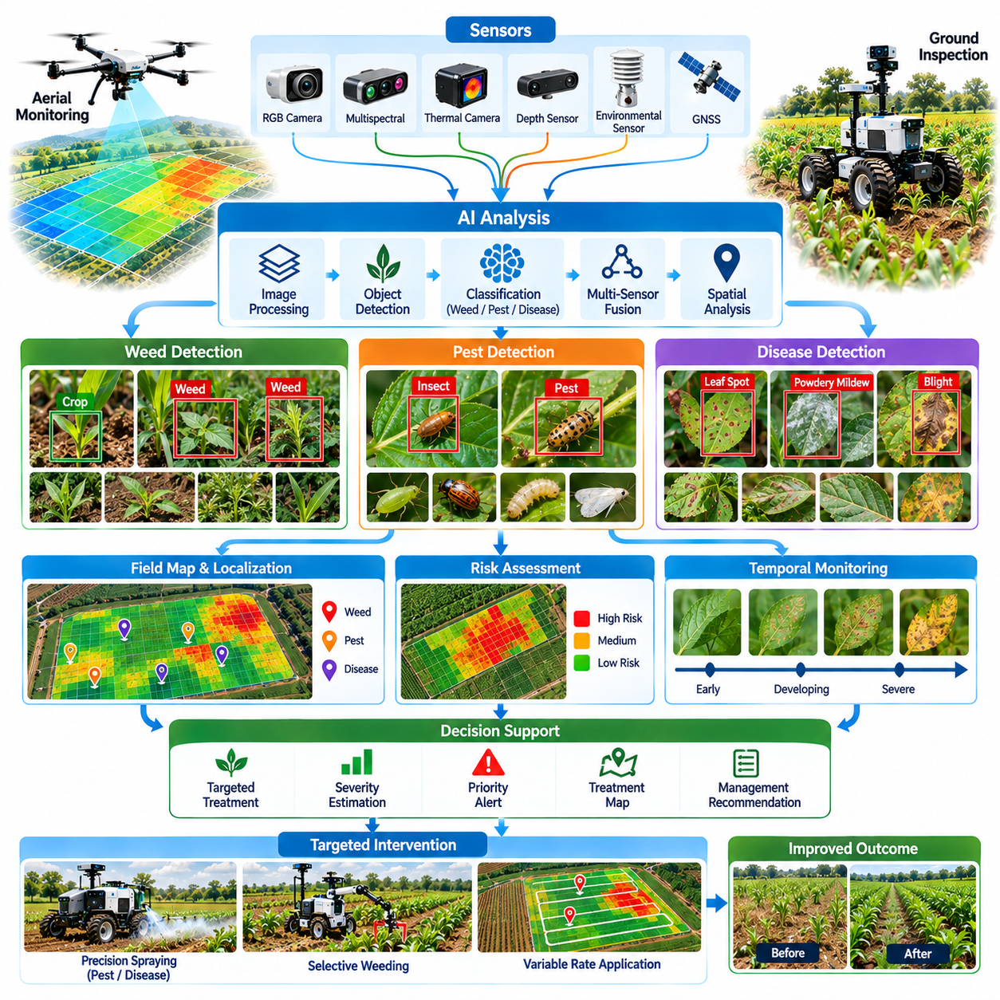{width="7.268055555555556in" height="7.268055555555556in"}

Weed, pest, and disease detection is a critical application of Physical AI in agriculture because biological threats can reduce crop productivity, quality, and economic value. Conventional monitoring often relies on visual inspection and periodic sampling, which may miss localized infestations or early symptoms. Intelligent sensing systems enable more frequent observation, spatial identification of abnormalities, and timely intervention based on field conditions.

Weeds compete with crops for sunlight, water, nutrients, and growing space, while pests and pathogens damage plant tissues or disrupt physiological processes. Their distribution is often irregular and changes with weather, crop development, and management practices. Physical AI integrates environmental perception, biological classification, and spatial reasoning to identify potential threats and support targeted agricultural decisions.

Automated weed detection requires distinguishing unwanted vegetation from cultivated crops under variable field conditions. Computer vision models analyze plant shape, color, texture, and spatial arrangement to classify vegetation. Deep learning methods can identify individual plants even when leaves overlap or growth stages differ. Accurate classification is essential because incorrect identification may result in crop damage or ineffective weed management.

Crop-row geometry provides useful contextual information for weed recognition in structured agricultural fields. Plants growing outside expected crop positions may be classified as potential weeds, although irregular planting and missing crops complicate this assumption. Combining geometric reasoning with visual classification improves detection reliability. Such systems must accommodate different planting patterns, crop varieties, and seasonal growth characteristics.

Pest detection presents additional challenges because insects and other organisms may be small, mobile, concealed, or visually similar to harmless species. High-resolution cameras, close-range robotic inspection, and automated monitoring traps can provide relevant observations. AI models identify candidate organisms and estimate their abundance or distribution. Reliable interpretation requires sufficient image quality and awareness of species-specific biological characteristics.

Disease detection focuses on identifying symptoms associated with fungal, bacterial, viral, and other plant disorders. Visible indicators may include discoloration, lesions, wilting, abnormal growth, or tissue deterioration. Computer vision systems can detect these patterns and estimate affected regions. However, similar symptoms may arise from nutrient deficiencies, environmental stress, or chemical injury, making definitive diagnosis more difficult.

Early-stage detection is particularly valuable because intervention opportunities may diminish as biological threats spread. Subtle changes in leaf appearance, canopy structure, or spectral response may indicate developing problems before severe damage becomes visible. Multispectral and hyperspectral imaging can provide additional information beyond conventional RGB cameras. Nevertheless, early indicators must be validated against biological observations to establish diagnostic reliability.

Thermal imaging offers another sensing modality for identifying potential crop stress associated with disease, pest activity, or water imbalance. Changes in leaf or canopy temperature may reflect altered transpiration and physiological function. These measurements can help identify regions requiring further inspection. Because temperature patterns are influenced by sunlight, wind, humidity, and irrigation, thermal anomalies should not be interpreted as disease confirmation alone.

Physical AI systems can combine multiple sensing modalities to improve threat detection under complex agricultural conditions. RGB imagery provides visual detail, spectral measurements reveal reflectance differences, and depth sensing captures plant geometry. Environmental sensors contribute information about humidity, temperature, and soil conditions. Multimodal fusion supports more informed assessments while reducing dependence on any single observation source.

Spatial localization transforms biological threat detection into actionable field intelligence. GNSS, visual odometry, and mapping algorithms associate detected weeds, pests, or symptoms with geographic coordinates. Field maps can represent infestation density, suspected disease clusters, and affected crop zones. Accurate localization enables targeted inspection and treatment, although positioning uncertainty must be considered when interventions require plant-level precision.

Detection systems must distinguish between the presence of a biological threat and its practical significance. A small number of weeds or insects may not justify immediate intervention, while rapidly spreading disease symptoms may require urgent investigation. Decision models can incorporate crop value, growth stage, estimated severity, and economic thresholds. These assessments should reflect established agronomic knowledge rather than rely solely on classification confidence.

Autonomous ground robots provide detailed observations by moving between crop rows and approaching suspicious plants. Their mobility allows sensors to inspect leaves, stems, and lower canopy regions that aerial platforms may not observe clearly. Robots can modify viewing angles or collect additional measurements when initial observations are uncertain. This active perception capability improves the quality of evidence available for biological threat assessment.

Aerial platforms complement ground-based detection by surveying large areas and identifying unusual vegetation patterns. Drone imagery can reveal spatial clusters of crop stress or abnormal growth that warrant closer examination. Ground robots or agricultural workers can then investigate selected locations. Coordinating aerial screening with terrestrial inspection improves monitoring coverage while allocating detailed sensing resources to priority regions.

Temporal analysis is important because weed growth, pest populations, and disease symptoms evolve over time. Repeated observations help distinguish persistent threats from temporary visual abnormalities. Time-series models can estimate changes in infestation extent or symptom severity and identify areas showing accelerated deterioration. Reliable trend analysis requires consistent sensing procedures and consideration of crop growth and environmental variation.

Machine learning performance depends heavily on the quality and diversity of agricultural training data. Datasets should represent different crops, weed species, pest organisms, disease symptoms, lighting conditions, and growth stages. Human-verified labels and confirmed biological diagnoses improve supervision quality. Models trained on limited environments may fail when encountering unfamiliar varieties, geographic regions, or previously unseen biological conditions.

Class imbalance creates a particular challenge because healthy plants and common weeds may dominate training datasets, while rare diseases and emerging pests have relatively few examples. Data augmentation, targeted sampling, and synthetic image generation can improve representation. However, artificial examples may not reproduce biological variability accurately. Field validation remains essential for assessing generalization and reducing misleading predictions.

Uncertainty estimation is necessary because agricultural detection systems inevitably encounter ambiguous symptoms and unfamiliar organisms. Confidence scores, anomaly detection, and out-of-distribution recognition can help identify cases requiring human review. Systems should avoid presenting uncertain classifications as confirmed biological diagnoses. Human experts remain important for validating critical findings and selecting appropriate treatment strategies.

Detection results can be integrated with precision spraying, mechanical weeding, and targeted crop treatment systems. Once a threat is identified and localized, robotic equipment may perform selective intervention under appropriate operational constraints. This connection between perception and physical action distinguishes Physical AI from conventional agricultural image analysis. Accurate timing, positioning, and treatment verification are necessary to prevent unintended damage.

The economic value of intelligent detection depends on avoided crop losses, reduced chemical consumption, lower inspection costs, and improved intervention timing. False positives can cause unnecessary treatment, while false negatives may allow biological threats to spread. Evaluation should therefore consider detection sensitivity, precision, operational coverage, and treatment outcomes. Commercial success requires measurable agronomic benefits relative to deployment and maintenance costs.

Ultimately, weed, pest, and disease detection provides an essential intelligence layer for precision agriculture. By combining multimodal sensing, biological understanding, autonomous mobility, and spatial decision-making, Physical AI can support more selective and responsive crop protection. Continued progress requires robust field datasets, reliable uncertainty management, agronomic validation, and integration with safe intervention systems that deliver sustainable agricultural value.

잡초·해충·질병 탐지(Weed, Pest, and Disease Detection)는 생물학적 위협(Biological Threats)이 작물 생산성(Crop Productivity), 품질(Quality), 경제적 가치(Economic Value)를 감소시킬 수 있기 때문에 농업 분야 피지컬 인공지능(Physical AI)의 핵심 응용 기술이다. 기존 모니터링(Conventional Monitoring)은 육안 점검(Visual Inspection)과 주기적인 표본 조사(Periodic Sampling)에 의존하는 경우가 많아 국소적인 발생(Localized Infestations)이나 초기 증상(Early Symptoms)을 놓칠 수 있다. 지능형 센싱 시스템(Intelligent Sensing Systems)은 더욱 빈번한 관측, 이상 징후의 공간적 식별(Spatial Identification), 농경지 상태에 따른 적시 개입(Timely Intervention)을 가능하게 한다.

잡초(Weeds)는 햇빛(Sunlight), 물(Water), 영양분(Nutrients), 생육 공간(Growing Space)을 두고 작물과 경쟁하며, 해충(Pests)과 병원체(Pathogens)는 식물 조직(Plant Tissues)을 손상시키거나 생리적 과정(Physiological Processes)을 방해한다. 이러한 생물학적 위협의 분포는 불규칙한 경우가 많으며 기상(Weather), 작물 발달(Crop Development), 관리 방식(Management Practices)에 따라 변화한다. 피지컬 인공지능은 환경 인식(Environmental Perception), 생물학적 분류(Biological Classification), 공간 추론(Spatial Reasoning)을 통합하여 잠재적 위협을 식별하고 표적 농업 의사결정(Targeted Agricultural Decisions)을 지원한다.

자동 잡초 탐지(Automated Weed Detection)는 다양한 농경지 조건에서 불필요한 식생(Unwanted Vegetation)과 재배 작물(Cultivated Crops)을 구분해야 한다. 컴퓨터 비전 모델(Computer Vision Models)은 식물의 형태(Shape), 색상(Color), 질감(Texture), 공간적 배열(Spatial Arrangement)을 분석하여 식생을 분류한다. 딥러닝 기법(Deep Learning Methods)은 잎이 중첩되거나 생육 단계(Growth Stages)가 서로 다른 경우에도 개별 식물을 식별할 수 있다. 정확한 분류(Accurate Classification)는 잘못된 식별이 작물 손상(Crop Damage)이나 비효율적인 잡초 관리(Ineffective Weed Management)로 이어질 수 있기 때문에 필수적이다.

작물 재배열의 기하학적 구조(Crop-Row Geometry)는 구조화된 농경지(Structured Agricultural Fields)에서 잡초 인식(Weed Recognition)에 유용한 맥락 정보를 제공한다. 예상되는 작물 위치(Expected Crop Positions)에서 벗어나 자라는 식물은 잠재적인 잡초(Potential Weeds)로 분류될 수 있지만, 불규칙한 파종(Irregular Planting)이나 작물 누락(Missing Crops)은 이러한 가정을 복잡하게 만든다. 기하학적 추론(Geometric Reasoning)과 시각적 분류(Visual Classification)를 결합하면 탐지 신뢰성(Detection Reliability)을 향상시킬 수 있다. 이러한 시스템은 다양한 파종 패턴(Planting Patterns), 작물 품종(Crop Varieties), 계절별 생육 특성(Seasonal Growth Characteristics)에 대응해야 한다.

해충 탐지(Pest Detection)는 곤충(Insects)과 기타 생물(Organisms)이 작거나 이동성이 높고, 가려져 있거나 무해한 종(Harmless Species)과 시각적으로 유사할 수 있기 때문에 추가적인 어려움이 있다. 고해상도 카메라(High-Resolution Cameras), 근거리 로봇 점검(Close-Range Robotic Inspection), 자동 모니터링 트랩(Automated Monitoring Traps)은 관련 관측 정보를 제공할 수 있다. 인공지능 모델(AI Models)은 후보 생물(Candidate Organisms)을 식별하고 개체 수(Abundance) 또는 분포(Distribution)를 추정한다. 신뢰할 수 있는 해석을 위해서는 충분한 영상 품질(Image Quality)과 종별 생물학적 특성(Species-Specific Biological Characteristics)에 대한 이해가 필요하다.

질병 탐지(Disease Detection)는 곰팡이성(Fungal), 세균성(Bacterial), 바이러스성(Viral) 및 기타 식물 질환(Plant Disorders)과 관련된 증상을 식별하는 데 중점을 둔다. 가시적인 지표(Visible Indicators)에는 변색(Discoloration), 병반(Lesions), 시듦(Wilting), 비정상적인 성장(Abnormal Growth), 조직 악화(Tissue Deterioration)가 포함될 수 있다. 컴퓨터 비전 시스템(Computer Vision Systems)은 이러한 패턴을 감지하고 영향을 받은 영역(Affected Regions)을 추정할 수 있다. 그러나 유사한 증상이 영양 결핍(Nutrient Deficiencies), 환경 스트레스(Environmental Stress), 화학적 손상(Chemical Injury)에서도 발생할 수 있어 확정적인 진단(Definitive Diagnosis)은 더욱 어렵다.

초기 단계 탐지(Early-Stage Detection)는 생물학적 위협이 확산됨에 따라 개입 기회(Intervention Opportunities)가 줄어들 수 있기 때문에 특히 중요하다. 잎의 외형(Leaf Appearance), 수관 구조(Canopy Structure), 분광 반응(Spectral Response)의 미세한 변화는 심각한 손상이 가시화되기 전에 문제가 발생하고 있음을 나타낼 수 있다. 다중분광 영상(Multispectral Imaging)과 초분광 영상(Hyperspectral Imaging)은 기존 RGB 카메라(RGB Cameras)를 넘어서는 추가 정보를 제공할 수 있다. 그러나 진단 신뢰성(Diagnostic Reliability)을 확보하기 위해서는 초기 지표(Early Indicators)를 생물학적 관측(Biological Observations)과 비교하여 검증해야 한다.

열화상 영상(Thermal Imaging)은 질병, 해충 활동(Pest Activity), 수분 불균형(Water Imbalance)과 관련된 잠재적인 작물 스트레스(Crop Stress)를 식별하기 위한 또 다른 센싱 방식(Sensing Modality)을 제공한다. 잎이나 수관 온도(Leaf or Canopy Temperature)의 변화는 증산작용(Transpiration)과 생리적 기능(Physiological Function)의 변화를 반영할 수 있다. 이러한 측정값은 추가 점검이 필요한 지역을 식별하는 데 도움이 된다. 온도 패턴(Temperature Patterns)은 햇빛, 바람(Wind), 습도(Humidity), 관개(Irrigation)의 영향을 받으므로 열적 이상 징후(Thermal Anomalies)만으로 질병을 확진해서는 안 된다.

피지컬 인공지능 시스템은 복잡한 농업 환경에서 위협 탐지(Threat Detection)를 개선하기 위해 여러 센싱 방식(Sensing Modalities)을 결합할 수 있다. RGB 영상(RGB Imagery)은 시각적 세부정보(Visual Detail)를 제공하고, 분광 측정(Spectral Measurements)은 반사율 차이(Reflectance Differences)를 나타내며, 깊이 센싱(Depth Sensing)은 식물의 기하학적 구조(Plant Geometry)를 포착한다. 환경 센서(Environmental Sensors)는 습도, 온도, 토양 상태에 관한 정보를 제공한다. 다중모달 융합(Multimodal Fusion)은 단일 관측 정보에 대한 의존도를 줄이면서 더욱 종합적인 평가를 지원한다.

공간적 위치 추정(Spatial Localization)은 생물학적 위협 탐지를 실행 가능한 농경지 정보(Actionable Field Intelligence)로 전환한다. 위성항법 시스템(GNSS), 시각적 주행거리 추정(Visual Odometry), 지도 작성 알고리즘(Mapping Algorithms)은 탐지된 잡초, 해충, 질병 증상을 지리적 좌표(Geographic Coordinates)와 연결한다. 농경지 지도(Field Maps)는 발생 밀도(Infestation Density), 의심되는 질병 군집(Suspected Disease Clusters), 영향을 받은 작물 구역(Affected Crop Zones)을 표현할 수 있다. 정확한 위치 추정은 표적 점검(Targeted Inspection)과 처리(Treatment)를 가능하게 하지만, 개별 식물 수준의 정밀도(Plant-Level Precision)가 필요한 경우 위치 불확실성(Positioning Uncertainty)을 고려해야 한다.

탐지 시스템(Detection Systems)은 생물학적 위협의 존재(Presence)와 실제 농업적 중요성(Practical Significance)을 구분해야 한다. 소수의 잡초나 곤충은 즉각적인 개입을 정당화하지 않을 수 있지만, 빠르게 확산되는 질병 증상은 긴급한 조사가 필요할 수 있다. 의사결정 모델(Decision Models)은 작물 가치(Crop Value), 생육 단계(Growth Stage), 추정 심각도(Estimated Severity), 경제적 방제 기준(Economic Thresholds)을 반영할 수 있다. 이러한 평가는 분류 신뢰도(Classification Confidence)에만 의존하기보다 확립된 농학적 지식(Agronomic Knowledge)을 기반으로 해야 한다.

자율 지상 로봇(Autonomous Ground Robots)은 작물 재배열(Crop Rows) 사이를 이동하고 의심되는 식물에 접근하여 상세한 관측 정보를 제공한다. 이러한 이동 능력(Mobility)을 통해 센서는 항공 플랫폼(Aerial Platforms)에서 명확하게 관측하기 어려운 잎, 줄기, 수관 하부(Lower Canopy Regions)를 점검할 수 있다. 로봇은 초기 관측이 불확실할 경우 관측 각도(Viewing Angles)를 변경하거나 추가 측정값(Additional Measurements)을 수집할 수 있다. 이러한 능동 인식(Active Perception) 기능은 생물학적 위협 평가(Biological Threat Assessment)에 활용되는 증거의 품질을 향상시킨다.

항공 플랫폼(Aerial Platforms)은 넓은 지역을 조사하고 비정상적인 식생 패턴(Abnormal Vegetation Patterns)을 식별하여 지상 기반 탐지(Ground-Based Detection)를 보완한다. 드론 영상(Drone Imagery)은 더욱 정밀한 조사가 필요한 작물 스트레스(Crop Stress)나 비정상적인 성장(Abnormal Growth)의 공간적 군집(Spatial Clusters)을 보여줄 수 있다. 이후 지상 로봇이나 농업 작업자(Agricultural Workers)가 선택된 위치를 조사할 수 있다. 항공 기반 선별 조사(Aerial Screening)와 지상 점검(Terrestrial Inspection)을 연계하면 상세 센싱 자원(Detailed Sensing Resources)을 우선순위 지역(Priority Regions)에 배분하면서 모니터링 범위(Monitoring Coverage)를 확대할 수 있다.

시간적 분석(Temporal Analysis)은 잡초 성장(Weed Growth), 해충 개체군(Pest Populations), 질병 증상(Disease Symptoms)이 시간에 따라 변화하기 때문에 중요하다. 반복적인 관측(Repeated Observations)은 지속적인 위협(Persistent Threats)과 일시적인 시각적 이상 징후(Temporary Visual Abnormalities)를 구분하는 데 도움이 된다. 시계열 모델(Time-Series Models)은 발생 범위(Infestation Extent)나 증상 심각도(Symptom Severity)의 변화를 추정하고 악화 속도가 빨라지는 지역을 식별할 수 있다. 신뢰할 수 있는 추세 분석(Trend Analysis)을 위해서는 일관된 센싱 절차(Sensing Procedures)와 작물 성장 및 환경 변화에 대한 고려가 필요하다.

머신러닝 성능(Machine Learning Performance)은 농업 학습 데이터(Agricultural Training Data)의 품질과 다양성에 크게 의존한다. 데이터셋(Datasets)은 다양한 작물, 잡초 종(Weed Species), 해충 생물(Pest Organisms), 질병 증상, 조명 조건(Lighting Conditions), 생육 단계를 포함해야 한다. 사람이 검증한 레이블(Human-Verified Labels)과 확인된 생물학적 진단(Confirmed Biological Diagnoses)은 지도학습 품질(Supervision Quality)을 향상시킨다. 제한된 환경에서 학습된 모델은 익숙하지 않은 품종, 지리적 지역(Geographic Regions), 이전에 관측되지 않은 생물학적 조건(Unseen Biological Conditions)에 직면하면 성능이 저하될 수 있다.

클래스 불균형(Class Imbalance)은 건강한 식물(Healthy Plants)과 흔한 잡초(Common Weeds)가 학습 데이터셋(Training Datasets)의 대부분을 차지하는 반면, 희귀 질병(Rare Diseases)과 새롭게 발생하는 해충(Emerging Pests)의 사례는 상대적으로 적기 때문에 특별한 어려움을 발생시킨다. 데이터 증강(Data Augmentation), 표적 샘플링(Targeted Sampling), 합성 영상 생성(Synthetic Image Generation)은 데이터 표현의 균형을 개선할 수 있다. 그러나 인공적으로 생성된 사례(Artificial Examples)는 생물학적 변동성(Biological Variability)을 정확하게 재현하지 못할 수 있다. 일반화 성능(Generalization)을 평가하고 잘못된 예측(Misleading Predictions)을 줄이기 위해서는 실제 농경지 검증(Field Validation)이 필수적이다.

불확실성 추정(Uncertainty Estimation)은 농업 탐지 시스템이 모호한 증상(Ambiguous Symptoms)과 익숙하지 않은 생물(Unfamiliar Organisms)을 필연적으로 마주하기 때문에 필요하다. 신뢰도 점수(Confidence Scores), 이상 탐지(Anomaly Detection), 분포 외 데이터 인식(Out-of-Distribution Recognition)은 인간의 검토(Human Review)가 필요한 사례를 식별하는 데 도움이 된다. 시스템은 불확실한 분류(Uncertain Classifications)를 확정된 생물학적 진단(Confirmed Biological Diagnoses)으로 제시하지 않아야 한다. 인간 전문가(Human Experts)는 중요한 탐지 결과를 검증하고 적절한 처리 전략(Treatment Strategies)을 선택하는 데 여전히 중요한 역할을 한다.

탐지 결과(Detection Results)는 정밀 살포(Precision Spraying), 기계적 제초(Mechanical Weeding), 표적 작물 처리(Targeted Crop Treatment) 시스템과 통합될 수 있다. 위협이 식별되고 위치가 추정되면 로봇 장비(Robotic Equipment)는 적절한 운영 제약조건(Operational Constraints) 아래에서 선택적 개입(Selective Intervention)을 수행할 수 있다. 인식(Perception)과 물리적 행동(Physical Action) 사이의 이러한 연결은 피지컬 인공지능을 기존 농업 영상 분석(Conventional Agricultural Image Analysis)과 구별한다. 의도하지 않은 손상(Unintended Damage)을 방지하기 위해서는 정확한 작업 시점(Timing), 위치 결정(Positioning), 처리 검증(Treatment Verification)이 필요하다.

지능형 탐지(Intelligent Detection)의 경제적 가치(Economic Value)는 예방된 작물 손실(Avoided Crop Losses), 화학물질 사용량 감소(Reduced Chemical Consumption), 점검 비용 절감(Lower Inspection Costs), 개입 시점 개선(Improved Intervention Timing)에 따라 결정된다. 오탐(False Positives)은 불필요한 처리를 유발할 수 있으며, 미탐(False Negatives)은 생물학적 위협의 확산을 허용할 수 있다. 따라서 성능 평가(Evaluation)는 탐지 민감도(Detection Sensitivity), 정밀도(Precision), 운영 범위(Operational Coverage), 처리 결과(Treatment Outcomes)를 고려해야 한다. 상업적 성공(Commercial Success)을 위해서는 배포 및 유지보수 비용(Deployment and Maintenance Costs) 대비 측정 가능한 농학적 편익(Measurable Agronomic Benefits)이 필요하다.

궁극적으로 잡초·해충·질병 탐지(Weed, Pest, and Disease Detection)는 정밀 농업(Precision Agriculture)을 위한 핵심 지능 계층(Intelligence Layer)을 제공한다. 피지컬 인공지능은 다중모달 센싱(Multimodal Sensing), 생물학적 이해(Biological Understanding), 자율 이동(Autonomous Mobility), 공간적 의사결정(Spatial Decision-Making)을 결합하여 더욱 선택적이고 신속하게 대응하는 작물 보호(Crop Protection)를 지원할 수 있다. 지속적인 발전을 위해서는 견고한 농경지 데이터셋(Robust Field Datasets), 신뢰할 수 있는 불확실성 관리(Reliable Uncertainty Management), 농학적 검증(Agronomic Validation), 지속 가능한 농업 가치(Sustainable Agricultural Value)를 제공하는 안전한 개입 시스템(Safe Intervention Systems)과의 통합이 필요하다.

##  

## 05.05. Precision Spraying and Treatment

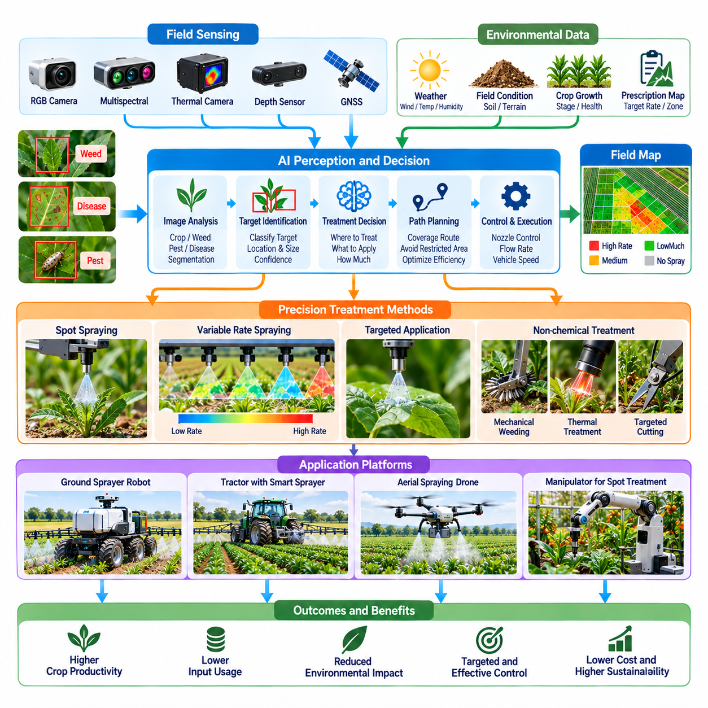{width="7.268055555555556in" height="7.268055555555556in"}

Precision spraying and treatment represent a major application of Physical AI in agriculture, enabling agricultural inputs to be delivered according to the actual needs of crops and field conditions. Conventional spraying frequently applies uniform treatment across large areas, regardless of local variability. Intelligent robotic systems combine perception, decision-making, and controlled actuation to deliver treatments selectively, improving resource efficiency while reducing unnecessary chemical exposure.

Precision treatment begins with identifying where intervention is required and determining the appropriate response. Crop health, weed distribution, pest pressure, disease symptoms, and environmental conditions influence treatment decisions. Physical AI connects sensing data with agronomic rules and operational constraints to generate location-specific actions. This approach transforms spraying from a repetitive mechanical process into an adaptive agricultural operation.

The architecture of an intelligent spraying system integrates environmental sensors, perception models, positioning, treatment planning, and application hardware. Cameras, multispectral sensors, GNSS receivers, and flow monitoring devices provide complementary information. AI algorithms interpret field conditions and generate treatment commands, while electronic controllers regulate valves, pumps, and nozzles. Feedback mechanisms verify whether commanded actions are executed correctly.

Selective spraying relies on accurately distinguishing target vegetation from crops and surrounding objects. Computer vision models identify weeds, crop structures, and treatment regions using object detection and segmentation techniques. The system must account for overlapping leaves, changing illumination, growth stages, and partial occlusion. Incorrect classification can result in missed treatment or unintended crop exposure, making reliable perception essential.

Spot spraying applies treatment only to selected locations rather than continuously across an entire field. Once a target is detected, the controller estimates its position relative to the spraying mechanism and activates the appropriate nozzle. Vehicle speed, sensor-to-nozzle distance, and actuation delay must be considered to maintain spatial accuracy. Precise synchronization between perception and spraying determines whether the treatment reaches the intended target.

Variable-rate application adjusts treatment quantity according to spatial differences in crop condition or management requirements. Prescription maps, sensor observations, and agronomic models can provide target application rates for different field zones. Controllers modify flow rate, pressure, or nozzle duty cycle within equipment capabilities. Successful implementation requires calibrated hardware and adherence to product-specific application restrictions.

Nozzle technology strongly influences treatment accuracy, droplet distribution, and environmental exposure. Different nozzle designs produce distinct spray patterns and droplet sizes under specified pressure conditions. Fine droplets may improve coverage in some applications but can increase drift risk. Intelligent spraying systems must coordinate nozzle selection, operating pressure, vehicle speed, and target characteristics to achieve appropriate deposition.

Spray drift is a critical operational concern because airborne droplets may move beyond the intended treatment area. Wind speed, wind direction, humidity, temperature, droplet size, and boom height influence drift behavior. Environmental monitoring can support decisions about whether spraying conditions are acceptable. Autonomous systems should suspend treatment when conditions exceed applicable safety limits or product-label requirements.

Physical AI can improve treatment planning by combining field maps with real-time observations. Georeferenced weed locations, crop boundaries, sensitive areas, and restricted zones help determine where application is permitted. Route planning algorithms coordinate vehicle movement with treatment coverage and operational efficiency. Accurate spatial registration is essential to prevent spraying outside designated areas or overlooking required treatment zones.

Autonomous ground platforms provide a flexible foundation for precision spraying in orchards, vineyards, greenhouses, and open fields. Mobile robots can carry treatment tanks, pumps, sensing equipment, and electronically controlled applicators. Their navigation systems maintain suitable positioning relative to crop rows and target vegetation. Platform design must consider payload capacity, terrain stability, energy consumption, and safe chemical handling.

Aerial spraying platforms offer alternative capabilities where ground access is difficult or rapid treatment is required. Agricultural drones can apply approved products over designated areas using controlled flight paths and application equipment. Their effectiveness depends on payload limitations, flight stability, droplet transport, and environmental conditions. Aerial application must comply with applicable regulations and product-label restrictions.

Robotic manipulators can extend precision treatment beyond conventional boom or broadcast spraying. Articulated arms may position specialized applicators near individual plants, branches, or localized treatment regions. This approach can improve access to complex crop structures while reducing unnecessary exposure of surrounding vegetation. However, manipulation speed, positioning accuracy, and mechanical complexity influence operational feasibility.

Precision treatment also includes nonchemical interventions such as mechanical weeding, targeted cutting, thermal treatment, and other approved physical methods. Physical AI can identify treatment targets and guide tools toward specific locations. The choice of intervention depends on crop sensitivity, weed characteristics, operating conditions, and safety constraints. Integrating different treatment methods enables more flexible agricultural management.

Closed-loop treatment control uses feedback to monitor application performance and detect deviations from expected operation. Flow sensors, pressure measurements, valve-state monitoring, and positioning data can reveal blocked nozzles, delivery errors, or synchronization failures. Controllers can respond by adjusting operating parameters or stopping treatment. Direct confirmation of biological treatment effectiveness may require later inspection.

Treatment verification connects immediate application records with subsequent crop observations. Robots can record target locations, commanded application rates, actual delivery measurements, and environmental conditions. Follow-up scouting evaluates whether the intended agricultural response occurred. These records support traceability, performance assessment, and improvement of future treatment decisions while distinguishing application completion from biological effectiveness.

Multi-robot coordination can improve precision treatment across large agricultural operations. Scouting robots identify potential problems, mapping systems organize treatment priorities, and specialized spraying robots execute approved interventions. Fleet management software allocates tasks according to equipment availability, location, remaining resources, and operational constraints. Shared information reduces duplicated coverage and supports coordinated field activities.

Data-driven learning can improve target recognition, application timing, and operational planning through accumulated field experience. Confirmed detection results, treatment records, and subsequent crop responses provide useful training information. However, treatment outcomes depend on weather, biological conditions, chemical properties, and application procedures. Models must be validated carefully before recommendations influence safety-critical agricultural operations.

Safety management must address chemical exposure, unintended application, equipment malfunction, and interactions with workers or nearby animals. Autonomous spraying systems require controlled operating boundaries, emergency stopping, fault detection, and appropriate human supervision. Chemical storage, mixing, handling, and disposal remain subject to established safety procedures. Intelligent autonomy must operate within approved agricultural practices and regulatory requirements.

The economic value of precision spraying depends on reduced input consumption, improved treatment effectiveness, labor efficiency, and avoided crop losses. Savings must be evaluated against equipment acquisition, maintenance, calibration, software, and operational supervision costs. False detections, missed targets, and application failures can reduce expected benefits. Commercial viability requires measurable improvements in cost per treated area and agricultural outcomes.

Ultimately, precision spraying and treatment connect agricultural perception directly with controlled physical intervention. Physical AI enables treatment decisions to reflect spatial variability, environmental conditions, and individual crop requirements rather than uniform assumptions. Continued progress in sensing, robotic actuation, closed-loop control, and agronomic validation can improve application efficiency. Successful deployment requires reliable performance, regulatory compliance, environmental responsibility, and sustainable economic value.

정밀 살포 및 처리(Precision Spraying and Treatment)는 작물의 실제 요구사항과 농경지 조건(Field Conditions)에 따라 농업 투입재(Agricultural Inputs)를 공급할 수 있도록 하는 농업 분야 피지컬 인공지능(Physical AI)의 주요 응용 기술이다. 기존 살포 방식(Conventional Spraying)은 지역별 변동성(Local Variability)과 관계없이 넓은 지역에 균일한 처리(Uniform Treatment)를 적용하는 경우가 많다. 지능형 로봇 시스템(Intelligent Robotic Systems)은 인식(Perception), 의사결정(Decision-Making), 제어된 구동(Controlled Actuation)을 결합하여 선택적으로 처리함으로써 자원 효율성(Resource Efficiency)을 향상시키고 불필요한 화학물질 노출(Chemical Exposure)을 줄인다.

정밀 처리(Precision Treatment)는 개입이 필요한 위치를 식별하고 적절한 대응 방법을 결정하는 것에서 시작된다. 작물 건강(Crop Health), 잡초 분포(Weed Distribution), 해충 발생 압력(Pest Pressure), 질병 증상(Disease Symptoms), 환경 조건(Environmental Conditions)은 처리 의사결정(Treatment Decisions)에 영향을 미친다. 피지컬 인공지능은 센싱 데이터(Sensing Data)를 농학적 규칙(Agronomic Rules) 및 운영 제약조건(Operational Constraints)과 연결하여 위치별 작업(Location-Specific Actions)을 생성한다. 이러한 접근법은 살포 작업을 반복적인 기계적 과정(Repetitive Mechanical Process)에서 적응형 농업 운영(Adaptive Agricultural Operation)으로 전환한다.

지능형 살포 시스템(Intelligent Spraying System)의 아키텍처(Architecture)는 환경 센서(Environmental Sensors), 인식 모델(Perception Models), 위치 측정(Positioning), 처리 계획(Treatment Planning), 살포 하드웨어(Application Hardware)를 통합한다. 카메라(Cameras), 다중분광 센서(Multispectral Sensors), 위성항법 시스템 수신기(GNSS Receivers), 유량 모니터링 장치(Flow Monitoring Devices)는 상호 보완적인 정보를 제공한다. 인공지능 알고리즘(AI Algorithms)은 농경지 조건을 해석하고 처리 명령(Treatment Commands)을 생성하며, 전자식 제어기(Electronic Controllers)는 밸브(Valves), 펌프(Pumps), 노즐(Nozzles)을 제어한다. 피드백 메커니즘(Feedback Mechanisms)은 명령된 작업이 올바르게 실행되는지 검증한다.

선택적 살포(Selective Spraying)는 대상 식생(Target Vegetation)을 작물 및 주변 물체(Surrounding Objects)와 정확하게 구분하는 능력에 의존한다. 컴퓨터 비전 모델(Computer Vision Models)은 객체 탐지(Object Detection)와 분할(Segmentation) 기법을 사용하여 잡초(Weeds), 작물 구조(Crop Structures), 처리 영역(Treatment Regions)을 식별한다. 시스템은 중첩된 잎(Overlapping Leaves), 변화하는 조명(Changing Illumination), 생육 단계(Growth Stages), 부분적인 가림(Partial Occlusion)을 고려해야 한다. 잘못된 분류(Incorrect Classification)는 처리 누락(Missed Treatment)이나 의도하지 않은 작물 노출(Unintended Crop Exposure)을 초래할 수 있으므로 신뢰할 수 있는 인식(Reliable Perception)이 필수적이다.

점적 표적 살포(Spot Spraying)는 농경지 전체에 연속적으로 살포하는 대신 선택된 위치에만 처리 물질을 적용한다. 대상이 탐지되면 제어기(Controller)는 살포 장치(Spraying Mechanism)를 기준으로 대상의 상대 위치(Relative Position)를 추정하고 적절한 노즐을 작동시킨다. 공간적 정확도(Spatial Accuracy)를 유지하려면 차량 속도(Vehicle Speed), 센서와 노즐 사이의 거리(Sensor-to-Nozzle Distance), 구동 지연시간(Actuation Delay)을 고려해야 한다. 인식과 살포 사이의 정밀한 동기화(Precise Synchronization)는 처리 물질이 의도한 대상에 도달하는지를 결정한다.

가변 살포량 적용(Variable-Rate Application)은 작물 상태나 관리 요구사항의 공간적 차이(Spatial Differences)에 따라 처리량(Treatment Quantity)을 조절한다. 처방 지도(Prescription Maps), 센서 관측값(Sensor Observations), 농학적 모델(Agronomic Models)은 농경지의 서로 다른 구역에 대한 목표 살포량(Target Application Rates)을 제공할 수 있다. 제어기는 장비의 성능 범위(Equipment Capabilities) 내에서 유량(Flow Rate), 압력(Pressure), 노즐 듀티 사이클(Nozzle Duty Cycle)을 조절한다. 성공적인 구현을 위해서는 보정된 하드웨어(Calibrated Hardware)와 제품별 살포 제한사항(Product-Specific Application Restrictions)의 준수가 필요하다.

노즐 기술(Nozzle Technology)은 처리 정확도(Treatment Accuracy), 액적 분포(Droplet Distribution), 환경 노출(Environmental Exposure)에 큰 영향을 미친다. 서로 다른 노즐 설계(Nozzle Designs)는 지정된 압력 조건(Pressure Conditions)에서 각기 다른 분무 패턴(Spray Patterns)과 액적 크기(Droplet Sizes)를 형성한다. 미세 액적(Fine Droplets)은 일부 응용 분야에서 피복률(Coverage)을 향상시킬 수 있지만 비산 위험(Drift Risk)을 증가시킬 수 있다. 지능형 살포 시스템은 적절한 부착 및 침착(Deposition)을 달성하기 위해 노즐 선택(Nozzle Selection), 작동 압력(Operating Pressure), 차량 속도, 대상 특성(Target Characteristics)을 조정해야 한다.

살포 비산(Spray Drift)은 공기 중 액적(Airborne Droplets)이 의도한 처리 영역(Intended Treatment Area)을 벗어나 이동할 수 있기 때문에 중요한 운영상 고려사항이다. 풍속(Wind Speed), 풍향(Wind Direction), 습도(Humidity), 온도(Temperature), 액적 크기, 붐 높이(Boom Height)는 비산 거동(Drift Behavior)에 영향을 미친다. 환경 모니터링(Environmental Monitoring)은 살포 조건(Spraying Conditions)의 적합성을 판단하는 데 도움을 줄 수 있다. 자율 시스템(Autonomous Systems)은 조건이 적용 가능한 안전 한계(Safety Limits)나 제품 라벨 요구사항(Product-Label Requirements)을 초과하면 처리를 중단해야 한다.

피지컬 인공지능은 농경지 지도(Field Maps)와 실시간 관측(Real-Time Observations)을 결합하여 처리 계획(Treatment Planning)을 개선할 수 있다. 지리참조된 잡초 위치(Georeferenced Weed Locations), 작물 경계(Crop Boundaries), 민감 지역(Sensitive Areas), 제한 구역(Restricted Zones)은 살포가 허용되는 위치를 결정하는 데 도움이 된다. 경로 계획 알고리즘(Route Planning Algorithms)은 차량 이동(Vehicle Movement)을 처리 범위(Treatment Coverage) 및 운영 효율성(Operational Efficiency)과 연계한다. 정확한 공간 정합(Spatial Registration)은 지정된 영역 밖으로 살포하거나 필요한 처리 구역을 누락하는 문제를 방지하는 데 필수적이다.

자율 지상 플랫폼(Autonomous Ground Platforms)은 과수원(Orchards), 포도원(Vineyards), 온실(Greenhouses), 노지 농경지(Open Fields)에서 정밀 살포를 수행하기 위한 유연한 기반을 제공한다. 이동 로봇(Mobile Robots)은 처리액 탱크(Treatment Tanks), 펌프, 센싱 장비(Sensing Equipment), 전자식 제어 살포 장치(Electronically Controlled Applicators)를 탑재할 수 있다. 내비게이션 시스템(Navigation Systems)은 작물 재배열(Crop Rows)과 대상 식생을 기준으로 적절한 위치를 유지한다. 플랫폼 설계(Platform Design)는 적재 용량(Payload Capacity), 지형 안정성(Terrain Stability), 에너지 소비(Energy Consumption), 안전한 화학물질 취급(Safe Chemical Handling)을 고려해야 한다.

항공 살포 플랫폼(Aerial Spraying Platforms)은 지상 접근(Ground Access)이 어렵거나 신속한 처리가 필요한 지역에서 대안적인 기능을 제공한다. 농업용 드론(Agricultural Drones)은 제어된 비행 경로(Controlled Flight Paths)와 살포 장비(Application Equipment)를 사용하여 지정된 지역에 승인된 제품(Approved Products)을 살포할 수 있다. 효과는 적재량 제한(Payload Limitations), 비행 안정성(Flight Stability), 액적 이동(Droplet Transport), 환경 조건에 따라 달라진다. 항공 살포(Aerial Application)는 적용 가능한 규정(Applicable Regulations)과 제품 라벨 제한사항(Product-Label Restrictions)을 준수해야 한다.

로봇 매니퓰레이터(Robotic Manipulators)는 기존의 붐 살포(Boom Spraying)나 전면 살포(Broadcast Spraying)를 넘어 정밀 처리 기능을 확장할 수 있다. 다관절 로봇 팔(Articulated Arms)은 특수 살포 장치(Specialized Applicators)를 개별 식물, 가지(Branches), 국소 처리 영역(Localized Treatment Regions) 가까이에 배치할 수 있다. 이러한 접근법은 복잡한 작물 구조(Complex Crop Structures)에 대한 접근성을 개선하면서 주변 식생(Surrounding Vegetation)의 불필요한 노출을 줄일 수 있다. 그러나 조작 속도(Manipulation Speed), 위치 정확도(Positioning Accuracy), 기계적 복잡성(Mechanical Complexity)은 운영 실현 가능성(Operational Feasibility)에 영향을 미친다.

정밀 처리에는 기계적 제초(Mechanical Weeding), 표적 절단(Targeted Cutting), 열처리(Thermal Treatment), 기타 승인된 물리적 방법(Approved Physical Methods)과 같은 비화학적 개입(Nonchemical Interventions)도 포함된다. 피지컬 인공지능은 처리 대상을 식별하고 도구(Tools)를 특정 위치로 유도할 수 있다. 개입 방법(Intervention Method)의 선택은 작물 민감도(Crop Sensitivity), 잡초 특성(Weed Characteristics), 운영 조건(Operating Conditions), 안전 제약조건(Safety Constraints)에 따라 달라진다. 다양한 처리 방법을 통합하면 더욱 유연한 농업 관리(Agricultural Management)가 가능해진다.

폐루프 처리 제어(Closed-Loop Treatment Control)는 피드백(Feedback)을 사용하여 살포 성능(Application Performance)을 모니터링하고 예상된 작동 상태(Expected Operation)와의 편차를 감지한다. 유량 센서(Flow Sensors), 압력 측정값(Pressure Measurements), 밸브 상태 모니터링(Valve-State Monitoring), 위치 데이터(Positioning Data)는 노즐 막힘(Blocked Nozzles), 공급 오류(Delivery Errors), 동기화 실패(Synchronization Failures)를 발견하는 데 도움이 된다. 제어기는 작동 매개변수(Operating Parameters)를 조정하거나 처리를 중단하여 대응할 수 있다. 생물학적 처리 효과(Biological Treatment Effectiveness)를 직접 확인하려면 후속 점검(Later Inspection)이 필요할 수 있다.

처리 검증(Treatment Verification)은 즉각적인 살포 기록(Application Records)을 이후의 작물 관측(Subsequent Crop Observations)과 연결한다. 로봇은 대상 위치(Target Locations), 명령된 살포량(Commanded Application Rates), 실제 공급 측정값(Actual Delivery Measurements), 환경 조건을 기록할 수 있다. 후속 작물 정찰(Follow-Up Scouting)은 의도한 농업적 반응(Intended Agricultural Response)이 발생했는지 평가한다. 이러한 기록은 살포 작업 완료(Application Completion)와 생물학적 효과(Biological Effectiveness)를 구분하면서 추적성(Traceability), 성능 평가(Performance Assessment), 향후 처리 의사결정의 개선을 지원한다.

다중 로봇 협업(Multi-Robot Coordination)은 대규모 농업 운영(Large Agricultural Operations)에서 정밀 처리 효율성을 향상시킬 수 있다. 정찰 로봇(Scouting Robots)은 잠재적인 문제를 식별하고, 지도 작성 시스템(Mapping Systems)은 처리 우선순위(Treatment Priorities)를 구성하며, 특수 살포 로봇(Specialized Spraying Robots)은 승인된 개입(Approved Interventions)을 실행한다. 플릿 관리 소프트웨어(Fleet Management Software)는 장비 가용성(Equipment Availability), 위치(Location), 잔여 자원(Remaining Resources), 운영 제약조건에 따라 작업을 할당한다. 공유 정보(Shared Information)는 중복 작업 범위(Duplicated Coverage)를 줄이고 협업 농경지 운영(Coordinated Field Activities)을 지원한다.

데이터 기반 학습(Data-Driven Learning)은 축적된 농경지 운영 경험(Field Experience)을 통해 대상 인식(Target Recognition), 살포 시점(Application Timing), 운영 계획(Operational Planning)을 개선할 수 있다. 검증된 탐지 결과(Confirmed Detection Results), 처리 기록(Treatment Records), 이후의 작물 반응(Subsequent Crop Responses)은 유용한 학습 정보(Training Information)를 제공한다. 그러나 처리 결과(Treatment Outcomes)는 기상, 생물학적 조건(Biological Conditions), 화학적 특성(Chemical Properties), 살포 절차(Application Procedures)에 따라 달라진다. 모델은 권고사항(Recommendations)이 안전 필수 농업 운영(Safety-Critical Agricultural Operations)에 영향을 미치기 전에 신중하게 검증되어야 한다.

안전 관리(Safety Management)는 화학물질 노출(Chemical Exposure), 의도하지 않은 살포(Unintended Application), 장비 오작동(Equipment Malfunction), 작업자 또는 주변 동물과의 상호작용(Interactions with Workers or Nearby Animals)을 다루어야 한다. 자율 살포 시스템(Autonomous Spraying Systems)에는 통제된 운영 경계(Controlled Operating Boundaries), 비상 정지(Emergency Stopping), 고장 탐지(Fault Detection), 적절한 인간 감독(Human Supervision)이 필요하다. 화학물질 보관(Chemical Storage), 혼합(Mixing), 취급(Handling), 폐기(Disposal)는 기존 안전 절차(Established Safety Procedures)를 따라야 한다. 지능형 자율성(Intelligent Autonomy)은 승인된 농업 관행(Approved Agricultural Practices)과 규제 요구사항(Regulatory Requirements) 내에서 작동해야 한다.

정밀 살포(Precision Spraying)의 경제적 가치(Economic Value)는 투입재 소비 감소(Reduced Input Consumption), 처리 효과 개선(Improved Treatment Effectiveness), 노동 효율성(Labor Efficiency), 작물 손실 방지(Avoided Crop Losses)에 따라 결정된다. 비용 절감(Savings)은 장비 도입 비용(Equipment Acquisition Costs), 유지보수(Maintenance), 보정(Calibration), 소프트웨어(Software), 운영 감독 비용(Operational Supervision Costs)과 비교하여 평가해야 한다. 오탐(False Detections), 대상 누락(Missed Targets), 살포 실패(Application Failures)는 예상 편익(Expected Benefits)을 감소시킬 수 있다. 상업적 실현 가능성(Commercial Viability)을 확보하려면 단위 처리 면적당 비용(Cost per Treated Area)과 농업 생산 결과(Agricultural Outcomes)에서 측정 가능한 개선이 필요하다.

궁극적으로 정밀 살포 및 처리(Precision Spraying and Treatment)는 농업 환경 인식(Agricultural Perception)을 제어된 물리적 개입(Controlled Physical Intervention)과 직접 연결한다. 피지컬 인공지능은 획일적인 가정(Uniform Assumptions)이 아니라 공간적 변동성(Spatial Variability), 환경 조건, 개별 작물 요구사항(Individual Crop Requirements)을 반영하여 처리 의사결정을 수행할 수 있도록 한다. 센싱(Sensing), 로봇 구동(Robotic Actuation), 폐루프 제어(Closed-Loop Control), 농학적 검증(Agronomic Validation)의 지속적인 발전은 살포 효율성(Application Efficiency)을 향상시킬 수 있다. 성공적인 도입을 위해서는 신뢰할 수 있는 성능(Reliable Performance), 규제 준수(Regulatory Compliance), 환경적 책임(Environmental Responsibility), 지속 가능한 경제적 가치(Sustainable Economic Value)가 필요하다.

##  

## 05.06. Autonomous Harvesting

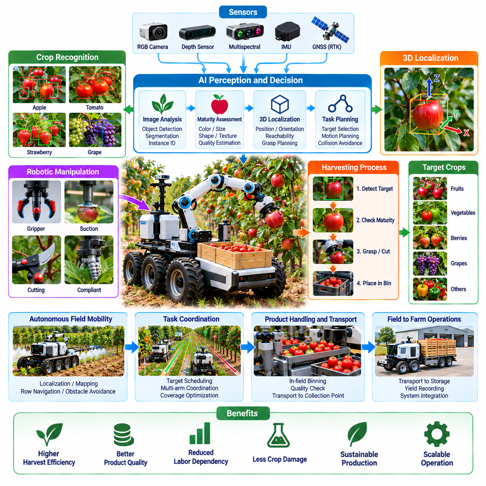{width="7.268055555555556in" height="7.268055555555556in"}

Autonomous harvesting is a major application of Physical AI in agriculture, integrating intelligent perception, robotic manipulation, and mobile autonomy to collect crops with reduced human intervention. Harvesting requires decisions about crop maturity, accessibility, and handling conditions. Unlike repetitive industrial operations, agricultural harvesting takes place in changing environments where plant geometry, fruit distribution, and product quality vary significantly.

The primary objective of autonomous harvesting is to identify harvestable crops and remove them efficiently without damaging plants or surrounding produce. Robots must recognize individual fruits, vegetables, or other agricultural products while estimating their maturity and physical condition. Successful operation requires coordination among visual recognition, motion planning, grasping, cutting, and product transportation within an integrated robotic workflow.

Harvesting strategies depend strongly on crop characteristics and production environments. Grain harvesting can use large autonomous machinery performing continuous field operations, while fruit and vegetable harvesting often requires selective manipulation. Orchards, vineyards, greenhouses, and open fields introduce different mobility and accessibility constraints. Physical AI systems must therefore adapt their sensing, mechanical structures, and control methods to specific agricultural tasks.

Crop perception begins with detecting harvest targets under complex natural conditions. RGB cameras, depth sensors, and multispectral imaging can provide information about appearance, geometry, and potential maturity indicators. Deep learning models identify individual products and estimate their locations. Reliable detection remains challenging because leaves, branches, shadows, and overlapping fruits frequently obscure important visual features.

Harvest readiness assessment involves determining whether a crop has reached an appropriate stage for collection. Visual color, size, shape, and surface texture may provide useful indicators, but these characteristics do not always correspond directly to internal quality. AI models can combine visual observations with crop-specific maturity criteria. Some applications require additional sensing or sampling to estimate firmness, sugar content, or other quality attributes.

Three-dimensional localization enables harvesting robots to estimate the position and orientation of target products relative to their manipulators. Stereo cameras, structured-light sensors, and depth estimation algorithms can reconstruct local crop geometry. Coordinate transformations connect sensor observations with robotic motion. Accurate localization is particularly important when harvesting occurs near branches, stems, neighboring fruits, or delicate plant structures.

Robotic manipulation is one of the most technically demanding components of autonomous harvesting. A manipulator must approach a target through cluttered vegetation while avoiding collisions and maintaining suitable positioning. Motion planning algorithms generate feasible trajectories under geometric and mechanical constraints. The robot must continuously account for uncertain plant geometry and potential movement caused by contact or environmental disturbances.

End-effector design determines how harvested products are physically contacted, detached, and transferred. Grippers may use compliant fingers, suction mechanisms, specialized cutting tools, or combinations of these approaches. The appropriate mechanism depends on crop size, shape, surface sensitivity, and attachment structure. Mechanical designs must balance reliable attachment with gentle handling to minimize bruising, tearing, or product deformation.

Force and tactile sensing improve harvesting performance by providing feedback during contact and detachment. Sensors can estimate gripping forces, detect slippage, and identify unexpected resistance. Closed-loop controllers adjust actuator behavior to maintain secure handling without excessive pressure. Such feedback is particularly valuable for delicate produce because visual information alone cannot reliably determine contact conditions.

Harvest detachment requires understanding how agricultural products connect to their plants. Some fruits can be removed through controlled twisting or pulling, while others require cutting at specific stem locations. Incorrect detachment may damage the product, plant, or nearby growth structures. Physical AI systems must coordinate perception, manipulation, and force control according to crop-specific harvesting requirements.

Mobile harvesting platforms must navigate agricultural environments while maintaining access to productive areas. Autonomous ground vehicles use localization, mapping, and obstacle avoidance to move between crop rows. Terrain irregularities, narrow passages, vegetation growth, and changing soil conditions complicate navigation. Platform stability and accurate positioning are necessary to support reliable manipulation during harvesting operations.

Whole-system coordination connects mobile navigation with robotic arm movement and harvesting execution. A robot may stop at a suitable location, identify reachable targets, perform harvesting actions, and reposition to access additional crops. Task scheduling algorithms determine the sequence of operations to reduce unnecessary movement. Coordinated control improves throughput while accounting for reachability, safety, and equipment limitations.

Multi-arm harvesting robots can potentially increase productivity by collecting several products within overlapping workspaces. However, simultaneous manipulation introduces collision risks, scheduling conflicts, and shared resource constraints. Coordinated planning must allocate targets among manipulators while preventing interference. Additional arms improve performance only when perception, product handling, and transportation systems can support the increased harvesting rate.

Harvested product handling extends beyond successful detachment. Robots must transfer collected crops into containers, conveyors, or storage compartments while preserving quality. Automated handling systems may classify products according to visible condition, size, or estimated grade. Gentle transfer mechanisms and controlled accumulation reduce mechanical damage. Product handling capacity can become a major limitation even when harvesting manipulation is reliable.

Autonomous harvesting performance is commonly evaluated through detection accuracy, successful picking rate, cycle time, crop damage, and operational availability. A high recognition rate does not guarantee effective harvesting if manipulation is slow or detachment frequently fails. Field evaluation should measure complete harvesting cycles rather than isolated perception results. Performance indicators must reflect commercial production requirements and crop-specific quality standards.

Environmental variability remains a major challenge for harvesting automation. Lighting changes, wind, rain, dust, and seasonal growth patterns affect sensing and manipulation. Crop structures also vary with cultivation methods, pruning practices, and plant maturity. Robust systems combine adaptive perception, feedback control, and conservative recovery strategies. Operations may need to pause when environmental conditions exceed validated capabilities.

Machine learning enables harvesting robots to improve perception and action selection using accumulated operational data. Successful picks, failed attempts, contact measurements, and human corrections provide useful training examples. Imitation learning and reinforcement learning may support manipulation policy development. However, learned behaviors require careful validation because agricultural interactions involve uncertain contact dynamics and potentially irreversible crop damage.

Human-robot collaboration provides a practical transition toward higher harvesting autonomy. Robots may perform routine picking while human workers handle inaccessible products, complex plant structures, and unusual conditions. Remote supervision and intervention mechanisms support recovery from uncertain situations. This collaborative approach can improve utilization while collecting operational experience needed to expand autonomous capabilities.

The economic feasibility of autonomous harvesting depends on labor availability, harvesting speed, equipment utilization, crop value, and seasonal operating duration. Capital investment must be evaluated alongside maintenance, energy consumption, supervision, and product loss. Harvesting robots may offer substantial benefits where labor shortages are persistent, but economic outcomes differ across crops and regions. Reliable throughput and product quality are central to commercial viability.

Ultimately, autonomous harvesting demonstrates how Physical AI integrates perception, mobility, manipulation, and decision-making within complex biological environments. Its development requires advances in crop recognition, dexterous handling, robust navigation, and operational coordination. Successful systems must deliver consistent harvesting quality under real field conditions. Long-term adoption will depend on technical reliability, agricultural compatibility, scalable deployment, and measurable economic value.

자율 수확(Autonomous Harvesting)은 지능형 인식(Intelligent Perception), 로봇 조작(Robotic Manipulation), 자율 이동(Mobile Autonomy)을 통합하여 사람의 개입(Human Intervention)을 줄이면서 작물을 수확하는 농업 분야 피지컬 인공지능(Physical AI)의 주요 응용 기술이다. 수확 작업(Harvesting)은 작물의 성숙도(Crop Maturity), 접근 가능성(Accessibility), 취급 조건(Handling Conditions)에 관한 의사결정을 요구한다. 반복적인 산업 작업(Industrial Operations)과 달리 농업 수확은 식물의 기하학적 구조(Plant Geometry), 과실 분포(Fruit Distribution), 생산물 품질(Product Quality)이 크게 달라지는 변화무쌍한 환경에서 수행된다.

자율 수확의 주요 목표(Primary Objective)는 수확 가능한 작물(Harvestable Crops)을 식별하고 식물이나 주변 농산물(Surrounding Produce)을 손상시키지 않으면서 효율적으로 분리하는 것이다. 로봇은 개별 과일(Fruits), 채소(Vegetables), 기타 농산물(Agricultural Products)을 인식하면서 성숙도(Maturity)와 물리적 상태(Physical Condition)를 추정해야 한다. 성공적인 운영을 위해서는 통합된 로봇 작업흐름(Integrated Robotic Workflow) 내에서 시각적 인식(Visual Recognition), 동작 계획(Motion Planning), 파지(Grasping), 절단(Cutting), 생산물 운반(Product Transportation) 사이의 협업이 필요하다.

수확 전략(Harvesting Strategies)은 작물 특성(Crop Characteristics)과 생산 환경(Production Environments)에 크게 의존한다. 곡물 수확(Grain Harvesting)은 연속적인 농경지 작업(Continuous Field Operations)을 수행하는 대형 자율 농기계(Large Autonomous Machinery)를 활용할 수 있지만, 과일 및 채소 수확(Fruit and Vegetable Harvesting)은 선택적 조작(Selective Manipulation)이 필요한 경우가 많다. 과수원(Orchards), 포도원(Vineyards), 온실(Greenhouses), 노지 농경지(Open Fields)는 서로 다른 이동성 및 접근성 제약조건(Mobility and Accessibility Constraints)을 가진다. 따라서 피지컬 인공지능 시스템은 특정 농업 작업에 맞게 센싱(Sensing), 기계적 구조(Mechanical Structures), 제어 방식(Control Methods)을 조정해야 한다.

작물 인식(Crop Perception)은 복잡한 자연환경에서 수확 대상(Harvest Targets)을 탐지하는 것에서 시작된다. RGB 카메라(RGB Cameras), 깊이 센서(Depth Sensors), 다중분광 영상(Multispectral Imaging)은 외형(Appearance), 기하학적 구조(Geometry), 잠재적인 성숙도 지표(Potential Maturity Indicators)에 관한 정보를 제공할 수 있다. 딥러닝 모델(Deep Learning Models)은 개별 농산물을 식별하고 위치를 추정한다. 그러나 잎(Leaves), 가지(Branches), 그림자(Shadows), 중첩된 과실(Overlapping Fruits)이 중요한 시각적 특징(Visual Features)을 가리는 경우가 많아 신뢰할 수 있는 탐지는 여전히 어렵다.

수확 적기 평가(Harvest Readiness Assessment)는 작물이 수확하기에 적절한 단계에 도달했는지를 판단하는 과정이다. 시각적인 색상(Color), 크기(Size), 형태(Shape), 표면 질감(Surface Texture)은 유용한 지표를 제공할 수 있지만, 이러한 특성이 항상 내부 품질(Internal Quality)과 직접적으로 일치하는 것은 아니다. 인공지능 모델(AI Models)은 시각적 관측(Visual Observations)을 작물별 성숙도 기준(Crop-Specific Maturity Criteria)과 결합할 수 있다. 일부 응용 분야에서는 경도(Firmness), 당도(Sugar Content), 기타 품질 특성(Quality Attributes)을 추정하기 위해 추가 센싱(Additional Sensing)이나 표본 조사(Sampling)가 필요하다.

3차원 위치 추정(Three-Dimensional Localization)은 수확 로봇이 매니퓰레이터(Manipulators)를 기준으로 대상 농산물의 위치(Position)와 방향(Orientation)을 추정할 수 있도록 한다. 스테레오 카메라(Stereo Cameras), 구조광 센서(Structured-Light Sensors), 깊이 추정 알고리즘(Depth Estimation Algorithms)은 국소적인 작물 기하학적 구조(Local Crop Geometry)를 재구성할 수 있다. 좌표 변환(Coordinate Transformations)은 센서 관측값(Sensor Observations)을 로봇 동작(Robotic Motion)과 연결한다. 정확한 위치 추정은 가지, 줄기(Stems), 인접 과실(Neighboring Fruits), 손상되기 쉬운 식물 구조(Delicate Plant Structures) 근처에서 수확할 때 특히 중요하다.

로봇 조작(Robotic Manipulation)은 자율 수확에서 기술적으로 가장 어려운 구성요소 중 하나이다. 매니퓰레이터는 복잡하게 얽힌 식생(Cluttered Vegetation) 사이로 대상에 접근하면서 충돌(Collisions)을 피하고 적절한 위치를 유지해야 한다. 동작 계획 알고리즘(Motion Planning Algorithms)은 기하학적 및 기계적 제약조건(Geometric and Mechanical Constraints) 아래에서 실행 가능한 궤적(Feasible Trajectories)을 생성한다. 로봇은 불확실한 식물 기하학적 구조(Uncertain Plant Geometry)와 접촉 또는 환경 교란(Environmental Disturbances)으로 인해 발생할 수 있는 움직임을 지속적으로 고려해야 한다.

말단효과기 설계(End-Effector Design)는 수확 대상 농산물을 물리적으로 접촉하고 분리하며 이송하는 방식을 결정한다. 그리퍼(Grippers)는 유연한 손가락 구조(Compliant Fingers), 흡착 메커니즘(Suction Mechanisms), 특수 절단 도구(Specialized Cutting Tools), 또는 이러한 방식의 조합을 사용할 수 있다. 적절한 메커니즘은 작물의 크기, 형태, 표면 민감도(Surface Sensitivity), 부착 구조(Attachment Structure)에 따라 달라진다. 기계적 설계(Mechanical Designs)는 멍듦(Bruising), 찢어짐(Tearing), 생산물 변형(Product Deformation)을 최소화하기 위해 안정적인 부착(Reliable Attachment)과 부드러운 취급(Gentle Handling) 사이의 균형을 유지해야 한다.

힘 및 촉각 센싱(Force and Tactile Sensing)은 접촉과 분리 과정에서 피드백(Feedback)을 제공하여 수확 성능(Harvesting Performance)을 향상시킨다. 센서는 파지력(Gripping Forces)을 추정하고 미끄러짐(Slippage)을 감지하며 예상하지 못한 저항(Unexpected Resistance)을 식별할 수 있다. 폐루프 제어기(Closed-Loop Controllers)는 과도한 압력(Excessive Pressure) 없이 안정적인 취급(Secure Handling)을 유지하도록 액추에이터 동작(Actuator Behavior)을 조절한다. 이러한 피드백은 시각적 정보(Visual Information)만으로 접촉 상태(Contact Conditions)를 신뢰성 있게 판단하기 어려운 연약한 농산물(Delicate Produce)에 특히 중요하다.

수확물 분리(Harvest Detachment)는 농산물이 식물에 어떻게 연결되어 있는지 이해해야 한다. 일부 과실은 제어된 비틀기(Controlled Twisting)나 당기기(Pulling)로 분리할 수 있지만, 다른 과실은 특정 줄기 위치(Specific Stem Locations)에서 절단해야 한다. 잘못된 분리(Incorrect Detachment)는 농산물, 식물, 주변 생장 구조(Nearby Growth Structures)를 손상시킬 수 있다. 피지컬 인공지능 시스템은 작물별 수확 요구사항(Crop-Specific Harvesting Requirements)에 따라 인식, 조작, 힘 제어(Force Control)를 협조적으로 수행해야 한다.

이동형 수확 플랫폼(Mobile Harvesting Platforms)은 생산성이 높은 구역(Productive Areas)에 접근할 수 있는 상태를 유지하면서 농업 환경을 주행해야 한다. 자율 지상 차량(Autonomous Ground Vehicles)은 위치 추정(Localization), 지도 작성(Mapping), 장애물 회피(Obstacle Avoidance)를 사용하여 작물 재배열(Crop Rows) 사이를 이동한다. 지형의 불규칙성(Terrain Irregularities), 좁은 통로(Narrow Passages), 식생 성장(Vegetation Growth), 변화하는 토양 조건(Soil Conditions)은 내비게이션(Navigation)을 복잡하게 만든다. 수확 작업 중 안정적인 조작을 지원하려면 플랫폼 안정성(Platform Stability)과 정확한 위치 결정(Accurate Positioning)이 필요하다.

전체 시스템 협조(Whole-System Coordination)는 이동 내비게이션(Mobile Navigation)을 로봇 팔 동작(Robotic Arm Movement) 및 수확 실행(Harvesting Execution)과 연결한다. 로봇은 적절한 위치에서 정지하고, 도달 가능한 대상(Reachable Targets)을 식별하고, 수확 동작(Harvesting Actions)을 수행한 다음, 추가 작물에 접근하기 위해 위치를 변경할 수 있다. 작업 스케줄링 알고리즘(Task Scheduling Algorithms)은 불필요한 이동을 줄이기 위해 작업 순서(Sequence of Operations)를 결정한다. 협조 제어(Coordinated Control)는 도달 가능성(Reachability), 안전성(Safety), 장비 제한사항(Equipment Limitations)을 고려하면서 처리량(Throughput)을 향상시킨다.

다중 로봇 팔 수확 로봇(Multi-Arm Harvesting Robots)은 작업 공간(Workspaces)이 중첩되는 환경에서 여러 농산물을 수확함으로써 생산성을 높일 수 있다. 그러나 동시 조작(Simultaneous Manipulation)은 충돌 위험(Collision Risks), 스케줄링 충돌(Scheduling Conflicts), 공유 자원 제약조건(Shared Resource Constraints)을 발생시킨다. 협조 계획(Coordinated Planning)은 매니퓰레이터 간 간섭(Interference)을 방지하면서 수확 대상을 할당해야 한다. 추가 로봇 팔(Additional Arms)은 인식, 농산물 취급(Product Handling), 운반 시스템(Transportation Systems)이 증가한 수확 속도(Harvesting Rate)를 지원할 수 있을 때만 성능 향상에 기여한다.

수확된 농산물의 취급(Harvested Product Handling)은 성공적인 분리 작업을 넘어서는 과정이다. 로봇은 품질을 유지하면서 수확물을 용기(Containers), 컨베이어(Conveyors), 저장 구획(Storage Compartments)으로 이송해야 한다. 자동 취급 시스템(Automated Handling Systems)은 가시적인 상태(Visible Condition), 크기, 추정 등급(Estimated Grade)에 따라 농산물을 분류할 수 있다. 부드러운 이송 메커니즘(Gentle Transfer Mechanisms)과 제어된 적재(Controlled Accumulation)는 기계적 손상(Mechanical Damage)을 줄인다. 수확 조작이 안정적이더라도 농산물 취급 용량(Product Handling Capacity)은 주요 병목 요인(Major Limitation)이 될 수 있다.

자율 수확 성능(Autonomous Harvesting Performance)은 일반적으로 탐지 정확도(Detection Accuracy), 수확 성공률(Successful Picking Rate), 작업 주기 시간(Cycle Time), 작물 손상(Crop Damage), 운영 가용성(Operational Availability)을 통해 평가한다. 높은 인식률(Recognition Rate)이 조작 속도가 느리거나 분리 실패(Detachment Failures)가 빈번한 경우 효과적인 수확을 보장하지는 않는다. 농경지 성능 평가(Field Evaluation)는 개별 인식 결과(Isolated Perception Results)가 아니라 전체 수확 주기(Complete Harvesting Cycles)를 측정해야 한다. 성능 지표(Performance Indicators)는 상업적 생산 요구사항(Commercial Production Requirements)과 작물별 품질 기준(Crop-Specific Quality Standards)을 반영해야 한다.

환경적 변동성(Environmental Variability)은 수확 자동화(Harvesting Automation)의 주요 과제로 남아 있다. 조명 변화(Lighting Changes), 바람(Wind), 비(Rain), 먼지(Dust), 계절별 생육 패턴(Seasonal Growth Patterns)은 센싱과 조작에 영향을 미친다. 작물 구조(Crop Structures) 역시 재배 방식(Cultivation Methods), 가지치기 관행(Pruning Practices), 식물 성숙도(Plant Maturity)에 따라 달라진다. 견고한 시스템(Robust Systems)은 적응형 인식(Adaptive Perception), 피드백 제어(Feedback Control), 보수적인 복구 전략(Conservative Recovery Strategies)을 결합한다. 환경 조건이 검증된 성능 범위(Validated Capabilities)를 초과하면 작업을 일시 중단해야 할 수도 있다.

머신러닝(Machine Learning)은 축적된 운영 데이터(Operational Data)를 활용하여 수확 로봇의 인식과 행동 선택(Action Selection)을 개선할 수 있도록 한다. 성공적인 수확(Successful Picks), 실패한 시도(Failed Attempts), 접촉 측정값(Contact Measurements), 인간의 교정(Human Corrections)은 유용한 학습 사례(Training Examples)를 제공한다. 모방학습(Imitation Learning)과 강화학습(Reinforcement Learning)은 조작 정책(Manipulation Policy) 개발을 지원할 수 있다. 그러나 농업 환경의 상호작용(Agricultural Interactions)은 불확실한 접촉 동역학(Uncertain Contact Dynamics)과 복구하기 어려운 작물 손상(Potentially Irreversible Crop Damage)을 수반하므로 학습된 행동(Learned Behaviors)은 신중하게 검증해야 한다.

인간-로봇 협업(Human-Robot Collaboration)은 더 높은 수준의 수확 자율성(Harvesting Autonomy)으로 전환하기 위한 실용적인 접근법을 제공한다. 로봇은 일상적인 수확 작업(Routine Picking)을 수행하고, 인간 작업자(Human Workers)는 접근하기 어려운 농산물(Inaccessible Products), 복잡한 식물 구조(Complex Plant Structures), 비정상적인 상황(Unusual Conditions)을 처리할 수 있다. 원격 감독(Remote Supervision)과 개입 메커니즘(Intervention Mechanisms)은 불확실한 상황에서 복구(Recovery)를 지원한다. 이러한 협업 방식(Collaborative Approach)은 자율 기능(Autonomous Capabilities)을 확대하는 데 필요한 운영 경험(Operational Experience)을 축적하면서 장비 활용도(Utilization)를 향상시킬 수 있다.

자율 수확의 경제적 실현 가능성(Economic Feasibility)은 노동력 가용성(Labor Availability), 수확 속도(Harvesting Speed), 장비 활용도(Equipment Utilization), 작물 가치(Crop Value), 계절별 운영 기간(Seasonal Operating Duration)에 따라 결정된다. 자본 투자(Capital Investment)는 유지보수(Maintenance), 에너지 소비(Energy Consumption), 감독(Supervision), 농산물 손실(Product Loss)과 함께 평가해야 한다. 노동력 부족(Labor Shortages)이 지속되는 지역에서는 수확 로봇이 상당한 편익(Substantial Benefits)을 제공할 수 있지만, 경제적 성과(Economic Outcomes)는 작물과 지역에 따라 달라진다. 안정적인 처리량(Reliable Throughput)과 농산물 품질(Product Quality)은 상업적 실현 가능성(Commercial Viability)의 핵심 요소이다.

궁극적으로 자율 수확(Autonomous Harvesting)은 피지컬 인공지능이 복잡한 생물학적 환경(Complex Biological Environments)에서 인식(Perception), 이동성(Mobility), 조작(Manipulation), 의사결정(Decision-Making)을 통합하는 방식을 보여준다. 이를 개발하려면 작물 인식(Crop Recognition), 정교한 조작(Dexterous Handling), 견고한 내비게이션(Robust Navigation), 운영 협조(Operational Coordination)의 발전이 필요하다. 성공적인 시스템은 실제 농경지 조건(Real Field Conditions)에서 일관된 수확 품질(Consistent Harvesting Quality)을 제공해야 한다. 장기적인 도입(Long-Term Adoption)은 기술적 신뢰성(Technical Reliability), 농업 환경 적합성(Agricultural Compatibility), 확장 가능한 배포(Scalable Deployment), 측정 가능한 경제적 가치(Measurable Economic Value)에 달려 있다.

##  

## 05.07. Fruit and Crop Manipulation

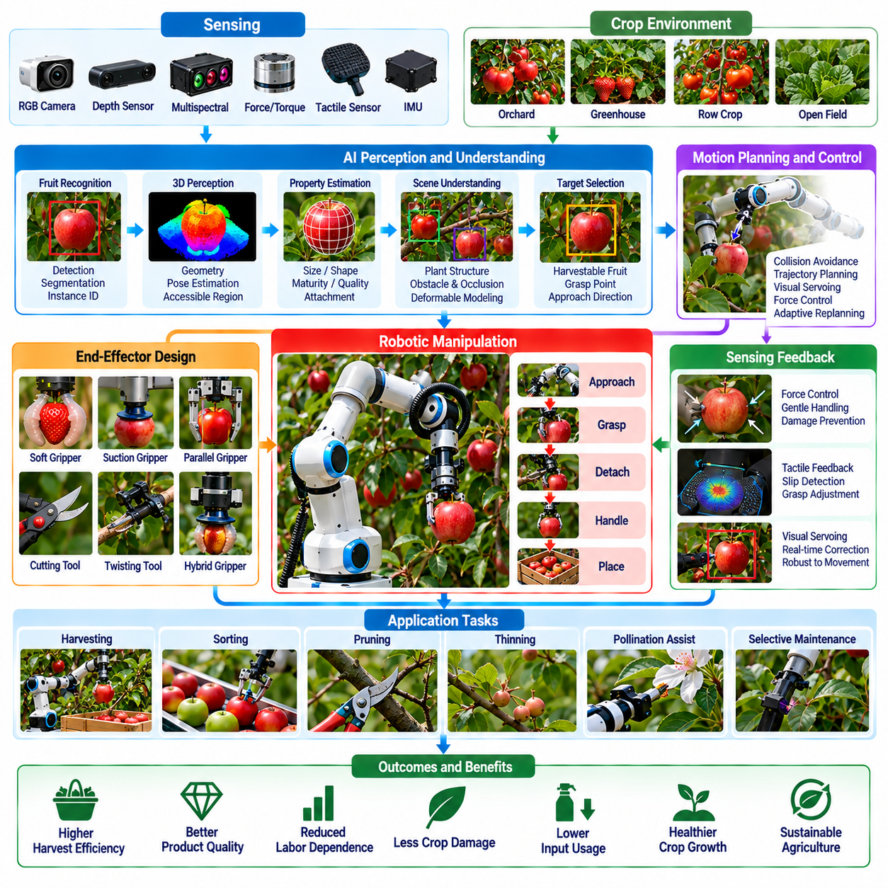{width="7.268055555555556in" height="7.268055555555556in"}

Fruit and crop manipulation is a fundamental capability of Physical AI in agriculture, enabling robots to interact directly with biological products during harvesting, sorting, pruning, and crop maintenance. Unlike standardized industrial objects, agricultural products exhibit substantial variation in shape, size, stiffness, and surface properties. Robotic manipulation must accommodate this variability while maintaining product quality and avoiding damage to surrounding plants.

Agricultural manipulation requires the integration of perception, motion planning, contact control, and task-specific mechanical design. A robot must identify the target, estimate its physical characteristics, select an appropriate interaction strategy, and execute the required movement. These processes operate under uncertainty because plant structures are flexible, partially occluded, and sensitive to external forces. Reliable manipulation therefore depends on continuous sensing and adaptive control.

Fruit recognition provides the foundation for robotic interaction with individual agricultural products. RGB cameras, depth sensors, and machine learning models can identify fruits, estimate their boundaries, and determine their spatial locations. Instance segmentation separates individual products even when multiple fruits overlap. However, shadows, leaves, branches, and changing illumination complicate recognition, requiring robust models and suitable sensor placement.

Three-dimensional perception enables robots to estimate fruit geometry and identify accessible grasping regions. Stereo vision, structured-light sensing, and depth reconstruction provide spatial information about products and surrounding vegetation. Point clouds can represent local plant structures and potential collision obstacles. Accurate geometric interpretation is necessary for selecting approach directions and generating manipulation trajectories within crowded agricultural environments.

Grasp planning determines how a robotic end effector should contact and secure an agricultural product. The selected grasp must provide sufficient stability while minimizing pressure on sensitive surfaces. Product geometry, mass distribution, attachment orientation, and surface friction influence grasp selection. AI-based planners can evaluate alternative contact configurations and choose actions that balance handling reliability, accessibility, and damage prevention.

End-effector design is particularly important because agricultural products vary widely in mechanical properties. Soft robotic grippers use compliant materials to distribute contact forces, while suction grippers provide attachment without conventional finger closure. Specialized mechanical fingers and hybrid gripping systems offer alternative capabilities. Selecting an appropriate mechanism requires consideration of product shape, fragility, contamination, and operational speed.

Soft robotics offers advantages when manipulating delicate fruits and vegetables. Flexible structures can conform to irregular surfaces and reduce localized contact pressure. Pneumatic actuators, elastomeric fingers, and variable-stiffness mechanisms can provide adaptable grasping behavior. However, soft grippers may introduce limitations in positioning accuracy, response speed, and force estimation, requiring careful integration with sensing and control systems.

Force and tactile sensing allow robots to monitor physical interactions during grasping and handling. Pressure sensors, force-torque sensors, and tactile arrays can detect contact conditions, slippage, and unexpected resistance. Closed-loop control adjusts gripping forces according to measured feedback. This capability is essential for products that bruise easily or deform under excessive pressure, where purely visual control may be insufficient.

Agricultural manipulation often involves interaction with deformable plant structures rather than isolated rigid objects. Leaves, stems, branches, and fruits may move when contacted, altering the geometry of the task environment. Robots must predict or observe these changes while maintaining safe contact. Deformable object modeling and compliant control help manage uncertain interactions, although accurate physical modeling remains computationally challenging.

Fruit detachment requires coordinated manipulation of the product and its connection to the plant. Different crops require pulling, twisting, bending, cutting, or combinations of these actions. The robot must identify suitable detachment locations and apply forces in appropriate directions. Incorrect execution can damage stems, branches, or harvested products. Crop-specific detachment strategies are therefore necessary for reliable automated harvesting.

Motion planning in agricultural manipulation must account for obstacles, limited access, and uncertain target positions. Robotic arms navigate through foliage while avoiding collisions with nearby fruits and plant structures. Sampling-based planners, optimization methods, and learned motion policies can generate feasible trajectories. Online replanning allows robots to respond when branches move or previously hidden obstacles become visible.

Visual servoing connects real-time image observations with robotic motion commands. Instead of relying exclusively on an initial target estimate, the robot continuously adjusts its trajectory according to updated visual measurements. This approach helps compensate for localization errors, plant movement, and manipulator positioning uncertainty. Combining visual servoing with force feedback provides greater robustness during final approach and physical contact.

Manipulation tasks extend beyond fruit harvesting to include thinning, pruning, pollination assistance, and selective crop maintenance. Each operation requires different tools, contact strategies, and biological constraints. Pruning involves precise cutting decisions, while thinning requires identifying and removing selected plant structures. Physical AI systems can share perception and motion-planning capabilities across these tasks, although specialized end effectors remain necessary.

Bimanual and multi-arm manipulation can improve performance when agricultural tasks require simultaneous stabilization and intervention. One manipulator may hold a branch or reposition foliage while another grasps or cuts a target. Coordinated control must prevent collisions and manage forces transmitted through connected plant structures. Multi-arm systems increase operational flexibility but introduce additional complexity in perception, scheduling, and mechanical coordination.

Product transfer and placement are important stages of agricultural manipulation. After detachment, robots must move products into containers, conveyors, or sorting systems without excessive impact or compression. Controlled release, compliant supports, and gentle transfer trajectories help preserve quality. Handling strategies must also consider product orientation, accumulation pressure, and the possibility of damage during repeated contact.

Learning-based manipulation can improve robotic performance through demonstrations and operational experience. Imitation learning uses human manipulation examples to develop action policies, while reinforcement learning explores strategies within controlled training environments. Simulation can support policy development, but biological materials are difficult to model accurately. Real-world validation is necessary to confirm that learned behaviors remain reliable across crop varieties and field conditions.

Data collection for agricultural manipulation should capture visual observations, robot configurations, contact forces, action sequences, and task outcomes. Successful and failed interactions provide information about grasp stability, detachment effectiveness, and product damage. Structured datasets support model training and performance analysis. Diversity across product maturity, geometry, environmental conditions, and manipulation strategies improves the potential for generalization.

Robotic manipulation performance should be evaluated using task success rate, cycle time, product damage, grasp stability, and recovery capability. A successful grasp does not necessarily indicate successful harvesting or acceptable product quality. Evaluation must consider the complete sequence from target identification to final placement. Consistent measurement procedures help compare alternative robotic designs and identify operational bottlenecks.

The economic value of fruit and crop manipulation depends on labor productivity, handling quality, equipment utilization, and compatibility with existing agricultural operations. Specialized manipulators may improve performance for particular crops but reduce flexibility across different products. Maintenance requirements, tool replacement, and seasonal utilization influence total ownership costs. Commercial deployment requires reliable operation at a competitive cost per handled product.

Ultimately, fruit and crop manipulation demonstrates the importance of embodied intelligence in agricultural robotics. Effective systems must combine visual understanding, geometric reasoning, compliant interaction, and adaptive control to handle biological variability. Continued advances in soft grippers, tactile sensing, learning-based control, and coordinated manipulation can expand agricultural automation. Long-term success depends on preserving crop quality while achieving reliable, scalable, and economically sustainable operation.

과실 및 작물 조작(Fruit and Crop Manipulation)은 농업 분야 피지컬 인공지능(Physical AI)의 핵심 기능으로, 로봇이 수확(Harvesting), 선별(Sorting), 가지치기(Pruning), 작물 관리(Crop Maintenance) 과정에서 생물학적 생산물(Biological Products)과 직접 상호작용할 수 있도록 한다. 표준화된 산업용 물체(Standardized Industrial Objects)와 달리 농산물(Agricultural Products)은 형태(Shape), 크기(Size), 강성(Stiffness), 표면 특성(Surface Properties)에서 상당한 변동성을 나타낸다. 로봇 조작(Robotic Manipulation)은 이러한 변동성에 대응하면서 농산물 품질(Product Quality)을 유지하고 주변 식물(Surrounding Plants)의 손상을 방지해야 한다.

농업용 조작(Agricultural Manipulation)은 인식(Perception), 동작 계획(Motion Planning), 접촉 제어(Contact Control), 작업별 기계 설계(Task-Specific Mechanical Design)의 통합을 요구한다. 로봇은 대상(Target)을 식별하고 물리적 특성(Physical Characteristics)을 추정하며 적절한 상호작용 전략(Interaction Strategy)을 선택한 후 필요한 동작을 실행해야 한다. 이러한 과정은 식물 구조(Plant Structures)가 유연하고 부분적으로 가려져 있으며 외부 힘(External Forces)에 민감하기 때문에 불확실성(Uncertainty) 속에서 수행된다. 따라서 신뢰할 수 있는 조작(Reliable Manipulation)은 지속적인 센싱(Continuous Sensing)과 적응형 제어(Adaptive Control)에 의존한다.

과실 인식(Fruit Recognition)은 개별 농산물과 로봇이 상호작용하기 위한 기반을 제공한다. RGB 카메라(RGB Cameras), 깊이 센서(Depth Sensors), 머신러닝 모델(Machine Learning Models)은 과실을 식별하고 경계(Boundaries)를 추정하며 공간적 위치(Spatial Locations)를 결정할 수 있다. 인스턴스 분할(Instance Segmentation)은 여러 과실이 중첩된 경우에도 개별 농산물을 구분한다. 그러나 그림자(Shadows), 잎(Leaves), 가지(Branches), 변화하는 조명(Changing Illumination)은 인식을 어렵게 만들기 때문에 견고한 모델(Robust Models)과 적절한 센서 배치(Sensor Placement)가 필요하다.

3차원 인식(Three-Dimensional Perception)은 로봇이 과실의 기하학적 구조(Fruit Geometry)를 추정하고 접근 가능한 파지 영역(Accessible Grasping Regions)을 식별하도록 한다. 스테레오 비전(Stereo Vision), 구조광 센싱(Structured-Light Sensing), 깊이 재구성(Depth Reconstruction)은 농산물과 주변 식생(Surrounding Vegetation)에 관한 공간 정보(Spatial Information)를 제공한다. 포인트 클라우드(Point Clouds)는 국소적인 식물 구조(Local Plant Structures)와 잠재적인 충돌 장애물(Potential Collision Obstacles)을 표현할 수 있다. 정확한 기하학적 해석(Geometric Interpretation)은 복잡한 농업 환경에서 접근 방향(Approach Directions)을 선택하고 조작 궤적(Manipulation Trajectories)을 생성하는 데 필요하다.

파지 계획(Grasp Planning)은 로봇 말단효과기(Robotic End Effector)가 농산물에 접촉하고 안정적으로 고정하는 방법을 결정한다. 선택된 파지(Grasp)는 민감한 표면(Sensitive Surfaces)에 가해지는 압력을 최소화하면서 충분한 안정성(Stability)을 제공해야 한다. 농산물의 기하학적 구조(Product Geometry), 질량 분포(Mass Distribution), 부착 방향(Attachment Orientation), 표면 마찰(Surface Friction)은 파지 선택(Grasp Selection)에 영향을 미친다. 인공지능 기반 계획기(AI-Based Planners)는 여러 접촉 구성(Contact Configurations)을 평가하고 취급 신뢰성(Handling Reliability), 접근성(Accessibility), 손상 방지(Damage Prevention) 사이의 균형을 유지하는 동작을 선택할 수 있다.

말단효과기 설계(End-Effector Design)는 농산물의 기계적 특성(Mechanical Properties)이 매우 다양하기 때문에 특히 중요하다. 소프트 로봇 그리퍼(Soft Robotic Grippers)는 유연한 소재(Compliant Materials)를 사용하여 접촉력(Contact Forces)을 분산시키며, 흡착 그리퍼(Suction Grippers)는 기존의 손가락 폐쇄 동작(Finger Closure) 없이 부착력을 제공한다. 특수 기계식 손가락(Specialized Mechanical Fingers)과 하이브리드 파지 시스템(Hybrid Gripping Systems)은 대안적인 기능을 제공한다. 적절한 메커니즘(Mechanism)을 선택하려면 농산물의 형태, 취약성(Fragility), 오염 가능성(Contamination), 작업 속도(Operational Speed)를 고려해야 한다.

소프트 로보틱스(Soft Robotics)는 손상되기 쉬운 과일과 채소(Delicate Fruits and Vegetables)를 조작할 때 장점을 제공한다. 유연한 구조(Flexible Structures)는 불규칙한 표면(Irregular Surfaces)에 순응하고 국소적인 접촉 압력(Localized Contact Pressure)을 줄일 수 있다. 공압 액추에이터(Pneumatic Actuators), 탄성체 손가락(Elastomeric Fingers), 가변 강성 메커니즘(Variable-Stiffness Mechanisms)은 적응 가능한 파지 동작(Adaptable Grasping Behavior)을 제공한다. 그러나 소프트 그리퍼(Soft Grippers)는 위치 정확도(Positioning Accuracy), 응답 속도(Response Speed), 힘 추정(Force Estimation) 측면에서 한계를 가질 수 있으므로 센싱 및 제어 시스템(Sensing and Control Systems)과의 신중한 통합이 필요하다.

힘 및 촉각 센싱(Force and Tactile Sensing)은 로봇이 파지와 취급 과정에서 물리적 상호작용(Physical Interactions)을 모니터링하도록 한다. 압력 센서(Pressure Sensors), 힘·토크 센서(Force-Torque Sensors), 촉각 센서 배열(Tactile Arrays)은 접촉 상태(Contact Conditions), 미끄러짐(Slippage), 예상하지 못한 저항(Unexpected Resistance)을 감지할 수 있다. 폐루프 제어(Closed-Loop Control)는 측정된 피드백(Measured Feedback)에 따라 파지력(Gripping Forces)을 조절한다. 이러한 기능은 과도한 압력(Excessive Pressure)에 의해 쉽게 멍들거나 변형되는 농산물에 필수적이며, 시각 정보만 사용하는 제어(Purely Visual Control)가 충분하지 않은 경우에 특히 중요하다.

농업용 조작은 분리된 강체 물체(Isolated Rigid Objects)보다 변형 가능한 식물 구조(Deformable Plant Structures)와 상호작용하는 경우가 많다. 잎, 줄기(Stems), 가지, 과실은 접촉 시 움직이면서 작업 환경의 기하학적 구조(Task Environment Geometry)를 변화시킬 수 있다. 로봇은 안전한 접촉(Safe Contact)을 유지하면서 이러한 변화를 예측하거나 관측해야 한다. 변형 가능 물체 모델링(Deformable Object Modeling)과 순응 제어(Compliant Control)는 불확실한 상호작용(Uncertain Interactions)을 관리하는 데 도움이 되지만, 정확한 물리 모델링(Physical Modeling)은 여전히 계산적으로 어려운 과제이다.

과실 분리(Fruit Detachment)는 농산물과 식물 사이의 연결 구조(Connection Structure)를 고려한 협조 조작(Coordinated Manipulation)을 요구한다. 작물에 따라 당기기(Pulling), 비틀기(Twisting), 굽히기(Bending), 절단(Cutting) 또는 이러한 동작의 조합이 필요하다. 로봇은 적절한 분리 위치(Detachment Locations)를 식별하고 올바른 방향으로 힘을 가해야 한다. 잘못된 작업 수행(Incorrect Execution)은 줄기, 가지 또는 수확된 농산물(Harvested Products)을 손상시킬 수 있다. 따라서 신뢰할 수 있는 자동 수확(Automated Harvesting)을 위해서는 작물별 분리 전략(Crop-Specific Detachment Strategies)이 필요하다.

농업용 조작의 동작 계획(Motion Planning)은 장애물(Obstacles), 제한된 접근 공간(Limited Access), 불확실한 대상 위치(Uncertain Target Positions)를 고려해야 한다. 로봇 팔(Robotic Arms)은 주변 과실과 식물 구조의 충돌을 피하면서 잎이 밀집된 공간(Foliage)을 통과해야 한다. 샘플링 기반 계획기(Sampling-Based Planners), 최적화 기법(Optimization Methods), 학습 기반 동작 정책(Learned Motion Policies)은 실행 가능한 궤적(Feasible Trajectories)을 생성할 수 있다. 온라인 재계획(Online Replanning)은 가지가 움직이거나 이전에 가려져 있던 장애물이 나타날 때 로봇이 대응하도록 한다.

시각 서보잉(Visual Servoing)은 실시간 영상 관측(Real-Time Image Observations)을 로봇 동작 명령(Robotic Motion Commands)과 연결한다. 로봇은 초기 대상 위치 추정(Initial Target Estimate)에만 의존하지 않고 갱신된 시각 측정값(Updated Visual Measurements)에 따라 궤적(Trajectory)을 지속적으로 조정한다. 이러한 접근법은 위치 추정 오차(Localization Errors), 식물 움직임(Plant Movement), 매니퓰레이터 위치 불확실성(Manipulator Positioning Uncertainty)을 보상하는 데 도움이 된다. 시각 서보잉과 힘 피드백(Force Feedback)을 결합하면 최종 접근(Final Approach)과 물리적 접촉(Physical Contact) 과정의 견고성(Robustness)을 높일 수 있다.

조작 작업(Manipulation Tasks)은 과실 수확을 넘어 솎아내기(Thinning), 가지치기(Pruning), 수분 보조(Pollination Assistance), 선택적 작물 관리(Selective Crop Maintenance)까지 확장된다. 각 작업은 서로 다른 도구(Tools), 접촉 전략(Contact Strategies), 생물학적 제약조건(Biological Constraints)을 요구한다. 가지치기는 정밀한 절단 의사결정(Precise Cutting Decisions)을 포함하며, 솎아내기는 선택된 식물 구조를 식별하고 제거하는 과정이다. 피지컬 인공지능 시스템은 이러한 작업 전반에 걸쳐 인식 및 동작 계획 기능(Perception and Motion-Planning Capabilities)을 공유할 수 있지만, 특수 말단효과기(Specialized End Effectors)는 여전히 필요하다.

양손 조작(Bimanual Manipulation)과 다중 로봇 팔 조작(Multi-Arm Manipulation)은 동시적인 안정화(Stabilization)와 개입(Intervention)이 필요한 농업 작업에서 성능을 향상시킬 수 있다. 하나의 매니퓰레이터(Manipulator)는 가지를 고정하거나 잎의 위치를 변경하고, 다른 매니퓰레이터는 대상을 파지하거나 절단할 수 있다. 협조 제어(Coordinated Control)는 충돌을 방지하고 연결된 식물 구조(Connected Plant Structures)를 통해 전달되는 힘을 관리해야 한다. 다중 로봇 팔 시스템(Multi-Arm Systems)은 운영 유연성(Operational Flexibility)을 높이지만 인식, 스케줄링(Scheduling), 기계적 협조(Mechanical Coordination)의 복잡성도 증가시킨다.

농산물 이송 및 배치(Product Transfer and Placement)는 농업용 조작의 중요한 단계이다. 분리 작업 이후 로봇은 과도한 충격(Excessive Impact)이나 압축(Compression) 없이 농산물을 용기(Containers), 컨베이어(Conveyors), 선별 시스템(Sorting Systems)으로 이동시켜야 한다. 제어된 방출(Controlled Release), 순응형 지지 구조(Compliant Supports), 부드러운 이송 궤적(Gentle Transfer Trajectories)은 품질 유지에 도움이 된다. 취급 전략(Handling Strategies)은 농산물의 방향(Product Orientation), 적재 압력(Accumulation Pressure), 반복적인 접촉(Repeated Contact)에 따른 손상 가능성도 고려해야 한다.

학습 기반 조작(Learning-Based Manipulation)은 시연(Demonstrations)과 운영 경험(Operational Experience)을 통해 로봇 성능을 향상시킬 수 있다. 모방학습(Imitation Learning)은 인간의 조작 사례(Human Manipulation Examples)를 활용하여 행동 정책(Action Policies)을 개발하며, 강화학습(Reinforcement Learning)은 통제된 학습 환경(Controlled Training Environments)에서 다양한 전략을 탐색한다. 시뮬레이션(Simulation)은 정책 개발(Policy Development)을 지원할 수 있지만 생물학적 재료(Biological Materials)를 정확하게 모델링하기는 어렵다. 학습된 행동(Learned Behaviors)이 다양한 작물 품종(Crop Varieties)과 농경지 조건(Field Conditions)에서 안정적으로 작동하는지 확인하려면 실제 환경 검증(Real-World Validation)이 필요하다.

농업용 조작을 위한 데이터 수집(Data Collection)은 시각적 관측(Visual Observations), 로봇 구성 상태(Robot Configurations), 접촉력(Contact Forces), 동작 시퀀스(Action Sequences), 작업 결과(Task Outcomes)를 포함해야 한다. 성공 및 실패한 상호작용(Successful and Failed Interactions)은 파지 안정성(Grasp Stability), 분리 효과(Detachment Effectiveness), 농산물 손상(Product Damage)에 관한 정보를 제공한다. 구조화된 데이터셋(Structured Datasets)은 모델 학습(Model Training)과 성능 분석(Performance Analysis)을 지원한다. 농산물 성숙도(Product Maturity), 기하학적 구조, 환경 조건, 조작 전략(Manipulation Strategies)의 다양성은 일반화 가능성(Generalization Potential)을 향상시킨다.

로봇 조작 성능(Robotic Manipulation Performance)은 작업 성공률(Task Success Rate), 작업 주기 시간(Cycle Time), 농산물 손상, 파지 안정성, 복구 능력(Recovery Capability)을 기준으로 평가해야 한다. 성공적인 파지(Successful Grasp)가 반드시 성공적인 수확(Successful Harvesting)이나 허용 가능한 농산물 품질(Acceptable Product Quality)을 의미하지는 않는다. 평가는 대상 식별(Target Identification)부터 최종 배치(Final Placement)까지의 전체 과정을 고려해야 한다. 일관된 측정 절차(Consistent Measurement Procedures)는 대안적인 로봇 설계(Alternative Robotic Designs)를 비교하고 운영 병목 요인(Operational Bottlenecks)을 식별하는 데 도움이 된다.

과실 및 작물 조작의 경제적 가치(Economic Value)는 노동 생산성(Labor Productivity), 취급 품질(Handling Quality), 장비 활용도(Equipment Utilization), 기존 농업 운영(Existing Agricultural Operations)과의 호환성(Compatibility)에 따라 결정된다. 특수 매니퓰레이터(Specialized Manipulators)는 특정 작물에 대한 성능을 향상시킬 수 있지만 서로 다른 농산물에 대한 유연성(Flexibility)을 감소시킬 수 있다. 유지보수 요구사항(Maintenance Requirements), 도구 교체(Tool Replacement), 계절별 활용도(Seasonal Utilization)는 총소유비용(Total Ownership Costs)에 영향을 미친다. 상업적 도입(Commercial Deployment)을 위해서는 농산물 단위당 경쟁력 있는 처리 비용(Competitive Cost per Handled Product)으로 신뢰할 수 있는 운영을 달성해야 한다.

궁극적으로 과실 및 작물 조작(Fruit and Crop Manipulation)은 농업 로보틱스(Agricultural Robotics)에서 체화 지능(Embodied Intelligence)의 중요성을 보여준다. 효과적인 시스템은 생물학적 변동성(Biological Variability)에 대응하기 위해 시각적 이해(Visual Understanding), 기하학적 추론(Geometric Reasoning), 순응적 상호작용(Compliant Interaction), 적응형 제어(Adaptive Control)를 결합해야 한다. 소프트 그리퍼(Soft Grippers), 촉각 센싱(Tactile Sensing), 학습 기반 제어(Learning-Based Control), 협조 조작(Coordinated Manipulation)의 지속적인 발전은 농업 자동화(Agricultural Automation)의 적용 범위를 확대할 수 있다. 장기적인 성공(Long-Term Success)은 작물 품질(Crop Quality)을 유지하면서 신뢰성(Reliability), 확장성(Scalability), 경제적 지속 가능성(Economic Sustainability)을 갖춘 운영을 달성하는 데 달려 있다.

##  

## 05.08. Heavy Payload and Field Logistics

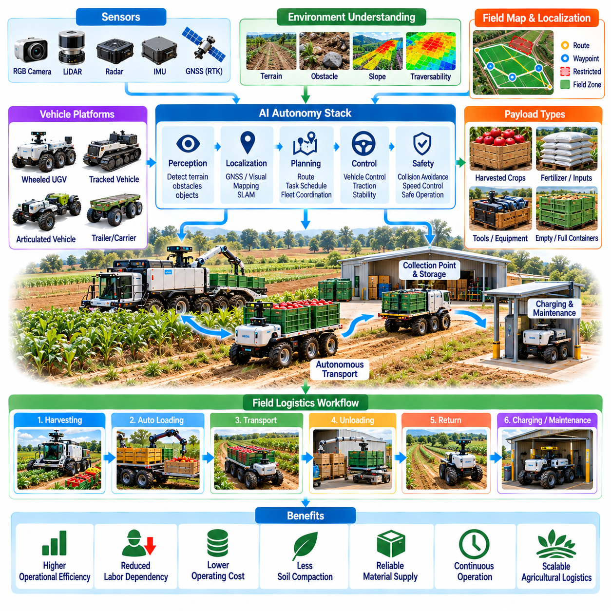{width="7.268055555555556in" height="7.268055555555556in"}

Heavy payload handling and field logistics are essential applications of Physical AI in agriculture, supporting the transportation of harvested crops, fertilizers, tools, equipment, and other materials across farming environments. Agricultural logistics frequently involves repetitive movement over long distances and irregular terrain. Autonomous transport systems can reduce manual handling requirements, improve operational continuity, and connect distributed agricultural activities.

Field logistics differs from conventional warehouse transportation because agricultural environments are largely unstructured and continuously changing. Uneven soil, slopes, mud, vegetation, drainage channels, and temporary obstacles create significant mobility challenges. Physical AI combines environmental perception, autonomous navigation, and vehicle control to transport heavy loads safely while adapting to terrain conditions and operational requirements.

Agricultural payload requirements vary according to crop type, production scale, and transportation objectives. Small mobile robots may carry harvesting containers or specialized tools, while larger autonomous vehicles transport bulk produce, fertilizer supplies, and agricultural equipment. Payload mass, dimensions, center of gravity, and loading configuration influence vehicle selection. Effective system design must balance transport capacity, mobility, stability, and energy efficiency.

Heavy payload transportation requires careful consideration of vehicle morphology and mechanical architecture. Wheeled platforms provide efficient movement on relatively firm surfaces, while tracked vehicles may improve traction on soft or uneven ground. Articulated chassis and specialized suspension systems help maintain contact with irregular terrain. The selected configuration must accommodate agricultural access constraints without causing excessive soil compaction or crop damage.

Terrain perception is fundamental to reliable autonomous field logistics. Cameras, LiDAR, depth sensors, and inertial measurement units provide information about obstacles, surface geometry, and vehicle motion. AI models can estimate traversability by interpreting soil appearance, vegetation density, slope, and terrain irregularities. However, visual information alone cannot reliably determine soil strength or traction, requiring feedback from vehicle dynamics and wheel-ground interactions.

Localization and mapping enable autonomous transport vehicles to navigate between harvesting zones, storage facilities, processing areas, and equipment stations. RTK-GNSS provides accurate outdoor positioning when satellite visibility is sufficient, while visual and LiDAR-based methods support localization under partial obstruction. Agricultural maps must represent routes, field boundaries, restricted areas, and temporary hazards. Reliable positioning is essential for safe movement and precise loading operations.

Route planning for heavy agricultural vehicles must consider more than travel distance. Payload weight, terrain slope, surface conditions, turning radius, vehicle width, and energy consumption influence route feasibility. A shorter path may be unsuitable when soil conditions cannot support the vehicle or when steep gradients create stability risks. Intelligent planners select routes that balance transport efficiency with safety, accessibility, and environmental impact.

Vehicle stability becomes particularly important when transporting large or elevated loads across uneven terrain. Changes in payload distribution can alter the center of gravity and increase rollover risk during turning, braking, or slope traversal. Stability-aware control systems monitor vehicle orientation, acceleration, and load conditions. Speed limitations and conservative trajectory planning help maintain safe operation under variable agricultural conditions.

Traction management is another critical requirement for heavy payload mobility. Wheel slip, soil deformation, and uneven ground contact can reduce propulsion efficiency and compromise navigation accuracy. Sensors monitoring wheel speed, motor torque, and inertial motion can identify abnormal traction conditions. Adaptive control strategies adjust acceleration, braking, and drive torque to reduce excessive slip while preserving mobility and limiting soil disturbance.

Loading and unloading operations connect autonomous transportation with agricultural production workflows. Robots may receive harvested containers from workers, harvesting machines, or automated transfer equipment. Accurate docking, platform alignment, and payload positioning are necessary for reliable material exchange. Mechanical interfaces must accommodate variation in container dimensions, loading height, and transfer mechanisms while preventing unintended movement during handling.

Automated payload handling can incorporate lifting mechanisms, conveyors, robotic arms, and interchangeable cargo platforms. These components enable agricultural vehicles to support different material transportation tasks without extensive manual intervention. However, additional handling equipment increases system mass, energy consumption, and mechanical complexity. Modular designs can improve flexibility when standardized containers and compatible transfer interfaces are available.

Harvest logistics requires coordinating transportation capacity with the output of harvesting operations. Autonomous carriers can collect filled containers and deliver them to designated collection points while harvesting equipment continues working. Poor coordination may cause harvesting delays or unnecessary vehicle waiting. Task scheduling systems estimate transport demand and allocate available vehicles according to production rates, travel distances, and loading requirements.

Multi-robot logistics enables coordinated transportation across large agricultural operations. Multiple autonomous carriers may share routes, collection stations, and charging facilities while serving different harvesting teams. Fleet management systems assign missions, monitor vehicle status, and resolve scheduling conflicts. Effective coordination reduces empty travel and congestion while improving equipment utilization, although communication limitations must be considered.

Energy management strongly influences the economics of heavy payload transportation. Vehicle mass, cargo weight, terrain resistance, travel speed, and auxiliary equipment determine power consumption. Battery-electric platforms require appropriate charging infrastructure and mission scheduling. Energy-aware planners can estimate remaining operating range and reserve sufficient capacity for safe return. Hybrid power systems may be considered where extended operating duration is required.

Field logistics systems must operate alongside agricultural workers, conventional machinery, and other autonomous equipment. Safety mechanisms include obstacle detection, controlled stopping, speed restrictions, and designated operating zones. Heavy vehicles require sufficient braking capability and safe separation distances, particularly on slopes or low-traction surfaces. Human supervision and emergency intervention procedures remain important when operating in shared agricultural environments.

Weather and seasonal variation significantly affect logistics reliability. Rain can reduce traction and increase soil deformation, while extreme temperatures may influence battery performance and electronic equipment. Harvest seasons may also introduce concentrated transportation demand over short periods. Physical AI systems must adapt operational plans to changing conditions and suspend missions when terrain or environmental risks exceed validated limits.

Data integration connects field logistics with broader agricultural management systems. Transport records can include payload weight, collection location, delivery time, route history, and equipment utilization. Digital farm platforms can combine these observations with harvesting schedules and storage capacity information. Such integration supports operational visibility, resource allocation, and analysis of logistics bottlenecks across agricultural production processes.

Simulation and digital twins can support the development of autonomous agricultural transport systems. Virtual environments represent field geometry, vehicle dynamics, payload configurations, and operational workflows. Engineers can evaluate route planning, fleet coordination, and energy consumption before physical deployment. Nevertheless, simulated soil interactions and terrain conditions may differ from reality, making field testing essential for reliable validation.

The economic value of heavy payload automation depends on transportation productivity, labor savings, equipment utilization, and reduced harvesting interruptions. Capital costs, maintenance, battery replacement, infrastructure, and supervision must be included in total ownership calculations. Performance can be evaluated through transported mass per hour, cost per delivery, vehicle availability, and energy consumption. Commercial feasibility requires consistent operational benefits under actual field conditions.

Ultimately, heavy payload handling and field logistics provide the physical transportation infrastructure connecting intelligent agricultural operations. By combining autonomous mobility, terrain-aware control, payload management, and fleet coordination, Physical AI can improve the continuity of harvesting and material distribution. Long-term adoption depends on safe load handling, robust field navigation, scalable coordination, and measurable improvements in agricultural logistics efficiency.

고중량 적재물 운반 및 농경지 물류(Heavy Payload Handling and Field Logistics)는 농업 분야 피지컬 인공지능(Physical AI)의 핵심 응용 분야로, 수확된 작물(Harvested Crops), 비료(Fertilizers), 도구(Tools), 장비(Equipment), 기타 자재(Materials)를 농업 환경 전반에 걸쳐 운송하는 작업을 지원한다. 농업 물류(Agricultural Logistics)는 장거리(Long Distances)와 불규칙한 지형(Irregular Terrain)에서 반복적인 운반 작업을 수반하는 경우가 많다. 자율 운송 시스템(Autonomous Transport Systems)은 수작업 취급 요구사항(Manual Handling Requirements)을 줄이고 운영 연속성(Operational Continuity)을 향상시키며 분산된 농업 활동(Distributed Agricultural Activities)을 연결할 수 있다.

농경지 물류(Field Logistics)는 농업 환경이 대부분 비정형적(Unstructured)이고 지속적으로 변화하기 때문에 기존 창고 운송(Conventional Warehouse Transportation)과 차이가 있다. 고르지 않은 토양(Uneven Soil), 경사면(Slopes), 진흙(Mud), 식생(Vegetation), 배수로(Drainage Channels), 임시 장애물(Temporary Obstacles)은 상당한 이동성 문제(Mobility Challenges)를 발생시킨다. 피지컬 인공지능은 환경 인식(Environmental Perception), 자율 내비게이션(Autonomous Navigation), 차량 제어(Vehicle Control)를 결합하여 지형 조건(Terrain Conditions)과 운영 요구사항(Operational Requirements)에 적응하면서 고중량 화물(Heavy Loads)을 안전하게 운송한다.

농업용 적재물 요구사항(Agricultural Payload Requirements)은 작물 종류(Crop Type), 생산 규모(Production Scale), 운송 목적(Transportation Objectives)에 따라 달라진다. 소형 이동 로봇(Small Mobile Robots)은 수확용 용기(Harvesting Containers)나 특수 도구(Specialized Tools)를 운반할 수 있으며, 대형 자율 차량(Larger Autonomous Vehicles)은 대량의 농산물(Bulk Produce), 비료 공급품(Fertilizer Supplies), 농업 장비(Agricultural Equipment)를 운송한다. 적재물 질량(Payload Mass), 크기(Dimensions), 무게중심(Center of Gravity), 적재 구성(Loading Configuration)은 차량 선택(Vehicle Selection)에 영향을 미친다. 효과적인 시스템 설계(System Design)는 운송 용량(Transport Capacity), 이동성(Mobility), 안정성(Stability), 에너지 효율성(Energy Efficiency) 사이의 균형을 유지해야 한다.

고중량 적재물 운송(Heavy Payload Transportation)은 차량 형태(Vehicle Morphology)와 기계적 아키텍처(Mechanical Architecture)에 대한 신중한 검토를 요구한다. 차륜형 플랫폼(Wheeled Platforms)은 비교적 단단한 지면(Firm Surfaces)에서 효율적으로 이동할 수 있으며, 궤도형 차량(Tracked Vehicles)은 연약하거나 고르지 않은 지면(Soft or Uneven Ground)에서 견인력(Traction)을 향상시킬 수 있다. 관절형 섀시(Articulated Chassis)와 특수 현가장치(Specialized Suspension Systems)는 불규칙한 지형과의 접촉을 유지하는 데 도움이 된다. 선택된 구성(Configuration)은 과도한 토양 다짐(Soil Compaction)이나 작물 손상(Crop Damage)을 유발하지 않으면서 농업 환경의 접근 제약조건(Agricultural Access Constraints)을 충족해야 한다.

지형 인식(Terrain Perception)은 신뢰할 수 있는 자율 농경지 물류(Autonomous Field Logistics)의 기본 요소이다. 카메라(Cameras), 라이다(LiDAR), 깊이 센서(Depth Sensors), 관성측정장치(Inertial Measurement Units, IMUs)는 장애물(Obstacles), 지표면 형상(Surface Geometry), 차량 운동(Vehicle Motion)에 관한 정보를 제공한다. 인공지능 모델(AI Models)은 토양 외관(Soil Appearance), 식생 밀도(Vegetation Density), 경사(Slope), 지형 불규칙성(Terrain Irregularities)을 해석하여 주행 가능성(Traversability)을 추정할 수 있다. 그러나 시각 정보(Visual Information)만으로는 토양 강도(Soil Strength)나 견인력을 신뢰성 있게 판단할 수 없으므로 차량 동역학(Vehicle Dynamics)과 바퀴-지면 상호작용(Wheel-Ground Interactions)에서 얻는 피드백이 필요하다.

위치 추정 및 지도 작성(Localization and Mapping)은 자율 운송 차량(Autonomous Transport Vehicles)이 수확 구역(Harvesting Zones), 저장 시설(Storage Facilities), 가공 구역(Processing Areas), 장비 작업장(Equipment Stations) 사이를 이동할 수 있도록 한다. 실시간 이동측위 위성항법 시스템(RTK-GNSS)은 위성 가시성(Satellite Visibility)이 충분한 경우 정확한 실외 위치 측정(Outdoor Positioning)을 제공하며, 시각 및 라이다 기반 방법(Visual and LiDAR-Based Methods)은 부분적인 가림(Partial Obstruction)이 발생하는 환경에서 위치 추정을 지원한다. 농업 지도(Agricultural Maps)는 이동 경로(Routes), 농경지 경계(Field Boundaries), 제한 구역(Restricted Areas), 임시 위험 요소(Temporary Hazards)를 표현해야 한다. 신뢰할 수 있는 위치 측정(Reliable Positioning)은 안전한 이동과 정밀한 적재 작업(Precise Loading Operations)에 필수적이다.

고중량 농업 차량(Heavy Agricultural Vehicles)의 경로 계획(Route Planning)은 이동 거리(Travel Distance) 이상의 요소를 고려해야 한다. 적재물 중량(Payload Weight), 지형 경사(Terrain Slope), 지표면 상태(Surface Conditions), 회전 반경(Turning Radius), 차량 폭(Vehicle Width), 에너지 소비(Energy Consumption)는 경로 실행 가능성(Route Feasibility)에 영향을 미친다. 토양 조건이 차량을 지지하지 못하거나 급경사(Steep Gradients)로 인해 안정성 위험(Stability Risks)이 발생하는 경우 짧은 경로가 부적합할 수 있다. 지능형 경로 계획기(Intelligent Planners)는 운송 효율성(Transport Efficiency), 안전성(Safety), 접근성(Accessibility), 환경 영향(Environmental Impact) 사이의 균형을 고려하여 경로를 선택한다.

차량 안정성(Vehicle Stability)은 크거나 높은 위치에 적재된 화물(Large or Elevated Loads)을 고르지 않은 지형에서 운송할 때 특히 중요하다. 적재물 분포(Payload Distribution)의 변화는 무게중심을 이동시키고 회전(Turning), 제동(Braking), 경사면 주행(Slope Traversal) 중 전복 위험(Rollover Risk)을 증가시킬 수 있다. 안정성 인식 제어 시스템(Stability-Aware Control Systems)은 차량 자세(Vehicle Orientation), 가속도(Acceleration), 적재 조건(Load Conditions)을 모니터링한다. 속도 제한(Speed Limitations)과 보수적인 궤적 계획(Conservative Trajectory Planning)은 다양한 농업 환경에서 안전한 운영을 유지하는 데 도움이 된다.

견인력 관리(Traction Management)는 고중량 적재물 이동(Heavy Payload Mobility)을 위한 또 다른 핵심 요구사항이다. 바퀴 미끄러짐(Wheel Slip), 토양 변형(Soil Deformation), 불균일한 지면 접촉(Uneven Ground Contact)은 추진 효율성(Propulsion Efficiency)을 감소시키고 내비게이션 정확도(Navigation Accuracy)를 저하시킬 수 있다. 바퀴 속도(Wheel Speed), 모터 토크(Motor Torque), 관성 운동(Inertial Motion)을 모니터링하는 센서는 비정상적인 견인 조건(Abnormal Traction Conditions)을 식별할 수 있다. 적응형 제어 전략(Adaptive Control Strategies)은 이동성을 유지하고 토양 교란(Soil Disturbance)을 제한하면서 과도한 미끄러짐을 줄이기 위해 가속, 제동, 구동 토크(Drive Torque)를 조절한다.

적재 및 하역 작업(Loading and Unloading Operations)은 자율 운송(Autonomous Transportation)을 농업 생산 작업흐름(Agricultural Production Workflows)과 연결한다. 로봇은 작업자(Workers), 수확 기계(Harvesting Machines), 자동 이송 장비(Automated Transfer Equipment)로부터 수확된 농산물이 담긴 용기를 전달받을 수 있다. 정확한 도킹(Accurate Docking), 플랫폼 정렬(Platform Alignment), 적재물 위치 결정(Payload Positioning)은 신뢰할 수 있는 자재 교환(Material Exchange)에 필요하다. 기계적 인터페이스(Mechanical Interfaces)는 취급 과정에서 의도하지 않은 움직임(Unintended Movement)을 방지하면서 용기 크기(Container Dimensions), 적재 높이(Loading Height), 이송 메커니즘(Transfer Mechanisms)의 차이를 수용해야 한다.

자동 적재물 취급(Automated Payload Handling)에는 리프팅 메커니즘(Lifting Mechanisms), 컨베이어(Conveyors), 로봇 팔(Robotic Arms), 교체형 화물 플랫폼(Interchangeable Cargo Platforms)이 포함될 수 있다. 이러한 구성요소는 농업 차량(Agricultural Vehicles)이 광범위한 수작업 개입(Manual Intervention) 없이 다양한 자재 운송 작업(Material Transportation Tasks)을 수행하도록 한다. 그러나 추가적인 취급 장비(Handling Equipment)는 시스템 질량(System Mass), 에너지 소비, 기계적 복잡성(Mechanical Complexity)을 증가시킨다. 표준화된 용기(Standardized Containers)와 호환 가능한 이송 인터페이스(Compatible Transfer Interfaces)를 사용할 수 있다면 모듈형 설계(Modular Designs)는 유연성(Flexibility)을 향상시킬 수 있다.

수확 물류(Harvest Logistics)는 운송 용량(Transportation Capacity)을 수확 작업의 생산량(Harvesting Output)과 조정해야 한다. 자율 운반 로봇(Autonomous Carriers)은 수확 장비가 계속 작업하는 동안 가득 찬 용기(Filled Containers)를 수거하여 지정된 집하 지점(Designated Collection Points)으로 운송할 수 있다. 협조가 원활하지 않으면 수확 지연(Harvesting Delays)이나 불필요한 차량 대기(Vehicle Waiting)가 발생할 수 있다. 작업 스케줄링 시스템(Task Scheduling Systems)은 생산 속도(Production Rates), 이동 거리(Travel Distances), 적재 요구사항(Loading Requirements)에 따라 운송 수요(Transport Demand)를 추정하고 가용 차량(Available Vehicles)을 할당한다.

다중 로봇 물류(Multi-Robot Logistics)는 대규모 농업 운영(Large Agricultural Operations)에서 협조적인 운송(Coordinated Transportation)을 가능하게 한다. 여러 자율 운반 로봇은 서로 다른 수확팀(Harvesting Teams)을 지원하면서 이동 경로(Routes), 집하장(Collection Stations), 충전 시설(Charging Facilities)을 공유할 수 있다. 플릿 관리 시스템(Fleet Management Systems)은 임무(Missions)를 할당하고 차량 상태(Vehicle Status)를 모니터링하며 스케줄링 충돌(Scheduling Conflicts)을 해결한다. 효과적인 협조(Effective Coordination)는 공차 이동(Empty Travel)과 교통 혼잡(Congestion)을 줄이고 장비 활용도(Equipment Utilization)를 향상시키지만 통신 제약조건(Communication Limitations)을 고려해야 한다.

에너지 관리(Energy Management)는 고중량 적재물 운송의 경제성(Economics)에 큰 영향을 미친다. 차량 질량(Vehicle Mass), 화물 중량(Cargo Weight), 지형 저항(Terrain Resistance), 이동 속도(Travel Speed), 보조 장비(Auxiliary Equipment)는 전력 소비(Power Consumption)를 결정한다. 배터리 전기식 플랫폼(Battery-Electric Platforms)은 적절한 충전 인프라(Charging Infrastructure)와 임무 스케줄링(Mission Scheduling)을 필요로 한다. 에너지 인식 경로 계획기(Energy-Aware Planners)는 잔여 운행 가능 거리(Remaining Operating Range)를 추정하고 안전한 복귀(Safe Return)에 필요한 충분한 에너지 용량(Energy Capacity)을 확보할 수 있다. 장시간 운영(Extended Operating Duration)이 필요한 경우 하이브리드 동력 시스템(Hybrid Power Systems)을 고려할 수 있다.

농경지 물류 시스템(Field Logistics Systems)은 농업 작업자(Agricultural Workers), 기존 농기계(Conventional Machinery), 기타 자율 장비(Autonomous Equipment)와 함께 작동해야 한다. 안전 메커니즘(Safety Mechanisms)에는 장애물 탐지(Obstacle Detection), 제어된 정지(Controlled Stopping), 속도 제한(Speed Restrictions), 지정된 운영 구역(Designated Operating Zones)이 포함된다. 고중량 차량(Heavy Vehicles)은 특히 경사면이나 낮은 견인력(Low-Traction Surfaces)을 가진 지면에서 충분한 제동 성능(Braking Capability)과 안전 이격거리(Safe Separation Distances)를 확보해야 한다. 공동 작업 농업 환경(Shared Agricultural Environments)에서는 인간 감독(Human Supervision)과 비상 개입 절차(Emergency Intervention Procedures)가 여전히 중요하다.

기상 및 계절적 변화(Weather and Seasonal Variation)는 물류 신뢰성(Logistics Reliability)에 상당한 영향을 미친다. 비(Rain)는 견인력을 감소시키고 토양 변형을 증가시킬 수 있으며, 극한 온도(Extreme Temperatures)는 배터리 성능(Battery Performance)과 전자 장비(Electronic Equipment)에 영향을 미칠 수 있다. 수확기(Harvest Seasons)에는 짧은 기간에 운송 수요가 집중될 수도 있다. 피지컬 인공지능 시스템은 변화하는 조건에 따라 운영 계획(Operational Plans)을 조정하고 지형 또는 환경 위험(Terrain or Environmental Risks)이 검증된 한계(Validated Limits)를 초과하면 임무를 중단해야 한다.

데이터 통합(Data Integration)은 농경지 물류를 보다 광범위한 농업 관리 시스템(Agricultural Management Systems)과 연결한다. 운송 기록(Transport Records)에는 적재물 중량(Payload Weight), 수거 위치(Collection Location), 배송 시간(Delivery Time), 경로 이력(Route History), 장비 활용도(Equipment Utilization)가 포함될 수 있다. 디지털 농장 플랫폼(Digital Farm Platforms)은 이러한 관측 정보를 수확 일정(Harvesting Schedules) 및 저장 용량 정보(Storage Capacity Information)와 결합할 수 있다. 이러한 통합은 농업 생산 과정 전반에 걸친 운영 가시성(Operational Visibility), 자원 할당(Resource Allocation), 물류 병목 요인(Logistics Bottlenecks)의 분석을 지원한다.

시뮬레이션(Simulation)과 디지털 트윈(Digital Twins)은 자율 농업 운송 시스템(Autonomous Agricultural Transport Systems)의 개발을 지원할 수 있다. 가상 환경(Virtual Environments)은 농경지 형상(Field Geometry), 차량 동역학(Vehicle Dynamics), 적재물 구성(Payload Configurations), 운영 작업흐름(Operational Workflows)을 표현한다. 엔지니어(Engineers)는 실제 배포(Physical Deployment) 전에 경로 계획, 플릿 협조(Fleet Coordination), 에너지 소비를 평가할 수 있다. 그러나 시뮬레이션된 토양 상호작용(Simulated Soil Interactions)과 지형 조건은 실제 환경과 다를 수 있으므로 신뢰할 수 있는 검증(Reliable Validation)을 위해서는 현장 시험(Field Testing)이 필수적이다.

고중량 적재물 자동화(Heavy Payload Automation)의 경제적 가치(Economic Value)는 운송 생산성(Transportation Productivity), 노동비 절감(Labor Savings), 장비 활용도, 수확 중단 감소(Reduced Harvesting Interruptions)에 따라 결정된다. 자본 비용(Capital Costs), 유지보수(Maintenance), 배터리 교체(Battery Replacement), 인프라(Infrastructure), 감독(Supervision)은 총소유비용(Total Ownership Cost) 계산에 포함되어야 한다. 성능은 시간당 운송 질량(Transported Mass per Hour), 배송당 비용(Cost per Delivery), 차량 가용성(Vehicle Availability), 에너지 소비를 통해 평가할 수 있다. 상업적 실현 가능성(Commercial Feasibility)을 확보하려면 실제 농경지 조건(Actual Field Conditions)에서 일관된 운영 편익(Operational Benefits)을 제공해야 한다.

궁극적으로 고중량 적재물 운반 및 농경지 물류(Heavy Payload Handling and Field Logistics)는 지능형 농업 운영(Intelligent Agricultural Operations)을 연결하는 물리적 운송 인프라(Physical Transportation Infrastructure)를 제공한다. 피지컬 인공지능은 자율 이동(Autonomous Mobility), 지형 인식 제어(Terrain-Aware Control), 적재물 관리(Payload Management), 플릿 협조(Fleet Coordination)를 결합하여 수확 및 자재 분배(Material Distribution)의 연속성을 향상시킬 수 있다. 장기적인 도입(Long-Term Adoption)은 안전한 적재물 취급(Safe Load Handling), 견고한 농경지 내비게이션(Robust Field Navigation), 확장 가능한 협조(Scalable Coordination), 농업 물류 효율성(Agricultural Logistics Efficiency)의 측정 가능한 개선에 달려 있다.

##  

## 05.09. Quadruped and Rough Terrain Agricultural Robots

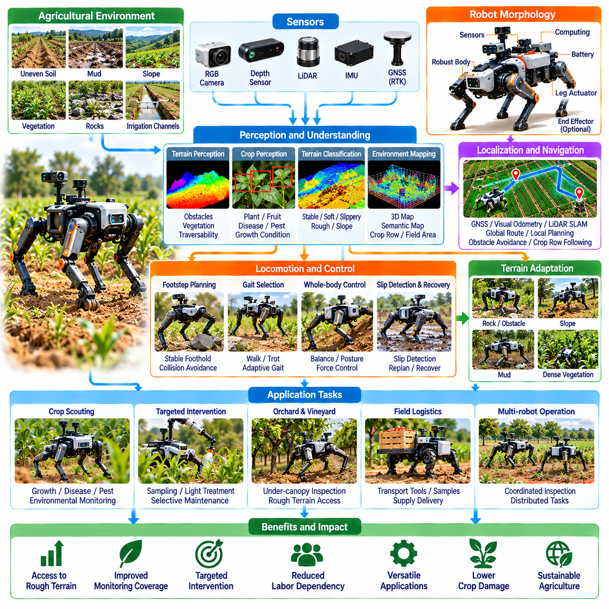{width="7.268055555555556in" height="7.268055555555556in"}

Quadruped and rough-terrain agricultural robots extend Physical AI into farming environments where conventional wheeled machines encounter mobility limitations. Their articulated legs enable controlled movement across uneven soil, slopes, vegetation, and irregular field surfaces. These robots can support crop inspection, environmental monitoring, and targeted agricultural interventions. Their practical value depends on combining terrain adaptability with reliable autonomy and operational efficiency.

Agricultural terrain presents challenges that differ substantially from structured industrial environments. Fields contain loose soil, mud, rocks, irrigation channels, crop residues, and changing ground elevations. Seasonal weather and cultivation activities continuously modify surface conditions. Robots operating in these environments must evaluate terrain accessibility, maintain balance, and adjust movement strategies while minimizing damage to crops and agricultural infrastructure.

Quadruped morphology provides four independently controlled legs that can adapt foot placement to local terrain geometry. Unlike wheels, legs can step over certain obstacles and selectively contact stable ground surfaces. Joint articulation enables changes in body height, posture, and walking configuration. However, legged locomotion introduces mechanical complexity, greater control requirements, and potentially higher energy consumption than efficient wheeled transportation.

Agricultural quadrupeds require perception systems capable of understanding both nearby obstacles and broader terrain conditions. RGB cameras, depth sensors, LiDAR, and inertial measurement units provide complementary environmental observations. AI-based perception models can identify vegetation, terrain discontinuities, obstacles, and potential footholds. Reliable perception is challenging when tall crops, shadows, dust, or changing illumination obscure the ground surface.

Terrain classification helps quadruped robots distinguish between stable surfaces, soft soil, slippery ground, and potentially hazardous areas. Visual appearance provides useful information, but it cannot always reveal subsurface conditions or actual load-bearing capacity. Contact feedback and proprioceptive measurements help estimate terrain properties during movement. Combining visual prediction with physical interaction enables more adaptive locomotion decisions.

Footstep planning determines where each leg should contact the ground while maintaining body stability and forward progress. Candidate footholds are evaluated according to surface geometry, expected traction, obstacle clearance, and reachability. Motion planners coordinate individual leg trajectories with the movement of the robot body. Agricultural applications require conservative planning because unstable soil or hidden vegetation can produce unexpected foot placement errors.

Gait selection influences locomotion speed, stability, and energy efficiency. Walking gaits generally provide greater control during careful movement, while faster gaits may improve travel speed on suitable terrain. Adaptive gait controllers adjust step length, timing, and body posture according to environmental conditions. Agricultural robots must prioritize dependable movement over maximum speed when operating near fragile crops, workers, or irrigation equipment.

Whole-body control coordinates leg forces, joint movements, and body orientation to maintain stability during terrain interaction. Model predictive control can optimize short-horizon motion while respecting actuator and contact constraints. Feedback from joint encoders, force sensors, and inertial measurements supports continuous correction. Robust control must accommodate uncertain ground contact, changing payloads, and disturbances caused by vegetation or uneven surfaces.

Slip detection and recovery are essential for reliable operation on wet or deformable agricultural terrain. A foot may sink into loose soil, slide on mud, or lose support near a drainage channel. Proprioceptive sensing can identify deviations between expected and actual motion. Recovery controllers may redistribute body weight, modify footholds, or retreat from unsafe areas. Severe uncertainty should trigger controlled stopping rather than continued movement.

Autonomous navigation connects local legged locomotion with agricultural missions spanning large areas. GNSS-based positioning, visual odometry, and LiDAR mapping can support localization across fields and orchards. Global planners identify routes between inspection points, while local planners handle immediate obstacles and terrain changes. Accurate navigation must account for crop rows, restricted areas, uneven ground, and temporary obstructions.

Crop scouting is a promising application because quadrupeds can carry sensors through areas that are difficult for conventional mobile platforms to access. Cameras and environmental instruments can collect information about crop growth, disease symptoms, and local conditions. Robots may inspect orchard floors, vineyard rows, or uneven cultivation areas. Sensor positioning and repeatable inspection routes are important for producing comparable agricultural observations.

Quadruped robots can also support targeted agricultural interventions when equipped with specialized payloads. Lightweight manipulators, sampling tools, or treatment devices may perform localized measurements and maintenance tasks. The robot must coordinate body posture with tool operation to maintain accuracy. Payload mass and manipulation forces affect balance and locomotion, making integrated mobility and manipulation control necessary for reliable field deployment.

Payload integration requires balancing sensing capability, battery capacity, and mechanical stability. Additional equipment increases total mass and can shift the center of gravity, especially when mounted above the robot body. Designers must consider actuator torque, structural loading, and available power. Modular payload interfaces can support different agricultural missions, but excessive equipment weight reduces endurance and may compromise mobility on difficult terrain.

Energy efficiency remains a major limitation for legged agricultural robots. Continuous joint actuation, terrain adaptation, and onboard computation consume energy during field operations. Battery capacity determines mission duration, while charging logistics influence practical utilization. Energy-aware navigation can favor routes and gaits that reduce unnecessary mechanical effort. Quadrupeds are most attractive where their terrain access advantages justify their additional energy requirements.

Weather resistance and environmental durability are critical for agricultural deployment. Dust, moisture, mud, fertilizers, and temperature fluctuations can affect sensors, actuators, connectors, and mechanical joints. Protective enclosures and appropriate sealing reduce exposure to contaminants. Maintenance procedures must address accumulated debris and component wear. Reliable operation requires validation under realistic agricultural conditions rather than laboratory environments alone.

Human-robot interaction is important because quadrupeds may operate near farmers, livestock, and conventional machinery. Their movement can be unfamiliar or unpredictable to nearby workers, particularly during posture adjustments or recovery actions. Safety systems should include obstacle detection, speed limitations, controlled stopping, and clear operating procedures. Agricultural deployments must also consider animal responses and the possibility of unexpected environmental interactions.

Multi-robot operations can combine quadrupeds with wheeled agricultural vehicles, drones, and fixed monitoring infrastructure. Aerial platforms provide broad environmental observations, while quadrupeds conduct detailed ground-level inspections in difficult areas. Wheeled vehicles can transport heavier equipment and collected materials. Coordinated task allocation allows each robot morphology to perform activities suited to its capabilities, improving overall operational efficiency.

Simulation and reinforcement learning can support the development of terrain-adaptive quadruped locomotion. Virtual environments allow controllers to experience varied slopes, obstacles, friction conditions, and disturbances. Domain randomization can improve robustness to uncertain physical parameters. However, simulated soil deformation and vegetation contact may differ significantly from reality. Field testing remains essential for validating locomotion safety and task performance.

Commercial evaluation should consider mission completion rate, terrain coverage, inspection quality, operating endurance, maintenance costs, and intervention frequency. Quadrupeds may provide unique access capabilities, but their economic value depends on tasks that conventional vehicles cannot perform efficiently. Acquisition cost, energy consumption, supervision, and seasonal utilization influence total ownership costs. Deployment decisions should compare complete operational outcomes rather than mobility capability alone.

Ultimately, quadruped and rough-terrain agricultural robots demonstrate how Physical AI can adapt robotic embodiment to challenging farming environments. Their combination of articulated mobility, terrain perception, adaptive control, and intelligent task execution enables operations beyond conventional vehicle access. Continued progress in energy efficiency, robust locomotion, autonomous navigation, and agricultural integration will determine their long-term practicality and commercial adoption.

사족보행 및 험지 주행 농업 로봇(Quadruped and Rough-Terrain Agricultural Robots)은 기존 차륜형 기계(Conventional Wheeled Machines)가 이동성의 한계(Mobility Limitations)에 직면하는 농업 환경까지 피지컬 인공지능(Physical AI)의 적용 범위를 확장한다. 관절형 다리(Articulated Legs)는 고르지 않은 토양(Uneven Soil), 경사면(Slopes), 식생(Vegetation), 불규칙한 농경지 표면(Irregular Field Surfaces)에서 제어된 이동(Controlled Movement)을 가능하게 한다. 이러한 로봇은 작물 검사(Crop Inspection), 환경 모니터링(Environmental Monitoring), 표적 농업 작업(Targeted Agricultural Interventions)을 지원할 수 있다. 실질적인 가치는 지형 적응성(Terrain Adaptability)을 신뢰할 수 있는 자율성(Reliable Autonomy) 및 운영 효율성(Operational Efficiency)과 결합하는 데 달려 있다.

농업 지형(Agricultural Terrain)은 구조화된 산업 환경(Structured Industrial Environments)과 상당히 다른 문제를 제시한다. 농경지에는 느슨한 토양(Loose Soil), 진흙(Mud), 암석(Rocks), 관개 수로(Irrigation Channels), 작물 잔재(Crop Residues), 변화하는 지면 높이(Ground Elevations)가 존재한다. 계절별 기상 조건(Seasonal Weather)과 경작 활동(Cultivation Activities)은 지표면 상태(Surface Conditions)를 지속적으로 변화시킨다. 이러한 환경에서 작동하는 로봇은 작물과 농업 기반시설(Agricultural Infrastructure)의 손상을 최소화하면서 지형 접근성(Terrain Accessibility)을 평가하고 균형(Balance)을 유지하며 이동 전략(Movement Strategies)을 조정해야 한다.

사족보행 형태(Quadruped Morphology)는 국소 지형 형상(Local Terrain Geometry)에 맞게 발 위치(Foot Placement)를 조정할 수 있는 네 개의 독립적으로 제어되는 다리(Independently Controlled Legs)를 제공한다. 바퀴(Wheels)와 달리 다리는 특정 장애물(Obstacles)을 넘어 이동하고 안정적인 지면(St​​able Ground Surfaces)을 선택적으로 접촉할 수 있다. 관절 구동(Joint Articulation)은 몸체 높이(Body Height), 자세(Posture), 보행 구성(Walking Configuration)의 변경을 가능하게 한다. 그러나 다리 기반 이동(Legged Locomotion)은 기계적 복잡성(Mechanical Complexity), 높은 제어 요구사항(Control Requirements), 효율적인 차륜형 운송(Wheeled Transportation)보다 잠재적으로 높은 에너지 소비(Energy Consumption)를 수반한다.

농업용 사족보행 로봇(Agricultural Quadrupeds)은 주변 장애물(Nearby Obstacles)과 광범위한 지형 조건(Broader Terrain Conditions)을 모두 이해할 수 있는 인식 시스템(Perception Systems)이 필요하다. RGB 카메라(RGB Cameras), 깊이 센서(Depth Sensors), 라이다(LiDAR), 관성측정장치(Inertial Measurement Units)는 상호 보완적인 환경 관측 정보(Environmental Observations)를 제공한다. 인공지능 기반 인식 모델(AI-Based Perception Models)은 식생, 지형의 불연속 구간(Terrain Discontinuities), 장애물, 잠재적인 발 디딤 위치(Potential Footholds)를 식별할 수 있다. 키가 큰 작물(Tall Crops), 그림자(Shadows), 먼지(Dust), 변화하는 조명(Changing Illumination)이 지면을 가릴 때 신뢰할 수 있는 인식은 더욱 어려워진다.

지형 분류(Terrain Classification)는 사족보행 로봇이 안정적인 지표면(Stable Surfaces), 연약한 토양(Soft Soil), 미끄러운 지면(Slippery Ground), 잠재적으로 위험한 구역(Potentially Hazardous Areas)을 구분하도록 한다. 시각적 외관(Visual Appearance)은 유용한 정보를 제공하지만 지표 아래의 상태(Subsurface Conditions)나 실제 하중 지지 능력(Load-Bearing Capacity)을 항상 나타내지는 못한다. 접촉 피드백(Contact Feedback)과 고유수용성 측정(Proprioceptive Measurements)은 이동 중 지형 특성(Terrain Properties)을 추정하는 데 도움이 된다. 시각적 예측(Visual Prediction)과 물리적 상호작용(Physical Interaction)을 결합하면 더욱 적응적인 이동 의사결정(Adaptive Locomotion Decisions)이 가능해진다.

발 디딤 계획(Footstep Planning)은 몸체 안정성(Body Stability)과 전진 이동(Forward Progress)을 유지하면서 각 다리가 지면에 접촉할 위치를 결정한다. 후보 발 디딤 위치(Candidate Footholds)는 지표면 형상(Surface Geometry), 예상 견인력(Expected Traction), 장애물 회피 여유(Obstacle Clearance), 도달 가능성(Reachability)에 따라 평가된다. 동작 계획기(Motion Planners)는 개별 다리 궤적(Individual Leg Trajectories)과 로봇 몸체의 움직임(Robot Body Movement)을 협조적으로 제어한다. 불안정한 토양(Unstable Soil)이나 가려진 식생(Hidden Vegetation)이 예상하지 못한 발 위치 오차(Foot Placement Errors)를 유발할 수 있으므로 농업 응용에서는 보수적인 계획(Conservative Planning)이 필요하다.

보행 패턴 선택(Gait Selection)은 이동 속도(Locomotion Speed), 안정성(Stability), 에너지 효율성(Energy Efficiency)에 영향을 미친다. 걷기 보행(Walking Gaits)은 일반적으로 신중한 이동(Careful Movement)에서 높은 제어 능력을 제공하며, 빠른 보행 패턴(Faster Gaits)은 적절한 지형에서 이동 속도를 높일 수 있다. 적응형 보행 제어기(Adaptive Gait Controllers)는 환경 조건(Environmental Conditions)에 따라 보폭(Step Length), 타이밍(Timing), 몸체 자세(Body Posture)를 조정한다. 농업 로봇(Agricultural Robots)은 손상되기 쉬운 작물(Fragile Crops), 작업자(Workers), 관개 장비(Irrigation Equipment) 근처에서 작동할 때 최고 속도(Maximum Speed)보다 안정적인 이동(Dependable Movement)을 우선해야 한다.

전신 제어(Whole-Body Control)는 지형과 상호작용하는 동안 안정성을 유지하기 위해 다리 힘(Leg Forces), 관절 움직임(Joint Movements), 몸체 방향(Body Orientation)을 협조적으로 제어한다. 모델 예측 제어(Model Predictive Control)는 액추에이터 제약조건(Actuator Constraints)과 접촉 제약조건(Contact Constraints)을 준수하면서 단기 예측 구간의 움직임(Short-Horizon Motion)을 최적화할 수 있다. 관절 엔코더(Joint Encoders), 힘 센서(Force Sensors), 관성 측정값(Inertial Measurements)의 피드백은 지속적인 보정(Continuous Correction)을 지원한다. 견고한 제어(Robust Control)는 불확실한 지면 접촉(Uncertain Ground Contact), 변화하는 적재물(Changing Payloads), 식생이나 불규칙한 지면으로 인한 외란(Disturbances)을 수용해야 한다.

미끄러짐 탐지 및 복구(Slip Detection and Recovery)는 젖거나 변형 가능한 농업 지형(Wet or Deformable Agricultural Terrain)에서 신뢰할 수 있는 운영을 위해 필수적이다. 발(Foot)은 느슨한 토양에 가라앉거나 진흙 위에서 미끄러지거나 배수로(Drainage Channel) 근처에서 지지력을 잃을 수 있다. 고유수용성 센싱(Proprioceptive Sensing)은 예상 움직임(Expected Motion)과 실제 움직임(Actual Motion) 사이의 편차(Deviations)를 식별할 수 있다. 복구 제어기(Recovery Controllers)는 몸체 중량(Body Weight)을 재분배하고 발 디딤 위치를 수정하거나 위험 구역(Unsafe Areas)에서 후퇴할 수 있다. 불확실성이 심각한 경우에는 이동을 계속하기보다 제어된 정지(Controlled Stopping)를 수행해야 한다.

자율 내비게이션(Autonomous Navigation)은 국소적인 다리 기반 이동(Local Legged Locomotion)을 넓은 농업 지역에 걸친 임무(Agricultural Missions)와 연결한다. 위성항법 기반 위치 측정(GNSS-Based Positioning), 시각 주행거리 추정(Visual Odometry), 라이다 지도 작성(LiDAR Mapping)은 농경지와 과수원(Orchards)에서 위치 추정(Localization)을 지원할 수 있다. 전역 경로 계획기(Global Planners)는 검사 지점(Inspection Points) 사이의 경로를 식별하며, 지역 경로 계획기(Local Planners)는 가까운 장애물과 지형 변화(Terrain Changes)를 처리한다. 정확한 내비게이션은 작물 재배열(Crop Rows), 제한 구역(Restricted Areas), 고르지 않은 지면, 임시 장애물(Temporary Obstructions)을 고려해야 한다.

작물 정찰(Crop Scouting)은 사족보행 로봇이 기존 이동 플랫폼(Conventional Mobile Platforms)으로 접근하기 어려운 지역까지 센서를 운반할 수 있기 때문에 유망한 응용 분야이다. 카메라와 환경 측정 장비(Environmental Instruments)는 작물 생육(Crop Growth), 질병 증상(Disease Symptoms), 국소 환경 조건(Local Conditions)에 관한 정보를 수집할 수 있다. 로봇은 과수원 바닥(Orchard Floors), 포도원 재배열(Vineyard Rows), 불규칙한 경작 지역(Uneven Cultivation Areas)을 검사할 수 있다. 비교 가능한 농업 관측 정보(Comparable Agricultural Observations)를 생성하려면 센서 위치(Sensor Positioning)와 반복 가능한 검사 경로(Repeatable Inspection Routes)가 중요하다.

사족보행 로봇은 특수 적재 장비(Specialized Payloads)를 장착하면 표적 농업 작업(Targeted Agricultural Interventions)도 지원할 수 있다. 경량 매니퓰레이터(Lightweight Manipulators), 샘플링 도구(Sampling Tools), 처리 장치(Treatment Devices)는 국소 측정(Localized Measurements)과 유지관리 작업(Maintenance Tasks)을 수행할 수 있다. 로봇은 정확도를 유지하기 위해 몸체 자세와 도구 작동(Tool Operation)을 협조적으로 제어해야 한다. 적재물 질량(Payload Mass)과 조작력(Manipulation Forces)은 균형과 이동에 영향을 미치므로 신뢰할 수 있는 농경지 배포(Field Deployment)를 위해 통합 이동 및 조작 제어(Integrated Mobility and Manipulation Control)가 필요하다.

적재 장비 통합(Payload Integration)은 센싱 능력(Sensing Capability), 배터리 용량(Battery Capacity), 기계적 안정성(Mechanical Stability) 사이의 균형을 요구한다. 추가 장비(Additional Equipment)는 전체 질량(Total Mass)을 증가시키고 특히 로봇 몸체 위쪽에 장착된 경우 무게중심(Center of Gravity)을 이동시킬 수 있다. 설계자는 액추에이터 토크(Actuator Torque), 구조 하중(Structural Loading), 사용 가능한 전력(Available Power)을 고려해야 한다. 모듈형 적재 인터페이스(Modular Payload Interfaces)는 다양한 농업 임무(Agricultural Missions)를 지원할 수 있지만 과도한 장비 중량(Excessive Equipment Weight)은 운용 지속시간(Endurance)을 감소시키고 험지 이동성(Mobility on Difficult Terrain)을 저하시킬 수 있다.

에너지 효율성(Energy Efficiency)은 다리 기반 농업 로봇(Legged Agricultural Robots)의 주요 한계로 남아 있다. 지속적인 관절 구동(Continuous Joint Actuation), 지형 적응(Terrain Adaptation), 온보드 연산(Onboard Computation)은 농경지 작업 중 에너지를 소비한다. 배터리 용량은 임무 지속시간(Mission Duration)을 결정하며, 충전 물류(Charging Logistics)는 실질적인 활용도(Practical Utilization)에 영향을 미친다. 에너지 인식 내비게이션(Energy-Aware Navigation)은 불필요한 기계적 작업(Mechanical Effort)을 줄이는 경로와 보행 패턴을 우선할 수 있다. 사족보행 로봇은 지형 접근성의 이점(Terrain Access Advantages)이 추가적인 에너지 요구사항(Additional Energy Requirements)을 정당화할 수 있는 환경에서 가장 매력적인 선택이 된다.

내후성(Weather Resistance)과 환경 내구성(Environmental Durability)은 농업 환경 배포(Agricultural Deployment)에 중요한 요소이다. 먼지(Dust), 습기(Moisture), 진흙(Mud), 비료(Fertilizers), 온도 변동(Temperature Fluctuations)은 센서(Sensors), 액추에이터(Actuators), 커넥터(Connectors), 기계적 관절(Mechanical Joints)에 영향을 미칠 수 있다. 보호용 외함(Protective Enclosures)과 적절한 밀봉(Appropriate Sealing)은 오염물질(Contaminants)에 대한 노출을 줄인다. 유지보수 절차(Maintenance Procedures)는 축적된 이물질(Accumulated Debris)과 부품 마모(Component Wear)를 관리해야 한다. 신뢰할 수 있는 운영을 위해서는 실험실 환경(Laboratory Environments)뿐만 아니라 실제 농업 조건(Realistic Agricultural Conditions)에서의 검증(Validation)이 필요하다.

인간-로봇 상호작용(Human-Robot Interaction)은 사족보행 로봇이 농업 종사자(Farmers), 가축(Livestock), 기존 농기계(Conventional Machinery) 근처에서 작동할 수 있기 때문에 중요하다. 로봇의 움직임은 특히 자세 조정(Posture Adjustments)이나 복구 동작(Recovery Actions) 중 주변 작업자에게 익숙하지 않거나 예측하기 어렵게 느껴질 수 있다. 안전 시스템(Safety Systems)에는 장애물 탐지(Obstacle Detection), 속도 제한(Speed Limitations), 제어된 정지(Controlled Stopping), 명확한 운영 절차(Clear Operating Procedures)가 포함되어야 한다. 농업 현장 배포(Agricultural Deployments)는 동물의 반응(Animal Responses)과 예상하지 못한 환경적 상호작용(Unexpected Environmental Interactions)의 가능성도 고려해야 한다.

다중 로봇 운영(Multi-Robot Operations)은 사족보행 로봇을 차륜형 농업 차량(Wheeled Agricultural Vehicles), 드론(Drones), 고정형 모니터링 인프라(Fixed Monitoring Infrastructure)와 결합할 수 있다. 항공 플랫폼(Aerial Platforms)은 광범위한 환경 관측(Broad Environmental Observations)을 제공하고, 사족보행 로봇은 접근하기 어려운 지역에서 상세한 지상 검사(Detailed Ground-Level Inspections)를 수행한다. 차륜형 차량은 더 무거운 장비(Heavier Equipment)와 수집된 자재(Collected Materials)를 운송할 수 있다. 협조적 작업 할당(Coordinated Task Allocation)은 각 로봇 형태(Robot Morphology)가 자체 능력에 적합한 활동을 수행하도록 하여 전체 운영 효율성(Overall Operational Efficiency)을 향상시킨다.

시뮬레이션(Simulation)과 강화학습(Reinforcement Learning)은 지형 적응형 사족보행(Terrain-Adaptive Quadruped Locomotion)의 개발을 지원할 수 있다. 가상 환경(Virtual Environments)은 제어기(Controllers)가 다양한 경사(Slopes), 장애물(Obstacles), 마찰 조건(Friction Conditions), 외란(Disturbances)을 경험하도록 한다. 도메인 무작위화(Domain Randomization)는 불확실한 물리적 매개변수(Uncertain Physical Parameters)에 대한 견고성(Robustness)을 향상시킬 수 있다. 그러나 시뮬레이션된 토양 변형(Simulated Soil Deformation)과 식생 접촉(Vegetation Contact)은 실제 환경과 크게 다를 수 있다. 이동 안전성(Locomotion Safety)과 작업 성능(Task Performance)을 검증하기 위해서는 현장 시험(Field Testing)이 여전히 필수적이다.

상업적 평가(Commercial Evaluation)는 임무 완료율(Mission Completion Rate), 지형 커버리지(Terrain Coverage), 검사 품질(Inspection Quality), 운용 지속시간(Operating Endurance), 유지보수 비용(Maintenance Costs), 개입 빈도(Intervention Frequency)를 고려해야 한다. 사족보행 로봇은 고유한 접근 능력(Unique Access Capabilities)을 제공할 수 있지만, 경제적 가치(Economic Value)는 기존 차량이 효율적으로 수행하기 어려운 작업에 달려 있다. 도입 비용(Acquisition Cost), 에너지 소비(Energy Consumption), 감독(Supervision), 계절별 활용도(Seasonal Utilization)는 총소유비용(Total Ownership Costs)에 영향을 미친다. 배포 의사결정(Deployment Decisions)은 이동 능력(Mobility Capability)만이 아니라 전체 운영 성과(Complete Operational Outcomes)를 비교해야 한다.

궁극적으로 사족보행 및 험지 주행 농업 로봇(Quadruped and Rough-Terrain Agricultural Robots)은 피지컬 인공지능이 로봇의 체화 형태(Robotic Embodiment)를 도전적인 농업 환경(Challenging Farming Environments)에 적응시키는 방식을 보여준다. 관절형 이동성(Articulated Mobility), 지형 인식(Terrain Perception), 적응형 제어(Adaptive Control), 지능형 작업 실행(Intelligent Task Execution)의 결합은 기존 차량의 접근 범위(Conventional Vehicle Access)를 넘어서는 작업을 가능하게 한다. 에너지 효율성, 견고한 보행(Robust Locomotion), 자율 내비게이션(Autonomous Navigation), 농업 시스템 통합(Agricultural Integration)의 지속적인 발전이 장기적인 실용성(Long-Term Practicality)과 상업적 도입(Commercial Adoption)을 결정할 것이다.

##  

## 05.10. Drones and Aerial Field Intelligence

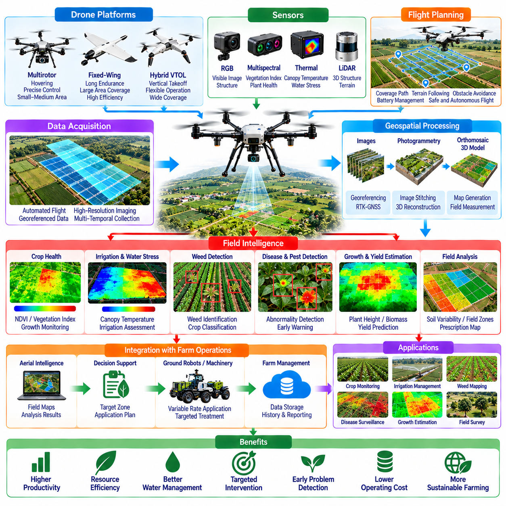{width="7.268055555555556in" height="7.268055555555556in"}

Drones and aerial field intelligence represent important applications of Physical AI in agriculture, enabling rapid observation, analysis, and monitoring across extensive farming environments. Unmanned aerial vehicles provide flexible access to fields, orchards, and agricultural infrastructure without direct ground contact. By combining autonomous flight, intelligent sensing, and data analytics, aerial systems can improve situational awareness and support more precise agricultural decisions.

Aerial agricultural intelligence extends beyond conventional drone photography by converting observations into actionable information. Physical AI systems integrate flight control, environmental perception, geospatial analysis, and machine learning to interpret agricultural conditions. These capabilities support crop health assessment, irrigation monitoring, disease detection, and operational planning. Their effectiveness depends on reliable data acquisition and meaningful integration with farming workflows.

Agricultural drones use different airframe configurations according to mission requirements. Multirotor platforms provide hovering, precise positioning, and flexible operation over localized areas, while fixed-wing aircraft offer greater coverage efficiency for large fields. Hybrid vertical takeoff and landing systems combine selected advantages of both architectures. Platform selection depends on field size, payload requirements, flight endurance, maneuverability, and operational constraints.

Autonomous flight planning determines how aerial robots inspect agricultural areas efficiently and safely. Coverage algorithms generate flight paths that account for field boundaries, sensor characteristics, altitude, and required image overlap. Terrain-following control helps maintain suitable observation distances across uneven landscapes. Mission planners must also consider obstacles, restricted airspace, battery reserves, and changing environmental conditions during flight operations.

Aerial sensing systems commonly include RGB cameras, multispectral sensors, thermal cameras, and positioning instruments. RGB imagery provides information about visible crop appearance and structural conditions, while multispectral measurements can reveal differences in vegetation reflectance. Thermal imaging may indicate canopy temperature variations associated with water stress. Sensor selection must reflect the agricultural question because no single modality reliably measures every crop condition.

Geospatial positioning is essential for connecting aerial observations with specific agricultural locations. GNSS receivers, inertial sensors, and camera-based estimation methods support flight navigation and image georeferencing. RTK positioning can improve coordinate accuracy when suitable correction services are available. Accurate spatial registration allows observations from different missions to be compared and supports targeted interventions by ground-based agricultural equipment.

Aerial image processing transforms individual observations into spatially organized representations of agricultural environments. Photogrammetry can combine overlapping images to generate orthomosaics, elevation models, and three-dimensional reconstructions. These products support crop mapping, field measurement, and structural analysis. Image quality depends on flight geometry, camera calibration, positioning accuracy, and the stability of environmental conditions during acquisition.

Crop health monitoring is a major application of aerial field intelligence. Machine learning models can analyze canopy appearance, vegetation patterns, and temporal changes to identify areas requiring attention. Vegetation indices derived from multispectral imagery provide indicators of plant reflectance characteristics. However, unusual spectral responses do not uniquely identify disease or nutrient deficiency, making field verification and contextual interpretation necessary.

Water stress and irrigation assessment can benefit from combining thermal observations with vegetation and environmental information. Canopy temperature differences may indicate changes in transpiration and plant water status under suitable measurement conditions. Aerial maps can help identify uneven irrigation distribution or potentially stressed regions. Reliable interpretation requires consideration of weather, crop development, soil characteristics, and sensor calibration.

Weed detection and crop classification enable aerial systems to identify spatial patterns that support precision agriculture. Computer vision models can distinguish crop rows, exposed soil, and unwanted vegetation when sufficient image resolution and training data are available. Generated weed maps may guide targeted ground treatment or variable-rate applications. Classification performance can decline when crop and weed appearances overlap or vegetation becomes densely mixed.

Disease and pest surveillance can use aerial imagery to detect abnormal crop patterns before they become obvious across an entire field. AI models may identify discoloration, canopy thinning, or irregular growth associated with possible biological stress. Nevertheless, similar visual symptoms can arise from multiple causes. Aerial intelligence should therefore support diagnostic prioritization rather than automatically treating image-based predictions as confirmed disease identification.

Aerial monitoring can also estimate crop growth and production characteristics. Repeated observations provide information about canopy development, plant density, and spatial variability throughout the growing season. Three-dimensional reconstruction may support estimates of plant height or canopy volume. Yield prediction models can combine aerial features with historical records and environmental measurements, although accuracy varies with crop type and growth stage.

Temporal analysis is particularly valuable because agricultural conditions evolve continuously. Comparing observations collected across multiple dates can reveal growth trends, emerging anomalies, and the effects of previous interventions. Consistent flight paths, sensor settings, and calibration procedures improve comparability. Physical AI systems can prioritize meaningful changes while accounting for seasonal development, illumination differences, and measurement uncertainty.

Autonomous aerial inspection can extend to agricultural infrastructure such as irrigation networks, drainage systems, fences, and greenhouse exteriors. High-resolution imagery and thermal observations may reveal visible damage, water distribution anomalies, or equipment conditions requiring investigation. These inspections can reduce manual surveying effort and improve maintenance planning. Close-range missions require careful obstacle avoidance and appropriate operational safeguards.

Edge computing enables some agricultural observations to be processed directly onboard drones. Embedded AI accelerators can perform image classification, object detection, and event recognition during flight. Local processing may reduce communication requirements and support immediate mission adjustments. However, onboard computation is constrained by payload mass, electrical power, thermal management, and available processing capacity, requiring careful hardware-software integration.

Cloud and farm management platforms provide additional capabilities for large-scale aerial data analysis. Flight records, imagery, geospatial layers, and AI-generated observations can be organized into agricultural information systems. Historical datasets support comparisons across fields, seasons, and management practices. Integration with ground robots and agricultural machinery allows aerial findings to inform scouting missions, localized treatment, and operational scheduling.

Cooperation between aerial and ground robots creates opportunities for more effective agricultural automation. Drones can rapidly identify regions of interest, while autonomous ground vehicles or quadrupeds perform detailed inspections and physical interventions. Shared maps and georeferenced task assignments connect aerial perception with ground execution. This division of responsibilities can reduce unnecessary field traversal and improve the utilization of specialized robotic platforms.

Operational safety remains essential because agricultural drones operate in shared airspace and changing outdoor environments. Wind, rain, visibility limitations, power loss, and communication interruptions can affect flight reliability. Safety mechanisms include geofencing, obstacle avoidance, battery monitoring, and emergency landing procedures. Operators must also comply with applicable aviation rules, airspace restrictions, and requirements governing agricultural aerial operations.

The economic value of aerial field intelligence depends on monitoring coverage, inspection frequency, actionable detection quality, and the costs of flight operations and data processing. Equipment acquisition, maintenance, trained personnel, software services, and regulatory compliance contribute to total ownership costs. Benefits arise when aerial observations lead to measurable improvements in resource allocation, crop protection, labor efficiency, or production outcomes.

Ultimately, drones and aerial field intelligence provide a scalable observation layer for Physical AI in agriculture. Their combination of autonomous flight, multimodal sensing, geospatial understanding, and intelligent analytics can transform field measurements into operational decisions. Continued progress in sensor reliability, AI interpretation, multi-robot coordination, and agricultural data integration will determine how effectively aerial intelligence supports sustainable and productive farming.

드론 및 항공 기반 농경지 지능화(Drones and Aerial Field Intelligence)는 광범위한 농업 환경에서 신속한 관측(Observation), 분석(Analysis), 모니터링(Monitoring)을 가능하게 하는 농업 분야 피지컬 인공지능(Physical AI)의 중요한 응용 분야이다. 무인항공기(Unmanned Aerial Vehicles, UAVs)는 지면에 직접 접촉하지 않고도 농경지(Fields), 과수원(Orchards), 농업 기반시설(Agricultural Infrastructure)에 유연하게 접근할 수 있다. 자율 비행(Autonomous Flight), 지능형 센싱(Intelligent Sensing), 데이터 분석(Data Analytics)을 결합함으로써 항공 시스템(Aerial Systems)은 상황 인식(Situational Awareness)을 향상시키고 더욱 정밀한 농업 의사결정(Agricultural Decisions)을 지원할 수 있다.

항공 기반 농업 지능화(Aerial Agricultural Intelligence)는 관측 정보를 실행 가능한 정보(Actionable Information)로 변환함으로써 기존 드론 촬영(Conventional Drone Photography)의 범위를 확장한다. 피지컬 인공지능 시스템은 비행 제어(Flight Control), 환경 인식(Environmental Perception), 지리공간 분석(Geospatial Analysis), 기계학습(Machine Learning)을 통합하여 농업 환경 조건(Agricultural Conditions)을 해석한다. 이러한 기능은 작물 건강 상태 평가(Crop Health Assessment), 관개 모니터링(Irrigation Monitoring), 질병 탐지(Disease Detection), 운영 계획(Operational Planning)을 지원한다. 효과적인 활용은 신뢰할 수 있는 데이터 수집(Reliable Data Acquisition)과 농업 작업흐름(Farming Workflows)과의 의미 있는 통합에 달려 있다.

농업용 드론(Agricultural Drones)은 임무 요구사항(Mission Requirements)에 따라 서로 다른 기체 구성(Airframe Configurations)을 사용한다. 멀티로터 플랫폼(Multirotor Platforms)은 제자리 비행(Hovering), 정밀 위치 제어(Precise Positioning), 국소 지역(Localized Areas)에서의 유연한 운영을 제공하며, 고정익 항공기(Fixed-Wing Aircraft)는 대규모 농경지(Large Fields)에서 더 높은 면적 탐사 효율성(Coverage Efficiency)을 제공한다. 하이브리드 수직이착륙 시스템(Hybrid Vertical Takeoff and Landing Systems)은 두 아키텍처(Architectures)의 장점을 선택적으로 결합한다. 플랫폼 선택(Platform Selection)은 농경지 규모(Field Size), 적재물 요구사항(Payload Requirements), 비행 지속시간(Flight Endurance), 기동성(Maneuverability), 운영 제약조건(Operational Constraints)에 따라 결정된다.

자율 비행 계획(Autonomous Flight Planning)은 항공 로봇(Aerial Robots)이 농업 지역을 효율적이고 안전하게 검사하는 방법을 결정한다. 영역 탐사 알고리즘(Coverage Algorithms)은 농경지 경계(Field Boundaries), 센서 특성(Sensor Characteristics), 비행 고도(Altitude), 필요한 영상 중첩률(Required Image Overlap)을 고려하여 비행 경로(Flight Paths)를 생성한다. 지형 추종 제어(Terrain-Following Control)는 불규칙한 지형(Uneven Landscapes)에서도 적절한 관측 거리(Observation Distances)를 유지하도록 돕는다. 임무 계획기(Mission Planners)는 비행 중 장애물(Obstacles), 비행 제한 공역(Restricted Airspace), 배터리 예비 용량(Battery Reserves), 변화하는 환경 조건(Environmental Conditions)도 고려해야 한다.

항공 센싱 시스템(Aerial Sensing Systems)에는 일반적으로 RGB 카메라(RGB Cameras), 다중분광 센서(Multispectral Sensors), 열화상 카메라(Thermal Cameras), 위치 측정 장치(Positioning Instruments)가 포함된다. RGB 영상(RGB Imagery)은 눈에 보이는 작물 외관(Crop Appearance)과 구조적 상태(Structural Conditions)에 관한 정보를 제공하며, 다중분광 측정(Multispectral Measurements)은 식생 반사율(Vegetation Reflectance)의 차이를 나타낼 수 있다. 열화상 영상(Thermal Imaging)은 수분 스트레스(Water Stress)와 관련된 작물 군락 온도(Canopy Temperature)의 변화를 보여줄 수 있다. 어떤 단일 센서 방식(Sensor Modality)도 모든 작물 상태를 신뢰성 있게 측정할 수 없으므로 센서 선택은 해결하려는 농업 문제(Agricultural Question)에 맞추어 이루어져야 한다.

지리공간 위치 측정(Geospatial Positioning)은 항공 관측 정보(Aerial Observations)를 특정 농업 위치(Specific Agricultural Locations)와 연결하는 데 필수적이다. 위성항법 수신기(GNSS Receivers), 관성 센서(Inertial Sensors), 카메라 기반 추정 방법(Camera-Based Estimation Methods)은 비행 내비게이션(Flight Navigation)과 영상 지리참조(Image Georeferencing)를 지원한다. 실시간 이동측위(RTK Positioning)는 적절한 보정 서비스(Correction Services)를 사용할 수 있을 때 좌표 정확도(Coordinate Accuracy)를 향상시킬 수 있다. 정확한 공간 정합(Spatial Registration)은 서로 다른 임무에서 수집한 관측 정보를 비교할 수 있게 하며, 지상 농업 장비(Ground-Based Agricultural Equipment)의 표적 작업(Targeted Interventions)을 지원한다.

항공 영상 처리(Aerial Image Processing)는 개별 관측 정보(Individual Observations)를 공간적으로 구성된 농업 환경 표현(Spatially Organized Representations)으로 변환한다. 사진측량(Photogrammetry)은 중첩된 영상(Overlapping Images)을 결합하여 정사영상 모자이크(Orthomosaics), 고도 모델(Elevation Models), 3차원 재구성(Three-Dimensional Reconstructions)을 생성할 수 있다. 이러한 결과물은 작물 지도 작성(Crop Mapping), 농경지 측정(Field Measurement), 구조 분석(Structural Analysis)을 지원한다. 영상 품질(Image Quality)은 비행 기하구조(Flight Geometry), 카메라 보정(Camera Calibration), 위치 측정 정확도(Positioning Accuracy), 데이터 수집 중 환경 조건의 안정성(Stability of Environmental Conditions)에 따라 달라진다.

작물 건강 상태 모니터링(Crop Health Monitoring)은 항공 기반 농경지 지능화(Aerial Field Intelligence)의 주요 응용 분야이다. 기계학습 모델(Machine Learning Models)은 작물 군락 외관(Canopy Appearance), 식생 패턴(Vegetation Patterns), 시간에 따른 변화(Temporal Changes)를 분석하여 주의가 필요한 지역(Areas Requiring Attention)을 식별할 수 있다. 다중분광 영상에서 도출된 식생지수(Vegetation Indices)는 식물 반사율 특성(Plant Reflectance Characteristics)을 나타내는 지표(Indicators)를 제공한다. 그러나 비정상적인 분광 반응(Unusual Spectral Responses)만으로 질병(Disease)이나 영양 결핍(Nutrient Deficiency)을 고유하게 식별할 수는 없으므로 현장 검증(Field Verification)과 맥락 기반 해석(Contextual Interpretation)이 필요하다.

수분 스트레스 및 관개 평가(Water Stress and Irrigation Assessment)는 열 관측(Thermal Observations)을 식생 정보(Vegetation Information) 및 환경 정보(Environmental Information)와 결합함으로써 개선될 수 있다. 적절한 측정 조건(Measurement Conditions)에서 작물 군락 온도 차이(Canopy Temperature Differences)는 증산 작용(Transpiration)과 식물 수분 상태(Plant Water Status)의 변화를 나타낼 수 있다. 항공 지도(Aerial Maps)는 불균일한 관개 분포(Uneven Irrigation Distribution)나 잠재적인 스트레스 지역(Potentially Stressed Regions)을 식별하는 데 도움이 된다. 신뢰할 수 있는 해석을 위해서는 기상(Weather), 작물 생육 단계(Crop Development), 토양 특성(Soil Characteristics), 센서 보정(Sensor Calibration)을 고려해야 한다.

잡초 탐지(Weed Detection)와 작물 분류(Crop Classification)는 항공 시스템이 정밀농업(Precision Agriculture)을 지원하는 공간적 패턴(Spatial Patterns)을 식별하도록 한다. 컴퓨터 비전 모델(Computer Vision Models)은 충분한 영상 해상도(Image Resolution)와 학습 데이터(Training Data)가 확보되면 작물 재배열(Crop Rows), 노출된 토양(Exposed Soil), 불필요한 식생(Unwanted Vegetation)을 구분할 수 있다. 생성된 잡초 지도(Weed Maps)는 표적 지상 처리(Targeted Ground Treatment)나 가변율 적용(Variable-Rate Applications)을 안내할 수 있다. 작물과 잡초의 외관이 유사하거나 식생이 조밀하게 혼합되면 분류 성능(Classification Performance)이 저하될 수 있다.

질병 및 해충 감시(Disease and Pest Surveillance)는 항공 영상(Aerial Imagery)을 활용하여 농경지 전체에 명확하게 나타나기 전에 비정상적인 작물 패턴(Abnormal Crop Patterns)을 탐지할 수 있다. 인공지능 모델(AI Models)은 잠재적인 생물학적 스트레스(Possible Biological Stress)와 관련된 변색(Discoloration), 작물 군락 밀도 감소(Canopy Thinning), 불규칙한 생장(Irregular Growth)을 식별할 수 있다. 그러나 유사한 시각적 증상(Visual Symptoms)은 여러 원인으로 발생할 수 있다. 따라서 항공 지능화(Aerial Intelligence)는 영상 기반 예측(Image-Based Predictions)을 확정된 질병 진단(Confirmed Disease Identification)으로 자동 간주하기보다 진단 우선순위 결정(Diagnostic Prioritization)을 지원해야 한다.

항공 모니터링(Aerial Monitoring)은 작물 생장(Crop Growth)과 생산 특성(Production Characteristics)을 추정하는 데도 활용될 수 있다. 반복 관측(Repeated Observations)은 생육 기간(Growing Season) 동안 작물 군락 발달(Canopy Development), 식물 밀도(Plant Density), 공간적 변동성(Spatial Variability)에 관한 정보를 제공한다. 3차원 재구성(Three-Dimensional Reconstruction)은 식물 높이(Plant Height)나 작물 군락 부피(Canopy Volume)의 추정을 지원할 수 있다. 수확량 예측 모델(Yield Prediction Models)은 항공 영상 특징(Aerial Features)을 과거 기록(Historical Records) 및 환경 측정값(Environmental Measurements)과 결합할 수 있지만 정확도는 작물 종류(Crop Type)와 생육 단계(Growth Stage)에 따라 달라진다.

시간적 분석(Temporal Analysis)은 농업 환경 조건(Agricultural Conditions)이 지속적으로 변화하기 때문에 특히 중요하다. 여러 날짜에 수집된 관측 정보를 비교하면 생장 추세(Growth Trends), 새롭게 나타나는 이상 현상(Emerging Anomalies), 이전 처리 작업의 효과(Effects of Previous Interventions)를 파악할 수 있다. 일관된 비행 경로(Consistent Flight Paths), 센서 설정(Sensor Settings), 보정 절차(Calibration Procedures)는 비교 가능성(Comparability)을 향상시킨다. 피지컬 인공지능 시스템은 계절별 생육 변화(Seasonal Development), 조명 차이(Illumination Differences), 측정 불확실성(Measurement Uncertainty)을 고려하면서 의미 있는 변화(Meaningful Changes)를 우선적으로 식별할 수 있다.

자율 항공 검사(Autonomous Aerial Inspection)는 관개 네트워크(Irrigation Networks), 배수 시스템(Drainage Systems), 울타리(Fences), 온실 외부(Greenhouse Exteriors)와 같은 농업 기반시설(Agricultural Infrastructure)까지 적용 범위를 확장할 수 있다. 고해상도 영상(High-Resolution Imagery)과 열 관측(Thermal Observations)은 눈에 보이는 손상(Visible Damage), 물 분포 이상(Water Distribution Anomalies), 조사가 필요한 장비 상태(Equipment Conditions)를 발견하는 데 도움이 될 수 있다. 이러한 검사는 수동 조사 작업(Manual Surveying Effort)을 줄이고 유지보수 계획(Maintenance Planning)을 개선할 수 있다. 근거리 비행 임무(Close-Range Missions)에는 신중한 장애물 회피(Obstacle Avoidance)와 적절한 운영 안전조치(Operational Safeguards)가 필요하다.

엣지 컴퓨팅(Edge Computing)은 일부 농업 관측 정보(Agricultural Observations)를 드론 내부에서 직접 처리할 수 있도록 한다. 임베디드 인공지능 가속기(Embedded AI Accelerators)는 비행 중 영상 분류(Image Classification), 객체 탐지(Object Detection), 이벤트 인식(Event Recognition)을 수행할 수 있다. 로컬 처리(Local Processing)는 통신 요구사항(Communication Requirements)을 줄이고 즉각적인 임무 조정(Immediate Mission Adjustments)을 지원할 수 있다. 그러나 온보드 연산(Onboard Computation)은 적재물 질량(Payload Mass), 전력(Electrical Power), 열 관리(Thermal Management), 사용 가능한 처리 용량(Available Processing Capacity)의 제약을 받으므로 신중한 하드웨어-소프트웨어 통합(Hardware-Software Integration)이 필요하다.

클라우드 및 농장 관리 플랫폼(Cloud and Farm Management Platforms)은 대규모 항공 데이터 분석(Large-Scale Aerial Data Analysis)을 위한 추가 기능을 제공한다. 비행 기록(Flight Records), 영상(Imagery), 지리공간 계층(Geospatial Layers), 인공지능 생성 관측 정보(AI-Generated Observations)를 농업 정보 시스템(Agricultural Information Systems)으로 체계화할 수 있다. 과거 데이터셋(Historical Datasets)은 농경지, 계절, 관리 방식(Management Practices) 간의 비교를 지원한다. 지상 로봇(Ground Robots) 및 농업 기계(Agricultural Machinery)와의 통합은 항공 분석 결과(Aerial Findings)를 작물 정찰 임무(Scouting Missions), 국소 처리(Localized Treatment), 운영 일정 관리(Operational Scheduling)에 반영할 수 있도록 한다.

항공 로봇과 지상 로봇의 협력(Cooperation Between Aerial and Ground Robots)은 더욱 효과적인 농업 자동화(Agricultural Automation)를 위한 기회를 제공한다. 드론은 관심 지역(Regions of Interest)을 신속하게 식별하고, 자율 지상 차량(Autonomous Ground Vehicles)이나 사족보행 로봇(Quadrupeds)은 상세 검사(Detailed Inspections)와 물리적 개입(Physical Interventions)을 수행할 수 있다. 공유 지도(Shared Maps)와 지리참조 기반 작업 할당(Georeferenced Task Assignments)은 항공 인식(Aerial Perception)을 지상 작업 실행(Ground Execution)과 연결한다. 이러한 역할 분담(Division of Responsibilities)은 불필요한 농경지 주행(Unnecessary Field Traversal)을 줄이고 특화된 로봇 플랫폼(Specialized Robotic Platforms)의 활용도를 향상시킬 수 있다.

운영 안전성(Operational Safety)은 농업용 드론이 공유 공역(Shared Airspace)과 변화하는 실외 환경(Changing Outdoor Environments)에서 작동하기 때문에 필수적이다. 바람(Wind), 비(Rain), 가시성 제한(Visibility Limitations), 전원 손실(Power Loss), 통신 중단(Communication Interruptions)은 비행 신뢰성(Flight Reliability)에 영향을 미칠 수 있다. 안전 메커니즘(Safety Mechanisms)에는 지오펜싱(Geofencing), 장애물 회피(Obstacle Avoidance), 배터리 모니터링(Battery Monitoring), 비상 착륙 절차(Emergency Landing Procedures)가 포함된다. 운영자는 적용 가능한 항공 규정(Aviation Rules), 공역 제한(Airspace Restrictions), 농업 항공 운영 요구사항(Requirements Governing Agricultural Aerial Operations)도 준수해야 한다.

항공 기반 농경지 지능화(Aerial Field Intelligence)의 경제적 가치(Economic Value)는 모니터링 범위(Monitoring Coverage), 검사 빈도(Inspection Frequency), 실행 가능한 탐지 품질(Actionable Detection Quality), 비행 운영 및 데이터 처리 비용(Costs of Flight Operations and Data Processing)에 따라 결정된다. 장비 도입(Equipment Acquisition), 유지보수(Maintenance), 숙련 인력(Trained Personnel), 소프트웨어 서비스(Software Services), 규제 준수(Regulatory Compliance)는 총소유비용(Total Ownership Costs)에 포함된다. 항공 관측 정보가 자원 할당(Resource Allocation), 작물 보호(Crop Protection), 노동 효율성(Labor Efficiency), 생산 성과(Production Outcomes)의 측정 가능한 개선으로 이어질 때 실질적인 편익(Benefits)이 발생한다.

궁극적으로 드론 및 항공 기반 농경지 지능화(Drones and Aerial Field Intelligence)는 농업 분야 피지컬 인공지능을 위한 확장 가능한 관측 계층(Scalable Observation Layer)을 제공한다. 자율 비행(Autonomous Flight), 다중모달 센싱(Multimodal Sensing), 지리공간 이해(Geospatial Understanding), 지능형 분석(Intelligent Analytics)의 결합은 농경지 측정 정보(Field Measurements)를 운영 의사결정(Operational Decisions)으로 전환할 수 있다. 센서 신뢰성(Sensor Reliability), 인공지능 기반 해석(AI Interpretation), 다중 로봇 협조(Multi-Robot Coordination), 농업 데이터 통합(Agricultural Data Integration)의 지속적인 발전은 항공 지능화가 지속 가능하고 생산적인 농업(Sustainable and Productive Farming)을 얼마나 효과적으로 지원할 수 있는지를 결정할 것이다.

##  

## 05.11. Multi Robot Farm Operations

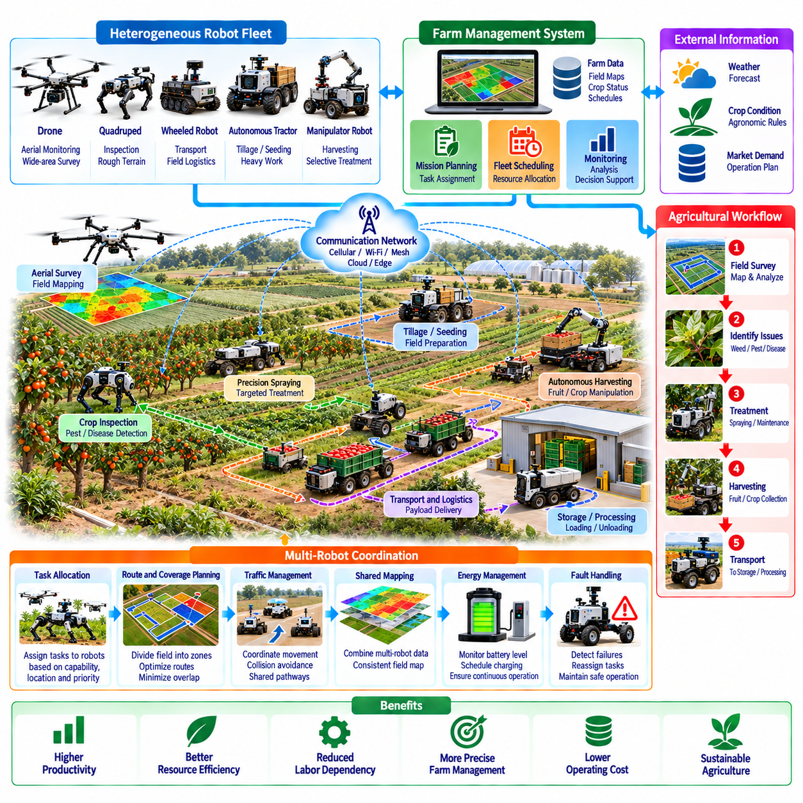{width="7.268055555555556in" height="7.268055555555556in"}

Multi-robot farm operations represent an important evolution of Physical AI in agriculture, enabling coordinated autonomous systems to perform complementary tasks across large and diverse farming environments. Instead of relying on individual machines operating independently, farms can deploy connected fleets for monitoring, treatment, harvesting, and transportation. Effective coordination improves resource utilization, operational continuity, and the ability to respond to changing agricultural conditions.

Agricultural robot fleets may include autonomous tractors, wheeled mobile robots, quadrupeds, aerial drones, and robotic manipulators. Each platform offers different capabilities in mobility, sensing, payload handling, and physical interaction. Drones provide broad environmental observations, while ground robots perform detailed inspections and agricultural interventions. Heterogeneous fleet architectures combine these capabilities to support integrated farming operations.

Multi-robot coordination requires a shared understanding of agricultural tasks, operating environments, and available resources. Farm management systems can define missions according to crop conditions, production schedules, and operational priorities. Individual robots receive assignments based on their capabilities, locations, and current status. Coordination mechanisms must account for task dependencies, equipment limitations, and the availability of human supervision.

Task allocation determines which robots should perform specific agricultural activities and when those activities should occur. Centralized scheduling systems can optimize assignments using estimated travel time, workload, battery capacity, and task urgency. Distributed approaches allow robots to negotiate responsibilities when communication or centralized control is limited. Effective allocation must adapt when equipment becomes unavailable or unexpected field conditions change mission requirements.

Agricultural workflows often contain dependencies that require careful sequencing between robots. Aerial scouting may identify crop stress before a ground robot performs detailed inspection or targeted treatment. Harvesting robots may depend on transport vehicles to remove filled containers and maintain productivity. Workflow orchestration coordinates these activities to prevent unnecessary waiting, resource conflicts, and interruptions across interconnected farming processes.

Shared mapping enables multiple agricultural robots to operate using consistent spatial information. Digital field maps can represent crop rows, access routes, irrigation structures, obstacles, and restricted zones. Individual robots contribute observations that update the shared environmental representation. However, differences in sensor accuracy, localization methods, and observation timing can introduce inconsistencies that must be managed through map alignment and uncertainty estimation.

Fleet-level localization combines information from GNSS, inertial sensors, cameras, and LiDAR systems to maintain reliable robot positioning. Accurate coordinates allow robots to exchange task locations and navigate toward common operational targets. RTK-GNSS can improve outdoor positioning when correction signals are available. Shared localization frameworks must also account for temporary satellite obstruction, sensor drift, and changing agricultural environments.

Communication infrastructure connects agricultural robots with fleet controllers, edge computing systems, and farm management platforms. Wireless networks may include cellular connections, local Wi-Fi, and other field communication technologies. Coverage limitations, interference, and network interruptions can affect coordinated operations. Robust architectures support local autonomy, buffered data exchange, and safe behavior when continuous communication cannot be guaranteed.

Collision avoidance becomes increasingly important when multiple robots share agricultural pathways and working areas. Vehicles may approach intersections, harvesting zones, charging stations, or narrow crop passages simultaneously. Fleet traffic management can reserve critical areas and coordinate movement priorities. Local safety controllers must independently detect nearby obstacles and stop safely because centralized scheduling alone cannot guarantee collision prevention.

Multi-robot systems can improve agricultural coverage by dividing large fields into smaller operational regions. Coverage planning algorithms assign zones according to robot capabilities, travel distances, and expected workload. Coordinated execution reduces unnecessary overlap while ensuring required areas receive attention. Dynamic replanning becomes necessary when robots encounter blocked routes, changing soil conditions, or unexpected differences in task duration.

Energy management influences fleet availability and operational scheduling throughout agricultural missions. Robots differ in battery capacity, power consumption, charging requirements, and mission endurance. Fleet controllers can schedule charging according to predicted workload and available infrastructure. Energy-aware task allocation reduces the likelihood of mission interruption while balancing productive operation against charging time and battery degradation.

Autonomous harvesting fleets require particularly close coordination between perception, manipulation, and logistics systems. Harvesting robots identify and collect mature products, while transport robots move filled containers to storage or processing locations. Fleet orchestration must match transport capacity with harvesting throughput. Poor synchronization can create bottlenecks even when individual robots demonstrate high task performance and reliable autonomy.

Precision agriculture benefits from coordinating observation robots with treatment platforms. Aerial drones and scouting vehicles collect information about weeds, disease symptoms, and crop conditions. AI systems transform observations into georeferenced treatment recommendations. Ground robots then execute localized spraying, mechanical weeding, or other interventions. Feedback from completed operations supports verification and refinement of subsequent agricultural decisions.

Human operators remain essential participants in many multi-robot farming systems. Workers may supervise missions, handle exceptional situations, replenish supplies, and perform maintenance. Human-machine interfaces should present fleet status, task progress, alerts, and intervention requirements clearly. Supervisory control must allow operators to modify priorities or suspend unsafe activities without introducing confusion or conflicting commands across the fleet.

Fleet data management provides a foundation for continuous improvement in agricultural automation. Robots generate information about routes, task outcomes, environmental conditions, equipment status, and operational interruptions. Centralized data platforms can organize these records for analysis and model development. Shared learning processes may improve navigation, crop recognition, and scheduling, provided differences between robot hardware and operating conditions are considered.

Simulation and digital twins support the design and evaluation of coordinated farm operations. Virtual farms can represent field layouts, robot capabilities, crop distributions, and changing environmental conditions. Engineers can test task allocation, traffic management, and logistics strategies before physical deployment. Simulation results must be validated against actual field performance because agricultural terrain, weather, and biological variability introduce substantial uncertainty.

Operational resilience requires multi-robot fleets to tolerate equipment failures, communication interruptions, and unexpected environmental changes. A failed robot should not necessarily stop the entire agricultural workflow. Fleet management systems can reassign tasks, modify routes, or request human intervention according to mission priorities. Reliable recovery depends on accurate status monitoring, well-defined fallback procedures, and safe transitions between autonomous and supervised operation.

Scalability introduces additional challenges as agricultural fleets expand across larger areas and multiple farms. Increasing robot numbers raises communication demand, traffic complexity, maintenance requirements, and scheduling overhead. Hierarchical coordination can distribute decisions between local robot groups and centralized farm management systems. Standardized interfaces and interoperable software architectures help integrate heterogeneous equipment while reducing deployment complexity.

The economic performance of multi-robot farming depends on fleet utilization, task completion rates, labor productivity, equipment availability, and operational costs. Adding robots does not automatically produce proportional productivity gains because shared infrastructure and workflow bottlenecks can limit throughput. Economic evaluation should include acquisition, maintenance, connectivity, supervision, and charging infrastructure. Coordinated fleets create value when system-level improvements exceed their additional complexity.

Ultimately, multi-robot farm operations transform individual agricultural machines into coordinated Physical AI systems capable of managing interconnected production activities. Shared perception, intelligent task allocation, autonomous mobility, and operational orchestration enable more flexible agricultural workflows. Long-term success depends on reliable interoperability, resilient communication, effective human supervision, and measurable improvements in productivity, sustainability, and economic efficiency.

다중 로봇 농장 운영(Multi-Robot Farm Operations)은 농업 분야 피지컬 인공지능(Physical AI)의 중요한 발전 단계로, 협조적으로 작동하는 자율 시스템(Coordinated Autonomous Systems)이 광범위하고 다양한 농업 환경에서 상호 보완적인 작업(Complementary Tasks)을 수행할 수 있도록 한다. 개별 기계가 독립적으로 작동하는 방식에서 벗어나 농장은 모니터링(Monitoring), 처리(Treatment), 수확(Harvesting), 운송(Transportation)을 위한 연결된 로봇 플릿(Connected Robot Fleets)을 배치할 수 있다. 효과적인 협조(Effective Coordination)는 자원 활용도(Resource Utilization), 운영 연속성(Operational Continuity), 변화하는 농업 환경 조건(Agricultural Conditions)에 대한 대응 능력을 향상시킨다.

농업용 로봇 플릿(Agricultural Robot Fleets)에는 자율 트랙터(Autonomous Tractors), 차륜형 이동 로봇(Wheeled Mobile Robots), 사족보행 로봇(Quadrupeds), 항공 드론(Aerial Drones), 로봇 매니퓰레이터(Robotic Manipulators)가 포함될 수 있다. 각 플랫폼은 이동성(Mobility), 센싱(Sensing), 적재물 취급(Payload Handling), 물리적 상호작용(Physical Interaction)에서 서로 다른 능력을 제공한다. 드론은 광범위한 환경 관측(Broad Environmental Observations)을 제공하는 반면, 지상 로봇(Ground Robots)은 상세 검사(Detailed Inspections)와 농업 작업(Agricultural Interventions)을 수행한다. 이기종 플릿 아키텍처(Heterogeneous Fleet Architectures)는 이러한 능력을 결합하여 통합 농업 운영(Integrated Farming Operations)을 지원한다.

다중 로봇 협조(Multi-Robot Coordination)는 농업 작업(Agricultural Tasks), 운영 환경(Operating Environments), 가용 자원(Available Resources)에 대한 공유된 이해(Shared Understanding)를 필요로 한다. 농장 관리 시스템(Farm Management Systems)은 작물 상태(Crop Conditions), 생산 일정(Production Schedules), 운영 우선순위(Operational Priorities)에 따라 임무(Missions)를 정의할 수 있다. 개별 로봇은 자신의 능력(Capabilities), 위치(Locations), 현재 상태(Current Status)에 따라 작업을 할당받는다. 협조 메커니즘(Coordination Mechanisms)은 작업 의존성(Task Dependencies), 장비 제약조건(Equipment Limitations), 인간 감독(Human Supervision)의 가용성을 고려해야 한다.

작업 할당(Task Allocation)은 어떤 로봇이 특정 농업 활동(Agricultural Activities)을 수행해야 하는지, 그리고 해당 활동을 언제 수행해야 하는지를 결정한다. 중앙집중식 스케줄링 시스템(Centralized Scheduling Systems)은 예상 이동 시간(Estimated Travel Time), 작업 부하(Workload), 배터리 용량(Battery Capacity), 작업 긴급도(Task Urgency)를 활용하여 작업 배정을 최적화할 수 있다. 분산형 접근방식(Distributed Approaches)은 통신이나 중앙 제어(Centralized Control)가 제한될 때 로봇들이 책임을 협상하도록 한다. 효과적인 작업 할당은 장비를 사용할 수 없게 되거나 예상하지 못한 농경지 조건(Field Conditions)이 임무 요구사항(Mission Requirements)을 변화시킬 때 적응해야 한다.

농업 작업흐름(Agricultural Workflows)에는 로봇 간 신중한 작업 순서 결정(Careful Sequencing)이 필요한 의존관계(Dependencies)가 자주 존재한다. 항공 정찰(Aerial Scouting)은 지상 로봇이 상세 검사(Detailed Inspection)나 표적 처리(Targeted Treatment)를 수행하기 전에 작물 스트레스(Crop Stress)를 식별할 수 있다. 수확 로봇(Harvesting Robots)은 생산성을 유지하기 위해 가득 찬 용기(Filled Containers)를 제거하는 운송 차량(Transport Vehicles)에 의존할 수 있다. 작업흐름 오케스트레이션(Workflow Orchestration)은 이러한 활동을 조정하여 상호 연결된 농업 생산 과정(Interconnected Farming Processes)에서 불필요한 대기(Unnecessary Waiting), 자원 충돌(Resource Conflicts), 작업 중단(Interruptions)을 방지한다.

공유 지도 작성(Shared Mapping)은 여러 농업 로봇이 일관된 공간 정보(Consistent Spatial Information)를 사용하여 작동하도록 한다. 디지털 농경지 지도(Digital Field Maps)는 작물 재배열(Crop Rows), 접근 경로(Access Routes), 관개 시설(Irrigation Structures), 장애물(Obstacles), 제한 구역(Restricted Zones)을 표현할 수 있다. 개별 로봇은 관측 정보(Observations)를 제공하여 공유 환경 표현(Shared Environmental Representation)을 갱신한다. 그러나 센서 정확도(Sensor Accuracy), 위치 추정 방법(Localization Methods), 관측 시점(Observation Timing)의 차이는 불일치(Inconsistencies)를 발생시킬 수 있으며, 이러한 문제는 지도 정합(Map Alignment)과 불확실성 추정(Uncertainty Estimation)을 통해 관리해야 한다.

플릿 수준 위치 추정(Fleet-Level Localization)은 위성항법 시스템(GNSS), 관성 센서(Inertial Sensors), 카메라(Cameras), 라이다 시스템(LiDAR Systems)의 정보를 결합하여 신뢰할 수 있는 로봇 위치 측정(Robot Positioning)을 유지한다. 정확한 좌표(Accurate Coordinates)는 로봇들이 작업 위치(Task Locations)를 교환하고 공통 운영 목표(Common Operational Targets)를 향해 이동할 수 있도록 한다. 실시간 이동측위 위성항법(RTK-GNSS)은 보정 신호(Correction Signals)를 사용할 수 있을 때 실외 위치 정확도(Outdoor Positioning Accuracy)를 향상시킬 수 있다. 공유 위치 추정 프레임워크(Shared Localization Frameworks)는 일시적인 위성 신호 차단(Temporary Satellite Obstruction), 센서 드리프트(Sensor Drift), 변화하는 농업 환경(Changing Agricultural Environments)도 고려해야 한다.

통신 인프라(Communication Infrastructure)는 농업 로봇을 플릿 제어기(Fleet Controllers), 엣지 컴퓨팅 시스템(Edge Computing Systems), 농장 관리 플랫폼(Farm Management Platforms)과 연결한다. 무선 네트워크(Wireless Networks)에는 셀룰러 연결(Cellular Connections), 로컬 와이파이(Local Wi-Fi), 기타 농경지 통신 기술(Field Communication Technologies)이 포함될 수 있다. 통신 범위 제한(Coverage Limitations), 간섭(Interference), 네트워크 중단(Network Interruptions)은 협조 운영(Coordinated Operations)에 영향을 미칠 수 있다. 견고한 아키텍처(Robust Architectures)는 지속적인 통신을 보장할 수 없는 상황에서도 로컬 자율성(Local Autonomy), 버퍼링된 데이터 교환(Buffered Data Exchange), 안전한 동작(Safe Behavior)을 지원한다.

충돌 회피(Collision Avoidance)는 여러 로봇이 농업 이동 경로(Agricultural Pathways)와 작업 구역(Working Areas)을 공유할 때 더욱 중요해진다. 차량들은 교차로(Intersections), 수확 구역(Harvesting Zones), 충전소(Charging Stations), 좁은 작물 통로(Narrow Crop Passages)에 동시에 접근할 수 있다. 플릿 교통 관리(Fleet Traffic Management)는 주요 구역(Critical Areas)을 예약하고 이동 우선순위(Movement Priorities)를 조정할 수 있다. 중앙집중식 스케줄링(Centralized Scheduling)만으로는 충돌 방지(Collision Prevention)를 보장할 수 없으므로 로컬 안전 제어기(Local Safety Controllers)는 주변 장애물을 독립적으로 탐지하고 안전하게 정지할 수 있어야 한다.

다중 로봇 시스템(Multi-Robot Systems)은 대규모 농경지를 더 작은 운영 구역(Operational Regions)으로 분할하여 농업 작업의 커버리지(Agricultural Coverage)를 향상시킬 수 있다. 영역 탐사 계획 알고리즘(Coverage Planning Algorithms)은 로봇 능력(Robot Capabilities), 이동 거리(Travel Distances), 예상 작업량(Expected Workload)에 따라 구역을 할당한다. 협조적 실행(Coordinated Execution)은 불필요한 중복 작업(Unnecessary Overlap)을 줄이면서 필요한 모든 지역이 관리되도록 한다. 로봇이 차단된 경로(Blocked Routes), 변화하는 토양 조건(Changing Soil Conditions), 예상하지 못한 작업 소요시간(Task Duration)의 차이에 직면하면 동적 재계획(Dynamic Replanning)이 필요해진다.

에너지 관리(Energy Management)는 농업 임무(Agricultural Missions) 전반에서 플릿 가용성(Fleet Availability)과 운영 일정(Operational Scheduling)에 영향을 미친다. 로봇마다 배터리 용량(Battery Capacity), 전력 소비(Power Consumption), 충전 요구사항(Charging Requirements), 임무 지속시간(Mission Endurance)이 다르다. 플릿 제어기(Fleet Controllers)는 예상 작업량(Predicted Workload)과 가용 인프라(Available Infrastructure)에 따라 충전 일정을 계획할 수 있다. 에너지 인식 작업 할당(Energy-Aware Task Allocation)은 생산적 운영(Productive Operation)과 충전 시간(Charging Time), 배터리 열화(Battery Degradation) 사이의 균형을 유지하면서 임무 중단(Mission Interruption)의 가능성을 줄인다.

자율 수확 플릿(Autonomous Harvesting Fleets)은 인식(Perception), 조작(Manipulation), 물류 시스템(Logistics Systems) 사이의 특히 긴밀한 협조를 요구한다. 수확 로봇(Harvesting Robots)은 성숙한 농산물(Mature Products)을 식별하고 수확하며, 운송 로봇(Transport Robots)은 가득 찬 용기를 저장 장소(Storage Locations)나 가공 구역(Processing Locations)으로 이동시킨다. 플릿 오케스트레이션(Fleet Orchestration)은 운송 용량(Transport Capacity)을 수확 처리량(Harvesting Throughput)과 일치시켜야 한다. 개별 로봇이 높은 작업 성능(Task Performance)과 신뢰할 수 있는 자율성(Reliable Autonomy)을 보여주더라도 동기화(Synchronization)가 부족하면 병목 현상(Bottlenecks)이 발생할 수 있다.

정밀농업(Precision Agriculture)은 관측 로봇(Observation Robots)과 처리 플랫폼(Treatment Platforms)의 협조를 통해 이점을 얻는다. 항공 드론(Aerial Drones)과 정찰 차량(Scouting Vehicles)은 잡초(Weeds), 질병 증상(Disease Symptoms), 작물 상태(Crop Conditions)에 관한 정보를 수집한다. 인공지능 시스템(AI Systems)은 관측 정보를 지리참조 기반 처리 권고사항(Georeferenced Treatment Recommendations)으로 변환한다. 이후 지상 로봇(Ground Robots)은 국소 살포(Localized Spraying), 기계적 제초(Mechanical Weeding), 기타 작업을 수행한다. 완료된 작업의 피드백(Feedback)은 검증(Verification)과 후속 농업 의사결정(Subsequent Agricultural Decisions)의 개선을 지원한다.

인간 운영자(Human Operators)는 많은 다중 로봇 농업 시스템(Multi-Robot Farming Systems)에서 여전히 필수적인 참여자이다. 작업자(Workers)는 임무를 감독하고 예외 상황(Exceptional Situations)을 처리하며 소모품을 보충하고 유지보수(Maintenance)를 수행할 수 있다. 인간-기계 인터페이스(Human-Machine Interfaces)는 플릿 상태(Fleet Status), 작업 진행 상황(Task Progress), 경고(Alerts), 개입 요구사항(Intervention Requirements)을 명확하게 표시해야 한다. 감독 제어(Supervisory Control)는 운영자가 플릿 전체에 혼란이나 상충되는 명령(Conflicting Commands)을 유발하지 않으면서 우선순위를 변경하거나 안전하지 않은 활동(Unsafe Activities)을 중단할 수 있도록 해야 한다.

플릿 데이터 관리(Fleet Data Management)는 농업 자동화(Agricultural Automation)의 지속적인 개선(Continuous Improvement)을 위한 기반을 제공한다. 로봇은 이동 경로(Routes), 작업 결과(Task Outcomes), 환경 조건(Environmental Conditions), 장비 상태(Equipment Status), 운영 중단(Operational Interruptions)에 관한 정보를 생성한다. 중앙집중식 데이터 플랫폼(Centralized Data Platforms)은 이러한 기록을 분석(Analysis)과 모델 개발(Model Development)을 위해 체계화할 수 있다. 공유 학습 프로세스(Shared Learning Processes)는 로봇 하드웨어(Robot Hardware)와 운영 조건(Operating Conditions)의 차이를 고려한다는 전제하에 내비게이션(Navigation), 작물 인식(Crop Recognition), 스케줄링(Scheduling)을 개선할 수 있다.

시뮬레이션(Simulation)과 디지털 트윈(Digital Twins)은 협조적 농장 운영(Coordinated Farm Operations)의 설계 및 평가(Design and Evaluation)를 지원한다. 가상 농장(Virtual Farms)은 농경지 배치(Field Layouts), 로봇 능력(Robot Capabilities), 작물 분포(Crop Distributions), 변화하는 환경 조건(Changing Environmental Conditions)을 표현할 수 있다. 엔지니어(Engineers)는 실제 배포(Physical Deployment) 전에 작업 할당(Task Allocation), 교통 관리(Traffic Management), 물류 전략(Logistics Strategies)을 시험할 수 있다. 농업 지형(Agricultural Terrain), 기상(Weather), 생물학적 변동성(Biological Variability)이 상당한 불확실성을 발생시키므로 시뮬레이션 결과(Simulation Results)는 실제 농경지 성능(Actual Field Performance)을 통해 검증해야 한다.

운영 복원력(Operational Resilience)은 다중 로봇 플릿(Multi-Robot Fleets)이 장비 고장(Equipment Failures), 통신 중단(Communication Interruptions), 예상하지 못한 환경 변화(Unexpected Environmental Changes)를 견딜 수 있도록 요구한다. 한 대의 로봇이 고장 나더라도 전체 농업 작업흐름(Agricultural Workflow)이 반드시 중단되어서는 안 된다. 플릿 관리 시스템(Fleet Management Systems)은 임무 우선순위(Mission Priorities)에 따라 작업을 재할당하고 경로를 수정하거나 인간 개입(Human Intervention)을 요청할 수 있다. 신뢰할 수 있는 복구(Reliable Recovery)는 정확한 상태 모니터링(Status Monitoring), 명확하게 정의된 대체 운영 절차(Fallback Procedures), 자율 운영과 감독 운영(Autonomous and Supervised Operation) 사이의 안전한 전환(Safe Transitions)에 달려 있다.

확장성(Scalability)은 농업용 플릿이 더 넓은 지역과 여러 농장으로 확대될수록 추가적인 문제를 발생시킨다. 로봇 수가 증가하면 통신 수요(Communication Demand), 교통 복잡성(Traffic Complexity), 유지보수 요구사항(Maintenance Requirements), 스케줄링 부담(Scheduling Overhead)이 증가한다. 계층적 협조(Hierarchical Coordination)는 로컬 로봇 그룹(Local Robot Groups)과 중앙집중식 농장 관리 시스템(Centralized Farm Management Systems) 사이에 의사결정을 분산할 수 있다. 표준화된 인터페이스(Standardized Interfaces)와 상호운용 가능한 소프트웨어 아키텍처(Interoperable Software Architectures)는 이기종 장비(Heterogeneous Equipment)의 통합을 지원하면서 배포 복잡성(Deployment Complexity)을 줄인다.

다중 로봇 농업(Multi-Robot Farming)의 경제적 성과(Economic Performance)는 플릿 활용도(Fleet Utilization), 작업 완료율(Task Completion Rates), 노동 생산성(Labor Productivity), 장비 가용성(Equipment Availability), 운영 비용(Operational Costs)에 따라 결정된다. 공유 인프라(Shared Infrastructure)와 작업흐름 병목 현상(Workflow Bottlenecks)이 처리량(Throughput)을 제한할 수 있으므로 로봇을 추가한다고 해서 생산성이 반드시 비례적으로 증가하는 것은 아니다. 경제성 평가(Economic Evaluation)에는 장비 도입(Acquisition), 유지보수(Maintenance), 연결성(Connectivity), 감독(Supervision), 충전 인프라(Charging Infrastructure)가 포함되어야 한다. 협조적 플릿(Coordinated Fleets)은 시스템 수준의 개선(System-Level Improvements)이 추가적인 복잡성(Additional Complexity)을 상회할 때 가치를 창출한다.

궁극적으로 다중 로봇 농장 운영(Multi-Robot Farm Operations)은 개별 농업 기계(Individual Agricultural Machines)를 상호 연결된 생산 활동(Interconnected Production Activities)을 관리할 수 있는 협조적 피지컬 인공지능 시스템(Coordinated Physical AI Systems)으로 전환한다. 공유 인식(Shared Perception), 지능형 작업 할당(Intelligent Task Allocation), 자율 이동(Autonomous Mobility), 운영 오케스트레이션(Operational Orchestration)은 더욱 유연한 농업 작업흐름(Flexible Agricultural Workflows)을 가능하게 한다. 장기적인 성공(Long-Term Success)은 신뢰할 수 있는 상호운용성(Reliable Interoperability), 복원력 있는 통신(Resilient Communication), 효과적인 인간 감독(Effective Human Supervision), 생산성(Productivity), 지속 가능성(Sustainability), 경제적 효율성(Economic Efficiency)의 측정 가능한 개선에 달려 있다.

##  

## 05.12. Weather Terrain and Seasonal Adaptation

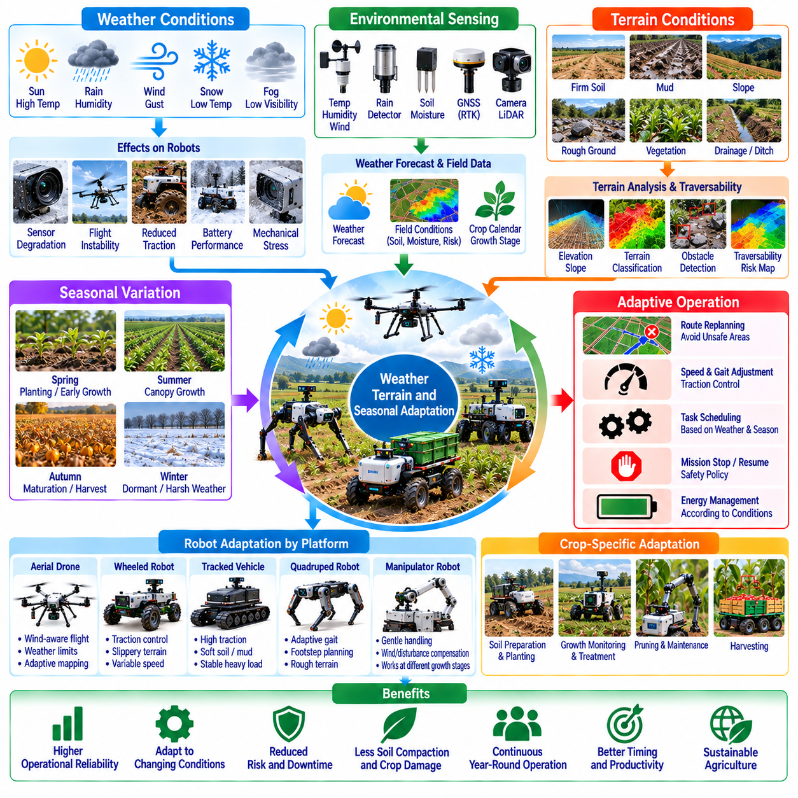{width="7.268055555555556in" height="7.268055555555556in"}

Weather, terrain, and seasonal adaptation are essential capabilities of Physical AI in agriculture because farming environments change continuously across time and location. Rainfall, temperature, sunlight, soil moisture, and crop development directly influence robotic perception, mobility, and task execution. Agricultural robots must operate beyond fixed laboratory conditions, adapting their behavior to environmental uncertainty while maintaining safety, productivity, and operational reliability.

Weather conditions influence nearly every aspect of agricultural robot operation. Rain can reduce visibility, alter soil traction, and interfere with optical sensors, while strong winds affect aerial platforms and exposed manipulators. Temperature extremes influence battery performance, electronics, and mechanical components. Physical AI systems require environmental awareness and adaptive operational policies to determine when missions should continue, change, or stop.

Environmental sensing provides the foundation for weather-aware agricultural autonomy. Temperature sensors, humidity sensors, rain detectors, anemometers, and soil moisture instruments supply measurements of local conditions. External weather forecasts can complement onboard observations by identifying potential changes during planned missions. Combining real-time sensing with predictive information enables robots to adjust schedules, routes, and task parameters before conditions become unsafe.

Terrain variability presents significant challenges for agricultural mobility. Fields contain compacted soil, loose ground, mud, gravel, vegetation, slopes, and drainage structures. Their physical properties change with rainfall, cultivation, and repeated machinery movement. Autonomous vehicles must estimate terrain traversability and select movement strategies that account for traction, ground clearance, load-bearing capacity, and the possibility of becoming immobilized.

Soil moisture strongly affects robot-ground interaction and agricultural operating constraints. Wet soil can increase wheel slip, reduce traction, and produce deep ruts under heavy machinery. Excessive traffic may also contribute to soil compaction and damage agricultural productivity. Physical AI systems can combine moisture measurements, terrain observations, and vehicle feedback to avoid unsuitable routes and reduce unnecessary disturbance of cultivated land.

Terrain-aware navigation integrates geometric mapping with estimates of surface properties. LiDAR, cameras, inertial sensors, and wheel or leg feedback help characterize slopes, obstacles, and contact conditions. Traversability models can assign risk estimates to different field regions. Route planners then balance travel distance, energy consumption, mobility limitations, and soil protection while adapting to environmental changes that invalidate previously selected paths.

Adaptive locomotion allows agricultural robots to respond to changing ground conditions during movement. Wheeled platforms can modify speed, acceleration, and drive torque to manage traction, while tracked vehicles distribute contact forces across larger surfaces. Legged robots can adjust footholds, body posture, and gait patterns. Each morphology offers different advantages, and control policies must reflect its mechanical constraints and environmental operating limits.

Seasonal variation introduces longer-term changes that affect agricultural robot configuration and mission planning. Plant height, canopy density, row accessibility, and field geometry evolve throughout the growing season. Robots that operate effectively during planting may encounter restricted visibility and movement during later growth stages. Adaptive perception and navigation systems must account for these changes rather than assuming static agricultural environments.

Crop growth stages also determine which robotic operations are appropriate. Early-season activities may emphasize soil preparation, planting, and weed monitoring, while later stages require crop inspection, selective treatment, and harvesting. Physical AI systems can incorporate crop calendars, phenological models, and field observations to select suitable tasks. Incorrect timing may reduce treatment effectiveness or cause unnecessary damage to developing plants.

Illumination variation creates additional challenges for visual perception. Direct sunlight, shadows, cloud cover, and changing solar angles alter image appearance throughout the day. Reflective leaves and wet surfaces can further complicate object recognition and depth estimation. Robust agricultural vision systems use suitable exposure control, sensor fusion, and training data diversity to maintain performance across changing lighting conditions.

Weather-aware perception requires recognizing when sensor measurements become unreliable. Rain droplets, dust accumulation, fog, and condensation can degrade cameras and LiDAR systems. Thermal and multispectral measurements are also influenced by environmental conditions and calibration quality. Physical AI systems should monitor sensor confidence and modify operational behavior when perception uncertainty exceeds acceptable thresholds.

Agricultural manipulation must adapt to environmental influences on biological materials. Fruits, stems, leaves, and branches change their mechanical behavior with maturity, hydration, and temperature. Wind can move target objects during grasping or cutting, while wet surfaces alter contact friction. Adaptive manipulators combine visual feedback, force sensing, and compliant control to maintain reliable interactions without damaging crops.

Aerial agricultural robots face particularly strong environmental constraints. Wind speed, gusts, precipitation, and visibility influence flight stability, sensor performance, and mission feasibility. Autonomous flight planners must account for weather forecasts, remaining battery energy, and safe recovery locations. Missions should be delayed or terminated when environmental conditions exceed validated aircraft capabilities or applicable operational restrictions.

Weather and seasonal adaptation also influence agricultural fleet coordination. Multiple robots may require different operating conditions because their mobility systems, payloads, and sensors have different limitations. Fleet management platforms can prioritize suitable missions, reassign tasks, and redistribute resources according to changing conditions. Coordinated adaptation reduces idle time while preventing equipment from entering environments beyond its safe operating envelope.

Predictive models can improve agricultural planning by anticipating environmental changes before they disrupt operations. Weather forecasts, soil measurements, historical field records, and crop development models provide information about future accessibility and task demand. AI-based scheduling can identify favorable operating windows for spraying, inspection, harvesting, or transportation. Prediction uncertainty must be considered when decisions involve safety or irreversible agricultural interventions.

Digital twins provide a framework for representing weather, terrain, and seasonal conditions within integrated agricultural systems. Virtual farm models can combine topography, soil characteristics, crop growth, equipment capabilities, and environmental observations. Simulation supports evaluation of navigation strategies and operational schedules under different conditions. However, simulated weather effects and soil interactions require validation against real agricultural measurements.

Learning-based adaptation can improve robot performance through repeated exposure to diverse agricultural conditions. Operational datasets may include sensor observations, weather measurements, terrain characteristics, control actions, and task outcomes. Models trained across multiple seasons and locations may become more robust to environmental variability. Nevertheless, rare events and unfamiliar conditions require uncertainty estimation, conservative behavior, and continued field validation.

Safety management must account for environmental hazards that change during agricultural operations. Flooded areas, unstable slopes, lightning, strong winds, and reduced visibility can create risks for robots, workers, and surrounding infrastructure. Runtime monitoring systems should compare observed conditions with validated operating limits. Safe fallback behaviors include reduced speed, mission suspension, controlled stopping, and return to designated recovery locations.

The economic consequences of environmental adaptation extend beyond immediate robot performance. Weather-related interruptions, seasonal utilization, equipment wear, and maintenance requirements influence operating costs and investment returns. Adaptive systems can improve productivity by selecting suitable operating windows and reducing avoidable failures. Economic evaluation should consider annual operating availability, completed tasks, environmental damage, and the cost of maintaining robust autonomous capabilities.

Ultimately, weather, terrain, and seasonal adaptation determine whether agricultural Physical AI can function reliably across real farming environments. Effective systems combine environmental sensing, terrain-aware mobility, adaptive manipulation, predictive planning, and operational safety management. Long-term agricultural autonomy requires robots that recognize changing conditions, adjust their behavior intelligently, and maintain dependable performance throughout diverse seasons and production cycles.

기상, 지형 및 계절적 적응(Weather, Terrain, and Seasonal Adaptation)은 농업 환경이 시간과 장소에 따라 지속적으로 변화하기 때문에 농업 분야 피지컬 인공지능(Physical AI)의 필수적인 능력이다. 강수량(Rainfall), 온도(Temperature), 일조량(Sunlight), 토양 수분(Soil Moisture), 작물 생육(Crop Development)은 로봇의 인식(Perception), 이동성(Mobility), 작업 실행(Task Execution)에 직접적인 영향을 미친다. 농업 로봇(Agricultural Robots)은 고정된 실험실 조건(Laboratory Conditions)을 넘어 환경적 불확실성(Environmental Uncertainty)에 맞게 동작을 조정하면서 안전성(Safety), 생산성(Productivity), 운영 신뢰성(Operational Reliability)을 유지해야 한다.

기상 조건(Weather Conditions)은 농업 로봇 운영(Agricultural Robot Operation)의 거의 모든 측면에 영향을 미친다. 비(Rain)는 가시성(Visibility)을 감소시키고 토양 견인력(Soil Traction)을 변화시키며 광학 센서(Optical Sensors)에 간섭을 일으킬 수 있고, 강풍(Strong Winds)은 항공 플랫폼(Aerial Platforms)과 외부에 노출된 매니퓰레이터(Exposed Manipulators)에 영향을 미친다. 극한 온도(Temperature Extremes)는 배터리 성능(Battery Performance), 전자 장치(Electronics), 기계 부품(Mechanical Components)에 영향을 준다. 피지컬 인공지능 시스템은 임무(Missions)를 지속하거나 변경하거나 중단할 시점을 결정하기 위해 환경 인식(Environmental Awareness)과 적응형 운영 정책(Adaptive Operational Policies)을 필요로 한다.

환경 센싱(Environmental Sensing)은 기상 인식 기반 농업 자율화(Weather-Aware Agricultural Autonomy)의 기초를 제공한다. 온도 센서(Temperature Sensors), 습도 센서(Humidity Sensors), 강우 감지기(Rain Detectors), 풍속계(Anemometers), 토양 수분 측정 장치(Soil Moisture Instruments)는 국소 환경 조건(Local Conditions)에 대한 측정값을 제공한다. 외부 기상 예보(External Weather Forecasts)는 계획된 임무 중 발생할 수 있는 변화를 식별함으로써 온보드 관측(Onboard Observations)을 보완할 수 있다. 실시간 센싱(Real-Time Sensing)과 예측 정보(Predictive Information)를 결합하면 로봇은 환경 조건이 위험해지기 전에 일정(Schedules), 경로(Routes), 작업 매개변수(Task Parameters)를 조정할 수 있다.

지형 변동성(Terrain Variability)은 농업 이동성(Agricultural Mobility)에 상당한 문제를 제기한다. 농경지에는 다져진 토양(Compacted Soil), 느슨한 지면(Loose Ground), 진흙(Mud), 자갈(Gravel), 식생(Vegetation), 경사면(Slopes), 배수 구조물(Drainage Structures)이 존재한다. 이러한 지형의 물리적 특성(Physical Properties)은 강우(Rainfall), 경작(Cultivation), 반복적인 농기계 이동(Repeated Machinery Movement)에 따라 변화한다. 자율 차량(Autonomous Vehicles)은 지형 주행 가능성(Terrain Traversability)을 추정하고 견인력(Traction), 지상고(Ground Clearance), 하중 지지 능력(Load-Bearing Capacity), 이동 불능 가능성(Possibility of Becoming Immobilized)을 고려한 이동 전략(Movement Strategies)을 선택해야 한다.

토양 수분(Soil Moisture)은 로봇과 지면의 상호작용(Robot-Ground Interaction) 및 농업 운영 제약조건(Agricultural Operating Constraints)에 큰 영향을 미친다. 젖은 토양(Wet Soil)은 바퀴 미끄러짐(Wheel Slip)을 증가시키고 견인력을 감소시키며 중장비(Heavy Machinery)의 이동으로 깊은 바퀴 자국(Deep Ruts)을 형성할 수 있다. 과도한 차량 통행(Excessive Traffic)은 토양 다짐(Soil Compaction)을 유발하고 농업 생산성(Agricultural Productivity)을 저하시킬 수도 있다. 피지컬 인공지능 시스템은 수분 측정값(Moisture Measurements), 지형 관측(Terrain Observations), 차량 피드백(Vehicle Feedback)을 결합하여 부적합한 경로(Unsuitable Routes)를 회피하고 경작지(Cultivated Land)에 대한 불필요한 교란(Unnecessary Disturbance)을 줄일 수 있다.

지형 인식 내비게이션(Terrain-Aware Navigation)은 기하학적 지도 작성(Geometric Mapping)과 지표면 특성(Surface Properties)의 추정 정보를 통합한다. 라이다(LiDAR), 카메라(Cameras), 관성 센서(Inertial Sensors), 바퀴 또는 다리 피드백(Wheel or Leg Feedback)은 경사(Slopes), 장애물(Obstacles), 접촉 조건(Contact Conditions)을 파악하는 데 도움이 된다. 주행 가능성 모델(Traversability Models)은 농경지의 서로 다른 영역에 위험 추정값(Risk Estimates)을 부여할 수 있다. 이후 경로 계획기(Route Planners)는 이동 거리(Travel Distance), 에너지 소비(Energy Consumption), 이동성 제약조건(Mobility Limitations), 토양 보호(Soil Protection) 사이의 균형을 유지하면서 기존 경로를 무효화하는 환경 변화(Environmental Changes)에 적응한다.

적응형 이동(Adaptive Locomotion)은 농업 로봇이 이동 중 변화하는 지면 조건(Ground Conditions)에 대응할 수 있도록 한다. 차륜형 플랫폼(Wheeled Platforms)은 견인력을 관리하기 위해 속도(Speed), 가속도(Acceleration), 구동 토크(Drive Torque)를 조정할 수 있으며, 궤도형 차량(Tracked Vehicles)은 더 넓은 지표면에 접촉력(Contact Forces)을 분산시킨다. 다리형 로봇(Legged Robots)은 발 디딤 위치(Footholds), 몸체 자세(Body Posture), 보행 패턴(Gait Patterns)을 조정할 수 있다. 각 로봇 형태(Morphology)는 서로 다른 장점을 제공하며, 제어 정책(Control Policies)은 해당 로봇의 기계적 제약조건(Mechanical Constraints)과 환경적 운영 한계(Environmental Operating Limits)를 반영해야 한다.

계절적 변동(Seasonal Variation)은 농업 로봇의 구성(Robot Configuration)과 임무 계획(Mission Planning)에 영향을 미치는 장기적인 변화를 발생시킨다. 식물 높이(Plant Height), 작물 군락 밀도(Canopy Density), 재배열 접근성(Row Accessibility), 농경지 형상(Field Geometry)은 생육 기간(Growing Season) 동안 변화한다. 파종 시기(Planting)에 효과적으로 작동하던 로봇도 이후 생육 단계(Later Growth Stages)에서는 가시성과 이동의 제약(Restricted Visibility and Movement)에 직면할 수 있다. 적응형 인식 및 내비게이션 시스템(Adaptive Perception and Navigation Systems)은 농업 환경을 정적인 것으로 가정하지 않고 이러한 변화를 고려해야 한다.

작물 생육 단계(Crop Growth Stages)는 어떤 로봇 작업(Robotic Operations)이 적절한지도 결정한다. 생육 초기(Early Season)에는 토양 준비(Soil Preparation), 파종(Planting), 잡초 모니터링(Weed Monitoring)이 강조될 수 있으며, 이후 단계(Later Stages)에는 작물 검사(Crop Inspection), 선택적 처리(Selective Treatment), 수확(Harvesting)이 필요하다. 피지컬 인공지능 시스템은 작물 재배 일정(Crop Calendars), 생물계절 모델(Phenological Models), 농경지 관측(Field Observations)을 통합하여 적절한 작업을 선택할 수 있다. 잘못된 작업 시점(Incorrect Timing)은 처리 효과(Treatment Effectiveness)를 감소시키거나 생육 중인 식물(Developing Plants)에 불필요한 손상을 유발할 수 있다.

조명 변화(Illumination Variation)는 시각 인식(Visual Perception)에 추가적인 문제를 발생시킨다. 직사광선(Direct Sunlight), 그림자(Shadows), 구름량(Cloud Cover), 변화하는 태양 고도 및 각도(Changing Solar Angles)는 하루 동안 영상 외관(Image Appearance)을 변화시킨다. 반사성이 있는 잎(Reflective Leaves)과 젖은 표면(Wet Surfaces)은 객체 인식(Object Recognition)과 깊이 추정(Depth Estimation)을 더욱 어렵게 만들 수 있다. 견고한 농업용 비전 시스템(Robust Agricultural Vision Systems)은 적절한 노출 제어(Exposure Control), 센서 융합(Sensor Fusion), 다양한 학습 데이터(Training Data Diversity)를 활용하여 변화하는 조명 조건(Changing Lighting Conditions)에서도 성능을 유지한다.

기상 인식 기반 지각(Weather-Aware Perception)은 센서 측정값(Sensor Measurements)의 신뢰성이 저하되는 상황을 인식해야 한다. 빗방울(Rain Droplets), 먼지 축적(Dust Accumulation), 안개(Fog), 결로(Condensation)는 카메라와 라이다 시스템(LiDAR Systems)의 성능을 저하시킬 수 있다. 열 측정(Thermal Measurements)과 다중분광 측정(Multispectral Measurements) 역시 환경 조건(Environmental Conditions)과 보정 품질(Calibration Quality)의 영향을 받는다. 피지컬 인공지능 시스템은 센서 신뢰도(Sensor Confidence)를 모니터링하고 인식 불확실성(Perception Uncertainty)이 허용 가능한 임계값(Acceptable Thresholds)을 초과하면 운영 동작(Operational Behavior)을 변경해야 한다.

농업용 조작(Agricultural Manipulation)은 생물학적 재료(Biological Materials)에 대한 환경적 영향(Environmental Influences)에 적응해야 한다. 과일(Fruits), 줄기(Stems), 잎(Leaves), 가지(Branches)는 성숙도(Maturity), 수분 상태(Hydration), 온도에 따라 기계적 거동(Mechanical Behavior)이 달라진다. 바람(Wind)은 파지(Grasping)나 절단(Cutting) 중 목표 객체(Target Objects)를 움직이게 할 수 있으며, 젖은 표면은 접촉 마찰(Contact Friction)을 변화시킨다. 적응형 매니퓰레이터(Adaptive Manipulators)는 시각 피드백(Visual Feedback), 힘 센싱(Force Sensing), 유연 제어(Compliant Control)를 결합하여 작물 손상 없이 신뢰할 수 있는 상호작용(Reliable Interactions)을 유지한다.

항공 농업 로봇(Aerial Agricultural Robots)은 특히 강한 환경적 제약조건(Environmental Constraints)에 직면한다. 풍속(Wind Speed), 돌풍(Gusts), 강수(Precipitation), 가시성(Visibility)은 비행 안정성(Flight Stability), 센서 성능(Sensor Performance), 임무 실행 가능성(Mission Feasibility)에 영향을 미친다. 자율 비행 계획기(Autonomous Flight Planners)는 기상 예보(Weather Forecasts), 잔여 배터리 에너지(Remaining Battery Energy), 안전한 복귀 및 착륙 위치(Safe Recovery Locations)를 고려해야 한다. 환경 조건이 검증된 항공기 성능 한계(Validated Aircraft Capabilities)나 적용 가능한 운영 제한(Applicable Operational Restrictions)을 초과하면 임무를 연기하거나 종료해야 한다.

기상 및 계절적 적응(Weather and Seasonal Adaptation)은 농업용 플릿 협조(Agricultural Fleet Coordination)에도 영향을 미친다. 여러 로봇은 이동 시스템(Mobility Systems), 적재 장비(Payloads), 센서(Sensors)의 한계가 서로 다르기 때문에 각기 다른 운영 조건(Operating Conditions)을 필요로 할 수 있다. 플릿 관리 플랫폼(Fleet Management Platforms)은 변화하는 조건에 따라 적합한 임무(Suitable Missions)의 우선순위를 결정하고 작업을 재할당(Reassign Tasks)하며 자원을 재분배(Redistribute Resources)할 수 있다. 협조적 적응(Coordinated Adaptation)은 장비가 안전 운영 범위(Safe Operating Envelope)를 벗어난 환경에 진입하는 것을 방지하면서 유휴 시간(Idle Time)을 줄인다.

예측 모델(Predictive Models)은 환경 변화(Environmental Changes)가 운영을 방해하기 전에 이를 예상함으로써 농업 계획(Agricultural Planning)을 개선할 수 있다. 기상 예보(Weather Forecasts), 토양 측정값(Soil Measurements), 과거 농경지 기록(Historical Field Records), 작물 생육 모델(Crop Development Models)은 향후 접근 가능성(Future Accessibility)과 작업 수요(Task Demand)에 관한 정보를 제공한다. 인공지능 기반 스케줄링(AI-Based Scheduling)은 살포(Spraying), 검사(Inspection), 수확(Harvesting), 운송(Transportation)에 유리한 작업 가능 시간대(Favorable Operating Windows)를 식별할 수 있다. 안전이나 되돌릴 수 없는 농업 작업(Irreversible Agricultural Interventions)과 관련된 의사결정에서는 예측 불확실성(Prediction Uncertainty)을 반드시 고려해야 한다.

디지털 트윈(Digital Twins)은 통합 농업 시스템(Integrated Agricultural Systems) 내에서 기상, 지형, 계절적 조건을 표현하기 위한 프레임워크(Framework)를 제공한다. 가상 농장 모델(Virtual Farm Models)은 지형 정보(Topography), 토양 특성(Soil Characteristics), 작물 생육(Crop Growth), 장비 능력(Equipment Capabilities), 환경 관측(Environmental Observations)을 결합할 수 있다. 시뮬레이션(Simulation)은 다양한 조건에서 내비게이션 전략(Navigation Strategies)과 운영 일정(Operational Schedules)을 평가하도록 지원한다. 그러나 시뮬레이션된 기상 영향(Simulated Weather Effects)과 토양 상호작용(Soil Interactions)은 실제 농업 측정값(Real Agricultural Measurements)을 통한 검증이 필요하다.

학습 기반 적응(Learning-Based Adaptation)은 다양한 농업 조건(Agricultural Conditions)에 반복적으로 노출됨으로써 로봇 성능(Robot Performance)을 향상시킬 수 있다. 운영 데이터셋(Operational Datasets)에는 센서 관측(Sensor Observations), 기상 측정값(Weather Measurements), 지형 특성(Terrain Characteristics), 제어 행동(Control Actions), 작업 결과(Task Outcomes)가 포함될 수 있다. 여러 계절과 지역(Multiple Seasons and Locations)의 데이터를 학습한 모델은 환경 변동성(Environmental Variability)에 대해 더욱 높은 견고성(Robustness)을 확보할 수 있다. 그러나 드문 사건(Rare Events)과 익숙하지 않은 조건(Unfamiliar Conditions)에 대응하려면 불확실성 추정(Uncertainty Estimation), 보수적인 동작(Conservative Behavior), 지속적인 현장 검증(Continued Field Validation)이 필요하다.

안전 관리(Safety Management)는 농업 운영 중 변화하는 환경 위험(Environmental Hazards)을 고려해야 한다. 침수 지역(Flooded Areas), 불안정한 경사면(Unstable Slopes), 낙뢰(Lightning), 강풍(Strong Winds), 가시성 저하(Reduced Visibility)는 로봇, 작업자, 주변 기반시설(Surrounding Infrastructure)에 위험을 초래할 수 있다. 런타임 모니터링 시스템(Runtime Monitoring Systems)은 관측된 조건(Observed Conditions)을 검증된 운영 한계(Validated Operating Limits)와 비교해야 한다. 안전 대체 동작(Safe Fallback Behaviors)에는 감속(Reduced Speed), 임무 중단(Mission Suspension), 제어된 정지(Controlled Stopping), 지정된 복구 위치(Designated Recovery Locations)로의 복귀가 포함된다.

환경 적응(Environmental Adaptation)의 경제적 영향(Economic Consequences)은 즉각적인 로봇 성능(Robot Performance)을 넘어선다. 기상 관련 운영 중단(Weather-Related Interruptions), 계절별 활용도(Seasonal Utilization), 장비 마모(Equipment Wear), 유지보수 요구사항(Maintenance Requirements)은 운영 비용(Operating Costs)과 투자 수익(Investment Returns)에 영향을 미친다. 적응형 시스템(Adaptive Systems)은 적절한 작업 가능 시간대(Suitable Operating Windows)를 선택하고 예방 가능한 고장(Avoidable Failures)을 줄임으로써 생산성을 향상시킬 수 있다. 경제성 평가(Economic Evaluation)는 연간 운영 가용성(Annual Operating Availability), 완료된 작업(Completed Tasks), 환경 피해(Environmental Damage), 견고한 자율 기능(Robust Autonomous Capabilities)을 유지하는 비용을 고려해야 한다.

궁극적으로 기상, 지형 및 계절적 적응(Weather, Terrain, and Seasonal Adaptation)은 농업 분야 피지컬 인공지능이 실제 농업 환경(Real Farming Environments)에서 신뢰성 있게 작동할 수 있는지를 결정한다. 효과적인 시스템(Effective Systems)은 환경 센싱(Environmental Sensing), 지형 인식 이동(Terrain-Aware Mobility), 적응형 조작(Adaptive Manipulation), 예측 계획(Predictive Planning), 운영 안전 관리(Operational Safety Management)를 결합한다. 장기적인 농업 자율화(Long-Term Agricultural Autonomy)를 실현하려면 변화하는 조건을 인식하고 동작을 지능적으로 조정하며 다양한 계절과 생산 주기(Diverse Seasons and Production Cycles)에 걸쳐 안정적인 성능(Dependable Performance)을 유지하는 로봇이 필요하다.

##  

## 05.13. Farm Data and Digital Twin Integration

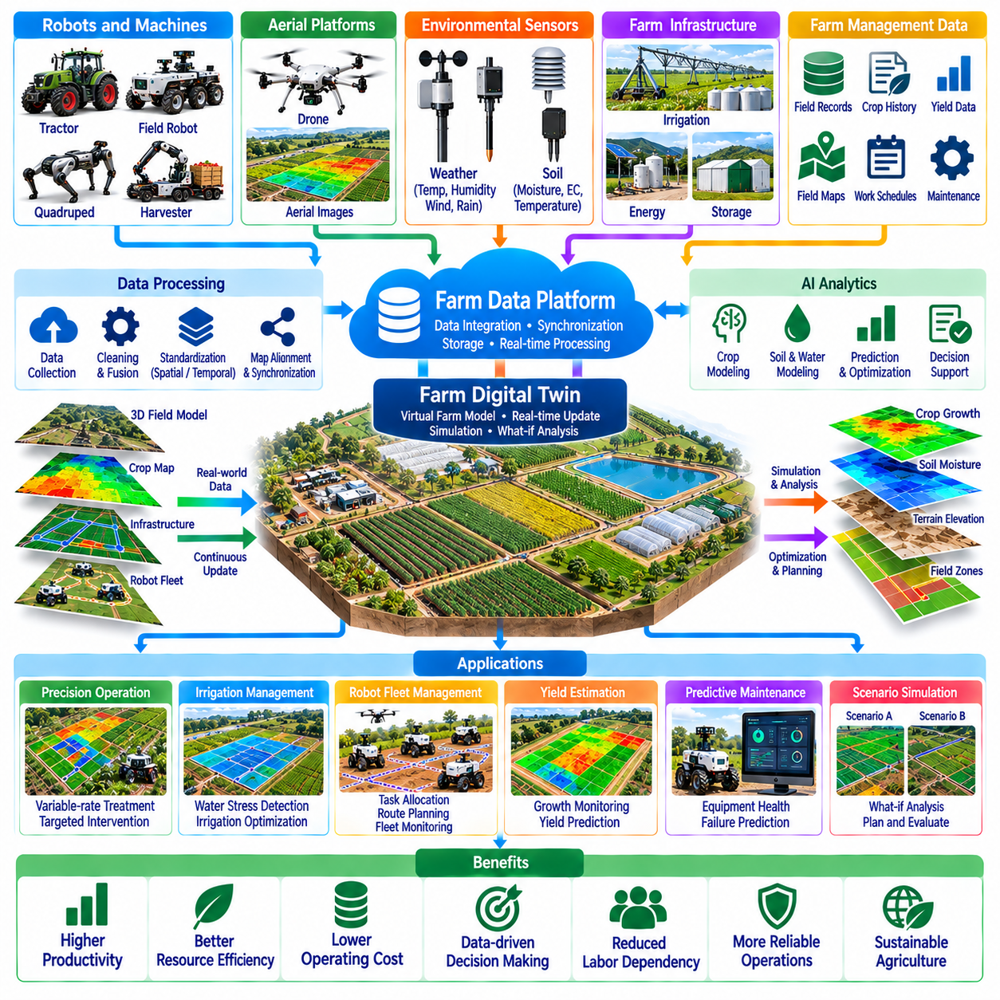{width="7.268055555555556in" height="7.268055555555556in"}

Farm data and digital twin integration provide a foundation for connecting Physical AI systems with agricultural planning, monitoring, and operational management. Modern farms generate information from robots, machinery, environmental sensors, aerial platforms, and production records. Integrating these sources creates a more complete representation of farming activities. Digital twins extend this capability by linking real-world observations with continuously updated virtual models.

Agricultural data integration begins with collecting information from heterogeneous devices and operational systems. Autonomous tractors, harvesting robots, irrigation controllers, weather stations, and drones produce different data formats and measurement frequencies. Unified data architectures organize these inputs into consistent structures. Effective integration requires standardized interfaces, reliable timestamps, spatial references, and clear descriptions of measurement conditions.

Farm data platforms commonly combine spatial, temporal, environmental, and operational information. Spatial datasets describe field boundaries, crop rows, soil zones, and infrastructure locations, while temporal records capture changes across growing seasons. Environmental measurements include temperature, rainfall, humidity, and soil moisture. Operational records document machine activity, resource consumption, completed tasks, and production outcomes.

Data synchronization is essential because agricultural observations originate from distributed systems operating under different communication conditions. Robots may collect information while disconnected from farm networks and upload records after returning to coverage areas. Synchronization mechanisms must preserve timestamps, data integrity, and event ordering. Conflict resolution procedures help reconcile inconsistent updates without losing important operational information.

Geospatial integration connects agricultural observations to physical locations and enables coordinated field operations. GNSS measurements, RTK positioning, aerial mapping, and robot localization systems provide location references for collected data. Geographic information systems organize these observations into spatial layers. Accurate coordinate transformations and map alignment are necessary when combining measurements from different sensors, platforms, and acquisition periods.

A farm digital twin is a computational representation of agricultural assets, environmental conditions, and operational processes. It may include virtual models of fields, crops, soil, irrigation networks, machinery, and robotic fleets. Unlike a static map, a digital twin incorporates updated measurements and operational states. Its usefulness depends on how accurately the virtual representation reflects the relevant behavior of the physical farm.

Digital twin architectures typically connect physical assets, sensing infrastructure, data services, simulation models, and operational applications. Field devices generate observations that update the virtual environment, while analytics estimate conditions that cannot be measured directly. Decision-support systems use these estimates to evaluate potential actions. Feedback from actual operations helps maintain consistency between the digital model and the physical environment.

Crop modeling is an important component of agricultural digital twins. Models can represent plant development, canopy growth, water demand, nutrient uptake, and responses to environmental conditions. Sensor observations and historical production records help update model parameters. Because biological processes are variable and only partially observable, crop digital twins must represent uncertainty rather than assuming perfectly predictable plant behavior.

Soil and water models provide additional information for agricultural decision-making. Digital representations can incorporate soil texture, moisture distribution, drainage characteristics, irrigation schedules, and weather conditions. These models help estimate water availability and identify regions requiring attention. Integrating physical measurements with predictive simulations can improve irrigation planning, although model accuracy depends on calibration and local environmental variability.

Robotic fleet digital twins represent the locations, capabilities, health, and operational status of agricultural machines. Virtual fleet models can track assigned tasks, planned routes, battery levels, equipment availability, and maintenance requirements. This information supports scheduling and resource allocation. Simulation can evaluate alternative fleet configurations and coordination strategies before implementing changes in active agricultural operations.

Data-driven decision support transforms integrated farm information into operational recommendations. AI models can analyze crop conditions, weather forecasts, soil measurements, and historical outcomes to prioritize agricultural interventions. Recommendations may include inspection schedules, irrigation adjustments, treatment locations, or harvesting priorities. Human operators should understand the assumptions, uncertainty, and expected consequences associated with these decisions.

Digital twins also support predictive maintenance and equipment lifecycle management. Robot telemetry can provide information about motor loads, battery health, actuator performance, vibration, and operating temperature. Analytical models may identify abnormal behavior and estimate maintenance needs. Linking equipment condition with agricultural schedules helps reduce unexpected downtime and coordinate servicing during periods of lower operational demand.

Simulation enables agricultural operators to examine potential decisions before applying them in physical environments. Virtual experiments can compare irrigation strategies, planting schedules, harvesting logistics, and robot deployment plans. Scenario analysis helps identify operational bottlenecks and resource constraints. However, simulation outcomes should be treated as conditional predictions because weather, biological variation, and unexpected events can alter actual results.

Edge and cloud computing play complementary roles in farm data integration. Edge systems process time-sensitive sensor information and support local robotic autonomy when network connectivity is limited. Cloud platforms provide scalable storage, historical analysis, model training, and cross-site comparisons. Hybrid architectures balance latency, bandwidth, reliability, and computing cost while maintaining essential operational capabilities during communication interruptions.

Interoperability is necessary when agricultural equipment originates from different manufacturers and software ecosystems. Data exchange interfaces must accommodate varying machine protocols, sensor schemas, coordinate systems, and operational terminology. Common information models and documented APIs reduce integration complexity. Modular architectures allow farms to introduce new robots, sensors, and analytics applications without rebuilding the entire digital infrastructure.

Data quality management determines whether integrated agricultural information can support reliable decisions. Missing measurements, sensor drift, incorrect timestamps, duplicated records, and inconsistent spatial references can distort analytical results. Validation pipelines detect anomalies and document data limitations. Metadata describing sensor calibration, acquisition conditions, and processing history improves traceability and helps users interpret model outputs appropriately.

Cybersecurity, privacy, and data governance are essential for connected agricultural platforms. Farm records may contain commercially sensitive information about production volumes, field performance, equipment utilization, and operating practices. Access controls, encryption, secure communications, and audit logs protect information and operational systems. Governance policies should define data ownership, permitted sharing, retention periods, and responsibilities across technology providers and farm operators.

Continuous learning connects digital twin integration with the broader Physical AI development cycle. Operational outcomes can be compared with model predictions to identify errors and improve future performance. Updated datasets support retraining of perception, planning, and forecasting models. Changes should undergo validation before deployment, especially when revised algorithms influence autonomous machinery, crop treatments, or other safety-critical agricultural activities.

The economic value of farm data integration depends on measurable improvements in decision quality, resource efficiency, equipment utilization, and agricultural productivity. Infrastructure costs include sensors, connectivity, data storage, software integration, model maintenance, and personnel training. Benefits may emerge gradually as historical information accumulates. Economic assessment should distinguish demonstrated operational savings from projected advantages that remain uncertain.

Ultimately, farm data and digital twin integration connect sensing, intelligence, simulation, and physical execution within a unified agricultural framework. Their value lies not simply in collecting more information but in maintaining trustworthy representations that support better decisions and coordinated actions. Continued progress in interoperability, model fidelity, data governance, and closed-loop learning will strengthen the role of digital twins in scalable agricultural Physical AI.

농장 데이터 및 디지털 트윈 통합(Farm Data and Digital Twin Integration)은 피지컬 인공지능 시스템(Physical AI Systems)을 농업 계획(Agricultural Planning), 모니터링(Monitoring), 운영 관리(Operational Management)와 연결하는 기반을 제공한다. 현대 농장(Modern Farms)은 로봇(Robots), 농업 기계(Machinery), 환경 센서(Environmental Sensors), 항공 플랫폼(Aerial Platforms), 생산 기록(Production Records)으로부터 다양한 정보를 생성한다. 이러한 데이터 소스(Data Sources)를 통합하면 농업 활동(Farming Activities)을 더욱 완전하게 표현할 수 있다. 디지털 트윈(Digital Twins)은 실제 환경의 관측 정보(Real-World Observations)를 지속적으로 갱신되는 가상 모델(Virtual Models)과 연결함으로써 이러한 능력을 확장한다.

농업 데이터 통합(Agricultural Data Integration)은 이기종 장치(Heterogeneous Devices)와 운영 시스템(Operational Systems)에서 정보를 수집하는 것에서 시작된다. 자율 트랙터(Autonomous Tractors), 수확 로봇(Harvesting Robots), 관개 제어기(Irrigation Controllers), 기상 관측소(Weather Stations), 드론(Drones)은 서로 다른 데이터 형식(Data Formats)과 측정 주기(Measurement Frequencies)를 가진 정보를 생성한다. 통합 데이터 아키텍처(Unified Data Architectures)는 이러한 입력 데이터를 일관된 구조(Consistent Structures)로 체계화한다. 효과적인 통합을 위해서는 표준화된 인터페이스(Standardized Interfaces), 신뢰할 수 있는 타임스탬프(Reliable Timestamps), 공간 참조(Spatial References), 측정 조건(Measurement Conditions)에 대한 명확한 설명이 필요하다.

농장 데이터 플랫폼(Farm Data Platforms)은 일반적으로 공간 정보(Spatial Information), 시간 정보(Temporal Information), 환경 정보(Environmental Information), 운영 정보(Operational Information)를 결합한다. 공간 데이터셋(Spatial Datasets)은 농경지 경계(Field Boundaries), 작물 재배열(Crop Rows), 토양 구역(Soil Zones), 기반시설 위치(Infrastructure Locations)를 설명하며, 시계열 기록(Temporal Records)은 생육 기간(Growing Seasons)에 걸친 변화를 저장한다. 환경 측정값(Environmental Measurements)에는 온도(Temperature), 강수량(Rainfall), 습도(Humidity), 토양 수분(Soil Moisture)이 포함된다. 운영 기록(Operational Records)은 기계 활동(Machine Activity), 자원 소비(Resource Consumption), 완료된 작업(Completed Tasks), 생산 결과(Production Outcomes)를 문서화한다.

데이터 동기화(Data Synchronization)는 농업 관측 정보(Agricultural Observations)가 서로 다른 통신 조건(Communication Conditions)에서 작동하는 분산 시스템(Distributed Systems)으로부터 생성되기 때문에 필수적이다. 로봇은 농장 네트워크(Farm Networks)와 연결되지 않은 상태에서도 정보를 수집하고, 통신 가능 지역(Coverage Areas)으로 복귀한 후 기록을 업로드할 수 있다. 동기화 메커니즘(Synchronization Mechanisms)은 타임스탬프(Timestamps), 데이터 무결성(Data Integrity), 이벤트 순서(Event Ordering)를 보존해야 한다. 충돌 해결 절차(Conflict Resolution Procedures)는 중요한 운영 정보(Operational Information)를 잃지 않으면서 일관되지 않은 갱신 내용(Inconsistent Updates)을 조정하는 데 도움이 된다.

지리공간 통합(Geospatial Integration)은 농업 관측 정보(Agricultural Observations)를 물리적 위치(Physical Locations)와 연결하고 협조적인 농경지 운영(Coordinated Field Operations)을 가능하게 한다. 위성항법 측정(GNSS Measurements), 실시간 이동측위(RTK Positioning), 항공 지도 작성(Aerial Mapping), 로봇 위치 추정 시스템(Robot Localization Systems)은 수집된 데이터에 위치 참조(Location References)를 제공한다. 지리정보시스템(Geographic Information Systems, GIS)은 이러한 관측 정보를 공간 계층(Spatial Layers)으로 구성한다. 서로 다른 센서(Sensors), 플랫폼(Platforms), 데이터 수집 시점(Acquisition Periods)의 측정값을 결합할 때는 정확한 좌표 변환(Coordinate Transformations)과 지도 정합(Map Alignment)이 필요하다.

농장 디지털 트윈(Farm Digital Twin)은 농업 자산(Agricultural Assets), 환경 조건(Environmental Conditions), 운영 프로세스(Operational Processes)에 대한 계산적 표현(Computational Representation)이다. 여기에는 농경지(Fields), 작물(Crops), 토양(Soil), 관개 네트워크(Irrigation Networks), 농업 기계(Machinery), 로봇 플릿(Robotic Fleets)의 가상 모델(Virtual Models)이 포함될 수 있다. 정적 지도(Static Map)와 달리 디지털 트윈은 갱신된 측정값(Updated Measurements)과 운영 상태(Operational States)를 반영한다. 디지털 트윈의 유용성은 가상 표현(Virtual Representation)이 실제 농장의 관련 동작(Relevant Behavior)을 얼마나 정확하게 반영하는지에 달려 있다.

디지털 트윈 아키텍처(Digital Twin Architectures)는 일반적으로 물리적 자산(Physical Assets), 센싱 인프라(Sensing Infrastructure), 데이터 서비스(Data Services), 시뮬레이션 모델(Simulation Models), 운영 애플리케이션(Operational Applications)을 연결한다. 농경지 장치(Field Devices)는 가상 환경(Virtual Environment)을 갱신하는 관측 정보를 생성하며, 분석 시스템(Analytics)은 직접 측정할 수 없는 상태를 추정한다. 의사결정 지원 시스템(Decision-Support Systems)은 이러한 추정값을 사용하여 가능한 행동(Potential Actions)을 평가한다. 실제 운영에서 얻은 피드백(Feedback)은 디지털 모델(Digital Model)과 물리적 환경(Physical Environment) 사이의 일관성을 유지하는 데 도움이 된다.

작물 모델링(Crop Modeling)은 농업 디지털 트윈(Agricultural Digital Twins)의 중요한 구성요소이다. 모델은 식물 발달(Plant Development), 작물 군락 생장(Canopy Growth), 수분 요구량(Water Demand), 양분 흡수(Nutrient Uptake), 환경 조건에 대한 반응(Responses to Environmental Conditions)을 표현할 수 있다. 센서 관측값(Sensor Observations)과 과거 생산 기록(Historical Production Records)은 모델 매개변수(Model Parameters)를 갱신하는 데 도움이 된다. 생물학적 과정(Biological Processes)은 변동성이 크고 부분적으로만 관측 가능하므로 작물 디지털 트윈(Crop Digital Twins)은 식물의 동작을 완벽하게 예측할 수 있다고 가정하기보다 불확실성(Uncertainty)을 표현해야 한다.

토양 및 수분 모델(Soil and Water Models)은 농업 의사결정(Agricultural Decision-Making)에 추가적인 정보를 제공한다. 디지털 표현(Digital Representations)에는 토양 질감(Soil Texture), 수분 분포(Moisture Distribution), 배수 특성(Drainage Characteristics), 관개 일정(Irrigation Schedules), 기상 조건(Weather Conditions)이 포함될 수 있다. 이러한 모델은 수분 가용성(Water Availability)을 추정하고 관리가 필요한 지역(Regions Requiring Attention)을 식별하는 데 도움이 된다. 물리적 측정값(Physical Measurements)을 예측 시뮬레이션(Predictive Simulations)과 통합하면 관개 계획(Irrigation Planning)을 개선할 수 있지만, 모델 정확도(Model Accuracy)는 보정(Calibration)과 국소 환경 변동성(Local Environmental Variability)에 따라 달라진다.

로봇 플릿 디지털 트윈(Robotic Fleet Digital Twins)은 농업 기계(Agricultural Machines)의 위치(Locations), 능력(Capabilities), 건전성(Health), 운영 상태(Operational Status)를 표현한다. 가상 플릿 모델(Virtual Fleet Models)은 할당된 작업(Assigned Tasks), 계획된 경로(Planned Routes), 배터리 잔량(Battery Levels), 장비 가용성(Equipment Availability), 유지보수 요구사항(Maintenance Requirements)을 추적할 수 있다. 이러한 정보는 일정 관리(Scheduling)와 자원 할당(Resource Allocation)을 지원한다. 시뮬레이션(Simulation)은 실제 농업 운영(Active Agricultural Operations)에 변경사항을 적용하기 전에 대안적인 플릿 구성(Alternative Fleet Configurations)과 협조 전략(Coordination Strategies)을 평가할 수 있다.

데이터 기반 의사결정 지원(Data-Driven Decision Support)은 통합된 농장 정보(Integrated Farm Information)를 운영 권고사항(Operational Recommendations)으로 변환한다. 인공지능 모델(AI Models)은 작물 상태(Crop Conditions), 기상 예보(Weather Forecasts), 토양 측정값(Soil Measurements), 과거 결과(Historical Outcomes)를 분석하여 농업 작업(Agricultural Interventions)의 우선순위를 결정할 수 있다. 권고사항에는 검사 일정(Inspection Schedules), 관개 조정(Irrigation Adjustments), 처리 위치(Treatment Locations), 수확 우선순위(Harvesting Priorities)가 포함될 수 있다. 인간 운영자(Human Operators)는 이러한 의사결정과 관련된 가정(Assumptions), 불확실성(Uncertainty), 예상 결과(Expected Consequences)를 이해할 수 있어야 한다.

디지털 트윈(Digital Twins)은 예측 유지보수(Predictive Maintenance)와 장비 수명주기 관리(Equipment Lifecycle Management)도 지원한다. 로봇 원격측정 데이터(Robot Telemetry)는 모터 부하(Motor Loads), 배터리 건전성(Battery Health), 액추에이터 성능(Actuator Performance), 진동(Vibration), 작동 온도(Operating Temperature)에 관한 정보를 제공할 수 있다. 분석 모델(Analytical Models)은 비정상적인 동작(Abnormal Behavior)을 식별하고 유지보수 필요성(Maintenance Needs)을 추정할 수 있다. 장비 상태(Equipment Condition)를 농업 일정(Agricultural Schedules)과 연결하면 예상하지 못한 가동 중단(Unexpected Downtime)을 줄이고 운영 수요가 낮은 기간에 정비(Servicing)를 조정하는 데 도움이 된다.

시뮬레이션(Simulation)은 농업 운영자(Agricultural Operators)가 실제 환경(Physical Environments)에 의사결정을 적용하기 전에 잠재적인 결과를 검토할 수 있도록 한다. 가상 실험(Virtual Experiments)은 관개 전략(Irrigation Strategies), 파종 일정(Planting Schedules), 수확 물류(Harvesting Logistics), 로봇 배치 계획(Robot Deployment Plans)을 비교할 수 있다. 시나리오 분석(Scenario Analysis)은 운영 병목 현상(Operational Bottlenecks)과 자원 제약조건(Resource Constraints)을 식별하는 데 도움이 된다. 그러나 기상(Weather), 생물학적 변동(Biological Variation), 예상하지 못한 사건(Unexpected Events)이 실제 결과를 변화시킬 수 있으므로 시뮬레이션 결과(Simulation Outcomes)는 조건부 예측(Conditional Predictions)으로 취급해야 한다.

엣지 컴퓨팅(Edge Computing)과 클라우드 컴퓨팅(Cloud Computing)은 농장 데이터 통합(Farm Data Integration)에서 상호 보완적인 역할을 수행한다. 엣지 시스템(Edge Systems)은 시간에 민감한 센서 정보(Time-Sensitive Sensor Information)를 처리하고 네트워크 연결(Network Connectivity)이 제한된 상황에서도 로컬 로봇 자율성(Local Robotic Autonomy)을 지원한다. 클라우드 플랫폼(Cloud Platforms)은 확장 가능한 저장소(Scalable Storage), 과거 데이터 분석(Historical Analysis), 모델 학습(Model Training), 농장 간 비교(Cross-Site Comparisons)를 제공한다. 하이브리드 아키텍처(Hybrid Architectures)는 지연시간(Latency), 대역폭(Bandwidth), 신뢰성(Reliability), 컴퓨팅 비용(Computing Cost)의 균형을 유지하면서 통신 중단(Communication Interruptions) 중에도 필수 운영 기능(Essential Operational Capabilities)을 유지한다.

상호운용성(Interoperability)은 농업 장비(Agricultural Equipment)가 서로 다른 제조업체(Manufacturers)와 소프트웨어 생태계(Software Ecosystems)에서 공급될 때 필수적이다. 데이터 교환 인터페이스(Data Exchange Interfaces)는 다양한 기계 프로토콜(Machine Protocols), 센서 스키마(Sensor Schemas), 좌표계(Coordinate Systems), 운영 용어(Operational Terminology)를 수용해야 한다. 공통 정보 모델(Common Information Models)과 문서화된 응용 프로그래밍 인터페이스(Documented APIs)는 통합 복잡성(Integration Complexity)을 줄인다. 모듈형 아키텍처(Modular Architectures)는 전체 디지털 인프라(Digital Infrastructure)를 다시 구축하지 않고도 새로운 로봇(Robots), 센서(Sensors), 분석 애플리케이션(Analytics Applications)을 도입할 수 있도록 한다.

데이터 품질 관리(Data Quality Management)는 통합된 농업 정보(Integrated Agricultural Information)가 신뢰할 수 있는 의사결정(Reliable Decisions)을 지원할 수 있는지를 결정한다. 누락된 측정값(Missing Measurements), 센서 드리프트(Sensor Drift), 잘못된 타임스탬프(Incorrect Timestamps), 중복 기록(Duplicated Records), 일관되지 않은 공간 참조(Inconsistent Spatial References)는 분석 결과(Analytical Results)를 왜곡할 수 있다. 검증 파이프라인(Validation Pipelines)은 이상 현상(Anomalies)을 탐지하고 데이터 한계(Data Limitations)를 문서화한다. 센서 보정(Sensor Calibration), 데이터 수집 조건(Acquisition Conditions), 처리 이력(Processing History)을 설명하는 메타데이터(Metadata)는 추적 가능성(Traceability)을 향상시키고 사용자가 모델 출력(Model Outputs)을 적절하게 해석하도록 돕는다.

사이버보안(Cybersecurity), 개인정보 보호(Privacy), 데이터 거버넌스(Data Governance)는 연결된 농업 플랫폼(Connected Agricultural Platforms)의 필수 요소이다. 농장 기록(Farm Records)에는 생산량(Production Volumes), 농경지 성과(Field Performance), 장비 활용도(Equipment Utilization), 운영 방식(Operating Practices)에 관한 상업적으로 민감한 정보(Commercially Sensitive Information)가 포함될 수 있다. 접근 제어(Access Controls), 암호화(Encryption), 보안 통신(Secure Communications), 감사 로그(Audit Logs)는 정보와 운영 시스템(Operational Systems)을 보호한다. 거버넌스 정책(Governance Policies)은 데이터 소유권(Data Ownership), 허용된 공유(Permitted Sharing), 보존 기간(Retention Periods), 기술 공급업체(Technology Providers)와 농장 운영자(Farm Operators) 사이의 책임(Responsibilities)을 정의해야 한다.

지속적 학습(Continuous Learning)은 디지털 트윈 통합(Digital Twin Integration)을 더 넓은 피지컬 인공지능 개발 주기(Physical AI Development Cycle)와 연결한다. 운영 결과(Operational Outcomes)를 모델 예측(Model Predictions)과 비교하여 오류(Errors)를 식별하고 향후 성능(Future Performance)을 개선할 수 있다. 갱신된 데이터셋(Updated Datasets)은 인식 모델(Perception Models), 계획 모델(Planning Models), 예측 모델(Forecasting Models)의 재학습(Retraining)을 지원한다. 특히 수정된 알고리즘(Revised Algorithms)이 자율 농업 기계(Autonomous Machinery), 작물 처리(Crop Treatments), 기타 안전 필수 농업 활동(Safety-Critical Agricultural Activities)에 영향을 미치는 경우에는 배포(Deployment) 전에 검증(Validation)을 거쳐야 한다.

농장 데이터 통합(Farm Data Integration)의 경제적 가치(Economic Value)는 의사결정 품질(Decision Quality), 자원 효율성(Resource Efficiency), 장비 활용도(Equipment Utilization), 농업 생산성(Agricultural Productivity)의 측정 가능한 개선에 달려 있다. 인프라 비용(Infrastructure Costs)에는 센서(Sensors), 연결성(Connectivity), 데이터 저장(Data Storage), 소프트웨어 통합(Software Integration), 모델 유지보수(Model Maintenance), 인력 교육(Personnel Training)이 포함된다. 과거 정보(Historical Information)가 축적됨에 따라 편익(Benefits)이 점진적으로 나타날 수 있다. 경제성 평가(Economic Assessment)는 입증된 운영 비용 절감(Demonstrated Operational Savings)과 여전히 불확실한 예상 이점(Projected Advantages)을 구분해야 한다.

궁극적으로 농장 데이터 및 디지털 트윈 통합(Farm Data and Digital Twin Integration)은 센싱(Sensing), 지능(Intelligence), 시뮬레이션(Simulation), 물리적 실행(Physical Execution)을 통합 농업 프레임워크(Unified Agricultural Framework) 안에서 연결한다. 그 가치는 단순히 더 많은 정보를 수집하는 데 있는 것이 아니라 더 나은 의사결정(Better Decisions)과 협조적 행동(Coordinated Actions)을 지원하는 신뢰할 수 있는 표현(Trustworthy Representations)을 유지하는 데 있다. 상호운용성(Interoperability), 모델 충실도(Model Fidelity), 데이터 거버넌스(Data Governance), 폐루프 학습(Closed-Loop Learning)의 지속적인 발전은 확장 가능한 농업 피지컬 인공지능(Scalable Agricultural Physical AI)에서 디지털 트윈의 역할을 더욱 강화할 것이다.

##  

## 05.14. Economics Labor and Scalability

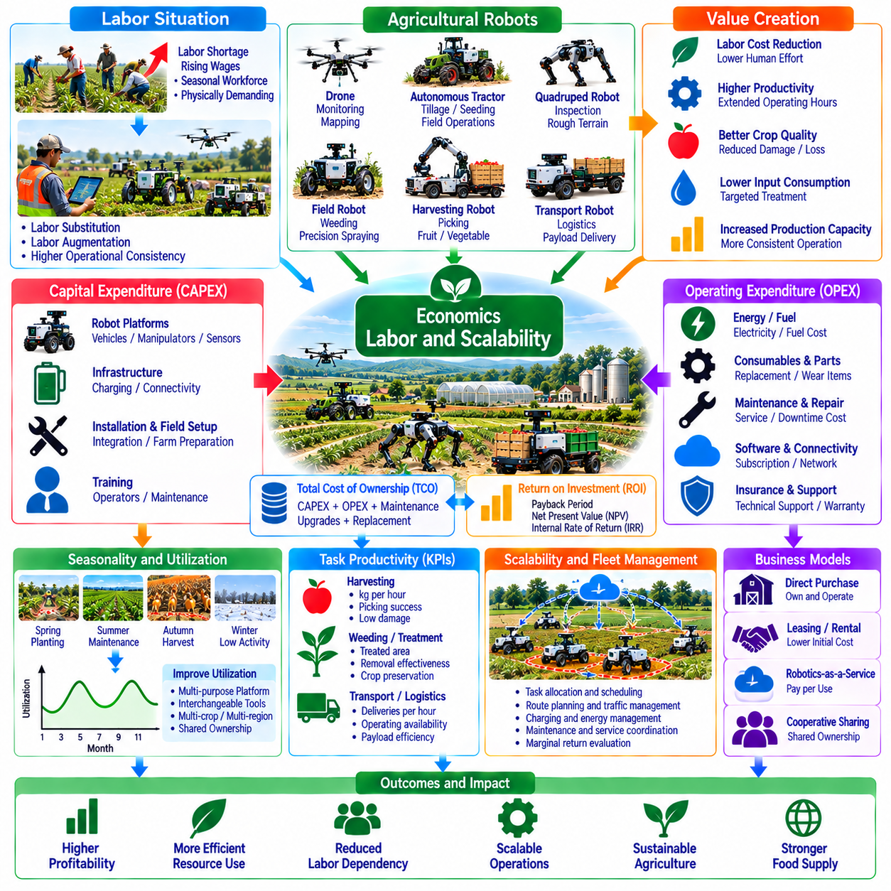{width="7.268055555555556in" height="7.268055555555556in"}

The economics of agricultural Physical AI depend on whether robotic systems can deliver measurable productivity gains while controlling investment, operating costs, and deployment risks. Agricultural automation must account for seasonal workloads, biological variability, and geographically distributed operations. Unlike continuous industrial production, farming often concentrates demand within limited operating windows. Economic viability therefore depends on matching robotic capabilities with actual agricultural needs.

Labor availability is a major driver of agricultural automation. Many farming operations depend on seasonal workers for planting, crop maintenance, harvesting, and transportation. Labor shortages, wage increases, and physically demanding working conditions can encourage robotic adoption. However, automation does not eliminate all human involvement. Workers remain necessary for supervision, maintenance, exception handling, and tasks that exceed current robotic capabilities.

Agricultural robots can create value through labor substitution, labor augmentation, and improved operational consistency. Substitution reduces direct human effort for repetitive tasks, while augmentation allows workers to supervise multiple machines or focus on complex activities. Automated systems may also extend operating hours when conditions permit. Economic assessments should distinguish actual labor hours saved from theoretical reductions that cannot be realized within existing staffing arrangements.

Capital expenditure represents a significant barrier to agricultural robot adoption. Initial investments may include robotic platforms, sensors, manipulators, batteries, charging infrastructure, connectivity, and software integration. Installation, field preparation, and operator training add further costs. Farmers must evaluate whether expected benefits justify these commitments over the equipment lifecycle, particularly when technology performance and future maintenance expenses remain uncertain.

Operating expenditure determines the continuing financial burden of agricultural automation. Electricity or fuel, consumables, replacement parts, software subscriptions, insurance, connectivity, and technical support contribute to recurring costs. Agricultural environments expose equipment to dust, moisture, vibration, and temperature extremes that can accelerate wear. Reliable cost models must include scheduled servicing, unexpected repairs, and productivity losses during downtime.

Total cost of ownership provides a broader measure of agricultural robot economics than purchase price alone. It combines acquisition, deployment, operation, maintenance, upgrades, and eventual replacement or disposal. The relevant evaluation period should reflect equipment durability, technological obsolescence, and farm investment horizons. Comparing ownership costs with conventional machinery and manual workflows helps identify situations where automation offers a sustainable financial advantage.

Return on investment depends on the relationship between economic benefits and the capital required to achieve them. Benefits may include labor savings, reduced input consumption, improved crop quality, lower losses, and increased production capacity. Net cash flows should account for recurring expenses and changing utilization. Payback period, net present value, and internal rate of return provide complementary perspectives, although their conclusions depend on realistic assumptions.

Seasonality creates one of the most important economic challenges for agricultural robotics. Harvesting machines may be highly productive during a short annual period but remain idle for much of the year. Utilization rates therefore strongly influence the cost per completed task. Multi-purpose platforms, interchangeable tools, and deployment across different crops or regions can improve annual usage, provided transportation and reconfiguration costs remain manageable.

Task productivity must be evaluated using meaningful agricultural performance indicators. Harvesting robots may be assessed through kilograms collected per hour, successful picking rates, crop damage, and product quality. Weeding systems can be evaluated through treated area, weed removal effectiveness, and crop preservation. Transport robots may be measured by completed deliveries and operating availability. These indicators connect technical performance with economic outcomes.

Agricultural robot reliability has a direct influence on financial performance. Failures during planting or harvesting windows can create losses that exceed the immediate repair cost. Mean time between failures, recovery time, spare-parts availability, and service response influence effective operating capacity. Economic planning should include contingency arrangements and evaluate the consequences of interruptions during time-critical agricultural activities.

Scalability requires more than increasing the number of deployed robots. Larger fleets introduce additional demands for charging, communication, traffic coordination, maintenance, and human supervision. Shared infrastructure can reduce unit costs, but operational bottlenecks may limit productivity improvements. Fleet-level optimization must evaluate marginal returns from additional robots rather than assuming that output increases proportionally with fleet size.

Farm size and production structure strongly influence automation economics. Large farms may distribute fixed infrastructure costs across extensive operating areas, while smaller farms may struggle to justify dedicated equipment. Cooperative ownership, equipment sharing, and agricultural robotics service providers offer alternative access models. Their effectiveness depends on scheduling flexibility, local service coverage, transport costs, and the concentration of seasonal demand.

Robotics-as-a-Service can reduce upfront investment requirements by converting equipment ownership into usage-based or subscription expenses. Providers may charge according to operating hours, treated hectares, harvested output, or contracted availability. This approach transfers some maintenance and technology risks to service operators. However, service pricing must reflect seasonal demand, equipment utilization, transportation, and the provider\'s responsibility for performance.

Labor transformation is an important consequence of agricultural automation. Demand may shift from repetitive manual activities toward robot supervision, equipment servicing, data interpretation, and technical coordination. Training programs must address both operational safety and digital competencies. Adoption strategies should consider workforce transition costs, local employment conditions, and the practical ability of farms to recruit or develop technically skilled personnel.

Economic performance also depends on how automation affects agricultural inputs and environmental outcomes. Precision spraying may reduce chemical consumption, while targeted irrigation can improve water efficiency under suitable conditions. Reduced soil disturbance and improved treatment timing may provide additional value. These benefits should be measured against actual baseline practices rather than assumed from technical capability alone.

Regional conditions influence the feasibility of agricultural Physical AI deployment. Labor costs, crop prices, land structure, weather, infrastructure, regulations, and financing availability differ across agricultural markets. A robot that is economically attractive in one region may not achieve similar results elsewhere. Deployment strategies require localized cost assumptions, field validation, and consideration of available maintenance and distribution networks.

Financing and investment risk can determine whether farms adopt automation even when projected returns are positive. High capital requirements, uncertain resale value, technological change, and unpredictable harvest outcomes may discourage investment. Leasing, shared ownership, performance-based contracts, and targeted financing can distribute risk. Economic models should test sensitivity to utilization, wages, crop prices, equipment lifetime, and operating reliability.

Scaling agricultural robotics from pilot projects to commercial deployment requires repeatable installation and support processes. Standardized hardware, modular software, remote diagnostics, and documented operating procedures reduce implementation effort. Local maintenance networks and accessible spare parts improve service continuity. Commercial scalability depends on maintaining consistent performance across farms without requiring extensive customization for every installation.

The broader economic impact of agricultural Physical AI includes changes in productivity, supply-chain resilience, workforce organization, and access to agricultural technology. Automation may help farms respond to labor constraints and improve operational predictability. Nevertheless, unequal access to financing, infrastructure, and technical expertise can limit adoption. Sustainable expansion requires business models that accommodate different farm sizes and production systems.

Ultimately, agricultural Physical AI becomes economically scalable when technical capability, labor organization, equipment utilization, and financial performance reinforce one another. Successful deployment requires realistic productivity measurements, lifecycle cost analysis, reliable service infrastructure, and adaptable commercial models. Long-term value will depend on delivering measurable benefits across diverse farming environments while managing operational uncertainty and supporting responsible workforce transitions.

농업 분야 피지컬 인공지능(Physical AI)의 경제성(Economics)은 로봇 시스템(Robotic Systems)이 투자비(Investment), 운영 비용(Operating Costs), 배포 위험(Deployment Risks)을 관리하면서 측정 가능한 생산성 향상(Measurable Productivity Gains)을 제공할 수 있는지에 달려 있다. 농업 자동화(Agricultural Automation)는 계절별 작업량(Seasonal Workloads), 생물학적 변동성(Biological Variability), 지리적으로 분산된 운영(Geographically Distributed Operations)을 고려해야 한다. 연속적인 산업 생산(Continuous Industrial Production)과 달리 농업은 제한된 작업 가능 기간(Limited Operating Windows)에 수요가 집중되는 경우가 많다. 따라서 경제적 타당성(Economic Viability)은 로봇의 능력(Robotic Capabilities)을 실제 농업 수요(Actual Agricultural Needs)에 얼마나 적절하게 맞추는지에 따라 결정된다.

노동력 가용성(Labor Availability)은 농업 자동화(Agricultural Automation)를 촉진하는 주요 요인이다. 많은 농업 운영(Farming Operations)은 파종(Planting), 작물 관리(Crop Maintenance), 수확(Harvesting), 운송(Transportation)을 위해 계절 근로자(Seasonal Workers)에 의존한다. 노동력 부족(Labor Shortages), 임금 상승(Wage Increases), 육체적으로 힘든 작업 환경(Physically Demanding Working Conditions)은 로봇 도입(Robotic Adoption)을 촉진할 수 있다. 그러나 자동화가 모든 인간의 개입(Human Involvement)을 제거하는 것은 아니다. 작업자는 감독(Supervision), 유지보수(Maintenance), 예외 상황 처리(Exception Handling), 현재 로봇의 능력을 초과하는 작업(Tasks Exceeding Current Robotic Capabilities)을 위해 여전히 필요하다.

농업 로봇(Agricultural Robots)은 노동 대체(Labor Substitution), 노동 보완(Labor Augmentation), 운영 일관성 향상(Improved Operational Consistency)을 통해 가치를 창출할 수 있다. 노동 대체는 반복 작업(Repetitive Tasks)에 필요한 직접적인 인간 노동(Direct Human Effort)을 줄이며, 노동 보완은 작업자가 여러 기계를 감독하거나 복잡한 활동(Complex Activities)에 집중하도록 한다. 자동화 시스템(Automated Systems)은 환경 조건이 허용하는 경우 작업 시간(Operating Hours)을 연장할 수도 있다. 경제성 평가(Economic Assessments)는 실제로 절감된 노동시간(Actual Labor Hours Saved)과 기존 인력 운영 체계(Existing Staffing Arrangements)에서 실현할 수 없는 이론적 노동 절감(Theoretical Reductions)을 구분해야 한다.

자본적 지출(Capital Expenditure, CAPEX)은 농업 로봇 도입(Agricultural Robot Adoption)의 중요한 장벽이다. 초기 투자(Initial Investments)에는 로봇 플랫폼(Robotic Platforms), 센서(Sensors), 매니퓰레이터(Manipulators), 배터리(Batteries), 충전 인프라(Charging Infrastructure), 통신 연결(Connectivity), 소프트웨어 통합(Software Integration)이 포함될 수 있다. 설치(Installation), 농경지 준비(Field Preparation), 운영자 교육(Operator Training)은 추가 비용을 발생시킨다. 농업 경영자는 기술 성능(Technology Performance)과 향후 유지보수 비용(Future Maintenance Expenses)이 불확실한 상황에서 예상 편익(Expected Benefits)이 장비 수명주기(Equipment Lifecycle) 동안 이러한 투자를 정당화할 수 있는지 평가해야 한다.

운영비용(Operating Expenditure, OPEX)은 농업 자동화(Agricultural Automation)의 지속적인 재무적 부담(Continuing Financial Burden)을 결정한다. 전기 또는 연료(Electricity or Fuel), 소모품(Consumables), 교체 부품(Replacement Parts), 소프트웨어 구독(Software Subscriptions), 보험(Insurance), 통신 연결(Connectivity), 기술 지원(Technical Support)은 반복 비용(Recurring Costs)에 포함된다. 농업 환경(Agricultural Environments)은 장비를 먼지(Dust), 습기(Moisture), 진동(Vibration), 극한 온도(Temperature Extremes)에 노출시켜 마모(Wear)를 가속할 수 있다. 신뢰할 수 있는 비용 모델(Cost Models)은 정기 정비(Scheduled Servicing), 예상하지 못한 수리(Unexpected Repairs), 가동 중단(Downtime)에 따른 생산성 손실(Productivity Losses)을 포함해야 한다.

총소유비용(Total Cost of Ownership, TCO)은 구매 가격(Purchase Price)만을 고려하는 것보다 농업 로봇의 경제성을 더 포괄적으로 평가하는 지표이다. 총소유비용은 장비 도입(Acquisition), 배포(Deployment), 운영(Operation), 유지보수(Maintenance), 업그레이드(Upgrades), 최종 교체 또는 폐기(Eventual Replacement or Disposal)를 결합한다. 적절한 평가 기간(Evaluation Period)은 장비 내구성(Equipment Durability), 기술적 노후화(Technological Obsolescence), 농장 투자 기간(Farm Investment Horizons)을 반영해야 한다. 소유 비용(Ownership Costs)을 기존 농업 기계(Conventional Machinery) 및 수작업 작업흐름(Manual Workflows)과 비교하면 자동화가 지속 가능한 재무적 이점(Sustainable Financial Advantage)을 제공하는 상황을 식별하는 데 도움이 된다.

투자수익률(Return on Investment, ROI)은 경제적 편익(Economic Benefits)과 이를 달성하는 데 필요한 자본(Capital)의 관계에 따라 결정된다. 편익에는 노동비 절감(Labor Savings), 농업 투입재 소비 감소(Reduced Input Consumption), 작물 품질 향상(Improved Crop Quality), 손실 감소(Lower Losses), 생산능력 증가(Increased Production Capacity)가 포함될 수 있다. 순현금흐름(Net Cash Flows)은 반복 비용(Recurring Expenses)과 변화하는 활용도(Changing Utilization)를 고려해야 한다. 투자회수기간(Payback Period), 순현재가치(Net Present Value, NPV), 내부수익률(Internal Rate of Return, IRR)은 상호 보완적인 평가 관점을 제공하지만, 그 결론은 현실적인 가정(Realistic Assumptions)에 따라 달라진다.

계절성(Seasonality)은 농업 로봇(Agricultural Robotics)의 가장 중요한 경제적 과제 중 하나이다. 수확 기계(Harvesting Machines)는 짧은 연간 수확 기간(Annual Harvesting Period) 동안 높은 생산성을 보일 수 있지만, 나머지 기간에는 대부분 유휴 상태(Idle State)로 남을 수 있다. 따라서 활용률(Utilization Rates)은 작업당 비용(Cost per Completed Task)에 큰 영향을 미친다. 다목적 플랫폼(Multi-Purpose Platforms), 교체 가능한 도구(Interchangeable Tools), 서로 다른 작물이나 지역(Different Crops or Regions)에 걸친 장비 배포는 운송 비용(Transportation Costs)과 재구성 비용(Reconfiguration Costs)을 관리할 수 있다는 전제하에 연간 활용도(Annual Usage)를 향상시킬 수 있다.

작업 생산성(Task Productivity)은 의미 있는 농업 성과지표(Agricultural Performance Indicators)를 사용하여 평가해야 한다. 수확 로봇(Harvesting Robots)은 시간당 수확 중량(Kilograms Collected per Hour), 성공적인 수확 비율(Successful Picking Rates), 작물 손상(Crop Damage), 농산물 품질(Product Quality)을 통해 평가할 수 있다. 제초 시스템(Weeding Systems)은 처리 면적(Treated Area), 잡초 제거 효과(Weed Removal Effectiveness), 작물 보호 수준(Crop Preservation)을 기준으로 평가할 수 있다. 운송 로봇(Transport Robots)은 완료된 운송 작업(Completed Deliveries)과 운영 가용성(Operating Availability)을 통해 측정할 수 있다. 이러한 지표는 기술적 성능(Technical Performance)을 경제적 성과(Economic Outcomes)와 연결한다.

농업 로봇의 신뢰성(Agricultural Robot Reliability)은 재무적 성과(Financial Performance)에 직접적인 영향을 미친다. 파종이나 수확의 핵심 작업 기간(Planting or Harvesting Windows)에 발생하는 고장(Failures)은 직접적인 수리 비용(Immediate Repair Cost)을 초과하는 손실을 발생시킬 수 있다. 평균 고장 간격(Mean Time Between Failures, MTBF), 복구 시간(Recovery Time), 예비 부품 가용성(Spare-Parts Availability), 서비스 대응(Service Response)은 실질적인 운영능력(Effective Operating Capacity)에 영향을 미친다. 경제적 계획(Economic Planning)에는 비상 대응 방안(Contingency Arrangements)을 포함하고 시간적으로 중요한 농업 활동(Time-Critical Agricultural Activities) 중 발생하는 운영 중단(Interruptions)의 결과를 평가해야 한다.

확장성(Scalability)은 단순히 배포된 로봇의 수를 증가시키는 것 이상을 요구한다. 대규모 플릿(Larger Fleets)은 충전(Charging), 통신(Communication), 교통 협조(Traffic Coordination), 유지보수(Maintenance), 인간 감독(Human Supervision)에 대한 추가 수요를 발생시킨다. 공유 인프라(Shared Infrastructure)는 단위 비용(Unit Costs)을 줄일 수 있지만 운영 병목 현상(Operational Bottlenecks)은 생산성 향상(Productivity Improvements)을 제한할 수 있다. 플릿 수준 최적화(Fleet-Level Optimization)는 로봇 수에 비례하여 생산량(Output)이 증가한다고 가정하기보다 추가 로봇의 한계수익(Marginal Returns)을 평가해야 한다.

농장 규모(Farm Size)와 생산 구조(Production Structure)는 자동화 경제성(Automation Economics)에 큰 영향을 미친다. 대규모 농장(Large Farms)은 고정 인프라 비용(Fixed Infrastructure Costs)을 광범위한 운영 면적(Operating Areas)에 분산할 수 있지만, 소규모 농장(Smaller Farms)은 전용 장비(Dedicated Equipment)에 대한 투자 타당성을 확보하기 어려울 수 있다. 협동 소유(Cooperative Ownership), 장비 공유(Equipment Sharing), 농업 로봇 서비스 제공업체(Agricultural Robotics Service Providers)는 대안적인 접근 모델(Alternative Access Models)을 제공한다. 이러한 모델의 효과는 일정 조정 유연성(Scheduling Flexibility), 지역 서비스 범위(Local Service Coverage), 운송 비용(Transport Costs), 계절적 수요 집중도(Concentration of Seasonal Demand)에 따라 달라진다.

서비스형 로봇(Robotics-as-a-Service, RaaS)은 장비 소유(Equipment Ownership)를 사용량 기반 비용(Usage-Based Expenses)이나 구독 비용(Subscription Expenses)으로 전환하여 초기 투자 요구사항(Upfront Investment Requirements)을 줄일 수 있다. 서비스 제공업체(Providers)는 운영 시간(Operating Hours), 처리 면적(Treated Hectares), 수확량(Harvested Output), 계약된 가용성(Contracted Availability)에 따라 요금을 부과할 수 있다. 이러한 접근방식은 유지보수 위험(Maintenance Risks)과 기술적 위험(Technology Risks)의 일부를 서비스 운영자(Service Operators)에게 이전한다. 그러나 서비스 가격(Service Pricing)은 계절적 수요(Seasonal Demand), 장비 활용도(Equipment Utilization), 운송(Transportation), 성능에 대한 서비스 제공업체의 책임(Provider\'s Responsibility for Performance)을 반영해야 한다.

노동 구조 전환(Labor Transformation)은 농업 자동화(Agricultural Automation)의 중요한 결과이다. 노동 수요(Labor Demand)는 반복적인 수작업(Repetitive Manual Activities)에서 로봇 감독(Robot Supervision), 장비 정비(Equipment Servicing), 데이터 해석(Data Interpretation), 기술적 협조(Technical Coordination)로 이동할 수 있다. 교육 프로그램(Training Programs)은 운영 안전성(Operational Safety)과 디지털 역량(Digital Competencies)을 모두 다루어야 한다. 도입 전략(Adoption Strategies)은 인력 전환 비용(Workforce Transition Costs), 지역 고용 조건(Local Employment Conditions), 기술 숙련 인력(Technically Skilled Personnel)을 채용하거나 양성할 수 있는 농장의 실질적인 능력을 고려해야 한다.

경제적 성과(Economic Performance)는 자동화가 농업 투입재(Agricultural Inputs)와 환경적 결과(Environmental Outcomes)에 미치는 영향에도 좌우된다. 정밀 살포(Precision Spraying)는 화학약품 소비(Chemical Consumption)를 줄일 수 있으며, 표적 관개(Targeted Irrigation)는 적절한 조건에서 물 사용 효율성(Water Efficiency)을 향상시킬 수 있다. 토양 교란 감소(Reduced Soil Disturbance)와 처리 시점 개선(Improved Treatment Timing)은 추가적인 가치를 제공할 수 있다. 이러한 편익(Benefits)은 기술적 능력(Technical Capability)만으로 가정해서는 안 되며 실제 기준 운영 방식(Actual Baseline Practices)과 비교하여 측정해야 한다.

지역적 조건(Regional Conditions)은 농업 분야 피지컬 인공지능(Physical AI)의 배포 타당성(Deployment Feasibility)에 영향을 미친다. 노동비(Labor Costs), 작물 가격(Crop Prices), 토지 구조(Land Structure), 기상(Weather), 기반시설(Infrastructure), 규제(Regulations), 금융 접근성(Financing Availability)은 농업 시장(Agricultural Markets)마다 다르다. 한 지역에서 경제적으로 매력적인 로봇(Robot)이 다른 지역에서도 유사한 성과를 달성하는 것은 아니다. 배포 전략(Deployment Strategies)에는 지역별 비용 가정(Localized Cost Assumptions), 현장 검증(Field Validation), 이용 가능한 유지보수 및 유통 네트워크(Maintenance and Distribution Networks)에 대한 고려가 필요하다.

자금 조달(Financing)과 투자 위험(Investment Risk)은 예상 수익(Projected Returns)이 긍정적이더라도 농장이 자동화를 도입할지를 결정할 수 있다. 높은 자본 요구사항(High Capital Requirements), 불확실한 재판매 가치(Uncertain Resale Value), 기술 변화(Technological Change), 예측하기 어려운 수확 결과(Unpredictable Harvest Outcomes)는 투자를 위축시킬 수 있다. 리스(Leasing), 공동 소유(Shared Ownership), 성과 기반 계약(Performance-Based Contracts), 목적형 금융(Targeted Financing)은 위험을 분산할 수 있다. 경제 모델(Economic Models)은 활용도(Utilization), 임금(Wages), 작물 가격(Crop Prices), 장비 수명(Equipment Lifetime), 운영 신뢰성(Operating Reliability)에 대한 민감도(Sensitivity)를 분석해야 한다.

농업 로봇(Agricultural Robotics)을 시범 프로젝트(Pilot Projects)에서 상업적 배포(Commercial Deployment)로 확장하려면 반복 적용 가능한 설치 및 지원 프로세스(Repeatable Installation and Support Processes)가 필요하다. 표준화된 하드웨어(Standardized Hardware), 모듈형 소프트웨어(Modular Software), 원격 진단(Remote Diagnostics), 문서화된 운영 절차(Documented Operating Procedures)는 구현 작업(Implementation Effort)을 줄인다. 지역 유지보수 네트워크(Local Maintenance Networks)와 쉽게 확보할 수 있는 예비 부품(Accessible Spare Parts)은 서비스 연속성(Service Continuity)을 향상시킨다. 상업적 확장성(Commercial Scalability)은 농장마다 광범위한 맞춤화(Extensive Customization)를 요구하지 않으면서 일관된 성능(Consistent Performance)을 유지하는 데 달려 있다.

농업 분야 피지컬 인공지능(Physical AI)의 광범위한 경제적 영향(Broader Economic Impact)에는 생산성(Productivity), 공급망 복원력(Supply-Chain Resilience), 인력 조직(Workforce Organization), 농업 기술 접근성(Access to Agricultural Technology)의 변화가 포함된다. 자동화(Automation)는 농장이 노동력 제약(Labor Constraints)에 대응하고 운영 예측 가능성(Operational Predictability)을 향상시키는 데 도움이 될 수 있다. 그러나 자금 조달(Financing), 기반시설(Infrastructure), 기술 전문성(Technical Expertise)에 대한 불균등한 접근성(Unequal Access)은 도입을 제한할 수 있다. 지속 가능한 확장(Sustainable Expansion)을 위해서는 다양한 농장 규모(Farm Sizes)와 생산 시스템(Production Systems)을 수용할 수 있는 비즈니스 모델(Business Models)이 필요하다.

궁극적으로 농업 분야 피지컬 인공지능(Physical AI)은 기술적 능력(Technical Capability), 노동 조직(Labor Organization), 장비 활용도(Equipment Utilization), 재무적 성과(Financial Performance)가 서로 긍정적인 영향을 미칠 때 경제적으로 확장 가능(Economically Scalable)해진다. 성공적인 배포(Successful Deployment)를 위해서는 현실적인 생산성 측정(Realistic Productivity Measurements), 수명주기 비용 분석(Lifecycle Cost Analysis), 신뢰할 수 있는 서비스 인프라(Reliable Service Infrastructure), 적응 가능한 상업 모델(Adaptable Commercial Models)이 필요하다. 장기적인 가치(Long-Term Value)는 운영 불확실성(Operational Uncertainty)을 관리하고 책임 있는 인력 전환(Responsible Workforce Transitions)을 지원하면서 다양한 농업 환경(Diverse Farming Environments)에서 측정 가능한 편익(Measurable Benefits)을 제공하는 능력에 달려 있다.

##  

## 05.15. Agricultural Robot Economics Model [w/Code]

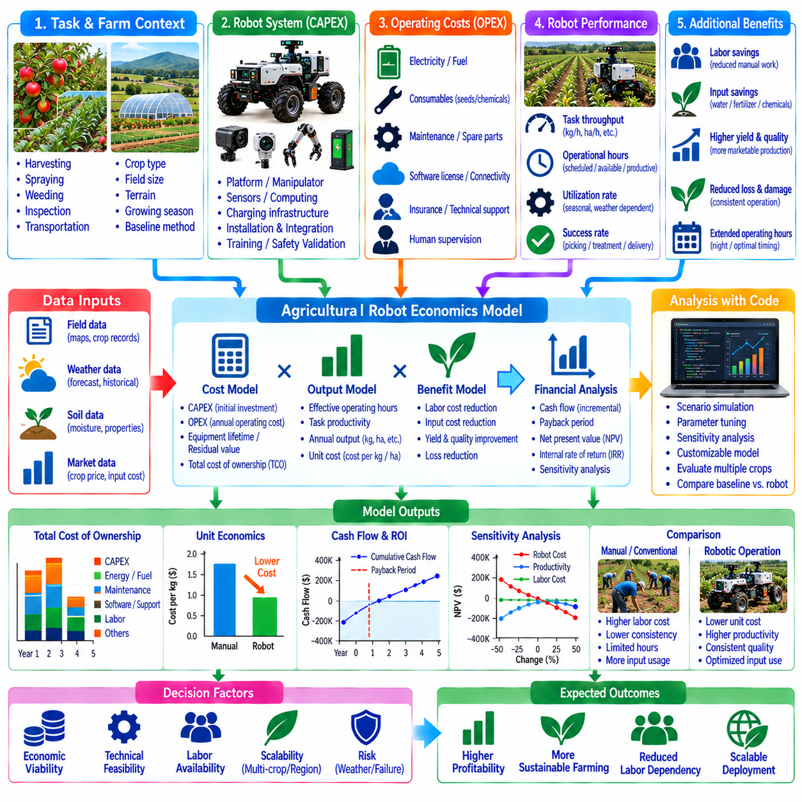{width="7.268055555555556in" height="7.268055555555556in"}

An agricultural robot economics model provides a structured framework for evaluating the financial feasibility of deploying Physical AI across farming operations. It connects robotic performance, labor requirements, equipment investment, and agricultural production outcomes. Unlike conventional machinery analysis, the model must account for autonomy reliability, seasonal utilization, and changing field conditions. Its purpose is to estimate economic value under realistic operating assumptions.

The model begins by defining the agricultural task, operating environment, and baseline production method. Harvesting, spraying, weeding, inspection, and transportation require different economic assumptions and performance indicators. Baseline costs may include manual labor, conventional machinery, agricultural inputs, and production losses. A credible comparison measures robotic operations against an equivalent task scope, quality requirement, and production period.

Capital expenditure includes the purchase and deployment costs of agricultural robotic systems. Relevant components may include mobile platforms, manipulators, sensors, computing hardware, batteries, charging stations, and communication equipment. Installation, software integration, safety validation, and personnel training contribute additional expenses. Capital costs should be allocated across the expected useful life of the equipment rather than treated as recurring annual payments.

Operating expenditure represents the costs incurred during routine robotic activities. Electricity, fuel, consumables, maintenance, spare parts, connectivity, software licenses, insurance, and technical support contribute to annual expenses. Operator supervision and remote intervention must also be included when human assistance remains necessary. Cost estimates should reflect actual operating hours, field conditions, and service requirements rather than ideal laboratory performance.

Robot productivity determines how effectively capital and operating expenses translate into completed agricultural work. Harvesting productivity may be expressed as kilograms per hour, while spraying and weeding systems are evaluated by hectares treated per hour. Transportation robots can be assessed through completed delivery cycles or material throughput. Productivity estimates should account for travel, repositioning, refilling, unloading, and other nonproductive activities.

Effective operating time is generally lower than scheduled operating time because robots experience charging, maintenance, interruptions, and environmental restrictions. A practical model separates scheduled hours, available hours, and productive task hours. Availability measures readiness for operation, while utilization reflects how much available capacity is actually used. These distinctions prevent optimistic projections based on continuous operation throughout the agricultural season.

Annual robotic output can be estimated by multiplying productive operating hours by effective task throughput. Productive hours depend on the number of workable days, daily operating schedules, equipment availability, and utilization. Throughput depends on crop density, terrain, task complexity, and robotic performance. Because these variables interact, the model should use validated field measurements and represent uncertainty through alternative operating scenarios.

Labor savings are calculated by comparing baseline labor requirements with the human effort remaining after automation. Agricultural robots may reduce direct manual work but still require supervisors, maintenance personnel, and exception handlers. Labor cost reductions should reflect actual staffing changes, overtime savings, or avoided seasonal recruitment. If displaced labor is reassigned to other productive activities, its economic value should be evaluated separately.

Input savings provide another source of economic benefit, particularly for precision agriculture applications. Targeted spraying may reduce chemical consumption, while precision irrigation can lower water and pumping requirements. Automated monitoring may improve treatment timing and reduce unnecessary field visits. Savings should be estimated using measured differences in input quantities and prices, with adjustments for any additional robotic consumables or processing costs.

Crop quality and yield improvements can contribute significantly to robotic economic value. Consistent harvesting, timely interventions, and reduced crop damage may increase marketable production. The financial benefit depends on the difference in saleable output and realized selling prices compared with baseline operations. Yield improvements should not be assumed automatically, because crop genetics, weather, soil conditions, and management practices also influence production.

Total cost of ownership combines initial investment with operating, maintenance, upgrade, and replacement costs over the evaluation horizon. Residual equipment value and end-of-life expenses should be considered where relevant. Annualized ownership cost can be estimated using depreciation or a capital recovery approach. The model should avoid double counting capital expenditure when calculating both annual operating profitability and discounted project cash flows.

Unit economics translate system-level financial performance into the cost of completing agricultural work. Cost per harvested kilogram, treated hectare, inspected field, or transported container can be calculated by dividing attributable costs by completed output. Comparable baseline costs should use the same quality and task boundaries. Unit costs often decline as utilization increases, although congestion, maintenance, and coordination overhead can limit economies of scale.

Investment returns should be evaluated through incremental cash flows rather than gross agricultural revenue alone. Annual net benefit equals additional revenue and avoided costs minus incremental operating expenses. Net present value discounts future net cash flows and subtracts initial investment, while internal rate of return identifies the discount rate associated with zero net present value. Payback period provides a simpler measure of investment recovery.

Sensitivity analysis identifies the assumptions that most strongly influence economic feasibility. Important variables include robot purchase price, productive throughput, annual utilization, labor cost, equipment availability, maintenance expense, and crop selling price. Testing favorable, expected, and adverse scenarios reveals financial exposure. Break-even analysis can estimate the minimum productive hours or completed output needed to cover annualized system costs.

Seasonal utilization requires particular attention because agricultural equipment may operate intensively during short production windows. A harvesting robot used for only several weeks may have high unit costs despite strong hourly productivity. Multi-crop operation, interchangeable tools, and deployment across regions can improve annual utilization. However, transportation, reconfiguration, calibration, and scheduling expenses must be included when evaluating these strategies.

Fleet economics extend the model from individual robots to coordinated agricultural systems. Additional robots may increase output, but charging capacity, field access, transportation support, and human supervision can become bottlenecks. Fleet-level models should estimate marginal productivity and incremental infrastructure requirements. Shared resources can reduce average costs, while poorly coordinated operations may increase waiting time and reduce effective utilization.

Alternative commercial models change how agricultural automation costs and risks are distributed. Direct ownership concentrates capital investment and maintenance responsibility on the farm, while leasing converts part of the investment into periodic payments. Robotics-as-a-Service may charge per operating hour, treated hectare, or harvested unit. Comparisons should account for contract terms, service availability, performance guarantees, and the allocation of operational risks.

Economic uncertainty arises from biological variability, weather disruptions, equipment failures, and changing agricultural markets. Delayed harvesting or missed treatment windows may create losses that exceed direct downtime expenses. Risk-adjusted scenarios should therefore include reduced operating days, lower task success rates, unexpected repairs, and price fluctuations. Contingency planning and reliable service support can reduce exposure to these events.

A practical implementation model should connect financial assumptions with measurable operational data. Robot telemetry, maintenance records, task completion logs, labor schedules, and agricultural production records provide evidence for updating estimates. Pilot deployments can establish baseline throughput, availability, and intervention requirements. Periodic recalibration helps distinguish genuine economic improvements from assumptions that were too optimistic during initial planning.

Ultimately, an agricultural robot economics model connects Physical AI capabilities with investment decisions and long-term farming performance. Its reliability depends on realistic baseline comparisons, complete lifecycle costs, validated productivity measurements, and explicit treatment of uncertainty. By linking technical metrics to cash flows, unit economics, and operational constraints, the model supports decisions about robot selection, fleet expansion, service contracts, and scalable agricultural automation.

농업 로봇 경제성 모델(Agricultural Robot Economics Model)은 농업 운영(Farming Operations) 전반에 피지컬 인공지능(Physical AI)을 도입할 때 재무적 타당성(Financial Feasibility)을 평가하기 위한 체계적인 프레임워크(Structured Framework)를 제공한다. 이 모델은 로봇 성능(Robotic Performance), 노동력 요구사항(Labor Requirements), 장비 투자(Equipment Investment), 농업 생산 성과(Agricultural Production Outcomes)를 연결한다. 기존 농업 기계 분석(Conventional Machinery Analysis)과 달리 자율성 신뢰성(Autonomy Reliability), 계절별 활용도(Seasonal Utilization), 변화하는 농경지 조건(Changing Field Conditions)을 고려해야 한다. 이 모델의 목적은 현실적인 운영 가정(Realistic Operating Assumptions)을 바탕으로 경제적 가치(Economic Value)를 추정하는 것이다.

경제성 모델(Economics Model)은 농업 작업(Agricultural Task), 운영 환경(Operating Environment), 기준 생산 방식(Baseline Production Method)을 정의하는 것에서 시작된다. 수확(Harvesting), 살포(Spraying), 제초(Weeding), 검사(Inspection), 운송(Transportation)은 서로 다른 경제적 가정(Economic Assumptions)과 성과지표(Performance Indicators)를 필요로 한다. 기준 비용(Baseline Costs)에는 수작업 노동(Manual Labor), 기존 농업 기계(Conventional Machinery), 농업 투입재(Agricultural Inputs), 생산 손실(Production Losses)이 포함될 수 있다. 신뢰할 수 있는 비교(Credible Comparison)를 위해서는 동일한 작업 범위(Task Scope), 품질 요구사항(Quality Requirement), 생산 기간(Production Period)을 기준으로 로봇 운영(Robotic Operations)을 평가해야 한다.

자본적 지출(Capital Expenditure, CAPEX)은 농업 로봇 시스템(Agricultural Robotic Systems)의 구매 및 배포 비용(Purchase and Deployment Costs)을 포함한다. 관련 구성요소에는 이동 플랫폼(Mobile Platforms), 매니퓰레이터(Manipulators), 센서(Sensors), 컴퓨팅 하드웨어(Computing Hardware), 배터리(Batteries), 충전소(Charging Stations), 통신 장비(Communication Equipment)가 포함될 수 있다. 설치(Installation), 소프트웨어 통합(Software Integration), 안전성 검증(Safety Validation), 인력 교육(Personnel Training)은 추가적인 비용을 발생시킨다. 자본 비용(Capital Costs)은 반복적인 연간 지출(Recurring Annual Payments)로 취급하기보다 장비의 예상 내용연수(Expected Useful Life)에 걸쳐 배분해야 한다.

운영비용(Operating Expenditure, OPEX)은 일상적인 로봇 작업(Routine Robotic Activities)에서 발생하는 비용을 의미한다. 전기(Electricity), 연료(Fuel), 소모품(Consumables), 유지보수(Maintenance), 예비 부품(Spare Parts), 통신 연결(Connectivity), 소프트웨어 라이선스(Software Licenses), 보험(Insurance), 기술 지원(Technical Support)은 연간 비용(Annual Expenses)을 구성한다. 인간의 지원(Human Assistance)이 필요한 경우 운영자 감독(Operator Supervision)과 원격 개입(Remote Intervention)도 포함해야 한다. 비용 추정(Cost Estimates)은 이상적인 실험실 성능(Ideal Laboratory Performance)이 아니라 실제 운영 시간(Actual Operating Hours), 농경지 조건(Field Conditions), 서비스 요구사항(Service Requirements)을 반영해야 한다.

로봇 생산성(Robot Productivity)은 자본 비용(Capital Expenses)과 운영비용(Operating Expenses)이 완료된 농업 작업(Completed Agricultural Work)으로 얼마나 효과적으로 전환되는지를 결정한다. 수확 생산성(Harvesting Productivity)은 시간당 수확 중량(Kilograms per Hour)으로 표현할 수 있으며, 살포 및 제초 시스템(Spraying and Weeding Systems)은 시간당 처리 면적(Hectares Treated per Hour)으로 평가할 수 있다. 운송 로봇(Transportation Robots)은 완료된 운송 주기(Completed Delivery Cycles)나 물류 처리량(Material Throughput)을 기준으로 평가할 수 있다. 생산성 추정(Productivity Estimates)에는 이동(Travel), 위치 재조정(Repositioning), 재충전 및 보충(Refilling), 하역(Unloading), 기타 비생산 활동(Nonproductive Activities)을 고려해야 한다.

실효 운영 시간(Effective Operating Time)은 일반적으로 충전(Charging), 유지보수(Maintenance), 운영 중단(Interruptions), 환경적 제한(Environmental Restrictions) 때문에 계획된 운영 시간(Scheduled Operating Time)보다 짧다. 실용적인 모델(Practical Model)은 계획 시간(Scheduled Hours), 가용 시간(Available Hours), 생산적 작업 시간(Productive Task Hours)을 구분한다. 가용성(Availability)은 장비가 운영할 준비가 되어 있는 정도를 측정하며, 활용률(Utilization)은 사용 가능한 능력(Available Capacity)이 실제로 얼마나 활용되는지를 나타낸다. 이러한 구분은 농업 시즌(Agricultural Season) 전체에 걸쳐 연속 운영(Continuous Operation)을 가정하는 지나치게 낙관적인 예측(Optimistic Projections)을 방지한다.

연간 로봇 작업량(Annual Robotic Output)은 생산적 운영 시간(Productive Operating Hours)에 실효 작업 처리량(Effective Task Throughput)을 곱하여 추정할 수 있다. 생산적 운영 시간은 작업 가능한 일수(Workable Days), 일일 운영 일정(Daily Operating Schedules), 장비 가용성(Equipment Availability), 활용률(Utilization)에 따라 결정된다. 처리량(Throughput)은 작물 밀도(Crop Density), 지형(Terrain), 작업 복잡성(Task Complexity), 로봇 성능(Robotic Performance)에 영향을 받는다. 이러한 변수들이 상호작용하므로 모델은 검증된 현장 측정값(Validated Field Measurements)을 사용하고 대안적인 운영 시나리오(Alternative Operating Scenarios)를 통해 불확실성(Uncertainty)을 표현해야 한다.

노동비 절감(Labor Savings)은 자동화 이전의 기준 노동력 요구사항(Baseline Labor Requirements)과 자동화 이후에도 필요한 인간 노동(Human Effort Remaining After Automation)을 비교하여 계산한다. 농업 로봇(Agricultural Robots)은 직접적인 수작업(Direct Manual Work)을 줄일 수 있지만 감독자(Supervisors), 유지보수 인력(Maintenance Personnel), 예외 상황 처리 담당자(Exception Handlers)는 여전히 필요할 수 있다. 노동비 절감액(Labor Cost Reductions)은 실제 인력 구성 변화(Actual Staffing Changes), 초과근무 비용 절감(Overtime Savings), 계절 인력 채용 회피(Avoided Seasonal Recruitment)를 반영해야 한다. 대체된 노동력(Displaced Labor)이 다른 생산적 활동(Productive Activities)에 재배치되는 경우 해당 경제적 가치(Economic Value)는 별도로 평가해야 한다.

농업 투입재 절감(Input Savings)은 특히 정밀농업(Precision Agriculture) 응용 분야에서 또 다른 경제적 편익(Economic Benefit)을 제공한다. 표적 살포(Targeted Spraying)는 농약 사용량(Chemical Consumption)을 줄일 수 있으며, 정밀 관개(Precision Irrigation)는 물 사용량(Water Requirements)과 펌핑 요구량(Pumping Requirements)을 감소시킬 수 있다. 자동화 모니터링(Automated Monitoring)은 처리 시점(Treatment Timing)을 개선하고 불필요한 농경지 방문(Unnecessary Field Visits)을 줄일 수 있다. 절감액(Savings)은 농업 투입재의 사용량(Input Quantities)과 가격(Prices)의 실제 측정 차이를 기준으로 추정하고 추가적인 로봇 소모품(Robotic Consumables)이나 처리 비용(Processing Costs)을 반영해야 한다.

작물 품질(Crop Quality)과 수확량 향상(Yield Improvements)은 로봇의 경제적 가치(Robotic Economic Value)에 크게 기여할 수 있다. 일관된 수확(Consistent Harvesting), 적시 작업(Timely Interventions), 작물 손상 감소(Reduced Crop Damage)는 판매 가능한 생산량(Marketable Production)을 증가시킬 수 있다. 재무적 편익(Financial Benefit)은 기준 운영(Baseline Operations)과 비교한 판매 가능 생산량(Saleable Output) 및 실제 판매 가격(Realized Selling Prices)의 차이에 따라 결정된다. 작물 유전적 특성(Crop Genetics), 기상(Weather), 토양 조건(Soil Conditions), 재배 관리 방식(Management Practices)도 생산량에 영향을 미치므로 수확량 향상을 자동으로 가정해서는 안 된다.

총소유비용(Total Cost of Ownership, TCO)은 평가 기간(Evaluation Horizon) 동안 초기 투자(Initial Investment), 운영(Operation), 유지보수(Maintenance), 업그레이드(Upgrades), 교체 비용(Replacement Costs)을 결합한다. 필요한 경우 장비 잔존가치(Residual Equipment Value)와 수명 종료 비용(End-of-Life Expenses)도 고려해야 한다. 연간 환산 소유비용(Annualized Ownership Cost)은 감가상각(Depreciation)이나 자본회수 방식(Capital Recovery Approach)을 사용하여 추정할 수 있다. 연간 운영 수익성(Annual Operating Profitability)과 할인 현금흐름(Discounted Project Cash Flows)을 모두 계산할 때 자본적 지출(Capital Expenditure)이 중복 계산(Double Counting)되지 않도록 해야 한다.

단위 경제성(Unit Economics)은 시스템 수준의 재무적 성과(System-Level Financial Performance)를 농업 작업 완료 비용(Cost of Completing Agricultural Work)으로 변환한다. 수확 중량당 비용(Cost per Harvested Kilogram), 처리 면적당 비용(Cost per Treated Hectare), 검사 농경지당 비용(Cost per Inspected Field), 운송 용기당 비용(Cost per Transported Container)은 해당 작업에 귀속되는 비용(Attributable Costs)을 완료된 작업량(Completed Output)으로 나누어 계산할 수 있다. 비교 대상인 기준 비용(Comparable Baseline Costs)은 동일한 품질 및 작업 범위(Quality and Task Boundaries)를 적용해야 한다. 단위 비용(Unit Costs)은 활용률(Utilization)이 증가할수록 감소하는 경우가 많지만 혼잡(Congestion), 유지보수(Maintenance), 협조 관리 부담(Coordination Overhead)이 규모의 경제(Economies of Scale)를 제한할 수 있다.

투자수익(Investment Returns)은 총농업매출(Gross Agricultural Revenue)만이 아니라 증분 현금흐름(Incremental Cash Flows)을 통해 평가해야 한다. 연간 순편익(Annual Net Benefit)은 추가 매출(Additional Revenue)과 회피 비용(Avoided Costs)의 합계에서 증분 운영비용(Incremental Operating Expenses)을 차감한 값이다. 순현재가치(Net Present Value, NPV)는 미래 순현금흐름(Future Net Cash Flows)을 할인하고 초기 투자(Initial Investment)를 차감하며, 내부수익률(Internal Rate of Return, IRR)은 순현재가치가 0이 되는 할인율(Discount Rate)을 나타낸다. 투자회수기간(Payback Period)은 투자금 회수(Investment Recovery)를 평가하는 보다 단순한 지표이다.

민감도 분석(Sensitivity Analysis)은 경제적 타당성(Economic Feasibility)에 가장 큰 영향을 미치는 가정(Assumptions)을 식별한다. 주요 변수(Important Variables)에는 로봇 구매 가격(Robot Purchase Price), 생산적 작업 처리량(Productive Throughput), 연간 활용률(Annual Utilization), 노동비(Labor Cost), 장비 가용성(Equipment Availability), 유지보수 비용(Maintenance Expense), 작물 판매 가격(Crop Selling Price)이 포함된다. 낙관적 시나리오(Favorable Scenario), 예상 시나리오(Expected Scenario), 비관적 시나리오(Adverse Scenario)를 시험하면 재무적 위험 노출(Financial Exposure)을 파악할 수 있다. 손익분기점 분석(Break-Even Analysis)은 연간 환산 시스템 비용(Annualized System Costs)을 충당하는 데 필요한 최소 생산적 운영 시간(Minimum Productive Hours)이나 완료 작업량(Completed Output)을 추정할 수 있다.

계절별 활용도(Seasonal Utilization)는 농업 장비(Agricultural Equipment)가 짧은 생산 기간(Production Windows)에 집중적으로 작동할 수 있기 때문에 특별한 주의가 필요하다. 연간 몇 주 동안만 사용되는 수확 로봇(Harvesting Robot)은 시간당 생산성(Hourly Productivity)이 높더라도 단위 비용(Unit Costs)이 높을 수 있다. 다품종 작물 운영(Multi-Crop Operation), 교체 가능한 도구(Interchangeable Tools), 지역 간 장비 배포(Deployment Across Regions)는 연간 활용률(Annual Utilization)을 향상시킬 수 있다. 그러나 이러한 전략을 평가할 때는 운송(Transportation), 재구성(Reconfiguration), 보정(Calibration), 일정 관리(Scheduling)에 필요한 비용을 포함해야 한다.

플릿 경제성(Fleet Economics)은 개별 로봇(Individual Robots)의 경제성 모델을 협조적 농업 시스템(Coordinated Agricultural Systems)으로 확장한다. 추가 로봇(Additional Robots)은 생산량(Output)을 증가시킬 수 있지만 충전 용량(Charging Capacity), 농경지 접근성(Field Access), 운송 지원(Transportation Support), 인간 감독(Human Supervision)이 병목 현상(Bottlenecks)으로 작용할 수 있다. 플릿 수준 모델(Fleet-Level Models)은 한계 생산성(Marginal Productivity)과 추가 인프라 요구사항(Incremental Infrastructure Requirements)을 추정해야 한다. 공유 자원(Shared Resources)은 평균 비용(Average Costs)을 줄일 수 있지만 협조가 부족한 운영(Poorly Coordinated Operations)은 대기 시간(Waiting Time)을 증가시키고 실효 활용률(Effective Utilization)을 감소시킬 수 있다.

대안적인 상업 모델(Alternative Commercial Models)은 농업 자동화(Agricultural Automation)의 비용과 위험(Costs and Risks)이 분배되는 방식을 변화시킨다. 직접 소유(Direct Ownership)는 자본 투자(Capital Investment)와 유지보수 책임(Maintenance Responsibility)을 농장에 집중시키는 반면, 리스(Leasing)는 투자비의 일부를 정기 지급액(Periodic Payments)으로 전환한다. 서비스형 로봇(Robotics-as-a-Service, RaaS)은 운영 시간(Operating Hour), 처리 면적(Treated Hectare), 수확 단위(Harvested Unit)에 따라 요금을 부과할 수 있다. 이러한 모델을 비교할 때는 계약 조건(Contract Terms), 서비스 가용성(Service Availability), 성능 보증(Performance Guarantees), 운영 위험 분담(Allocation of Operational Risks)을 고려해야 한다.

경제적 불확실성(Economic Uncertainty)은 생물학적 변동성(Biological Variability), 기상으로 인한 운영 중단(Weather Disruptions), 장비 고장(Equipment Failures), 변화하는 농업 시장(Changing Agricultural Markets)에서 발생한다. 수확 지연(Delayed Harvesting)이나 적절한 처리 시점의 상실(Missed Treatment Windows)은 직접적인 가동 중단 비용(Direct Downtime Expenses)을 초과하는 손실을 발생시킬 수 있다. 따라서 위험 조정 시나리오(Risk-Adjusted Scenarios)에는 작업 가능 일수 감소(Reduced Operating Days), 작업 성공률 저하(Lower Task Success Rates), 예상하지 못한 수리(Unexpected Repairs), 가격 변동(Price Fluctuations)을 포함해야 한다. 비상 대응 계획(Contingency Planning)과 신뢰할 수 있는 서비스 지원(Reliable Service Support)은 이러한 사건에 대한 위험 노출(Risk Exposure)을 줄일 수 있다.

실용적인 구현 모델(Practical Implementation Model)은 재무적 가정(Financial Assumptions)을 측정 가능한 운영 데이터(Measurable Operational Data)와 연결해야 한다. 로봇 원격측정 데이터(Robot Telemetry), 유지보수 기록(Maintenance Records), 작업 완료 로그(Task Completion Logs), 노동 일정(Labor Schedules), 농업 생산 기록(Agricultural Production Records)은 추정값을 갱신하기 위한 근거(Evidence)를 제공한다. 시범 배포(Pilot Deployments)는 기준 처리량(Baseline Throughput), 가용성(Availability), 개입 요구사항(Intervention Requirements)을 확립할 수 있다. 주기적인 재보정(Periodic Recalibration)은 실제 경제적 개선(Genuine Economic Improvements)과 초기 계획(Initial Planning)에서 지나치게 낙관적으로 설정된 가정(Optimistic Assumptions)을 구분하는 데 도움이 된다.

궁극적으로 농업 로봇 경제성 모델(Agricultural Robot Economics Model)은 피지컬 인공지능의 능력(Physical AI Capabilities)을 투자 의사결정(Investment Decisions) 및 장기적인 농업 성과(Long-Term Farming Performance)와 연결한다. 모델의 신뢰성(Reliability)은 현실적인 기준 비교(Realistic Baseline Comparisons), 완전한 수명주기 비용(Complete Lifecycle Costs), 검증된 생산성 측정값(Validated Productivity Measurements), 불확실성에 대한 명시적 고려(Explicit Treatment of Uncertainty)에 달려 있다. 기술적 지표(Technical Metrics)를 현금흐름(Cash Flows), 단위 경제성(Unit Economics), 운영 제약조건(Operational Constraints)과 연결함으로써 이 모델은 로봇 선택(Robot Selection), 플릿 확장(Fleet Expansion), 서비스 계약(Service Contracts), 확장 가능한 농업 자동화(Scalable Agricultural Automation)에 관한 의사결정을 지원한다.
