**Volume 12. Physical AI Business and Industry Applications**


# Chapter 06. Construction and Infrastructure Applications

##  

## 06.01. Physical AI in Construction and Infrastructure

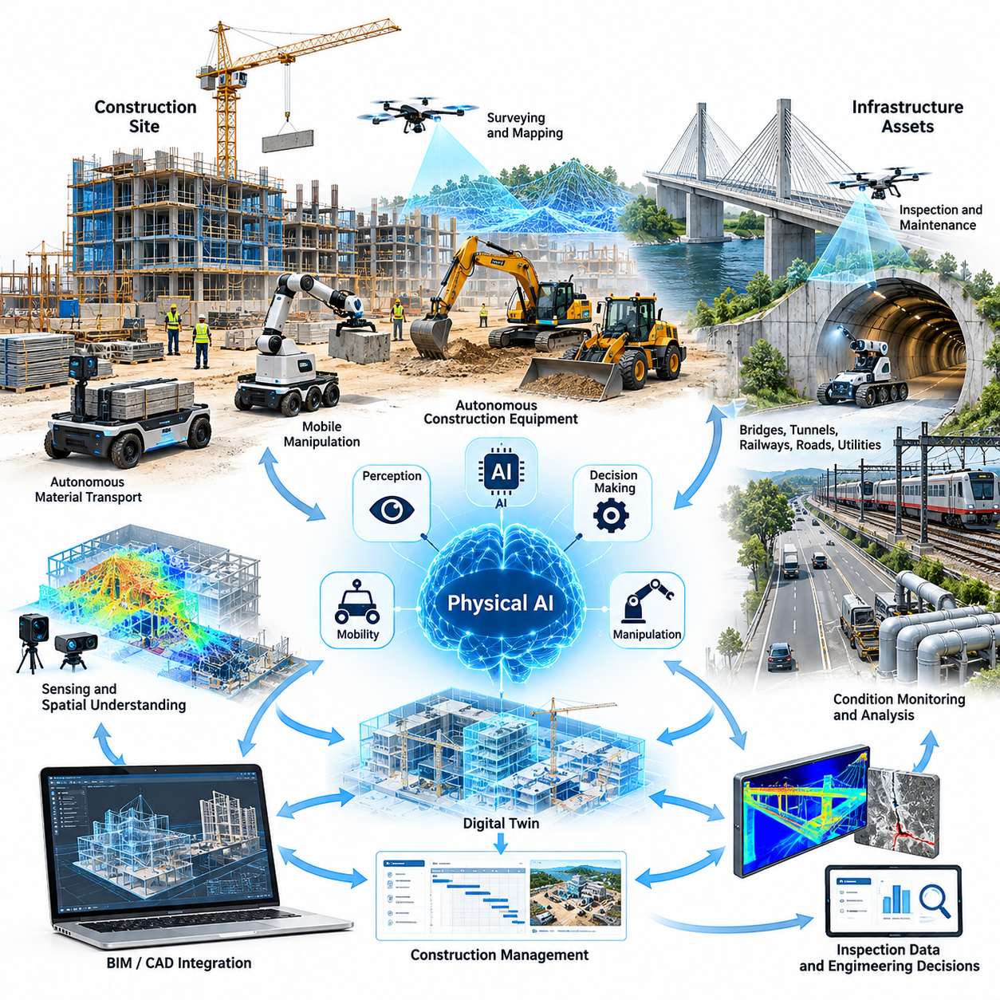{width="7.268055555555556in" height="7.268055555555556in"}

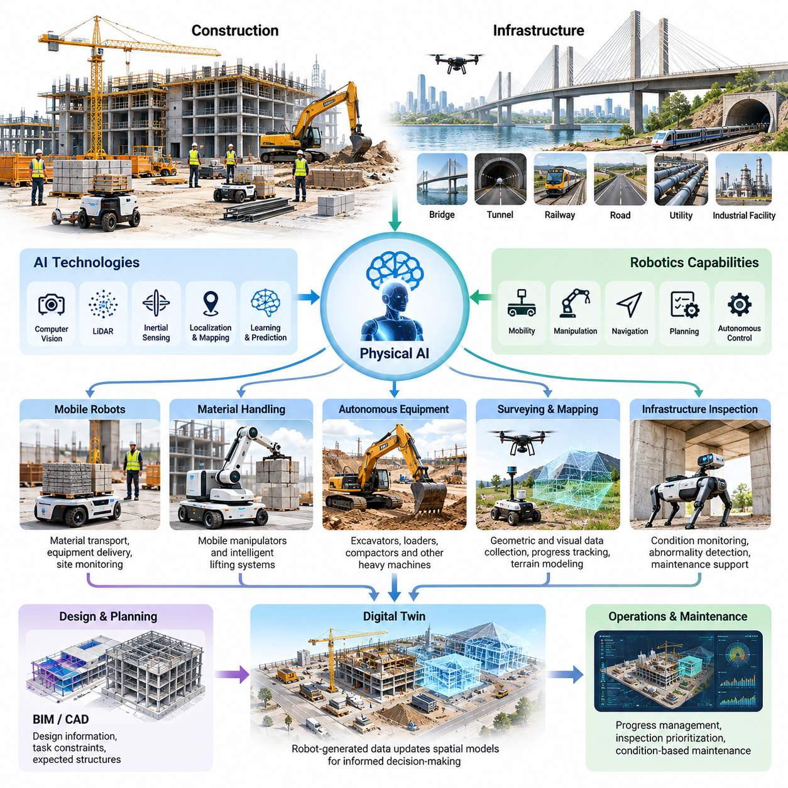{width="7.268055555555556in" height="7.268055555555556in"}

Physical AI represents a fundamental transformation in how construction projects and infrastructure assets are developed, operated, inspected, and maintained. By integrating artificial intelligence with robotic mobility, perception, manipulation, and autonomous decision-making, Physical AI enables machines to interact intelligently with complex physical environments rather than simply executing predefined mechanical operations.

Construction environments differ significantly from controlled manufacturing facilities because site layouts, terrain conditions, materials, and operational constraints change continuously. Autonomous systems must recognize temporary obstacles, uneven surfaces, moving equipment, and human activities while adapting their behavior to evolving conditions. These characteristics make construction a demanding application domain for embodied intelligence.

Infrastructure applications extend Physical AI beyond construction activities into the continuous monitoring and maintenance of bridges, tunnels, railways, roads, utilities, and industrial facilities. Intelligent robotic systems can collect physical measurements, identify structural abnormalities, and support condition-based maintenance decisions. Their value increasingly depends on connecting autonomous sensing with reliable engineering interpretation.

Traditional construction automation primarily focuses on mechanizing repetitive operations through specialized equipment. Physical AI introduces an additional layer of environmental understanding, adaptive planning, and intelligent control. Autonomous machines can interpret sensor information, estimate changing site conditions, and modify their actions within defined safety boundaries, reducing dependence on continuous manual intervention.

The technological foundation of construction Physical AI combines computer vision, LiDAR, inertial sensing, localization, mapping, motion planning, and robotic control. These capabilities allow machines to construct spatial representations of construction sites and infrastructure assets. When combined with learning-based perception and predictive models, they support navigation and task execution under uncertain environmental conditions.

Autonomous mobile robots provide an important entry point for construction applications because material transportation, equipment delivery, and site monitoring involve substantial movement between operational locations. Robots equipped with suitable mobility platforms can transport tools and supplies while coordinating with workers and construction machinery. Their effectiveness depends on payload capacity, terrain accessibility, and reliable navigation.

Construction material handling creates opportunities for mobile manipulators and intelligent lifting systems. These machines may combine autonomous movement with robotic arms, gripping mechanisms, or specialized handling attachments. Unlike conventional fixed automation, mobile manipulation must account for irregular objects, variable loading conditions, restricted working spaces, and the dynamic interactions between materials and surrounding structures.

Autonomous construction equipment represents another major application category. Excavators, loaders, compactors, and other heavy machines can incorporate perception, positioning, and automated control capabilities to support repetitive or geometrically constrained operations. However, reliable deployment requires careful management of ground conditions, equipment dynamics, operating boundaries, and interactions with personnel.

Surveying and mapping are particularly suitable for early Physical AI adoption because they generate measurable operational value without necessarily requiring direct manipulation of construction materials. Mobile robots and aerial platforms can acquire geometric and visual information across large sites. These observations support progress tracking, terrain modeling, dimensional verification, and the identification of deviations from planned construction conditions.

Digital twins provide a connection between physical construction activities and their computational representations. Robot-generated observations can update spatial models with information about completed structures, equipment locations, and changing site conditions. When synchronized with engineering data, these representations support more informed decisions regarding construction progress, inspection priorities, and operational coordination.

Building Information Modeling and computer-aided design systems establish important interfaces for construction Physical AI. Design information can provide geometric references, task constraints, and expected structural configurations. Conversely, robot-generated measurements can reveal differences between design intent and actual construction conditions, enabling scan-to-model workflows and improved verification of completed work.

Infrastructure inspection offers particularly strong opportunities because many assets are difficult, dangerous, or expensive to examine manually. Robots equipped with cameras, thermal sensors, ultrasonic devices, and other measurement instruments can collect condition information from accessible surfaces and designated inspection locations. AI-based analysis can assist inspectors by highlighting suspicious patterns and prioritizing areas requiring closer examination.

Bridges, tunnels, and railway infrastructure introduce specialized requirements involving confined spaces, structural geometry, vibration, environmental exposure, and operational access. Robotic inspection platforms must maintain reliable localization while collecting measurements with sufficient spatial accuracy. Their deployment must also respect traffic restrictions, railway operating procedures, and engineering requirements for inspection documentation.

Underground infrastructure presents additional challenges because conventional satellite-based positioning is often unavailable. Ground-penetrating radar, inertial navigation, LiDAR, and other sensing methods can contribute to subsurface investigation and asset localization. Physical AI systems must distinguish uncertain measurements from confirmed observations, particularly when detecting buried utilities, cavities, or potential structural defects.

Quadruped robots provide mobility advantages in certain construction and infrastructure environments containing stairs, debris, uneven surfaces, and restricted passages. Their articulated legs allow adaptation to terrain that may limit wheeled platforms. Nevertheless, practical deployment depends on stability, endurance, payload capacity, environmental protection, and whether their mobility benefits justify higher operational complexity.

Aerial robots complement ground-based systems by providing rapid access to elevated structures, roofs, façades, and geographically distributed assets. Equipped with appropriate sensing systems, they can capture images and spatial measurements for mapping and inspection. Flight duration, wind conditions, obstacle proximity, positioning reliability, and regulatory requirements determine their practical operating limits.

Multi-robot construction environments require coordination between autonomous vehicles, inspection robots, aerial platforms, and human-operated equipment. Shared maps, task allocation, communication networks, and fleet management systems can reduce operational conflicts. Effective coordination must account for changing work zones, temporary access restrictions, equipment priorities, and the safety requirements of mixed human-machine operations.

Worker safety is a central requirement rather than a secondary benefit of construction automation. Physical AI can reduce human exposure to hazardous locations, repetitive transportation, and certain inspection activities. However, autonomous machines introduce their own risks, including unexpected motion, sensing failures, communication interruptions, and unsafe interactions with heavy equipment or personnel.

Reliable construction autonomy therefore requires layered safety mechanisms combining operational rules, obstacle detection, motion constraints, emergency stopping, and human supervision. Learning-based decision systems should operate within validated safety boundaries appropriate to the application. Human operators must retain clear authority to intervene when environmental conditions exceed the robot\'s demonstrated capabilities.

Environmental robustness strongly influences deployment feasibility. Construction robots may encounter dust, rain, vibration, temperature variations, reflective surfaces, poor illumination, and intermittent connectivity. These conditions can degrade sensing, localization, communication, and mechanical performance. Successful systems require environmental protection, fault detection, recovery procedures, and realistic operational limitations.

The economic value of Physical AI depends on measurable improvements in productivity, quality, safety, and asset management. Construction applications may reduce transportation delays, repeated surveying effort, or inefficient equipment utilization. Infrastructure applications may improve inspection coverage and reduce certain access costs. These benefits must be evaluated against acquisition, integration, maintenance, supervision, and downtime expenses.

Project schedules introduce another important economic dimension because construction activities are highly interdependent. A robotic system that accelerates one operation may produce limited overall benefit if preceding or subsequent tasks remain constrained. Evaluation should therefore consider critical-path activities, resource coordination, equipment utilization, and the effect of automation on overall project completion rather than isolated task speed.

Infrastructure inspection economics differ from construction production economics because inspection value often includes avoided disruption, improved maintenance planning, and earlier identification of deterioration. Relevant performance measures include inspection cost per asset, coverage, measurement quality, operational availability, and the time required to produce actionable findings. Long-term value depends on consistent and trustworthy inspection results.

Data management becomes increasingly important as robotic systems operate across multiple construction sites and infrastructure assets. Sensor recordings, inspection observations, geometric models, and operational logs can support performance analysis and model improvement. Standardized data structures, traceability, version control, and secure integration with engineering systems help transform isolated robot operations into reusable organizational knowledge.

Commercial adoption is likely to progress through clearly defined tasks where technical feasibility and economic benefits can be demonstrated. Surveying, repetitive material movement, and structured inspection workflows provide potential starting points. Broader autonomy requires additional evidence of reliability, interoperability, workforce acceptance, and performance across diverse sites, equipment configurations, and environmental conditions.

Physical AI ultimately connects autonomous physical operations with the digital management of construction projects and infrastructure lifecycles. Its long-term significance lies not merely in replacing individual manual tasks but in creating adaptive systems that perceive changing conditions, coordinate physical activities, and continuously improve operational decisions while maintaining engineering accountability and human oversight.

피지컬 인공지능(Physical AI)은 건설 프로젝트(Construction Projects)와 인프라 자산(Infrastructure Assets)의 개발, 운영, 검사 및 유지보수 방식을 근본적으로 변화시키는 기술이다. 인공지능(Artificial Intelligence)을 로봇 이동성(Robotic Mobility), 인지(Perception), 조작(Manipulation), 자율 의사결정(Autonomous Decision-Making)과 통합함으로써, 피지컬 인공지능은 기계가 사전에 정의된 기계적 동작만 수행하는 수준을 넘어 복잡한 물리적 환경과 지능적으로 상호작용할 수 있도록 한다.

건설 환경(Construction Environments)은 현장 배치, 지형 조건, 자재 및 운영 제약이 지속적으로 변화한다는 점에서 통제된 제조시설(Manufacturing Facilities)과 상당한 차이가 있다. 자율 시스템(Autonomous Systems)은 임시 장애물, 불규칙한 지면, 이동하는 장비 및 작업자의 활동을 인식하면서 변화하는 환경에 맞게 동작을 조정해야 한다. 이러한 특성으로 인해 건설 분야는 체화 지능(Embodied Intelligence)의 적용이 특히 까다로운 영역에 해당한다.

인프라 응용(Infrastructure Applications)은 피지컬 인공지능의 활용 범위를 건설 활동에서 교량, 터널, 철도, 도로, 공공설비 및 산업시설의 지속적인 모니터링(Monitoring)과 유지보수(Maintenance)로 확장한다. 지능형 로봇 시스템(Intelligent Robotic Systems)은 물리적 측정 데이터를 수집하고 구조적 이상을 식별하며 상태 기반 유지보수(Condition-Based Maintenance) 의사결정을 지원할 수 있다. 이러한 시스템의 가치는 자율 센싱(Autonomous Sensing)을 신뢰할 수 있는 공학적 해석(Engineering Interpretation)과 연결하는 능력에 점점 더 크게 좌우된다.

전통적인 건설 자동화(Construction Automation)는 주로 특수 장비를 활용하여 반복적인 작업을 기계화하는 데 초점을 맞추어 왔다. 피지컬 인공지능은 여기에 환경 이해(Environmental Understanding), 적응형 계획(Adaptive Planning), 지능형 제어(Intelligent Control) 기능을 추가한다. 자율 기계(Autonomous Machines)는 센서 정보를 해석하고 변화하는 현장 조건을 추정하며 정의된 안전 범위 내에서 동작을 수정함으로써 지속적인 수동 개입에 대한 의존도를 줄일 수 있다.

건설 분야 피지컬 인공지능의 기술적 기반은 컴퓨터 비전(Computer Vision), 라이다(LiDAR), 관성 센싱(Inertial Sensing), 위치 추정(Localization), 지도 작성(Mapping), 동작 계획(Motion Planning), 로봇 제어(Robotic Control)의 결합으로 구성된다. 이러한 기술을 통해 기계는 건설 현장과 인프라 자산의 공간적 표현(Spatial Representations)을 구축할 수 있다. 학습 기반 인지(Learning-Based Perception)와 예측 모델(Predictive Models)을 결합하면 불확실한 환경에서도 주행과 작업 수행을 지원할 수 있다.

자율이동로봇(Autonomous Mobile Robots, AMR)은 자재 운송, 장비 배송 및 현장 모니터링이 여러 작업 위치 사이의 이동을 필요로 한다는 점에서 건설 분야의 중요한 초기 적용 수단이다. 적절한 이동 플랫폼(Mobility Platforms)을 갖춘 로봇은 작업자 및 건설 장비와 협력하면서 공구와 자재를 운송할 수 있다. 이러한 시스템의 효과는 적재 용량(Payload Capacity), 지형 접근성(Terrain Accessibility), 신뢰성 있는 자율주행(Reliable Navigation)에 따라 결정된다.

건설 자재 취급(Construction Material Handling)은 이동형 매니퓰레이터(Mobile Manipulators)와 지능형 리프팅 시스템(Intelligent Lifting Systems)에 새로운 기회를 제공한다. 이러한 기계는 자율 이동 기능과 로봇 팔(Robotic Arms), 파지 장치(Gripping Mechanisms), 특수 취급 부착장치(Specialized Handling Attachments)를 결합할 수 있다. 기존의 고정형 자동화(Fixed Automation)와 달리 이동형 조작 시스템은 불규칙한 물체, 가변적인 적재 조건, 제한된 작업 공간, 자재와 주변 구조물 사이의 동적 상호작용을 고려해야 한다.

자율 건설 장비(Autonomous Construction Equipment)는 또 다른 주요 응용 분야이다. 굴착기(Excavators), 로더(Loaders), 다짐 장비(Compactors) 및 기타 중장비는 인지, 위치 결정(Positioning), 자동 제어(Automated Control) 기능을 통합하여 반복적이거나 기하학적 제약이 있는 작업을 지원할 수 있다. 그러나 신뢰성 있는 배치를 위해서는 지반 조건(Ground Conditions), 장비 동역학(Equipment Dynamics), 작업 경계(Operating Boundaries), 작업자와의 상호작용을 세심하게 관리해야 한다.

측량(Surveying)과 지도 작성(Mapping)은 건설 자재를 직접 조작하지 않고도 측정 가능한 운영 가치를 창출할 수 있기 때문에 피지컬 인공지능의 초기 도입에 특히 적합하다. 이동로봇(Mobile Robots)과 항공 플랫폼(Aerial Platforms)은 넓은 현장에서 기하학적 정보(Geometric Information)와 시각 정보를 수집할 수 있다. 이러한 관측 데이터는 공정 진행 추적(Progress Tracking), 지형 모델링(Terrain Modeling), 치수 검증(Dimensional Verification), 계획된 건설 조건과 실제 상태 사이의 편차 식별을 지원한다.

디지털 트윈(Digital Twins)은 물리적 건설 활동과 컴퓨터 기반 표현(Computational Representations)을 연결한다. 로봇이 생성한 관측 데이터는 완성된 구조물, 장비 위치 및 변화하는 현장 조건에 관한 정보로 공간 모델(Spatial Models)을 갱신할 수 있다. 이러한 표현이 엔지니어링 데이터(Engineering Data)와 동기화되면 건설 진행 상황, 검사 우선순위 및 운영 조정에 관한 보다 정확한 의사결정을 지원할 수 있다.

건축정보모델링(Building Information Modeling, BIM)과 컴퓨터 지원 설계(Computer-Aided Design, CAD) 시스템은 건설 분야 피지컬 인공지능의 중요한 연계 인터페이스를 제공한다. 설계 정보는 기하학적 기준, 작업 제약 및 예상 구조 형상을 제공할 수 있다. 반대로 로봇이 생성한 측정 데이터는 설계 의도와 실제 시공 상태 사이의 차이를 식별하여 스캔 기반 모델 생성(Scan-to-Model) 작업 흐름과 완공된 작업의 검증 개선을 가능하게 한다.

인프라 검사(Infrastructure Inspection)는 많은 시설이 수작업으로 검사하기 어렵거나 위험하며 높은 비용을 요구하기 때문에 특히 큰 기회를 제공한다. 카메라, 열 센서(Thermal Sensors), 초음파 장치(Ultrasonic Devices) 및 기타 측정 장비를 갖춘 로봇은 접근 가능한 표면과 지정된 검사 위치에서 상태 정보를 수집할 수 있다. 인공지능 기반 분석(AI-Based Analysis)은 의심스러운 패턴을 강조하고 정밀 검사가 필요한 영역의 우선순위를 지정함으로써 검사원을 지원할 수 있다.

교량, 터널 및 철도 인프라는 밀폐 공간(Confined Spaces), 구조물 형상(Structural Geometry), 진동(Vibration), 환경 노출(Environmental Exposure), 운영 접근성(Operational Access)과 관련된 특수 요구사항을 가진다. 로봇 검사 플랫폼(Robotic Inspection Platforms)은 충분한 공간 정확도(Spatial Accuracy)를 갖춘 측정 데이터를 수집하면서 신뢰성 있는 위치 추정을 유지해야 한다. 또한 교통 통제, 철도 운영 절차 및 검사 문서화에 관한 공학적 요구사항을 준수해야 한다.

지하 인프라(Underground Infrastructure)는 기존의 위성 기반 위치 결정(Satellite-Based Positioning)을 사용할 수 없는 경우가 많아 추가적인 기술적 과제를 발생시킨다. 지표투과레이더(Ground-Penetrating Radar, GPR), 관성 항법(Inertial Navigation), 라이다(LiDAR) 및 기타 센싱 기술은 지하 탐사(Subsurface Investigation)와 시설물 위치 추정(Asset Localization)에 기여할 수 있다. 피지컬 인공지능 시스템은 특히 매설된 공공설비, 공동(Cavities), 잠재적인 구조적 결함을 탐지할 때 불확실한 측정 결과와 확인된 관측 결과를 구분해야 한다.

사족보행 로봇(Quadruped Robots)은 계단, 잔해물, 불규칙한 지면 및 좁은 통로가 존재하는 일부 건설 및 인프라 환경에서 이동성 측면의 장점을 제공한다. 관절형 다리(Articulated Legs)는 바퀴형 플랫폼(Wheeled Platforms)의 이동이 제한될 수 있는 지형에 적응할 수 있도록 한다. 그러나 실제 배치는 안정성(Stability), 작동 지속시간(Endurance), 적재 용량(Payload Capacity), 환경 보호(Environmental Protection), 높은 운영 복잡성을 정당화할 수 있는 이동성 이점에 따라 결정된다.

항공 로봇(Aerial Robots)은 고층 구조물, 지붕, 건물 외벽 및 지리적으로 분산된 시설에 신속하게 접근함으로써 지상 기반 시스템을 보완한다. 적절한 센싱 시스템(Sensing Systems)을 장착하면 지도 작성과 검사를 위한 영상 및 공간 측정 데이터를 확보할 수 있다. 비행 지속시간(Flight Duration), 풍속 조건(Wind Conditions), 장애물 근접성(Obstacle Proximity), 위치 결정 신뢰성(Positioning Reliability), 규제 요구사항(Regulatory Requirements)이 실제 운용 범위를 결정한다.

다중 로봇 건설 환경(Multi-Robot Construction Environments)에서는 자율주행 차량(Autonomous Vehicles), 검사 로봇(Inspection Robots), 항공 플랫폼 및 사람이 운전하는 장비 사이의 협력이 필요하다. 공유 지도(Shared Maps), 작업 할당(Task Allocation), 통신 네트워크(Communication Networks), 군집 관리 시스템(Fleet Management Systems)은 운영 충돌을 줄일 수 있다. 효과적인 협력을 위해서는 변화하는 작업 구역, 임시 접근 제한, 장비 우선순위 및 인간과 기계가 혼재된 운영 환경의 안전 요구사항을 고려해야 한다.

작업자 안전(Worker Safety)은 건설 자동화의 부수적인 이점이 아니라 핵심 요구사항이다. 피지컬 인공지능은 위험한 장소, 반복적인 운송 작업 및 일부 검사 활동에서 작업자의 위험 노출을 줄일 수 있다. 그러나 자율 기계는 예상하지 못한 움직임, 센싱 오류(Sensing Failures), 통신 중단(Communication Interruptions), 중장비 또는 작업자와의 위험한 상호작용 등 새로운 위험요소를 발생시킬 수 있다.

따라서 신뢰성 있는 건설 자율화(Construction Autonomy)를 위해서는 운영 규칙, 장애물 감지(Obstacle Detection), 동작 제한(Motion Constraints), 비상 정지(Emergency Stopping), 인간 감독(Human Supervision)을 결합한 다계층 안전 메커니즘(Layered Safety Mechanisms)이 필요하다. 학습 기반 의사결정 시스템(Learning-Based Decision Systems)은 해당 응용 분야에 적합하도록 검증된 안전 경계(Safety Boundaries) 내에서 작동해야 한다. 환경 조건이 로봇의 입증된 수행 능력을 초과하면 인간 운영자가 개입할 수 있는 명확한 권한을 유지해야 한다.

환경적 강건성(Environmental Robustness)은 실제 배치 가능성에 큰 영향을 미친다. 건설 로봇은 먼지, 비, 진동, 온도 변화, 반사 표면, 낮은 조도 및 불안정한 통신 환경에 노출될 수 있다. 이러한 조건은 센싱, 위치 추정, 통신 및 기계적 성능을 저하시킬 수 있다. 성공적인 시스템을 위해서는 환경 보호(Environmental Protection), 고장 감지(Fault Detection), 복구 절차(Recovery Procedures), 현실적인 운영 한계(Operational Limitations)를 고려해야 한다.

피지컬 인공지능의 경제적 가치(Economic Value)는 생산성(Productivity), 품질(Quality), 안전성(Safety), 자산 관리(Asset Management)의 측정 가능한 개선에 따라 결정된다. 건설 응용 분야에서는 운송 지연, 반복적인 측량 작업 및 비효율적인 장비 활용을 줄일 수 있다. 인프라 응용 분야에서는 검사 범위를 확대하고 일부 접근 비용을 절감할 수 있다. 이러한 이점은 도입 비용(Acquisition Costs), 시스템 통합(System Integration), 유지보수, 감독 및 가동 중단 비용(Downtime Costs)과 비교하여 평가해야 한다.

프로젝트 일정(Project Schedules)은 건설 활동이 서로 높은 의존성을 가진다는 점에서 또 다른 중요한 경제적 요소이다. 로봇 시스템이 특정 작업을 가속하더라도 선행 또는 후속 작업이 제약을 받으면 전체적인 이점은 제한될 수 있다. 따라서 평가는 개별 작업 속도뿐만 아니라 주공정(Critical-Path Activities), 자원 조정(Resource Coordination), 장비 활용률(Equipment Utilization), 자동화가 전체 프로젝트 완료 시점에 미치는 영향을 고려해야 한다.

인프라 검사의 경제성(Infrastructure Inspection Economics)은 검사 가치에 운영 중단 방지(Avoided Disruption), 유지보수 계획 개선(Improved Maintenance Planning), 시설 열화의 조기 식별(Early Identification of Deterioration)이 포함된다는 점에서 건설 생산의 경제성과 다르다. 주요 성과 지표(Performance Metrics)에는 자산당 검사 비용, 검사 범위(Coverage), 측정 품질(Measurement Quality), 운영 가용성(Operational Availability), 실행 가능한 검사 결과를 생성하는 데 필요한 시간이 포함된다. 장기적 가치는 일관되고 신뢰할 수 있는 검사 결과에 달려 있다.

데이터 관리(Data Management)는 로봇 시스템이 여러 건설 현장과 인프라 자산에 걸쳐 운영됨에 따라 더욱 중요해진다. 센서 기록(Sensor Recordings), 검사 관측 데이터(Inspection Observations), 기하학적 모델(Geometric Models), 운영 로그(Operational Logs)는 성능 분석과 모델 개선을 지원할 수 있다. 표준화된 데이터 구조(Standardized Data Structures), 추적성(Traceability), 버전 관리(Version Control), 엔지니어링 시스템과의 안전한 통합은 개별 로봇 작업을 재사용 가능한 조직 지식(Organizational Knowledge)으로 전환하는 데 기여한다.

상용화 도입(Commercial Adoption)은 기술적 실현 가능성(Technical Feasibility)과 경제적 이점(Economic Benefits)을 입증할 수 있는 명확하게 정의된 작업부터 진행될 가능성이 높다. 측량, 반복적인 자재 운송 및 구조화된 검사 작업 흐름(Structured Inspection Workflows)은 초기 적용 분야가 될 수 있다. 보다 광범위한 자율화를 위해서는 신뢰성(Reliability), 상호운용성(Interoperability), 작업자 수용성(Workforce Acceptance), 다양한 현장과 장비 구성 및 환경 조건에서의 성능에 관한 추가적인 검증이 필요하다.

궁극적으로 피지컬 인공지능은 자율적인 물리적 작업(Autonomous Physical Operations)을 건설 프로젝트와 인프라 생애주기(Infrastructure Lifecycles)의 디지털 관리(Digital Management)와 연결한다. 장기적인 중요성은 개별 수작업을 대체하는 데만 있는 것이 아니라, 변화하는 조건을 인지하고 물리적 활동을 조정하며 공학적 책임성(Engineering Accountability)과 인간 감독(Human Oversight)을 유지하면서 운영 의사결정을 지속적으로 개선하는 적응형 시스템(Adaptive Systems)을 구축하는 데 있다.

##  

## 06.02. Autonomous Site Mobility

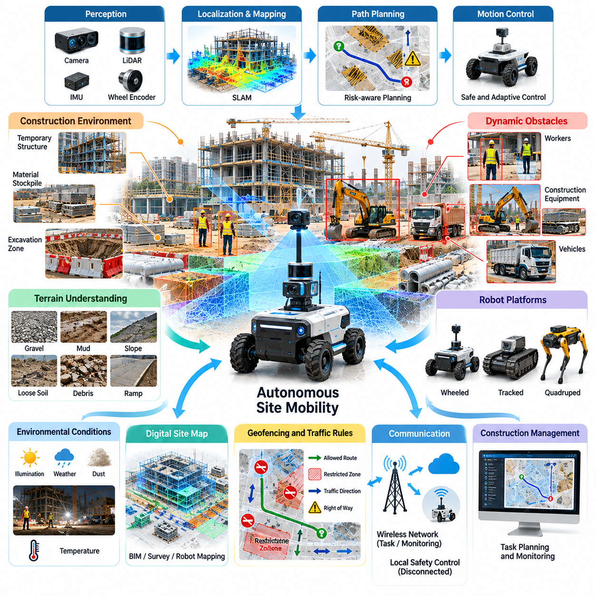{width="7.268055555555556in" height="7.268055555555556in"}

Autonomous site mobility represents a foundational capability of Physical AI in construction environments, enabling robotic systems to navigate dynamic worksites without continuous human control. Unlike structured factory floors, construction sites contain changing terrain, temporary pathways, moving equipment, and unpredictable obstacles. Autonomous mobility must therefore combine environmental perception, adaptive navigation, and operational safety.

Construction site navigation requires robots to understand both permanent structures and temporary environmental features. Excavation zones, material stockpiles, scaffolding, temporary barriers, and partially completed buildings continuously modify available routes. Autonomous systems must maintain updated spatial representations while distinguishing traversable surfaces from hazardous or inaccessible areas.

The mobility architecture typically integrates perception, localization, mapping, path planning, and motion control into a coordinated system. Cameras, LiDAR, inertial measurement units, and wheel encoders provide complementary observations of the surrounding environment. Sensor fusion improves localization reliability and enables robots to estimate their position even when individual sensing modalities become unreliable.

Simultaneous Localization and Mapping allows autonomous robots to construct environmental maps while estimating their positions within those maps. Construction environments introduce challenges because objects and structures may move, disappear, or change configuration between operating sessions. Robust mapping systems must identify stable environmental features while updating temporary obstacles and evolving site geometry.

Outdoor positioning often combines Global Navigation Satellite System measurements with inertial sensing and local perception. Real-Time Kinematic positioning can provide high-accuracy location estimates when satellite visibility and correction signals are adequate. However, tall structures, tunnels, equipment, and partially enclosed spaces may degrade satellite reception, requiring alternative localization methods.

Terrain understanding is essential because construction surfaces rarely provide the uniform conditions found in warehouses. Robots may encounter gravel, mud, slopes, loose soil, debris, drainage channels, and temporary ramps. Traversability estimation evaluates whether a surface can safely support movement by considering geometry, traction, ground stability, and the mechanical limitations of the robotic platform.

Autonomous path planning must account for both geometric accessibility and operational risk. The shortest route may cross unstable terrain, active excavation areas, or zones occupied by heavy machinery. Risk-aware planning evaluates alternative paths using terrain conditions, obstacle proximity, traffic activity, energy consumption, and operational restrictions to identify routes that balance efficiency and safety.

Dynamic obstacle avoidance becomes particularly important when autonomous robots operate alongside workers, trucks, excavators, and mobile construction equipment. Perception systems must detect moving objects, estimate their trajectories, and predict potential conflicts. Motion planners should continuously revise robot behavior while maintaining appropriate separation distances and respecting equipment operating zones.

Different robotic morphologies offer distinct advantages for construction mobility. Wheeled platforms generally provide efficient transportation across sufficiently firm surfaces, while tracked robots can improve traction on selected loose or uneven terrain. Quadruped robots may negotiate stairs and irregular obstacles, although their energy consumption, payload limitations, and mechanical complexity require careful consideration.

Payload conditions significantly influence mobility performance. Transporting tools, sensors, batteries, or construction materials changes vehicle mass, center of gravity, braking distance, and traction requirements. Autonomous controllers must account for these variations when selecting speeds, negotiating slopes, and executing turns. Load-aware navigation helps maintain stability under changing operating conditions.

Construction sites frequently contain narrow passages, temporary access routes, and areas shared by pedestrians and machinery. Autonomous navigation must incorporate site-specific traffic rules, designated corridors, restricted zones, and right-of-way priorities. Geofencing and digital access permissions can prevent robots from entering hazardous locations or interfering with scheduled construction activities.

Environmental conditions create additional challenges for perception and mobility. Dust can reduce camera visibility, rain may degrade optical sensing, and reflective surfaces can introduce measurement errors. Low illumination, vibration, and temperature variations further affect system performance. Robust operation requires sensor redundancy, environmental protection, uncertainty estimation, and appropriate fallback behavior.

Communication infrastructure supports coordination between mobile robots, supervisory systems, and construction personnel. Wireless networks may provide task assignments, traffic updates, and operational monitoring, but connectivity can become unreliable around steel structures or underground areas. Autonomous platforms should maintain essential safety functions locally and respond predictably when communication is interrupted.

Digital site maps can connect autonomous mobility with construction planning systems. Building Information Modeling data, survey measurements, and updated robot observations provide complementary information about site geometry and operational constraints. Integrating these sources enables robots to recognize planned construction changes and adjust navigation routes as the physical environment evolves.

Fleet management becomes necessary when multiple autonomous platforms share construction routes and operational resources. Centralized or distributed coordination can allocate transportation tasks, manage traffic intersections, and reduce congestion. Effective fleet orchestration must consider robot capabilities, battery levels, task priorities, route availability, and the movement of human-operated equipment.

Human-robot interaction is particularly important because construction workers may not be familiar with autonomous mobile systems. Robots should communicate their intended movement through understandable signals, predictable behavior, and clearly defined operating procedures. Supervisors require accessible mechanisms for stopping, redirecting, or recovering robots when unexpected site conditions arise.

Safety engineering must address collisions, rollovers, uncontrolled movement, localization failures, and hazardous interactions with construction equipment. Protective measures may include speed restrictions, obstacle monitoring, emergency stopping, operational design boundaries, and independent safety controls. Validation should demonstrate acceptable behavior under foreseeable environmental disturbances and system failures.

Operational reliability depends not only on successful navigation but also on recovery from unexpected situations. Robots may become immobilized in soft ground, encounter blocked routes, or lose localization confidence. Recovery strategies can include controlled repositioning, alternative route selection, safe stopping, and human assistance. Reliable systems must recognize when autonomous recovery is inappropriate.

Simulation and digital twins provide valuable environments for developing construction mobility algorithms before field deployment. Virtual construction sites can represent slopes, obstacles, moving equipment, and changing layouts. Domain randomization helps expose navigation policies to environmental variability, while physical testing remains necessary to evaluate traction, sensing limitations, and real-world safety performance.

Autonomous site mobility generates operational data that can support continuous system improvement. Robot trajectories, obstacle encounters, localization uncertainty, terrain observations, and intervention events reveal recurring operational limitations. Structured data collection enables developers to identify difficult locations, refine navigation models, and improve performance across different construction environments.

Energy management directly influences operational availability. Rough terrain, frequent acceleration, heavy payloads, and repeated obstacle avoidance can increase power consumption. Energy-aware planning considers remaining battery capacity, expected route difficulty, charging availability, and task urgency. Effective scheduling reduces unplanned interruptions while preserving sufficient energy for safe return or recovery.

The economic value of autonomous site mobility depends on the frequency, duration, and operational importance of movement-related activities. Automated transportation and inspection travel may reduce nonproductive labor time and improve resource utilization. However, financial evaluation must include robot acquisition, site preparation, integration, supervision, maintenance, charging infrastructure, and operational downtime.

Deployment strategies should begin with clearly defined operating areas and repeatable mobility tasks. Initial applications may use designated routes between material storage locations, inspection points, and construction work zones. As reliability improves, operating boundaries can expand to include more complex terrain and dynamic interactions, provided additional safety validation supports the increased autonomy.

Autonomous site mobility ultimately provides the movement infrastructure required for broader Physical AI applications in construction. Material transportation, mobile manipulation, surveying, inspection, and multi-robot coordination all depend on reliable physical navigation. By combining terrain awareness, adaptive planning, operational integration, and safety assurance, autonomous mobility enables construction robots to function as practical components of intelligent worksites.

자율 현장 이동(Autonomous Site Mobility)은 건설 환경에서 피지컬 인공지능(Physical AI)의 핵심 기반 기능으로, 로봇 시스템이 지속적인 인간의 제어 없이 역동적인 건설 현장을 자율적으로 주행할 수 있도록 한다. 구조화된 공장 바닥과 달리 건설 현장에는 변화하는 지형, 임시 이동 경로, 움직이는 장비 및 예측하기 어려운 장애물이 존재한다. 따라서 자율 이동은 환경 인지(Environmental Perception), 적응형 주행(Adaptive Navigation), 운영 안전성(Operational Safety)을 통합해야 한다.

건설 현장 주행(Construction Site Navigation)을 위해서는 로봇이 영구적인 구조물과 임시 환경 요소를 모두 이해해야 한다. 굴착 구역(Excavation Zones), 자재 적재장(Material Stockpiles), 비계(Scaffolding), 임시 방호벽(Temporary Barriers), 부분적으로 완공된 건축물은 이동 가능한 경로를 지속적으로 변화시킨다. 자율 시스템(Autonomous Systems)은 통행 가능한 표면(Traversable Surfaces)과 위험하거나 접근할 수 없는 영역을 구분하면서 최신 공간 표현(Spatial Representations)을 유지해야 한다.

이동 아키텍처(Mobility Architecture)는 일반적으로 인지(Perception), 위치 추정(Localization), 지도 작성(Mapping), 경로 계획(Path Planning), 동작 제어(Motion Control)를 하나의 통합 시스템으로 구성한다. 카메라(Cameras), 라이다(LiDAR), 관성측정장치(Inertial Measurement Units, IMU), 휠 엔코더(Wheel Encoders)는 주변 환경에 대한 상호 보완적인 관측 정보를 제공한다. 센서 융합(Sensor Fusion)은 위치 추정의 신뢰성을 높이고 개별 센서의 성능이 저하되는 상황에서도 로봇이 자신의 위치를 추정할 수 있도록 한다.

동시적 위치 추정 및 지도 작성(Simultaneous Localization and Mapping, SLAM)은 자율 로봇이 환경 지도를 구축하면서 지도 내 자신의 위치를 추정할 수 있도록 한다. 건설 환경에서는 작업 기간 사이에 물체와 구조물이 이동하거나 사라지고 배치가 변경될 수 있기 때문에 추가적인 어려움이 발생한다. 강건한 지도 작성 시스템(Robust Mapping Systems)은 안정적인 환경 특징(Stable Environmental Features)을 식별하면서 임시 장애물과 변화하는 현장 형상을 지속적으로 갱신해야 한다.

실외 위치 결정(Outdoor Positioning)은 일반적으로 위성항법시스템(Global Navigation Satellite System, GNSS) 측정값과 관성 센싱(Inertial Sensing), 국소 환경 인지(Local Perception)를 결합한다. 실시간 이동측위(Real-Time Kinematic, RTK)는 위성 가시성과 보정 신호(Correction Signals)가 충분할 경우 높은 정확도의 위치 추정값을 제공할 수 있다. 그러나 높은 구조물, 터널, 장비 및 부분적으로 밀폐된 공간에서는 위성 수신 성능이 저하될 수 있으므로 대체 위치 추정 방법(Alternative Localization Methods)이 필요하다.

지형 이해(Terrain Understanding)는 건설 현장의 표면이 물류창고와 같은 균일한 조건을 제공하지 않기 때문에 필수적이다. 로봇은 자갈, 진흙, 경사면, 느슨한 토양, 잔해물, 배수로 및 임시 경사로를 마주할 수 있다. 주행 가능성 추정(Traversability Estimation)은 지형 형상(Geometry), 접지력(Traction), 지반 안정성(Ground Stability), 로봇 플랫폼의 기계적 한계(Mechanical Limitations)를 고려하여 특정 표면에서 안전하게 이동할 수 있는지를 평가한다.

자율 경로 계획(Autonomous Path Planning)은 기하학적 접근 가능성(Geometric Accessibility)과 운영 위험(Operational Risk)을 동시에 고려해야 한다. 최단 경로가 불안정한 지형, 활성 굴착 구역 또는 중장비가 작업하는 영역을 통과할 수도 있다. 위험 인지 경로 계획(Risk-Aware Planning)은 지형 조건, 장애물과의 거리, 교통 활동, 에너지 소비 및 운영 제한을 기준으로 대체 경로를 평가하여 효율성과 안전성의 균형을 유지하는 경로를 선택한다.

동적 장애물 회피(Dynamic Obstacle Avoidance)는 자율 로봇이 작업자, 트럭, 굴착기 및 이동식 건설 장비와 함께 운영될 때 특히 중요하다. 인지 시스템(Perception Systems)은 움직이는 물체를 감지하고 이동 궤적(Trajectories)을 추정하며 잠재적인 충돌 가능성을 예측해야 한다. 동작 계획기(Motion Planners)는 적절한 안전 이격거리(Separation Distances)를 유지하고 장비 작업 구역을 준수하면서 로봇의 동작을 지속적으로 수정해야 한다.

서로 다른 로봇 형태(Robot Morphologies)는 건설 현장 이동에서 각기 다른 장점을 제공한다. 바퀴형 플랫폼(Wheeled Platforms)은 충분히 단단한 지면에서 일반적으로 효율적인 운송 성능을 제공하며, 궤도형 로봇(Tracked Robots)은 일부 느슨하거나 불규칙한 지형에서 접지력을 향상시킬 수 있다. 사족보행 로봇(Quadruped Robots)은 계단과 불규칙한 장애물을 통과할 수 있지만 에너지 소비(Energy Consumption), 적재 용량 제한(Payload Limitations), 기계적 복잡성(Mechanical Complexity)을 신중하게 고려해야 한다.

적재 조건(Payload Conditions)은 이동 성능에 상당한 영향을 미친다. 공구, 센서, 배터리 또는 건설 자재를 운반하면 차량 질량(Vehicle Mass), 무게중심(Center of Gravity), 제동거리(Braking Distance), 접지력 요구사항(Traction Requirements)이 변화한다. 자율 제어기(Autonomous Controllers)는 속도를 선택하고 경사면을 통과하며 회전 동작을 수행할 때 이러한 변화를 고려해야 한다. 적재 상태 인지 주행(Load-Aware Navigation)은 변화하는 운영 조건에서도 안정성을 유지하는 데 기여한다.

건설 현장에는 좁은 통로, 임시 접근 경로 및 보행자와 기계가 공유하는 구역이 자주 존재한다. 자율주행(Autonomous Navigation)은 현장별 교통 규칙(Site-Specific Traffic Rules), 지정된 이동 통로(Designated Corridors), 제한 구역(Restricted Zones), 통행 우선순위(Right-of-Way Priorities)를 반영해야 한다. 지오펜싱(Geofencing)과 디지털 접근 권한(Digital Access Permissions)은 로봇이 위험한 장소에 진입하거나 예정된 건설 작업을 방해하는 것을 방지할 수 있다.

환경 조건(Environmental Conditions)은 인지와 이동에 추가적인 어려움을 발생시킨다. 먼지는 카메라 가시성(Camera Visibility)을 저하시킬 수 있고, 비는 광학 센싱(Optical Sensing)의 성능을 떨어뜨리며, 반사 표면은 측정 오류(Measurement Errors)를 유발할 수 있다. 낮은 조도, 진동 및 온도 변화도 시스템 성능에 영향을 미친다. 강건한 운영(Robust Operation)을 위해서는 센서 이중화(Sensor Redundancy), 환경 보호(Environmental Protection), 불확실성 추정(Uncertainty Estimation), 적절한 대체 동작(Fallback Behavior)이 필요하다.

통신 인프라(Communication Infrastructure)는 이동로봇, 감독 시스템(Supervisory Systems), 건설 작업자 사이의 협력을 지원한다. 무선 네트워크(Wireless Networks)는 작업 지시(Task Assignments), 교통 정보 갱신(Traffic Updates), 운영 모니터링(Operational Monitoring)을 제공할 수 있지만 철골 구조물이나 지하 공간에서는 연결이 불안정해질 수 있다. 자율 플랫폼(Autonomous Platforms)은 핵심 안전 기능을 로컬에서 유지하고 통신이 중단될 경우 예측 가능한 방식으로 대응해야 한다.

디지털 현장 지도(Digital Site Maps)는 자율 이동을 건설 계획 시스템(Construction Planning Systems)과 연결할 수 있다. 건축정보모델링(Building Information Modeling, BIM) 데이터, 측량 결과(Survey Measurements), 갱신된 로봇 관측 데이터(Robot Observations)는 현장 형상과 운영 제약에 관한 상호 보완적인 정보를 제공한다. 이러한 정보원을 통합하면 로봇은 계획된 건설 변경사항을 인식하고 실제 환경이 변화함에 따라 주행 경로를 조정할 수 있다.

다수의 자율 플랫폼(Autonomous Platforms)이 건설 현장의 이동 경로와 운영 자원을 공유하는 경우 군집 관리(Fleet Management)가 필요하다. 중앙집중형 또는 분산형 협력(Centralized or Distributed Coordination)은 운송 작업을 할당하고 교차로 교통을 관리하며 혼잡을 줄일 수 있다. 효과적인 군집 운영(Fleet Orchestration)을 위해서는 로봇의 기능, 배터리 잔량(Battery Levels), 작업 우선순위(Task Priorities), 경로 가용성(Route Availability), 사람이 운전하는 장비의 이동을 고려해야 한다.

인간-로봇 상호작용(Human-Robot Interaction)은 건설 작업자가 자율 이동 시스템에 익숙하지 않을 수 있기 때문에 특히 중요하다. 로봇은 이해하기 쉬운 신호(Understandable Signals), 예측 가능한 동작(Predictable Behavior), 명확하게 정의된 운영 절차(Operating Procedures)를 통해 이동 의도를 전달해야 한다. 감독자(Supervisors)는 예상하지 못한 현장 상황이 발생할 때 로봇을 정지시키거나 경로를 변경하고 복구할 수 있는 접근하기 쉬운 제어 수단을 확보해야 한다.

안전 공학(Safety Engineering)은 충돌(Collisions), 전복(Rollovers), 통제되지 않은 이동(Uncontrolled Movement), 위치 추정 실패(Localization Failures), 건설 장비와의 위험한 상호작용을 다루어야 한다. 보호 조치(Protective Measures)에는 속도 제한(Speed Restrictions), 장애물 모니터링(Obstacle Monitoring), 비상 정지(Emergency Stopping), 운영 설계 경계(Operational Design Boundaries), 독립적인 안전 제어(Independent Safety Controls)가 포함될 수 있다. 검증(Validation)은 예측 가능한 환경 교란과 시스템 고장 상황에서도 허용 가능한 동작을 수행함을 입증해야 한다.

운영 신뢰성(Operational Reliability)은 성공적인 주행뿐만 아니라 예상하지 못한 상황에서의 복구 능력에도 달려 있다. 로봇은 연약 지반에 빠지거나 이동 경로가 차단되거나 위치 추정 신뢰도(Localization Confidence)를 상실할 수 있다. 복구 전략(Recovery Strategies)에는 제어된 위치 재조정(Controlled Repositioning), 대체 경로 선택(Alternative Route Selection), 안전 정지(Safe Stopping), 인간의 지원(Human Assistance)이 포함될 수 있다. 신뢰성 있는 시스템은 자율 복구가 적절하지 않은 상황을 인식해야 한다.

시뮬레이션(Simulation)과 디지털 트윈(Digital Twins)은 실제 현장에 배치하기 전에 건설 이동 알고리즘(Construction Mobility Algorithms)을 개발할 수 있는 유용한 환경을 제공한다. 가상 건설 현장(Virtual Construction Sites)은 경사면, 장애물, 이동 장비 및 변화하는 현장 배치를 표현할 수 있다. 도메인 무작위화(Domain Randomization)는 주행 정책(Navigation Policies)이 다양한 환경 조건을 경험하도록 지원하며, 실제 물리적 시험(Physical Testing)은 접지력, 센싱 한계 및 현실적인 안전 성능을 평가하는 데 여전히 필요하다.

자율 현장 이동(Autonomous Site Mobility)은 지속적인 시스템 개선을 지원하는 운영 데이터(Operational Data)를 생성한다. 로봇 이동 궤적(Robot Trajectories), 장애물 조우 기록(Obstacle Encounters), 위치 추정 불확실성(Localization Uncertainty), 지형 관측 데이터(Terrain Observations), 개입 사건(Intervention Events)은 반복적으로 발생하는 운영상의 한계를 보여준다. 구조화된 데이터 수집(Structured Data Collection)은 개발자가 어려운 위치를 식별하고 주행 모델(Navigation Models)을 개선하며 다양한 건설 환경에서 성능을 향상시키도록 지원한다.

에너지 관리(Energy Management)는 운영 가용성(Operational Availability)에 직접적인 영향을 미친다. 거친 지형, 빈번한 가속, 무거운 적재물 및 반복적인 장애물 회피는 전력 소비(Power Consumption)를 증가시킬 수 있다. 에너지 인지 계획(Energy-Aware Planning)은 배터리 잔량(Remaining Battery Capacity), 예상 경로 난이도(Expected Route Difficulty), 충전 가능성(Charging Availability), 작업 긴급도(Task Urgency)를 고려한다. 효과적인 일정 관리(Scheduling)는 안전한 복귀 또는 복구를 위한 충분한 에너지를 확보하면서 계획되지 않은 운영 중단을 줄인다.

자율 현장 이동의 경제적 가치(Economic Value)는 이동 관련 활동의 빈도(Frequency), 소요시간(Duration), 운영상 중요도(Operational Importance)에 따라 결정된다. 자동화된 운송(Automated Transportation)과 검사 이동(Inspection Travel)은 비생산적인 노동시간(Nonproductive Labor Time)을 줄이고 자원 활용률(Resource Utilization)을 개선할 수 있다. 그러나 재무적 평가(Financial Evaluation)에는 로봇 도입 비용(Robot Acquisition), 현장 준비(Site Preparation), 시스템 통합(System Integration), 감독(Supervision), 유지보수(Maintenance), 충전 인프라(Charging Infrastructure), 운영 중단 시간(Operational Downtime)을 포함해야 한다.

배치 전략(Deployment Strategies)은 명확하게 정의된 운영 구역(Operating Areas)과 반복 가능한 이동 작업(Repeatable Mobility Tasks)에서 시작해야 한다. 초기 응용 분야에서는 자재 보관 위치(Material Storage Locations), 검사 지점(Inspection Points), 건설 작업 구역(Construction Work Zones) 사이에 지정된 경로를 사용할 수 있다. 신뢰성이 향상되면 추가적인 안전 검증(Safety Validation)을 통해 확대된 자율성이 뒷받침되는 범위에서 더욱 복잡한 지형과 동적 상호작용을 포함하도록 운영 경계(Operating Boundaries)를 확장할 수 있다.

궁극적으로 자율 현장 이동(Autonomous Site Mobility)은 건설 분야의 광범위한 피지컬 인공지능 응용(Physical AI Applications)에 필요한 이동 인프라(Movement Infrastructure)를 제공한다. 자재 운송(Material Transportation), 이동형 조작(Mobile Manipulation), 측량(Surveying), 검사(Inspection), 다중 로봇 협력(Multi-Robot Coordination)은 모두 신뢰성 있는 물리적 주행(Physical Navigation)에 의존한다. 지형 인식(Terrain Awareness), 적응형 계획(Adaptive Planning), 운영 통합(Operational Integration), 안전 보증(Safety Assurance)을 결합함으로써 자율 이동은 건설 로봇이 지능형 건설 현장(Intelligent Worksites)의 실질적인 구성요소로 기능하도록 한다.

##  

## 06.03. Construction Material Transport

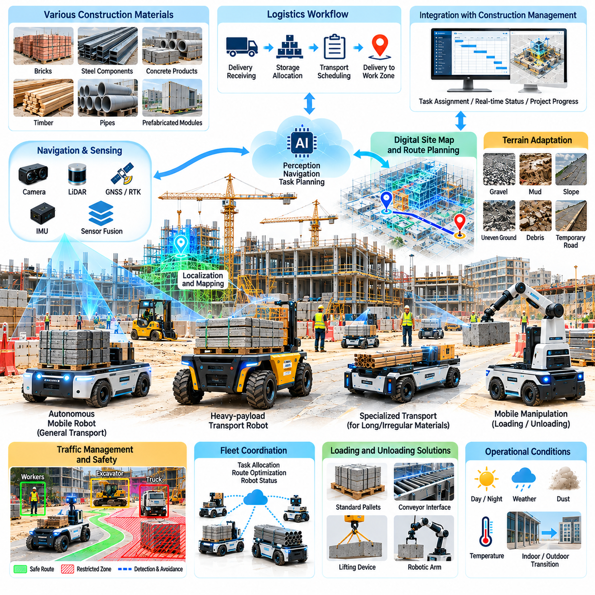{width="7.268055555555556in" height="7.268055555555556in"}

Construction material transport represents one of the most practical applications of Physical AI because construction projects depend on continuous movement of materials between storage areas, delivery points, and active work zones. Traditional transportation relies heavily on manual labor and operator-controlled equipment. Autonomous transport systems can improve material availability, reduce repetitive movement, and support more predictable construction workflows.

Construction materials present significant handling challenges because their dimensions, weights, shapes, and packaging vary considerably. Bricks, steel components, concrete products, timber, pipes, tools, and prefabricated assemblies require different transportation mechanisms. Physical AI systems must recognize these variations and select appropriate loading, securing, routing, and unloading strategies while maintaining operational safety.

Autonomous Mobile Robots provide a flexible transportation platform for construction sites where materials must move repeatedly between designated locations. These robots combine localization, obstacle detection, path planning, and motion control to navigate changing environments. Their practical effectiveness depends on payload capacity, terrain compatibility, positioning accuracy, and integration with construction logistics procedures.

Heavy-payload transport requires specialized robotic platforms capable of carrying substantial loads while maintaining stability and controllability. Load distribution, center of gravity, wheel configuration, suspension, and braking performance become critical design considerations. Autonomous control systems must account for changing vehicle dynamics and adjust acceleration, turning behavior, and operating speed according to actual loading conditions.

Construction terrain creates additional challenges compared with indoor warehouse transportation. Temporary roads, gravel surfaces, mud, slopes, debris, and uneven ground can significantly affect traction and mobility. Transport robots require terrain-aware navigation and robust mechanical designs to maintain reliable movement. Traversability assessment should consider both the robot\'s capabilities and the stability of the supporting ground.

Material transportation workflows typically begin with delivery scheduling, receiving, storage allocation, and assignment to construction activities. Physical AI can connect these processes through autonomous task execution and real-time status reporting. Robots may receive transportation requests from construction management systems and deliver designated materials to work zones according to project priorities and operational constraints.

Loading and unloading operations strongly influence the overall effectiveness of autonomous material transportation. Even when navigation is automated, dependence on manual loading can create operational bottlenecks. Integration with conveyors, lifting devices, robotic manipulators, and standardized material containers can improve workflow continuity. Interface compatibility between transport robots and handling equipment is therefore essential.

Mobile manipulation extends autonomous transportation by enabling robots to interact directly with construction materials. Robotic arms and specialized grippers may support picking, positioning, and transferring objects between storage locations and workstations. However, irregular geometry, uncertain material properties, and variable gripping conditions make construction manipulation more difficult than handling standardized industrial components.

Palletized materials and modular containers offer opportunities for standardizing autonomous transport operations. Consistent load interfaces simplify mechanical engagement, positioning, and securing procedures. Standardization also improves interoperability between autonomous robots, forklifts, cranes, and storage systems. Nevertheless, construction sites must accommodate materials that cannot be packaged into conventional handling units.

Transportation planning must consider material demand, delivery deadlines, route availability, and equipment utilization. Intelligent task allocation can prioritize critical construction activities while reducing unnecessary movement. Predictive scheduling may use project progress information and historical consumption patterns to anticipate material requirements, although reliable forecasts depend on accurate and continuously updated operational data.

Construction sites frequently experience congestion because transport vehicles, workers, and heavy equipment share limited access routes. Autonomous material transport must incorporate traffic management, designated corridors, intersection coordination, and restricted operating zones. Fleet management systems can distribute transportation tasks and reduce conflicts while adapting to temporary road closures and changing site layouts.

Multi-robot transportation systems introduce opportunities for coordinated material movement across large construction projects. Different robots may specialize in lightweight supplies, heavy components, or transportation through restricted spaces. Centralized or distributed fleet orchestration can assign tasks according to payload requirements, robot availability, battery condition, and route accessibility while maintaining safe separation.

Outdoor positioning and navigation require integration of multiple sensing technologies. GNSS, RTK positioning, LiDAR, cameras, and inertial sensors can provide complementary localization information. Satellite reception may deteriorate near tall structures or inside partially completed buildings. Robust transport systems therefore require localization strategies that remain effective across transitions between outdoor and indoor environments.

Safety requirements become particularly demanding when autonomous platforms carry heavy or unstable materials. Unexpected braking, sharp turns, uneven terrain, and load displacement can create rollover or falling-object hazards. Load monitoring, speed restrictions, stability estimation, obstacle detection, and emergency stopping mechanisms must operate together to maintain acceptable safety margins during transportation.

Human-robot coordination is necessary because construction workers may interact directly with autonomous transport platforms during material delivery and collection. Clear signaling, predictable stopping behavior, accessible emergency controls, and defined handover procedures help reduce operational uncertainty. Workers must understand robot operating boundaries and recognize situations requiring human intervention or manual assistance.

Environmental durability directly affects the commercial viability of construction transport robots. Dust, moisture, vibration, impact, and temperature variations can degrade sensors, actuators, electrical systems, and mechanical components. Protective enclosures, appropriate ingress protection, maintainable components, and diagnostic monitoring help improve reliability under demanding site conditions.

Battery capacity and energy consumption influence the number of transportation tasks a robot can complete during each operating period. Heavy payloads, steep slopes, soft ground, and frequent acceleration increase energy requirements. Energy-aware scheduling can coordinate charging with construction activity patterns, while battery monitoring helps prevent unexpected interruptions during critical material deliveries.

Integration with Building Information Modeling and construction management platforms can connect autonomous transportation with broader project execution. Digital models may provide location references, access constraints, and planned material destinations. Operational systems can communicate task priorities and delivery requirements, while robot-generated records provide evidence of completed transportation activities and actual resource movement.

Material traceability becomes increasingly valuable when construction projects involve numerous suppliers, subcontractors, and installation locations. Transport robots can associate delivery events with material identifiers, timestamps, destinations, and handling records. Integration with inventory systems improves visibility into material movement and may reduce misplaced supplies, duplicate deliveries, and uncertainty about worksite availability.

Operational performance should be evaluated through transportation throughput, delivery reliability, utilization, cycle time, and intervention frequency. Payload transported per operating hour provides one measure of productivity, while successful deliveries without human assistance indicate autonomy maturity. Additional indicators include energy consumption, equipment availability, route delays, and material handling errors.

The economic justification for autonomous material transport depends on transportation frequency, labor requirements, project duration, and site complexity. Savings may arise from reduced repetitive handling, improved material availability, and more efficient equipment utilization. However, total cost of ownership must include robot acquisition, infrastructure preparation, integration, maintenance, supervision, charging, and downtime.

Deployment should begin with transportation routes and material categories that offer predictable operating conditions and measurable value. Repetitive deliveries between storage areas and designated work zones provide suitable initial opportunities. Expansion into heavier payloads, irregular materials, and more complex terrain should follow demonstrated reliability, validated safety performance, and successful integration with existing construction operations.

Physical AI can also support adaptive transportation when construction schedules or material requirements change unexpectedly. Robots may receive revised assignments, select alternative routes, or redirect deliveries according to updated priorities. Such adaptability requires reliable communication between project management systems, fleet orchestration platforms, and local autonomous controllers, together with safeguards against conflicting instructions.

Construction material transport ultimately provides a foundation for increasingly connected and autonomous construction operations. By combining intelligent mobility, load-aware control, material tracking, fleet coordination, and project system integration, Physical AI can transform transportation from an isolated support activity into a coordinated operational capability that improves construction productivity, safety, and resource utilization.

건설 자재 운송(Construction Material Transport)은 건설 프로젝트가 자재 보관 구역, 납품 지점 및 실제 작업 구역 사이에서 지속적인 자재 이동을 필요로 한다는 점에서 피지컬 인공지능(Physical AI)의 가장 실용적인 응용 분야 중 하나이다. 기존 운송 방식은 수작업과 작업자가 직접 조종하는 장비에 크게 의존한다. 자율 운송 시스템(Autonomous Transport Systems)은 자재 가용성(Material Availability)을 개선하고 반복적인 이동 작업을 줄이며 더욱 예측 가능한 건설 작업 흐름(Construction Workflows)을 지원할 수 있다.

건설 자재(Construction Materials)는 크기, 중량, 형상 및 포장 방식이 매우 다양하기 때문에 취급 과정에서 상당한 어려움을 발생시킨다. 벽돌, 철강 부품, 콘크리트 제품, 목재, 배관, 공구 및 사전 제작 조립체(Prefabricated Assemblies)는 서로 다른 운송 메커니즘(Transportation Mechanisms)을 필요로 한다. 피지컬 인공지능 시스템은 이러한 차이를 인식하고 운영 안전성(Operational Safety)을 유지하면서 적절한 적재, 고정, 경로 설정 및 하역 전략을 선택해야 한다.

자율이동로봇(Autonomous Mobile Robots, AMR)은 지정된 위치 사이에서 자재를 반복적으로 이동해야 하는 건설 현장에 유연한 운송 플랫폼(Transportation Platform)을 제공한다. 이러한 로봇은 위치 추정(Localization), 장애물 감지(Obstacle Detection), 경로 계획(Path Planning), 동작 제어(Motion Control)를 결합하여 변화하는 환경에서 자율주행을 수행한다. 실제 운영 효과는 적재 용량(Payload Capacity), 지형 적합성(Terrain Compatibility), 위치 결정 정확도(Positioning Accuracy), 건설 물류 절차(Construction Logistics Procedures)와의 통합 수준에 따라 결정된다.

고중량 운송(Heavy-Payload Transport)을 위해서는 상당한 하중을 운반하면서 안정성과 제어 가능성을 유지할 수 있는 특수 로봇 플랫폼(Specialized Robotic Platforms)이 필요하다. 하중 분포(Load Distribution), 무게중심(Center of Gravity), 바퀴 구성(Wheel Configuration), 현가장치(Suspension), 제동 성능(Braking Performance)은 핵심적인 설계 고려사항이 된다. 자율 제어 시스템(Autonomous Control Systems)은 변화하는 차량 동역학(Vehicle Dynamics)을 고려하고 실제 적재 조건에 따라 가속도, 회전 동작 및 운행 속도를 조정해야 한다.

건설 현장의 지형은 실내 물류창고 운송과 비교하여 추가적인 어려움을 발생시킨다. 임시 도로, 자갈 표면, 진흙, 경사면, 잔해물 및 불규칙한 지면은 접지력(Traction)과 이동성(Mobility)에 상당한 영향을 미칠 수 있다. 운송 로봇(Transport Robots)은 신뢰성 있는 이동을 유지하기 위해 지형 인지 주행(Terrain-Aware Navigation)과 강건한 기계적 설계(Robust Mechanical Design)를 필요로 한다. 주행 가능성 평가(Traversability Assessment)는 로봇의 성능뿐만 아니라 지지 지반의 안정성(Ground Stability)도 고려해야 한다.

자재 운송 작업 흐름(Material Transportation Workflows)은 일반적으로 납품 일정 관리(Delivery Scheduling), 자재 입고(Receiving), 보관 위치 할당(Storage Allocation), 건설 작업 배정(Assignment to Construction Activities)으로 시작된다. 피지컬 인공지능은 자율 작업 실행(Autonomous Task Execution)과 실시간 상태 보고(Real-Time Status Reporting)를 통해 이러한 프로세스를 연결할 수 있다. 로봇은 건설 관리 시스템(Construction Management Systems)으로부터 운송 요청을 수신하고 프로젝트 우선순위와 운영 제약에 따라 지정된 자재를 작업 구역으로 운송할 수 있다.

상차 및 하역 작업(Loading and Unloading Operations)은 자율 자재 운송의 전체적인 효과에 큰 영향을 미친다. 주행이 자동화되더라도 수동 상차에 대한 의존성이 남아 있으면 운영 병목현상(Operational Bottlenecks)이 발생할 수 있다. 컨베이어(Conveyors), 리프팅 장치(Lifting Devices), 로봇 매니퓰레이터(Robotic Manipulators), 표준화된 자재 컨테이너(Standardized Material Containers)와의 통합은 작업 흐름의 연속성을 개선할 수 있다. 따라서 운송 로봇과 자재 취급 장비 사이의 인터페이스 호환성(Interface Compatibility)이 필수적이다.

이동형 조작(Mobile Manipulation)은 로봇이 건설 자재와 직접 상호작용할 수 있도록 하여 자율 운송 기능을 확장한다. 로봇 팔(Robotic Arms)과 특수 그리퍼(Specialized Grippers)는 보관 위치와 작업장 사이에서 물체를 집어 들고 위치를 조정하며 이동시키는 작업을 지원할 수 있다. 그러나 불규칙한 형상(Irregular Geometry), 불확실한 자재 특성(Uncertain Material Properties), 가변적인 파지 조건(Variable Gripping Conditions)은 표준화된 산업용 부품을 취급하는 경우보다 건설 자재 조작을 더욱 어렵게 만든다.

팔레트화된 자재(Palletized Materials)와 모듈형 컨테이너(Modular Containers)는 자율 운송 작업을 표준화할 수 있는 기회를 제공한다. 일관된 하중 인터페이스(Load Interfaces)는 기계적 결합(Mechanical Engagement), 위치 결정(Positioning), 고정 절차(Securing Procedures)를 단순화한다. 표준화(Standardization)는 자율 로봇, 지게차, 크레인 및 보관 시스템 사이의 상호운용성(Interoperability)도 향상시킨다. 그러나 건설 현장에서는 기존의 일반적인 취급 단위로 포장할 수 없는 자재도 수용해야 한다.

운송 계획(Transportation Planning)은 자재 수요(Material Demand), 납품 기한(Delivery Deadlines), 경로 가용성(Route Availability), 장비 활용률(Equipment Utilization)을 고려해야 한다. 지능형 작업 할당(Intelligent Task Allocation)은 불필요한 이동을 줄이면서 핵심 건설 작업의 우선순위를 높일 수 있다. 예측 기반 일정 관리(Predictive Scheduling)는 프로젝트 진행 정보와 과거 자재 소비 패턴(Historical Consumption Patterns)을 활용하여 자재 요구량을 예측할 수 있지만, 신뢰성 있는 예측을 위해서는 정확하고 지속적으로 갱신되는 운영 데이터(Operational Data)가 필요하다.

건설 현장에서는 운송 차량, 작업자 및 중장비가 제한된 접근 경로를 공유하기 때문에 혼잡(Congestion)이 자주 발생한다. 자율 자재 운송은 교통 관리(Traffic Management), 지정된 이동 통로(Designated Corridors), 교차로 협력(Intersection Coordination), 제한된 운영 구역(Restricted Operating Zones)을 반영해야 한다. 군집 관리 시스템(Fleet Management Systems)은 임시 도로 폐쇄와 변화하는 현장 배치에 적응하면서 운송 작업을 분배하고 충돌 가능성을 줄일 수 있다.

다중 로봇 운송 시스템(Multi-Robot Transportation Systems)은 대규모 건설 프로젝트에서 협력적인 자재 이동(Coordinated Material Movement)을 가능하게 한다. 서로 다른 로봇은 경량 자재, 고중량 부품 또는 제한된 공간에서의 운송을 전문적으로 담당할 수 있다. 중앙집중형 또는 분산형 군집 운영(Centralized or Distributed Fleet Orchestration)은 안전 이격거리(Safe Separation)를 유지하면서 적재 요구사항, 로봇 가용성(Robot Availability), 배터리 상태(Battery Condition), 경로 접근성(Route Accessibility)에 따라 작업을 할당할 수 있다.

실외 위치 결정(Outdoor Positioning)과 자율주행(Navigation)을 위해서는 여러 센싱 기술(Sensing Technologies)의 통합이 필요하다. 위성항법시스템(Global Navigation Satellite System, GNSS), 실시간 이동측위(Real-Time Kinematic, RTK), 라이다(LiDAR), 카메라(Cameras), 관성 센서(Inertial Sensors)는 상호 보완적인 위치 추정 정보를 제공할 수 있다. 높은 구조물 근처나 부분적으로 완공된 건물 내부에서는 위성 수신 성능이 저하될 수 있다. 따라서 강건한 운송 시스템(Robust Transport Systems)은 실외와 실내 환경 사이의 전환 과정에서도 효과적으로 작동하는 위치 추정 전략(Localization Strategies)을 필요로 한다.

자율 플랫폼(Autonomous Platforms)이 무겁거나 불안정한 자재를 운반하는 경우 안전 요구사항(Safety Requirements)은 특히 까다로워진다. 예상하지 못한 제동, 급격한 회전, 불규칙한 지형 및 하중 이동(Load Displacement)은 전복(Rollover)이나 낙하물 위험(Falling-Object Hazards)을 발생시킬 수 있다. 하중 모니터링(Load Monitoring), 속도 제한(Speed Restrictions), 안정성 추정(Stability Estimation), 장애물 감지(Obstacle Detection), 비상 정지 메커니즘(Emergency Stopping Mechanisms)은 운송 중 허용 가능한 안전 여유(Safety Margins)를 유지하도록 통합적으로 작동해야 한다.

인간-로봇 협력(Human-Robot Coordination)은 건설 작업자가 자재 배송 및 수거 과정에서 자율 운송 플랫폼과 직접 상호작용할 수 있기 때문에 필요하다. 명확한 신호 전달(Clear Signaling), 예측 가능한 정지 동작(Predictable Stopping Behavior), 접근하기 쉬운 비상 제어장치(Accessible Emergency Controls), 정의된 인수인계 절차(Defined Handover Procedures)는 운영상의 불확실성을 줄이는 데 도움이 된다. 작업자는 로봇의 운영 경계(Operating Boundaries)를 이해하고 인간의 개입(Human Intervention)이나 수동 지원(Manual Assistance)이 필요한 상황을 인식해야 한다.

환경 내구성(Environmental Durability)은 건설 운송 로봇의 상업적 실현 가능성(Commercial Viability)에 직접적인 영향을 미친다. 먼지, 습기, 진동, 충격 및 온도 변화는 센서(Sensors), 액추에이터(Actuators), 전기 시스템(Electrical Systems), 기계 부품(Mechanical Components)의 성능을 저하시킬 수 있다. 보호용 외함(Protective Enclosures), 적절한 방진·방수 등급(Ingress Protection), 유지보수가 용이한 부품(Maintainable Components), 진단 모니터링(Diagnostic Monitoring)은 까다로운 현장 조건에서 신뢰성을 향상시키는 데 기여한다.

배터리 용량(Battery Capacity)과 에너지 소비(Energy Consumption)는 로봇이 각 운영 기간 동안 완료할 수 있는 운송 작업의 수에 영향을 미친다. 무거운 적재물, 급경사, 연약 지반 및 빈번한 가속은 에너지 요구량(Energy Requirements)을 증가시킨다. 에너지 인지 일정 관리(Energy-Aware Scheduling)는 충전 작업을 건설 활동 패턴과 조정할 수 있으며, 배터리 모니터링(Battery Monitoring)은 중요한 자재 배송 도중 예상하지 못한 운영 중단을 방지하는 데 도움이 된다.

건축정보모델링(Building Information Modeling, BIM) 및 건설 관리 플랫폼(Construction Management Platforms)과의 통합은 자율 운송을 전체 프로젝트 실행(Project Execution)과 연결할 수 있다. 디지털 모델(Digital Models)은 위치 기준(Location References), 접근 제약(Access Constraints), 계획된 자재 목적지(Planned Material Destinations)를 제공할 수 있다. 운영 시스템(Operational Systems)은 작업 우선순위와 배송 요구사항을 전달하며, 로봇이 생성한 기록(Robot-Generated Records)은 완료된 운송 활동과 실제 자원 이동에 대한 증거를 제공한다.

자재 추적성(Material Traceability)은 건설 프로젝트에 다수의 공급업체(Suppliers), 하도급업체(Subcontractors), 설치 위치(Installation Locations)가 포함될 때 더욱 중요해진다. 운송 로봇은 배송 사건(Delivery Events)을 자재 식별자(Material Identifiers), 타임스탬프(Timestamps), 목적지(Destinations), 취급 기록(Handling Records)과 연결할 수 있다. 재고 관리 시스템(Inventory Systems)과의 통합은 자재 이동에 대한 가시성(Visibility)을 향상시키고 자재 분실, 중복 배송 및 현장 자재 가용성에 관한 불확실성을 줄일 수 있다.

운영 성능(Operational Performance)은 운송 처리량(Transportation Throughput), 배송 신뢰성(Delivery Reliability), 활용률(Utilization), 사이클 타임(Cycle Time), 인간 개입 빈도(Intervention Frequency)를 통해 평가해야 한다. 운영 시간당 운송된 적재량(Payload Transported per Operating Hour)은 생산성의 한 가지 측정 기준이며, 인간의 도움 없이 완료된 배송(Successful Deliveries Without Human Assistance)은 자율화 성숙도(Autonomy Maturity)를 나타낸다. 추가 지표에는 에너지 소비, 장비 가용성(Equipment Availability), 경로 지연(Route Delays), 자재 취급 오류(Material Handling Errors)가 포함된다.

자율 자재 운송의 경제적 타당성(Economic Justification)은 운송 빈도(Transportation Frequency), 노동 요구량(Labor Requirements), 프로젝트 기간(Project Duration), 현장 복잡성(Site Complexity)에 따라 결정된다. 반복적인 자재 취급 감소, 자재 가용성 개선 및 효율적인 장비 활용을 통해 비용 절감 효과가 발생할 수 있다. 그러나 총소유비용(Total Cost of Ownership, TCO)에는 로봇 도입, 인프라 준비(Infrastructure Preparation), 시스템 통합, 유지보수, 감독, 충전 및 가동 중단 비용(Downtime Costs)을 포함해야 한다.

배치(Deployment)는 예측 가능한 운영 조건과 측정 가능한 가치를 제공하는 운송 경로(Transportation Routes) 및 자재 범주(Material Categories)에서 시작해야 한다. 보관 구역과 지정된 작업 구역 사이의 반복적인 배송은 적절한 초기 적용 기회를 제공한다. 고중량 적재물, 불규칙한 자재 및 더욱 복잡한 지형으로의 확장은 입증된 신뢰성(Demonstrated Reliability), 검증된 안전 성능(Validated Safety Performance), 기존 건설 운영과의 성공적인 통합을 기반으로 진행해야 한다.

피지컬 인공지능은 건설 일정(Construction Schedules)이나 자재 요구사항(Material Requirements)이 예상하지 못하게 변경되는 경우에도 적응형 운송(Adaptive Transportation)을 지원할 수 있다. 로봇은 수정된 작업 지시(Revised Assignments)를 수신하거나 대체 경로(Alternative Routes)를 선택하고 갱신된 우선순위에 따라 배송 목적지를 변경할 수 있다. 이러한 적응성을 위해서는 상충하는 명령(Conflicting Instructions)을 방지하는 안전장치와 함께 프로젝트 관리 시스템(Project Management Systems), 군집 운영 플랫폼(Fleet Orchestration Platforms), 로컬 자율 제어기(Local Autonomous Controllers) 사이의 신뢰성 있는 통신이 필요하다.

궁극적으로 건설 자재 운송(Construction Material Transport)은 더욱 긴밀하게 연결되고 자율화된 건설 운영(Autonomous Construction Operations)을 위한 기반을 제공한다. 지능형 이동(Intelligent Mobility), 하중 인지 제어(Load-Aware Control), 자재 추적(Material Tracking), 군집 협력(Fleet Coordination), 프로젝트 시스템 통합(Project System Integration)을 결합함으로써 피지컬 인공지능은 자재 운송을 독립적인 지원 활동에서 건설 생산성(Construction Productivity), 안전성(Safety), 자원 활용률(Resource Utilization)을 향상시키는 통합 운영 역량(Coordinated Operational Capability)으로 전환할 수 있다.

##  

## 06.04. Autonomous Construction Equipment

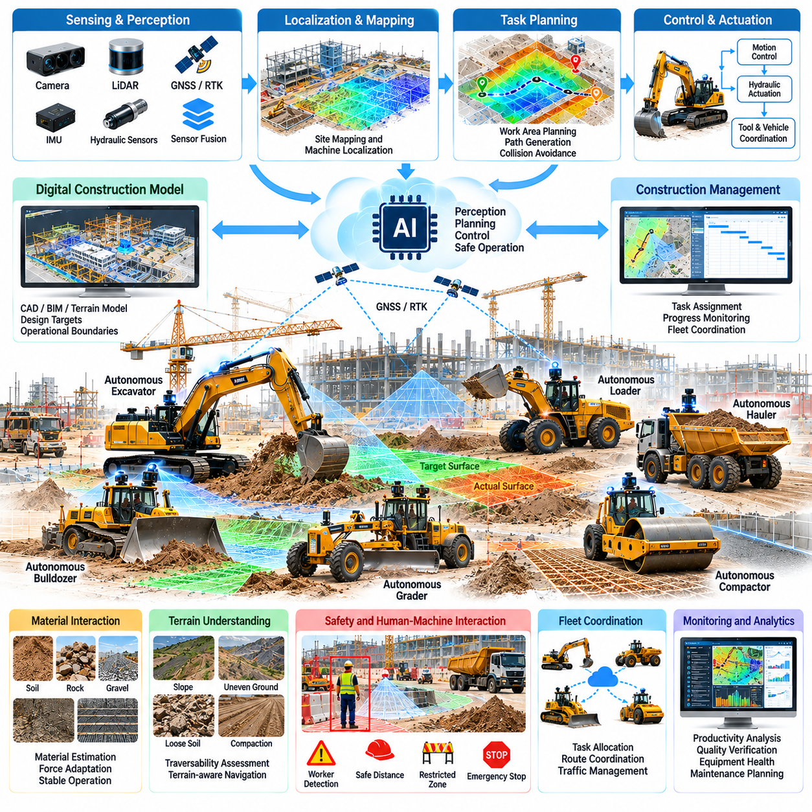{width="7.268055555555556in" height="7.268055555555556in"}

Autonomous construction equipment represents a major advancement in Physical AI, transforming conventional heavy machinery into intelligent systems capable of performing physical operations with reduced human intervention. Excavators, bulldozers, loaders, graders, and compactors can integrate perception, planning, and automated control to execute construction tasks while adapting to changing terrain, material properties, and operational conditions.

Traditional construction machinery relies on skilled operators who continuously interpret site conditions and control equipment movements. Autonomous systems transfer selected perception and decision-making functions to onboard computing platforms. This transformation requires machines to understand their surroundings, estimate operational risks, and coordinate mechanical actions while maintaining productivity, precision, and safety.

Autonomous equipment architecture combines environmental sensing, localization, task planning, motion control, and machine actuation. Cameras, LiDAR, GNSS receivers, inertial sensors, and hydraulic measurements provide information about machine position and operating conditions. Sensor fusion creates a consistent representation of the environment, enabling control algorithms to coordinate vehicle movement and construction implements.

Autonomous excavation illustrates the complexity of intelligent construction machinery because digging requires continuous interaction between equipment and deformable materials. Excavators must estimate bucket position, soil resistance, excavation geometry, and machine stability. Intelligent controllers can adjust digging trajectories and hydraulic commands according to observed conditions while respecting structural and operational constraints.

Earthmoving automation requires machines to understand terrain geometry and material distribution before modifying the environment. Bulldozers and graders can use digital terrain models to determine desired surface elevations and plan material movement. Repeated measurements allow controllers to compare actual terrain with design targets and refine operating trajectories to improve grading accuracy and reduce unnecessary rework.

Autonomous loaders combine mobility, material interaction, and transportation within a single operational cycle. A loader must approach a material pile, position its bucket, manage penetration forces, secure the load, and transport it to a designated destination. Automated loading strategies must account for material variability, vehicle traction, payload distribution, and the interaction between hydraulic forces and machine stability.

Compaction equipment provides opportunities for structured autonomy because many operations follow predefined coverage patterns and measurable surface requirements. Autonomous rollers can navigate designated paths while recording position, speed, vibration settings, and repeated passes. Integration with compaction measurement systems may support more consistent coverage, although material properties and field verification remain essential.

Machine localization is critical because construction equipment must operate relative to design coordinates, excavation boundaries, and surrounding infrastructure. GNSS and RTK positioning can provide accurate outdoor references under suitable reception conditions. LiDAR, inertial navigation, and local mapping complement satellite positioning when buildings, equipment, or terrain features obstruct signals.

Digital construction models connect autonomous machinery with engineering requirements. CAD files, terrain surfaces, and Building Information Modeling data can define target geometries, operational boundaries, and construction sequences. Autonomous equipment can compare measured site conditions with these references, allowing task execution to follow engineering specifications while identifying deviations that require correction.

Task planning for autonomous construction equipment involves translating project objectives into executable machine actions. A grading objective may require selecting work regions, planning passes, estimating material displacement, and coordinating equipment movements. Planning algorithms must consider machine capabilities, terrain conditions, operational priorities, and dependencies between construction activities.

Machine control introduces challenges because heavy equipment contains nonlinear hydraulic systems, substantial mechanical inertia, and variable external forces. Control algorithms must manage actuator delays, pressure limitations, joint dynamics, and changing loads. Model-based control and learning-assisted methods can improve performance, but safety-critical functions require predictable behavior and validated operating limits.

Physical interaction with soil, rock, and construction materials creates uncertainty that cannot be resolved through geometric planning alone. Material stiffness, friction, moisture, and compaction characteristics influence equipment behavior. Force estimation and adaptive control can help machines respond to changing resistance, while conservative operating limits reduce the likelihood of equipment overload or unstable movement.

Autonomous construction equipment must coordinate vehicle mobility with tool operation. Excavators combine upper-structure rotation, boom movement, arm articulation, and bucket control, while loaders coordinate steering, propulsion, and hydraulic lifting. Integrated motion planning is necessary to avoid mechanical conflicts, maintain stability, and execute efficient work cycles under varying payload conditions.

Safety engineering is particularly demanding because heavy construction machinery can generate large forces and operate near workers, vehicles, and partially completed structures. Autonomous systems require reliable obstacle detection, exclusion zones, emergency stopping, and operational supervision. Independent safety mechanisms should prevent hazardous actions even when perception or learning-based planning components behave unexpectedly.

Human supervision remains essential for managing exceptional conditions, approving operational changes, and responding to equipment faults. Supervisory interfaces can provide machine status, planned actions, sensor observations, and intervention controls. Remote operation may support recovery or specialized tasks, but communication delays and limited situational awareness must be considered before allowing remote control of heavy machinery.

Construction environments introduce severe reliability challenges through dust, vibration, moisture, temperature variation, and mechanical shock. Sensors and computing hardware must remain functional under these conditions, while hydraulic and mechanical systems require continuous condition monitoring. Fault detection and diagnostic systems can identify degraded performance before it develops into operational failure or unsafe behavior.

Multi-machine coordination extends autonomous construction beyond individual equipment capabilities. Excavators, loaders, haul trucks, and compactors may operate as an interconnected system in which material extraction, transportation, placement, and finishing depend on one another. Fleet orchestration can coordinate assignments and equipment availability while reducing congestion and unnecessary waiting.

Construction scheduling systems can provide operational priorities for autonomous machinery based on project progress and resource availability. Equipment-generated data can report completed work quantities, machine utilization, and operational delays. Integrating these records with project management platforms enables more accurate progress monitoring and supports adjustments when site conditions or construction priorities change.

Digital twins and simulation environments provide tools for developing and validating autonomous construction behavior. Simulated machines can practice excavation, grading, loading, and navigation under varied terrain and material conditions. However, differences between simulated and real soil behavior, hydraulic dynamics, and environmental sensing require careful validation before autonomous policies are deployed on actual equipment.

Operational data collected from construction machinery can support continuous improvement in planning, control, and maintenance. Hydraulic pressures, actuator positions, equipment trajectories, material interactions, and intervention events provide information about machine performance. Structured data pipelines allow developers to identify recurring limitations, refine predictive models, and evaluate improvements across different operating conditions.

Predictive maintenance becomes increasingly valuable as construction machinery incorporates extensive sensing and computing capabilities. Vibration, temperature, hydraulic pressure, and component operating histories can reveal emerging mechanical problems. Condition-based maintenance strategies may reduce unexpected downtime and improve equipment availability, although reliable predictions require representative operating data and validated diagnostic methods.

The economic value of autonomous construction equipment depends on utilization, productivity, labor requirements, quality improvement, and operational reliability. Automation may increase productive operating time, improve repeatability, and reduce certain forms of rework. Financial evaluation must also include equipment acquisition, retrofit costs, sensing infrastructure, software integration, supervision, maintenance, training, and operational downtime.

Deployment strategies should prioritize construction activities with clearly defined boundaries, measurable outcomes, and manageable environmental variability. Repetitive grading, controlled excavation, and structured compaction tasks may provide practical initial opportunities. Expansion into highly dynamic operations should follow demonstrated reliability, validated safety performance, and successful integration with existing site procedures.

Autonomous construction equipment ultimately connects intelligent perception and decision-making with large-scale physical transformation of the built environment. Its long-term significance extends beyond replacing manual machine control toward coordinating equipment, engineering models, operational data, and project objectives. Physical AI can thereby support construction systems that operate with greater precision, adaptability, safety, and resource efficiency.

자율 건설 장비(Autonomous Construction Equipment)는 기존 중장비를 인간의 개입을 줄이면서 물리적 작업을 수행할 수 있는 지능형 시스템(Intelligent Systems)으로 전환하는 피지컬 인공지능(Physical AI)의 중요한 기술적 발전을 의미한다. 굴착기(Excavators), 불도저(Bulldozers), 로더(Loaders), 그레이더(Graders), 다짐 장비(Compactors)는 인지(Perception), 계획(Planning), 자동 제어(Automated Control)를 통합하여 변화하는 지형, 자재 특성 및 운영 조건에 적응하면서 건설 작업을 수행할 수 있다.

전통적인 건설 기계(Traditional Construction Machinery)는 현장 조건을 지속적으로 해석하고 장비의 움직임을 제어하는 숙련된 작업자(Skilled Operators)에 의존한다. 자율 시스템(Autonomous Systems)은 일부 인지 및 의사결정 기능을 온보드 컴퓨팅 플랫폼(Onboard Computing Platforms)으로 이전한다. 이러한 전환을 위해서는 기계가 주변 환경을 이해하고 운영 위험(Operational Risks)을 추정하며 생산성(Productivity), 정밀도(Precision), 안전성(Safety)을 유지하면서 기계적 동작을 조정해야 한다.

자율 장비 아키텍처(Autonomous Equipment Architecture)는 환경 센싱(Environmental Sensing), 위치 추정(Localization), 작업 계획(Task Planning), 동작 제어(Motion Control), 기계 구동(Machine Actuation)을 결합한다. 카메라(Cameras), 라이다(LiDAR), 위성항법시스템 수신기(GNSS Receivers), 관성 센서(Inertial Sensors), 유압 측정 장치(Hydraulic Measurements)는 기계의 위치와 운영 조건에 관한 정보를 제공한다. 센서 융합(Sensor Fusion)은 일관된 환경 표현(Environmental Representation)을 생성하여 제어 알고리즘(Control Algorithms)이 차량 이동과 건설 작업 장치를 통합적으로 제어할 수 있도록 한다.

자율 굴착(Autonomous Excavation)은 굴착 작업이 장비와 변형 가능한 재료(Deformable Materials) 사이의 지속적인 상호작용을 필요로 한다는 점에서 지능형 건설 기계(Intelligent Construction Machinery)의 복잡성을 보여준다. 굴착기는 버킷 위치(Bucket Position), 토양 저항(Soil Resistance), 굴착 형상(Excavation Geometry), 기계 안정성(Machine Stability)을 추정해야 한다. 지능형 제어기(Intelligent Controllers)는 구조적 및 운영상 제약을 준수하면서 관측된 조건에 따라 굴착 궤적(Digging Trajectories)과 유압 명령(Hydraulic Commands)을 조정할 수 있다.

토공 자동화(Earthmoving Automation)를 위해서는 기계가 환경을 변경하기 전에 지형 형상(Terrain Geometry)과 자재 분포(Material Distribution)를 이해해야 한다. 불도저와 그레이더는 디지털 지형 모델(Digital Terrain Models)을 활용하여 목표 지표면 높이(Target Surface Elevations)를 결정하고 토사 이동(Material Movement)을 계획할 수 있다. 반복적인 측정(Repeated Measurements)을 통해 제어기는 실제 지형과 설계 목표(Design Targets)를 비교하고 작업 궤적(Operating Trajectories)을 개선하여 정지 정확도(Grading Accuracy)를 높이고 불필요한 재작업(Rework)을 줄일 수 있다.

자율 로더(Autonomous Loaders)는 이동성(Mobility), 자재 상호작용(Material Interaction), 운송(Transportation)을 하나의 운영 사이클(Operational Cycle)로 결합한다. 로더는 자재 더미(Material Pile)에 접근하고 버킷의 위치를 조정하며 관입력(Penetration Forces)을 관리하고 적재물을 확보한 후 지정된 목적지로 운송해야 한다. 자동 적재 전략(Automated Loading Strategies)은 자재 변동성(Material Variability), 차량 접지력(Vehicle Traction), 하중 분포(Payload Distribution), 유압력(Hydraulic Forces)과 기계 안정성 사이의 상호작용을 고려해야 한다.

다짐 장비(Compaction Equipment)는 많은 작업이 사전에 정의된 주행 패턴(Predefined Coverage Patterns)과 측정 가능한 표면 요구사항(Measurable Surface Requirements)을 따르기 때문에 구조화된 자율화(Structured Autonomy)에 적합한 기회를 제공한다. 자율 롤러(Autonomous Rollers)는 위치, 속도, 진동 설정(Vibration Settings), 반복 주행 횟수(Repeated Passes)를 기록하면서 지정된 경로를 주행할 수 있다. 다짐 측정 시스템(Compaction Measurement Systems)과의 통합은 더욱 일관된 작업 범위(Coverage)를 지원할 수 있지만 자재 특성과 현장 검증(Field Verification)은 여전히 필수적이다.

기계 위치 추정(Machine Localization)은 건설 장비가 설계 좌표(Design Coordinates), 굴착 경계(Excavation Boundaries), 주변 인프라를 기준으로 작업해야 하므로 매우 중요하다. 위성항법시스템(GNSS)과 실시간 이동측위(Real-Time Kinematic, RTK)는 수신 조건이 적절한 실외 환경에서 정확한 위치 기준(Accurate Outdoor References)을 제공할 수 있다. 라이다, 관성 항법(Inertial Navigation), 국소 지도 작성(Local Mapping)은 건물, 장비 또는 지형 요소가 위성 신호를 차단할 때 위성 기반 위치 결정을 보완한다.

디지털 건설 모델(Digital Construction Models)은 자율 건설 기계(Autonomous Machinery)를 엔지니어링 요구사항(Engineering Requirements)과 연결한다. 컴퓨터 지원 설계(Computer-Aided Design, CAD) 파일, 지형 표면(Terrain Surfaces), 건축정보모델링(Building Information Modeling, BIM) 데이터는 목표 형상(Target Geometries), 운영 경계(Operational Boundaries), 건설 작업 순서(Construction Sequences)를 정의할 수 있다. 자율 장비는 측정된 현장 조건을 이러한 기준과 비교하여 엔지니어링 사양(Engineering Specifications)에 따라 작업을 수행하고 수정이 필요한 편차(Deviations)를 식별할 수 있다.

자율 건설 장비의 작업 계획(Task Planning)은 프로젝트 목표(Project Objectives)를 실행 가능한 기계 동작(Executable Machine Actions)으로 변환하는 과정을 포함한다. 정지 작업(Grading Objective)은 작업 구역 선택(Work Region Selection), 주행 경로 계획(Pass Planning), 자재 이동량 추정(Material Displacement Estimation), 장비 동작 조정(Equipment Movement Coordination)을 필요로 할 수 있다. 계획 알고리즘(Planning Algorithms)은 기계 성능(Machine Capabilities), 지형 조건(Terrain Conditions), 운영 우선순위(Operational Priorities), 건설 작업 사이의 의존관계(Dependencies)를 고려해야 한다.

기계 제어(Machine Control)는 중장비가 비선형 유압 시스템(Nonlinear Hydraulic Systems), 상당한 기계적 관성(Mechanical Inertia), 가변적인 외력(Variable External Forces)을 포함하기 때문에 어려움을 발생시킨다. 제어 알고리즘은 액추에이터 지연(Actuator Delays), 압력 제한(Pressure Limitations), 관절 동역학(Joint Dynamics), 변화하는 하중(Changing Loads)을 관리해야 한다. 모델 기반 제어(Model-Based Control)와 학습 보조 기법(Learning-Assisted Methods)은 성능을 개선할 수 있지만 안전 필수 기능(Safety-Critical Functions)은 예측 가능한 동작과 검증된 운영 한계(Validated Operating Limits)를 필요로 한다.

토양, 암석 및 건설 자재와의 물리적 상호작용(Physical Interaction)은 기하학적 계획(Geometric Planning)만으로 해결할 수 없는 불확실성을 발생시킨다. 자재 강성(Material Stiffness), 마찰(Friction), 수분(Moisture), 다짐 특성(Compaction Characteristics)은 장비 동작에 영향을 미친다. 힘 추정(Force Estimation)과 적응형 제어(Adaptive Control)는 기계가 변화하는 저항에 대응하도록 지원하며, 보수적인 운영 한계(Conservative Operating Limits)는 장비 과부하(Equipment Overload)나 불안정한 움직임의 가능성을 줄인다.

자율 건설 장비는 차량 이동성(Vehicle Mobility)과 작업 도구 작동(Tool Operation)을 조정해야 한다. 굴착기는 상부 구조물 회전(Upper-Structure Rotation), 붐 이동(Boom Movement), 암 관절 동작(Arm Articulation), 버킷 제어(Bucket Control)를 결합하며, 로더는 조향(Steering), 추진(Propulsion), 유압 리프팅(Hydraulic Lifting)을 조정한다. 통합 동작 계획(Integrated Motion Planning)은 기계적 충돌(Mechanical Conflicts)을 방지하고 안정성을 유지하며 다양한 적재 조건에서 효율적인 작업 사이클(Work Cycles)을 수행하기 위해 필요하다.

안전 공학(Safety Engineering)은 중장비가 큰 힘을 발생시키고 작업자, 차량 및 부분적으로 완공된 구조물 근처에서 운영될 수 있기 때문에 특히 까다롭다. 자율 시스템은 신뢰성 있는 장애물 감지(Obstacle Detection), 출입 제한 구역(Exclusion Zones), 비상 정지(Emergency Stopping), 운영 감독(Operational Supervision)을 필요로 한다. 독립적인 안전 메커니즘(Independent Safety Mechanisms)은 인지 또는 학습 기반 계획 구성요소가 예상하지 못한 방식으로 작동하더라도 위험한 동작을 방지해야 한다.

인간 감독(Human Supervision)은 예외적인 상황(Exceptional Conditions)을 관리하고 운영 변경(Operational Changes)을 승인하며 장비 고장(Equipment Faults)에 대응하기 위해 여전히 필수적이다. 감독 인터페이스(Supervisory Interfaces)는 기계 상태(Machine Status), 계획된 동작(Planned Actions), 센서 관측 정보(Sensor Observations), 개입 제어 기능(Intervention Controls)을 제공할 수 있다. 원격 조작(Remote Operation)은 복구 작업이나 특수 작업을 지원할 수 있지만 중장비의 원격 제어를 허용하기 전에 통신 지연(Communication Delays)과 제한된 상황 인식(Limited Situational Awareness)을 고려해야 한다.

건설 환경은 먼지, 진동, 습기, 온도 변화 및 기계적 충격(Mechanical Shock)으로 인해 심각한 신뢰성 문제(Reliability Challenges)를 발생시킨다. 센서와 컴퓨팅 하드웨어(Computing Hardware)는 이러한 조건에서도 정상적으로 작동해야 하며, 유압 및 기계 시스템(Hydraulic and Mechanical Systems)은 지속적인 상태 모니터링(Condition Monitoring)을 필요로 한다. 고장 감지(Fault Detection)와 진단 시스템(Diagnostic Systems)은 성능 저하가 운영 실패(Operational Failure)나 위험한 동작으로 발전하기 전에 이를 식별할 수 있다.

다중 기계 협력(Multi-Machine Coordination)은 자율 건설의 범위를 개별 장비의 기능을 넘어 확장한다. 굴착기, 로더, 운반 트럭(Haul Trucks), 다짐 장비는 자재 굴착(Material Extraction), 운송(Transportation), 배치(Placement), 마감(Finishing)이 서로 의존하는 상호 연결된 시스템(Interconnected System)으로 운영될 수 있다. 군집 운영(Fleet Orchestration)은 작업 할당과 장비 가용성(Equipment Availability)을 조정하면서 혼잡(Congestion)과 불필요한 대기시간(Unnecessary Waiting)을 줄일 수 있다.

건설 일정 관리 시스템(Construction Scheduling Systems)은 프로젝트 진행 상황(Project Progress)과 자원 가용성(Resource Availability)을 기반으로 자율 기계에 운영 우선순위(Operational Priorities)를 제공할 수 있다. 장비가 생성한 데이터(Equipment-Generated Data)는 완료된 작업량(Completed Work Quantities), 기계 활용률(Machine Utilization), 운영 지연(Operational Delays)을 보고할 수 있다. 이러한 기록을 프로젝트 관리 플랫폼(Project Management Platforms)과 통합하면 더욱 정확한 진행 상황 모니터링(Progress Monitoring)이 가능하며 현장 조건이나 건설 우선순위가 변경될 때 조정을 지원할 수 있다.

디지털 트윈(Digital Twins)과 시뮬레이션 환경(Simulation Environments)은 자율 건설 동작(Autonomous Construction Behavior)을 개발하고 검증하기 위한 도구를 제공한다. 시뮬레이션된 기계(Simulated Machines)는 다양한 지형과 자재 조건에서 굴착, 정지, 적재 및 주행을 연습할 수 있다. 그러나 시뮬레이션과 실제 환경 사이의 토양 거동(Soil Behavior), 유압 동역학(Hydraulic Dynamics), 환경 센싱(Environmental Sensing) 차이로 인해 자율 정책(Autonomous Policies)을 실제 장비에 배치하기 전에 신중한 검증이 필요하다.

건설 기계에서 수집된 운영 데이터(Operational Data)는 계획, 제어 및 유지보수의 지속적인 개선을 지원할 수 있다. 유압 압력(Hydraulic Pressures), 액추에이터 위치(Actuator Positions), 장비 이동 궤적(Equipment Trajectories), 자재 상호작용(Material Interactions), 개입 사건(Intervention Events)은 기계 성능에 관한 정보를 제공한다. 구조화된 데이터 파이프라인(Structured Data Pipelines)은 개발자가 반복적으로 발생하는 한계를 식별하고 예측 모델(Predictive Models)을 개선하며 서로 다른 운영 조건에서 개선 효과를 평가할 수 있도록 한다.

예지보전(Predictive Maintenance)은 건설 기계에 광범위한 센싱 및 컴퓨팅 기능이 통합됨에 따라 더욱 중요해진다. 진동(Vibration), 온도(Temperature), 유압 압력(Hydraulic Pressure), 부품 운영 이력(Component Operating Histories)은 초기 기계적 문제(Emerging Mechanical Problems)를 나타낼 수 있다. 상태 기반 유지보수 전략(Condition-Based Maintenance Strategies)은 예상하지 못한 가동 중단(Unplanned Downtime)을 줄이고 장비 가용성(Equipment Availability)을 개선할 수 있지만, 신뢰성 있는 예측을 위해서는 대표성 있는 운영 데이터(Representative Operating Data)와 검증된 진단 방법(Validated Diagnostic Methods)이 필요하다.

자율 건설 장비의 경제적 가치(Economic Value)는 활용률(Utilization), 생산성(Productivity), 노동 요구량(Labor Requirements), 품질 개선(Quality Improvement), 운영 신뢰성(Operational Reliability)에 따라 결정된다. 자동화는 생산적인 작업시간(Productive Operating Time)을 늘리고 반복 정확도(Repeatability)를 개선하며 일부 재작업(Rework)을 줄일 수 있다. 재무적 평가(Financial Evaluation)에는 장비 도입 비용(Equipment Acquisition), 개조 비용(Retrofit Costs), 센싱 인프라(Sensing Infrastructure), 소프트웨어 통합(Software Integration), 감독(Supervision), 유지보수(Maintenance), 교육(Training), 운영 중단 시간(Operational Downtime)을 포함해야 한다.

배치 전략(Deployment Strategies)은 명확하게 정의된 작업 경계(Clearly Defined Boundaries), 측정 가능한 결과(Measurable Outcomes), 관리 가능한 환경 변동성(Manageable Environmental Variability)을 가진 건설 활동을 우선해야 한다. 반복적인 정지 작업(Repetitive Grading), 통제된 굴착(Controlled Excavation), 구조화된 다짐 작업(Structured Compaction Tasks)은 실용적인 초기 적용 기회를 제공할 수 있다. 매우 역동적인 작업으로의 확장은 입증된 신뢰성(Demonstrated Reliability), 검증된 안전 성능(Validated Safety Performance), 기존 현장 절차(Existing Site Procedures)와의 성공적인 통합을 기반으로 진행해야 한다.

궁극적으로 자율 건설 장비(Autonomous Construction Equipment)는 지능형 인지(Intelligent Perception)와 의사결정(Decision-Making)을 건설 환경(Built Environment)의 대규모 물리적 변형(Large-Scale Physical Transformation)과 연결한다. 장기적인 중요성은 수동 기계 제어(Manual Machine Control)를 대체하는 수준을 넘어 장비, 엔지니어링 모델(Engineering Models), 운영 데이터(Operational Data), 프로젝트 목표(Project Objectives)를 통합적으로 조정하는 데 있다. 이를 통해 피지컬 인공지능은 더욱 높은 정밀도(Precision), 적응성(Adaptability), 안전성(Safety), 자원 효율성(Resource Efficiency)을 갖춘 건설 시스템(Construction Systems)을 지원할 수 있다.

##  

## 06.05. Surveying Mapping and Digital Twin Capture

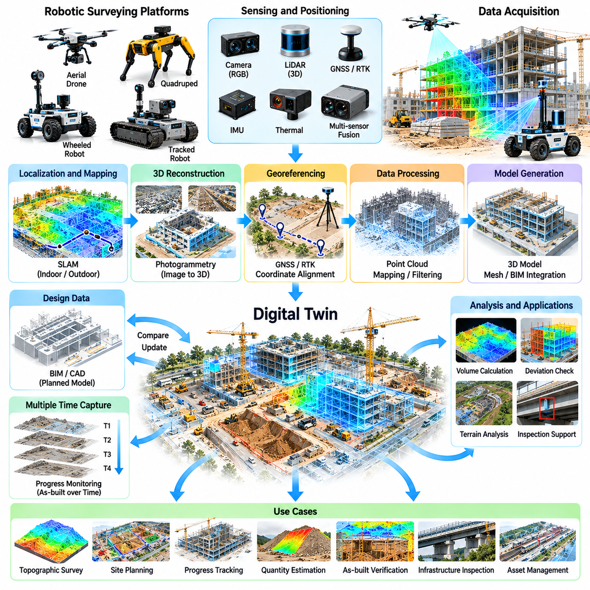{width="7.268055555555556in" height="7.268055555555556in"}

Surveying, mapping, and digital twin capture represent foundational applications of Physical AI in construction and infrastructure management. These technologies transform physical environments into measurable digital representations that support planning, execution, inspection, and maintenance. Autonomous robotic platforms can collect spatial information repeatedly, reducing manual surveying effort while improving the frequency and consistency of site observations.

Traditional construction surveying relies on specialized instruments and skilled personnel to establish coordinates, measure terrain, and verify structural geometry. Physical AI extends these capabilities through autonomous mobility, intelligent sensing, and automated data processing. Robotic systems can navigate designated areas, acquire measurements, and update digital site records while adapting to changing environmental conditions.

Autonomous surveying systems combine mobile platforms with LiDAR, cameras, GNSS receivers, inertial sensors, and other measurement instruments. Each sensor provides complementary information about geometry, appearance, and spatial position. Sensor fusion enables robots to generate coordinated observations while compensating for individual sensor limitations, supporting reliable mapping across complex construction environments.

LiDAR-based mapping provides three-dimensional measurements of terrain, structures, equipment, and surrounding objects. Laser returns generate point clouds that represent visible surfaces and geometric features. These datasets support terrain reconstruction, dimensional analysis, and structural inspection. Measurement accuracy depends on sensor calibration, positioning quality, scanning geometry, and environmental conditions.

Photogrammetry reconstructs spatial information from overlapping images captured by ground robots or aerial platforms. Image processing algorithms identify corresponding features and estimate camera positions to generate three-dimensional models. Photogrammetric outputs can provide detailed visual textures alongside geometric information, although reconstruction quality depends on illumination, image overlap, surface characteristics, and camera calibration.

Simultaneous Localization and Mapping enables robotic surveying when reliable external positioning is unavailable. SLAM algorithms estimate robot motion while constructing maps from sensor observations. Construction environments complicate this process because temporary structures, moving equipment, and changing material stockpiles can alter the scene. Robust systems must distinguish persistent landmarks from transient environmental features.

Outdoor surveying frequently uses GNSS and Real-Time Kinematic positioning to establish geographically referenced measurements. RTK corrections can improve positioning accuracy when satellite reception and correction availability are sufficient. However, urban canyons, tunnels, steel structures, and partially enclosed buildings may degrade performance. Hybrid localization combines satellite positioning with LiDAR, inertial sensing, and local mapping.

Coordinate system management is essential for integrating robotic measurements with engineering designs. Survey data may originate in local robot frames, site coordinate systems, or geographic references. Accurate transformation between these representations requires calibration, control points, and consistent reference definitions. Errors in coordinate alignment can propagate into construction verification, quantity estimation, and digital twin updates.

Autonomous aerial surveying provides efficient coverage of large construction sites and infrastructure corridors. Unmanned aerial vehicles can capture overhead imagery, terrain geometry, and structural observations from locations difficult to access from the ground. Flight planning must consider required resolution, image overlap, environmental conditions, obstacles, and regulatory restrictions while maintaining safe operational boundaries.

Ground-based mobile mapping complements aerial surveying by capturing surfaces and structural details that overhead sensors cannot observe effectively. Wheeled robots, tracked platforms, and quadrupeds can collect measurements along roads, inside buildings, and through accessible infrastructure passages. Platform selection depends on terrain conditions, sensor payload, measurement stability, and the accessibility of target inspection locations.

Digital twin capture extends conventional mapping by connecting measured geometry with structured information about physical assets. A digital twin may combine three-dimensional models, asset identifiers, construction status, inspection observations, and operational measurements. Its usefulness depends on maintaining correspondence between the physical environment and digital representation rather than simply generating visually detailed models.

Building Information Modeling provides a structured reference for interpreting robot-generated spatial measurements. BIM models describe planned geometry, component relationships, and construction information. Registered point clouds and reconstructed surfaces can be compared with these references to identify geometric deviations, missing components, and potential installation discrepancies. Reliable comparison requires consistent coordinates and suitable measurement tolerances.

Construction progress monitoring benefits from repeated surveying at defined intervals. Comparing successive scans allows project teams to observe changes in terrain, structural completion, and material placement. Automated change detection can highlight regions where physical conditions differ from previous observations or planned construction stages. Interpretation must distinguish actual progress from temporary equipment and measurement artifacts.

Earthwork measurement represents an important commercial application of robotic mapping. Three-dimensional terrain models can support calculations of excavation volumes, fill quantities, and surface elevation differences. Repeated surveys provide evidence of material movement and construction progress. Accuracy depends on terrain coverage, reference surfaces, point-cloud quality, and appropriate treatment of inaccessible or occluded regions.

Infrastructure inspection uses digital capture to establish geometric and visual records of bridges, tunnels, roads, and industrial facilities. Repeated measurements can support comparisons of surface conditions and structural geometry over time. However, geometric change alone does not establish structural integrity. Engineering assessment may require additional measurements, material testing, and interpretation by qualified specialists.

Data registration is necessary when combining observations from multiple robots, sensors, or surveying sessions. Point-cloud alignment and image registration techniques estimate transformations between overlapping datasets. Registration quality depends on stable reference features, sufficient overlap, and reliable calibration. Automated validation should identify uncertain alignments before the resulting data are incorporated into engineering records.

Digital twin updating requires more than transferring raw sensor measurements into storage systems. Processing pipelines must filter noise, classify relevant objects, reconstruct surfaces, and associate observations with existing assets. Semantic information allows users to distinguish structural components, temporary equipment, terrain, and construction materials. This transformation converts geometric data into operationally meaningful information.

Artificial intelligence can improve mapping workflows through object recognition, semantic segmentation, anomaly detection, and automated feature extraction. Learning-based models may identify construction elements or prioritize regions requiring further inspection. Nevertheless, their outputs must be evaluated for uncertainty and potential classification errors, particularly when used for engineering verification or safety-related decisions.

Cloud, edge, and on-premise computing architectures support different stages of digital twin capture. Edge systems can perform immediate sensor processing and navigation, while centralized computing resources handle large-scale reconstruction and historical comparison. Network limitations and data volumes influence where processing occurs. Efficient architectures balance latency, storage cost, computational demand, and data security.

Data governance is essential because construction scans may contain proprietary designs, worker imagery, equipment information, and sensitive infrastructure details. Access controls, encryption, retention policies, and traceable data ownership help protect these records. Version management and provenance tracking also ensure that engineering teams can identify when measurements were collected and which processing methods produced each model.

Survey quality assurance requires systematic evaluation of accuracy, completeness, repeatability, and consistency. Reference control points, calibration procedures, coverage analysis, and independent measurements can reveal systematic errors. Automated quality indicators should accompany generated maps so users understand measurement limitations. Critical engineering decisions must rely on validated data rather than visual appearance alone.

The economic value of autonomous surveying depends on measurement frequency, site size, labor requirements, and the importance of timely information. Repeated robotic capture may reduce fieldwork effort and accelerate progress reporting. Financial evaluation should include equipment acquisition, sensor calibration, processing infrastructure, software integration, supervision, and data management alongside potential productivity improvements.

Deployment should begin with clearly defined surveying objectives and measurable acceptance criteria. Initial applications may include terrain mapping, progress documentation, and repetitive inspection capture. More advanced digital twin workflows can be introduced after demonstrating reliable localization, coordinate alignment, measurement accuracy, and integration with engineering information systems.

Surveying, mapping, and digital twin capture ultimately establish the information foundation for intelligent construction operations. By connecting autonomous sensing, spatial reconstruction, engineering models, and continuous data updates, Physical AI enables construction organizations to maintain more accurate representations of changing physical environments. These capabilities support better coordination, verification, maintenance planning, and evidence-based project decisions.

측량(Surveying), 지도 작성(Mapping), 디지털 트윈 캡처(Digital Twin Capture)는 건설 및 인프라 관리(Construction and Infrastructure Management) 분야에서 피지컬 인공지능(Physical AI)의 핵심적인 응용 분야를 구성한다. 이러한 기술은 물리적 환경(Physical Environments)을 측정 가능한 디지털 표현(Digital Representations)으로 변환하여 계획, 시공, 검사 및 유지보수를 지원한다. 자율 로봇 플랫폼(Autonomous Robotic Platforms)은 공간 정보(Spatial Information)를 반복적으로 수집하여 수동 측량 작업을 줄이는 동시에 현장 관측(Site Observations)의 빈도와 일관성을 향상시킬 수 있다.

전통적인 건설 측량(Traditional Construction Surveying)은 좌표를 설정하고 지형을 측정하며 구조물의 형상을 검증하기 위해 전문 측정 장비(Specialized Instruments)와 숙련된 인력(Skilled Personnel)에 의존한다. 피지컬 인공지능은 자율 이동(Autonomous Mobility), 지능형 센싱(Intelligent Sensing), 자동화된 데이터 처리(Automated Data Processing)를 통해 이러한 기능을 확장한다. 로봇 시스템(Robotic Systems)은 변화하는 환경 조건에 적응하면서 지정된 구역을 주행하고 측정 데이터를 획득하며 디지털 현장 기록(Digital Site Records)을 갱신할 수 있다.

자율 측량 시스템(Autonomous Surveying Systems)은 이동형 플랫폼(Mobile Platforms)에 라이다(LiDAR), 카메라(Cameras), 위성항법시스템 수신기(GNSS Receivers), 관성 센서(Inertial Sensors) 및 기타 측정 장비(Measurement Instruments)를 결합한다. 각 센서는 형상(Geometry), 외관(Appearance), 공간적 위치(Spatial Position)에 관한 상호 보완적인 정보를 제공한다. 센서 융합(Sensor Fusion)은 개별 센서의 한계를 보완하면서 로봇이 좌표계가 일치하는 관측 데이터(Coordinated Observations)를 생성하도록 하여 복잡한 건설 환경에서 신뢰성 있는 지도 작성을 지원한다.

라이다 기반 지도 작성(LiDAR-Based Mapping)은 지형, 구조물, 장비 및 주변 물체에 대한 3차원 측정(Three-Dimensional Measurements)을 제공한다. 레이저 반사 신호(Laser Returns)는 관측 가능한 표면과 기하학적 특징(Geometric Features)을 표현하는 포인트 클라우드(Point Clouds)를 생성한다. 이러한 데이터셋(Datasets)은 지형 재구성(Terrain Reconstruction), 치수 분석(Dimensional Analysis), 구조물 검사(Structural Inspection)를 지원한다. 측정 정확도(Measurement Accuracy)는 센서 보정(Sensor Calibration), 위치 결정 품질(Positioning Quality), 스캐닝 기하구조(Scanning Geometry), 환경 조건(Environmental Conditions)에 따라 달라진다.

사진측량(Photogrammetry)은 지상 로봇(Ground Robots)이나 항공 플랫폼(Aerial Platforms)이 촬영한 중첩 이미지(Overlapping Images)로부터 공간 정보를 재구성한다. 영상 처리 알고리즘(Image Processing Algorithms)은 대응되는 특징점(Corresponding Features)을 식별하고 카메라 위치(Camera Positions)를 추정하여 3차원 모델(Three-Dimensional Models)을 생성한다. 사진측량 결과물(Photogrammetric Outputs)은 기하학적 정보와 함께 상세한 시각적 텍스처(Visual Textures)를 제공할 수 있지만, 재구성 품질(Reconstruction Quality)은 조명(Illumination), 이미지 중첩률(Image Overlap), 표면 특성(Surface Characteristics), 카메라 보정(Camera Calibration)에 따라 달라진다.

동시적 위치 추정 및 지도 작성(Simultaneous Localization and Mapping, SLAM)은 신뢰성 있는 외부 위치 결정(External Positioning)을 사용할 수 없는 환경에서 로봇 측량(Robotic Surveying)을 가능하게 한다. SLAM 알고리즘(SLAM Algorithms)은 센서 관측 정보를 이용하여 지도를 생성하면서 로봇의 움직임을 추정한다. 건설 환경에서는 임시 구조물(Temporary Structures), 이동 장비(Moving Equipment), 변화하는 자재 적치물(Material Stockpiles)이 주변 환경을 변화시키기 때문에 이러한 과정이 복잡해진다. 강건한 시스템(Robust Systems)은 지속적으로 유지되는 랜드마크(Persistent Landmarks)와 일시적인 환경 특징(Transient Environmental Features)을 구별해야 한다.

실외 측량(Outdoor Surveying)에서는 지리적으로 참조된 측정값(Geographically Referenced Measurements)을 확보하기 위해 위성항법시스템(Global Navigation Satellite System, GNSS)과 실시간 이동측위(Real-Time Kinematic, RTK)를 자주 활용한다. 위성 수신 상태와 보정 정보(Correction Data)의 가용성이 충분하면 RTK 보정(RTK Corrections)을 통해 위치 결정 정확도(Positioning Accuracy)를 향상시킬 수 있다. 그러나 도심 협곡(Urban Canyons), 터널(Tunnels), 철골 구조물(Steel Structures), 부분적으로 폐쇄된 건물은 성능을 저하시킬 수 있다. 하이브리드 위치 추정(Hybrid Localization)은 위성 위치 결정에 라이다, 관성 센싱(Inertial Sensing), 국소 지도 작성(Local Mapping)을 결합한다.

좌표계 관리(Coordinate System Management)는 로봇 측정 데이터를 엔지니어링 설계(Engineering Designs)와 통합하기 위해 필수적이다. 측량 데이터(Survey Data)는 로봇의 국소 좌표계(Local Robot Frames), 현장 좌표계(Site Coordinate Systems), 지리 좌표 기준(Geographic References)에서 생성될 수 있다. 이러한 표현 사이의 정확한 좌표 변환(Coordinate Transformation)을 위해서는 보정(Calibration), 기준점(Control Points), 일관된 기준 정의(Consistent Reference Definitions)가 필요하다. 좌표 정렬 오류(Coordinate Alignment Errors)는 시공 검증(Construction Verification), 물량 산정(Quantity Estimation), 디지털 트윈 갱신(Digital Twin Updates)에 연쇄적인 영향을 미칠 수 있다.

자율 항공 측량(Autonomous Aerial Surveying)은 대규모 건설 현장과 인프라 회랑(Infrastructure Corridors)을 효율적으로 조사할 수 있도록 한다. 무인항공기(Unmanned Aerial Vehicles, UAV)는 지상에서 접근하기 어려운 위치의 상공 영상(Overhead Imagery), 지형 형상(Terrain Geometry), 구조물 관측 정보(Structural Observations)를 수집할 수 있다. 비행 계획(Flight Planning)은 안전한 운영 경계(Safe Operational Boundaries)를 유지하면서 요구 해상도(Required Resolution), 이미지 중첩률(Image Overlap), 환경 조건, 장애물 및 규제 제한(Regulatory Restrictions)을 고려해야 한다.

지상 기반 이동형 지도 작성(Ground-Based Mobile Mapping)은 상공 센서(Overhead Sensors)가 효과적으로 관측하기 어려운 표면과 구조물의 세부 정보를 수집함으로써 항공 측량을 보완한다. 바퀴형 로봇(Wheeled Robots), 궤도형 플랫폼(Tracked Platforms), 사족보행 로봇(Quadrupeds)은 도로, 건물 내부 및 접근 가능한 인프라 통로(Infrastructure Passages)를 따라 측정 데이터를 수집할 수 있다. 플랫폼 선택(Platform Selection)은 지형 조건, 센서 탑재하중(Sensor Payload), 측정 안정성(Measurement Stability), 목표 검사 위치(Target Inspection Locations)의 접근성에 따라 결정된다.

디지털 트윈 캡처(Digital Twin Capture)는 측정된 형상을 물리적 자산(Physical Assets)에 관한 구조화된 정보(Structured Information)와 연결함으로써 기존 지도 작성의 범위를 확장한다. 디지털 트윈(Digital Twin)은 3차원 모델(Three-Dimensional Models), 자산 식별자(Asset Identifiers), 시공 상태(Construction Status), 검사 관측 정보(Inspection Observations), 운영 측정값(Operational Measurements)을 결합할 수 있다. 디지털 트윈의 유용성은 시각적으로 정교한 모델을 생성하는 것뿐만 아니라 물리적 환경과 디지털 표현 사이의 대응 관계(Correspondence)를 유지하는 데 달려 있다.

건축정보모델링(Building Information Modeling, BIM)은 로봇이 생성한 공간 측정값(Spatial Measurements)을 해석하기 위한 구조화된 기준(Structured Reference)을 제공한다. BIM 모델(BIM Models)은 계획된 형상(Planned Geometry), 구성요소 간 관계(Component Relationships), 시공 정보(Construction Information)를 설명한다. 정합된 포인트 클라우드(Registered Point Clouds)와 재구성된 표면(Reconstructed Surfaces)을 이러한 기준과 비교하면 기하학적 편차(Geometric Deviations), 누락된 구성요소(Missing Components), 잠재적인 설치 불일치(Installation Discrepancies)를 식별할 수 있다. 신뢰성 있는 비교를 위해서는 일관된 좌표와 적절한 측정 허용오차(Measurement Tolerances)가 필요하다.

건설 진행 상황 모니터링(Construction Progress Monitoring)은 정해진 간격으로 반복되는 측량을 통해 효과를 얻을 수 있다. 연속적으로 수집된 스캔(Successive Scans)을 비교하면 프로젝트 팀(Project Teams)은 지형 변화(Terrain Changes), 구조물 완성 상태(Structural Completion), 자재 배치(Material Placement)를 관찰할 수 있다. 자동 변화 감지(Automated Change Detection)는 물리적 상태가 이전 관측 결과나 계획된 시공 단계(Planned Construction Stages)와 다른 영역을 강조할 수 있다. 이러한 결과를 해석할 때는 실제 공사 진행과 임시 장비 및 측정 인공물(Measurement Artifacts)을 구별해야 한다.

토공 물량 측정(Earthwork Measurement)은 로봇 지도 작성(Robotic Mapping)의 중요한 상업적 응용 분야이다. 3차원 지형 모델(Three-Dimensional Terrain Models)은 굴착량(Excavation Volumes), 성토량(Fill Quantities), 지표면 높이 차이(Surface Elevation Differences)의 계산을 지원할 수 있다. 반복 측량(Repeated Surveys)은 자재 이동(Material Movement)과 건설 진행 상황(Construction Progress)에 대한 근거를 제공한다. 정확도는 지형 관측 범위(Terrain Coverage), 기준 표면(Reference Surfaces), 포인트 클라우드 품질(Point-Cloud Quality), 접근이 불가능하거나 가려진 영역(Occluded Regions)에 대한 적절한 처리에 따라 달라진다.

인프라 검사(Infrastructure Inspection)는 디지털 캡처(Digital Capture)를 활용하여 교량(Bridges), 터널(Tunnels), 도로(Roads), 산업 시설(Industrial Facilities)의 기하학적 기록(Geometric Records)과 시각적 기록(Visual Records)을 구축한다. 반복 측정(Repeated Measurements)은 시간 경과에 따른 표면 상태(Surface Conditions)와 구조물 형상(Structural Geometry)의 비교를 지원할 수 있다. 그러나 기하학적 변화만으로 구조적 건전성(Structural Integrity)을 판단할 수는 없다. 엔지니어링 평가(Engineering Assessment)에는 추가 측정, 재료 시험(Material Testing), 자격을 갖춘 전문가(Qualified Specialists)의 해석이 필요할 수 있다.

데이터 정합(Data Registration)은 여러 로봇, 센서 또는 측량 세션(Surveying Sessions)에서 수집된 관측 정보를 결합할 때 필요하다. 포인트 클라우드 정렬(Point-Cloud Alignment)과 이미지 정합(Image Registration) 기술은 중첩된 데이터셋 사이의 변환 관계(Transformations)를 추정한다. 정합 품질(Registration Quality)은 안정적인 기준 특징(Stable Reference Features), 충분한 중첩(Sufficient Overlap), 신뢰성 있는 보정(Reliable Calibration)에 따라 달라진다. 자동 검증(Automated Validation)은 결과 데이터가 엔지니어링 기록(Engineering Records)에 통합되기 전에 불확실한 정렬(Uncertain Alignments)을 식별해야 한다.

디지털 트윈 갱신(Digital Twin Updating)은 단순히 원시 센서 측정값(Raw Sensor Measurements)을 저장 시스템(Storage Systems)으로 전송하는 것 이상의 과정을 필요로 한다. 처리 파이프라인(Processing Pipelines)은 잡음 제거(Noise Filtering), 관련 객체 분류(Object Classification), 표면 재구성(Surface Reconstruction), 관측 정보와 기존 자산의 연계(Asset Association)를 수행해야 한다. 의미 정보(Semantic Information)를 활용하면 사용자는 구조물 구성요소(Structural Components), 임시 장비(Temporary Equipment), 지형(Terrain), 건설 자재(Construction Materials)를 구별할 수 있다. 이러한 변환은 기하학적 데이터(Geometric Data)를 운영상 의미 있는 정보(Operationally Meaningful Information)로 전환한다.

인공지능(Artificial Intelligence, AI)은 객체 인식(Object Recognition), 의미론적 분할(Semantic Segmentation), 이상 탐지(Anomaly Detection), 자동 특징 추출(Automated Feature Extraction)을 통해 지도 작성 작업 흐름(Mapping Workflows)을 개선할 수 있다. 학습 기반 모델(Learning-Based Models)은 건설 구성요소(Construction Elements)를 식별하거나 추가 검사가 필요한 영역의 우선순위를 지정할 수 있다. 그러나 특히 엔지니어링 검증(Engineering Verification)이나 안전 관련 의사결정(Safety-Related Decisions)에 활용되는 경우에는 출력 결과의 불확실성(Uncertainty)과 잠재적인 분류 오류(Classification Errors)를 평가해야 한다.

클라우드(Cloud), 엣지(Edge), 온프레미스(On-Premise) 컴퓨팅 아키텍처(Computing Architectures)는 디지털 트윈 캡처의 서로 다른 처리 단계를 지원한다. 엣지 시스템(Edge Systems)은 즉각적인 센서 처리(Sensor Processing)와 자율주행(Navigation)을 수행할 수 있으며, 중앙집중형 컴퓨팅 자원(Centralized Computing Resources)은 대규모 재구성(Large-Scale Reconstruction)과 과거 데이터 비교(Historical Comparison)를 처리한다. 네트워크 제약(Network Limitations)과 데이터 용량(Data Volumes)은 처리 위치에 영향을 미친다. 효율적인 아키텍처(Efficient Architectures)는 지연시간(Latency), 저장 비용(Storage Cost), 계산 요구량(Computational Demand), 데이터 보안(Data Security) 사이의 균형을 유지해야 한다.

데이터 거버넌스(Data Governance)는 건설 스캔(Construction Scans)에 독점 설계 정보(Proprietary Designs), 작업자 영상(Worker Imagery), 장비 정보(Equipment Information), 민감한 인프라 세부 정보(Sensitive Infrastructure Details)가 포함될 수 있기 때문에 필수적이다. 접근 제어(Access Controls), 암호화(Encryption), 보존 정책(Retention Policies), 추적 가능한 데이터 소유권(Traceable Data Ownership)은 이러한 기록을 보호하는 데 도움이 된다. 버전 관리(Version Management)와 데이터 출처 추적(Provenance Tracking)은 엔지니어링 팀이 측정 시점과 각 모델을 생성한 처리 방법(Processing Methods)을 식별할 수 있도록 보장한다.

측량 품질 보증(Survey Quality Assurance)은 정확도(Accuracy), 완전성(Completeness), 반복성(Repeatability), 일관성(Consistency)에 대한 체계적인 평가를 필요로 한다. 기준점(Reference Control Points), 보정 절차(Calibration Procedures), 관측 범위 분석(Coverage Analysis), 독립적인 측정(Independent Measurements)은 체계적 오류(Systematic Errors)를 발견하는 데 도움이 된다. 생성된 지도에는 자동 품질 지표(Automated Quality Indicators)가 함께 제공되어 사용자가 측정의 한계(Measurement Limitations)를 이해할 수 있어야 한다. 중요한 엔지니어링 의사결정(Critical Engineering Decisions)은 시각적 외관만이 아니라 검증된 데이터(Validated Data)를 기반으로 이루어져야 한다.

자율 측량(Autonomous Surveying)의 경제적 가치(Economic Value)는 측정 빈도(Measurement Frequency), 현장 규모(Site Size), 노동 요구량(Labor Requirements), 적시 정보(Timely Information)의 중요성에 따라 결정된다. 반복적인 로봇 기반 데이터 수집(Robotic Capture)은 현장 작업(Fieldwork)에 필요한 노력을 줄이고 진행 상황 보고(Progress Reporting)를 가속화할 수 있다. 재무적 평가(Financial Evaluation)에는 잠재적인 생산성 개선(Potential Productivity Improvements)과 함께 장비 도입(Equipment Acquisition), 센서 보정(Sensor Calibration), 처리 인프라(Processing Infrastructure), 소프트웨어 통합(Software Integration), 운영 감독(Supervision), 데이터 관리(Data Management)를 포함해야 한다.

시스템 배치(Deployment)는 명확하게 정의된 측량 목표(Surveying Objectives)와 측정 가능한 수용 기준(Measurable Acceptance Criteria)을 설정하는 것에서 시작해야 한다. 초기 응용 분야(Initial Applications)에는 지형 지도 작성(Terrain Mapping), 공사 진행 기록(Progress Documentation), 반복적인 검사 데이터 수집(Repetitive Inspection Capture)이 포함될 수 있다. 더욱 발전된 디지털 트윈 작업 흐름(Advanced Digital Twin Workflows)은 신뢰성 있는 위치 추정(Reliable Localization), 좌표 정렬(Coordinate Alignment), 측정 정확도(Measurement Accuracy), 엔지니어링 정보 시스템(Engineering Information Systems)과의 통합이 입증된 이후 도입할 수 있다.

궁극적으로 측량(Surveying), 지도 작성(Mapping), 디지털 트윈 캡처(Digital Twin Capture)는 지능형 건설 운영(Intelligent Construction Operations)을 위한 정보 기반(Information Foundation)을 구축한다. 피지컬 인공지능은 자율 센싱(Autonomous Sensing), 공간 재구성(Spatial Reconstruction), 엔지니어링 모델(Engineering Models), 지속적인 데이터 갱신(Continuous Data Updates)을 연결함으로써 건설 조직(Construction Organizations)이 변화하는 물리적 환경에 대해 더욱 정확한 디지털 표현(Digital Representations)을 유지할 수 있도록 한다. 이러한 기능은 협업 조정(Coordination), 검증(Verification), 유지보수 계획(Maintenance Planning), 근거 기반 프로젝트 의사결정(Evidence-Based Project Decisions)을 지원한다.

##  

## 06.06. CAD to Site and Scan to Model Workflows

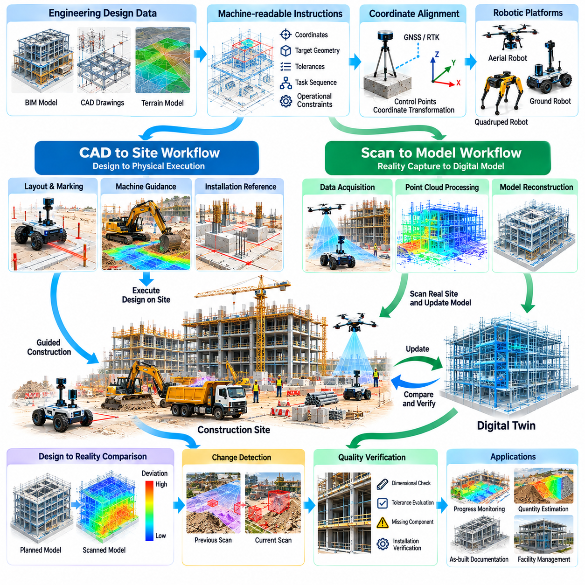{width="7.268055555555556in" height="7.268055555555556in"}

CAD-to-Site and Scan-to-Model workflows establish a bidirectional connection between digital engineering designs and physical construction environments. CAD-to-Site transfers planned geometry into executable field references, while Scan-to-Model converts measured site conditions into structured digital representations. Physical AI integrates these workflows through autonomous sensing, localization, geometric reasoning, and construction verification.

CAD-to-Site begins with engineering information contained in CAD drawings, terrain models, and Building Information Modeling systems. These sources define dimensions, elevations, component locations, and construction boundaries. Before robotic execution, design information must be transformed into machine-readable instructions that specify coordinate references, target geometries, allowable tolerances, and relevant operational constraints.

Coordinate alignment is fundamental because engineering models and robotic systems may use different spatial reference frames. Design coordinates must correspond accurately to physical control points and site positioning systems. Transformation errors can cause misplaced markings, incorrect excavation boundaries, or inaccurate component installation. Reliable workflows therefore require surveyed references, calibration procedures, and coordinate validation.

Autonomous construction robots can translate digital design information into physical layout operations. Mobile platforms equipped with positioning sensors and marking mechanisms may identify wall lines, equipment foundations, installation points, and construction boundaries. Automated layout reduces repetitive manual measurement, but its accuracy depends on localization quality, mechanical calibration, surface conditions, and verified design references.

CAD-to-Site workflows also support autonomous equipment guidance. Excavators, graders, and other construction machines can interpret digital terrain surfaces and target geometries to guide physical operations. Machine controllers compare measured positions with planned references and adjust movements accordingly. This connection enables design-driven execution while requiring continuous monitoring of operating limits and site conditions.

Scan-to-Model begins with physical measurements acquired through LiDAR, photogrammetry, structured-light sensing, or conventional surveying instruments. Ground robots and aerial platforms can capture geometry from different viewpoints. The resulting point clouds and images provide evidence of actual construction conditions, although raw measurements require registration, filtering, and interpretation before becoming useful engineering models.

Point-cloud processing transforms large collections of spatial measurements into consistent geometric datasets. Noise removal, outlier filtering, downsampling, and coordinate registration improve usability while preserving relevant details. Surface reconstruction can produce meshes or simplified geometric primitives. Processing parameters must reflect measurement objectives because excessive simplification may conceal important deviations.

Scan-to-Model reconstruction requires identifying meaningful construction elements within measured geometry. Structural columns, beams, walls, pipes, floors, and mechanical installations must be distinguished from temporary objects and background surfaces. Semantic segmentation and object recognition can assist this process. However, incomplete visibility and irregular site conditions can produce uncertain classifications requiring verification.

Model generation may involve fitting geometric primitives, reconstructing surfaces, and associating detected components with engineering attributes. Automated methods can estimate dimensions, orientations, and spatial relationships from scan data. Yet geometric reconstruction does not automatically establish material properties, design intent, or asset identity. These attributes require reliable references, metadata, or additional inspection information.

Design-to-reality comparison connects CAD-to-Site and Scan-to-Model into a continuous verification process. Registered measurements can be compared with planned geometry to identify dimensional differences, alignment errors, and missing components. Deviation analysis may calculate distances between measured surfaces and design references. Results must account for measurement uncertainty and applicable construction tolerances.

Construction tolerances determine whether observed differences represent acceptable variation or potential defects. Different structural and mechanical components require different acceptance criteria. A deviation that is insignificant for rough earthworks may be unacceptable for precision equipment installation. Automated verification systems must therefore apply component-specific requirements rather than treating every geometric difference as an error.

Change detection supports progress monitoring by comparing scans collected at different construction stages. Newly installed components, removed temporary structures, and modified terrain can be identified through spatial comparison. Temporal analysis helps distinguish construction progress from unexpected changes. Reliable interpretation requires consistent registration, sufficient scan coverage, and awareness of temporary site activities.

Physical AI enables robotic inspection routes to be planned directly from engineering models. Digital geometry can identify areas requiring measurement, inspection viewpoints, and accessible navigation corridors. Robots may select sensor positions to reduce occlusion and improve coverage. Adaptive planning can request additional measurements when uncertainty remains high or important structural features are insufficiently observed.

Occlusion presents a major challenge because construction environments contain overlapping structures, stored materials, and restricted access areas. A scan may capture only a portion of an installed component, making complete reconstruction uncertain. Multi-view sensing and repeated site visits can improve coverage. Digital models should explicitly distinguish observed geometry from inferred or unverified regions.

Interoperability between CAD, BIM, robotic mapping, and construction management systems is essential for scalable workflows. Different software platforms may represent geometry, coordinate systems, component identities, and metadata differently. Open exchange formats and standardized interfaces can reduce integration effort. Nevertheless, information loss and inconsistent model interpretation remain important implementation risks.

Digital thread architectures connect design revisions, robotic instructions, field measurements, and verification results through traceable information relationships. Each construction activity can be associated with a design version and corresponding observation records. This traceability helps teams understand whether a discrepancy originates from execution, measurement, or outdated design information.

Version control becomes critical when engineering designs change during construction. Robots operating from obsolete models may mark incorrect locations or execute outdated tasks. Updated design information must be validated, distributed, and associated with the correct work packages. Configuration management should prevent conflicting instructions and preserve historical records of approved construction changes.

Quality assurance requires more than visually comparing a point cloud with a CAD model. Measurement accuracy, calibration status, registration confidence, sensor coverage, and processing history must be evaluated. Independent reference measurements may be necessary for critical dimensions. Automated reports should communicate uncertainty and distinguish confirmed deviations from areas requiring further investigation.

Edge and cloud computing can distribute processing across robotic platforms and centralized engineering systems. Edge devices support localization, immediate measurement feedback, and basic deviation detection. Centralized resources can perform large-scale reconstruction, model comparison, and historical analysis. Data synchronization must maintain consistent coordinate references, timestamps, and model versions.

Artificial intelligence can automate repetitive tasks such as feature matching, component recognition, geometric fitting, and anomaly prioritization. Learning-based methods may accelerate conversion between unstructured scans and structured models. However, training data limitations and changing construction environments can reduce reliability. Human review remains important when automated interpretations influence engineering acceptance decisions.

Operational integration requires clear responsibilities among designers, surveyors, construction supervisors, and robotic system operators. Design teams define approved references, surveying personnel validate spatial control, and construction teams respond to detected discrepancies. Robotic platforms provide measurements and execution support, but engineering accountability must remain clearly assigned throughout the workflow.

Economic benefits may arise from reduced layout effort, earlier detection of installation errors, improved progress visibility, and lower rework costs. The value depends on project complexity, measurement frequency, integration quality, and the cost of correcting defects. Total cost evaluation must include sensing equipment, robotic platforms, software licenses, computing infrastructure, calibration, training, and ongoing maintenance.

Deployment should begin with limited workflows that have clear geometry, accessible measurement locations, and measurable acceptance criteria. Automated layout verification, floor-level mapping, and structural alignment checks provide practical examples. More advanced applications can expand toward autonomous equipment guidance and continuous digital twin updating after accuracy, interoperability, and operational reliability are demonstrated.

CAD-to-Site and Scan-to-Model ultimately create a closed information loop between engineering intent and physical construction outcomes. Digital designs guide robotic actions, while autonomous measurements update representations of actual site conditions. By integrating geometric alignment, intelligent sensing, model reconstruction, and quality verification, Physical AI supports more accurate, traceable, and adaptive construction processes.

설계정보 현장 적용(CAD-to-Site)과 스캔 기반 모델 생성(Scan-to-Model) 작업 흐름은 디지털 엔지니어링 설계(Digital Engineering Designs)와 실제 건설 환경(Physical Construction Environments) 사이에 양방향 연결(Bidirectional Connection)을 구축한다. 설계정보 현장 적용은 계획된 형상(Planned Geometry)을 현장에서 실행할 수 있는 기준 정보(Executable Field References)로 변환하며, 스캔 기반 모델 생성은 측정된 현장 조건(Measured Site Conditions)을 구조화된 디지털 표현(Structured Digital Representations)으로 변환한다. 피지컬 인공지능(Physical AI)은 자율 센싱(Autonomous Sensing), 위치 추정(Localization), 기하학적 추론(Geometric Reasoning), 시공 검증(Construction Verification)을 통해 이러한 작업 흐름을 통합한다.

설계정보 현장 적용(CAD-to-Site)은 컴퓨터 지원 설계(Computer-Aided Design, CAD) 도면, 지형 모델(Terrain Models), 건축정보모델링(Building Information Modeling, BIM) 시스템에 포함된 엔지니어링 정보(Engineering Information)에서 시작된다. 이러한 정보원은 치수(Dimensions), 표고(Elevations), 구성요소 위치(Component Locations), 시공 경계(Construction Boundaries)를 정의한다. 로봇이 작업을 실행하기 전에 설계 정보는 좌표 기준(Coordinate References), 목표 형상(Target Geometries), 허용 공차(Allowable Tolerances), 관련 운영 제약(Operational Constraints)을 명시하는 기계 판독 가능 명령(Machine-Readable Instructions)으로 변환되어야 한다.

좌표 정렬(Coordinate Alignment)은 엔지니어링 모델(Engineering Models)과 로봇 시스템(Robotic Systems)이 서로 다른 공간 기준 좌표계(Spatial Reference Frames)를 사용할 수 있기 때문에 기본적으로 중요하다. 설계 좌표(Design Coordinates)는 실제 기준점(Physical Control Points) 및 현장 위치 결정 시스템(Site Positioning Systems)과 정확하게 일치해야 한다. 좌표 변환 오류(Transformation Errors)는 잘못된 위치 표시(Misplaced Markings), 부정확한 굴착 경계(Incorrect Excavation Boundaries), 부정확한 구성요소 설치(Inaccurate Component Installation)를 발생시킬 수 있다. 따라서 신뢰성 있는 작업 흐름을 위해서는 측량된 기준점(Surveyed References), 보정 절차(Calibration Procedures), 좌표 검증(Coordinate Validation)이 필요하다.

자율 건설 로봇(Autonomous Construction Robots)은 디지털 설계 정보(Digital Design Information)를 실제 현장 배치 작업(Physical Layout Operations)으로 변환할 수 있다. 위치 결정 센서(Positioning Sensors)와 마킹 장치(Marking Mechanisms)를 탑재한 이동형 플랫폼(Mobile Platforms)은 벽체 기준선(Wall Lines), 장비 기초(Equipment Foundations), 설치 지점(Installation Points), 시공 경계(Construction Boundaries)를 식별할 수 있다. 자동화된 현장 배치(Automated Layout)는 반복적인 수동 측정 작업을 줄이지만, 정확도는 위치 추정 품질(Localization Quality), 기계적 보정(Mechanical Calibration), 표면 조건(Surface Conditions), 검증된 설계 기준(Verified Design References)에 따라 달라진다.

설계정보 현장 적용(CAD-to-Site) 작업 흐름은 자율 장비 유도(Autonomous Equipment Guidance)도 지원한다. 굴착기(Excavators), 그레이더(Graders) 및 기타 건설 기계(Construction Machines)는 디지털 지형 표면(Digital Terrain Surfaces)과 목표 형상(Target Geometries)을 해석하여 물리적 작업을 수행할 수 있다. 기계 제어기(Machine Controllers)는 측정된 위치(Measured Positions)를 계획된 기준(Planned References)과 비교하고 이에 따라 움직임을 조정한다. 이러한 연결은 설계 기반 작업 수행(Design-Driven Execution)을 가능하게 하지만 운영 한계(Operating Limits)와 현장 조건(Site Conditions)에 대한 지속적인 모니터링이 필요하다.

스캔 기반 모델 생성(Scan-to-Model)은 라이다(LiDAR), 사진측량(Photogrammetry), 구조광 센싱(Structured-Light Sensing), 기존 측량 장비(Conventional Surveying Instruments)를 통해 획득한 물리적 측정값(Physical Measurements)에서 시작된다. 지상 로봇(Ground Robots)과 항공 플랫폼(Aerial Platforms)은 서로 다른 관측 시점(Viewpoints)에서 형상 정보를 수집할 수 있다. 생성된 포인트 클라우드(Point Clouds)와 이미지(Images)는 실제 시공 상태(Actual Construction Conditions)에 대한 증거를 제공하지만, 원시 측정값(Raw Measurements)이 유용한 엔지니어링 모델(Engineering Models)이 되기 위해서는 정합(Registration), 필터링(Filtering), 해석(Interpretation)이 필요하다.

포인트 클라우드 처리(Point-Cloud Processing)는 대규모 공간 측정 데이터(Spatial Measurements)를 일관된 기하학적 데이터셋(Geometric Datasets)으로 변환한다. 잡음 제거(Noise Removal), 이상점 필터링(Outlier Filtering), 다운샘플링(Downsampling), 좌표 정합(Coordinate Registration)은 관련 세부 정보를 보존하면서 데이터의 활용성을 개선한다. 표면 재구성(Surface Reconstruction)은 메시(Meshes) 또는 단순화된 기하학적 기본 형상(Geometric Primitives)을 생성할 수 있다. 처리 매개변수(Processing Parameters)는 측정 목적(Measurement Objectives)을 반영해야 하며, 과도한 단순화(Excessive Simplification)는 중요한 편차(Deviations)를 감출 수 있다.

스캔 기반 모델 재구성(Scan-to-Model Reconstruction)을 위해서는 측정된 형상(Measured Geometry)에서 의미 있는 건설 구성요소(Construction Elements)를 식별해야 한다. 구조 기둥(Structural Columns), 보(Beams), 벽체(Walls), 배관(Pipes), 바닥(Floors), 기계 설비(Mechanical Installations)는 임시 물체(Temporary Objects) 및 배경 표면(Background Surfaces)과 구별되어야 한다. 의미론적 분할(Semantic Segmentation)과 객체 인식(Object Recognition)은 이러한 과정을 지원할 수 있다. 그러나 불완전한 가시성(Incomplete Visibility)과 불규칙한 현장 조건(Irregular Site Conditions)은 검증이 필요한 불확실한 분류(Uncertain Classifications)를 발생시킬 수 있다.

모델 생성(Model Generation)은 기하학적 기본 형상 맞춤(Geometric Primitive Fitting), 표면 재구성(Surface Reconstruction), 감지된 구성요소와 엔지니어링 속성(Engineering Attributes)의 연계를 포함할 수 있다. 자동화된 방법(Automated Methods)은 스캔 데이터(Scan Data)에서 치수(Dimensions), 방향(Orientations), 공간적 관계(Spatial Relationships)를 추정할 수 있다. 그러나 기하학적 재구성(Geometric Reconstruction)만으로 자재 특성(Material Properties), 설계 의도(Design Intent), 자산 식별 정보(Asset Identity)가 자동으로 확정되는 것은 아니다. 이러한 속성을 확보하려면 신뢰성 있는 기준 정보(References), 메타데이터(Metadata), 추가 검사 정보(Additional Inspection Information)가 필요하다.

설계와 실제 상태 비교(Design-to-Reality Comparison)는 설계정보 현장 적용(CAD-to-Site)과 스캔 기반 모델 생성(Scan-to-Model)을 지속적인 검증 프로세스(Continuous Verification Process)로 연결한다. 정합된 측정 데이터(Registered Measurements)를 계획된 형상(Planned Geometry)과 비교하면 치수 차이(Dimensional Differences), 정렬 오류(Alignment Errors), 누락된 구성요소(Missing Components)를 식별할 수 있다. 편차 분석(Deviation Analysis)은 측정된 표면(Measured Surfaces)과 설계 기준(Design References) 사이의 거리를 계산할 수 있다. 분석 결과에는 측정 불확실성(Measurement Uncertainty)과 적용 가능한 시공 공차(Construction Tolerances)가 반영되어야 한다.

시공 공차(Construction Tolerances)는 관측된 차이가 허용 가능한 변동(Acceptable Variation)인지 잠재적인 결함(Potential Defects)인지를 결정한다. 서로 다른 구조 및 기계 구성요소(Structural and Mechanical Components)에는 서로 다른 합격 기준(Acceptance Criteria)이 필요하다. 거친 토공 작업(Rough Earthworks)에서는 중요하지 않은 편차라도 정밀 장비 설치(Precision Equipment Installation)에서는 허용되지 않을 수 있다. 따라서 자동 검증 시스템(Automated Verification Systems)은 모든 기하학적 차이를 오류로 취급하지 않고 구성요소별 요구사항(Component-Specific Requirements)을 적용해야 한다.

변화 감지(Change Detection)는 서로 다른 시공 단계(Construction Stages)에서 수집한 스캔을 비교하여 공사 진행 상황 모니터링(Progress Monitoring)을 지원한다. 새롭게 설치된 구성요소(Newly Installed Components), 제거된 임시 구조물(Removed Temporary Structures), 변경된 지형(Modified Terrain)은 공간 비교(Spatial Comparison)를 통해 식별할 수 있다. 시간적 분석(Temporal Analysis)은 시공 진행(Construction Progress)과 예상하지 못한 변화(Unexpected Changes)를 구별하는 데 도움이 된다. 신뢰성 있는 해석을 위해서는 일관된 정합(Consistent Registration), 충분한 스캔 범위(Sufficient Scan Coverage), 임시 현장 활동(Temporary Site Activities)에 대한 이해가 필요하다.

피지컬 인공지능(Physical AI)은 엔지니어링 모델(Engineering Models)에서 직접 로봇 검사 경로(Robotic Inspection Routes)를 계획할 수 있도록 한다. 디지털 형상(Digital Geometry)은 측정이 필요한 영역(Areas Requiring Measurement), 검사 관측 지점(Inspection Viewpoints), 접근 가능한 주행 통로(Accessible Navigation Corridors)를 식별할 수 있다. 로봇은 가림 현상(Occlusion)을 줄이고 관측 범위(Coverage)를 개선하기 위해 센서 위치(Sensor Positions)를 선택할 수 있다. 적응형 계획(Adaptive Planning)은 불확실성이 높거나 중요한 구조적 특징(Structural Features)이 충분히 관측되지 않은 경우 추가 측정을 요청할 수 있다.

가림 현상(Occlusion)은 건설 환경에 중첩된 구조물(Overlapping Structures), 보관된 자재(Stored Materials), 접근 제한 구역(Restricted Access Areas)이 존재하기 때문에 중요한 문제를 발생시킨다. 스캔은 설치된 구성요소의 일부만 수집할 수 있으며, 이로 인해 완전한 재구성(Complete Reconstruction)이 불확실해질 수 있다. 다중 시점 센싱(Multi-View Sensing)과 반복적인 현장 방문(Repeated Site Visits)은 관측 범위를 개선할 수 있다. 디지털 모델(Digital Models)은 실제로 관측된 형상(Observed Geometry)과 추론되었거나 검증되지 않은 영역(Inferred or Unverified Regions)을 명확하게 구별해야 한다.

컴퓨터 지원 설계(CAD), 건축정보모델링(BIM), 로봇 지도 작성(Robotic Mapping), 건설 관리 시스템(Construction Management Systems) 사이의 상호운용성(Interoperability)은 확장 가능한 작업 흐름(Scalable Workflows)을 위해 필수적이다. 서로 다른 소프트웨어 플랫폼(Software Platforms)은 형상(Geometry), 좌표계(Coordinate Systems), 구성요소 식별 정보(Component Identities), 메타데이터(Metadata)를 서로 다른 방식으로 표현할 수 있다. 개방형 교환 형식(Open Exchange Formats)과 표준화된 인터페이스(Standardized Interfaces)는 통합 작업을 줄일 수 있다. 그러나 정보 손실(Information Loss)과 일관되지 않은 모델 해석(Inconsistent Model Interpretation)은 여전히 중요한 구현 위험(Implementation Risks)으로 남는다.

디지털 스레드 아키텍처(Digital Thread Architectures)는 설계 변경(Design Revisions), 로봇 명령(Robotic Instructions), 현장 측정값(Field Measurements), 검증 결과(Verification Results)를 추적 가능한 정보 관계(Traceable Information Relationships)로 연결한다. 각 건설 활동(Construction Activity)은 설계 버전(Design Version) 및 해당 관측 기록(Observation Records)과 연계될 수 있다. 이러한 추적성(Traceability)은 불일치(Discrepancy)가 시공 실행(Execution), 측정(Measurement), 오래된 설계 정보(Outdated Design Information) 중 어디에서 발생했는지 프로젝트 팀이 이해하는 데 도움이 된다.

버전 관리(Version Control)는 건설 과정에서 엔지니어링 설계(Engineering Designs)가 변경될 때 매우 중요해진다. 오래된 모델(Obsolete Models)을 기반으로 작동하는 로봇은 잘못된 위치를 표시하거나 이전 작업 지시(Outdated Tasks)를 실행할 수 있다. 갱신된 설계 정보(Updated Design Information)는 검증되고 배포되어야 하며 올바른 작업 패키지(Work Packages)와 연결되어야 한다. 구성 관리(Configuration Management)는 상충하는 명령(Conflicting Instructions)을 방지하고 승인된 시공 변경(Approved Construction Changes)의 이력 기록(Historical Records)을 보존해야 한다.

품질 보증(Quality Assurance)은 포인트 클라우드(Point Cloud)와 CAD 모델(CAD Model)을 시각적으로 비교하는 것 이상의 절차를 필요로 한다. 측정 정확도(Measurement Accuracy), 보정 상태(Calibration Status), 정합 신뢰도(Registration Confidence), 센서 관측 범위(Sensor Coverage), 처리 이력(Processing History)을 평가해야 한다. 중요한 치수(Critical Dimensions)에 대해서는 독립적인 기준 측정(Independent Reference Measurements)이 필요할 수 있다. 자동 보고서(Automated Reports)는 불확실성(Uncertainty)을 전달하고 확인된 편차(Confirmed Deviations)와 추가 조사가 필요한 영역(Areas Requiring Further Investigation)을 구별해야 한다.

엣지 컴퓨팅(Edge Computing)과 클라우드 컴퓨팅(Cloud Computing)은 로봇 플랫폼(Robotic Platforms)과 중앙집중형 엔지니어링 시스템(Centralized Engineering Systems) 사이에 처리 작업을 분산할 수 있다. 엣지 장치(Edge Devices)는 위치 추정(Localization), 즉각적인 측정 피드백(Immediate Measurement Feedback), 기본적인 편차 감지(Basic Deviation Detection)를 지원한다. 중앙집중형 컴퓨팅 자원(Centralized Computing Resources)은 대규모 재구성(Large-Scale Reconstruction), 모델 비교(Model Comparison), 과거 데이터 분석(Historical Analysis)을 수행할 수 있다. 데이터 동기화(Data Synchronization)는 일관된 좌표 기준(Coordinate References), 타임스탬프(Timestamps), 모델 버전(Model Versions)을 유지해야 한다.

인공지능(Artificial Intelligence, AI)은 특징점 매칭(Feature Matching), 구성요소 인식(Component Recognition), 기하학적 형상 맞춤(Geometric Fitting), 이상 우선순위 지정(Anomaly Prioritization)과 같은 반복적인 작업을 자동화할 수 있다. 학습 기반 방법(Learning-Based Methods)은 비정형 스캔(Unstructured Scans)을 구조화된 모델(Structured Models)로 변환하는 과정을 가속화할 수 있다. 그러나 학습 데이터의 한계(Training Data Limitations)와 변화하는 건설 환경(Changing Construction Environments)은 신뢰성을 저하시킬 수 있다. 자동화된 해석(Automated Interpretations)이 엔지니어링 합격 판정(Engineering Acceptance Decisions)에 영향을 미치는 경우 인간 검토(Human Review)는 여전히 중요하다.

운영 통합(Operational Integration)을 위해서는 설계자(Designers), 측량 담당자(Surveyors), 건설 감독자(Construction Supervisors), 로봇 시스템 운영자(Robotic System Operators) 사이의 명확한 책임 분담(Clear Responsibilities)이 필요하다. 설계팀(Design Teams)은 승인된 기준(Approved References)을 정의하고, 측량 담당자는 공간 기준(Spatial Control)을 검증하며, 건설팀(Construction Teams)은 발견된 불일치(Detected Discrepancies)에 대응한다. 로봇 플랫폼은 측정과 작업 실행을 지원하지만 엔지니어링 책임(Engineering Accountability)은 전체 작업 흐름에서 명확하게 배정되어야 한다.

경제적 이점(Economic Benefits)은 현장 배치 작업량(Layout Effort) 감소, 설치 오류(Installation Errors)의 조기 발견, 공사 진행 상황 가시성(Progress Visibility) 개선, 재작업 비용(Rework Costs) 절감에서 발생할 수 있다. 이러한 가치는 프로젝트 복잡성(Project Complexity), 측정 빈도(Measurement Frequency), 통합 품질(Integration Quality), 결함 수정 비용(Cost of Correcting Defects)에 따라 달라진다. 총비용 평가(Total Cost Evaluation)에는 센싱 장비(Sensing Equipment), 로봇 플랫폼(Robotic Platforms), 소프트웨어 라이선스(Software Licenses), 컴퓨팅 인프라(Computing Infrastructure), 보정(Calibration), 교육(Training), 지속적인 유지보수(Ongoing Maintenance)를 포함해야 한다.

시스템 배치(Deployment)는 명확한 형상(Clear Geometry), 접근 가능한 측정 위치(Accessible Measurement Locations), 측정 가능한 합격 기준(Measurable Acceptance Criteria)을 갖춘 제한적인 작업 흐름(Limited Workflows)에서 시작해야 한다. 자동화된 현장 배치 검증(Automated Layout Verification), 층별 지도 작성(Floor-Level Mapping), 구조물 정렬 검사(Structural Alignment Checks)는 실용적인 적용 사례를 제공한다. 더욱 발전된 응용 분야(Advanced Applications)는 정확도(Accuracy), 상호운용성(Interoperability), 운영 신뢰성(Operational Reliability)이 입증된 이후 자율 장비 유도(Autonomous Equipment Guidance)와 지속적인 디지털 트윈 갱신(Continuous Digital Twin Updating)으로 확장할 수 있다.

궁극적으로 설계정보 현장 적용(CAD-to-Site)과 스캔 기반 모델 생성(Scan-to-Model)은 엔지니어링 설계 의도(Engineering Intent)와 실제 시공 결과(Physical Construction Outcomes) 사이에 폐루프 정보 순환(Closed Information Loop)을 구축한다. 디지털 설계(Digital Designs)는 로봇 동작(Robotic Actions)을 안내하며, 자율 측정(Autonomous Measurements)은 실제 현장 조건(Actual Site Conditions)에 대한 디지털 표현(Digital Representations)을 갱신한다. 피지컬 인공지능은 기하학적 정렬(Geometric Alignment), 지능형 센싱(Intelligent Sensing), 모델 재구성(Model Reconstruction), 품질 검증(Quality Verification)을 통합하여 더욱 정확하고 추적 가능하며 적응적인 건설 프로세스(Construction Processes)를 지원한다.

##  

## 06.07. Infrastructure Inspection

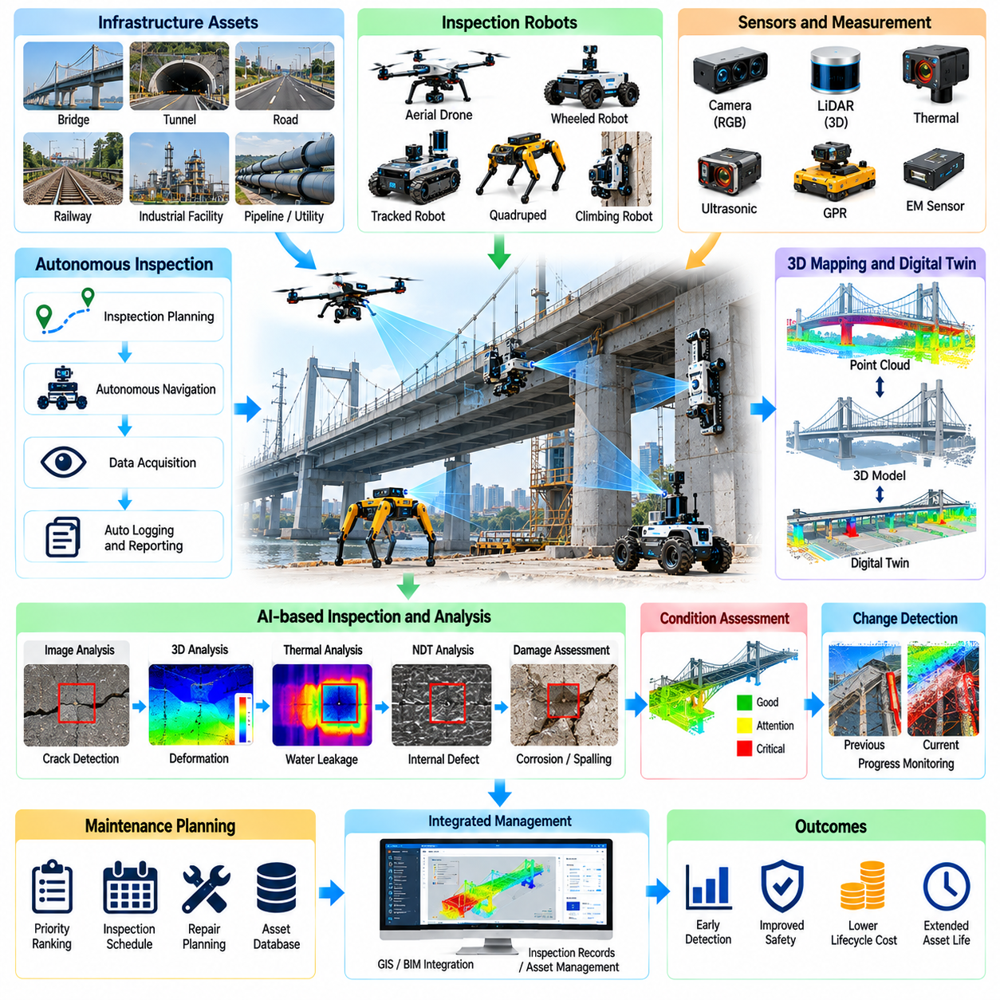{width="7.268055555555556in" height="7.268055555555556in"}

Infrastructure inspection is a critical application of Physical AI because bridges, tunnels, roads, pipelines, utilities, and industrial facilities require continuous assessment throughout their operational lifetimes. Traditional inspection relies heavily on human observation and specialized access equipment. Autonomous robotic systems can improve inspection frequency, reduce hazardous exposure, and provide consistent measurements for infrastructure condition assessment.

Infrastructure assets experience deterioration through environmental exposure, mechanical loading, corrosion, fatigue, vibration, and material aging. Inspection systems must identify visible defects and measurable changes that may indicate developing problems. Physical AI combines autonomous mobility, intelligent sensing, and data analysis to collect evidence of asset condition while supporting engineers responsible for maintenance and structural safety decisions.

Robotic inspection platforms include wheeled mobile robots, tracked vehicles, quadrupeds, aerial robots, and specialized climbing systems. Each platform offers different mobility and sensing capabilities. Ground robots can inspect accessible surfaces and enclosed passages, while aerial systems can observe elevated structures. Platform selection depends on asset geometry, access restrictions, environmental hazards, and measurement requirements.

Visual inspection remains an important foundation of infrastructure assessment. High-resolution cameras can capture cracks, corrosion, surface deformation, water leakage, and material deterioration. Computer vision algorithms may identify suspicious regions and classify visible anomalies. However, image-based observations depend on lighting, camera resolution, viewing angle, and surface conditions, requiring appropriate verification before engineering conclusions are established.

Three-dimensional sensing provides geometric information that complements visual inspection. LiDAR and photogrammetry can reconstruct infrastructure surfaces and measure spatial relationships between components. Repeated scans may reveal deformation, displacement, or changes in structural geometry. Measurement reliability depends on sensor calibration, coordinate registration, environmental conditions, and the stability of reference measurements.

Non-destructive testing extends inspection beyond visible surface characteristics. Ultrasonic sensing, thermal imaging, ground-penetrating radar, and electromagnetic methods can provide information about selected subsurface or material conditions. These techniques require application-specific calibration and interpretation. Robotic integration improves access and measurement repeatability but does not eliminate the limitations of individual sensing technologies.

Autonomous navigation is challenging because infrastructure environments frequently contain narrow passages, uneven surfaces, obstacles, and limited positioning references. Robots must estimate their locations while avoiding collisions and maintaining stable sensor operation. SLAM, inertial sensing, LiDAR, and visual localization can support navigation where satellite positioning is unavailable. Reliable recovery procedures are essential when localization confidence decreases.

Inspection planning determines which asset regions require observation and how robotic platforms should access them. Digital asset models, historical inspection records, and risk classifications can guide route generation and sensor placement. Coverage planning should account for structural complexity, measurement resolution, accessibility, and inspection priorities. Adaptive systems may revisit uncertain regions or request additional observations.

Defect detection algorithms can assist inspectors by identifying cracks, corrosion, spalling, leakage, and other visible deterioration patterns. Deep learning models can process large image collections and prioritize suspicious observations for review. Their performance depends on representative training data and consistent image quality. False detections and missed defects must be evaluated before automated outputs influence maintenance decisions.

Crack measurement illustrates the importance of connecting detection with quantitative assessment. Identifying a crack in an image does not automatically establish its physical width, depth, or structural significance. Accurate measurement requires geometric calibration, suitable imaging resolution, and appropriate viewing conditions. Structural interpretation must consider crack location, material properties, loading conditions, and historical development.

Repeated robotic inspections support temporal condition monitoring by comparing measurements collected over months or years. Changes in crack patterns, corrosion extent, surface geometry, and moisture indicators may reveal deterioration trends. Reliable comparison requires consistent measurement procedures and spatial alignment. Apparent changes caused by illumination, sensor noise, or environmental variation must be distinguished from actual asset deterioration.

Digital twins provide a framework for connecting inspection observations with infrastructure asset information. Geometric models can be associated with component identifiers, inspection histories, defect records, and maintenance activities. Robot-generated observations update these records and support spatial visualization of asset condition. Effective digital twins require traceable measurements and consistent relationships between physical components and digital representations.

Condition assessment transforms raw inspection data into information that supports maintenance planning. Detected anomalies may be categorized by location, severity indicators, progression, and potential operational consequences. Risk-based inspection strategies can prioritize assets with greater exposure or suspected deterioration. Nevertheless, automated condition scores should support rather than replace qualified engineering judgment.

Infrastructure inspection frequently involves environments that are hazardous or difficult for human personnel to access. Elevated structures, confined spaces, unstable surfaces, contaminated areas, and active industrial facilities create significant safety concerns. Robotic systems can reduce direct human exposure, but deployment still requires hazard assessment, emergency procedures, and compliance with applicable site safety requirements.

Remote inspection allows operators to supervise robotic platforms from safer locations while receiving sensor observations and operational status. Communication systems must support reliable control, data transmission, and emergency intervention. Underground facilities and reinforced structures may restrict wireless connectivity. Autonomous fallback behaviors and communication recovery procedures are therefore important for maintaining safe operation.

Sensor payload integration influences the inspection capabilities and operating duration of robotic platforms. High-resolution cameras, LiDAR, thermal sensors, and specialized testing instruments introduce weight, power, and calibration requirements. Payload design must balance measurement performance with mobility and endurance. Stable sensor mounting and synchronized data acquisition improve the reliability of multi-sensor inspection results.

Inspection data management becomes increasingly important when robotic systems generate large quantities of images, point clouds, and sensor measurements. Structured storage should associate observations with asset identifiers, timestamps, locations, and equipment configurations. Data quality controls can identify incomplete coverage or unreliable measurements. Traceable records enable engineers to review findings and compare inspection results over time.

Artificial intelligence can improve inspection efficiency through automated image filtering, anomaly detection, defect classification, and change analysis. Learning-based systems may reduce the effort required to review extensive inspection datasets. However, unusual damage mechanisms and limited training examples can create uncertainty. Human verification remains essential for critical findings and decisions affecting public safety.

Fleet-scale inspection introduces opportunities for coordinating multiple robotic platforms across distributed infrastructure assets. Inspection tasks can be assigned according to robot capabilities, asset accessibility, sensor requirements, and operational schedules. Centralized management systems may track mission completion, equipment condition, and collected data. Standardized reporting improves consistency across different inspection locations.

Quality assurance requires documented calibration, inspection coverage, measurement uncertainty, and repeatability. Reference measurements and independent verification can help establish confidence in robotic inspection results. Automated reports should distinguish confirmed defects from suspected anomalies and unobserved regions. Inspection completeness must be evaluated against defined requirements rather than assuming that successful robot navigation guarantees adequate coverage.

Maintenance integration connects inspection findings with asset management and work-order systems. Identified defects can trigger engineering review, additional testing, repair planning, or scheduled monitoring. Historical inspection information supports prioritization of limited maintenance resources. The value of Physical AI increases when inspection data lead to timely decisions rather than remaining isolated within technical databases.

The economic justification for robotic infrastructure inspection depends on inspection frequency, access costs, asset criticality, and the consequences of undetected deterioration. Potential benefits include reduced scaffolding requirements, shorter inspection interruptions, improved documentation, and lower exposure to hazardous environments. Total cost of ownership must include robotic equipment, sensors, software, operator training, maintenance, data processing, and engineering verification.

Deployment should begin with clearly defined inspection objectives, accessible assets, and measurable performance requirements. Pilot projects can compare robotic observations with established inspection methods to evaluate coverage, defect detection, and measurement accuracy. Expansion into complex or safety-critical infrastructure should follow demonstrated reliability, validated inspection procedures, and appropriate engineering acceptance.

Infrastructure inspection ultimately demonstrates how Physical AI can connect autonomous sensing with long-term asset management. Robots provide repeatable access and structured observations, while intelligent analysis helps transform measurements into actionable information. By integrating robotic mobility, multi-modal sensing, digital twins, and engineering workflows, infrastructure organizations can improve inspection consistency, maintenance planning, and operational resilience.

인프라 검사(Infrastructure Inspection)는 교량(Bridges), 터널(Tunnels), 도로(Roads), 파이프라인(Pipelines), 공공 기반시설(Utilities), 산업 시설(Industrial Facilities)이 운영 수명(Operational Lifetimes) 전반에 걸쳐 지속적인 상태 평가(Condition Assessment)를 필요로 한다는 점에서 피지컬 인공지능(Physical AI)의 핵심적인 응용 분야이다. 기존 검사 방식은 인간의 육안 관찰(Human Observation)과 특수 접근 장비(Specialized Access Equipment)에 크게 의존한다. 자율 로봇 시스템(Autonomous Robotic Systems)은 검사 빈도(Inspection Frequency)를 높이고 위험 환경 노출(Hazardous Exposure)을 줄이며 인프라 상태 평가를 위한 일관된 측정 데이터를 제공할 수 있다.

인프라 자산(Infrastructure Assets)은 환경 노출(Environmental Exposure), 기계적 하중(Mechanical Loading), 부식(Corrosion), 피로(Fatigue), 진동(Vibration), 재료 노화(Material Aging)로 인해 성능이 저하된다. 검사 시스템(Inspection Systems)은 발생 중인 문제를 나타낼 수 있는 가시적 결함(Visible Defects)과 측정 가능한 변화(Measurable Changes)를 식별해야 한다. 피지컬 인공지능은 자율 이동(Autonomous Mobility), 지능형 센싱(Intelligent Sensing), 데이터 분석(Data Analysis)을 결합하여 자산 상태(Asset Condition)에 관한 증거를 수집하고 유지보수 및 구조적 안전성(Structural Safety)에 대한 의사결정을 담당하는 엔지니어를 지원한다.

로봇 검사 플랫폼(Robotic Inspection Platforms)에는 바퀴형 이동 로봇(Wheeled Mobile Robots), 궤도형 차량(Tracked Vehicles), 사족보행 로봇(Quadrupeds), 항공 로봇(Aerial Robots), 특수 등반 로봇(Specialized Climbing Systems)이 포함된다. 각 플랫폼은 서로 다른 이동성(Mobility)과 센싱 기능(Sensing Capabilities)을 제공한다. 지상 로봇(Ground Robots)은 접근 가능한 표면과 밀폐된 통로를 검사할 수 있으며, 항공 시스템(Aerial Systems)은 높은 위치의 구조물을 관측할 수 있다. 플랫폼 선택(Platform Selection)은 자산 형상(Asset Geometry), 접근 제한(Access Restrictions), 환경 위험(Environmental Hazards), 측정 요구사항(Measurement Requirements)에 따라 결정된다.

육안 검사(Visual Inspection)는 인프라 평가(Infrastructure Assessment)의 중요한 기초로 남아 있다. 고해상도 카메라(High-Resolution Cameras)는 균열(Cracks), 부식(Corrosion), 표면 변형(Surface Deformation), 누수(Water Leakage), 재료 열화(Material Deterioration)를 촬영할 수 있다. 컴퓨터 비전 알고리즘(Computer Vision Algorithms)은 의심스러운 영역(Suspicious Regions)을 식별하고 가시적 이상(Visible Anomalies)을 분류할 수 있다. 그러나 영상 기반 관측(Image-Based Observations)은 조명(Lighting), 카메라 해상도(Camera Resolution), 관측 각도(Viewing Angle), 표면 조건(Surface Conditions)에 영향을 받으므로 엔지니어링 결론을 확정하기 전에 적절한 검증이 필요하다.

3차원 센싱(Three-Dimensional Sensing)은 육안 검사를 보완하는 기하학적 정보(Geometric Information)를 제공한다. 라이다(LiDAR)와 사진측량(Photogrammetry)은 인프라 표면을 재구성하고 구성요소 사이의 공간적 관계(Spatial Relationships)를 측정할 수 있다. 반복 스캔(Repeated Scans)은 변형(Deformation), 변위(Displacement), 구조물 형상(Structural Geometry)의 변화를 발견하는 데 도움이 될 수 있다. 측정 신뢰성(Measurement Reliability)은 센서 보정(Sensor Calibration), 좌표 정합(Coordinate Registration), 환경 조건(Environmental Conditions), 기준 측정값(Reference Measurements)의 안정성에 따라 달라진다.

비파괴 검사(Non-Destructive Testing, NDT)는 가시적인 표면 특성을 넘어 검사 범위를 확장한다. 초음파 센싱(Ultrasonic Sensing), 열화상 촬영(Thermal Imaging), 지표투과레이더(Ground-Penetrating Radar, GPR), 전자기적 방법(Electromagnetic Methods)은 특정 지하 또는 내부 재료 상태(Subsurface or Material Conditions)에 관한 정보를 제공할 수 있다. 이러한 기술은 적용 분야별 보정(Application-Specific Calibration)과 해석(Interpretation)을 필요로 한다. 로봇 통합(Robotic Integration)은 접근성과 측정 반복성(Measurement Repeatability)을 개선하지만 개별 센싱 기술의 한계를 제거하지는 못한다.

자율주행(Autonomous Navigation)은 인프라 환경에 좁은 통로(Narrow Passages), 불규칙한 표면(Uneven Surfaces), 장애물(Obstacles), 제한된 위치 기준(Limited Positioning References)이 자주 존재하기 때문에 어려움을 수반한다. 로봇은 충돌을 회피하고 안정적인 센서 작동(Stable Sensor Operation)을 유지하면서 자신의 위치를 추정해야 한다. 동시적 위치 추정 및 지도 작성(Simultaneous Localization and Mapping, SLAM), 관성 센싱(Inertial Sensing), 라이다, 시각적 위치 추정(Visual Localization)은 위성 위치 결정(Satellite Positioning)을 사용할 수 없는 환경에서 자율주행을 지원할 수 있다. 위치 추정 신뢰도(Localization Confidence)가 감소하는 경우에는 신뢰성 있는 복구 절차(Recovery Procedures)가 필수적이다.

검사 계획(Inspection Planning)은 자산의 어떤 영역을 관측해야 하며 로봇 플랫폼이 해당 영역에 어떻게 접근해야 하는지를 결정한다. 디지털 자산 모델(Digital Asset Models), 과거 검사 기록(Historical Inspection Records), 위험 등급(Risk Classifications)은 경로 생성(Route Generation)과 센서 배치(Sensor Placement)를 안내할 수 있다. 검사 범위 계획(Coverage Planning)은 구조적 복잡성(Structural Complexity), 측정 해상도(Measurement Resolution), 접근성(Accessibility), 검사 우선순위(Inspection Priorities)를 고려해야 한다. 적응형 시스템(Adaptive Systems)은 불확실한 영역을 다시 방문하거나 추가 관측을 요청할 수 있다.

결함 탐지 알고리즘(Defect Detection Algorithms)은 균열, 부식, 콘크리트 박락(Spalling), 누수 및 기타 가시적 열화 패턴(Visible Deterioration Patterns)을 식별하여 검사자를 지원할 수 있다. 딥러닝 모델(Deep Learning Models)은 대규모 이미지 데이터(Image Collections)를 처리하고 검토가 필요한 의심 관측 결과(Suspicious Observations)의 우선순위를 지정할 수 있다. 성능은 대표성 있는 학습 데이터(Representative Training Data)와 일관된 이미지 품질(Consistent Image Quality)에 따라 달라진다. 자동화된 결과가 유지보수 의사결정(Maintenance Decisions)에 영향을 미치기 전에 오탐(False Detections)과 미탐(Missed Defects)을 평가해야 한다.

균열 측정(Crack Measurement)은 탐지(Detection)와 정량적 평가(Quantitative Assessment)를 연결하는 것이 중요하다는 점을 보여준다. 이미지에서 균열을 식별하는 것만으로 실제 균열 폭(Crack Width), 깊이(Crack Depth), 구조적 중요성(Structural Significance)이 자동으로 확인되는 것은 아니다. 정확한 측정에는 기하학적 보정(Geometric Calibration), 적절한 영상 해상도(Imaging Resolution), 적합한 관측 조건(Viewing Conditions)이 필요하다. 구조적 해석(Structural Interpretation)은 균열 위치(Crack Location), 재료 특성(Material Properties), 하중 조건(Loading Conditions), 과거 진행 양상(Historical Development)을 고려해야 한다.

반복적인 로봇 검사(Repeated Robotic Inspections)는 수개월 또는 수년에 걸쳐 수집된 측정값을 비교함으로써 시간에 따른 상태 모니터링(Temporal Condition Monitoring)을 지원한다. 균열 패턴(Crack Patterns), 부식 범위(Corrosion Extent), 표면 형상(Surface Geometry), 수분 지표(Moisture Indicators)의 변화는 열화 추세(Deterioration Trends)를 나타낼 수 있다. 신뢰성 있는 비교를 위해서는 일관된 측정 절차(Consistent Measurement Procedures)와 공간 정렬(Spatial Alignment)이 필요하다. 조명 변화(Illumination Changes), 센서 잡음(Sensor Noise), 환경 변동(Environmental Variation)으로 발생한 겉보기 변화(Apparent Changes)는 실제 자산 열화(Actual Asset Deterioration)와 구별되어야 한다.

디지털 트윈(Digital Twins)은 검사 관측 정보(Inspection Observations)를 인프라 자산 정보(Infrastructure Asset Information)와 연결하기 위한 프레임워크(Framework)를 제공한다. 기하학적 모델(Geometric Models)은 구성요소 식별자(Component Identifiers), 검사 이력(Inspection Histories), 결함 기록(Defect Records), 유지보수 활동(Maintenance Activities)과 연계될 수 있다. 로봇이 생성한 관측 정보(Robot-Generated Observations)는 이러한 기록을 갱신하고 자산 상태(Asset Condition)의 공간적 시각화(Spatial Visualization)를 지원한다. 효과적인 디지털 트윈은 추적 가능한 측정값(Traceable Measurements)과 물리적 구성요소 및 디지털 표현(Digital Representations) 사이의 일관된 관계를 필요로 한다.

상태 평가(Condition Assessment)는 원시 검사 데이터(Raw Inspection Data)를 유지보수 계획(Maintenance Planning)을 지원하는 정보로 변환한다. 탐지된 이상(Detected Anomalies)은 위치(Location), 심각도 지표(Severity Indicators), 진행 양상(Progression), 잠재적인 운영상 영향(Potential Operational Consequences)에 따라 분류될 수 있다. 위험 기반 검사 전략(Risk-Based Inspection Strategies)은 노출 수준이 높거나 열화가 의심되는 자산에 우선순위를 부여할 수 있다. 그러나 자동화된 상태 점수(Automated Condition Scores)는 자격을 갖춘 엔지니어의 전문적 판단(Qualified Engineering Judgment)을 대체하기보다는 지원해야 한다.

인프라 검사(Infrastructure Inspection)는 작업자가 접근하기 위험하거나 어려운 환경에서 자주 수행된다. 고소 구조물(Elevated Structures), 밀폐 공간(Confined Spaces), 불안정한 표면(Unstable Surfaces), 오염 지역(Contaminated Areas), 가동 중인 산업 시설(Active Industrial Facilities)은 상당한 안전 문제(Safety Concerns)를 발생시킨다. 로봇 시스템은 인간의 직접적인 위험 노출(Direct Human Exposure)을 줄일 수 있지만, 실제 배치(Deployment)에는 위험 평가(Hazard Assessment), 비상 대응 절차(Emergency Procedures), 적용 가능한 현장 안전 요구사항(Site Safety Requirements)의 준수가 여전히 필요하다.

원격 검사(Remote Inspection)는 운영자가 더욱 안전한 위치에서 로봇 플랫폼을 감독하면서 센서 관측 정보(Sensor Observations)와 운영 상태(Operational Status)를 수신할 수 있도록 한다. 통신 시스템(Communication Systems)은 신뢰성 있는 제어(Control), 데이터 전송(Data Transmission), 비상 개입(Emergency Intervention)을 지원해야 한다. 지하 시설(Underground Facilities)과 철근 구조물(Reinforced Structures)은 무선 연결(Wireless Connectivity)을 제한할 수 있다. 따라서 자율 대체 동작(Autonomous Fallback Behaviors)과 통신 복구 절차(Communication Recovery Procedures)는 안전한 운영을 유지하기 위해 중요하다.

센서 탑재장치 통합(Sensor Payload Integration)은 로봇 플랫폼의 검사 기능(Inspection Capabilities)과 운영 지속시간(Operating Duration)에 영향을 미친다. 고해상도 카메라(High-Resolution Cameras), 라이다, 열 센서(Thermal Sensors), 특수 검사 장비(Specialized Testing Instruments)는 중량(Weight), 전력(Power), 보정(Calibration)에 관한 요구사항을 증가시킨다. 탑재장치 설계(Payload Design)는 측정 성능(Measurement Performance)과 이동성(Mobility), 운용 지속성(Endurance) 사이의 균형을 유지해야 한다. 안정적인 센서 장착(Stable Sensor Mounting)과 동기화된 데이터 획득(Synchronized Data Acquisition)은 다중 센서 검사 결과(Multi-Sensor Inspection Results)의 신뢰성을 향상시킨다.

검사 데이터 관리(Inspection Data Management)는 로봇 시스템이 대량의 이미지(Images), 포인트 클라우드(Point Clouds), 센서 측정값(Sensor Measurements)을 생성함에 따라 더욱 중요해진다. 구조화된 저장 시스템(Structured Storage)은 관측 정보를 자산 식별자(Asset Identifiers), 타임스탬프(Timestamps), 위치(Locations), 장비 구성(Equipment Configurations)과 연결해야 한다. 데이터 품질 관리(Data Quality Controls)는 불완전한 검사 범위(Incomplete Coverage)나 신뢰할 수 없는 측정값(Unreliable Measurements)을 식별할 수 있다. 추적 가능한 기록(Traceable Records)은 엔지니어가 검사 결과를 검토하고 시간 경과에 따른 결과를 비교할 수 있도록 한다.

인공지능(Artificial Intelligence, AI)은 자동 이미지 필터링(Automated Image Filtering), 이상 탐지(Anomaly Detection), 결함 분류(Defect Classification), 변화 분석(Change Analysis)을 통해 검사 효율성(Inspection Efficiency)을 개선할 수 있다. 학습 기반 시스템(Learning-Based Systems)은 방대한 검사 데이터셋(Inspection Datasets)을 검토하는 데 필요한 작업량을 줄일 수 있다. 그러나 특이한 손상 메커니즘(Unusual Damage Mechanisms)과 제한된 학습 사례(Limited Training Examples)는 불확실성을 발생시킬 수 있다. 중요한 발견(Critical Findings)과 공공 안전(Public Safety)에 영향을 미치는 의사결정에는 인간 검증(Human Verification)이 여전히 필수적이다.

군집 규모 검사(Fleet-Scale Inspection)는 분산된 인프라 자산(Distributed Infrastructure Assets)에 여러 로봇 플랫폼을 협력적으로 배치할 수 있는 기회를 제공한다. 검사 작업(Inspection Tasks)은 로봇 성능(Robot Capabilities), 자산 접근성(Asset Accessibility), 센서 요구사항(Sensor Requirements), 운영 일정(Operational Schedules)에 따라 할당될 수 있다. 중앙집중형 관리 시스템(Centralized Management Systems)은 임무 완료(Mission Completion), 장비 상태(Equipment Condition), 수집된 데이터(Collected Data)를 추적할 수 있다. 표준화된 보고(Standardized Reporting)는 서로 다른 검사 위치에서 결과의 일관성을 향상시킨다.

품질 보증(Quality Assurance)은 문서화된 보정(Calibration), 검사 범위(Inspection Coverage), 측정 불확실성(Measurement Uncertainty), 반복성(Repeatability)을 필요로 한다. 기준 측정(Reference Measurements)과 독립적인 검증(Independent Verification)은 로봇 검사 결과(Robotic Inspection Results)에 대한 신뢰도를 확보하는 데 도움이 된다. 자동 보고서(Automated Reports)는 확인된 결함(Confirmed Defects), 의심되는 이상(Suspected Anomalies), 관측되지 않은 영역(Unobserved Regions)을 구별해야 한다. 검사 완전성(Inspection Completeness)은 로봇이 성공적으로 주행했다는 사실만으로 충분한 검사 범위가 확보되었다고 가정하지 않고 정의된 요구사항(Defined Requirements)에 따라 평가해야 한다.

유지보수 통합(Maintenance Integration)은 검사 결과(Inspection Findings)를 자산 관리 시스템(Asset Management Systems) 및 작업 지시 시스템(Work-Order Systems)과 연결한다. 식별된 결함(Identified Defects)은 엔지니어링 검토(Engineering Review), 추가 시험(Additional Testing), 보수 계획(Repair Planning), 정기 모니터링(Scheduled Monitoring)을 촉발할 수 있다. 과거 검사 정보(Historical Inspection Information)는 제한된 유지보수 자원(Limited Maintenance Resources)의 우선순위 설정을 지원한다. 피지컬 인공지능의 가치는 검사 데이터가 기술 데이터베이스(Technical Databases)에 고립되지 않고 적시에 의사결정(Timely Decisions)으로 연결될 때 증가한다.

로봇 기반 인프라 검사(Robotic Infrastructure Inspection)의 경제적 타당성(Economic Justification)은 검사 빈도(Inspection Frequency), 접근 비용(Access Costs), 자산 중요도(Asset Criticality), 발견되지 않은 열화(Undetected Deterioration)의 결과에 따라 달라진다. 잠재적 이점(Potential Benefits)에는 비계 설치 요구량(Scaffolding Requirements) 감소, 검사로 인한 운영 중단 시간(Inspection Interruptions) 단축, 문서화 품질(Documentation) 개선, 위험 환경 노출(Hazardous Environment Exposure) 감소가 포함된다. 총소유비용(Total Cost of Ownership, TCO)에는 로봇 장비(Robotic Equipment), 센서(Sensors), 소프트웨어(Software), 운영자 교육(Operator Training), 유지보수(Maintenance), 데이터 처리(Data Processing), 엔지니어링 검증(Engineering Verification)을 포함해야 한다.

시스템 배치(Deployment)는 명확하게 정의된 검사 목표(Inspection Objectives), 접근 가능한 자산(Accessible Assets), 측정 가능한 성능 요구사항(Measurable Performance Requirements)을 기반으로 시작해야 한다. 시범 프로젝트(Pilot Projects)는 로봇 관측 결과(Robotic Observations)를 기존 검사 방법(Established Inspection Methods)과 비교하여 검사 범위(Coverage), 결함 탐지(Defect Detection), 측정 정확도(Measurement Accuracy)를 평가할 수 있다. 복잡하거나 안전이 중요한 인프라(Complex or Safety-Critical Infrastructure)로의 확장은 입증된 신뢰성(Demonstrated Reliability), 검증된 검사 절차(Validated Inspection Procedures), 적절한 엔지니어링 승인(Engineering Acceptance)을 기반으로 진행해야 한다.

궁극적으로 인프라 검사(Infrastructure Inspection)는 피지컬 인공지능이 자율 센싱(Autonomous Sensing)을 장기적인 자산 관리(Long-Term Asset Management)와 어떻게 연결할 수 있는지를 보여준다. 로봇은 반복 가능한 접근(Repeatable Access)과 구조화된 관측 정보(Structured Observations)를 제공하며, 지능형 분석(Intelligent Analysis)은 측정값을 실행 가능한 정보(Actionable Information)로 변환하도록 지원한다. 로봇 이동성(Robotic Mobility), 다중 모달 센싱(Multi-Modal Sensing), 디지털 트윈(Digital Twins), 엔지니어링 작업 흐름(Engineering Workflows)을 통합함으로써 인프라 운영 조직(Infrastructure Organizations)은 검사 일관성(Inspection Consistency), 유지보수 계획(Maintenance Planning), 운영 회복탄력성(Operational Resilience)을 향상시킬 수 있다.

##  

## 06.08. Bridge Tunnel and Railway Inspection

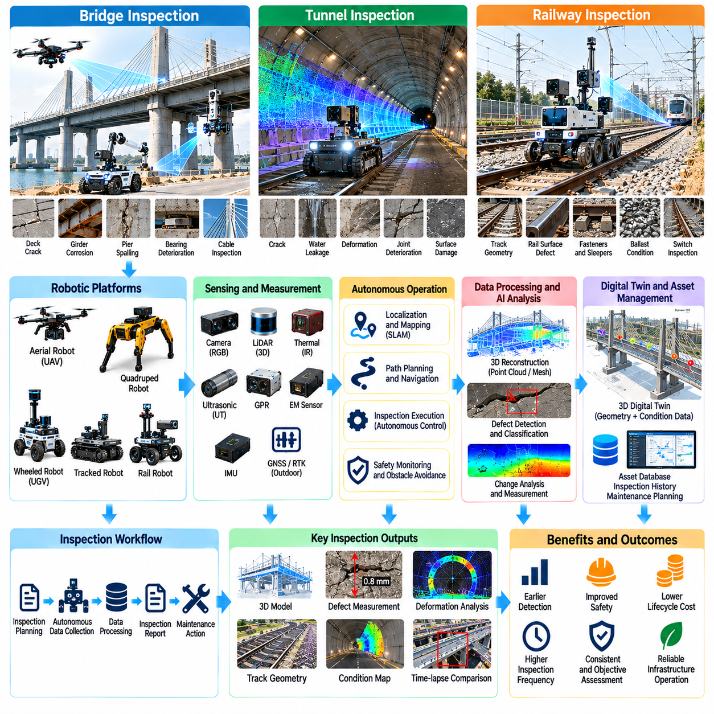{width="7.268055555555556in" height="7.268055555555556in"}

Bridge, tunnel, and railway inspection represents a critical application of Physical AI because these infrastructure systems support essential transportation networks and require continuous structural assessment. Aging materials, environmental exposure, repeated loading, and operational wear create deterioration risks. Autonomous robotic inspection can improve monitoring frequency, reduce hazardous human access, and provide consistent evidence for maintenance decisions.

Bridge inspection involves evaluating structural components such as decks, girders, piers, bearings, joints, cables, and foundations. Different components experience distinct deterioration mechanisms, including corrosion, fatigue cracking, concrete spalling, and displacement. Physical AI systems must combine appropriate sensing technologies with reliable positioning to document defects and associate observations with specific structural elements.

Aerial robots provide access to elevated bridge components and surfaces that are difficult to inspect using conventional equipment. Multirotor platforms can capture images of towers, cables, and selected underside regions while maintaining controlled observation distances. Flight stability, wind exposure, obstacle proximity, and satellite signal limitations influence inspection quality. Safe operations require appropriate clearance and validated flight procedures.

Ground robots and climbing platforms complement aerial inspection by examining bridge decks, support structures, and accessible enclosed spaces. Magnetic adhesion, mechanical gripping, or specialized locomotion may enable inspection of selected steel surfaces. These platforms can carry cameras, ultrasonic sensors, and other instruments. Their effectiveness depends on surface conditions, attachment reliability, payload capacity, and recovery provisions.

Bridge deck assessment may combine visual imaging, geometric measurement, and non-destructive testing to identify surface deterioration and potential internal defects. Cameras can document cracking and spalling, while ground-penetrating radar may provide information about subsurface features under suitable conditions. Interpretation requires calibration and engineering expertise because sensor anomalies do not necessarily establish structural damage.

Tunnel inspection presents different challenges because enclosed environments restrict satellite positioning, communication, and equipment access. Tunnel linings may exhibit cracks, water infiltration, deformation, joint deterioration, and localized material damage. Autonomous platforms must operate within confined geometries while maintaining reliable localization and consistent sensor coverage. Inspection procedures must also accommodate operational restrictions and emergency access requirements.

Mobile tunnel inspection systems may integrate LiDAR, high-resolution cameras, thermal sensors, and inertial navigation. Three-dimensional scans can reconstruct tunnel profiles and identify geometric irregularities, while imagery supports surface condition documentation. Repeated measurements can reveal changes over time. Reliable comparisons require consistent coordinate registration, sensor calibration, and awareness of environmental influences.

Water leakage is an important tunnel maintenance concern because persistent moisture can contribute to corrosion, material degradation, and operational hazards. Visual and thermal observations may help identify suspicious wet regions or temperature differences. However, temperature patterns depend on ventilation and environmental conditions. Confirming leakage sources often requires additional investigation and appropriate engineering assessment.

Tunnel navigation commonly relies on LiDAR-based SLAM, visual odometry, and inertial sensing because GNSS signals are unavailable underground. Repetitive tunnel geometry can create localization ambiguity, particularly in long corridors with limited distinctive features. Reference markers, surveyed control points, and sensor fusion can improve positioning reliability. Robots must also recognize restricted passages and unexpected obstacles.

Railway inspection focuses on track geometry, rail surfaces, fastening systems, sleepers, ballast, switches, and surrounding infrastructure. Repeated mechanical loading and environmental exposure can produce wear, deformation, and component deterioration. Physical AI platforms can collect measurements along railway corridors and support systematic condition monitoring. Inspection methods must reflect the operational and safety requirements of railway networks.

Track geometry measurement evaluates parameters such as gauge, alignment, longitudinal level, and crosslevel. Dedicated inspection vehicles and robotic platforms can combine position sensing with geometric measurement instruments. Deviations from applicable maintenance limits may indicate areas requiring attention. Reliable assessment depends on measurement accuracy, vehicle dynamics, operating speed, and the standards governing the specific railway system.

Rail surface inspection may use cameras, laser profiling, and specialized non-destructive testing to identify wear and potential defects. Computer vision can recognize selected visible anomalies, while ultrasonic or electromagnetic techniques may detect certain internal or near-surface conditions. No single sensor detects every defect type. Inspection strategies must combine complementary methods and qualified interpretation.

Railway fastening systems and sleepers require attention because their condition influences track stability and load transfer. Robotic imaging can identify missing fasteners, damaged components, and selected surface defects. Automated classification may prioritize suspicious observations for maintenance review. However, vegetation, contamination, shadows, and variations in component designs can reduce recognition reliability.

Ballast and trackbed conditions influence railway drainage, geometry retention, and structural support. Three-dimensional sensing and visual observations may reveal surface irregularities, fouling indicators, or localized deformation. Subsurface assessment may require additional sensing methods and engineering interpretation. Repeated surveys can support trend analysis, but observed surface changes do not independently establish underlying causes.

Railway corridor inspection extends beyond the track itself to bridges, tunnels, drainage structures, signals, and nearby vegetation. Mobile robotic systems can capture spatial information about clearance envelopes and potential obstructions. Integration with asset databases helps associate observations with specific infrastructure locations. Accurate georeferencing is essential when inspection findings must guide maintenance crews to precise sites.

Operational safety is particularly important when inspection robots operate near active railway lines or road traffic. Access permissions, protective procedures, exclusion zones, and coordination with infrastructure operators are essential. Autonomous systems must detect hazards and maintain safe behavior under communication or localization failures. Inspection scheduling should minimize disruption without compromising personnel or transportation safety.

Multi-modal sensing improves inspection completeness by combining visual, geometric, thermal, and material-related observations. Sensor fusion can connect detected anomalies with precise asset locations and supporting measurements. However, differences in sensor resolution, calibration, and observation conditions complicate interpretation. Quality assurance must verify that combined data remain spatially consistent and technically meaningful.

Digital twins provide a framework for organizing bridge, tunnel, and railway inspection information across asset lifecycles. Three-dimensional geometry can be linked with component identifiers, inspection histories, defect records, and maintenance actions. Repeated robotic observations update these representations. Effective digital twins require consistent asset references, documented measurement uncertainty, and reliable data versioning.

Artificial intelligence can support defect recognition, anomaly prioritization, condition classification, and temporal change detection. Learning-based models may reduce manual review effort across extensive inspection datasets. Nevertheless, unusual defects and limited training examples can produce missed detections or false alarms. Engineering validation remains necessary before automated findings are used to authorize repairs or operational restrictions.

Inspection planning should reflect asset criticality, deterioration history, accessibility, and operational constraints. Risk-based scheduling can prioritize locations with greater suspected deterioration or consequences of failure. Autonomous mission planning may optimize observation routes and sensor positioning while preserving required coverage. Uncertain findings should trigger additional measurements rather than unsupported conclusions.

Inspection data pipelines must preserve images, point clouds, sensor readings, timestamps, coordinates, and equipment configurations. Structured records support comparisons across inspection cycles and facilitate integration with maintenance management systems. Automated reports can summarize detected changes and identify areas requiring engineering review. Traceability is essential when findings influence safety-related decisions or long-term investment planning.

The economic value of robotic inspection depends on asset scale, inspection frequency, access costs, and operational disruption. Autonomous platforms may reduce reliance on scaffolding, specialized access vehicles, or extended closures for suitable tasks. Benefits also include improved documentation and repeatable measurements. Cost evaluation must account for equipment, sensing payloads, software, training, maintenance, supervision, and verification.

Deployment should begin with defined inspection targets and measurable performance requirements. Pilot studies can compare robotic measurements with established methods to assess defect detection, spatial accuracy, and coverage. Expansion into critical infrastructure requires validated safety procedures and demonstrated reliability. Human engineering oversight remains essential for interpreting findings and approving maintenance actions.

Bridge, tunnel, and railway inspection demonstrates how Physical AI can support safer and more systematic transportation infrastructure management. Autonomous mobility enables repeatable access, while intelligent sensing provides structured evidence of asset condition. By integrating robotic inspection, digital twins, and maintenance workflows, infrastructure operators can improve deterioration monitoring, resource allocation, and long-term operational resilience.

교량, 터널 및 철도 검사(Bridge, Tunnel, and Railway Inspection)는 이러한 인프라 시스템(Infrastructure Systems)이 필수적인 교통망(Essential Transportation Networks)을 지원하고 지속적인 구조 상태 평가(Structural Condition Assessment)를 필요로 한다는 점에서 피지컬 인공지능(Physical AI)의 핵심적인 응용 분야이다. 재료 노후화(Aging Materials), 환경 노출(Environmental Exposure), 반복 하중(Repeated Loading), 운영 마모(Operational Wear)는 열화 위험(Deterioration Risks)을 발생시킨다. 자율 로봇 검사(Autonomous Robotic Inspection)는 모니터링 빈도(Monitoring Frequency)를 높이고 위험한 인간 접근(Hazardous Human Access)을 줄이며 유지보수 의사결정(Maintenance Decisions)을 위한 일관된 근거를 제공할 수 있다.

교량 검사(Bridge Inspection)는 교량 상판(Bridge Decks), 거더(Girders), 교각(Piers), 받침(Bearings), 이음부(Joints), 케이블(Cables), 기초(Foundations)와 같은 구조 구성요소(Structural Components)를 평가하는 작업을 포함한다. 각 구성요소는 부식(Corrosion), 피로 균열(Fatigue Cracking), 콘크리트 박락(Concrete Spalling), 변위(Displacement) 등 서로 다른 열화 메커니즘(Deterioration Mechanisms)을 경험한다. 피지컬 인공지능 시스템은 결함을 기록하고 관측 정보를 특정 구조 요소(Structural Elements)와 연결하기 위해 적절한 센싱 기술(Sensing Technologies)과 신뢰성 있는 위치 결정(Reliable Positioning)을 결합해야 한다.

항공 로봇(Aerial Robots)은 기존 장비(Conventional Equipment)로 검사하기 어려운 높은 위치의 교량 구성요소(Elevated Bridge Components)와 표면에 접근할 수 있도록 한다. 멀티로터 플랫폼(Multirotor Platforms)은 제어된 관측 거리(Controlled Observation Distances)를 유지하면서 주탑(Towers), 케이블(Cables), 일부 교량 하부 영역(Underside Regions)의 이미지를 수집할 수 있다. 비행 안정성(Flight Stability), 바람 노출(Wind Exposure), 장애물 근접성(Obstacle Proximity), 위성 신호 제한(Satellite Signal Limitations)은 검사 품질(Inspection Quality)에 영향을 미친다. 안전한 운영(Safe Operations)을 위해서는 적절한 이격 거리(Clearance)와 검증된 비행 절차(Validated Flight Procedures)가 필요하다.

지상 로봇(Ground Robots)과 등반 플랫폼(Climbing Platforms)은 교량 상판, 지지 구조물(Support Structures), 접근 가능한 밀폐 공간(Accessible Enclosed Spaces)을 검사하여 항공 검사를 보완한다. 자기 부착(Magnetic Adhesion), 기계적 파지(Mechanical Gripping), 특수 이동 방식(Specialized Locomotion)은 특정 강재 표면(Steel Surfaces)의 검사를 가능하게 할 수 있다. 이러한 플랫폼에는 카메라(Cameras), 초음파 센서(Ultrasonic Sensors), 기타 검사 장비(Inspection Instruments)를 탑재할 수 있다. 효과성은 표면 조건(Surface Conditions), 부착 신뢰성(Attachment Reliability), 탑재 용량(Payload Capacity), 회수 대책(Recovery Provisions)에 따라 달라진다.

교량 상판 평가(Bridge Deck Assessment)는 표면 열화(Surface Deterioration)와 잠재적인 내부 결함(Internal Defects)을 식별하기 위해 영상 검사(Visual Imaging), 기하학적 측정(Geometric Measurement), 비파괴 검사(Non-Destructive Testing)를 결합할 수 있다. 카메라는 균열(Cracking)과 박락(Spalling)을 기록할 수 있으며, 지표투과레이더(Ground-Penetrating Radar, GPR)는 적절한 조건에서 표면 아래의 특징(Subsurface Features)에 관한 정보를 제공할 수 있다. 센서 이상 신호(Sensor Anomalies)가 반드시 구조적 손상(Structural Damage)을 의미하는 것은 아니므로 해석에는 보정(Calibration)과 엔지니어링 전문지식(Engineering Expertise)이 필요하다.

터널 검사(Tunnel Inspection)는 밀폐 환경(Enclosed Environments)이 위성 위치 결정(Satellite Positioning), 통신(Communication), 장비 접근(Equipment Access)을 제한하기 때문에 다른 문제를 제시한다. 터널 라이닝(Tunnel Linings)에는 균열(Cracks), 누수(Water Infiltration), 변형(Deformation), 이음부 열화(Joint Deterioration), 국부적인 재료 손상(Localized Material Damage)이 발생할 수 있다. 자율 플랫폼(Autonomous Platforms)은 제한된 공간 형상(Confined Geometries) 내에서 신뢰성 있는 위치 추정(Reliable Localization)과 일관된 센서 관측 범위(Consistent Sensor Coverage)를 유지해야 한다. 검사 절차는 운영 제한(Operational Restrictions)과 비상 접근 요구사항(Emergency Access Requirements)도 고려해야 한다.

이동형 터널 검사 시스템(Mobile Tunnel Inspection Systems)은 라이다(LiDAR), 고해상도 카메라(High-Resolution Cameras), 열 센서(Thermal Sensors), 관성 항법(Inertial Navigation)을 통합할 수 있다. 3차원 스캔(Three-Dimensional Scans)은 터널 단면 형상(Tunnel Profiles)을 재구성하고 기하학적 불규칙성(Geometric Irregularities)을 식별할 수 있으며, 영상 데이터(Imagery)는 표면 상태 기록(Surface Condition Documentation)을 지원한다. 반복 측정(Repeated Measurements)은 시간에 따른 변화를 발견할 수 있다. 신뢰성 있는 비교를 위해서는 일관된 좌표 정합(Coordinate Registration), 센서 보정(Sensor Calibration), 환경적 영향(Environmental Influences)에 대한 이해가 필요하다.

누수(Water Leakage)는 지속적인 수분(Persistent Moisture)이 부식(Corrosion), 재료 열화(Material Degradation), 운영 위험(Operational Hazards)을 유발할 수 있기 때문에 중요한 터널 유지보수 문제(Tunnel Maintenance Concern)이다. 시각적 관측(Visual Observations)과 열화상 관측(Thermal Observations)은 의심스러운 습윤 영역(Wet Regions)이나 온도 차이(Temperature Differences)를 식별하는 데 도움이 될 수 있다. 그러나 온도 패턴(Temperature Patterns)은 환기(Ventilation)와 환경 조건(Environmental Conditions)에 따라 달라진다. 누수 발생원(Leakage Sources)을 확인하기 위해서는 추가 조사(Additional Investigation)와 적절한 엔지니어링 평가(Engineering Assessment)가 필요한 경우가 많다.

터널 자율주행(Tunnel Navigation)은 지하에서 전역위성항법시스템(Global Navigation Satellite System, GNSS) 신호를 사용할 수 없기 때문에 일반적으로 라이다 기반 동시적 위치 추정 및 지도 작성(LiDAR-Based Simultaneous Localization and Mapping, SLAM), 시각적 주행거리 추정(Visual Odometry), 관성 센싱(Inertial Sensing)에 의존한다. 반복적인 터널 형상(Repetitive Tunnel Geometry)은 특히 구별되는 특징(Distinctive Features)이 제한적인 긴 통로에서 위치 추정의 모호성(Localization Ambiguity)을 발생시킬 수 있다. 기준 마커(Reference Markers), 측량 기준점(Surveyed Control Points), 센서 융합(Sensor Fusion)은 위치 결정 신뢰성(Positioning Reliability)을 개선할 수 있다. 로봇은 접근 제한 통로(Restricted Passages)와 예상하지 못한 장애물(Unexpected Obstacles)도 인식해야 한다.

철도 검사(Railway Inspection)는 궤도 형상(Track Geometry), 레일 표면(Rail Surfaces), 체결 장치(Fastening Systems), 침목(Sleepers), 도상 자갈(Ballast), 분기기(Switches), 주변 인프라(Surrounding Infrastructure)에 중점을 둔다. 반복적인 기계적 하중(Repeated Mechanical Loading)과 환경 노출(Environmental Exposure)은 마모(Wear), 변형(Deformation), 구성요소 열화(Component Deterioration)를 발생시킬 수 있다. 피지컬 인공지능 플랫폼은 철도 선로 구간(Railway Corridors)을 따라 측정 데이터를 수집하고 체계적인 상태 모니터링(Systematic Condition Monitoring)을 지원할 수 있다. 검사 방법은 철도망(Railway Networks)의 운영 및 안전 요구사항(Operational and Safety Requirements)을 반영해야 한다.

궤도 형상 측정(Track Geometry Measurement)은 궤간(Gauge), 선형(Alignment), 종방향 수평(Longitudinal Level), 좌우 레일 높이 차이(Crosslevel)와 같은 매개변수를 평가한다. 전용 검사 차량(Dedicated Inspection Vehicles)과 로봇 플랫폼(Robotic Platforms)은 위치 센싱(Position Sensing)과 기하학적 측정 장비(Geometric Measurement Instruments)를 결합할 수 있다. 적용 가능한 유지보수 한계(Maintenance Limits)를 벗어나는 편차(Deviations)는 관리가 필요한 영역을 나타낼 수 있다. 신뢰성 있는 평가는 측정 정확도(Measurement Accuracy), 차량 동역학(Vehicle Dynamics), 운행 속도(Operating Speed), 해당 철도 시스템에 적용되는 표준(Standards)에 따라 달라진다.

레일 표면 검사(Rail Surface Inspection)는 카메라(Cameras), 레이저 프로파일링(Laser Profiling), 특수 비파괴 검사(Specialized Non-Destructive Testing)를 활용하여 마모와 잠재적인 결함을 식별할 수 있다. 컴퓨터 비전(Computer Vision)은 특정 가시적 이상(Visible Anomalies)을 인식할 수 있으며, 초음파(Ultrasonic) 또는 전자기 기술(Electromagnetic Techniques)은 일부 내부 또는 표면 근처 상태(Internal or Near-Surface Conditions)를 탐지할 수 있다. 단일 센서(Single Sensor)만으로 모든 결함 유형(Defect Types)을 탐지할 수는 없다. 검사 전략(Inspection Strategies)은 상호 보완적인 방법(Complementary Methods)과 전문적인 해석(Qualified Interpretation)을 결합해야 한다.

철도 체결 장치(Railway Fastening Systems)와 침목(Sleepers)은 궤도 안정성(Track Stability)과 하중 전달(Load Transfer)에 영향을 미치므로 세심한 관리가 필요하다. 로봇 영상 검사(Robotic Imaging)는 누락된 체결 장치(Missing Fasteners), 손상된 구성요소(Damaged Components), 일부 표면 결함(Surface Defects)을 식별할 수 있다. 자동 분류(Automated Classification)는 유지보수 검토(Maintenance Review)가 필요한 의심 관측 결과(Suspicious Observations)의 우선순위를 지정할 수 있다. 그러나 식생(Vegetation), 오염(Contamination), 그림자(Shadows), 구성요소 설계의 차이(Variations in Component Designs)는 인식 신뢰성(Recognition Reliability)을 저하시킬 수 있다.

도상 자갈(Ballast)과 궤도 노반(Trackbed)의 상태는 철도 배수(Drainage), 궤도 형상 유지(Geometry Retention), 구조적 지지(Structural Support)에 영향을 미친다. 3차원 센싱(Three-Dimensional Sensing)과 시각적 관측(Visual Observations)은 표면 불규칙성(Surface Irregularities), 도상 오염 징후(Fouling Indicators), 국부적인 변형(Localized Deformation)을 발견할 수 있다. 지표 아래 상태 평가(Subsurface Assessment)에는 추가적인 센싱 방법(Additional Sensing Methods)과 엔지니어링 해석(Engineering Interpretation)이 필요할 수 있다. 반복 측량(Repeated Surveys)은 추세 분석(Trend Analysis)을 지원하지만 관측된 표면 변화만으로 근본 원인(Underlying Causes)을 확정할 수는 없다.

철도 선로 구간 검사(Railway Corridor Inspection)는 선로 자체를 넘어 교량(Bridges), 터널(Tunnels), 배수 구조물(Drainage Structures), 신호 설비(Signals), 주변 식생(Nearby Vegetation)까지 확장된다. 이동형 로봇 시스템(Mobile Robotic Systems)은 차량한계 공간(Clearance Envelopes)과 잠재적 장애물(Potential Obstructions)에 관한 공간 정보(Spatial Information)를 수집할 수 있다. 자산 데이터베이스(Asset Databases)와의 통합은 관측 정보를 특정 인프라 위치(Infrastructure Locations)와 연결하는 데 도움이 된다. 검사 결과를 바탕으로 유지보수 작업자(Maintenance Crews)를 정확한 위치로 안내하려면 정밀한 지리참조(Accurate Georeferencing)가 필수적이다.

운영 안전(Operational Safety)은 검사 로봇(Inspection Robots)이 운행 중인 철도 노선(Active Railway Lines)이나 도로 교통(Road Traffic) 근처에서 작동할 때 특히 중요하다. 접근 허가(Access Permissions), 보호 절차(Protective Procedures), 출입 제한 구역(Exclusion Zones), 인프라 운영자(Infrastructure Operators)와의 협조가 필수적이다. 자율 시스템(Autonomous Systems)은 위험을 감지하고 통신 장애(Communication Failures) 또는 위치 추정 실패(Localization Failures)가 발생하더라도 안전한 동작(Safe Behavior)을 유지해야 한다. 검사 일정 계획(Inspection Scheduling)은 작업자와 교통 안전(Personnel and Transportation Safety)을 저해하지 않으면서 운영 중단(Operational Disruption)을 최소화해야 한다.

다중 모달 센싱(Multi-Modal Sensing)은 시각적 관측(Visual Observations), 기하학적 관측(Geometric Observations), 열적 관측(Thermal Observations), 재료 관련 관측(Material-Related Observations)을 결합하여 검사 완전성(Inspection Completeness)을 개선한다. 센서 융합(Sensor Fusion)은 탐지된 이상(Detected Anomalies)을 정확한 자산 위치(Asset Locations) 및 관련 측정값(Supporting Measurements)과 연결할 수 있다. 그러나 센서 해상도(Sensor Resolution), 보정(Calibration), 관측 조건(Observation Conditions)의 차이는 해석을 복잡하게 만든다. 품질 보증(Quality Assurance)은 통합된 데이터가 공간적으로 일관되고(Spatially Consistent) 기술적으로 의미 있는지(Technically Meaningful) 검증해야 한다.

디지털 트윈(Digital Twins)은 자산 수명주기(Asset Lifecycles) 전반에 걸쳐 교량, 터널, 철도 검사 정보를 체계적으로 관리하기 위한 프레임워크(Framework)를 제공한다. 3차원 형상(Three-Dimensional Geometry)은 구성요소 식별자(Component Identifiers), 검사 이력(Inspection Histories), 결함 기록(Defect Records), 유지보수 조치(Maintenance Actions)와 연결될 수 있다. 반복적인 로봇 관측(Repeated Robotic Observations)은 이러한 디지털 표현(Digital Representations)을 갱신한다. 효과적인 디지털 트윈은 일관된 자산 기준 정보(Consistent Asset References), 문서화된 측정 불확실성(Documented Measurement Uncertainty), 신뢰성 있는 데이터 버전 관리(Reliable Data Versioning)를 필요로 한다.

인공지능(Artificial Intelligence, AI)은 결함 인식(Defect Recognition), 이상 우선순위 지정(Anomaly Prioritization), 상태 분류(Condition Classification), 시간적 변화 감지(Temporal Change Detection)를 지원할 수 있다. 학습 기반 모델(Learning-Based Models)은 방대한 검사 데이터셋(Inspection Datasets)에 대한 수동 검토 작업량(Manual Review Effort)을 줄일 수 있다. 그러나 특이한 결함(Unusual Defects)과 제한된 학습 사례(Limited Training Examples)는 미탐(Missed Detections)이나 오경보(False Alarms)를 발생시킬 수 있다. 자동화된 검사 결과(Automated Findings)를 보수 작업(Repairs)이나 운영 제한(Operational Restrictions)의 승인에 사용하기 전에 엔지니어링 검증(Engineering Validation)이 필요하다.

검사 계획(Inspection Planning)은 자산 중요도(Asset Criticality), 열화 이력(Deterioration History), 접근성(Accessibility), 운영 제약(Operational Constraints)을 반영해야 한다. 위험 기반 일정 계획(Risk-Based Scheduling)은 열화 가능성이 높거나 고장 발생 시 영향(Consequences of Failure)이 큰 위치에 우선순위를 부여할 수 있다. 자율 임무 계획(Autonomous Mission Planning)은 필요한 검사 범위(Required Coverage)를 유지하면서 관측 경로(Observation Routes)와 센서 위치(Sensor Positioning)를 최적화할 수 있다. 불확실한 검사 결과(Uncertain Findings)는 근거 없는 결론(Unsupported Conclusions)이 아니라 추가 측정(Additional Measurements)으로 이어져야 한다.

검사 데이터 파이프라인(Inspection Data Pipelines)은 이미지(Images), 포인트 클라우드(Point Clouds), 센서 측정값(Sensor Readings), 타임스탬프(Timestamps), 좌표(Coordinates), 장비 구성(Equipment Configurations)을 보존해야 한다. 구조화된 기록(Structured Records)은 검사 주기(Inspection Cycles) 간 비교를 지원하고 유지보수 관리 시스템(Maintenance Management Systems)과의 통합을 촉진한다. 자동 보고서(Automated Reports)는 탐지된 변화(Detected Changes)를 요약하고 엔지니어링 검토(Engineering Review)가 필요한 영역을 식별할 수 있다. 검사 결과가 안전 관련 의사결정(Safety-Related Decisions)이나 장기 투자 계획(Long-Term Investment Planning)에 영향을 미치는 경우 추적성(Traceability)은 필수적이다.

로봇 검사(Robotic Inspection)의 경제적 가치(Economic Value)는 자산 규모(Asset Scale), 검사 빈도(Inspection Frequency), 접근 비용(Access Costs), 운영 중단(Operational Disruption)에 따라 달라진다. 자율 플랫폼(Autonomous Platforms)은 적합한 작업에서 비계(Scaffolding), 특수 접근 차량(Specialized Access Vehicles), 장시간 통제(Extended Closures)에 대한 의존도를 줄일 수 있다. 개선된 문서화(Improved Documentation)와 반복 가능한 측정(Repeatable Measurements)도 중요한 이점이다. 비용 평가(Cost Evaluation)에는 장비(Equipment), 센서 탑재장치(Sensing Payloads), 소프트웨어(Software), 교육(Training), 유지보수(Maintenance), 운영 감독(Supervision), 검증(Verification)이 포함되어야 한다.

시스템 배치(Deployment)는 명확하게 정의된 검사 대상(Defined Inspection Targets)과 측정 가능한 성능 요구사항(Measurable Performance Requirements)을 기반으로 시작해야 한다. 시범 연구(Pilot Studies)는 로봇 측정값(Robotic Measurements)을 기존 검사 방법(Established Methods)과 비교하여 결함 탐지(Defect Detection), 공간 정확도(Spatial Accuracy), 검사 범위(Coverage)를 평가할 수 있다. 핵심 인프라(Critical Infrastructure)로의 확장에는 검증된 안전 절차(Validated Safety Procedures)와 입증된 신뢰성(Demonstrated Reliability)이 필요하다. 검사 결과의 해석과 유지보수 조치(Maintenance Actions)의 승인에는 인간 엔지니어의 감독(Human Engineering Oversight)이 여전히 필수적이다.

교량, 터널 및 철도 검사(Bridge, Tunnel, and Railway Inspection)는 피지컬 인공지능이 더욱 안전하고 체계적인 교통 인프라 관리(Transportation Infrastructure Management)를 어떻게 지원할 수 있는지 보여준다. 자율 이동(Autonomous Mobility)은 반복 가능한 접근(Repeatable Access)을 가능하게 하며, 지능형 센싱(Intelligent Sensing)은 자산 상태(Asset Condition)에 대한 구조화된 증거(Structured Evidence)를 제공한다. 로봇 검사(Robotic Inspection), 디지털 트윈(Digital Twins), 유지보수 작업 흐름(Maintenance Workflows)을 통합함으로써 인프라 운영자(Infrastructure Operators)는 열화 모니터링(Deterioration Monitoring), 자원 배분(Resource Allocation), 장기적인 운영 회복탄력성(Long-Term Operational Resilience)을 향상시킬 수 있다.

##  

## 06.09. GPR and Underground Infrastructure Inspection

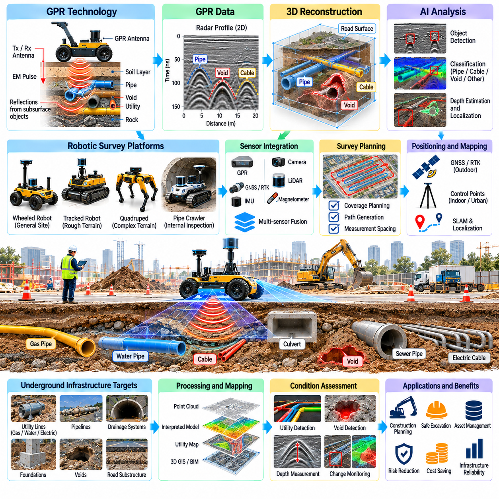{width="7.268055555555556in" height="7.268055555555556in"}

Ground-penetrating radar and underground infrastructure inspection are important applications of Physical AI because buried utilities, foundations, pipelines, and subsurface structures are difficult to assess directly. Conventional excavation is expensive, disruptive, and potentially hazardous. Autonomous robotic platforms equipped with geophysical sensors can collect subsurface measurements, improve asset documentation, and support safer construction and maintenance decisions.

Ground-penetrating radar, commonly called GPR, transmits electromagnetic pulses into the ground and records reflected signals from changes in material properties. Reflections may indicate buried objects, interfaces, voids, or variations in subsurface conditions. Signal interpretation depends on electromagnetic contrast, soil composition, moisture, and antenna frequency. GPR provides indirect evidence rather than a direct image of underground structures.

GPR systems typically include transmitting and receiving antennas, control electronics, positioning sensors, and data recording equipment. Antenna frequency influences the balance between spatial resolution and penetration depth. Higher frequencies generally provide finer detail but shallower penetration, while lower frequencies may reach greater depths with reduced resolution. Appropriate sensor selection depends on inspection objectives and expected ground conditions.

Physical AI enables GPR instruments to be integrated with autonomous mobile robots, tracked vehicles, and specialized field platforms. Robots can follow planned survey trajectories while maintaining controlled sensor movement and measurement spacing. Consistent motion improves data acquisition repeatability and supports systematic coverage. Platform design must consider terrain accessibility, sensor mounting height, vibration, and electromagnetic interference.

Underground utility detection is a major application because construction activities frequently encounter incomplete or outdated records of buried infrastructure. GPR surveys may reveal pipes, cables, conduits, and other subsurface objects when sufficient electromagnetic contrast exists. Detection performance varies with material composition and surrounding soil conditions. Non-detection does not establish that an area is free of buried utilities.

Utility mapping requires combining geophysical observations with accurate surface positioning. GNSS, real-time kinematic positioning, inertial navigation, and robotic localization can associate radar measurements with geographic coordinates. In environments with unreliable satellite signals, surveyed control points or local mapping systems may be necessary. Coordinate uncertainty must be documented because mapping errors can create excavation hazards.

GPR data are commonly represented as radar traces and two-dimensional profiles showing signal amplitude over travel time and survey distance. Buried objects may generate characteristic hyperbolic reflection patterns, although similar signatures can arise from other subsurface features. Processing techniques such as filtering, background removal, and migration can improve interpretation. Excessive processing may also introduce artifacts or suppress relevant signals.

Depth estimation requires knowledge of electromagnetic wave propagation velocity within the inspected material. Velocity depends strongly on dielectric properties and moisture conditions, which may vary across a construction site. Calibration using known targets, measured material properties, or suitable velocity estimation methods improves accuracy. Reported depths should include uncertainty rather than implying that radar measurements provide exact underground positions.

Three-dimensional subsurface reconstruction can be performed by combining multiple parallel or intersecting GPR survey lines. Spatial interpolation and volumetric processing may reveal patterns associated with buried structures or geological interfaces. Reconstruction quality depends on survey spacing, positioning accuracy, signal quality, and processing assumptions. Areas between measurement paths remain uncertain when coverage is insufficient.

Artificial intelligence can assist GPR interpretation through signal classification, hyperbola detection, anomaly localization, and pattern recognition. Machine learning models may reduce the manual effort required to examine extensive radar datasets. However, subsurface variability creates substantial differences between training and deployment conditions. Automated detections must be evaluated against verified field observations and measurement uncertainty.

Multi-sensor fusion improves underground inspection by combining GPR with electromagnetic utility locators, magnetometers, LiDAR, cameras, and positioning instruments. Each sensor provides different evidence about buried objects or surrounding conditions. Correlating observations can increase confidence in selected detections. Nevertheless, disagreement between sensors should be preserved as uncertainty rather than resolved through unsupported assumptions.

Underground infrastructure inspection also includes assessment of buried pipelines and drainage systems. Mobile robots may inspect accessible pipe interiors using cameras, LiDAR, or specialized sensing instruments. External GPR surveys can provide complementary information about surrounding soil and selected subsurface anomalies. Combining internal and external measurements supports broader condition assessment, although individual methods have different detection limits.

Void detection and ground stability assessment are important near roads, tunnels, foundations, and underground utilities. GPR may identify reflection patterns consistent with cavities, disturbed soil, or changes in material interfaces. Such patterns do not independently confirm the presence or dimensions of a void. Engineering interpretation may require complementary geophysical surveys, boreholes, or other ground investigation methods.

Autonomous survey planning determines measurement paths, sensor spacing, travel speed, and coverage requirements. Digital site maps and utility records can guide initial inspection routes. Adaptive planning may increase measurement density near suspicious anomalies or regions with insufficient data. Robots must account for surface obstacles, slopes, restricted areas, and changing terrain conditions while maintaining reliable data acquisition.

Inspection quality depends on maintaining consistent antenna coupling, sensor orientation, positioning accuracy, and acquisition parameters. Rough surfaces and varying antenna height can introduce measurement variability. Environmental conditions, including rainfall and soil moisture, may alter signal penetration and reflection characteristics. Quality assurance procedures should record equipment settings, calibration results, survey conditions, and coverage completeness.

Underground digital twins can integrate detected utilities, estimated depths, geological observations, and inspection histories into structured spatial models. These representations help construction teams understand potential subsurface constraints before excavation. Each mapped feature should include confidence levels, measurement sources, and relevant uncertainty. Digital twins must distinguish confirmed assets from inferred objects and unexplained radar anomalies.

Integration with CAD, BIM, and geographic information systems enables underground survey findings to support engineering design and construction planning. Detected infrastructure can be compared with proposed excavation boundaries, foundation locations, and utility installation routes. Potential conflicts may trigger design review or additional investigation. Accurate coordinate transformation and consistent asset identifiers are essential for reliable integration.

Construction safety is a central motivation for underground infrastructure inspection. Unexpected contact with buried electrical cables, gas pipelines, or pressurized utilities can create severe hazards. Robotic surveys may reduce uncertainty before excavation, but GPR alone cannot guarantee complete utility detection. Safe excavation requires appropriate records review, utility locating procedures, site controls, and physical verification where necessary.

Data management systems should preserve raw radar traces, processed profiles, positioning records, survey metadata, and interpretation results. Traceable datasets allow engineers to revisit uncertain findings and compare observations from different inspection campaigns. Automated reporting can summarize detected anomalies and recommended verification areas. Maintaining original measurements is important because processing methods and interpretation models may improve over time.

Fleet-scale deployment can coordinate multiple robotic survey platforms across construction sites, transportation corridors, and utility networks. Centralized systems may assign inspection tasks, monitor survey completion, and consolidate georeferenced datasets. Standardized acquisition procedures improve consistency between operators and locations. However, local soil conditions and asset configurations still require site-specific interpretation and validation.

Economic benefits may include reduced exploratory excavation, improved utility documentation, fewer construction interruptions, and earlier identification of subsurface risks. The value of autonomous inspection depends on survey area, ground conditions, required accuracy, and the consequences of missed detections. Total cost includes robotic platforms, GPR equipment, positioning systems, software, training, data processing, and field verification.

Deployment should begin with defined inspection objectives and representative ground conditions. Pilot surveys can compare robotic GPR results with known utilities, existing records, and independently verified measurements. Performance evaluation should consider detection probability, false alarms, localization error, coverage, and operational productivity. Expansion requires demonstrated reliability and procedures for handling uncertain or incomplete results.

GPR and underground infrastructure inspection demonstrate how Physical AI extends perception beyond directly visible environments. Autonomous mobility provides systematic survey coverage, while geophysical sensing and intelligent analysis generate evidence about hidden structures. By integrating uncertainty-aware interpretation, digital mapping, and engineering verification, these systems can support safer excavation, better infrastructure records, and more informed asset management.

지표투과레이더(Ground-Penetrating Radar, GPR)와 지하 인프라 검사(Underground Infrastructure Inspection)는 매설된 공공설비(Buried Utilities), 기초 구조물(Foundations), 파이프라인(Pipelines), 지하 구조물(Subsurface Structures)의 상태를 직접 평가하기 어렵다는 점에서 피지컬 인공지능(Physical AI)의 중요한 응용 분야이다. 기존 굴착 방식(Conventional Excavation)은 비용이 많이 들고 작업 중단을 유발하며 잠재적으로 위험하다. 지구물리학적 센서(Geophysical Sensors)를 탑재한 자율 로봇 플랫폼(Autonomous Robotic Platforms)은 지하 측정 데이터(Subsurface Measurements)를 수집하고 자산 문서화(Asset Documentation)를 개선하며 더욱 안전한 건설 및 유지보수 의사결정을 지원할 수 있다.

일반적으로 GPR이라고 부르는 지표투과레이더(Ground-Penetrating Radar)는 전자기 펄스(Electromagnetic Pulses)를 지중으로 송신하고 재료 특성(Material Properties)의 변화로 인해 발생하는 반사 신호(Reflected Signals)를 기록한다. 반사 신호는 매설 물체(Buried Objects), 경계면(Interfaces), 공동(Voids), 지하 조건(Subsurface Conditions)의 변화를 나타낼 수 있다. 신호 해석(Signal Interpretation)은 전자기적 대비(Electromagnetic Contrast), 토양 구성(Soil Composition), 수분(Moisture), 안테나 주파수(Antenna Frequency)에 따라 달라진다. GPR은 지하 구조물의 직접적인 영상(Direct Image)이 아니라 간접적인 증거(Indirect Evidence)를 제공한다.

GPR 시스템(GPR Systems)은 일반적으로 송신 및 수신 안테나(Transmitting and Receiving Antennas), 제어 전자장치(Control Electronics), 위치 결정 센서(Positioning Sensors), 데이터 기록 장비(Data Recording Equipment)로 구성된다. 안테나 주파수(Antenna Frequency)는 공간 해상도(Spatial Resolution)와 탐사 깊이(Penetration Depth) 사이의 균형에 영향을 미친다. 높은 주파수(Higher Frequencies)는 일반적으로 더 세밀한 정보를 제공하지만 탐사 깊이가 얕으며, 낮은 주파수(Lower Frequencies)는 해상도가 감소하는 대신 더 깊은 곳까지 탐사할 수 있다. 적절한 센서 선택(Sensor Selection)은 검사 목표(Inspection Objectives)와 예상되는 지반 조건(Ground Conditions)에 따라 결정된다.

피지컬 인공지능(Physical AI)은 GPR 장비(GPR Instruments)를 자율 이동 로봇(Autonomous Mobile Robots), 궤도형 차량(Tracked Vehicles), 특수 현장 플랫폼(Specialized Field Platforms)과 통합할 수 있도록 한다. 로봇은 센서 이동(Sensor Movement)과 측정 간격(Measurement Spacing)을 일정하게 유지하면서 계획된 측량 경로(Planned Survey Trajectories)를 따라 이동할 수 있다. 일관된 움직임(Consistent Motion)은 데이터 획득 반복성(Data Acquisition Repeatability)을 개선하고 체계적인 탐사 범위(Systematic Coverage)를 지원한다. 플랫폼 설계(Platform Design)는 지형 접근성(Terrain Accessibility), 센서 장착 높이(Sensor Mounting Height), 진동(Vibration), 전자기 간섭(Electromagnetic Interference)을 고려해야 한다.

지하 공공설비 탐지(Underground Utility Detection)는 건설 작업에서 매설 인프라(Buried Infrastructure)에 대한 기록이 불완전하거나 오래된 경우가 많기 때문에 중요한 응용 분야이다. GPR 탐사(GPR Surveys)는 충분한 전자기적 대비(Electromagnetic Contrast)가 존재하는 경우 배관(Pipes), 케이블(Cables), 전선관(Conduits), 기타 지하 물체(Subsurface Objects)를 발견할 수 있다. 탐지 성능(Detection Performance)은 재료 구성(Material Composition)과 주변 토양 조건(Surrounding Soil Conditions)에 따라 달라진다. 탐지되지 않았다는 사실(Non-Detection)이 해당 구역에 매설 공공설비가 없다는 것을 의미하지는 않는다.

공공설비 지도 작성(Utility Mapping)을 위해서는 지구물리학적 관측(Geophysical Observations)과 정확한 지표 위치 결정(Accurate Surface Positioning)을 결합해야 한다. 전역위성항법시스템(Global Navigation Satellite System, GNSS), 실시간 이동측위(Real-Time Kinematic Positioning, RTK), 관성 항법(Inertial Navigation), 로봇 위치 추정(Robotic Localization)은 레이더 측정값(Radar Measurements)을 지리 좌표(Geographic Coordinates)와 연결할 수 있다. 위성 신호(Satellite Signals)가 불안정한 환경에서는 측량 기준점(Surveyed Control Points)이나 지역 지도 작성 시스템(Local Mapping Systems)이 필요할 수 있다. 지도 작성 오류(Mapping Errors)는 굴착 위험(Excavation Hazards)을 발생시킬 수 있으므로 좌표 불확실성(Coordinate Uncertainty)을 문서화해야 한다.

GPR 데이터(GPR Data)는 일반적으로 이동 시간(Travel Time)과 측량 거리(Survey Distance)에 따른 신호 진폭(Signal Amplitude)을 나타내는 레이더 트레이스(Radar Traces)와 2차원 프로파일(Two-Dimensional Profiles)로 표현된다. 매설 물체(Buried Objects)는 특징적인 쌍곡선 반사 패턴(Hyperbolic Reflection Patterns)을 생성할 수 있지만, 다른 지하 특징(Subsurface Features)에서도 유사한 신호가 발생할 수 있다. 필터링(Filtering), 배경 신호 제거(Background Removal), 마이그레이션(Migration)과 같은 처리 기술은 해석을 개선할 수 있다. 그러나 과도한 데이터 처리(Excessive Processing)는 인공적인 신호(Artifacts)를 생성하거나 중요한 신호를 제거할 수도 있다.

깊이 추정(Depth Estimation)을 위해서는 검사 대상 재료 내부에서 전자기파(Electromagnetic Waves)가 전파되는 속도(Propagation Velocity)를 알아야 한다. 전파 속도(Velocity)는 유전 특성(Dielectric Properties)과 수분 조건(Moisture Conditions)에 크게 영향을 받으며, 이러한 특성은 건설 현장 내에서도 달라질 수 있다. 알려진 목표물(Known Targets), 측정된 재료 특성(Measured Material Properties), 적절한 속도 추정 방법(Velocity Estimation Methods)을 활용한 보정(Calibration)은 정확도를 개선한다. 보고되는 깊이(Reported Depths)에는 레이더 측정이 정확한 지하 위치(Exact Underground Positions)를 제공한다고 가정하지 않도록 불확실성(Uncertainty)을 포함해야 한다.

3차원 지하 재구성(Three-Dimensional Subsurface Reconstruction)은 여러 개의 평행하거나 교차하는 GPR 측량선(GPR Survey Lines)을 결합하여 수행할 수 있다. 공간 보간(Spatial Interpolation)과 체적 데이터 처리(Volumetric Processing)는 매설 구조물(Buried Structures)이나 지질학적 경계면(Geological Interfaces)과 관련된 패턴을 드러낼 수 있다. 재구성 품질(Reconstruction Quality)은 측량 간격(Survey Spacing), 위치 결정 정확도(Positioning Accuracy), 신호 품질(Signal Quality), 처리 과정의 가정(Processing Assumptions)에 따라 달라진다. 측정 경로 사이의 영역은 탐사 범위(Coverage)가 충분하지 않은 경우 불확실한 상태로 남는다.

인공지능(Artificial Intelligence, AI)은 신호 분류(Signal Classification), 쌍곡선 탐지(Hyperbola Detection), 이상 위치 추정(Anomaly Localization), 패턴 인식(Pattern Recognition)을 통해 GPR 해석을 지원할 수 있다. 머신러닝 모델(Machine Learning Models)은 방대한 레이더 데이터셋(Radar Datasets)을 수동으로 검토하는 데 필요한 작업량을 줄일 수 있다. 그러나 지하 환경의 다양성(Subsurface Variability)은 학습 환경(Training Conditions)과 실제 배치 환경(Deployment Conditions) 사이에 상당한 차이를 발생시킨다. 자동 탐지 결과(Automated Detections)는 검증된 현장 관측(Verified Field Observations)과 측정 불확실성(Measurement Uncertainty)을 기준으로 평가해야 한다.

다중 센서 융합(Multi-Sensor Fusion)은 GPR을 전자기식 공공설비 탐지기(Electromagnetic Utility Locators), 자력계(Magnetometers), 라이다(LiDAR), 카메라(Cameras), 위치 결정 장비(Positioning Instruments)와 결합하여 지하 검사 성능을 개선한다. 각 센서는 매설 물체(Buried Objects)나 주변 조건(Surrounding Conditions)에 관한 서로 다른 증거를 제공한다. 관측 정보의 상호 연관 분석(Correlating Observations)은 특정 탐지 결과에 대한 신뢰도(Detection Confidence)를 높일 수 있다. 그러나 센서 간 불일치(Sensor Disagreement)는 근거 없는 가정(Unsupported Assumptions)으로 해결하기보다 불확실성으로 유지해야 한다.

지하 인프라 검사(Underground Infrastructure Inspection)에는 매설 파이프라인(Buried Pipelines)과 배수 시스템(Drainage Systems)의 상태 평가도 포함된다. 이동 로봇(Mobile Robots)은 카메라, 라이다, 특수 센싱 장비(Specialized Sensing Instruments)를 사용하여 접근 가능한 배관 내부(Pipe Interiors)를 검사할 수 있다. 외부 GPR 탐사(External GPR Surveys)는 주변 토양(Surrounding Soil)과 일부 지하 이상(Subsurface Anomalies)에 관한 보완 정보를 제공할 수 있다. 내부 및 외부 측정(Internal and External Measurements)을 결합하면 더욱 폭넓은 상태 평가(Condition Assessment)가 가능하지만, 개별 방법마다 서로 다른 탐지 한계(Detection Limits)가 존재한다.

공동 탐지(Void Detection)와 지반 안정성 평가(Ground Stability Assessment)는 도로(Roads), 터널(Tunnels), 기초 구조물(Foundations), 지하 공공설비(Underground Utilities) 주변에서 중요하다. GPR은 공동(Cavities), 교란된 토양(Disturbed Soil), 재료 경계면(Material Interfaces)의 변화와 일치하는 반사 패턴(Reflection Patterns)을 식별할 수 있다. 그러나 이러한 패턴만으로 공동의 존재(Presence of a Void)나 크기(Dimensions)를 확정할 수는 없다. 엔지니어링 해석(Engineering Interpretation)에는 보완적인 지구물리 탐사(Complementary Geophysical Surveys), 시추공(Boreholes), 기타 지반 조사 방법(Ground Investigation Methods)이 필요할 수 있다.

자율 측량 계획(Autonomous Survey Planning)은 측정 경로(Measurement Paths), 센서 간격(Sensor Spacing), 이동 속도(Travel Speed), 탐사 범위 요구사항(Coverage Requirements)을 결정한다. 디지털 현장 지도(Digital Site Maps)와 공공설비 기록(Utility Records)은 초기 검사 경로(Initial Inspection Routes)를 안내할 수 있다. 적응형 계획(Adaptive Planning)은 의심스러운 이상(Suspicious Anomalies)이나 데이터가 불충분한 영역(Regions with Insufficient Data) 주변의 측정 밀도(Measurement Density)를 높일 수 있다. 로봇은 신뢰성 있는 데이터 획득(Reliable Data Acquisition)을 유지하면서 지표 장애물(Surface Obstacles), 경사(Slopes), 접근 제한 구역(Restricted Areas), 변화하는 지형 조건(Changing Terrain Conditions)을 고려해야 한다.

검사 품질(Inspection Quality)은 일관된 안테나 결합 상태(Antenna Coupling), 센서 방향(Sensor Orientation), 위치 결정 정확도(Positioning Accuracy), 데이터 획득 매개변수(Acquisition Parameters)를 유지하는 데 따라 달라진다. 거친 지표면(Rough Surfaces)과 변화하는 안테나 높이(Varying Antenna Height)는 측정 변동성(Measurement Variability)을 발생시킬 수 있다. 강우(Rainfall)와 토양 수분(Soil Moisture)을 포함한 환경 조건(Environmental Conditions)은 신호 투과(Signal Penetration)와 반사 특성(Reflection Characteristics)을 변화시킬 수 있다. 품질 보증 절차(Quality Assurance Procedures)는 장비 설정(Equipment Settings), 보정 결과(Calibration Results), 측량 조건(Survey Conditions), 탐사 범위 완전성(Coverage Completeness)을 기록해야 한다.

지하 디지털 트윈(Underground Digital Twins)은 탐지된 공공설비(Detected Utilities), 추정 깊이(Estimated Depths), 지질학적 관측(Geological Observations), 검사 이력(Inspection Histories)을 구조화된 공간 모델(Structured Spatial Models)로 통합할 수 있다. 이러한 표현은 건설팀(Construction Teams)이 굴착 전에 잠재적인 지하 제약(Subsurface Constraints)을 이해하는 데 도움이 된다. 지도에 표시된 각 특징(Mapped Feature)에는 신뢰도 수준(Confidence Levels), 측정 출처(Measurement Sources), 관련 불확실성(Relevant Uncertainty)을 포함해야 한다. 디지털 트윈은 확인된 자산(Confirmed Assets), 추론된 물체(Inferred Objects), 원인이 밝혀지지 않은 레이더 이상(Unexplained Radar Anomalies)을 구별해야 한다.

컴퓨터 지원 설계(Computer-Aided Design, CAD), 건축정보모델링(Building Information Modeling, BIM), 지리정보시스템(Geographic Information Systems, GIS)과의 통합은 지하 측량 결과(Underground Survey Findings)가 엔지니어링 설계(Engineering Design)와 건설 계획(Construction Planning)을 지원하도록 한다. 탐지된 인프라(Detected Infrastructure)는 계획된 굴착 경계(Proposed Excavation Boundaries), 기초 위치(Foundation Locations), 공공설비 설치 경로(Utility Installation Routes)와 비교할 수 있다. 잠재적인 충돌(Potential Conflicts)은 설계 검토(Design Review)나 추가 조사(Additional Investigation)를 촉발할 수 있다. 정확한 좌표 변환(Coordinate Transformation)과 일관된 자산 식별자(Consistent Asset Identifiers)는 신뢰성 있는 통합에 필수적이다.

건설 안전(Construction Safety)은 지하 인프라 검사(Underground Infrastructure Inspection)의 핵심적인 추진 동기이다. 매설 전력 케이블(Buried Electrical Cables), 가스 파이프라인(Gas Pipelines), 가압 공공설비(Pressurized Utilities)와 예상하지 못한 접촉이 발생하면 심각한 위험을 초래할 수 있다. 로봇 탐사(Robotic Surveys)는 굴착 전에 불확실성을 줄일 수 있지만, GPR만으로 모든 공공설비의 탐지(Complete Utility Detection)를 보장할 수는 없다. 안전한 굴착(Safe Excavation)을 위해서는 적절한 기록 검토(Records Review), 공공설비 탐지 절차(Utility Locating Procedures), 현장 안전 관리(Site Controls), 필요한 경우 물리적 확인(Physical Verification)이 요구된다.

데이터 관리 시스템(Data Management Systems)은 원시 레이더 트레이스(Raw Radar Traces), 처리된 프로파일(Processed Profiles), 위치 결정 기록(Positioning Records), 측량 메타데이터(Survey Metadata), 해석 결과(Interpretation Results)를 보존해야 한다. 추적 가능한 데이터셋(Traceable Datasets)은 엔지니어가 불확실한 결과를 재검토하고 서로 다른 검사 작업(Inspection Campaigns)의 관측값을 비교할 수 있도록 한다. 자동 보고(Automated Reporting)는 탐지된 이상(Detected Anomalies)과 권장 검증 영역(Recommended Verification Areas)을 요약할 수 있다. 데이터 처리 방법(Processing Methods)과 해석 모델(Interpretation Models)은 시간이 지남에 따라 개선될 수 있으므로 원본 측정값(Original Measurements)을 유지하는 것이 중요하다.

군집 규모 배치(Fleet-Scale Deployment)는 건설 현장(Construction Sites), 교통 통로(Transportation Corridors), 공공설비 네트워크(Utility Networks)에 걸쳐 여러 로봇 측량 플랫폼(Robotic Survey Platforms)을 조정할 수 있다. 중앙집중형 시스템(Centralized Systems)은 검사 작업(Inspection Tasks)을 할당하고 측량 완료 상태(Survey Completion)를 모니터링하며 지리참조 데이터셋(Georeferenced Datasets)을 통합할 수 있다. 표준화된 데이터 획득 절차(Standardized Acquisition Procedures)는 운영자와 위치 간 일관성을 개선한다. 그러나 지역별 토양 조건(Local Soil Conditions)과 자산 구성(Asset Configurations)은 여전히 현장별 해석(Site-Specific Interpretation)과 검증(Validation)을 필요로 한다.

경제적 이점(Economic Benefits)에는 탐색 굴착(Exploratory Excavation) 감소, 공공설비 문서화(Utility Documentation) 개선, 건설 작업 중단(Construction Interruptions) 감소, 지하 위험(Subsurface Risks)의 조기 식별이 포함될 수 있다. 자율 검사(Autonomous Inspection)의 가치는 측량 면적(Survey Area), 지반 조건(Ground Conditions), 요구 정확도(Required Accuracy), 탐지 누락(Missed Detections)의 결과에 따라 달라진다. 총비용(Total Cost)에는 로봇 플랫폼(Robotic Platforms), GPR 장비(GPR Equipment), 위치 결정 시스템(Positioning Systems), 소프트웨어(Software), 교육(Training), 데이터 처리(Data Processing), 현장 검증(Field Verification)이 포함된다.

시스템 배치(Deployment)는 명확하게 정의된 검사 목표(Inspection Objectives)와 대표성 있는 지반 조건(Representative Ground Conditions)을 기반으로 시작해야 한다. 시범 측량(Pilot Surveys)은 로봇 GPR 결과(Robotic GPR Results)를 알려진 공공설비(Known Utilities), 기존 기록(Existing Records), 독립적으로 검증된 측정값(Independently Verified Measurements)과 비교할 수 있다. 성능 평가(Performance Evaluation)는 탐지 확률(Detection Probability), 오경보(False Alarms), 위치 추정 오차(Localization Error), 탐사 범위(Coverage), 운영 생산성(Operational Productivity)을 고려해야 한다. 적용 범위 확대(Expansion)를 위해서는 입증된 신뢰성(Demonstrated Reliability)과 불확실하거나 불완전한 결과(Uncertain or Incomplete Results)를 처리하기 위한 절차가 필요하다.

GPR과 지하 인프라 검사(GPR and Underground Infrastructure Inspection)는 피지컬 인공지능(Physical AI)이 직접 관측할 수 없는 환경(Beyond Directly Visible Environments)으로 인지 능력(Perception)을 어떻게 확장하는지 보여준다. 자율 이동(Autonomous Mobility)은 체계적인 측량 범위(Systematic Survey Coverage)를 제공하며, 지구물리학적 센싱(Geophysical Sensing)과 지능형 분석(Intelligent Analysis)은 숨겨진 구조물(Hidden Structures)에 관한 증거를 생성한다. 불확실성을 고려한 해석(Uncertainty-Aware Interpretation), 디지털 지도 작성(Digital Mapping), 엔지니어링 검증(Engineering Verification)을 통합함으로써 이러한 시스템은 더욱 안전한 굴착(Safer Excavation), 개선된 인프라 기록(Better Infrastructure Records), 정보에 기반한 자산 관리(Informed Asset Management)를 지원할 수 있다.

##  

## 06.10. Quadrupeds for Difficult Access Areas

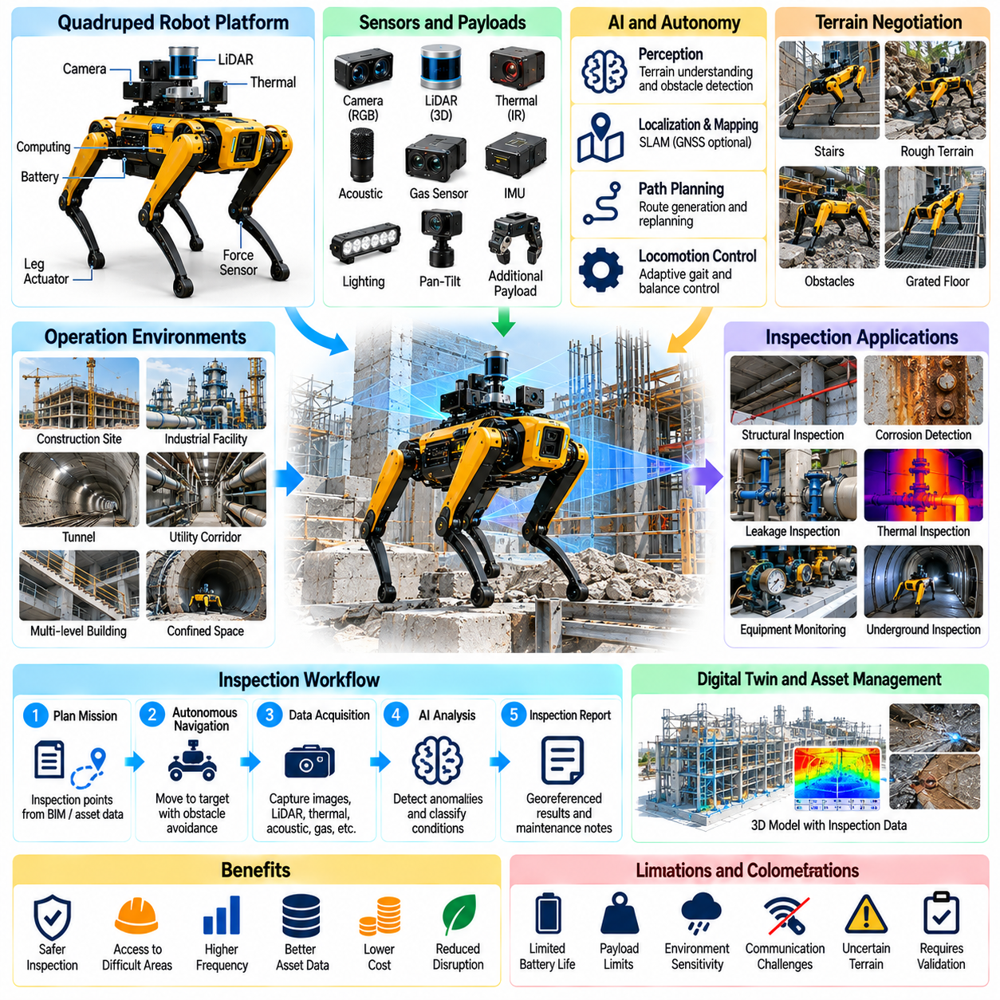{width="7.268055555555556in" height="7.268055555555556in"}

Quadruped robots provide an important Physical AI solution for inspecting construction and infrastructure environments where conventional wheeled platforms encounter mobility limitations. Their articulated legs enable movement across stairs, debris, uneven floors, and selected obstacles. By combining adaptive locomotion with autonomous perception, quadrupeds can extend robotic inspection into difficult-access areas while reducing direct human exposure to hazardous conditions.

Construction sites frequently contain temporary structures, loose materials, irregular surfaces, and changing access routes. These conditions make fixed-path automation and conventional mobile navigation difficult. Quadruped robots can adjust foothold placement and body posture to negotiate terrain variations. However, successful mobility depends on obstacle geometry, surface friction, payload weight, and the robot\'s mechanical and control capabilities.

Legged locomotion requires coordinated control of multiple joints while maintaining dynamic or quasi-static stability. Joint actuators, inertial sensors, force estimation, and motion controllers work together to regulate balance and movement. Physical AI can improve terrain interpretation and adaptive gait selection. Reliable operation also requires conservative limits on speed, joint loading, ground contact, and allowable body orientation.

Terrain perception is essential because difficult-access environments rarely provide uniform walking surfaces. LiDAR, stereo cameras, depth sensors, and inertial measurements can estimate local geometry and traversability. Perception algorithms identify steps, slopes, gaps, obstacles, and potential footholds. Uncertain surfaces or visually obscured hazards require cautious behavior because geometric appearance alone cannot guarantee adequate support.

Autonomous navigation integrates terrain maps with route planning and locomotion control. A high-level planner identifies accessible corridors and inspection targets, while local controllers adapt individual movements to nearby obstacles. Simultaneous Localization and Mapping supports navigation where satellite positioning is unavailable. Continuous replanning is necessary when construction materials, equipment, or personnel alter the environment.

Stair climbing is a distinctive capability of quadruped platforms in multi-level construction and industrial facilities. Robots can coordinate foot placement and body motion to ascend or descend suitable stairways without dedicated lifting equipment. Performance depends on step dimensions, traction, visibility, and available clearance. Stairway traversal must be validated for each platform rather than assumed from its general locomotion capabilities.

Quadrupeds can inspect tunnels, underground passages, utility corridors, and mechanical rooms where access is restricted. Their compact body configurations may allow movement through selected narrow routes and around equipment. Mounted cameras and environmental sensors provide remote observations. Nevertheless, confined-space deployment requires communication planning, atmospheric hazard assessment, emergency recovery procedures, and compliance with site access requirements.

Industrial infrastructure often contains elevated walkways, grated floors, cable trays, and complex piping networks. Quadrupeds may patrol accessible routes to inspect equipment and surrounding structures. Their ability to negotiate modest obstacles can reduce the need for extensive environmental modification. However, floor load limits, grating dimensions, exposed openings, and fall hazards must be evaluated before autonomous operation.

Inspection payloads can include high-resolution cameras, thermal imagers, acoustic sensors, gas detectors, and LiDAR systems. Visual sensors document corrosion, leakage, cracks, and equipment conditions, while thermal instruments identify temperature differences. Acoustic measurements may support selected machinery assessments. Each sensor has limitations, and abnormal readings require interpretation against operating conditions and validated inspection criteria.

Sensor integration introduces mechanical, electrical, and computational tradeoffs. Additional payload mass changes the robot\'s center of gravity, energy consumption, and locomotion performance. Vibration and body movement can degrade image quality or measurement stability. Payload design should account for mounting rigidity, calibration, synchronization, environmental protection, and the available power and computing resources.

Autonomous inspection missions can be generated from digital facility maps, construction models, and asset management databases. Inspection points are associated with equipment identifiers, required viewpoints, and sensing procedures. Quadrupeds navigate between locations and collect standardized observations. Mission planning should consider access restrictions, terrain difficulty, battery capacity, and the time required for reliable measurements.

Repeatable inspection is valuable because consistent observation positions support comparison across multiple inspection cycles. A quadruped can revisit equipment, structural connections, and designated monitoring locations using stored routes. Changes in visual appearance, temperature, or acoustic characteristics may indicate developing problems. Reliable trend analysis requires consistent sensor settings, operating context, and spatial registration.

Physical AI can support anomaly detection by analyzing images, thermal patterns, and other inspection measurements. Learning-based systems may identify suspicious conditions and prioritize observations for engineering review. However, unusual defects and limited training data can produce false alarms or missed detections. Automated findings should therefore include confidence information and remain subject to appropriate human verification.

Human supervision remains important when quadrupeds operate in unpredictable construction environments. Remote operators can monitor navigation status, sensor outputs, and detected hazards while intervening when necessary. Teleoperation provides an alternative when autonomous planning encounters uncertainty. Safe operation requires clearly defined control authority, emergency stopping mechanisms, and recovery procedures for immobilized robots.

Communication reliability can be difficult in reinforced structures, underground facilities, and large industrial complexes. Wireless signals may be weakened by concrete, steel, and equipment arrangements. Quadrupeds should maintain safe fallback behaviors when connectivity deteriorates. Depending on the environment, these behaviors may include stopping, remaining in a stable posture, or returning along a verified route.

Energy management influences inspection coverage and operational productivity. Legged locomotion generally requires significant actuator power, especially on stairs, slopes, and irregular terrain. Battery endurance varies with payload, gait, speed, and environmental conditions. Mission planning should reserve sufficient energy for return travel, unexpected obstacles, and recovery activities rather than relying solely on nominal operating duration.

Safety engineering must address falls, collisions, unstable footholds, and interactions with personnel. Robots should recognize exclusion zones and avoid routes that exceed validated mobility limits. Operational procedures must account for emergency access, moving machinery, and changing construction hazards. Functional safety mechanisms and human oversight are particularly important where robotic failures could create secondary risks.

Quadrupeds may operate alongside wheeled robots, aerial platforms, and human inspection teams. Wheeled systems can cover smooth corridors efficiently, aerial robots can observe elevated structures, and quadrupeds can access selected irregular routes. Multi-robot coordination can assign tasks according to mobility and sensing capabilities. Shared maps and standardized inspection records improve collaboration across heterogeneous platforms.

Digital twin integration connects quadruped inspection observations with three-dimensional facility representations and asset histories. Robot-generated images, point clouds, and sensor readings can be associated with precise inspection locations. Historical records support change detection and maintenance planning. Data pipelines should preserve timestamps, coordinate references, equipment configurations, and measurement uncertainty.

Operational performance should be evaluated using mission completion rate, inspection coverage, localization accuracy, traversal reliability, and intervention frequency. Additional metrics include battery consumption, inspection time, and sensor data quality. Successful walking alone does not establish inspection effectiveness. Evaluation must demonstrate that the platform consistently acquires useful measurements under representative environmental conditions.

Economic value arises when quadrupeds reduce hazardous access requirements, repeated manual inspection effort, or operational disruption. Benefits are strongest where conventional mobility systems cannot reach inspection targets without substantial modifications. Total cost of ownership includes robot hardware, sensing payloads, software, operator training, maintenance, communications, and engineering verification. Utilization and reliability strongly influence financial feasibility.

Deployment should begin with clearly defined routes, accessible recovery points, and measurable inspection objectives. Pilot programs can evaluate stair traversal, terrain adaptation, sensing performance, and communication reliability against established inspection procedures. Gradual expansion should follow demonstrated safety and operational consistency. Complex environments may require supervised autonomy before higher levels of independence become practical.

Quadrupeds for difficult-access areas demonstrate how embodied intelligence extends Physical AI beyond structured industrial floors. Their value comes from integrating legged mobility, terrain perception, autonomous planning, and repeatable sensing into practical inspection workflows. When combined with digital asset management and engineering oversight, quadrupeds can improve access, inspection consistency, and infrastructure maintenance efficiency.

사족보행 로봇(Quadruped Robots)은 기존의 바퀴형 플랫폼(Wheeled Platforms)이 이동성의 한계(Mobility Limitations)에 직면하는 건설 및 인프라 환경(Construction and Infrastructure Environments)을 검사하기 위한 중요한 피지컬 인공지능(Physical AI) 솔루션을 제공한다. 관절형 다리(Articulated Legs)는 계단(Stairs), 잔해(Debris), 불규칙한 바닥(Uneven Floors), 특정 장애물(Obstacles)을 통과할 수 있도록 한다. 사족보행 로봇은 적응형 보행(Adaptive Locomotion)과 자율 인지(Autonomous Perception)를 결합하여 접근이 어려운 구역(Difficult-Access Areas)까지 로봇 검사를 확장하고 위험한 환경에 대한 작업자의 직접적인 노출을 줄일 수 있다.

건설 현장(Construction Sites)에는 임시 구조물(Temporary Structures), 흩어진 자재(Loose Materials), 불규칙한 표면(Irregular Surfaces), 지속적으로 변화하는 접근 경로(Changing Access Routes)가 자주 존재한다. 이러한 조건에서는 고정 경로 자동화(Fixed-Path Automation)와 기존 이동 로봇의 내비게이션(Conventional Mobile Navigation)을 구현하기 어렵다. 사족보행 로봇은 발 디딤 위치(Foothold Placement)와 몸체 자세(Body Posture)를 조정하여 다양한 지형 변화(Terrain Variations)에 대응할 수 있다. 그러나 성공적인 이동은 장애물 형상(Obstacle Geometry), 표면 마찰(Surface Friction), 탑재 하중(Payload Weight), 로봇의 기계적 성능(Mechanical Capabilities) 및 제어 성능(Control Capabilities)에 따라 달라진다.

다리 기반 이동(Legged Locomotion)은 동적 안정성(Dynamic Stability) 또는 준정적 안정성(Quasi-Static Stability)을 유지하면서 여러 관절(Multiple Joints)을 협조적으로 제어해야 한다. 관절 구동기(Joint Actuators), 관성 센서(Inertial Sensors), 힘 추정(Force Estimation), 운동 제어기(Motion Controllers)는 균형(Balance)과 움직임(Movement)을 조절하기 위해 함께 작동한다. 피지컬 인공지능은 지형 해석(Terrain Interpretation)과 적응형 보행 패턴 선택(Adaptive Gait Selection)을 개선할 수 있다. 신뢰성 있는 운영을 위해서는 속도(Speed), 관절 하중(Joint Loading), 지면 접촉(Ground Contact), 허용 가능한 몸체 방향(Allowable Body Orientation)에 대한 보수적인 제한도 필요하다.

지형 인지(Terrain Perception)는 접근이 어려운 환경에서 균일한 보행 표면(Uniform Walking Surfaces)이 제공되는 경우가 드물기 때문에 필수적이다. 라이다(LiDAR), 스테레오 카메라(Stereo Cameras), 깊이 센서(Depth Sensors), 관성 측정(Inertial Measurements)은 국소 지형 형상(Local Geometry)과 주행 가능성(Traversability)을 추정할 수 있다. 인지 알고리즘(Perception Algorithms)은 계단(Steps), 경사면(Slopes), 틈새(Gaps), 장애물(Obstacles), 잠재적인 발 디딤 위치(Potential Footholds)를 식별한다. 불확실한 표면(Uncertain Surfaces)이나 시각적으로 가려진 위험 요소(Visually Obscured Hazards)에 대해서는 기하학적 외관(Geometric Appearance)만으로 충분한 지지력(Adequate Support)을 보장할 수 없으므로 신중한 동작이 필요하다.

자율 내비게이션(Autonomous Navigation)은 지형 지도(Terrain Maps)를 경로 계획(Route Planning) 및 보행 제어(Locomotion Control)와 통합한다. 상위 수준 계획기(High-Level Planner)는 접근 가능한 통로(Accessible Corridors)와 검사 대상(Inspection Targets)을 식별하며, 국소 제어기(Local Controllers)는 주변 장애물에 맞추어 개별 움직임을 조정한다. 동시적 위치 추정 및 지도 작성(Simultaneous Localization and Mapping, SLAM)은 위성 위치 결정(Satellite Positioning)을 사용할 수 없는 환경에서 내비게이션을 지원한다. 건설 자재(Construction Materials), 장비(Equipment), 작업자(Personnel)가 환경을 변화시키는 경우 지속적인 재계획(Continuous Replanning)이 필요하다.

계단 오르내리기(Stair Climbing)는 다층 건설 현장(Multi-Level Construction Sites)과 산업 시설(Industrial Facilities)에서 사족보행 플랫폼(Quadruped Platforms)이 제공하는 특징적인 기능이다. 로봇은 별도의 승강 장비(Dedicated Lifting Equipment) 없이 적합한 계단을 오르내리기 위해 발 디딤 위치(Foot Placement)와 몸체 움직임(Body Motion)을 협조적으로 제어할 수 있다. 성능은 계단 치수(Step Dimensions), 접지력(Traction), 가시성(Visibility), 이용 가능한 여유 공간(Available Clearance)에 따라 달라진다. 계단 이동(Stairway Traversal)은 일반적인 보행 능력만으로 가능하다고 가정하지 말고 각 플랫폼에 대해 검증해야 한다.

사족보행 로봇은 접근이 제한된 터널(Tunnels), 지하 통로(Underground Passages), 공공설비 통로(Utility Corridors), 기계실(Mechanical Rooms)을 검사할 수 있다. 소형 몸체 구조(Compact Body Configurations)는 특정 좁은 경로(Narrow Routes)를 통과하고 장비 주변을 이동할 수 있도록 한다. 탑재된 카메라(Mounted Cameras)와 환경 센서(Environmental Sensors)는 원격 관측(Remote Observations)을 제공한다. 그러나 밀폐 공간 배치(Confined-Space Deployment)에는 통신 계획(Communication Planning), 대기 위험 평가(Atmospheric Hazard Assessment), 비상 회수 절차(Emergency Recovery Procedures), 현장 접근 요구사항(Site Access Requirements)의 준수가 필요하다.

산업 인프라(Industrial Infrastructure)에는 고가 보행로(Elevated Walkways), 격자형 바닥(Grated Floors), 케이블 트레이(Cable Trays), 복잡한 배관망(Complex Piping Networks)이 존재하는 경우가 많다. 사족보행 로봇은 접근 가능한 경로를 순찰하면서 장비와 주변 구조물을 검사할 수 있다. 비교적 작은 장애물(Modest Obstacles)을 통과하는 능력은 광범위한 환경 개조(Extensive Environmental Modification)의 필요성을 줄일 수 있다. 그러나 자율 운영 전에 바닥 하중 제한(Floor Load Limits), 격자 치수(Grating Dimensions), 개방된 구멍(Exposed Openings), 추락 위험(Fall Hazards)을 평가해야 한다.

검사 탑재장치(Inspection Payloads)에는 고해상도 카메라(High-Resolution Cameras), 열화상 카메라(Thermal Imagers), 음향 센서(Acoustic Sensors), 가스 검지기(Gas Detectors), 라이다 시스템(LiDAR Systems)이 포함될 수 있다. 시각 센서(Visual Sensors)는 부식(Corrosion), 누출(Leakage), 균열(Cracks), 장비 상태(Equipment Conditions)를 기록하며, 열화상 장비(Thermal Instruments)는 온도 차이(Temperature Differences)를 식별한다. 음향 측정(Acoustic Measurements)은 특정 기계 상태 평가(Machinery Assessments)를 지원할 수 있다. 각 센서에는 한계(Limitations)가 존재하며, 비정상적인 측정값(Abnormal Readings)은 운영 조건(Operating Conditions)과 검증된 검사 기준(Validated Inspection Criteria)을 바탕으로 해석해야 한다.

센서 통합(Sensor Integration)은 기계적(Mechanical), 전기적(Electrical), 계산적(Computational) 측면에서 상충관계(Tradeoffs)를 발생시킨다. 추가 탑재 중량(Additional Payload Mass)은 로봇의 무게중심(Center of Gravity), 에너지 소비(Energy Consumption), 보행 성능(Locomotion Performance)을 변화시킨다. 진동(Vibration)과 몸체 움직임(Body Movement)은 영상 품질(Image Quality)이나 측정 안정성(Measurement Stability)을 저하시킬 수 있다. 탑재장치 설계(Payload Design)는 장착 강성(Mounting Rigidity), 보정(Calibration), 동기화(Synchronization), 환경 보호(Environmental Protection), 이용 가능한 전력 및 컴퓨팅 자원(Power and Computing Resources)을 고려해야 한다.

자율 검사 임무(Autonomous Inspection Missions)는 디지털 시설 지도(Digital Facility Maps), 건설 모델(Construction Models), 자산 관리 데이터베이스(Asset Management Databases)를 기반으로 생성할 수 있다. 검사 지점(Inspection Points)은 장비 식별자(Equipment Identifiers), 요구되는 관측 시점(Required Viewpoints), 센싱 절차(Sensing Procedures)와 연결된다. 사족보행 로봇은 각 위치 사이를 이동하면서 표준화된 관측 데이터(Standardized Observations)를 수집한다. 임무 계획(Mission Planning)은 접근 제한(Access Restrictions), 지형 난이도(Terrain Difficulty), 배터리 용량(Battery Capacity), 신뢰성 있는 측정에 필요한 시간(Time Required for Reliable Measurements)을 고려해야 한다.

반복 가능한 검사(Repeatable Inspection)는 일관된 관측 위치(Consistent Observation Positions)를 통해 여러 검사 주기(Inspection Cycles)의 결과를 비교할 수 있다는 점에서 중요하다. 사족보행 로봇은 저장된 경로(Stored Routes)를 이용하여 장비(Equipment), 구조적 연결부(Structural Connections), 지정된 모니터링 위치(Designated Monitoring Locations)를 다시 방문할 수 있다. 시각적 외관(Visual Appearance), 온도(Temperature), 음향 특성(Acoustic Characteristics)의 변화는 문제가 진행되고 있음을 나타낼 수 있다. 신뢰성 있는 추세 분석(Reliable Trend Analysis)을 위해서는 일관된 센서 설정(Sensor Settings), 운영 상황(Operating Context), 공간 정합(Spatial Registration)이 필요하다.

피지컬 인공지능(Physical AI)은 이미지(Images), 열 패턴(Thermal Patterns), 기타 검사 측정값(Inspection Measurements)을 분석하여 이상 탐지(Anomaly Detection)를 지원할 수 있다. 학습 기반 시스템(Learning-Based Systems)은 의심스러운 상태(Suspicious Conditions)를 식별하고 엔지니어링 검토(Engineering Review)가 필요한 관측 결과의 우선순위를 지정할 수 있다. 그러나 특이한 결함(Unusual Defects)과 제한된 학습 데이터(Limited Training Data)는 오경보(False Alarms) 또는 탐지 누락(Missed Detections)을 발생시킬 수 있다. 따라서 자동화된 검사 결과(Automated Findings)에는 신뢰도 정보(Confidence Information)가 포함되어야 하며 적절한 인간 검증(Human Verification)을 거쳐야 한다.

사족보행 로봇이 예측하기 어려운 건설 환경(Unpredictable Construction Environments)에서 작동할 때는 인간 감독(Human Supervision)이 여전히 중요하다. 원격 운영자(Remote Operators)는 내비게이션 상태(Navigation Status), 센서 출력(Sensor Outputs), 탐지된 위험(Detected Hazards)을 모니터링하면서 필요한 경우 개입할 수 있다. 원격 조작(Teleoperation)은 자율 계획(Autonomous Planning)이 불확실한 상황에 직면했을 때 대안이 된다. 안전한 운영(Safe Operation)을 위해서는 명확하게 정의된 제어 권한(Control Authority), 비상 정지 장치(Emergency Stopping Mechanisms), 이동 불능 로봇(Immobilized Robots)을 위한 회수 절차(Recovery Procedures)가 필요하다.

통신 신뢰성(Communication Reliability)은 철근콘크리트 구조물(Reinforced Structures), 지하 시설(Underground Facilities), 대규모 산업 단지(Large Industrial Complexes)에서 확보하기 어려울 수 있다. 무선 신호(Wireless Signals)는 콘크리트(Concrete), 강재(Steel), 장비 배치(Equipment Arrangements)에 의해 약해질 수 있다. 사족보행 로봇은 연결 상태(Connectivity)가 악화될 때 안전한 대체 동작(Safe Fallback Behaviors)을 유지해야 한다. 환경에 따라 이러한 동작에는 정지(Stopping), 안정된 자세 유지(Remaining in a Stable Posture), 검증된 경로를 통한 복귀(Returning Along a Verified Route)가 포함될 수 있다.

에너지 관리(Energy Management)는 검사 범위(Inspection Coverage)와 운영 생산성(Operational Productivity)에 영향을 미친다. 다리 기반 이동(Legged Locomotion)은 일반적으로 상당한 구동기 전력(Actuator Power)을 필요로 하며, 특히 계단(Stairs), 경사면(Slopes), 불규칙한 지형(Irregular Terrain)에서 전력 소모가 증가한다. 배터리 지속시간(Battery Endurance)은 탑재 하중(Payload), 보행 패턴(Gait), 속도(Speed), 환경 조건(Environmental Conditions)에 따라 달라진다. 임무 계획(Mission Planning)은 정격 운영시간(Nominal Operating Duration)에만 의존하지 않고 복귀 이동(Return Travel), 예상하지 못한 장애물(Unexpected Obstacles), 회수 작업(Recovery Activities)에 필요한 충분한 에너지를 확보해야 한다.

안전 엔지니어링(Safety Engineering)은 추락(Falls), 충돌(Collisions), 불안정한 발 디딤 위치(Unstable Footholds), 작업자와의 상호작용(Interactions with Personnel)을 다루어야 한다. 로봇은 출입 제한 구역(Exclusion Zones)을 인식하고 검증된 이동 한계(Validated Mobility Limits)를 초과하는 경로를 피해야 한다. 운영 절차(Operational Procedures)는 비상 접근(Emergency Access), 움직이는 기계(Moving Machinery), 변화하는 건설 위험(Changing Construction Hazards)을 고려해야 한다. 로봇 고장(Robotic Failures)이 2차 위험(Secondary Risks)을 발생시킬 수 있는 환경에서는 기능 안전 메커니즘(Functional Safety Mechanisms)과 인간 감독(Human Oversight)이 특히 중요하다.

사족보행 로봇은 바퀴형 로봇(Wheeled Robots), 항공 플랫폼(Aerial Platforms), 인간 검사팀(Human Inspection Teams)과 함께 운영될 수 있다. 바퀴형 시스템(Wheeled Systems)은 평탄한 통로(Smooth Corridors)를 효율적으로 이동하고, 항공 로봇(Aerial Robots)은 높은 구조물(Elevated Structures)을 관측하며, 사족보행 로봇은 일부 불규칙한 경로(Irregular Routes)에 접근할 수 있다. 다중 로봇 협조(Multi-Robot Coordination)는 이동 능력(Mobility Capabilities)과 센싱 능력(Sensing Capabilities)에 따라 작업을 할당할 수 있다. 공유 지도(Shared Maps)와 표준화된 검사 기록(Standardized Inspection Records)은 이기종 플랫폼(Heterogeneous Platforms) 간 협업을 개선한다.

디지털 트윈 통합(Digital Twin Integration)은 사족보행 로봇의 검사 관측 결과(Inspection Observations)를 3차원 시설 표현(Three-Dimensional Facility Representations) 및 자산 이력(Asset Histories)과 연결한다. 로봇이 생성한 이미지(Images), 포인트 클라우드(Point Clouds), 센서 측정값(Sensor Readings)은 정확한 검사 위치(Inspection Locations)와 연계될 수 있다. 과거 기록(Historical Records)은 변화 감지(Change Detection)와 유지보수 계획(Maintenance Planning)을 지원한다. 데이터 파이프라인(Data Pipelines)은 타임스탬프(Timestamps), 좌표 기준(Coordinate References), 장비 구성(Equipment Configurations), 측정 불확실성(Measurement Uncertainty)을 보존해야 한다.

운영 성능(Operational Performance)은 임무 완료율(Mission Completion Rate), 검사 범위(Inspection Coverage), 위치 추정 정확도(Localization Accuracy), 지형 통과 신뢰성(Traversal Reliability), 개입 빈도(Intervention Frequency)를 사용하여 평가해야 한다. 추가적인 지표(Additional Metrics)에는 배터리 소비량(Battery Consumption), 검사 시간(Inspection Time), 센서 데이터 품질(Sensor Data Quality)이 포함된다. 성공적인 보행(Successful Walking)만으로 검사 효과성(Inspection Effectiveness)이 입증되는 것은 아니다. 성능 평가(Evaluation)는 대표적인 환경 조건(Representative Environmental Conditions)에서 플랫폼이 유용한 측정값(Useful Measurements)을 일관되게 획득한다는 것을 입증해야 한다.

경제적 가치(Economic Value)는 사족보행 로봇이 위험한 접근 작업(Hazardous Access Requirements), 반복적인 수동 검사 작업(Repeated Manual Inspection Effort), 운영 중단(Operational Disruption)을 줄일 때 발생한다. 기존 이동 시스템(Conventional Mobility Systems)이 상당한 환경 개조(Substantial Modifications) 없이는 검사 대상에 도달할 수 없는 환경에서 이점이 가장 크다. 총소유비용(Total Cost of Ownership, TCO)에는 로봇 하드웨어(Robot Hardware), 센서 탑재장치(Sensing Payloads), 소프트웨어(Software), 운영자 교육(Operator Training), 유지보수(Maintenance), 통신(Communications), 엔지니어링 검증(Engineering Verification)이 포함된다. 활용률(Utilization)과 신뢰성(Reliability)은 경제적 타당성(Financial Feasibility)에 큰 영향을 미친다.

시스템 배치(Deployment)는 명확하게 정의된 경로(Clearly Defined Routes), 접근 가능한 회수 지점(Accessible Recovery Points), 측정 가능한 검사 목표(Measurable Inspection Objectives)를 기반으로 시작해야 한다. 시범 프로그램(Pilot Programs)은 기존 검사 절차(Established Inspection Procedures)를 기준으로 계단 이동(Stair Traversal), 지형 적응(Terrain Adaptation), 센싱 성능(Sensing Performance), 통신 신뢰성(Communication Reliability)을 평가할 수 있다. 점진적인 확장(Gradual Expansion)은 안전성(Safety)과 운영 일관성(Operational Consistency)이 입증된 이후에 진행되어야 한다. 복잡한 환경(Complex Environments)에서는 더 높은 수준의 자율성(Higher Levels of Independence)이 실용화되기 전에 감독형 자율 운영(Supervised Autonomy)이 필요할 수 있다.

접근이 어려운 구역을 위한 사족보행 로봇(Quadrupeds for Difficult-Access Areas)은 체화 지능(Embodied Intelligence)이 구조화된 산업 현장 바닥(Structured Industrial Floors)을 넘어 피지컬 인공지능(Physical AI)을 어떻게 확장하는지 보여준다. 그 가치는 다리 기반 이동(Legged Mobility), 지형 인지(Terrain Perception), 자율 계획(Autonomous Planning), 반복 가능한 센싱(Repeatable Sensing)을 실용적인 검사 작업 흐름(Practical Inspection Workflows)으로 통합하는 데 있다. 디지털 자산 관리(Digital Asset Management) 및 엔지니어링 감독(Engineering Oversight)과 결합하면 사족보행 로봇은 접근성(Access), 검사 일관성(Inspection Consistency), 인프라 유지보수 효율성(Infrastructure Maintenance Efficiency)을 개선할 수 있다.

##  

## 06.11. Aerial Robots for Inspection and Mapping

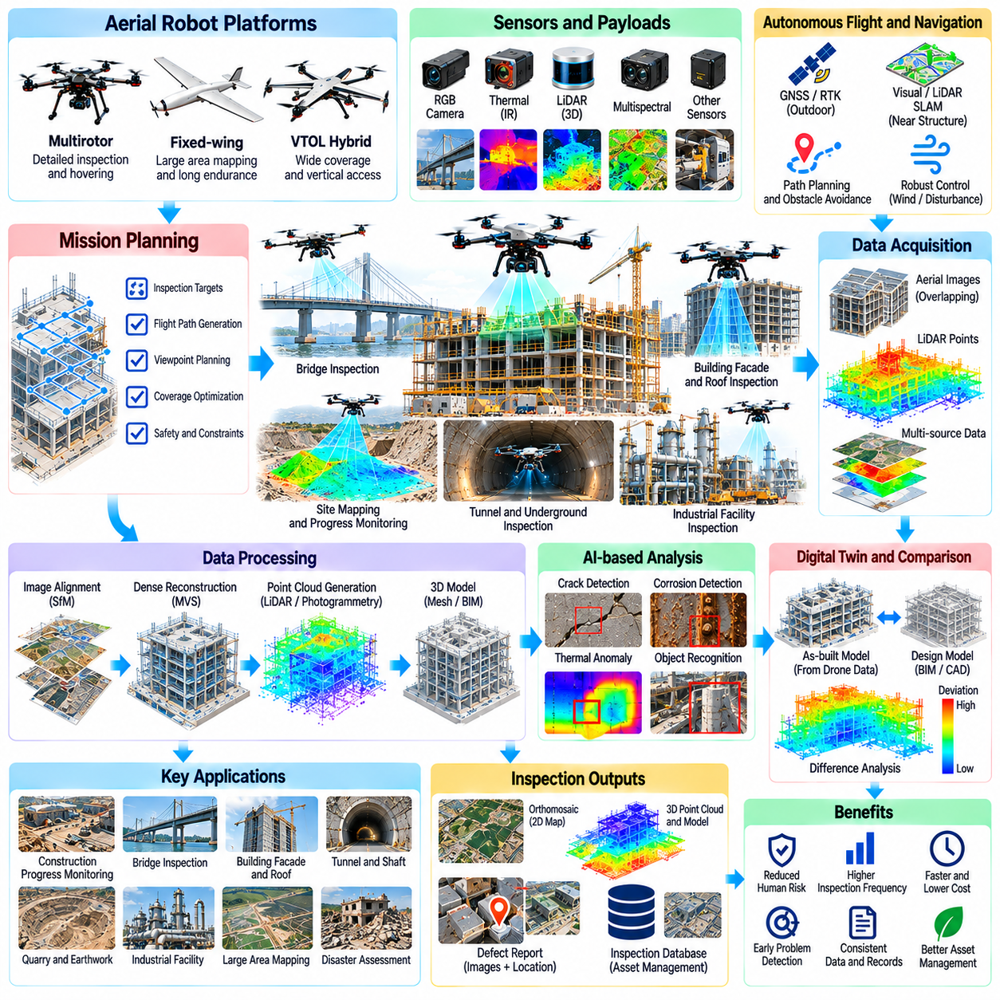{width="7.268055555555556in" height="7.268055555555556in"}

Aerial robots have become important Physical AI platforms for construction inspection and infrastructure mapping because they can access elevated, remote, and hazardous locations without extensive temporary structures. Unmanned aerial vehicles equipped with intelligent sensors can collect visual and spatial information across large sites. Their effectiveness depends on integrating flight control, environmental perception, autonomous planning, and reliable data processing.

Construction environments present inspection challenges involving cranes, towers, bridges, roofs, facades, and partially completed structures. Conventional inspection may require scaffolding, lifting equipment, or temporary access restrictions. Aerial robots can observe selected areas from flexible viewpoints while reducing direct human exposure. However, wind, obstacles, changing site layouts, and regulatory restrictions constrain operational feasibility.

Multirotor aerial platforms are commonly used for detailed inspection because they can hover and adjust their position near structural components. Fixed-wing aircraft are more suitable for covering extensive terrain where sustained forward flight is practical. Hybrid vertical takeoff and landing systems combine selected characteristics of both configurations. Platform selection depends on inspection distance, payload requirements, endurance, maneuverability, and site constraints.

Aerial inspection payloads may include RGB cameras, thermal imagers, LiDAR sensors, multispectral instruments, and specialized measurement devices. High-resolution imagery supports surface defect documentation, while LiDAR captures three-dimensional geometry. Thermal sensing may reveal temperature anomalies associated with selected material or equipment conditions. Each modality requires suitable observation geometry, calibration, and interpretation.

Autonomous flight relies on coordinated perception, localization, trajectory planning, and motion control. GNSS and inertial navigation provide positioning information in suitable outdoor environments. Visual odometry and LiDAR-based localization can improve operation near structures where satellite signals are degraded. Reliable autonomy requires continuous obstacle awareness and adaptation to changing environmental conditions.

Inspection mission planning defines flight paths, observation distances, camera orientations, and required coverage. Automated planners can generate viewpoints around structural surfaces while considering visibility and collision constraints. Close-range inspection requires careful control of stand-off distance and viewing angle. Mission feasibility must account for wind exposure, available clearance, communication quality, and emergency recovery options.

Photogrammetry converts overlapping aerial images into spatial representations through feature matching and geometric reconstruction. Structure-from-Motion estimates camera poses and sparse geometry, while multi-view stereo can generate denser surface models. Reconstruction accuracy depends on image overlap, texture, camera calibration, and survey control. Reflective surfaces, repetitive patterns, and occlusions may reduce model completeness.

Aerial LiDAR mapping uses laser range measurements to reconstruct terrain, buildings, vegetation, and infrastructure geometry. Unlike passive imaging, LiDAR directly measures distances and can provide useful geometric information under varying illumination. Point clouds require accurate sensor positioning and orientation for consistent registration. Dense vegetation, reflective materials, and limited viewing angles can still create incomplete observations.

Construction progress monitoring is a valuable application of repeated aerial surveys. Updated imagery and three-dimensional models can be compared with design information and previous site measurements. These comparisons help identify changes in earthworks, structural completion, and material placement. Meaningful progress assessment requires consistent coordinate systems and an understanding of measurement uncertainty.

Bridge inspection benefits from aerial access to towers, cables, girders, and selected underside surfaces. Robots can capture detailed images without placing personnel at every observation location. However, turbulent airflow, structural occlusion, and restricted positioning signals complicate flight near large bridges. Close-proximity operations require validated procedures, appropriate separation distances, and reliable contingency responses.

Building facade and roof inspection can identify visible cracks, surface deterioration, damaged components, and water-related anomalies. Aerial robots can systematically capture images across extensive exterior surfaces. Thermal imaging may supplement visual observations when environmental conditions support meaningful temperature contrast. Automated interpretation must distinguish genuine defects from shadows, reflections, and material variations.

Tunnel entrances, shafts, and selected underground cavities create opportunities for aerial inspection where conventional access is difficult. GNSS-denied environments require alternative localization methods and robust obstacle avoidance. Enclosed-space flights may also involve dust, poor illumination, limited communications, and restricted maneuvering space. Protective configurations and carefully designed recovery procedures are essential for suitable deployments.

Artificial intelligence supports aerial inspection through defect detection, object recognition, semantic segmentation, and anomaly classification. Learning-based models can identify candidate cracks, corrosion, spalling, or missing components in collected imagery. Detection reliability depends on training coverage, image quality, and environmental variation. Automated results should be treated as inspection evidence requiring appropriate engineering verification.

Change detection combines observations from different survey dates to identify geometric or visual differences. Registered point clouds may reveal surface displacement or changes in construction geometry, while image comparisons can highlight evolving conditions. Apparent differences may arise from illumination, sensor calibration, or registration errors. Reliable interpretation requires uncertainty analysis and appropriate comparison thresholds.

Digital twin integration connects aerial mapping outputs with engineering models, asset identifiers, and inspection histories. Georeferenced images, point clouds, and reconstructed surfaces can update representations of buildings and infrastructure. These datasets support design verification, maintenance planning, and collaborative review. Data governance must preserve coordinate references, acquisition metadata, model versions, and measurement limitations.

Aerial mapping can support earthwork measurement by estimating terrain surfaces and changes in material volumes. Repeated surveys provide information about excavation progress, stockpiles, and site grading. Volume estimates depend on surface reconstruction accuracy, ground control, and assumptions about reference surfaces. Vegetation, equipment, and temporary obstructions should be addressed before results are used for contractual or engineering decisions.

Operational safety requires attention to airspace restrictions, personnel exposure, equipment proximity, and changing construction activities. Flight authorization and applicable aviation requirements must be considered before deployment. Robots should maintain appropriate separation from workers and critical structures. Emergency landing procedures, geofencing, operational supervision, and documented risk assessments help reduce the consequences of flight failures.

Communication and energy constraints strongly influence aerial inspection productivity. Wireless connectivity may deteriorate behind structures or within enclosed environments, while battery endurance limits mission duration. Payload mass, wind, and flight maneuvering increase energy consumption. Mission planning should include return reserves, communication contingencies, and safe interruption procedures rather than relying on nominal performance specifications.

Multi-robot operations can combine aerial platforms with ground robots and quadrupeds to improve inspection coverage. Aerial robots map elevated structures and large areas, while ground systems capture detailed observations from accessible surfaces. Shared coordinate frames and inspection databases enable complementary measurements. Task allocation should consider sensor capabilities, mobility limitations, safety constraints, and operational priorities.

Inspection data pipelines organize images, flight trajectories, point clouds, defect annotations, and processing records into traceable datasets. Automated quality checks can identify missing coverage, blurred images, or inconsistent positioning. Structured reports connect detected anomalies with asset locations and recommended follow-up actions. Preserving raw measurements supports later verification and improvements in analytical methods.

Economic evaluation should consider reduced access equipment requirements, inspection duration, personnel exposure, and improved survey frequency. Aerial robots may reduce the need for scaffolding or prolonged closures in suitable applications. However, equipment acquisition, pilot training, maintenance, insurance, software, and data processing contribute to total cost. Financial value depends on utilization, inspection quality, and operational reliability.

Deployment should begin with representative inspection tasks and clearly defined performance criteria. Pilot programs can compare aerial measurements with established surveying and inspection methods. Evaluation should include spatial accuracy, defect detection performance, coverage completeness, flight safety, and processing time. Gradual scaling requires repeatable procedures, trained personnel, and demonstrated compliance with applicable requirements.

Aerial robots for inspection and mapping demonstrate how Physical AI combines autonomous mobility with intelligent sensing to transform infrastructure observation. Their principal contribution is efficient access to spatial information that is difficult or costly to obtain through conventional methods. Integration with digital twins, engineering workflows, and human verification can improve construction visibility, inspection consistency, and long-term infrastructure management.

항공 로봇(Aerial Robots)은 대규모 임시 구조물(Temporary Structures)을 설치하지 않고도 높은 위치(Elevated Locations), 원격 지역(Remote Locations), 위험한 장소(Hazardous Locations)에 접근할 수 있기 때문에 건설 검사(Construction Inspection)와 인프라 지도 작성(Infrastructure Mapping)을 위한 중요한 피지컬 인공지능(Physical AI) 플랫폼으로 발전하였다. 지능형 센서(Intelligent Sensors)를 탑재한 무인항공기(Unmanned Aerial Vehicles, UAVs)는 넓은 현장에서 시각 정보(Visual Information)와 공간 정보(Spatial Information)를 수집할 수 있다. 이러한 시스템의 효과성은 비행 제어(Flight Control), 환경 인지(Environmental Perception), 자율 계획(Autonomous Planning), 신뢰성 있는 데이터 처리(Reliable Data Processing)의 통합에 따라 달라진다.

건설 환경(Construction Environments)에서는 크레인(Cranes), 타워(Towers), 교량(Bridges), 지붕(Roofs), 건물 외벽(Facades), 부분적으로 완공된 구조물(Partially Completed Structures)과 관련된 검사 문제가 발생한다. 기존 검사(Conventional Inspection)에는 비계(Scaffolding), 승강 장비(Lifting Equipment), 임시 접근 제한(Temporary Access Restrictions)이 필요할 수 있다. 항공 로봇은 유연한 관측 시점(Flexible Viewpoints)에서 특정 영역을 관찰하면서 작업자의 직접적인 위험 노출(Direct Human Exposure)을 줄일 수 있다. 그러나 바람(Wind), 장애물(Obstacles), 변화하는 현장 배치(Changing Site Layouts), 규제 제한(Regulatory Restrictions)은 운영 가능성(Operational Feasibility)을 제약한다.

멀티로터 항공 플랫폼(Multirotor Aerial Platforms)은 구조물 구성요소(Structural Components) 근처에서 정지비행(Hovering)을 수행하고 위치를 조정할 수 있기 때문에 정밀 검사(Detailed Inspection)에 널리 사용된다. 고정익 항공기(Fixed-Wing Aircraft)는 지속적인 전진 비행(Sustained Forward Flight)이 가능한 넓은 지형을 조사하는 데 더 적합하다. 하이브리드 수직이착륙 시스템(Hybrid Vertical Takeoff and Landing Systems)은 두 구성 방식의 일부 특성을 결합한다. 플랫폼 선택(Platform Selection)은 검사 거리(Inspection Distance), 탑재 하중 요구사항(Payload Requirements), 비행 지속시간(Endurance), 기동성(Maneuverability), 현장 제약(Site Constraints)에 따라 달라진다.

항공 검사 탑재장치(Aerial Inspection Payloads)에는 RGB 카메라(RGB Cameras), 열화상 카메라(Thermal Imagers), 라이다 센서(LiDAR Sensors), 다중분광 장비(Multispectral Instruments), 특수 측정 장치(Specialized Measurement Devices)가 포함될 수 있다. 고해상도 영상(High-Resolution Imagery)은 표면 결함 기록(Surface Defect Documentation)을 지원하며, 라이다는 3차원 형상(Three-Dimensional Geometry)을 획득한다. 열 센싱(Thermal Sensing)은 특정 재료 또는 장비 상태(Material or Equipment Conditions)와 관련된 온도 이상(Temperature Anomalies)을 발견할 수 있다. 각 센싱 방식(Modality)에는 적절한 관측 기하(Observation Geometry), 보정(Calibration), 해석(Interpretation)이 필요하다.

자율 비행(Autonomous Flight)은 인지(Perception), 위치 추정(Localization), 궤적 계획(Trajectory Planning), 운동 제어(Motion Control)의 협조적인 작동에 의존한다. 전역위성항법시스템(Global Navigation Satellite System, GNSS)과 관성 항법(Inertial Navigation)은 적절한 실외 환경에서 위치 정보(Positioning Information)를 제공한다. 시각적 주행거리 추정(Visual Odometry)과 라이다 기반 위치 추정(LiDAR-Based Localization)은 위성 신호(Satellite Signals)가 약해지는 구조물 주변에서 운영 성능을 개선할 수 있다. 신뢰성 있는 자율성(Reliable Autonomy)을 위해서는 지속적인 장애물 인식(Obstacle Awareness)과 변화하는 환경 조건(Environmental Conditions)에 대한 적응이 필요하다.

검사 임무 계획(Inspection Mission Planning)은 비행 경로(Flight Paths), 관측 거리(Observation Distances), 카메라 방향(Camera Orientations), 필요한 검사 범위(Required Coverage)를 정의한다. 자동 계획기(Automated Planners)는 가시성(Visibility)과 충돌 제약(Collision Constraints)을 고려하면서 구조물 표면(Structural Surfaces) 주변의 관측 위치(Viewpoints)를 생성할 수 있다. 근접 검사(Close-Range Inspection)에는 이격 거리(Stand-Off Distance)와 관측 각도(Viewing Angle)의 정밀한 제어가 필요하다. 임무 수행 가능성(Mission Feasibility)은 바람 노출(Wind Exposure), 이용 가능한 여유 공간(Available Clearance), 통신 품질(Communication Quality), 비상 회수 방안(Emergency Recovery Options)을 고려해야 한다.

사진측량(Photogrammetry)은 서로 중첩되는 항공 영상(Overlapping Aerial Images)을 특징점 정합(Feature Matching)과 기하학적 재구성(Geometric Reconstruction)을 통해 공간 표현(Spatial Representations)으로 변환한다. 동작 기반 구조 복원(Structure-from-Motion, SfM)은 카메라 자세(Camera Poses)와 희소 기하 구조(Sparse Geometry)를 추정하며, 다중 시점 스테레오(Multi-View Stereo, MVS)는 더욱 밀집된 표면 모델(Dense Surface Models)을 생성할 수 있다. 재구성 정확도(Reconstruction Accuracy)는 영상 중첩도(Image Overlap), 텍스처(Texture), 카메라 보정(Camera Calibration), 측량 기준점(Survey Control)에 따라 달라진다. 반사 표면(Reflective Surfaces), 반복 패턴(Repetitive Patterns), 가림 현상(Occlusions)은 모델 완전성(Model Completeness)을 저하시킬 수 있다.

항공 라이다 지도 작성(Aerial LiDAR Mapping)은 레이저 거리 측정(Laser Range Measurements)을 이용하여 지형(Terrain), 건물(Buildings), 식생(Vegetation), 인프라 형상(Infrastructure Geometry)을 재구성한다. 수동 영상 센싱(Passive Imaging)과 달리 라이다는 거리를 직접 측정하며 다양한 조명 조건(Varying Illumination)에서도 유용한 기하학적 정보(Geometric Information)를 제공할 수 있다. 포인트 클라우드(Point Clouds)의 일관된 정합(Consistent Registration)을 위해서는 정확한 센서 위치(Positioning)와 방향(Orientation)이 필요하다. 밀집 식생(Dense Vegetation), 반사성 재료(Reflective Materials), 제한된 관측 각도(Limited Viewing Angles)는 여전히 불완전한 관측(Incomplete Observations)을 발생시킬 수 있다.

건설 진행 상황 모니터링(Construction Progress Monitoring)은 반복적인 항공 측량(Repeated Aerial Surveys)의 중요한 응용 분야이다. 갱신된 영상(Updated Imagery)과 3차원 모델(Three-Dimensional Models)은 설계 정보(Design Information) 및 이전 현장 측정값(Previous Site Measurements)과 비교할 수 있다. 이러한 비교는 토공 작업(Earthworks), 구조물 완공 상태(Structural Completion), 자재 배치(Material Placement)의 변화를 식별하는 데 도움이 된다. 의미 있는 공정 평가(Progress Assessment)를 위해서는 일관된 좌표계(Consistent Coordinate Systems)와 측정 불확실성(Measurement Uncertainty)에 대한 이해가 필요하다.

교량 검사(Bridge Inspection)는 주탑(Towers), 케이블(Cables), 거더(Girders), 일부 교량 하부 표면(Underside Surfaces)에 대한 항공 접근(Aerial Access)의 이점을 활용할 수 있다. 로봇은 모든 관측 위치에 작업자를 배치하지 않고도 상세 영상(Detailed Images)을 획득할 수 있다. 그러나 난류(Turbulent Airflow), 구조물에 의한 가림(Structural Occlusion), 제한된 위치 결정 신호(Restricted Positioning Signals)는 대형 교량 근처의 비행을 복잡하게 만든다. 근접 비행(Close-Proximity Operations)에는 검증된 절차(Validated Procedures), 적절한 이격 거리(Appropriate Separation Distances), 신뢰성 있는 비상 대응(Contingency Responses)이 필요하다.

건물 외벽 및 지붕 검사(Building Facade and Roof Inspection)는 가시적인 균열(Visible Cracks), 표면 열화(Surface Deterioration), 손상된 구성요소(Damaged Components), 수분 관련 이상(Water-Related Anomalies)을 식별할 수 있다. 항공 로봇은 넓은 외부 표면(Exterior Surfaces)에 걸쳐 체계적으로 영상을 수집할 수 있다. 열화상 촬영(Thermal Imaging)은 환경 조건(Environmental Conditions)이 의미 있는 온도 대비(Temperature Contrast)를 제공하는 경우 시각적 관측(Visual Observations)을 보완할 수 있다. 자동 해석(Automated Interpretation)은 실제 결함(Genuine Defects)을 그림자(Shadows), 반사(Reflections), 재료 변화(Material Variations)와 구별해야 한다.

터널 입구(Tunnel Entrances), 수직갱(Shafts), 일부 지하 공동(Underground Cavities)은 기존 접근 방식(Conventional Access)이 어려운 경우 항공 검사의 기회를 제공한다. GNSS를 사용할 수 없는 환경(GNSS-Denied Environments)에서는 대체 위치 추정 방법(Alternative Localization Methods)과 강건한 장애물 회피(Robust Obstacle Avoidance)가 필요하다. 밀폐 공간 비행(Enclosed-Space Flights)에서는 먼지(Dust), 낮은 조도(Poor Illumination), 제한된 통신(Limited Communications), 좁은 기동 공간(Restricted Maneuvering Space)도 문제가 될 수 있다. 적절한 배치를 위해서는 보호 구조(Protective Configurations)와 신중하게 설계된 회수 절차(Recovery Procedures)가 필수적이다.

인공지능(Artificial Intelligence, AI)은 결함 탐지(Defect Detection), 객체 인식(Object Recognition), 의미론적 분할(Semantic Segmentation), 이상 분류(Anomaly Classification)를 통해 항공 검사를 지원한다. 학습 기반 모델(Learning-Based Models)은 수집된 영상에서 균열(Cracks), 부식(Corrosion), 박락(Spalling), 누락된 구성요소(Missing Components)의 후보를 식별할 수 있다. 탐지 신뢰성(Detection Reliability)은 학습 데이터 범위(Training Coverage), 영상 품질(Image Quality), 환경 변화(Environmental Variation)에 따라 달라진다. 자동화된 결과(Automated Results)는 적절한 엔지니어링 검증(Engineering Verification)이 필요한 검사 근거(Inspection Evidence)로 취급해야 한다.

변화 감지(Change Detection)는 서로 다른 측량 날짜(Survey Dates)의 관측 결과를 결합하여 기하학적 차이(Geometric Differences)나 시각적 차이(Visual Differences)를 식별한다. 정합된 포인트 클라우드(Registered Point Clouds)는 표면 변위(Surface Displacement)나 건설 형상(Construction Geometry)의 변화를 드러낼 수 있으며, 영상 비교(Image Comparisons)는 진행 중인 상태 변화(Evolving Conditions)를 강조할 수 있다. 관측된 차이는 조명(Illumination), 센서 보정(Sensor Calibration), 정합 오차(Registration Errors)로 인해 발생할 수도 있다. 신뢰성 있는 해석(Reliable Interpretation)을 위해서는 불확실성 분석(Uncertainty Analysis)과 적절한 비교 임계값(Comparison Thresholds)이 필요하다.

디지털 트윈 통합(Digital Twin Integration)은 항공 지도 작성 결과(Aerial Mapping Outputs)를 엔지니어링 모델(Engineering Models), 자산 식별자(Asset Identifiers), 검사 이력(Inspection Histories)과 연결한다. 지리참조 영상(Georeferenced Images), 포인트 클라우드(Point Clouds), 재구성된 표면(Reconstructed Surfaces)은 건물과 인프라의 디지털 표현(Digital Representations)을 갱신할 수 있다. 이러한 데이터셋(Datasets)은 설계 검증(Design Verification), 유지보수 계획(Maintenance Planning), 협업 검토(Collaborative Review)를 지원한다. 데이터 거버넌스(Data Governance)는 좌표 기준(Coordinate References), 데이터 획득 메타데이터(Acquisition Metadata), 모델 버전(Model Versions), 측정 한계(Measurement Limitations)를 보존해야 한다.

항공 지도 작성(Aerial Mapping)은 지형 표면(Terrain Surfaces)과 자재 체적 변화(Material Volume Changes)를 추정하여 토공량 측정(Earthwork Measurement)을 지원할 수 있다. 반복적인 측량(Repeated Surveys)은 굴착 진행 상황(Excavation Progress), 적치 자재(Stockpiles), 현장 정지 작업(Site Grading)에 관한 정보를 제공한다. 체적 추정(Volume Estimates)은 표면 재구성 정확도(Surface Reconstruction Accuracy), 지상 기준점(Ground Control), 기준 표면(Reference Surfaces)에 관한 가정에 따라 달라진다. 식생(Vegetation), 장비(Equipment), 임시 장애물(Temporary Obstructions)은 결과를 계약 또는 엔지니어링 의사결정(Contractual or Engineering Decisions)에 사용하기 전에 적절히 처리해야 한다.

운영 안전(Operational Safety)을 위해서는 공역 제한(Airspace Restrictions), 작업자 위험 노출(Personnel Exposure), 장비 근접성(Equipment Proximity), 변화하는 건설 활동(Changing Construction Activities)을 고려해야 한다. 시스템 배치(Deployment) 전에 비행 허가(Flight Authorization)와 적용 가능한 항공 규정(Applicable Aviation Requirements)을 검토해야 한다. 로봇은 작업자(Workers)와 핵심 구조물(Critical Structures)로부터 적절한 이격 거리(Appropriate Separation)를 유지해야 한다. 비상 착륙 절차(Emergency Landing Procedures), 지오펜싱(Geofencing), 운영 감독(Operational Supervision), 문서화된 위험 평가(Documented Risk Assessments)는 비행 실패(Flight Failures)의 영향을 줄이는 데 도움이 된다.

통신 및 에너지 제약(Communication and Energy Constraints)은 항공 검사 생산성(Aerial Inspection Productivity)에 큰 영향을 미친다. 무선 연결(Wireless Connectivity)은 구조물 뒤쪽이나 밀폐 환경(Enclosed Environments)에서 악화될 수 있으며, 배터리 지속시간(Battery Endurance)은 임무 수행 시간(Mission Duration)을 제한한다. 탑재 중량(Payload Mass), 바람(Wind), 비행 기동(Flight Maneuvering)은 에너지 소비(Energy Consumption)를 증가시킨다. 임무 계획(Mission Planning)은 정격 성능 사양(Nominal Performance Specifications)에만 의존하지 않고 복귀용 에너지 예비량(Return Reserves), 통신 장애 대응책(Communication Contingencies), 안전한 임무 중단 절차(Safe Interruption Procedures)를 포함해야 한다.

다중 로봇 운영(Multi-Robot Operations)은 항공 플랫폼(Aerial Platforms)을 지상 로봇(Ground Robots) 및 사족보행 로봇(Quadrupeds)과 결합하여 검사 범위(Inspection Coverage)를 개선할 수 있다. 항공 로봇은 높은 구조물(Elevated Structures)과 넓은 지역(Large Areas)을 지도화하고, 지상 시스템(Ground Systems)은 접근 가능한 표면(Accessible Surfaces)에서 상세 관측(Detailed Observations)을 수행한다. 공유 좌표계(Shared Coordinate Frames)와 검사 데이터베이스(Inspection Databases)는 상호 보완적인 측정(Complementary Measurements)을 가능하게 한다. 작업 할당(Task Allocation)은 센서 성능(Sensor Capabilities), 이동성 제약(Mobility Limitations), 안전 제약(Safety Constraints), 운영 우선순위(Operational Priorities)를 고려해야 한다.

검사 데이터 파이프라인(Inspection Data Pipelines)은 영상(Images), 비행 궤적(Flight Trajectories), 포인트 클라우드(Point Clouds), 결함 주석(Defect Annotations), 데이터 처리 기록(Processing Records)을 추적 가능한 데이터셋(Traceable Datasets)으로 구성한다. 자동 품질 검사(Automated Quality Checks)는 누락된 검사 범위(Missing Coverage), 흐릿한 영상(Blurred Images), 일관되지 않은 위치 결정(Inconsistent Positioning)을 식별할 수 있다. 구조화된 보고서(Structured Reports)는 탐지된 이상(Detected Anomalies)을 자산 위치(Asset Locations) 및 권장 후속 조치(Recommended Follow-Up Actions)와 연결한다. 원시 측정값(Raw Measurements)의 보존은 이후 검증(Later Verification)과 분석 방법(Analytical Methods)의 개선을 지원한다.

경제성 평가(Economic Evaluation)는 접근 장비 요구사항(Access Equipment Requirements)의 감소, 검사 소요시간(Inspection Duration), 작업자 위험 노출(Personnel Exposure), 측량 빈도(Survey Frequency)의 개선을 고려해야 한다. 항공 로봇은 적절한 응용 분야에서 비계(Scaffolding)나 장기간 통제(Prolonged Closures)의 필요성을 줄일 수 있다. 그러나 장비 도입(Equipment Acquisition), 조종사 교육(Pilot Training), 유지보수(Maintenance), 보험(Insurance), 소프트웨어(Software), 데이터 처리(Data Processing)는 총비용(Total Cost)에 영향을 미친다. 경제적 가치(Financial Value)는 활용률(Utilization), 검사 품질(Inspection Quality), 운영 신뢰성(Operational Reliability)에 따라 달라진다.

시스템 배치(Deployment)는 대표적인 검사 작업(Representative Inspection Tasks)과 명확하게 정의된 성능 기준(Performance Criteria)을 기반으로 시작해야 한다. 시범 프로그램(Pilot Programs)은 항공 측정값(Aerial Measurements)을 기존 측량 및 검사 방법(Established Surveying and Inspection Methods)과 비교할 수 있다. 성능 평가(Evaluation)에는 공간 정확도(Spatial Accuracy), 결함 탐지 성능(Defect Detection Performance), 검사 범위 완전성(Coverage Completeness), 비행 안전(Flight Safety), 데이터 처리 시간(Processing Time)이 포함되어야 한다. 점진적인 확장(Gradual Scaling)을 위해서는 반복 가능한 절차(Repeatable Procedures), 숙련된 인력(Trained Personnel), 적용 가능한 요구사항(Applicable Requirements)에 대한 입증된 준수(Demonstrated Compliance)가 필요하다.

검사 및 지도 작성을 위한 항공 로봇(Aerial Robots for Inspection and Mapping)은 피지컬 인공지능(Physical AI)이 자율 이동(Autonomous Mobility)과 지능형 센싱(Intelligent Sensing)을 결합하여 인프라 관측(Infrastructure Observation)을 어떻게 변화시키는지 보여준다. 항공 로봇의 핵심적인 기여(Principal Contribution)는 기존 방법(Conventional Methods)으로 획득하기 어렵거나 비용이 많이 드는 공간 정보(Spatial Information)에 효율적으로 접근할 수 있도록 하는 것이다. 디지털 트윈(Digital Twins), 엔지니어링 작업 흐름(Engineering Workflows), 인간 검증(Human Verification)과의 통합은 건설 현장 가시성(Construction Visibility), 검사 일관성(Inspection Consistency), 장기적인 인프라 관리(Long-Term Infrastructure Management)를 개선할 수 있다.

##  

## 06.12. Multi Robot Construction Sites

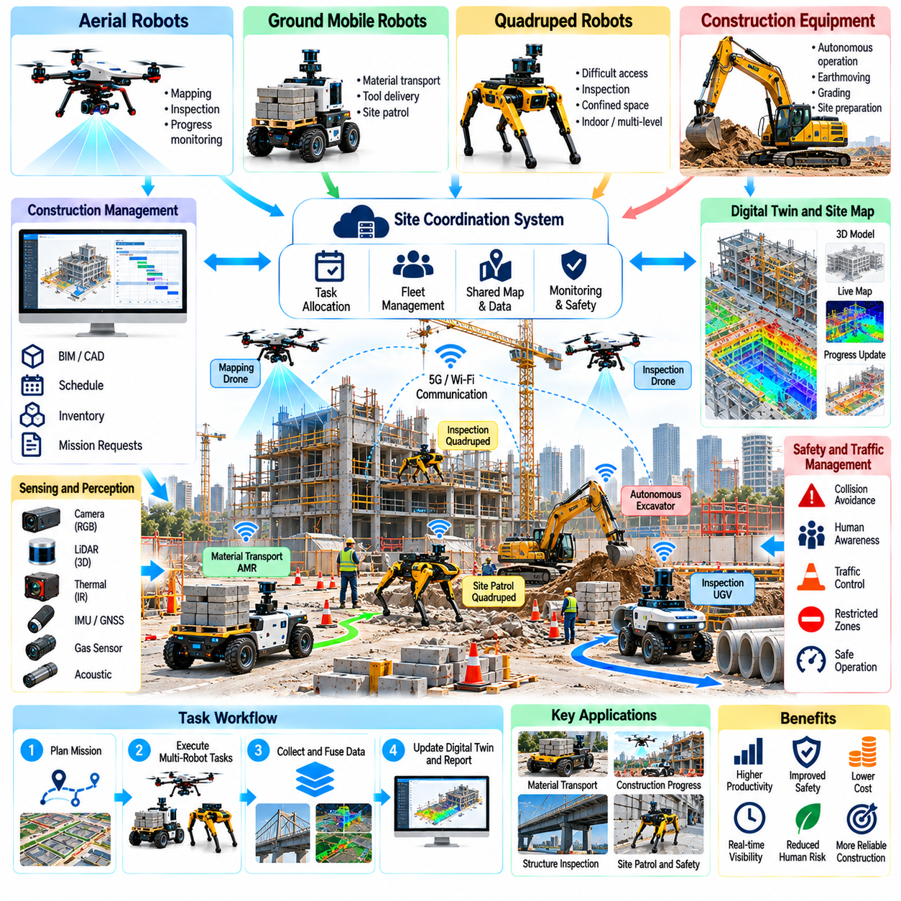{width="7.268055555555556in" height="7.268055555555556in"}

Multi-robot construction sites represent an advanced application of Physical AI in which autonomous machines coordinate transportation, inspection, mapping, and construction activities within a shared environment. Instead of operating as isolated systems, robots exchange information and cooperate through common planning and management frameworks. Their integration can improve productivity, resource utilization, and site visibility while introducing new coordination and safety challenges.

Construction environments require heterogeneous robotic platforms because tasks differ in mobility, payload, sensing, and manipulation requirements. Autonomous mobile robots transport materials, aerial robots capture site geometry, quadrupeds inspect difficult-access areas, and robotic equipment performs selected construction operations. Effective coordination assigns responsibilities according to each platform\'s capabilities while accounting for changing site conditions.

A multi-robot architecture typically combines onboard autonomy with site-level coordination services. Individual robots maintain local perception, navigation, obstacle avoidance, and safety functions. Centralized or distributed systems manage task allocation, shared maps, mission priorities, and operational status. This separation allows robots to respond immediately to nearby hazards without depending entirely on continuous communication with a central controller.

Task allocation determines which robot should perform each activity based on capability, location, availability, and operational priority. Scheduling algorithms may consider travel distance, payload capacity, battery state, and task deadlines. Dynamic reassignment becomes necessary when equipment fails or construction priorities change. Effective scheduling should optimize overall project performance rather than maximizing the utilization of individual robots.

Shared spatial awareness is essential because construction sites change continuously. Robots can contribute observations from cameras, LiDAR, positioning systems, and other sensors to a common site representation. Updated maps may include obstacles, temporary structures, material storage areas, and restricted zones. Data fusion requires consistent coordinate systems, timestamps, and uncertainty estimates to avoid conflicting interpretations.

Localization across heterogeneous platforms is challenging because aerial, wheeled, and legged robots use different sensors and movement models. GNSS, inertial navigation, visual odometry, and simultaneous localization and mapping may provide complementary positioning information. Shared reference frames enable robots to exchange meaningful locations and routes. Coordinate alignment errors can create navigation conflicts and compromise inspection accuracy.

Traffic management coordinates robot movements through corridors, intersections, loading areas, and temporary access routes. Reservation-based scheduling, priority rules, and local collision avoidance can reduce congestion. Narrow passages may require one-way operation or controlled access intervals. Traffic policies must also account for pedestrians, conventional vehicles, and equipment whose movements cannot be fully predicted.

Material transportation illustrates the benefits of coordinated robot fleets. Multiple autonomous mobile robots can deliver tools, components, and supplies between storage locations and active work zones. Fleet management systems assign missions according to demand, travel conditions, and robot availability. Integration with inventory and construction schedules helps reduce unnecessary movement, waiting time, and interruptions to work crews.

Collaborative inspection combines complementary sensing capabilities from different robotic platforms. Aerial robots document elevated structures, ground robots inspect accessible surfaces, and quadrupeds traverse selected irregular areas. Their observations can be integrated into common inspection records and spatial models. Coordinated coverage planning reduces duplicated measurements while identifying areas that remain insufficiently inspected.

Multi-robot construction operations may involve sequential or simultaneous activities that depend on one another. A mapping robot can update site geometry before an autonomous transporter enters a work zone. Inspection robots may verify completed work before subsequent construction stages begin. Such dependencies require explicit workflow management, reliable status reporting, and procedures for handling incomplete or uncertain results.

Communication infrastructure supports mission coordination, map updates, and operational supervision. Wireless networks may experience interference, obstruction, and temporary coverage gaps caused by changing structures. Edge computing can process time-sensitive information locally, while cloud services support broader analytics and historical storage. Robots must retain safe behavior when network connections are delayed or interrupted.

Interoperability is important when fleets contain machines from different manufacturers. Standardized interfaces can exchange mission requests, robot status, maps, and safety-related information. Middleware and application programming interfaces help connect fleet systems with construction management software. However, differences in coordinate conventions, task semantics, and safety capabilities require careful integration and validation.

Digital twins provide a shared information environment linking robot observations with design models, construction progress, and asset records. Updated spatial data can reveal discrepancies between planned and actual site conditions. Robots may use these representations for navigation and task planning, while project managers use them for progress monitoring. Model synchronization must distinguish verified measurements from estimates and outdated information.

Safety management becomes more complex when several autonomous machines operate near human workers. Robots must respect exclusion zones, speed restrictions, emergency access routes, and equipment operating boundaries. Site-wide coordination should complement independent onboard safety functions. Risk assessments must consider interactions between robots, people, moving machinery, and temporary construction hazards.

Human-robot collaboration requires clear operational responsibilities and understandable communication. Supervisors need visibility into robot assignments, locations, faults, and pending interventions. Workers should recognize robot movement intentions and understand applicable right-of-way procedures. Training and standardized operating practices reduce confusion when autonomous systems share spaces with conventional construction activities.

Resource management extends beyond assigning tasks to include battery charging, maintenance, payload availability, and communication capacity. Fleet schedulers can stagger charging sessions to maintain sufficient operational coverage. Predictive maintenance may identify deteriorating components before failures interrupt coordinated missions. Resource planning should consider peak demand periods and recovery capacity during unexpected disruptions.

Resilience is essential because construction environments are uncertain and operational failures are unavoidable. If one robot becomes unavailable, the coordination system may reassign compatible tasks or adjust schedules. Critical missions should have fallback procedures involving alternative equipment or human operators. Fault detection, recovery planning, and graceful degradation help prevent isolated failures from disrupting the entire site.

Cybersecurity and data governance are necessary when robots exchange operational information through shared networks. Unauthorized commands, compromised maps, or manipulated mission data could affect physical safety and project execution. Authentication, access control, secure communication, and software update management reduce exposure. Data records should preserve provenance, permissions, and traceability across participating systems.

Performance evaluation should measure fleet-level outcomes rather than isolated robot capabilities. Relevant indicators include task completion rate, transportation throughput, inspection coverage, waiting time, intervention frequency, and safety incidents. Energy consumption and equipment utilization provide additional operational insights. Evaluation must account for site variability and compare results against realistic conventional workflows.

Economic benefits may arise from improved equipment coordination, reduced idle time, fewer repeated inspections, and more predictable material delivery. However, integration costs can be substantial because robots require communication infrastructure, software interfaces, mapping systems, and operational support. Total cost of ownership includes maintenance, training, cybersecurity, and system upgrades. Financial value depends on utilization and sustained workflow improvements.

Deployment should begin with a limited number of robots performing well-defined tasks in controlled operating zones. Pilot programs can validate shared localization, traffic coordination, task allocation, and emergency procedures. Additional platforms and workflows should be introduced gradually after demonstrating reliable performance. Standardized interfaces and documented operating rules make expansion more manageable.

Multi-robot construction sites demonstrate how Physical AI can evolve from individual autonomous machines into coordinated operational ecosystems. Shared perception, intelligent scheduling, interoperable control, and digital integration enable robots to support complex construction workflows. Long-term success depends on reliable autonomy, human-centered safety, measurable economic value, and the ability to adapt as construction environments change.

다중 로봇 건설 현장(Multi-Robot Construction Sites)은 자율 기계(Autonomous Machines)가 공유 환경(Shared Environment)에서 운송(Transportation), 검사(Inspection), 지도 작성(Mapping), 건설 작업(Construction Activities)을 협조적으로 수행하는 피지컬 인공지능(Physical AI)의 고도화된 응용 분야이다. 로봇들은 독립적인 시스템(Isolated Systems)으로 작동하는 대신 공통 계획 및 관리 프레임워크(Common Planning and Management Frameworks)를 통해 정보를 교환하고 협력한다. 이러한 통합은 생산성(Productivity), 자원 활용률(Resource Utilization), 현장 가시성(Site Visibility)을 개선할 수 있지만 새로운 협조 및 안전 문제(Coordination and Safety Challenges)도 발생시킨다.

건설 환경(Construction Environments)에서는 작업마다 이동성(Mobility), 탑재 하중(Payload), 센싱(Sensing), 조작(Manipulation) 요구사항이 다르기 때문에 이기종 로봇 플랫폼(Heterogeneous Robotic Platforms)이 필요하다. 자율 이동 로봇(Autonomous Mobile Robots, AMRs)은 자재를 운송하고, 항공 로봇(Aerial Robots)은 현장 형상(Site Geometry)을 획득하며, 사족보행 로봇(Quadrupeds)은 접근이 어려운 구역(Difficult-Access Areas)을 검사하고, 로봇 건설 장비(Robotic Construction Equipment)는 특정 건설 작업을 수행한다. 효과적인 협조(Effective Coordination)는 변화하는 현장 조건(Changing Site Conditions)을 고려하면서 각 플랫폼의 능력(Capabilities)에 따라 책임을 할당한다.

다중 로봇 아키텍처(Multi-Robot Architecture)는 일반적으로 온보드 자율성(Onboard Autonomy)과 현장 수준의 협조 서비스(Site-Level Coordination Services)를 결합한다. 개별 로봇(Individual Robots)은 국소 인지(Local Perception), 내비게이션(Navigation), 장애물 회피(Obstacle Avoidance), 안전 기능(Safety Functions)을 자체적으로 유지한다. 중앙집중형 또는 분산형 시스템(Centralized or Distributed Systems)은 작업 할당(Task Allocation), 공유 지도(Shared Maps), 임무 우선순위(Mission Priorities), 운영 상태(Operational Status)를 관리한다. 이러한 기능 분리는 로봇이 중앙 제어기(Central Controller)와의 지속적인 통신에 전적으로 의존하지 않고 주변 위험(Nearby Hazards)에 즉각적으로 대응할 수 있도록 한다.

작업 할당(Task Allocation)은 로봇의 능력(Capability), 위치(Location), 가용성(Availability), 운영 우선순위(Operational Priority)를 기반으로 각 작업을 수행할 로봇을 결정한다. 스케줄링 알고리즘(Scheduling Algorithms)은 이동 거리(Travel Distance), 탑재 용량(Payload Capacity), 배터리 상태(Battery State), 작업 마감시간(Task Deadlines)을 고려할 수 있다. 장비 고장(Equipment Failures)이 발생하거나 건설 우선순위(Construction Priorities)가 변경되면 동적 재할당(Dynamic Reassignment)이 필요하다. 효과적인 스케줄링(Effective Scheduling)은 개별 로봇의 활용률(Individual Robot Utilization)을 극대화하기보다 전체 프로젝트 성과(Overall Project Performance)를 최적화해야 한다.

공유 공간 인식(Shared Spatial Awareness)은 건설 현장이 지속적으로 변화하기 때문에 필수적이다. 로봇은 카메라(Cameras), 라이다(LiDAR), 위치 결정 시스템(Positioning Systems), 기타 센서(Other Sensors)에서 획득한 관측 정보를 공통 현장 표현(Common Site Representation)에 제공할 수 있다. 갱신된 지도(Updated Maps)에는 장애물(Obstacles), 임시 구조물(Temporary Structures), 자재 보관 구역(Material Storage Areas), 출입 제한 구역(Restricted Zones)이 포함될 수 있다. 데이터 융합(Data Fusion)은 상충되는 해석(Conflicting Interpretations)을 방지하기 위해 일관된 좌표계(Consistent Coordinate Systems), 타임스탬프(Timestamps), 불확실성 추정값(Uncertainty Estimates)을 필요로 한다.

이기종 플랫폼 간 위치 추정(Localization Across Heterogeneous Platforms)은 항공 로봇(Aerial Robots), 바퀴형 로봇(Wheeled Robots), 다리형 로봇(Legged Robots)이 서로 다른 센서(Sensors)와 운동 모델(Movement Models)을 사용하기 때문에 어렵다. 전역위성항법시스템(Global Navigation Satellite System, GNSS), 관성 항법(Inertial Navigation), 시각적 주행거리 추정(Visual Odometry), 동시적 위치 추정 및 지도 작성(Simultaneous Localization and Mapping, SLAM)은 상호 보완적인 위치 정보(Positioning Information)를 제공할 수 있다. 공유 기준 좌표계(Shared Reference Frames)는 로봇들이 의미 있는 위치(Locations)와 경로(Routes)를 교환할 수 있도록 한다. 좌표 정렬 오차(Coordinate Alignment Errors)는 내비게이션 충돌(Navigation Conflicts)을 발생시키고 검사 정확도(Inspection Accuracy)를 저하시킬 수 있다.

교통 관리(Traffic Management)는 통로(Corridors), 교차로(Intersections), 적재 구역(Loading Areas), 임시 접근 경로(Temporary Access Routes)에서 로봇의 움직임을 조정한다. 예약 기반 스케줄링(Reservation-Based Scheduling), 우선순위 규칙(Priority Rules), 국소 충돌 회피(Local Collision Avoidance)는 혼잡(Congestion)을 줄일 수 있다. 좁은 통로(Narrow Passages)에서는 일방통행 운영(One-Way Operation)이나 통제된 접근 시간 구간(Controlled Access Intervals)이 필요할 수 있다. 교통 정책(Traffic Policies)은 보행자(Pedestrians), 일반 차량(Conventional Vehicles), 움직임을 완전히 예측할 수 없는 장비(Equipment)도 고려해야 한다.

자재 운송(Material Transportation)은 협조적인 로봇 군집(Coordinated Robot Fleets)의 이점을 보여주는 대표적인 사례이다. 여러 자율 이동 로봇(Autonomous Mobile Robots)은 보관 장소(Storage Locations)와 실제 작업 구역(Active Work Zones) 사이에서 공구(Tools), 부품(Components), 공급 자재(Supplies)를 운송할 수 있다. 군집 관리 시스템(Fleet Management Systems)은 수요(Demand), 이동 조건(Travel Conditions), 로봇 가용성(Robot Availability)에 따라 임무를 할당한다. 재고 관리(Inventory) 및 건설 일정(Construction Schedules)과의 통합은 불필요한 이동(Unnecessary Movement), 대기 시간(Waiting Time), 작업팀의 작업 중단(Interruptions to Work Crews)을 줄이는 데 도움이 된다.

협업 검사(Collaborative Inspection)는 서로 다른 로봇 플랫폼의 상호 보완적인 센싱 능력(Complementary Sensing Capabilities)을 결합한다. 항공 로봇(Aerial Robots)은 높은 구조물(Elevated Structures)을 기록하고, 지상 로봇(Ground Robots)은 접근 가능한 표면(Accessible Surfaces)을 검사하며, 사족보행 로봇(Quadrupeds)은 특정 불규칙한 구역(Irregular Areas)을 이동한다. 이러한 관측 결과(Observations)는 공통 검사 기록(Common Inspection Records)과 공간 모델(Spatial Models)에 통합될 수 있다. 협조적인 검사 범위 계획(Coordinated Coverage Planning)은 중복 측정(Duplicated Measurements)을 줄이면서 충분히 검사되지 않은 영역(Insufficiently Inspected Areas)을 식별한다.

다중 로봇 건설 작업(Multi-Robot Construction Operations)에는 서로 의존하는 순차적 또는 동시 작업(Sequential or Simultaneous Activities)이 포함될 수 있다. 지도 작성 로봇(Mapping Robot)은 자율 운송 로봇(Autonomous Transporter)이 작업 구역(Work Zone)에 진입하기 전에 현장 형상(Site Geometry)을 갱신할 수 있다. 검사 로봇(Inspection Robots)은 후속 건설 단계(Subsequent Construction Stages)가 시작되기 전에 완료된 작업(Completed Work)을 검증할 수 있다. 이러한 작업 의존성(Task Dependencies)을 관리하기 위해서는 명시적인 작업 흐름 관리(Explicit Workflow Management), 신뢰성 있는 상태 보고(Reliable Status Reporting), 불완전하거나 불확실한 결과(Incomplete or Uncertain Results)를 처리하기 위한 절차가 필요하다.

통신 인프라(Communication Infrastructure)는 임무 협조(Mission Coordination), 지도 갱신(Map Updates), 운영 감독(Operational Supervision)을 지원한다. 무선 네트워크(Wireless Networks)는 변화하는 구조물(Changing Structures)로 인해 간섭(Interference), 신호 차단(Obstruction), 일시적인 통신 음영 구역(Temporary Coverage Gaps)을 경험할 수 있다. 엣지 컴퓨팅(Edge Computing)은 시간에 민감한 정보(Time-Sensitive Information)를 현장에서 처리할 수 있으며, 클라우드 서비스(Cloud Services)는 광범위한 분석(Broader Analytics)과 이력 데이터 저장(Historical Storage)을 지원한다. 로봇은 네트워크 연결(Network Connections)이 지연되거나 중단되는 경우에도 안전한 동작(Safe Behavior)을 유지해야 한다.

상호운용성(Interoperability)은 서로 다른 제조업체(Manufacturers)의 기계로 로봇 군집이 구성되는 경우 중요하다. 표준화된 인터페이스(Standardized Interfaces)는 임무 요청(Mission Requests), 로봇 상태(Robot Status), 지도(Maps), 안전 관련 정보(Safety-Related Information)를 교환할 수 있다. 미들웨어(Middleware)와 응용 프로그래밍 인터페이스(Application Programming Interfaces, APIs)는 군집 시스템(Fleet Systems)을 건설 관리 소프트웨어(Construction Management Software)와 연결하는 데 도움이 된다. 그러나 좌표 규약(Coordinate Conventions), 작업 의미 체계(Task Semantics), 안전 기능(Safety Capabilities)의 차이는 신중한 통합(Integration)과 검증(Validation)을 필요로 한다.

디지털 트윈(Digital Twins)은 로봇 관측 결과(Robot Observations)를 설계 모델(Design Models), 건설 진행 상황(Construction Progress), 자산 기록(Asset Records)과 연결하는 공유 정보 환경(Shared Information Environment)을 제공한다. 갱신된 공간 데이터(Updated Spatial Data)는 계획된 현장 조건(Planned Site Conditions)과 실제 현장 조건(Actual Site Conditions) 사이의 불일치(Discrepancies)를 드러낼 수 있다. 로봇은 이러한 표현을 내비게이션(Navigation)과 작업 계획(Task Planning)에 활용하고, 프로젝트 관리자(Project Managers)는 공정 모니터링(Progress Monitoring)에 활용할 수 있다. 모델 동기화(Model Synchronization)는 검증된 측정값(Verified Measurements)을 추정값(Estimates) 및 오래된 정보(Outdated Information)와 구별해야 한다.

여러 자율 기계(Autonomous Machines)가 인간 작업자(Human Workers) 근처에서 작동하면 안전 관리(Safety Management)가 더욱 복잡해진다. 로봇은 출입 제한 구역(Exclusion Zones), 속도 제한(Speed Restrictions), 비상 접근 경로(Emergency Access Routes), 장비 작동 경계(Equipment Operating Boundaries)를 준수해야 한다. 현장 전체의 협조(Site-Wide Coordination)는 각 로봇의 독립적인 온보드 안전 기능(Independent Onboard Safety Functions)을 보완해야 한다. 위험 평가(Risk Assessments)는 로봇(Robots), 사람(People), 이동 중인 기계(Moving Machinery), 임시 건설 위험(Temporary Construction Hazards) 사이의 상호작용을 고려해야 한다.

인간-로봇 협업(Human-Robot Collaboration)에는 명확한 운영 책임(Operational Responsibilities)과 이해하기 쉬운 의사소통(Understandable Communication)이 필요하다. 감독자(Supervisors)는 로봇의 작업 할당(Assignments), 위치(Locations), 고장(Faults), 대기 중인 개입 요청(Pending Interventions)을 파악할 수 있어야 한다. 작업자(Workers)는 로봇의 이동 의도(Robot Movement Intentions)를 인식하고 적용 가능한 통행 우선권 절차(Right-of-Way Procedures)를 이해해야 한다. 교육(Training)과 표준화된 운영 관행(Standardized Operating Practices)은 자율 시스템(Autonomous Systems)이 기존 건설 활동(Conventional Construction Activities)과 공간을 공유할 때 발생하는 혼란을 줄인다.

자원 관리(Resource Management)는 작업 할당(Task Assignment)을 넘어 배터리 충전(Battery Charging), 유지보수(Maintenance), 탑재장치 가용성(Payload Availability), 통신 용량(Communication Capacity)까지 포함한다. 군집 스케줄러(Fleet Schedulers)는 충분한 운영 범위(Operational Coverage)를 유지하기 위해 충전 시간(Charging Sessions)을 분산할 수 있다. 예측 유지보수(Predictive Maintenance)는 고장이 협조 임무(Coordinated Missions)를 중단시키기 전에 성능이 저하되는 부품(Deteriorating Components)을 식별할 수 있다. 자원 계획(Resource Planning)은 최대 수요 시간대(Peak Demand Periods)와 예상하지 못한 중단 상황(Unexpected Disruptions)에서의 복구 능력(Recovery Capacity)을 고려해야 한다.

복원력(Resilience)은 건설 환경(Construction Environments)이 불확실하고 운영 실패(Operational Failures)를 완전히 피할 수 없기 때문에 필수적이다. 특정 로봇을 사용할 수 없게 되면 협조 시스템(Coordination System)은 호환 가능한 작업(Compatible Tasks)을 다른 로봇에 재할당하거나 일정을 조정할 수 있다. 핵심 임무(Critical Missions)에는 대체 장비(Alternative Equipment) 또는 인간 운영자(Human Operators)를 활용하는 대체 절차(Fallback Procedures)가 마련되어야 한다. 고장 탐지(Fault Detection), 복구 계획(Recovery Planning), 점진적 성능 저하 대응(Graceful Degradation)은 개별 고장(Isolated Failures)이 전체 현장의 운영을 방해하지 않도록 하는 데 도움이 된다.

사이버보안(Cybersecurity)과 데이터 거버넌스(Data Governance)는 로봇이 공유 네트워크(Shared Networks)를 통해 운영 정보(Operational Information)를 교환하는 경우 필요하다. 승인되지 않은 명령(Unauthorized Commands), 손상된 지도(Compromised Maps), 조작된 임무 데이터(Manipulated Mission Data)는 물리적 안전(Physical Safety)과 프로젝트 수행(Project Execution)에 영향을 미칠 수 있다. 인증(Authentication), 접근 제어(Access Control), 보안 통신(Secure Communication), 소프트웨어 업데이트 관리(Software Update Management)는 위험 노출(Exposure)을 줄인다. 데이터 기록(Data Records)은 참여 시스템(Participating Systems) 전반에 걸쳐 출처 정보(Provenance), 접근 권한(Permissions), 추적 가능성(Traceability)을 보존해야 한다.

성능 평가(Performance Evaluation)는 개별 로봇의 능력(Isolated Robot Capabilities)보다 군집 수준의 성과(Fleet-Level Outcomes)를 측정해야 한다. 관련 지표(Relevant Indicators)에는 작업 완료율(Task Completion Rate), 운송 처리량(Transportation Throughput), 검사 범위(Inspection Coverage), 대기 시간(Waiting Time), 개입 빈도(Intervention Frequency), 안전 사고(Safety Incidents)가 포함된다. 에너지 소비(Energy Consumption)와 장비 활용률(Equipment Utilization)은 추가적인 운영 통찰(Operational Insights)을 제공한다. 성능 평가는 현장 변동성(Site Variability)을 고려하고 실제적인 기존 작업 흐름(Realistic Conventional Workflows)과 결과를 비교해야 한다.

경제적 이점(Economic Benefits)은 장비 협조(Equipment Coordination)의 개선, 유휴 시간(Idle Time) 감소, 반복 검사(Repeated Inspections) 감소, 예측 가능한 자재 배송(Predictable Material Delivery)에서 발생할 수 있다. 그러나 로봇에는 통신 인프라(Communication Infrastructure), 소프트웨어 인터페이스(Software Interfaces), 지도 작성 시스템(Mapping Systems), 운영 지원(Operational Support)이 필요하므로 통합 비용(Integration Costs)이 상당할 수 있다. 총소유비용(Total Cost of Ownership, TCO)에는 유지보수(Maintenance), 교육(Training), 사이버보안(Cybersecurity), 시스템 업그레이드(System Upgrades)가 포함된다. 경제적 가치(Financial Value)는 활용률(Utilization)과 지속적인 작업 흐름 개선(Sustained Workflow Improvements)에 따라 달라진다.

시스템 배치(Deployment)는 통제된 운영 구역(Controlled Operating Zones)에서 명확하게 정의된 작업(Well-Defined Tasks)을 수행하는 소수의 로봇으로 시작해야 한다. 시범 프로그램(Pilot Programs)은 공유 위치 추정(Shared Localization), 교통 협조(Traffic Coordination), 작업 할당(Task Allocation), 비상 절차(Emergency Procedures)를 검증할 수 있다. 신뢰성 있는 성능(Reliable Performance)이 입증된 이후 추가 플랫폼(Additional Platforms)과 작업 흐름(Workflows)을 점진적으로 도입해야 한다. 표준화된 인터페이스(Standardized Interfaces)와 문서화된 운영 규칙(Documented Operating Rules)은 시스템 확장(Expansion)을 더욱 관리하기 쉽게 만든다.

다중 로봇 건설 현장(Multi-Robot Construction Sites)은 피지컬 인공지능(Physical AI)이 개별 자율 기계(Individual Autonomous Machines)에서 협조적인 운영 생태계(Coordinated Operational Ecosystems)로 어떻게 발전할 수 있는지를 보여준다. 공유 인지(Shared Perception), 지능형 스케줄링(Intelligent Scheduling), 상호운용 가능한 제어(Interoperable Control), 디지털 통합(Digital Integration)은 로봇이 복잡한 건설 작업 흐름(Complex Construction Workflows)을 지원할 수 있도록 한다. 장기적인 성공(Long-Term Success)은 신뢰성 있는 자율성(Reliable Autonomy), 인간 중심 안전(Human-Centered Safety), 측정 가능한 경제적 가치(Measurable Economic Value), 변화하는 건설 환경(Changing Construction Environments)에 대한 적응 능력(Ability to Adapt)에 달려 있다.

##  

## 06.13. Hazardous Environment and Worker Safety

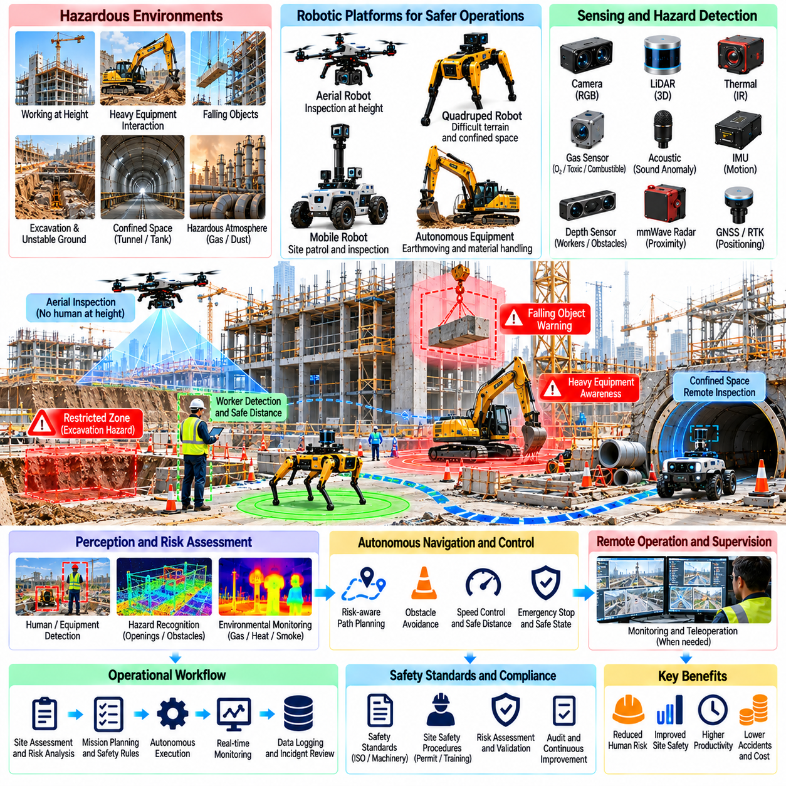{width="7.268055555555556in" height="7.268055555555556in"}

Hazardous environments and worker safety are central concerns in construction and infrastructure operations because workers encounter moving equipment, unstable structures, elevated locations, confined spaces, and potentially dangerous materials. Physical AI can reduce exposure by assigning selected hazardous tasks to autonomous robots. Its effectiveness depends on reliable perception, risk-aware planning, controlled interaction, and integration with established safety procedures.

Construction hazards change continuously as excavation, material handling, structural assembly, and equipment movement progress. Temporary barriers, incomplete floors, suspended loads, and changing access routes create unpredictable conditions. Autonomous systems must therefore assess both static and dynamic risks. Safety cannot depend solely on previously mapped environments because new hazards may appear between inspection and execution.

Robotic inspection can reduce the need for personnel to enter dangerous locations. Aerial robots observe elevated structures, quadrupeds traverse difficult terrain, and mobile platforms inspect selected industrial or underground areas. Remote sensing can provide early information about structural damage, gas accumulation, or unsafe access conditions. However, robotic measurements must be interpreted within their detection limits and verified when necessary.

Hazard identification begins with understanding the environment, intended robotic task, and possible failure consequences. Risk assessments examine collisions, falls, entrapment, electrical exposure, equipment interactions, and loss of control. Severity and likelihood estimates guide mitigation priorities. Assessments should be updated whenever site conditions, robot configurations, operating procedures, or task requirements change significantly.

Environmental perception combines cameras, LiDAR, depth sensors, thermal instruments, and other measurements to detect obstacles and potential hazards. Artificial intelligence can assist in recognizing workers, vehicles, open excavations, and restricted areas. Nevertheless, dust, smoke, poor illumination, occlusion, and sensor contamination may reduce detection reliability. Safety functions require validated performance under representative adverse conditions.

Human detection and collision avoidance are particularly important when robots share workspaces with construction personnel. Robots may estimate pedestrian positions, predict nearby movement, and adjust speed or trajectory. Protective separation distances should account for sensing uncertainty, stopping capability, and human unpredictability. Where necessary, physical barriers and controlled access provide additional protection beyond autonomous avoidance.

Heavy construction machinery introduces hazards involving large masses, limited visibility, and substantial stopping distances. Autonomous excavators, loaders, and transport vehicles require carefully defined operating zones and interaction rules. Personnel should not rely on visual recognition alone to determine whether machinery is safe to approach. Clear warning signals, controlled access, and reliable emergency stopping arrangements are essential.

Working at height presents risks of falling personnel, dropped objects, and unstable access equipment. Aerial robots and remotely operated inspection systems can perform selected observations without placing workers on elevated structures. However, drones introduce their own risks, including falling aircraft and rotor contact. Flight planning must consider exclusion zones, overhead obstacles, wind conditions, and emergency landing locations.

Confined spaces such as tunnels, tanks, shafts, and underground chambers may contain oxygen-deficient atmospheres, toxic gases, or restricted escape routes. Robots equipped with appropriate environmental sensors can support preliminary assessment before human entry. Their measurements do not automatically establish that entry is safe. Confined-space procedures, atmospheric testing, rescue planning, and applicable permit requirements remain necessary.

Hazardous atmosphere monitoring may involve oxygen sensors, combustible gas detectors, and instruments for selected toxic substances. Mobile robots can collect measurements across multiple locations while limiting worker exposure. Sensor placement, calibration, response time, and environmental compatibility influence measurement quality. Alarm thresholds and responses must reflect applicable safety requirements and the limitations of each instrument.

Structural instability creates additional challenges near damaged buildings, excavations, retaining walls, and aging infrastructure. Robots can document visible deformation, cracking, and selected changes in geometry without requiring immediate human access. LiDAR and imaging systems support repeated observations. Such measurements provide evidence for engineering assessment but do not independently establish structural stability or safe entry conditions.

Remote operation and supervised autonomy offer practical alternatives when fully autonomous behavior cannot be justified. Operators can direct robots through uncertain areas while monitoring camera feeds and sensor readings. Communication delay, restricted visibility, and incomplete situational awareness remain important limitations. Procedures should define when operations must stop and how robots can be recovered without exposing personnel to additional hazards.

Functional safety requires protective mechanisms that remain effective when software, sensors, communication links, or actuators fail. Emergency stopping, speed limitation, fault monitoring, and safe-state transitions can reduce hazardous consequences. Safety-related control functions must be designed and validated according to applicable machinery and robotic safety requirements. Learning-based autonomy should not replace independently justified protective controls.

Multi-robot construction environments require coordination between autonomous machines and conventional equipment. Shared traffic rules, restricted zones, and task scheduling can reduce conflicting movements. Each robot should maintain appropriate local protective functions even when a fleet management system coordinates operations. Centralized supervision improves visibility but should not become a single point of failure for immediate hazard response.

Digital site models can support safety planning by representing excavation boundaries, hazardous zones, temporary structures, and designated access routes. Robot observations may update these representations as construction progresses. Integrating spatial information with work permits and operational schedules helps identify potential conflicts. However, outdated maps and incorrect coordinates can create dangerous assumptions about site conditions.

Worker safety also depends on understandable human-robot interaction. Personnel need training on robot behavior, warning indicators, emergency procedures, and permitted access boundaries. Supervisors should clearly communicate operating schedules and changes to autonomous work zones. Workers must have reliable methods to report unsafe behavior and request intervention. Effective adoption requires attention to practical work practices rather than technology alone.

Cybersecurity contributes to physical safety because compromised control commands, positioning information, or operational data can influence robot behavior. Authentication, access restrictions, secure communication, and controlled software updates reduce exposure to unauthorized interference. Safety-critical configurations should be protected against unintended changes. Incident records and system logs support investigation, accountability, and corrective action.

Safety performance should be evaluated using both leading and lagging indicators. Leading indicators include hazard detection coverage, intervention frequency, protective-system tests, and corrective action completion. Lagging indicators include collisions, injuries, and equipment damage. Near-miss reporting provides additional evidence about emerging risks. Metrics should consider exposure levels and operational context rather than relying only on raw incident counts.

Robotic deployment may improve safety by reducing time spent in hazardous locations, supporting more frequent inspections, and identifying selected risks earlier. Nevertheless, robots can introduce new hazards through unexpected motion, falling equipment, battery failures, or operational confusion. Risk reduction must be demonstrated through systematic assessment and field validation. A successful deployment transfers dangerous work without creating unacceptable secondary risks.

Economic evaluation should consider avoided exposure, reduced access equipment requirements, operational continuity, and potential inspection efficiency. These benefits must be weighed against robot acquisition, maintenance, training, safety engineering, and supervision costs. Financial calculations should not assume that every identified hazard results in a preventable accident. Safety value is best assessed alongside operational performance and compliance obligations.

Implementation should begin with a defined hazardous task and a documented baseline risk assessment. Pilot deployments can validate sensing reliability, protective functions, communication behavior, and emergency procedures under controlled conditions. Workers and safety specialists should participate in operational reviews. Expansion should follow demonstrated performance, updated risk assessments, and clear responsibility for ongoing safety management.

Hazardous environment robotics demonstrates how Physical AI can support worker protection through remote access, intelligent sensing, and controlled autonomy. Its greatest contribution is reducing unnecessary human exposure while improving information about difficult operating conditions. Sustainable adoption requires engineering safeguards, human oversight, reliable procedures, and continuous evaluation as construction environments evolve.

위험 환경(Hazardous Environments)과 작업자 안전(Worker Safety)은 건설 및 인프라 운영(Construction and Infrastructure Operations)의 핵심적인 고려사항이다. 작업자들은 이동 장비(Moving Equipment), 불안정한 구조물(Unstable Structures), 고소 작업 구역(Elevated Locations), 밀폐 공간(Confined Spaces), 잠재적으로 위험한 물질(Potentially Dangerous Materials)에 노출되기 때문이다. 피지컬 인공지능(Physical AI)은 특정 위험 작업(Hazardous Tasks)을 자율 로봇(Autonomous Robots)에 할당하여 이러한 노출을 줄일 수 있다. 그 효과는 신뢰성 있는 인지(Reliable Perception), 위험 인식 기반 계획(Risk-Aware Planning), 통제된 상호작용(Controlled Interaction), 기존 안전 절차(Established Safety Procedures)와의 통합에 따라 달라진다.

건설 현장의 위험 요소(Construction Hazards)는 굴착(Excavation), 자재 취급(Material Handling), 구조물 조립(Structural Assembly), 장비 이동(Equipment Movement)이 진행됨에 따라 지속적으로 변화한다. 임시 방호벽(Temporary Barriers), 미완성 바닥(Incomplete Floors), 매달린 하중(Suspended Loads), 변화하는 접근 경로(Changing Access Routes)는 예측하기 어려운 조건을 형성한다. 따라서 자율 시스템(Autonomous Systems)은 정적 위험(Static Risks)과 동적 위험(Dynamic Risks)을 모두 평가해야 한다. 검사와 작업 수행 사이에 새로운 위험이 발생할 수 있으므로 안전을 기존에 작성된 환경 지도(Previously Mapped Environments)에만 의존해서는 안 된다.

로봇 검사(Robotic Inspection)는 작업자가 위험한 장소에 직접 진입해야 할 필요성을 줄일 수 있다. 항공 로봇(Aerial Robots)은 높은 구조물(Elevated Structures)을 관측하고, 사족보행 로봇(Quadrupeds)은 이동하기 어려운 지형(Difficult Terrain)을 통과하며, 이동 플랫폼(Mobile Platforms)은 특정 산업 시설이나 지하 구역(Industrial or Underground Areas)을 검사한다. 원격 센싱(Remote Sensing)은 구조적 손상(Structural Damage), 가스 축적(Gas Accumulation), 안전하지 않은 접근 조건(Unsafe Access Conditions)에 관한 초기 정보를 제공할 수 있다. 그러나 로봇 측정값(Robotic Measurements)은 탐지 한계(Detection Limits)를 고려하여 해석해야 하며 필요한 경우 검증해야 한다.

위험 식별(Hazard Identification)은 환경(Environment), 의도된 로봇 작업(Intended Robotic Task), 발생 가능한 고장 결과(Possible Failure Consequences)를 이해하는 것에서 시작된다. 위험 평가(Risk Assessments)는 충돌(Collisions), 추락(Falls), 끼임(Entrapment), 전기적 위험 노출(Electrical Exposure), 장비 간 상호작용(Equipment Interactions), 제어 상실(Loss of Control)을 검토한다. 심각도(Severity)와 발생 가능성(Likelihood)의 추정은 위험 완화 우선순위(Mitigation Priorities)를 결정하는 데 활용된다. 현장 조건(Site Conditions), 로봇 구성(Robot Configurations), 운영 절차(Operating Procedures), 작업 요구사항(Task Requirements)이 크게 변경될 때마다 위험 평가를 갱신해야 한다.

환경 인지(Environmental Perception)는 카메라(Cameras), 라이다(LiDAR), 깊이 센서(Depth Sensors), 열 측정 장비(Thermal Instruments), 기타 측정값을 결합하여 장애물(Obstacles)과 잠재적 위험(Potential Hazards)을 탐지한다. 인공지능(Artificial Intelligence, AI)은 작업자(Workers), 차량(Vehicles), 개방된 굴착 구역(Open Excavations), 출입 제한 구역(Restricted Areas)을 인식하는 데 도움을 줄 수 있다. 그러나 먼지(Dust), 연기(Smoke), 낮은 조도(Poor Illumination), 가림 현상(Occlusion), 센서 오염(Sensor Contamination)은 탐지 신뢰성(Detection Reliability)을 저하시킬 수 있다. 안전 기능(Safety Functions)은 대표적인 불리한 환경 조건(Representative Adverse Conditions)에서 검증된 성능(Validated Performance)을 확보해야 한다.

인간 탐지(Human Detection)와 충돌 회피(Collision Avoidance)는 로봇이 건설 작업자(Construction Personnel)와 작업 공간을 공유하는 경우 특히 중요하다. 로봇은 보행자 위치(Pedestrian Positions)를 추정하고 주변 움직임(Nearby Movement)을 예측하며 속도(Speed)나 이동 궤적(Trajectory)을 조정할 수 있다. 보호 이격 거리(Protective Separation Distances)는 센싱 불확실성(Sensing Uncertainty), 정지 능력(Stopping Capability), 인간 행동의 예측 불가능성(Human Unpredictability)을 고려해야 한다. 필요한 경우 물리적 방호벽(Physical Barriers)과 통제된 접근(Controlled Access)은 자율 충돌 회피(Autonomous Avoidance)를 넘어서는 추가적인 보호 기능을 제공한다.

대형 건설 기계(Heavy Construction Machinery)는 큰 질량(Large Masses), 제한된 가시성(Limited Visibility), 긴 정지 거리(Substantial Stopping Distances)와 관련된 위험을 발생시킨다. 자율 굴착기(Autonomous Excavators), 로더(Loaders), 운송 차량(Transport Vehicles)에는 명확하게 정의된 운영 구역(Operating Zones)과 상호작용 규칙(Interaction Rules)이 필요하다. 작업자는 기계에 접근해도 안전한지를 판단할 때 시각적 인식(Visual Recognition)에만 의존해서는 안 된다. 명확한 경고 신호(Warning Signals), 통제된 접근(Controlled Access), 신뢰성 있는 비상 정지 체계(Emergency Stopping Arrangements)가 필수적이다.

고소 작업(Working at Height)은 작업자 추락(Falling Personnel), 낙하물(Dropped Objects), 불안정한 접근 장비(Unstable Access Equipment)와 관련된 위험을 수반한다. 항공 로봇(Aerial Robots)과 원격 조작 검사 시스템(Remotely Operated Inspection Systems)은 작업자를 높은 구조물에 배치하지 않고도 특정 관측 작업을 수행할 수 있다. 그러나 드론(Drones)은 기체 추락(Falling Aircraft)과 회전 날개 접촉(Rotor Contact)을 포함한 자체적인 위험을 발생시킨다. 비행 계획(Flight Planning)은 출입 제한 구역(Exclusion Zones), 상부 장애물(Overhead Obstacles), 풍속 조건(Wind Conditions), 비상 착륙 장소(Emergency Landing Locations)를 고려해야 한다.

터널(Tunnels), 탱크(Tanks), 수직갱(Shafts), 지하 공간(Underground Chambers)과 같은 밀폐 공간(Confined Spaces)에는 산소 결핍 대기(Oxygen-Deficient Atmospheres), 유독가스(Toxic Gases), 제한된 탈출 경로(Restricted Escape Routes)가 존재할 수 있다. 적절한 환경 센서(Environmental Sensors)를 탑재한 로봇은 작업자가 진입하기 전에 예비 평가(Preliminary Assessment)를 지원할 수 있다. 그러나 로봇의 측정값만으로 진입이 안전하다고 자동으로 판단할 수는 없다. 밀폐 공간 작업 절차(Confined-Space Procedures), 대기 측정(Atmospheric Testing), 구조 계획(Rescue Planning), 적용 가능한 작업 허가 요건(Permit Requirements)은 여전히 필요하다.

위험 대기 모니터링(Hazardous Atmosphere Monitoring)에는 산소 센서(Oxygen Sensors), 가연성 가스 검지기(Combustible Gas Detectors), 특정 유해 물질(Selected Toxic Substances)을 측정하는 장비가 사용될 수 있다. 이동 로봇(Mobile Robots)은 작업자의 위험 노출을 제한하면서 여러 위치에서 측정값을 수집할 수 있다. 센서 배치(Sensor Placement), 보정(Calibration), 응답 시간(Response Time), 환경 적합성(Environmental Compatibility)은 측정 품질(Measurement Quality)에 영향을 미친다. 경보 임계값(Alarm Thresholds)과 대응 조치(Responses)는 적용 가능한 안전 요구사항(Safety Requirements)과 각 장비의 한계(Instrument Limitations)를 반영해야 한다.

구조적 불안정성(Structural Instability)은 손상된 건물(Damaged Buildings), 굴착 구역(Excavations), 옹벽(Retaining Walls), 노후 인프라(Aging Infrastructure) 주변에서 추가적인 문제를 발생시킨다. 로봇은 작업자의 즉각적인 접근 없이 가시적인 변형(Visible Deformation), 균열(Cracking), 특정 형상 변화(Changes in Geometry)를 기록할 수 있다. 라이다(LiDAR)와 영상 시스템(Imaging Systems)은 반복적인 관측(Repeated Observations)을 지원한다. 이러한 측정값은 엔지니어링 평가(Engineering Assessment)를 위한 근거를 제공하지만 구조적 안정성(Structural Stability)이나 안전한 진입 조건(Safe Entry Conditions)을 독립적으로 입증하지는 못한다.

원격 조작(Remote Operation)과 감독형 자율 운영(Supervised Autonomy)은 완전 자율 동작(Fully Autonomous Behavior)의 정당성을 확보하기 어려운 경우 실용적인 대안을 제공한다. 운영자(Operators)는 카메라 영상(Camera Feeds)과 센서 측정값(Sensor Readings)을 모니터링하면서 불확실한 구역(Uncertain Areas)을 통과하도록 로봇을 지시할 수 있다. 그러나 통신 지연(Communication Delay), 제한된 가시성(Restricted Visibility), 불완전한 상황 인식(Incomplete Situational Awareness)은 여전히 중요한 한계로 남는다. 운영 절차(Operational Procedures)는 작업을 중단해야 하는 시점과 작업자를 추가 위험에 노출시키지 않고 로봇을 회수하는 방법을 정의해야 한다.

기능 안전(Functional Safety)은 소프트웨어(Software), 센서(Sensors), 통신 링크(Communication Links), 구동기(Actuators)에 고장이 발생하더라도 효과를 유지하는 보호 메커니즘(Protective Mechanisms)을 필요로 한다. 비상 정지(Emergency Stopping), 속도 제한(Speed Limitation), 고장 모니터링(Fault Monitoring), 안전 상태 전환(Safe-State Transitions)은 위험한 결과를 줄일 수 있다. 안전 관련 제어 기능(Safety-Related Control Functions)은 적용 가능한 기계 및 로봇 안전 요구사항(Machinery and Robotic Safety Requirements)에 따라 설계되고 검증되어야 한다. 학습 기반 자율성(Learning-Based Autonomy)이 독립적으로 정당성이 입증된 보호 제어(Independently Justified Protective Controls)를 대체해서는 안 된다.

다중 로봇 건설 환경(Multi-Robot Construction Environments)에서는 자율 기계(Autonomous Machines)와 기존 장비(Conventional Equipment) 사이의 협조가 필요하다. 공유 교통 규칙(Shared Traffic Rules), 출입 제한 구역(Restricted Zones), 작업 스케줄링(Task Scheduling)은 상충되는 움직임(Conflicting Movements)을 줄일 수 있다. 군집 관리 시스템(Fleet Management System)이 운영을 조정하더라도 각 로봇은 적절한 국소 보호 기능(Local Protective Functions)을 유지해야 한다. 중앙집중형 감독(Centralized Supervision)은 운영 가시성(Operational Visibility)을 개선하지만 즉각적인 위험 대응(Immediate Hazard Response)을 위한 단일 장애점(Single Point of Failure)이 되어서는 안 된다.

디지털 현장 모델(Digital Site Models)은 굴착 경계(Excavation Boundaries), 위험 구역(Hazardous Zones), 임시 구조물(Temporary Structures), 지정된 접근 경로(Designated Access Routes)를 표현하여 안전 계획(Safety Planning)을 지원할 수 있다. 로봇 관측 결과(Robot Observations)는 건설이 진행됨에 따라 이러한 표현을 갱신할 수 있다. 공간 정보(Spatial Information)를 작업 허가서(Work Permits) 및 운영 일정(Operational Schedules)과 통합하면 잠재적인 충돌(Potential Conflicts)을 식별하는 데 도움이 된다. 그러나 오래된 지도(Outdated Maps)와 잘못된 좌표(Incorrect Coordinates)는 현장 조건에 관한 위험한 가정(Dangerous Assumptions)을 발생시킬 수 있다.

작업자 안전(Worker Safety)은 이해하기 쉬운 인간-로봇 상호작용(Human-Robot Interaction)에도 의존한다. 작업자들은 로봇 행동(Robot Behavior), 경고 표시(Warning Indicators), 비상 절차(Emergency Procedures), 허용된 접근 경계(Permitted Access Boundaries)에 관한 교육을 받아야 한다. 감독자(Supervisors)는 운영 일정(Operating Schedules)과 자율 작업 구역(Autonomous Work Zones)의 변경 사항을 명확하게 전달해야 한다. 작업자들은 안전하지 않은 행동(Unsafe Behavior)을 보고하고 개입(Intervention)을 요청할 수 있는 신뢰성 있는 수단을 확보해야 한다. 효과적인 도입(Effective Adoption)을 위해서는 기술 자체뿐 아니라 실제 작업 관행(Practical Work Practices)에도 주의를 기울여야 한다.

사이버보안(Cybersecurity)은 손상된 제어 명령(Control Commands), 위치 정보(Positioning Information), 운영 데이터(Operational Data)가 로봇 행동(Robot Behavior)에 영향을 미칠 수 있기 때문에 물리적 안전(Physical Safety)에 기여한다. 인증(Authentication), 접근 제한(Access Restrictions), 보안 통신(Secure Communication), 통제된 소프트웨어 업데이트(Controlled Software Updates)는 승인되지 않은 간섭(Unauthorized Interference)에 대한 노출을 줄인다. 안전 필수 구성(Safety-Critical Configurations)은 의도하지 않은 변경(Unintended Changes)으로부터 보호되어야 한다. 사고 기록(Incident Records)과 시스템 로그(System Logs)는 사고 조사(Investigation), 책임성(Accountability), 시정 조치(Corrective Action)를 지원한다.

안전 성능(Safety Performance)은 선행 지표(Leading Indicators)와 후행 지표(Lagging Indicators)를 모두 사용하여 평가해야 한다. 선행 지표에는 위험 탐지 범위(Hazard Detection Coverage), 개입 빈도(Intervention Frequency), 보호 시스템 시험(Protective-System Tests), 시정 조치 완료(Corrective Action Completion)가 포함된다. 후행 지표에는 충돌(Collisions), 부상(Injuries), 장비 손상(Equipment Damage)이 포함된다. 아차사고 보고(Near-Miss Reporting)는 새롭게 나타나는 위험(Emerging Risks)에 관한 추가 근거를 제공한다. 성능 지표(Metrics)는 단순한 사고 건수(Raw Incident Counts)에만 의존하지 않고 위험 노출 수준(Exposure Levels)과 운영 상황(Operational Context)을 고려해야 한다.

로봇 배치(Robotic Deployment)는 위험한 장소에서 보내는 시간(Time Spent in Hazardous Locations)을 줄이고, 더욱 빈번한 검사(More Frequent Inspections)를 지원하며, 특정 위험을 조기에 식별함으로써 안전을 개선할 수 있다. 그러나 로봇은 예상하지 못한 움직임(Unexpected Motion), 장비 추락(Falling Equipment), 배터리 고장(Battery Failures), 운영상 혼란(Operational Confusion)을 통해 새로운 위험을 발생시킬 수도 있다. 위험 감소(Risk Reduction)는 체계적인 평가(Systematic Assessment)와 현장 검증(Field Validation)을 통해 입증되어야 한다. 성공적인 배치(Successful Deployment)는 허용할 수 없는 2차 위험(Unacceptable Secondary Risks)을 발생시키지 않으면서 위험 작업(Dangerous Work)을 로봇으로 이전하는 것이다.

경제성 평가(Economic Evaluation)는 위험 노출 회피(Avoided Exposure), 접근 장비 요구사항 감소(Reduced Access Equipment Requirements), 운영 연속성(Operational Continuity), 잠재적인 검사 효율성(Potential Inspection Efficiency)을 고려해야 한다. 이러한 이점은 로봇 도입(Robot Acquisition), 유지보수(Maintenance), 교육(Training), 안전 엔지니어링(Safety Engineering), 감독(Supervision)에 필요한 비용과 비교해야 한다. 재무 계산(Financial Calculations)에서 식별된 모든 위험이 예방 가능한 사고(Preventable Accident)로 이어진다고 가정해서는 안 된다. 안전 가치(Safety Value)는 운영 성능(Operational Performance) 및 규정 준수 의무(Compliance Obligations)와 함께 평가하는 것이 가장 적절하다.

구현(Implementation)은 명확하게 정의된 위험 작업(Defined Hazardous Task)과 문서화된 기준 위험 평가(Documented Baseline Risk Assessment)에서 시작해야 한다. 시범 배치(Pilot Deployments)는 통제된 조건(Controlled Conditions)에서 센싱 신뢰성(Sensing Reliability), 보호 기능(Protective Functions), 통신 동작(Communication Behavior), 비상 절차(Emergency Procedures)를 검증할 수 있다. 작업자(Workers)와 안전 전문가(Safety Specialists)는 운영 검토(Operational Reviews)에 참여해야 한다. 적용 범위 확대(Expansion)는 입증된 성능(Demonstrated Performance), 갱신된 위험 평가(Updated Risk Assessments), 지속적인 안전 관리(Ongoing Safety Management)에 대한 명확한 책임을 바탕으로 진행되어야 한다.

위험 환경 로보틱스(Hazardous Environment Robotics)는 피지컬 인공지능(Physical AI)이 원격 접근(Remote Access), 지능형 센싱(Intelligent Sensing), 통제된 자율성(Controlled Autonomy)을 통해 작업자 보호(Worker Protection)를 어떻게 지원할 수 있는지 보여준다. 가장 중요한 기여는 불필요한 인간 위험 노출(Unnecessary Human Exposure)을 줄이면서 작업하기 어려운 환경 조건(Difficult Operating Conditions)에 관한 정보를 개선하는 것이다. 지속 가능한 도입(Sustainable Adoption)을 위해서는 건설 환경(Construction Environments)이 변화함에 따라 엔지니어링 안전장치(Engineering Safeguards), 인간 감독(Human Oversight), 신뢰성 있는 절차(Reliable Procedures), 지속적인 평가(Continuous Evaluation)가 필요하다.

##  

## 06.14. Project Schedule Quality and Cost Impact

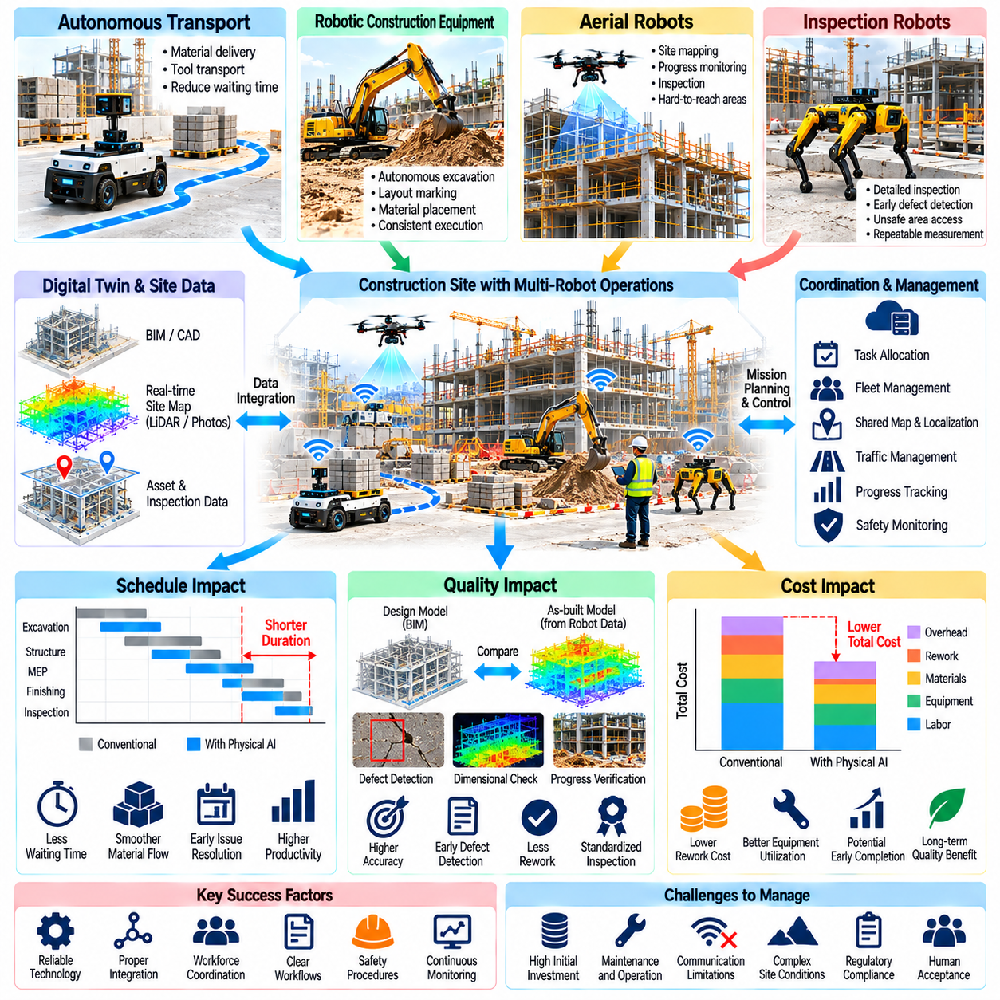{width="7.268055555555556in" height="7.268055555555556in"}

Physical AI can influence construction project schedules, quality, and costs by introducing autonomous sensing, material transportation, robotic equipment, and intelligent inspection into site operations. Its business value depends on measurable improvements across interconnected project activities rather than isolated robot performance. Effective evaluation must consider deployment complexity, workforce coordination, reliability, and the economic consequences of operational changes.

Construction schedules are determined by dependencies between excavation, material delivery, structural assembly, inspection, and finishing activities. Delays in one operation can affect multiple downstream tasks, particularly when the delayed activity lies on the critical path. Physical AI can improve schedule predictability through more consistent execution and timely information. However, faster individual tasks do not automatically shorten overall project duration.

Autonomous material transportation can reduce waiting time when construction crews depend on timely delivery of tools, components, and supplies. Mobile robots may perform repetitive deliveries between storage areas and active work zones. Their effectiveness depends on route availability, loading procedures, and coordination with human workers. Schedule benefits arise when transportation improvements eliminate actual workflow bottlenecks.

Robotic construction equipment can improve productivity in selected repetitive or well-defined operations. Autonomous excavation, layout marking, surface preparation, and material placement may achieve more consistent execution under suitable conditions. Actual productivity depends on task complexity, environmental variability, and setup requirements. Equipment utilization must include calibration, repositioning, maintenance, and intervention time.

Inspection automation can influence project schedules by identifying defects and construction discrepancies earlier. Aerial robots, ground platforms, and intelligent sensors can collect observations more frequently than some conventional inspection workflows. Early detection allows corrective actions before subsequent activities conceal or amplify problems. Nevertheless, inspection findings must be verified and integrated into timely engineering decisions.

Digital mapping and reality capture support schedule management by providing updated information about actual site conditions. LiDAR, photogrammetry, and robotic surveying can document geometry, material placement, and construction progress. Comparing measured conditions with design models helps identify deviations. The usefulness of these comparisons depends on spatial accuracy, data processing speed, and clear responsibility for resolving discrepancies.

Construction quality includes dimensional accuracy, material conformity, structural integrity, and compliance with specified workmanship requirements. Physical AI can support quality assurance through repeatable measurements and standardized inspection procedures. Robots may reduce variability caused by inconsistent observation positions or manual recording. However, automated measurements cannot replace engineering judgment or required acceptance testing.

Quality control becomes more effective when robotic observations are connected to specific assets, locations, and construction stages. Images, point clouds, and sensor readings can be linked to building information models and inspection records. This traceability supports defect investigation and verification of corrective work. Reliable integration requires consistent identifiers, calibrated sensors, and documented measurement uncertainty.

Rework is a major connection between construction quality and project economics. Errors discovered after subsequent activities have begun may require demolition, replacement, additional labor, and schedule adjustments. Robotic inspection can reduce some rework by detecting discrepancies earlier. The economic benefit depends on detection accuracy, response speed, and whether the identified problem would otherwise have remained unnoticed.

Project cost analysis should distinguish capital expenditure, operating expenditure, and integration costs. Robotic platforms, sensing equipment, charging systems, and supporting infrastructure contribute to initial investment. Maintenance, software, energy, training, supervision, and data processing create recurring expenses. A realistic financial model must also include commissioning, workflow redesign, and temporary productivity losses during deployment.

Labor economics require careful interpretation because robots rarely eliminate all human involvement. Autonomous systems may reduce repetitive transportation, hazardous access, or manual measurement activities while creating new responsibilities in supervision and maintenance. Labor savings depend on actual staffing changes, redeployment, and overtime reduction. Financial evaluations should avoid treating every automated task hour as an equivalent reduction in paid labor.

Schedule improvements can generate indirect financial benefits through reduced equipment rental periods, lower temporary facility expenses, and earlier project completion. However, these benefits occur only when robotic improvements affect activities that determine overall duration. Critical path analysis helps distinguish genuine schedule savings from local productivity gains. Contractual incentives, penalties, and resource constraints may further influence economic outcomes.

Construction quality improvements may reduce warranty claims, corrective work, material waste, and long-term maintenance requirements. Repeated robotic measurements can provide better evidence of installation conditions and completed work. These benefits are difficult to monetize without historical defect and rework data. Economic estimates should distinguish verified cost reductions from potential future savings and avoided risks.

A digital twin can connect schedule, quality, and cost information through a common representation of project progress. Planned activities, actual measurements, defect records, and resource consumption can be associated with spatial construction elements. This integration supports comparison between planned and actual performance. Its effectiveness depends on data governance, timely updates, and compatibility with existing project management systems.

Performance measurement should combine operational and project-level indicators. Robot utilization, mission completion rate, intervention frequency, and inspection coverage describe system performance. Schedule variance, rework rate, defect closure time, and cost variance describe broader project outcomes. Comparing these indicators helps determine whether robotic improvements translate into measurable construction value.

Baseline selection is critical for credible evaluation. Conventional workflows should be measured under representative site conditions before introducing robotic systems. Comparisons must account for differences in project complexity, weather, workforce availability, and construction phase. Controlled pilot studies or matched work packages can reduce misleading conclusions. Measurement methods and assumptions should remain consistent across alternatives.

Economic modeling can use net present value, return on investment, and payback period to evaluate deployment feasibility. Cash flow estimates should include acquisition costs, recurring expenses, productivity changes, and expected operating life. Discount rates reflect the time value of money and project risk. Sensitivity analysis is necessary because utilization, reliability, and labor assumptions can substantially change financial results.

Scenario analysis can compare conservative, expected, and optimistic deployment outcomes. Conservative scenarios may include slower adoption, frequent interventions, and limited schedule improvements. More favorable scenarios may assume stable operations and high utilization. Each scenario should use explicit assumptions rather than unsupported performance claims. Decision-makers can then evaluate whether investment remains acceptable under uncertainty.

Multi-robot coordination can create additional value when transportation, inspection, and construction activities are managed together. Shared scheduling may reduce congestion, idle equipment time, and duplicated observations. However, coordination software and communication infrastructure introduce integration costs and failure dependencies. System-level optimization must demonstrate improvements beyond those achieved by independently operated robots.

Risk-adjusted evaluation should include technical failures, safety incidents, cybersecurity exposure, regulatory constraints, and uncertain operating conditions. Robots may reduce some construction risks while introducing others. Contingency budgets and fallback procedures help manage deployment uncertainty. Financial models should avoid assigning precise monetary benefits to risks without credible evidence about their probability and consequences.

Deployment planning should prioritize tasks with clear bottlenecks, measurable quality requirements, or substantial hazardous exposure. Pilot projects can establish realistic productivity, accuracy, intervention, and maintenance data. Gradual expansion allows organizations to refine workflows and training before committing to larger investments. Procurement decisions should consider interoperability, service support, and lifecycle costs.

Project governance is necessary to connect robotic performance with construction management decisions. Project managers, engineers, safety personnel, and robot operators should agree on objectives, acceptance criteria, and reporting responsibilities. Regular reviews can identify whether expected benefits are materializing. Corrective actions may involve changing routes, modifying task assignments, improving data quality, or revising deployment scope.

The schedule, quality, and cost impact of Physical AI is best understood as an integrated project performance problem. Autonomous robots create value when they remove bottlenecks, detect defects early, improve information reliability, and support safer operations. Sustainable adoption requires evidence-based financial analysis, disciplined implementation, and continuous measurement of outcomes across the complete construction workflow.

피지컬 인공지능(Physical AI)은 자율 센싱(Autonomous Sensing), 자재 운송(Material Transportation), 로봇 건설 장비(Robotic Construction Equipment), 지능형 검사(Intelligent Inspection)를 현장 운영(Site Operations)에 도입함으로써 건설 프로젝트 일정(Construction Project Schedules), 품질(Quality), 비용(Costs)에 영향을 미칠 수 있다. 이러한 기술의 사업적 가치(Business Value)는 개별 로봇 성능(Isolated Robot Performance)이 아니라 상호 연결된 프로젝트 활동(Interconnected Project Activities) 전반에서 측정 가능한 개선에 달려 있다. 효과적인 평가(Effective Evaluation)를 위해서는 배치 복잡성(Deployment Complexity), 인력 협조(Workforce Coordination), 신뢰성(Reliability), 운영 변화의 경제적 결과(Economic Consequences of Operational Changes)를 고려해야 한다.

건설 일정(Construction Schedules)은 굴착(Excavation), 자재 배송(Material Delivery), 구조물 조립(Structural Assembly), 검사(Inspection), 마감 작업(Finishing Activities) 사이의 의존 관계(Dependencies)에 의해 결정된다. 하나의 작업에서 발생한 지연(Delays)은 여러 후속 작업(Downstream Tasks)에 영향을 미칠 수 있으며, 특히 지연된 작업이 주공정(Critical Path)에 포함되는 경우 그 영향이 커진다. 피지컬 인공지능(Physical AI)은 더욱 일관된 작업 수행(Consistent Execution)과 적시 정보(Timely Information)를 통해 일정 예측 가능성(Schedule Predictability)을 개선할 수 있다. 그러나 개별 작업의 수행 속도가 빨라진다고 해서 전체 프로젝트 기간(Overall Project Duration)이 자동으로 단축되는 것은 아니다.

자율 자재 운송(Autonomous Material Transportation)은 건설 작업팀(Construction Crews)이 공구(Tools), 부품(Components), 공급 자재(Supplies)의 적시 배송에 의존하는 경우 대기 시간(Waiting Time)을 줄일 수 있다. 이동 로봇(Mobile Robots)은 보관 구역(Storage Areas)과 실제 작업 구역(Active Work Zones) 사이에서 반복적인 배송 작업(Repetitive Deliveries)을 수행할 수 있다. 이러한 로봇의 효과는 이동 경로의 가용성(Route Availability), 적재 절차(Loading Procedures), 인간 작업자와의 협조(Coordination with Human Workers)에 따라 달라진다. 일정 개선 효과(Schedule Benefits)는 운송 효율 향상이 실제 작업 흐름 병목(Workflow Bottlenecks)을 제거할 때 발생한다.

로봇 건설 장비(Robotic Construction Equipment)는 특정 반복 작업(Repetitive Operations)이나 명확하게 정의된 작업(Well-Defined Operations)에서 생산성(Productivity)을 향상시킬 수 있다. 자율 굴착(Autonomous Excavation), 위치 표시(Layout Marking), 표면 준비(Surface Preparation), 자재 배치(Material Placement)는 적절한 조건에서 더욱 일관된 작업 수행(Consistent Execution)을 가능하게 한다. 실제 생산성(Actual Productivity)은 작업 복잡성(Task Complexity), 환경 변동성(Environmental Variability), 설치 및 준비 요구사항(Setup Requirements)에 따라 달라진다. 장비 활용률(Equipment Utilization)을 평가할 때는 보정(Calibration), 위치 재조정(Repositioning), 유지보수(Maintenance), 작업자 개입 시간(Intervention Time)을 포함해야 한다.

검사 자동화(Inspection Automation)는 결함(Defects)과 시공 불일치(Construction Discrepancies)를 조기에 식별함으로써 프로젝트 일정(Project Schedules)에 영향을 미칠 수 있다. 항공 로봇(Aerial Robots), 지상 플랫폼(Ground Platforms), 지능형 센서(Intelligent Sensors)는 일부 기존 검사 작업 흐름(Conventional Inspection Workflows)보다 더 자주 관측 정보를 수집할 수 있다. 조기 탐지(Early Detection)는 후속 작업(Subsequent Activities)이 문제를 가리거나 확대하기 전에 시정 조치(Corrective Actions)를 수행할 수 있도록 한다. 그러나 검사 결과(Inspection Findings)는 검증되어야 하며 적시에 이루어지는 엔지니어링 의사결정(Engineering Decisions)에 반영되어야 한다.

디지털 지도 작성(Digital Mapping)과 현실 공간 데이터 획득(Reality Capture)은 실제 현장 조건(Actual Site Conditions)에 관한 최신 정보를 제공하여 일정 관리(Schedule Management)를 지원한다. 라이다(LiDAR), 사진측량(Photogrammetry), 로봇 측량(Robotic Surveying)은 형상(Geometry), 자재 배치(Material Placement), 건설 진행 상황(Construction Progress)을 기록할 수 있다. 측정된 현장 조건(Measured Conditions)을 설계 모델(Design Models)과 비교하면 편차(Deviations)를 식별하는 데 도움이 된다. 이러한 비교의 유용성은 공간 정확도(Spatial Accuracy), 데이터 처리 속도(Data Processing Speed), 불일치 해결 책임(Responsibility for Resolving Discrepancies)의 명확성에 따라 달라진다.

건설 품질(Construction Quality)에는 치수 정확도(Dimensional Accuracy), 자재 적합성(Material Conformity), 구조적 건전성(Structural Integrity), 지정된 시공 품질 요구사항(Specified Workmanship Requirements)의 준수가 포함된다. 피지컬 인공지능(Physical AI)은 반복 가능한 측정(Repeatable Measurements)과 표준화된 검사 절차(Standardized Inspection Procedures)를 통해 품질 보증(Quality Assurance)을 지원할 수 있다. 로봇은 관측 위치(Observation Positions)의 불일치나 수동 기록(Manual Recording)에서 발생하는 변동성(Variability)을 줄일 수 있다. 그러나 자동화된 측정(Automated Measurements)이 엔지니어링 판단(Engineering Judgment)이나 필수 인수 시험(Required Acceptance Testing)을 대체할 수는 없다.

품질 관리(Quality Control)는 로봇 관측 결과(Robotic Observations)가 특정 자산(Assets), 위치(Locations), 건설 단계(Construction Stages)와 연결될 때 더욱 효과적이다. 이미지(Images), 포인트 클라우드(Point Clouds), 센서 측정값(Sensor Readings)은 건축정보모델(Building Information Models, BIM)과 검사 기록(Inspection Records)에 연결될 수 있다. 이러한 추적 가능성(Traceability)은 결함 조사(Defect Investigation)와 시정 작업(Corrective Work)의 검증을 지원한다. 신뢰성 있는 통합(Reliable Integration)을 위해서는 일관된 식별자(Consistent Identifiers), 보정된 센서(Calibrated Sensors), 문서화된 측정 불확실성(Documented Measurement Uncertainty)이 필요하다.

재작업(Rework)은 건설 품질(Construction Quality)과 프로젝트 경제성(Project Economics)을 연결하는 주요 요소이다. 후속 작업(Subsequent Activities)이 시작된 이후 발견된 오류(Errors)는 철거(Demolition), 교체(Replacement), 추가 인력(Additional Labor), 일정 조정(Schedule Adjustments)을 필요로 할 수 있다. 로봇 검사(Robotic Inspection)는 시공 불일치(Discrepancies)를 조기에 탐지하여 일부 재작업을 줄일 수 있다. 경제적 이점(Economic Benefit)은 탐지 정확도(Detection Accuracy), 대응 속도(Response Speed), 식별된 문제가 그렇지 않았다면 발견되지 않았을 가능성에 따라 달라진다.

프로젝트 비용 분석(Project Cost Analysis)은 자본적 지출(Capital Expenditure, CAPEX), 운영비용(Operating Expenditure, OPEX), 통합 비용(Integration Costs)을 구분해야 한다. 로봇 플랫폼(Robotic Platforms), 센싱 장비(Sensing Equipment), 충전 시스템(Charging Systems), 지원 인프라(Supporting Infrastructure)는 초기 투자(Initial Investment)에 포함된다. 유지보수(Maintenance), 소프트웨어(Software), 에너지(Energy), 교육(Training), 감독(Supervision), 데이터 처리(Data Processing)는 반복적인 비용(Recurring Expenses)을 발생시킨다. 현실적인 재무 모델(Financial Model)에는 시운전 및 초기 가동 준비(Commissioning), 작업 흐름 재설계(Workflow Redesign), 배치 과정에서 발생하는 일시적인 생산성 손실(Temporary Productivity Losses)도 포함해야 한다.

인건비 경제성(Labor Economics)은 로봇이 인간의 참여(Human Involvement)를 모두 제거하는 경우가 드물기 때문에 신중하게 해석해야 한다. 자율 시스템(Autonomous Systems)은 반복적인 운송(Repetitive Transportation), 위험 구역 접근(Hazardous Access), 수동 측정(Manual Measurement) 작업을 줄이는 동시에 감독(Supervision)과 유지보수(Maintenance) 분야에서 새로운 책임을 발생시킬 수 있다. 인건비 절감(Labor Savings)은 실제 인력 구성 변화(Actual Staffing Changes), 인력 재배치(Redeployment), 초과근무 감소(Overtime Reduction)에 따라 달라진다. 재무 평가(Financial Evaluations)에서는 자동화된 모든 작업 시간을 동일한 유급 노동시간(Paid Labor)의 감소로 간주하지 않아야 한다.

일정 개선(Schedule Improvements)은 장비 임대 기간(Equipment Rental Periods) 단축, 임시 시설 비용(Temporary Facility Expenses) 감소, 프로젝트 조기 완료(Earlier Project Completion)를 통해 간접적인 재무적 이점(Indirect Financial Benefits)을 창출할 수 있다. 그러나 이러한 이점은 로봇을 통한 개선이 전체 공사 기간(Overall Duration)을 결정하는 작업에 영향을 미칠 때만 발생한다. 주공정 분석(Critical Path Analysis)은 실제 일정 단축(Genuine Schedule Savings)과 국소적인 생산성 향상(Local Productivity Gains)을 구분하는 데 도움이 된다. 계약상 인센티브(Contractual Incentives), 지체상금(Penalties), 자원 제약(Resource Constraints)도 경제적 성과에 영향을 미칠 수 있다.

건설 품질 개선(Construction Quality Improvements)은 하자보증 청구(Warranty Claims), 시정 작업(Corrective Work), 자재 낭비(Material Waste), 장기 유지보수 요구사항(Long-Term Maintenance Requirements)을 줄일 수 있다. 반복적인 로봇 측정(Repeated Robotic Measurements)은 설치 상태(Installation Conditions)와 완료된 작업(Completed Work)에 관한 더 나은 근거를 제공할 수 있다. 그러나 과거 결함 데이터(Historical Defect Data)와 재작업 데이터(Rework Data)가 없으면 이러한 이점을 금전적 가치로 환산하기 어렵다. 경제적 추정(Economic Estimates)은 검증된 비용 절감(Verified Cost Reductions)과 잠재적인 미래 절감(Potential Future Savings) 및 회피된 위험(Avoided Risks)을 구분해야 한다.

디지털 트윈(Digital Twin)은 프로젝트 진행 상황(Project Progress)에 대한 공통 표현(Common Representation)을 통해 일정(Schedule), 품질(Quality), 비용(Cost) 정보를 연결할 수 있다. 계획된 작업(Planned Activities), 실제 측정값(Actual Measurements), 결함 기록(Defect Records), 자원 소비(Resource Consumption)는 공간적으로 정의된 건설 요소(Spatial Construction Elements)와 연계될 수 있다. 이러한 통합(Integration)은 계획 대비 실제 성과(Planned versus Actual Performance)의 비교를 지원한다. 그 효과는 데이터 거버넌스(Data Governance), 적시 업데이트(Timely Updates), 기존 프로젝트 관리 시스템(Existing Project Management Systems)과의 호환성(Compatibility)에 따라 달라진다.

성능 측정(Performance Measurement)은 운영 수준 지표(Operational-Level Indicators)와 프로젝트 수준 지표(Project-Level Indicators)를 결합해야 한다. 로봇 활용률(Robot Utilization), 임무 완료율(Mission Completion Rate), 개입 빈도(Intervention Frequency), 검사 범위(Inspection Coverage)는 시스템 성능(System Performance)을 설명한다. 일정 편차(Schedule Variance), 재작업률(Rework Rate), 결함 조치 완료 시간(Defect Closure Time), 비용 편차(Cost Variance)는 더 광범위한 프로젝트 성과(Project Outcomes)를 나타낸다. 이러한 지표를 비교하면 로봇의 성능 개선이 측정 가능한 건설 가치(Measurable Construction Value)로 연결되는지 판단할 수 있다.

기준선 선정(Baseline Selection)은 신뢰할 수 있는 평가(Credible Evaluation)를 위해 매우 중요하다. 로봇 시스템(Robotic Systems)을 도입하기 전에 대표적인 현장 조건(Representative Site Conditions)에서 기존 작업 흐름(Conventional Workflows)을 측정해야 한다. 비교 분석(Comparisons)에서는 프로젝트 복잡성(Project Complexity), 날씨(Weather), 인력 가용성(Workforce Availability), 건설 단계(Construction Phase)의 차이를 고려해야 한다. 통제된 시범 연구(Controlled Pilot Studies)나 대응되는 작업 패키지(Matched Work Packages)를 활용하면 잘못된 결론(Misleading Conclusions)을 줄일 수 있다. 측정 방법(Measurement Methods)과 가정(Assumptions)은 비교 대상 전반에서 일관되게 유지되어야 한다.

경제성 모델링(Economic Modeling)은 순현재가치(Net Present Value, NPV), 투자수익률(Return on Investment, ROI), 투자 회수기간(Payback Period)을 활용하여 배치 타당성(Deployment Feasibility)을 평가할 수 있다. 현금흐름 추정(Cash Flow Estimates)에는 도입 비용(Acquisition Costs), 반복 비용(Recurring Expenses), 생산성 변화(Productivity Changes), 예상 운영 수명(Expected Operating Life)이 포함되어야 한다. 할인율(Discount Rates)은 화폐의 시간가치(Time Value of Money)와 프로젝트 위험(Project Risk)을 반영한다. 활용률(Utilization), 신뢰성(Reliability), 인건비 가정(Labor Assumptions)이 재무적 결과(Financial Results)를 크게 변화시킬 수 있으므로 민감도 분석(Sensitivity Analysis)이 필요하다.

시나리오 분석(Scenario Analysis)은 보수적 시나리오(Conservative Scenario), 예상 시나리오(Expected Scenario), 낙관적 시나리오(Optimistic Scenario)의 배치 결과를 비교할 수 있다. 보수적 시나리오에는 느린 도입 속도(Slower Adoption), 빈번한 개입(Frequent Interventions), 제한적인 일정 개선(Limited Schedule Improvements)이 포함될 수 있다. 더 유리한 시나리오(More Favorable Scenarios)에서는 안정적인 운영(Stable Operations)과 높은 활용률(High Utilization)을 가정할 수 있다. 각 시나리오는 근거 없는 성능 주장(Unsupported Performance Claims)이 아니라 명시적인 가정(Explicit Assumptions)을 사용해야 한다. 이를 통해 의사결정자(Decision-Makers)는 불확실성(Uncertainty) 속에서도 투자가 수용 가능한지 평가할 수 있다.

다중 로봇 협조(Multi-Robot Coordination)는 운송(Transportation), 검사(Inspection), 건설 작업(Construction Activities)을 통합적으로 관리할 때 추가적인 가치를 창출할 수 있다. 공유 스케줄링(Shared Scheduling)은 혼잡(Congestion), 장비 유휴 시간(Idle Equipment Time), 중복 관측(Duplicated Observations)을 줄일 수 있다. 그러나 협조 소프트웨어(Coordination Software)와 통신 인프라(Communication Infrastructure)는 통합 비용(Integration Costs)과 고장 의존성(Failure Dependencies)을 발생시킨다. 시스템 수준 최적화(System-Level Optimization)는 독립적으로 운영되는 로봇(Independently Operated Robots)이 달성하는 성과를 넘어서는 개선 효과를 입증해야 한다.

위험 조정 평가(Risk-Adjusted Evaluation)에는 기술적 고장(Technical Failures), 안전 사고(Safety Incidents), 사이버보안 위험 노출(Cybersecurity Exposure), 규제 제약(Regulatory Constraints), 불확실한 운영 조건(Uncertain Operating Conditions)이 포함되어야 한다. 로봇은 일부 건설 위험(Construction Risks)을 줄이는 동시에 새로운 위험을 발생시킬 수 있다. 예비비(Contingency Budgets)와 대체 절차(Fallback Procedures)는 배치 불확실성(Deployment Uncertainty)을 관리하는 데 도움이 된다. 재무 모델(Financial Models)은 발생 확률(Probability)과 결과(Consequences)에 관한 신뢰할 수 있는 근거 없이 위험에 정확한 금전적 이익(Precise Monetary Benefits)을 부여해서는 안 된다.

배치 계획(Deployment Planning)은 명확한 병목 현상(Clear Bottlenecks), 측정 가능한 품질 요구사항(Measurable Quality Requirements), 상당한 위험 노출(Substantial Hazardous Exposure)이 존재하는 작업을 우선해야 한다. 시범 프로젝트(Pilot Projects)는 현실적인 생산성(Productivity), 정확도(Accuracy), 개입(Intervention), 유지보수(Maintenance) 데이터를 확보할 수 있다. 점진적인 확대(Gradual Expansion)는 조직이 대규모 투자(Larger Investments)를 결정하기 전에 작업 흐름(Workflows)과 교육(Training)을 개선할 수 있도록 한다. 구매 의사결정(Procurement Decisions)에서는 상호운용성(Interoperability), 서비스 지원(Service Support), 수명주기 비용(Lifecycle Costs)을 고려해야 한다.

프로젝트 거버넌스(Project Governance)는 로봇 성능(Robotic Performance)을 건설 관리 의사결정(Construction Management Decisions)과 연결하는 데 필요하다. 프로젝트 관리자(Project Managers), 엔지니어(Engineers), 안전 담당자(Safety Personnel), 로봇 운영자(Robot Operators)는 목표(Objectives), 인수 기준(Acceptance Criteria), 보고 책임(Reporting Responsibilities)에 합의해야 한다. 정기적인 검토(Regular Reviews)를 통해 예상된 이점(Expected Benefits)이 실제로 나타나는지 확인할 수 있다. 시정 조치(Corrective Actions)에는 이동 경로 변경(Changing Routes), 작업 할당 수정(Modifying Task Assignments), 데이터 품질 개선(Improving Data Quality), 배치 범위 조정(Revising Deployment Scope)이 포함될 수 있다.

피지컬 인공지능(Physical AI)이 일정(Schedule), 품질(Quality), 비용(Cost)에 미치는 영향은 통합적인 프로젝트 성과 문제(Integrated Project Performance Problem)로 이해하는 것이 가장 적절하다. 자율 로봇(Autonomous Robots)은 병목 현상(Bottlenecks)을 제거하고, 결함(Defects)을 조기에 탐지하며, 정보 신뢰성(Information Reliability)을 개선하고, 더욱 안전한 운영(Safer Operations)을 지원할 때 가치를 창출한다. 지속 가능한 도입(Sustainable Adoption)을 위해서는 근거 기반 재무 분석(Evidence-Based Financial Analysis), 체계적인 구현(Disciplined Implementation), 전체 건설 작업 흐름(Complete Construction Workflow)에 걸친 성과의 지속적인 측정(Continuous Measurement of Outcomes)이 필요하다.

##  

## 06.15. Infrastructure Inspection ROI Model [w/Code]

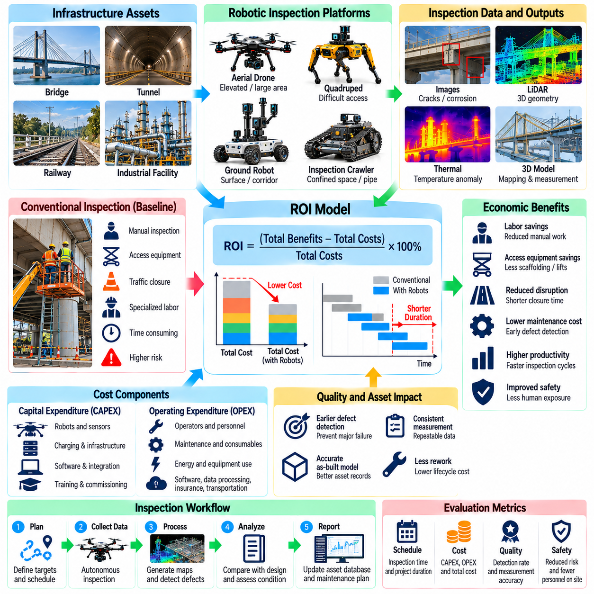{width="7.268055555555556in" height="7.268055555555556in"}

An infrastructure inspection return on investment model evaluates whether robotic inspection systems generate sufficient economic and operational benefits to justify their acquisition and deployment. Physical AI enables autonomous inspection of bridges, tunnels, railways, industrial facilities, and underground infrastructure. A credible ROI model compares robotic workflows with conventional methods while accounting for inspection quality, safety, asset condition, and lifecycle costs.

The economic baseline represents the cost and performance of existing inspection procedures before automation. Conventional inspections may require specialized personnel, access equipment, traffic restrictions, temporary closures, and manual documentation. Baseline measurements should include inspection frequency, labor hours, equipment rental, reporting time, and corrective actions. Without reliable baseline data, projected savings can be misleading.

Infrastructure characteristics strongly influence the financial feasibility of robotic inspection. Bridges may require elevated access equipment, while tunnels involve restricted operating windows and difficult communication conditions. Railways impose possession schedules and operational constraints. Underground assets may require confined-space procedures. The ROI model should distinguish these environments rather than applying a single cost assumption to every inspection mission.

Capital expenditure includes robotic platforms, sensors, navigation equipment, communication systems, charging infrastructure, and initial software integration. Aerial robots, quadrupeds, and ground inspection vehicles have different acquisition and operating requirements. Additional investments may include mapping software, data storage, and safety equipment. Initial deployment costs should also account for commissioning, calibration, and workforce training.

Operating expenditure includes inspection personnel, robot operators, maintenance, energy, software subscriptions, insurance, and data processing. Consumable components and sensor calibration create recurring expenses. Robots may also require transportation between inspection locations and periodic replacement of batteries or mechanical parts. Accurate operating cost estimates should reflect actual mission frequency and expected equipment utilization.

Inspection productivity can be evaluated through asset coverage per hour, mission completion rate, setup time, and reporting duration. Robotic systems may collect measurements more efficiently in repetitive or difficult-access environments. However, autonomous navigation failures, environmental restrictions, and manual verification can reduce effective productivity. The model should use completed and accepted inspections rather than raw robot operating hours.

Direct labor savings arise when robotic inspection reduces manual measurement, hazardous access, or repetitive documentation. These savings depend on whether personnel hours are actually eliminated, redeployed, or converted into higher-value activities. Human inspectors remain necessary for engineering interpretation and regulatory decisions. Financial models should avoid assuming that autonomous data collection completely replaces professional inspection responsibilities.

Access equipment savings can be substantial when robots reduce the need for scaffolding, lifts, rope access, or specialized inspection vehicles. Such savings depend on the asset geometry, inspection requirements, and whether physical access remains necessary for testing or repair. Some inspections still require personnel to reach the structure. The model should calculate avoided access costs separately for each inspection category.

Operational disruption costs are particularly important for transportation infrastructure. Bridge lane closures, railway possession windows, and tunnel restrictions can affect users and asset operators. Robotic inspections may reduce closure duration or enable selected observations during normal operations. Economic benefits should distinguish direct operator savings from broader societal impacts, avoiding double counting when calculating project-level ROI.

Inspection quality influences financial outcomes through defect detection, measurement consistency, and documentation reliability. High-resolution imaging, LiDAR, thermal sensing, and other instruments can support repeatable condition assessment. Earlier identification of deterioration may reduce some corrective maintenance costs. However, financial benefits require evidence that detected defects lead to timely intervention and improved asset outcomes.

False positives and missed defects must be considered when evaluating automated inspection performance. False alarms can increase verification costs and unnecessary maintenance activities. Missed defects may create additional safety and financial risks. Detection precision, recall, and measurement uncertainty should therefore influence economic assumptions. Inspection acceptance criteria must remain consistent with applicable engineering and regulatory requirements.

A practical cost model separates annual fixed expenses from variable mission expenses. Fixed costs may include depreciation, software licensing, insurance, and administrative support. Variable costs include labor, travel, energy, consumables, and mission-specific access arrangements. Total annual robotic inspection cost equals annual fixed cost plus the number of missions multiplied by average variable cost per mission.

Annual financial benefit can be estimated by combining verified labor savings, avoided access equipment costs, reduced operational disruption, and documented maintenance improvements. Additional benefits may include faster reporting and improved inspection frequency. Benefits should be expressed in consistent monetary units and evaluated over the same period. Nonfinancial safety and information benefits should be reported separately unless credible valuation methods exist.

Return on investment can be expressed as net financial benefit divided by the investment amount, multiplied by one hundred percent. Net benefit represents total attributable benefits minus relevant costs over the defined evaluation period. The model must state whether ROI is calculated annually or across the equipment lifecycle. Consistent treatment of capital expenditure and recurring costs is essential to avoid overstating returns.

Payback period estimates how long accumulated net operating benefits require to recover the initial investment. Under constant annual net savings, simple payback equals initial investment divided by annual net savings. This calculation is convenient but does not account for the time value of money. Discounted payback provides a more appropriate comparison when cash flows vary or investment horizons are long.

Net present value evaluates discounted future cash flows over the expected system lifecycle. Each year\'s net benefit is discounted using an appropriate rate, and initial investment is deducted from the resulting present value. A positive net present value indicates financial attractiveness under the selected assumptions. Replacement costs, residual value, and major software upgrades should be included when they materially affect lifecycle economics.

Robot utilization is a major determinant of inspection ROI because capital costs are distributed across completed missions. A robot used frequently across several infrastructure assets may achieve a lower cost per inspection than one deployed occasionally. Fleet sharing and service-based operating models can improve utilization. Nevertheless, travel time, weather restrictions, charging, and maintenance limit the number of missions realistically achievable.

Sensitivity analysis examines how financial outcomes change when uncertain assumptions vary. Important variables include inspection volume, labor rates, access costs, robot reliability, maintenance expenditure, and achievable productivity. Break-even analysis identifies the minimum annual mission volume or savings required to justify investment. These methods help distinguish robust business cases from projections dependent on optimistic assumptions.

Scenario analysis can compare conservative, expected, and optimistic operating conditions. Conservative scenarios may include low utilization, additional verification labor, and frequent equipment downtime. Expected scenarios should reflect measured pilot performance. Optimistic scenarios may assume stable operations and broader asset coverage. Explicit scenario assumptions make investment decisions more transparent and easier to revise.

A numerical example illustrates the calculation process without representing a universal industry benchmark. Suppose robotic inspection requires an initial investment of \$200,000 and generates annual gross savings of \$100,000 with additional annual operating costs of \$40,000. Annual net savings equal \$60,000, producing a simple payback period of approximately 3.33 years. The result excludes discounting, replacement costs, and residual value.

Safety benefits should be evaluated carefully because reduced worker exposure does not automatically translate into predictable financial savings. Robots may decrease time spent at heights, near moving traffic, or inside confined spaces. Relevant indicators include hazardous exposure hours and required access operations. Monetary valuation should rely on defensible evidence rather than assuming that every avoided exposure prevents an accident.

Implementation begins with selecting representative assets and collecting conventional inspection cost and performance data. Pilot deployments should measure mission duration, accepted inspection coverage, intervention frequency, detection quality, and operating expenses. These observations provide inputs for the financial model. Periodic reassessment is necessary as robot capabilities, maintenance requirements, and inspection demand evolve.

An infrastructure inspection ROI model provides a structured connection between Physical AI capabilities and asset management decisions. Economic value emerges from reduced inspection costs, improved access, operational efficiency, and potentially earlier maintenance intervention. Sustainable investment requires validated technical performance, transparent financial assumptions, and continuous comparison between expected and realized benefits.

인프라 검사 투자수익률 모델(Infrastructure Inspection Return on Investment Model)은 로봇 검사 시스템(Robotic Inspection Systems)이 도입 및 배치(Acquisition and Deployment)를 정당화할 만큼 충분한 경제적·운영적 이점(Economic and Operational Benefits)을 창출하는지 평가한다. 피지컬 인공지능(Physical AI)은 교량(Bridges), 터널(Tunnels), 철도(Railways), 산업 시설(Industrial Facilities), 지하 인프라(Underground Infrastructure)의 자율 검사(Autonomous Inspection)를 가능하게 한다. 신뢰할 수 있는 투자수익률 모델(ROI Model)은 검사 품질(Inspection Quality), 안전(Safety), 자산 상태(Asset Condition), 수명주기 비용(Lifecycle Costs)을 고려하면서 로봇 기반 작업 흐름(Robotic Workflows)을 기존 검사 방식(Conventional Methods)과 비교한다.

경제적 기준선(Economic Baseline)은 자동화(Automation)를 도입하기 이전의 기존 검사 절차(Existing Inspection Procedures)에 대한 비용과 성능을 나타낸다. 기존 검사(Conventional Inspections)에는 전문 인력(Specialized Personnel), 접근 장비(Access Equipment), 교통 제한(Traffic Restrictions), 임시 폐쇄(Temporary Closures), 수동 문서화(Manual Documentation)가 필요할 수 있다. 기준선 측정(Baseline Measurements)에는 검사 빈도(Inspection Frequency), 노동시간(Labor Hours), 장비 임대료(Equipment Rental), 보고서 작성 시간(Reporting Time), 시정 조치(Corrective Actions)가 포함되어야 한다. 신뢰할 수 있는 기준선 데이터(Baseline Data)가 없으면 예상 절감액(Projected Savings)이 잘못 산정될 수 있다.

인프라 특성(Infrastructure Characteristics)은 로봇 검사의 재무적 타당성(Financial Feasibility)에 큰 영향을 미친다. 교량(Bridges)에는 고소 접근 장비(Elevated Access Equipment)가 필요할 수 있으며, 터널(Tunnels)은 제한된 운영 시간(Restricted Operating Windows)과 어려운 통신 조건(Difficult Communication Conditions)을 수반한다. 철도(Railways)에는 선로 점유 일정(Possession Schedules)과 운영상 제약(Operational Constraints)이 적용된다. 지하 자산(Underground Assets)에는 밀폐 공간 작업 절차(Confined-Space Procedures)가 필요할 수 있다. 투자수익률 모델(ROI Model)은 모든 검사 임무(Inspection Missions)에 동일한 비용 가정(Cost Assumption)을 적용하지 않고 이러한 환경을 구분해야 한다.

자본적 지출(Capital Expenditure, CAPEX)에는 로봇 플랫폼(Robotic Platforms), 센서(Sensors), 내비게이션 장비(Navigation Equipment), 통신 시스템(Communication Systems), 충전 인프라(Charging Infrastructure), 초기 소프트웨어 통합(Initial Software Integration)이 포함된다. 항공 로봇(Aerial Robots), 사족보행 로봇(Quadrupeds), 지상 검사 차량(Ground Inspection Vehicles)은 서로 다른 도입 및 운영 요구사항(Acquisition and Operating Requirements)을 가진다. 추가 투자(Additional Investments)에는 지도 작성 소프트웨어(Mapping Software), 데이터 저장 장치(Data Storage), 안전 장비(Safety Equipment)가 포함될 수 있다. 초기 배치 비용(Initial Deployment Costs)에는 시운전(Commissioning), 보정(Calibration), 인력 교육(Workforce Training)도 반영해야 한다.

운영비용(Operating Expenditure, OPEX)에는 검사 인력(Inspection Personnel), 로봇 운영자(Robot Operators), 유지보수(Maintenance), 에너지(Energy), 소프트웨어 구독료(Software Subscriptions), 보험(Insurance), 데이터 처리(Data Processing)가 포함된다. 소모성 부품(Consumable Components)과 센서 보정(Sensor Calibration)은 반복적인 비용(Recurring Expenses)을 발생시킨다. 로봇은 검사 장소(Inspection Locations) 사이의 운송(Transportation)과 배터리(Batteries) 또는 기계 부품(Mechanical Parts)의 주기적인 교체(Periodic Replacement)도 필요할 수 있다. 정확한 운영비용 추정(Operating Cost Estimates)은 실제 임무 빈도(Actual Mission Frequency)와 예상 장비 활용률(Expected Equipment Utilization)을 반영해야 한다.

검사 생산성(Inspection Productivity)은 시간당 자산 검사 범위(Asset Coverage per Hour), 임무 완료율(Mission Completion Rate), 준비 시간(Setup Time), 보고서 작성 시간(Reporting Duration)을 통해 평가할 수 있다. 로봇 시스템(Robotic Systems)은 반복적이거나 접근하기 어려운 환경(Repetitive or Difficult-Access Environments)에서 측정값을 더욱 효율적으로 수집할 수 있다. 그러나 자율 내비게이션 실패(Autonomous Navigation Failures), 환경적 제약(Environmental Restrictions), 수동 검증(Manual Verification)은 실질적인 생산성(Effective Productivity)을 저하시킬 수 있다. 모델은 단순한 로봇 가동시간(Robot Operating Hours)이 아니라 완료되고 승인된 검사(Completed and Accepted Inspections)를 기준으로 해야 한다.

직접 인건비 절감(Direct Labor Savings)은 로봇 검사(Robotic Inspection)가 수동 측정(Manual Measurement), 위험 구역 접근(Hazardous Access), 반복적인 문서화(Repetitive Documentation)를 줄일 때 발생한다. 이러한 절감 효과는 인력의 노동시간(Personnel Hours)이 실제로 제거되는지, 다른 업무로 재배치되는지, 또는 더 높은 부가가치 활동(Higher-Value Activities)으로 전환되는지에 따라 달라진다. 인간 검사자(Human Inspectors)는 엔지니어링 해석(Engineering Interpretation)과 규제 관련 의사결정(Regulatory Decisions)에 여전히 필요하다. 재무 모델(Financial Models)은 자율 데이터 수집(Autonomous Data Collection)이 전문 검사 책임(Professional Inspection Responsibilities)을 완전히 대체한다고 가정해서는 안 된다.

접근 장비 비용 절감(Access Equipment Savings)은 로봇이 비계(Scaffolding), 고소 작업대(Lifts), 로프 접근(Rope Access), 특수 검사 차량(Specialized Inspection Vehicles)의 필요성을 줄이는 경우 상당할 수 있다. 이러한 절감 효과는 자산 형상(Asset Geometry), 검사 요구사항(Inspection Requirements), 시험 또는 수리(Testing or Repair)를 위해 물리적 접근(Physical Access)이 여전히 필요한지에 따라 달라진다. 일부 검사(Inspections)에서는 작업자가 구조물에 직접 접근해야 한다. 모델은 각 검사 유형(Inspection Category)에 대해 회피 가능한 접근 비용(Avoided Access Costs)을 별도로 계산해야 한다.

운영 중단 비용(Operational Disruption Costs)은 교통 인프라(Transportation Infrastructure)에서 특히 중요하다. 교량 차선 폐쇄(Bridge Lane Closures), 철도 선로 점유 시간(Railway Possession Windows), 터널 통행 제한(Tunnel Restrictions)은 이용자(Users)와 자산 운영자(Asset Operators)에게 영향을 미칠 수 있다. 로봇 검사(Robotic Inspections)는 폐쇄 시간(Closure Duration)을 줄이거나 정상 운영(Normal Operations) 중 일부 관측 작업을 수행할 수 있도록 한다. 경제적 이점(Economic Benefits)을 산정할 때는 직접적인 운영자 비용 절감(Direct Operator Savings)과 광범위한 사회적 영향(Broader Societal Impacts)을 구분하여 프로젝트 수준 투자수익률(Project-Level ROI) 계산에서 이중 계산(Double Counting)을 방지해야 한다.

검사 품질(Inspection Quality)은 결함 탐지(Defect Detection), 측정 일관성(Measurement Consistency), 문서화 신뢰성(Documentation Reliability)을 통해 재무적 성과(Financial Outcomes)에 영향을 미친다. 고해상도 영상(High-Resolution Imaging), 라이다(LiDAR), 열 센싱(Thermal Sensing), 기타 측정 장비(Other Instruments)는 반복 가능한 상태 평가(Repeatable Condition Assessment)를 지원할 수 있다. 열화(Deterioration)를 조기에 식별하면 일부 시정 유지보수 비용(Corrective Maintenance Costs)을 줄일 수 있다. 그러나 재무적 이점(Financial Benefits)을 인정하려면 탐지된 결함(Detected Defects)이 적시에 이루어지는 개입(Timely Intervention)과 자산 상태 개선(Improved Asset Outcomes)으로 연결된다는 근거가 필요하다.

자동화된 검사 성능(Automated Inspection Performance)을 평가할 때는 오탐(False Positives)과 미탐(Missed Defects)을 고려해야 한다. 잘못된 경보(False Alarms)는 검증 비용(Verification Costs)과 불필요한 유지보수 활동(Unnecessary Maintenance Activities)을 증가시킬 수 있다. 탐지하지 못한 결함(Missed Defects)은 추가적인 안전 위험(Safety Risks)과 재무적 위험(Financial Risks)을 발생시킬 수 있다. 따라서 탐지 정밀도(Detection Precision), 재현율(Recall), 측정 불확실성(Measurement Uncertainty)을 경제적 가정(Economic Assumptions)에 반영해야 한다. 검사 인수 기준(Inspection Acceptance Criteria)은 적용 가능한 엔지니어링 및 규제 요구사항(Engineering and Regulatory Requirements)과 일관성을 유지해야 한다.

실용적인 비용 모델(Practical Cost Model)은 연간 고정비(Annual Fixed Expenses)와 임무별 변동비(Variable Mission Expenses)를 구분한다. 고정비(Fixed Costs)에는 감가상각(Depreciation), 소프트웨어 라이선스(Software Licensing), 보험(Insurance), 관리 지원(Administrative Support)이 포함될 수 있다. 변동비(Variable Costs)에는 인건비(Labor), 이동비(Travel), 에너지(Energy), 소모품(Consumables), 임무별 접근 조치(Mission-Specific Access Arrangements)가 포함된다. 연간 총 로봇 검사 비용(Total Annual Robotic Inspection Cost)은 연간 고정비(Annual Fixed Cost)에 임무 수(Number of Missions)와 임무당 평균 변동비(Average Variable Cost per Mission)의 곱을 더한 값이다.

연간 재무적 이익(Annual Financial Benefit)은 검증된 인건비 절감(Verified Labor Savings), 회피된 접근 장비 비용(Avoided Access Equipment Costs), 운영 중단 감소(Reduced Operational Disruption), 문서화된 유지보수 개선(Documented Maintenance Improvements)을 결합하여 추정할 수 있다. 추가적인 이점(Additional Benefits)에는 보고서 작성 시간 단축(Faster Reporting)과 검사 빈도 향상(Improved Inspection Frequency)이 포함될 수 있다. 이익(Benefits)은 일관된 화폐 단위(Consistent Monetary Units)로 표현하고 동일한 기간(Same Period)을 기준으로 평가해야 한다. 비재무적 안전 및 정보 이점(Nonfinancial Safety and Information Benefits)은 신뢰할 수 있는 가치 평가 방법(Credible Valuation Methods)이 없는 한 별도로 보고해야 한다.

투자수익률(Return on Investment, ROI)은 순재무적 이익(Net Financial Benefit)을 투자금액(Investment Amount)으로 나눈 뒤 100%를 곱하여 나타낼 수 있다. 순이익(Net Benefit)은 정의된 평가 기간(Defined Evaluation Period) 동안의 총 귀속 이익(Total Attributable Benefits)에서 관련 비용(Relevant Costs)을 차감한 값이다. 모델은 투자수익률(ROI)이 연간 기준(Annual Basis)인지 장비 수명주기(Equipment Lifecycle) 전체를 기준으로 계산되는지 명시해야 한다. 수익률(Returns)을 과대평가하지 않으려면 자본적 지출(Capital Expenditure)과 반복 비용(Recurring Costs)을 일관되게 처리하는 것이 필수적이다.

투자 회수기간(Payback Period)은 누적 순운영 이익(Accumulated Net Operating Benefits)이 초기 투자금(Initial Investment)을 회수하는 데 필요한 기간을 추정한다. 연간 순절감액(Annual Net Savings)이 일정한 경우 단순 투자 회수기간(Simple Payback Period)은 초기 투자금(Initial Investment)을 연간 순절감액(Annual Net Savings)으로 나누어 계산한다. 이 계산은 편리하지만 화폐의 시간가치(Time Value of Money)를 고려하지 않는다. 현금흐름(Cash Flows)이 변동하거나 투자 기간(Investment Horizons)이 긴 경우 할인 투자 회수기간(Discounted Payback Period)이 더욱 적절한 비교 기준을 제공한다.

순현재가치(Net Present Value, NPV)는 예상 시스템 수명주기(Expected System Lifecycle) 동안 발생하는 미래 현금흐름(Future Cash Flows)을 할인하여 평가한다. 각 연도의 순이익(Net Benefit)은 적절한 할인율(Discount Rate)을 사용하여 할인되며, 산출된 현재가치(Present Value)에서 초기 투자금(Initial Investment)을 차감한다. 양의 순현재가치(Positive Net Present Value)는 선택된 가정(Selected Assumptions)하에서 재무적으로 매력적인 투자임을 나타낸다. 교체 비용(Replacement Costs), 잔존가치(Residual Value), 주요 소프트웨어 업그레이드(Major Software Upgrades)가 수명주기 경제성(Lifecycle Economics)에 실질적인 영향을 미치는 경우 이를 포함해야 한다.

로봇 활용률(Robot Utilization)은 자본 비용(Capital Costs)이 완료된 임무(Completed Missions) 전체에 배분되기 때문에 검사 투자수익률(Inspection ROI)을 결정하는 주요 요소이다. 여러 인프라 자산(Infrastructure Assets)에 걸쳐 자주 사용되는 로봇은 가끔 배치되는 로봇보다 검사당 비용(Cost per Inspection)이 낮을 수 있다. 군집 공유(Fleet Sharing)와 서비스 기반 운영 모델(Service-Based Operating Models)은 활용률을 개선할 수 있다. 그러나 이동 시간(Travel Time), 기상 제약(Weather Restrictions), 충전(Charging), 유지보수(Maintenance)는 현실적으로 수행 가능한 임무 수(Number of Missions)를 제한한다.

민감도 분석(Sensitivity Analysis)은 불확실한 가정(Uncertain Assumptions)이 변화할 때 재무적 결과(Financial Outcomes)가 어떻게 달라지는지 검토한다. 주요 변수(Important Variables)에는 검사 물량(Inspection Volume), 인건비율(Labor Rates), 접근 비용(Access Costs), 로봇 신뢰성(Robot Reliability), 유지보수 지출(Maintenance Expenditure), 달성 가능한 생산성(Achievable Productivity)이 포함된다. 손익분기점 분석(Break-Even Analysis)은 투자를 정당화하는 데 필요한 최소 연간 임무 수(Minimum Annual Mission Volume) 또는 절감액(Savings)을 식별한다. 이러한 방법은 견고한 사업성(Robust Business Cases)과 낙관적인 가정(Optimistic Assumptions)에 의존하는 예측을 구분하는 데 도움이 된다.

시나리오 분석(Scenario Analysis)은 보수적 운영 조건(Conservative Operating Conditions), 예상 운영 조건(Expected Operating Conditions), 낙관적 운영 조건(Optimistic Operating Conditions)을 비교할 수 있다. 보수적 시나리오(Conservative Scenarios)에는 낮은 활용률(Low Utilization), 추가 검증 인력(Additional Verification Labor), 빈번한 장비 가동 중단(Frequent Equipment Downtime)이 포함될 수 있다. 예상 시나리오(Expected Scenarios)는 측정된 시범 운영 성능(Measured Pilot Performance)을 반영해야 한다. 낙관적 시나리오(Optimistic Scenarios)는 안정적인 운영(Stable Operations)과 더 넓은 자산 검사 범위(Broader Asset Coverage)를 가정할 수 있다. 명시적인 시나리오 가정(Explicit Scenario Assumptions)은 투자 의사결정(Investment Decisions)의 투명성을 높이고 수정도 쉽게 만든다.

수치 예제(Numerical Example)는 보편적인 산업 기준(Universal Industry Benchmark)을 나타내는 것이 아니라 계산 과정(Calculation Process)을 설명하기 위한 것이다. 로봇 검사(Robotic Inspection)에 초기 투자금(Initial Investment) 200,000달러가 필요하고, 연간 총절감액(Annual Gross Savings) 100,000달러와 추가 연간 운영비용(Additional Annual Operating Costs) 40,000달러가 발생한다고 가정한다. 연간 순절감액(Annual Net Savings)은 60,000달러이며, 단순 투자 회수기간(Simple Payback Period)은 약 3.33년이 된다. 이 결과에는 할인(Discounting), 교체 비용(Replacement Costs), 잔존가치(Residual Value)가 반영되지 않았다.

안전 이점(Safety Benefits)은 작업자의 위험 노출 감소(Reduced Worker Exposure)가 자동으로 예측 가능한 재무적 절감(Predictable Financial Savings)으로 연결되는 것은 아니므로 신중하게 평가해야 한다. 로봇은 고소 작업(Working at Heights), 이동 차량 주변(Near Moving Traffic), 밀폐 공간 내부(Inside Confined Spaces)에서 보내는 시간을 줄일 수 있다. 관련 지표(Relevant Indicators)에는 위험 노출 시간(Hazardous Exposure Hours)과 필요한 접근 작업(Required Access Operations)이 포함된다. 금전적 가치 평가(Monetary Valuation)는 회피된 모든 위험 노출(Avoided Exposure)이 사고 예방(Accident Prevention)으로 이어진다고 가정하기보다 타당한 근거(Defensible Evidence)에 기반해야 한다.

구현(Implementation)은 대표적인 자산(Representative Assets)을 선정하고 기존 검사 비용(Conventional Inspection Costs)과 성능 데이터(Performance Data)를 수집하는 것에서 시작된다. 시범 배치(Pilot Deployments)에서는 임무 수행 시간(Mission Duration), 승인된 검사 범위(Accepted Inspection Coverage), 개입 빈도(Intervention Frequency), 탐지 품질(Detection Quality), 운영비용(Operating Expenses)을 측정해야 한다. 이러한 관측 결과(Observations)는 재무 모델(Financial Model)의 입력 데이터(Inputs)를 제공한다. 로봇 능력(Robot Capabilities), 유지보수 요구사항(Maintenance Requirements), 검사 수요(Inspection Demand)가 변화함에 따라 주기적인 재평가(Periodic Reassessment)가 필요하다.

인프라 검사 투자수익률 모델(Infrastructure Inspection ROI Model)은 피지컬 인공지능(Physical AI)의 기술적 능력(Capabilities)과 자산 관리 의사결정(Asset Management Decisions)을 연결하는 체계적인 구조(Structured Connection)를 제공한다. 경제적 가치(Economic Value)는 검사 비용 절감(Reduced Inspection Costs), 접근성 개선(Improved Access), 운영 효율성(Operational Efficiency), 잠재적으로 더 이른 유지보수 개입(Earlier Maintenance Intervention)에서 발생한다. 지속 가능한 투자(Sustainable Investment)를 위해서는 검증된 기술 성능(Validated Technical Performance), 투명한 재무적 가정(Transparent Financial Assumptions), 예상 이익(Expected Benefits)과 실현 이익(Realized Benefits) 사이의 지속적인 비교(Continuous Comparison)가 필요하다.
