**Volume 12. Physical AI Business and Industry Applications**

# Chapter 07. Consumer and Home Applications

## 07.01. Physical AI in Consumer Environments

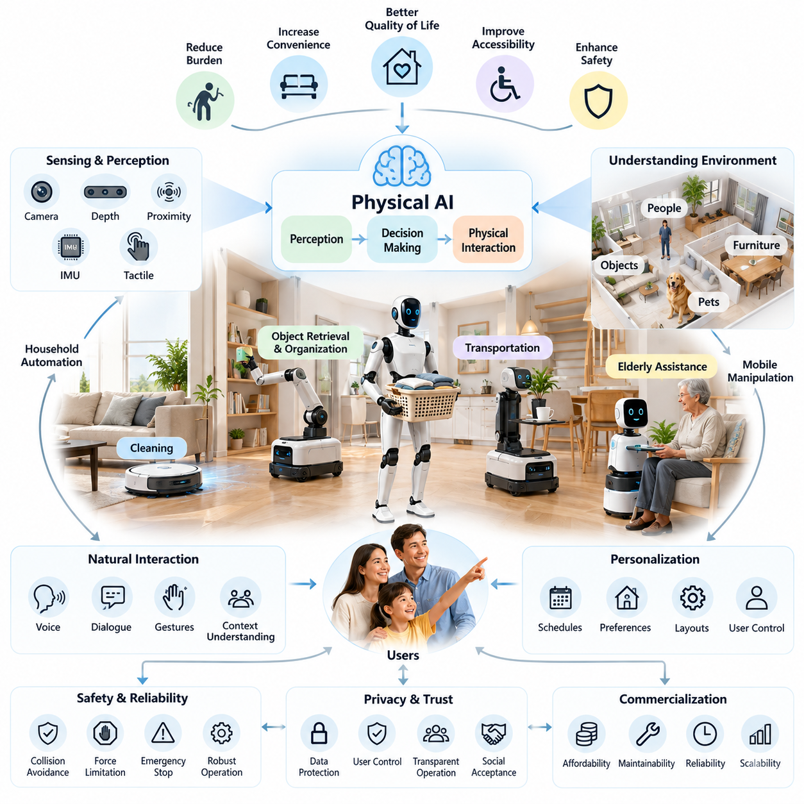{width="7.268055555555556in" height="7.268055555555556in"}

소비자 환경에서의 피지컬 인공지능(Physical AI)은 지능형 인식(Intelligent Perception), 자율적 의사결정(Autonomous Decision-Making), 물리적 상호작용(Physical Interaction)을 일상생활 공간에 통합하는 기술을 의미한다. 비교적 통제된 조건에서 작동하는 산업 자동화(Industrial Automation)와 달리, 소비자용 피지컬 인공지능은 인간의 행동, 가정용 물체, 반려동물, 가구, 변화하는 개인 생활 패턴에 의해 형성되는 역동적이고 예측하기 어려운 환경에서 작동해야 한다.

소비자용 피지컬 인공지능(Consumer Physical AI)의 주요 목적은 일상 활동과 관련된 신체적·인지적 부담을 줄이면서 편의성(Convenience), 접근성(Accessibility), 안전성(Safety), 삶의 질(Quality of Life)을 향상시키는 것이다. 지능형 가정용 로봇(Intelligent Home Robot)은 청소, 운반, 물체 회수, 모니터링, 개인 보조 등의 작업을 수행할 수 있다. 이러한 시스템의 실질적인 가치는 기술적 성능뿐만 아니라 경제성, 신뢰성, 사용 편의성, 가정생활의 요구사항과의 적합성에 따라 결정된다.

소비자 환경(Consumer Environment)은 공장이나 물류창고에서 발생하는 문제와 근본적으로 다른 운영상의 과제를 제시한다. 가정에는 좁은 통로, 불규칙한 가구 배치, 반사 표면, 일시적인 장애물, 다양한 물리적 특성을 가진 물체가 존재한다. 로봇은 광범위한 환경 변경 없이도 이러한 조건을 지속적으로 해석하고, 주변 상황에 맞게 이동 및 조작 전략을 적응적으로 조정할 수 있어야 한다.

피지컬 인공지능 시스템(Physical AI System)은 일반적으로 카메라(Camera), 깊이 센서(Depth Sensor), 근접 센서(Proximity Sensor), 관성 측정 장치(Inertial Measurement Unit), 촉각 피드백(Tactile Feedback)을 결합하여 주변 환경을 이해한다. 다중모달 인식(Multimodal Perception)은 물체 인식, 공간 관계 추정, 이동 가능 영역 식별, 인간 활동 감지를 가능하게 한다. 센서 융합(Sensor Fusion)은 조명, 가시성, 물체 외형이 변화하는 일상적인 가정 환경에서 환경 인식 능력을 향상시킨다.

공간 지능(Spatial Intelligence)은 가정 환경이 거의 정적인 상태로 유지되지 않기 때문에 필수적이다. 가구 배치가 변경되거나 문이 열리고 닫히며, 예고 없이 일시적인 장애물이 나타날 수 있다. 동시적 위치 추정 및 지도 작성(Simultaneous Localization and Mapping), 의미론적 장면 이해(Semantic Scene Understanding), 동적 장애물 감지(Dynamic Obstacle Detection)는 자율 시스템이 유용한 환경 표현을 유지하면서 사람이 생활하는 공간을 안전하게 이동하도록 지원한다.

인식(Perception)에서 물리적 행동(Physical Action)으로 전환하려면 지능형 계획(Intelligent Planning)과 적응형 제어(Adaptive Control)가 필요하다. 가정용 로봇은 기하학적·기계적·안전 제약조건을 준수하면서 관측 정보와 사용자의 의도를 실행 가능한 움직임으로 변환해야 한다. 작업 계획(Task Planning)은 필요한 작업 순서를 결정하며, 동작 계획(Motion Planning)과 피드백 제어(Feedback Control)는 이동, 조작, 주변 물체와의 상호작용을 조정한다.

가정 자동화(Household Automation)는 소비자용 피지컬 인공지능의 상업적으로 가장 확립된 응용 분야 중 하나이다. 로봇 청소기(Robotic Vacuum Cleaner)와 바닥 청소 시스템(Floor-Cleaning System)은 자율주행(Autonomous Navigation), 환경 감지(Environmental Sensing), 반복 작업 수행을 통해 측정 가능한 소비자 가치를 제공할 수 있음을 보여준다. 더욱 발전된 시스템은 물체 인식(Object Recognition), 적응형 청소 전략(Adaptive Cleaning Strategy), 자동 유지관리 기능(Automatic Maintenance Function), 개인화된 운영 일정(Personalized Operational Schedule)을 점차 통합하고 있다.

이동형 조작(Mobile Manipulation)은 가정용 로봇의 기능을 바닥 중심의 자동화에서 일상적인 물체와의 실질적인 상호작용으로 확장한다. 이동형 매니퓰레이터(Mobile Manipulator)는 자율 이동 기능과 로봇 팔(Robotic Arm), 말단효과기(End Effector)를 결합하여 물체에 접근하고, 파지하고, 운반하고, 배치할 수 있다. 잠재적인 응용 분야에는 생활용품 가져오기, 물체 정리, 개인 소지품 운반, 반복적인 가사 활동 보조 등이 포함된다.

휴머노이드 로봇(Humanoid Robot)은 인간의 생활환경이 인간의 신체 크기와 능력을 기준으로 설계되어 있다는 점에서 범용 가정 보조(General-Purpose Household Assistance)를 위한 잠재적인 접근 방식이다. 휴머노이드 로봇은 이론적으로 대규모 인프라 변경 없이 기존의 문, 수납장, 가전제품, 가구를 조작할 수 있다. 그러나 보행 안정성(Locomotion Stability), 정교한 조작(Dexterous Manipulation), 에너지 효율(Energy Efficiency), 운영 안전성(Operational Safety), 생산 비용(Production Cost)은 여전히 주요 상용화 과제로 남아 있다.

소비자용 피지컬 인공지능은 고령자(Elderly Individuals)와 이동 능력에 제약이 있는 사람들에게도 새로운 기회를 제공한다. 보조 로봇(Assistive Robot)은 물체 회수, 실내 운반, 의사소통, 일부 일상 활동을 지원할 수 있다. 이러한 시스템은 인간의 도움을 무조건 대체하기보다는 보완해야 하며, 특히 개인 돌봄(Personal Care), 신체 접촉(Physical Contact), 의료적 판단(Medical Judgment), 정서적 이해(Emotional Understanding)가 필요한 상황에서는 인간의 역할이 중요하다.

자연어 상호작용(Natural Language Interaction)은 전문적인 기술 교육을 받지 않은 사용자도 피지컬 인공지능을 쉽게 활용하도록 지원한다. 음성 명령(Voice Command), 시각적 제스처(Visual Gesture), 맥락 기반 대화(Contextual Dialogue), 다중모달 인터페이스(Multimodal Interface)를 통해 사용자는 로봇의 세부 동작을 지정하는 대신 목표를 표현할 수 있다. 시각-언어-행동 모델(Vision-Language-Action Model)은 인간의 요청을 환경 관측 및 실행 가능한 행동과 연결할 수 있지만, 신뢰할 수 있는 의미 연결(Grounding)과 안전성 검증(Safety Verification)은 여전히 필요하다.

개인화(Personalization)는 가정마다 생활 패턴, 선호도, 물리적 구조, 접근성 요구사항이 크게 다르기 때문에 특히 중요하다. 적응형 시스템(Adaptive System)은 선호하는 청소 일정, 자주 사용하는 위치, 물체 배치, 상호작용 패턴을 학습할 수 있다. 효과적인 개인화는 편의성과 함께 투명성(Transparency), 사용자 통제(User Control), 개인정보 수집 및 보관에 대한 적절한 제한을 균형 있게 고려해야 한다.

안전 요구사항(Safety Requirements)은 로봇이 어린이, 고령자, 반려동물, 파손되기 쉬운 가정용 물체 주변에서 작동할 때 더욱 엄격해진다. 소비자용 로봇은 예상하지 못한 접촉, 불안정한 표면, 움직이는 장애물, 우발적인 간섭을 고려해야 한다. 충돌 회피(Collision Avoidance), 힘 제한(Force Limitation), 비상 정지(Emergency Stopping), 불확실성 인식 계획(Uncertainty-Aware Planning), 예측 가능한 대체 동작(Fallback Behavior)은 신뢰할 수 있는 물리적 상호작용의 필수 요소이다.

개인정보 보호(Privacy)와 사이버보안(Cybersecurity) 역시 중요한 고려사항이다. 소비자용 피지컬 인공지능이 사적인 생활공간을 지속적으로 관찰할 수 있기 때문이다. 카메라, 마이크, 공간 지도, 행동 기록은 가구 구성원에 관한 민감한 정보를 드러낼 수 있다. 안전한 데이터 처리(Secure Data Processing), 접근 제어(Access Control), 암호화(Encryption), 선택적 데이터 보관(Selective Data Retention), 실질적인 동의 체계(Consent Mechanism)는 제품 수명주기(Product Lifecycle) 전반에 걸쳐 신뢰를 유지하는 데 필요하다.

소비자용 피지컬 인공지능의 컴퓨팅 아키텍처(Computing Architecture)는 로컬 응답성(Local Responsiveness)과 고도화된 지능(Advanced Intelligence) 사이의 균형을 유지해야 한다. 엣지 프로세서(Edge Processor)는 저지연 인식(Low-Latency Perception), 자율주행, 안전 필수 제어(Safety-Critical Control)를 지원하며, 클라우드 인프라(Cloud Infrastructure)는 모델 업데이트(Model Update), 계산 집약적 학습(Computationally Intensive Learning), 선택적 연결 서비스(Connected Service)를 제공할 수 있다. 필수 안전 기능은 네트워크 연결이 불가능하거나 불안정한 상황에서도 작동해야 한다.

에너지 소비(Energy Consumption)와 물리적 설계(Physical Design)는 실제 가정 내 배치에 큰 영향을 미친다. 로봇은 배터리 용량(Battery Capacity), 충전 가능성(Charging Availability), 소음(Noise), 발열(Heat Generation), 크기(Dimensions), 허용 가능한 무게 등의 제약조건 내에서 작동해야 한다. 자율 도킹 및 충전(Autonomous Docking and Charging)은 사용자 개입을 줄일 수 있으며, 고효율 액추에이터(Efficient Actuator), 경량 구조(Lightweight Structure), 최적화된 컴퓨팅 작업부하(Optimized Computing Workload)는 작동 시간과 가정환경 적합성을 개선한다.

상업적 성공(Commercial Success)은 소비자가 수용할 수 있는 총소유비용(Total Cost of Ownership)으로 명확한 편익을 제공하는 능력에 달려 있다. 소비자는 구매 가격(Purchase Price)뿐만 아니라 설치 노력(Installation Effort), 유지관리 요구사항(Maintenance Requirements), 교체 부품(Replacement Parts), 소프트웨어 지원(Software Support), 예상 사용 수명(Expected Service Life)을 함께 평가한다. 기술적으로 정교한 로봇이라도 기능을 이해하기 어렵거나 빈번한 개입이 필요하고 유지관리 부담이 체감 가치보다 크다면 상업적 성공을 거두기 어렵다.

신뢰성(Reliability)은 일반 소비자가 전문적인 기술 감독을 제공하기 어렵다는 점에서 특히 중요하다. 가정용 로봇은 일반적인 장애 상황에서 복구하고, 문제를 명확하게 전달하며, 최소한의 도움으로 유용한 작업을 지속해야 한다. 따라서 제품 엔지니어링(Product Engineering)은 견고한 하드웨어(Robust Hardware), 간소화된 유지관리(Simplified Maintenance), 진단 기능(Diagnostic Capability), 소프트웨어 업데이트 관리(Software Update Management), 제품 보유 기간 전반에 걸친 안정적인 고객 지원(Customer Support)을 강조한다.

소비자용 피지컬 인공지능 생태계(Consumer Physical AI Ecosystem)는 하드웨어 제조업체(Hardware Manufacturer), 인공지능 모델 개발업체(AI Model Developer), 반도체 공급업체(Semiconductor Supplier), 소프트웨어 플랫폼(Software Platform), 부품 공급업체(Component Provider), 서비스 조직(Service Organization)으로 구성된다. 스마트홈 인프라(Smart-Home Infrastructure)와의 통합은 로봇, 연결된 가전제품, 센서, 홈 자동화 시스템(Home Automation System) 사이의 협업을 가능하게 한다. 상호운용성(Interoperability)과 개방형 인터페이스(Open Interface)는 시스템 파편화를 줄이면서 소비자 응용 범위를 확대할 수 있다.

시장 도입(Market Adoption)은 완전 자율형 가정 보조 로봇으로 즉시 전환되기보다는 경제적으로 정당화되는 응용 분야를 중심으로 기능이 점진적으로 확장되는 방식으로 진행될 가능성이 높다. 전문화된 청소 및 모니터링 시스템은 이미 확립된 기반을 제공하지만, 이동형 조작(Mobile Manipulation)과 범용 보조(General-Purpose Assistance)는 더 높은 기술적 복잡성을 수반한다. 시장 도입은 추가 기능이 비용과 위험을 정당화할 만큼 충분한 편익을 제공하는지에 따라 결정될 것이다.

소비자용 피지컬 인공지능의 평가(Evaluation)에는 기존 로봇 성능을 넘어서는 지표가 필요하다. 작업 완료율(Task Completion Rate), 개입 빈도(Intervention Frequency), 자율주행 신뢰성(Navigation Reliability), 물체 조작 성공률(Object-Handling Success Rate), 에너지 소비(Energy Consumption), 운영 가용성(Operating Availability)은 기술적 효과성을 측정한다. 사용자 만족도(User Satisfaction), 체감 안전성(Perceived Safety), 초기 설정 난이도(Setup Difficulty), 유지관리 부담(Maintenance Burden), 개인정보 보호 신뢰도(Privacy Confidence), 장기 사용 참여도(Long-Term Engagement)는 이러한 기능이 지속적인 가정 내 가치로 연결되는지를 결정한다.

소비자 환경에 배치되는 피지컬 인공지능은 주거 형태(Housing Type), 문화적 기대(Cultural Expectations), 가족 구성(Family Structure), 경제적 조건(Economic Conditions)에 따른 상당한 다양성에도 대응해야 한다. 아파트, 단독주택, 공동주거 공간, 생활 보조 시설(Assisted-Living Environment)은 자율주행, 조작, 소음, 보관에 서로 다른 제약조건을 부과한다. 성공적인 제품 전략(Product Strategy)은 지역별 요구사항(Regional Requirements), 가구 인구통계(Household Demographics), 접근성 요구(Accessibility Needs), 구매 행동(Purchasing Behavior)의 차이를 고려해야 한다.

범용 가정용 로봇(General-Purpose Home Robot)의 개발에는 파운데이션 모델(Foundation Model), 물리적 추론(Physical Reasoning), 정교한 조작(Dexterous Manipulation), 장기 작업 계획(Long-Horizon Planning), 제한된 경험으로부터의 학습(Learning from Limited Experience) 분야에서 기술적 발전이 필요하다. 시스템은 익숙하지 않은 가정환경에서도 지식을 전이(Transfer)하면서 자신의 수행 능력 한계를 인식해야 한다. 일반화된 지능(Generalized Intelligence)을 제약 기반 실행(Constrained Execution), 인간 감독(Human Supervision), 지속적 평가(Continuous Evaluation)와 결합하는 것이 더 높은 자율성으로 발전하기 위한 현실적인 접근 방식이다.

궁극적으로 소비자 환경에서의 피지컬 인공지능(Physical AI)은 단순히 새로운 로봇 가전제품(Robotic Appliance)의 범주가 아니라 인간 중심 기술 플랫폼(Human-Centered Technology Platform)으로 이해해야 한다. 장기적인 중요성은 지능형 컴퓨팅(Intelligent Computing)을 일상생활에서 신뢰할 수 있는 물리적 보조(Physical Assistance)로 전환하는 데 있다. 지속 가능한 시장 도입(Sustainable Adoption)은 자율적 수행 능력(Autonomous Capability), 안전성(Safety), 개인정보 보호(Privacy), 경제성(Affordability), 사용자 경험(User Experience)이 함께 발전하여 일관되고 실질적인 가치를 제공할 때 실현될 것이다.

## 07.02. Home Service Robot Evolution

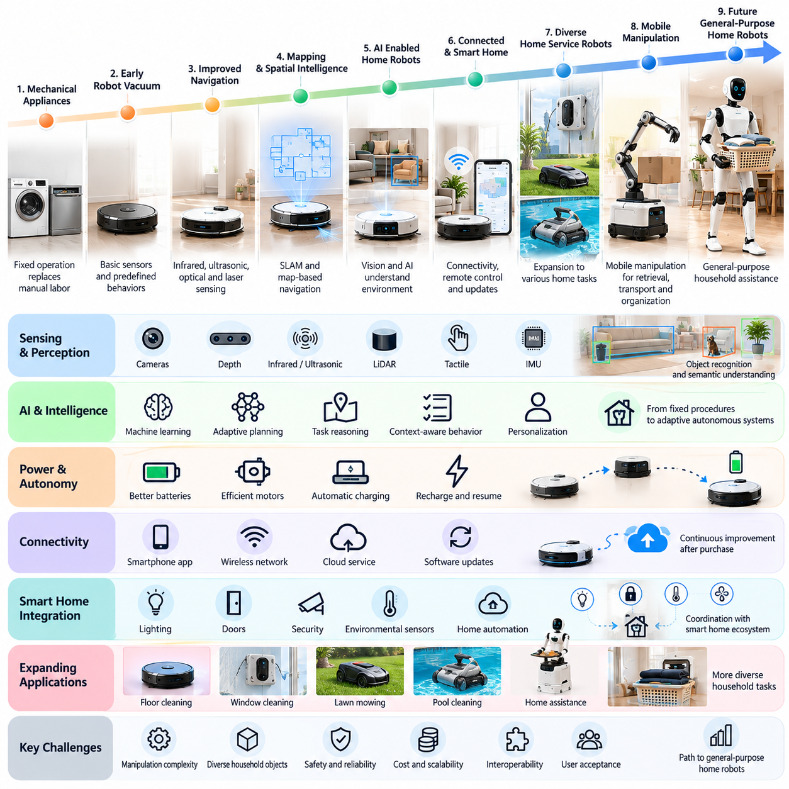{width="7.268055555555556in" height="7.268055555555556in"}

가정용 서비스 로봇(Home Service Robot)의 발전은 기계식 가전제품(Mechanical Household Appliance)에서 가정환경을 인식하고 해석하며 상호작용할 수 있는 지능형 자율 시스템(Intelligent Autonomous System)으로 전환되는 과정을 보여준다. 초기 장치는 고정된 작동 순서와 제한적인 센서 기능에 의존했지만, 현대의 로봇 플랫폼(Robotic Platform)은 환경 인식(Environmental Perception), 적응형 계획(Adaptive Planning), 기계학습(Machine Learning)을 결합하여 인간의 개입을 최소화하면서 가사 작업을 수행하는 방향으로 발전하고 있다.

가정 자동화(Household Automation)의 초기 단계는 특수 목적의 전기기계 장치(Electromechanical Device)를 통해 반복적인 수작업을 대체하는 데 집중하였다. 세탁기, 식기세척기, 자동 청소 장비는 가사 노동의 기계화(Mechanization)가 제공하는 가치를 입증하였다. 그러나 이러한 가전제품은 일반적으로 고정된 물리적 구성에서 작동했으며, 현대 서비스 로봇(Service Robot)의 특징인 이동성(Mobility), 환경 인식(Environmental Awareness), 자율적 의사결정(Autonomous Decision-Making) 능력을 갖추지 못했다.

로봇 청소기(Robotic Vacuum Cleaner)의 등장은 고정형 가전제품에서 이동형 자율 가정 시스템(Mobile Autonomous Household System)으로 전환되는 중요한 계기가 되었다. 초기 모델은 기본적인 충돌 센서(Collision Sensor), 단순한 이동 패턴(Movement Pattern), 사전에 정의된 청소 동작(Predefined Cleaning Behavior)을 사용하였다. 자율주행 능력은 제한적이었지만, 일반적인 주거 공간에서 독립적으로 작동할 수 있는 가정용 로봇(Domestic Robot)의 상업적 시장을 형성하였다.

이후 세대에서는 적외선 감지(Infrared Sensing), 초음파 감지(Ultrasonic Sensing), 광학 추적(Optical Tracking), 레이저 기반 거리 측정(Laser-Based Distance Measurement) 등 더욱 정교한 자율주행 기술(Navigation Technology)이 도입되었다. 이러한 기술은 로봇이 자신의 위치를 추정하고 장애물을 식별하며 가정 내부 구조를 체계적으로 이동할 수 있도록 하였다. 반응형 이동(Reactive Movement)에서 지도 기반 자율주행(Map-Based Navigation)으로의 전환은 청소 범위, 운영 효율성, 사용자 신뢰도를 크게 향상시켰다.

동시적 위치 추정 및 지도 작성(Simultaneous Localization and Mapping, SLAM)은 가정용 로봇 기술의 중요한 발전 단계가 되었다. 로봇은 자신의 위치를 추정하면서 환경 지도를 생성함으로써 이동 경로를 계획하고, 방의 구조를 기억하며, 불필요한 반복 이동을 방지할 수 있게 되었다. 지도 작성(Mapping) 기술은 방별 청소(Room-Specific Cleaning), 제한 구역(Restricted Zone) 설정, 예약 작업(Scheduled Operation), 복잡한 주거 환경에서의 일관된 성능을 가능하게 하였다.

컴퓨터 비전(Computer Vision)의 발전은 가정용 서비스 로봇의 지능을 기하학적 자율주행(Geometric Navigation) 이상의 수준으로 확장하였다. 카메라 기반 인식(Camera-Based Perception)과 기계학습(Machine Learning)을 통해 가구, 가정용 물체, 바닥 재질, 특정 장애물을 인식할 수 있게 되었다. 의미론적 이해(Semantic Understanding)는 로봇이 감지된 모든 물체를 단순한 기하학적 장애물로 취급하는 대신, 환경을 구성하는 의미 있는 요소를 구분하도록 지원하였다.

인공지능(Artificial Intelligence)의 통합은 가정용 로봇을 고정된 절차를 실행하는 장치에서 변화하는 조건에 맞게 행동을 조정할 수 있는 시스템으로 발전시켰다. 학습 기반 인식(Learning-Based Perception), 적응형 경로 계획(Adaptive Route Planning), 맥락 기반 작업 선택(Contextual Task Selection)은 일상적인 작업의 유연성을 향상시켰다. 그러나 실질적인 자율성(Practical Autonomy)은 여전히 신뢰할 수 있는 센서 기술, 예측 가능한 제어, 익숙하지 않은 상황에 대한 정교하게 설계된 대응 능력에 의존하였다.

배터리 기술(Battery Technology)과 자율 충전 시스템(Autonomous Charging System) 역시 상업적 발전에 중요한 역할을 하였다. 향상된 에너지 저장(Energy Storage), 고효율 전기모터(Efficient Electric Motor), 자동 도킹(Automated Docking)은 사용자의 직접적인 개입 빈도를 줄였다. 충전 후 작업 재개(Recharge-and-Resume) 기능은 장시간 작업을 여러 운영 구간으로 나누어 수행할 수 있게 하여, 넓거나 복잡한 가정에서도 자율 청소(Autonomous Cleaning)의 실용성을 높였다.

연결성(Connectivity)은 가정용 로봇을 스마트폰(Smartphone), 무선 네트워크(Wireless Network), 클라우드 서비스(Cloud Service)와 연결하면서 새로운 발전 단계를 열었다. 사용자는 작업 일정 설정, 운영 상태 모니터링, 환경 지도 관리, 원격 작업 실행(Remote Task Execution)을 수행할 수 있게 되었다. 소프트웨어 업데이트(Software Update)는 제조업체가 제품 판매 이후에도 기능을 개선할 수 있도록 하여, 가정용 로봇을 지속적으로 유지관리되는 소프트웨어 기반 소비자 제품(Software-Enabled Consumer Product)으로 변화시켰다.

스마트홈 생태계(Smart-Home Ecosystem)의 발전은 서비스 로봇과 연결된 가정 인프라(Connected Household Infrastructure) 사이의 협업 가능성을 확대하였다. 로봇은 문, 조명 시스템, 보안 장치, 환경 센서와 정보를 교환할 수 있다. 이러한 통합은 맥락 인식 자동화(Context-Aware Automation)를 지원하지만, 상호운용성(Interoperability)의 한계, 사이버보안 위험(Cybersecurity Risk), 독점 플랫폼(Proprietary Platform)에 대한 의존성은 실제 시스템 구축을 복잡하게 만들 수 있다.

자율주행 및 청소 기술이 성숙하면서 개발자들은 가정용 로봇의 기능을 더욱 다양한 물리적 작업으로 확장하기 시작하였다. 창문 청소 로봇(Window-Cleaning Robot), 로봇 잔디깎이(Robotic Lawn Mower), 수영장 청소 로봇(Pool-Cleaning Robot), 특수 유지관리 장치(Specialized Maintenance Device)는 자율 서비스 개념이 실내 바닥 청소를 넘어 확장될 수 있음을 보여주었다. 각 응용 분야에는 서로 다른 이동 메커니즘(Locomotion Mechanism), 센서 구성(Sensing Configuration), 안전 전략(Safety Strategy), 환경 적응 능력(Environmental Adaptation Capability)이 필요하였다.

이동형 조작(Mobile Manipulation)으로의 전환은 가정용 서비스 로봇의 기능을 더욱 근본적으로 확장하는 단계이다. 주로 환경 내부를 이동하는 청소 로봇과 달리, 이동형 매니퓰레이터(Mobile Manipulator)는 다양한 형태, 무게, 재질을 가진 물체와 직접 상호작용해야 한다. 자율주행(Autonomous Navigation)을 로봇 팔(Robotic Arm), 파지 시스템(Grasping System), 힘 피드백(Force Feedback)과 결합하면 물체 회수, 운반, 정리, 가사 보조 등의 응용이 가능해진다.

조작(Manipulation)은 자율주행만 수행하는 것보다 훨씬 복잡한 기술적 과제를 수반한다. 가정용 물체는 투명하거나 변형 가능하고, 깨지기 쉬우며, 관절 구조를 가지거나 센서로부터 부분적으로 가려져 있을 수 있다. 성공적인 상호작용을 위해서는 물체 인식(Object Recognition), 자세 추정(Pose Estimation), 파지 계획(Grasp Planning), 접촉 제어(Contact Control), 실패한 동작으로부터의 복구(Recovery)가 필요하다. 이러한 요구사항은 범용 가정용 조작(General-Purpose Household Manipulation)을 어려운 연구 및 엔지니어링 과제로 만든다.

인간-로봇 상호작용(Human-Robot Interaction)은 물리적 수행 능력의 발전과 함께 진화하였다. 초기 시스템은 주로 버튼, 원격 제어기(Remote Control), 사전에 정의된 애플리케이션 명령(Predefined Application Command)에 의존하였다. 최근 인터페이스(Interface)는 음성 인식(Speech Recognition), 자연어 처리(Natural Language Processing), 시각적 제스처(Visual Gesture), 대화형 보조(Conversational Assistance)를 통합하고 있다. 이러한 발전은 사용자가 원하는 결과를 더욱 자연스럽게 전달하도록 하지만, 모호한 명령에는 여전히 명확화(Clarification)와 맥락적 추론(Contextual Reasoning)이 필요하다.

시각-언어 모델(Vision-Language Model, VLM)과 시각-언어-행동 아키텍처(Vision-Language-Action Architecture, VLA)는 차세대 가정용 서비스 로봇의 잠재적인 기술 기반을 제공한다. 이러한 모델은 시각적 관측(Visual Observation)을 언어 명령(Language Instruction) 및 물리적 행동(Physical Action)과 연결하여 더욱 유연한 작업 해석(Task Interpretation)을 지원할 수 있다. 실제 배치에는 신뢰할 수 있는 행동 의미 연결(Action Grounding), 컴퓨팅 효율성(Computational Efficiency), 안전 제약조건(Safety Constraint), 익숙하지 않은 가정환경에서의 견고한 성능(Robust Performance)이 필요하다.

휴머노이드 로봇(Humanoid Robot)은 가정용 서비스 시스템(Domestic Service System)의 또 다른 발전 방향으로 등장하였다. 인간과 유사한 신체 구조(Human-Like Body Structure)는 사람을 위해 설계된 계단, 가구, 수납장, 도구와의 호환성을 제공할 수 있다. 그러나 휴머노이드 로봇은 동적 균형(Dynamic Balance), 정교한 조작(Dexterous Manipulation), 에너지 소비(Energy Consumption), 기계적 내구성(Mechanical Durability), 복잡한 주거 환경에서의 안전한 물리적 상호작용(Safe Physical Interaction)과 관련된 상당한 과제를 안고 있다.

특수 목적 가전제품(Specialized Appliance)에서 범용 로봇(General-Purpose Robot)으로의 발전이 반드시 기존 제품을 순차적으로 대체하는 선형적인 과정(Linear Replacement Process)은 아니다. 작업 특화형 기계(Task-Specific Machine)는 비용, 신뢰성, 에너지 효율성, 운영 단순성 측면에서 장점을 유지하는 경우가 많다. 범용 플랫폼(General-Purpose Platform)은 여러 가치 있는 작업을 수행하는 능력이 증가된 하드웨어 복잡성(Hardware Complexity), 소프트웨어 요구사항(Software Requirements), 유지관리 부담(Maintenance Demand)을 상쇄할 때 경제적으로 매력적인 대안이 된다.

안전 엔지니어링(Safety Engineering)은 로봇이 독립적인 청소 작업에서 가구 구성원과 직접 상호작용하는 단계로 발전하면서 더욱 중요해졌다. 고도화된 시스템은 사람과 반려동물을 감지하고, 접촉력(Contact Force)을 조절하며, 예상하지 못한 움직임에 대응하고, 고장 발생 시 안전 상태(Safe State)로 전환해야 한다. 기능 안전(Functional Safety), 실행 중 모니터링(Runtime Monitoring), 비상 정지(Emergency Stopping), 투명한 사용자 제어(Transparent User Control)는 신뢰할 수 있는 가정 내 자율성(Domestic Autonomy)을 위한 필수 요소이다.

개인정보 보호에 대한 기대(Privacy Expectations) 역시 가정용 로봇에 카메라, 마이크, 공간 지도 작성(Spatial Mapping), 클라우드 연결(Cloud Connectivity)이 통합되면서 변화하였다. 환경 관측(Environmental Observation)은 개인의 생활 패턴, 주거 구조, 민감한 가정 정보를 드러낼 수 있다. 따라서 책임 있는 제품 개발(Responsible Product Development)을 위해서는 안전한 데이터 처리(Secure Data Processing), 통제된 데이터 접근(Controlled Data Access), 적절한 보관 정책(Retention Policy), 로컬 및 원격 정보 처리(Local and Remote Information Handling)에 관한 사용자 선택권이 필요하다.

가정용 서비스 로봇의 상업적 발전(Commercial Evolution)은 제조 규모(Manufacturing Scale), 부품 비용(Component Cost), 유통 채널(Distribution Channel), 소비자 기대(Consumer Expectations)의 영향을 받아왔다. 성공적인 제품은 과도한 초기 설정이나 유지관리 요구 없이 일관된 실질적 편익을 제공해야 한다. 구매 경제성(Purchase Affordability), 교체 부품(Replacement Parts), 수리 가능성(Repairability), 소프트웨어 지원(Software Support), 장기 운영 신뢰성(Long-Term Operational Reliability)은 고도화된 지능의 시연만큼 중요하다.

서비스 기반 비즈니스 모델(Service-Based Business Model)은 유지관리 구독(Maintenance Subscription), 소프트웨어 업그레이드(Software Upgrade), 연장 지원(Extended Support), 특수 기능(Specialized Functionality)을 통해 기존 하드웨어 판매(Hardware Sales)를 점진적으로 보완할 수 있다. 그러나 반복 매출(Recurring Revenue)은 단순한 연결성이 아니라 지속적인 소비자 가치(Sustained Consumer Value)에 의존한다. 제조업체는 경제적으로 지속 가능한 서비스 모델을 설계할 때 제품 수명주기 서비스 비용(Lifecycle Service Cost), 고객 유지(Customer Retention), 개인정보 보호 의무(Privacy Obligation), 제품 수명(Product Longevity)의 균형을 고려해야 한다.

가정용 서비스 로봇의 다음 발전 단계는 인식(Perception), 언어 이해(Language Understanding), 조작(Manipulation), 적응형 계획(Adaptive Planning)의 더욱 강력한 통합을 중심으로 진행될 가능성이 높다. 로봇은 가정의 선호도를 점차 학습하고, 연결된 장치와 협력하며, 더 긴 일련의 물리적 작업을 실행할 수 있게 될 것이다. 이러한 발전은 서로 다른 가정환경에 대한 견고한 일반화(Robust Generalization)와 잠재적으로 위험한 행동을 시도하기 전에 불확실성(Uncertainty)을 인식하는 능력에 달려 있다.

궁극적으로 가정용 서비스 로봇(Home Service Robot)의 발전은 자동화된 가정용 장비(Automated Household Equipment)에서 인간의 생활공간에서 작동하는 체화 지능(Embodied Intelligence)으로의 광범위한 전환을 보여준다. 미래의 성공은 개별적인 첨단 로봇 기술의 시연보다 신뢰할 수 있는 일상적 성능(Dependable Daily Performance)에 더 크게 좌우될 것이다. 경제성(Affordability), 안전성(Safety), 유지관리 용이성(Maintainability), 실질적 유용성(Practical Usefulness)을 갖춘 시스템이 가정용 피지컬 인공지능(Domestic Physical AI)이 일상생활의 확립된 구성 요소로 자리 잡는 속도를 결정할 것이다.

## 07.03. Cleaning and Household Automation

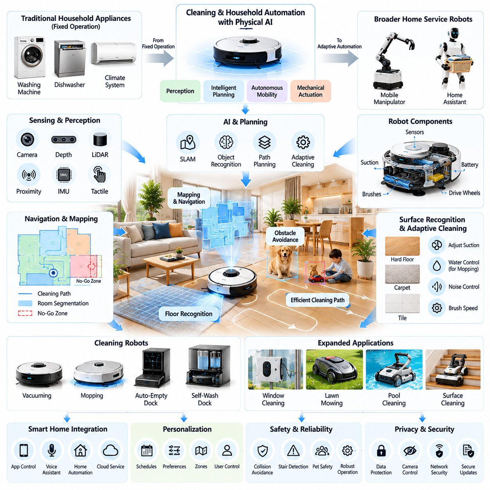{width="7.268055555555556in" height="7.268055555555556in"}

청소 및 가정 자동화(Cleaning and Household Automation)는 소비자 환경에서 피지컬 인공지능(Physical AI)이 상업적으로 가장 널리 확립된 응용 분야 중 하나이다. 이러한 기술은 자율 이동(Autonomous Mobility), 환경 인식(Environmental Perception), 지능형 계획(Intelligent Planning), 기계적 구동(Mechanical Actuation)을 결합하여 반복적인 가사 노동을 줄인다. 이 기술의 발전은 특수 목적 로봇 시스템(Specialized Robotic System)이 실질적인 가치를 제공하면서 더욱 고도화된 가정용 서비스 로봇(Home Service Robot)의 기술적 기반을 구축할 수 있음을 보여준다.

전통적인 가정 자동화(Household Automation)는 통제된 물리적 범위 내에서 사전에 정의된 작업을 실행하는 가전제품(Appliance)에 의존한다. 세탁기, 식기세척기, 자동 실내환경 제어 시스템(Automated Climate System)은 유용한 기능을 수행하지만, 일반적으로 독립적인 이동성(Independent Mobility)과 맥락 기반 물리적 추론(Contextual Physical Reasoning) 능력이 부족하다. 피지컬 인공지능은 기계가 변화하는 환경을 인식하고 적절한 행동을 선택하며 실제 환경 조건에 맞게 동작을 조정하도록 함으로써 자동화의 범위를 확장한다.

로봇 청소기(Robotic Vacuum Cleaner)는 자율 가정 청소(Autonomous Household Cleaning)의 대표적인 사례이다. 현대적인 시스템은 이동 플랫폼(Mobile Platform), 흡입 장치(Suction Mechanism), 환경 센서(Environmental Sensor), 자율주행 알고리즘(Navigation Algorithm)을 통합하여 제한적인 감독만으로 주거 공간의 바닥을 청소한다. 운영 효과성(Operational Effectiveness)은 청소 범위 계획(Coverage Planning), 장애물 회피(Obstacle Avoidance), 표면 인식(Surface Recognition), 배터리 관리(Battery Management), 일반적인 자율주행 실패로부터의 복구 능력에 따라 결정된다.

자율주행 기술(Navigation Technology)은 반응형 장애물 회피(Reactive Obstacle Avoidance)에서 체계적인 공간 이해(Systematic Spatial Understanding)로 발전하였다. 동시적 위치 추정 및 지도 작성(Simultaneous Localization and Mapping, SLAM)은 청소 로봇이 자신의 위치를 추정하면서 환경 표현(Environmental Representation)을 구축하도록 한다. 이러한 지도는 방 분할(Room Segmentation), 경로 최적화(Route Optimization), 제한 구역(Restricted Zone), 목표 구역 청소(Targeted Cleaning)를 지원하여 불필요한 이동과 반복 청소를 줄이면서 청소 범위의 일관성을 향상시킨다.

환경 인식(Environmental Perception)은 청소 로봇이 장애물, 가구, 바닥 표면, 잠재적으로 위험한 물체를 구별하도록 한다. 카메라(Camera), 깊이 센서(Depth Sensor), 레이저 스캐너(Laser Scanner), 근접 센서(Proximity Sensor)는 주변 환경에 대한 상호 보완적인 정보를 제공한다. 학습 기반 인식(Learning-Based Perception)은 전선, 신발, 장난감 및 기타 가정용 물체를 식별할 수 있지만, 인식 신뢰성(Recognition Reliability)은 조명, 가시성, 물체의 외형, 센서의 한계에 따라 달라진다.

지능형 청소(Intelligent Cleaning)는 성공적인 자율주행 이상의 기능을 요구한다. 서로 다른 바닥 표면과 오염 상태에는 각기 다른 작동 전략이 필요하기 때문이다. 로봇은 감지된 바닥 특성에 따라 흡입력(Suction Power), 브러시 회전 속도(Brush Speed), 물 공급량(Water Delivery), 이동 패턴(Movement Pattern)을 조정할 수 있다. 적응형 청소 정책(Adaptive Cleaning Policy)은 변화하는 가정환경에서 청소 효과(Cleaning Effectiveness), 에너지 소비(Energy Consumption), 소음 발생(Noise Generation), 기계적 마모(Mechanical Wear) 사이의 균형을 추구한다.

청소 범위 계획(Coverage Planning)은 자율 청소(Autonomous Cleaning)의 핵심 최적화 문제(Optimization Problem)이다. 로봇은 가구, 좁은 통로, 일시적인 장애물, 배터리 제약조건(Battery Constraint)을 고려하면서 접근 가능한 바닥 영역을 효율적으로 방문하는 방법을 결정해야 한다. 효과적인 계획은 전역 경로 생성(Global Route Generation), 국소 장애물 회피(Local Obstacle Avoidance), 환경 변화로 기존 경로가 유효하지 않게 되었을 때 수행하는 주기적 재계획(Periodic Replanning)을 결합한다.

습식 청소 자동화(Wet-Cleaning Automation)는 액체 취급(Liquid Handling)에 물 공급, 표면 접촉, 오염 관리에 대한 정밀한 제어가 필요하기 때문에 추가적인 복잡성을 수반한다. 로봇 물걸레 청소 시스템(Robotic Mopping System)은 물탱크(Water Tank), 청소 패드(Cleaning Pad), 압력 조절(Pressure Regulation), 자동 세척 장치(Automatic Washing Mechanism)를 통합할 수 있다. 신뢰할 수 있는 작동을 위해서는 과도한 수분을 방지하고 부적합한 표면을 피하며, 추가적인 위생 문제를 발생시키지 않도록 오수를 관리해야 한다.

자율 도킹 및 유지관리 시스템(Autonomous Docking and Maintenance System)은 가정용 청소 로봇과 관련된 운영 부담을 줄인다. 충전 스테이션(Charging Station)은 배터리 충전(Battery Replenishment), 먼지 수거(Dust Collection), 물걸레 세척(Mop Washing), 건조(Drying), 물 관리(Water Management) 기능을 제공할 수 있다. 이러한 기능은 사람의 개입 없이 작동할 수 있는 시간을 연장하지만, 장기적인 신뢰성을 유지하기 위해서는 소모품 교체(Consumable Replacement), 폐기물 처리(Waste Disposal), 기계적 청소(Mechanical Cleaning), 정기 점검(Periodic Inspection)이 여전히 필요하다.

가정 자동화(Household Automation)는 바닥 청소를 넘어 로봇 창문 청소(Robotic Window Cleaning), 잔디 관리(Lawn Maintenance), 수영장 청소(Pool Cleaning), 특정 표면 청소(Surface-Cleaning Operation)와 같은 전문 응용 분야로 확장된다. 각 응용 분야는 부착력(Adhesion), 지형 상호작용(Terrain Interaction), 물 노출(Water Exposure), 기상 조건(Weather Condition), 안전성(Safety)과 관련된 서로 다른 물리적 제약조건을 가진다. 하나의 기계적 설계가 모든 청소 환경을 효율적으로 처리할 수는 없기 때문에 특수 목적 로봇 형태(Specialized Robot Morphology)와 작업 특화형 센싱(Task-Specific Sensing)이 중요하다.

스마트홈 플랫폼(Smart-Home Platform)과의 통합은 청소 로봇이 가정의 일정 및 연결된 장치와 협력하도록 한다. 사용자는 모바일 애플리케이션(Mobile Application), 음성 비서(Voice Assistant), 재실 상태(Occupancy) 및 활동 패턴(Activity Pattern)과 연계된 자동화 루틴(Automated Routine)을 통해 청소를 시작할 수 있다. 이러한 협업은 편의성을 향상시키지만, 신뢰할 수 있는 운영을 유지하려면 상호운용성(Interoperability), 네트워크 신뢰성(Network Reliability), 접근 권한(Access Permission), 사이버보안(Cybersecurity) 문제를 해결해야 한다.

개인화(Personalization)는 가정 자동화 시스템(Household Automation System)이 개인의 선호도와 반복적인 환경 패턴에 적응하도록 한다. 로봇은 선호하는 청소 시간, 자주 오염되는 구역, 출입 제한 공간, 허용 가능한 소음 수준을 학습할 수 있다. 효과적인 적응(Effective Adaptation)은 사용자 통제(User Control)를 유지하고 이해하기 쉬운 설정을 제공해야 하며, 특히 학습된 행동이 개인정보 보호(Privacy), 가정 내 접근(Household Access), 사람 및 반려동물과의 상호작용에 영향을 미치는 경우 더욱 중요하다.

안전성(Safety)은 청소 로봇이 어린이, 반려동물, 가구, 파손되기 쉬운 물체와 공간을 공유하기 때문에 필수적이다. 충돌 회피(Collision Avoidance), 제어된 이동 속도(Controlled Movement Speed), 장애물 감지(Obstacle Detection), 적절한 정지 동작(Stopping Behavior)은 운영 위험(Operational Risk)을 줄인다. 더욱 고도화된 시스템은 자율 작동 중 발생할 수 있는 얽힘(Entanglement), 액체 유출(Liquid Spill), 계단 가장자리(Stair Edge), 불안정한 물체(Unstable Object), 예상하지 못한 인간의 개입(Human Intervention)에도 대응해야 한다.

개인정보 보호(Privacy)는 청소 로봇에 카메라, 마이크, 공간 지도 작성(Spatial Mapping), 클라우드 연결 서비스(Cloud-Connected Service)가 통합되면서 더욱 중요해지고 있다. 환경 데이터(Environmental Data)는 가정 내부 구조, 재실 패턴(Occupancy Pattern), 개인 소지품에 관한 정보를 드러낼 수 있다. 책임 있는 시스템 설계(Responsible System Design)를 위해서는 안전한 통신(Secure Communication), 접근 제어(Access Control), 데이터 최소화(Data Minimization), 투명한 보관 정책(Transparent Retention Policy), 로컬 처리(Local Processing) 및 사용자 주도 정보 관리(User-Directed Information Management)를 위한 실질적인 선택권이 필요하다.

가정 자동화의 경제성(Economics of Household Automation)은 제품 성능(Product Capability)과 구매 및 수명주기 비용(Acquisition and Lifecycle Cost) 사이의 균형에 따라 결정된다. 소비자는 구매 가격(Purchase Price), 청소 성능(Cleaning Performance), 운영 편의성(Operating Convenience), 전력 소비(Electricity Consumption), 소모품(Consumables), 수리 비용(Repair Expense), 예상 제품 수명(Expected Product Lifetime)을 고려한다. 제조업체는 경쟁력 있는 가격과 신뢰할 수 있는 사후 지원(After-Sales Support)을 유지하면서 하드웨어 복잡성(Hardware Complexity)과 소프트웨어 기능(Software Functionality)을 최적화해야 한다.

청소 성능(Cleaning Performance)은 자율 수행 능력(Autonomous Capability)만이 아니라 측정 가능한 운영 지표(Operational Indicator)를 통해 평가해야 한다. 주요 지표에는 표면 청소 범위(Surface Coverage), 청소 효과(Cleaning Effectiveness), 작업 완료 시간(Task Completion Time), 개입 빈도(Intervention Frequency), 에너지 소비(Energy Consumption), 자율주행 실패(Navigation Failure), 유지관리 요구사항(Maintenance Requirement)이 포함된다. 장기 평가(Long-Term Evaluation)에서는 서로 다른 바닥 재질, 가구 배치, 가정 활동 패턴에 따른 신뢰성도 고려해야 한다.

가정용 청소 로봇(Household Cleaning Robot)의 발전은 더욱 광범위한 가정용 피지컬 인공지능(Domestic Physical AI)을 위한 중요한 기반을 제공한다. 위치 추정(Localization), 지도 작성(Mapping), 환경 인식(Perception), 자율 도킹(Autonomous Docking), 작업 일정 관리(Task Scheduling), 사용자 상호작용(User Interaction)과 관련된 기술은 다른 서비스 응용 분야에도 적용될 수 있다. 그러나 이러한 기능을 물체 조작(Object Manipulation)이나 범용 가정 보조(General Household Assistance)로 확장하려면 물리적 추론(Physical Reasoning), 파지(Grasping), 접촉 중심 제어(Contact-Rich Control) 분야에서 추가적인 발전이 필요하다.

미래의 가정 자동화(Future Household Automation)는 특수 목적 청소 장치(Specialized Cleaning Device), 이동형 매니퓰레이터(Mobile Manipulator), 지능형 홈 관리 시스템(Intelligent Home Management System)을 결합할 수 있다. 협업 로봇(Coordinated Robot)은 각자의 물리적 능력에 따라 작업을 분담하면서 선택된 환경 정보를 공유할 수 있다. 이러한 시스템은 운영 범위(Operational Coverage)와 유연성(Flexibility)을 향상시킬 수 있지만, 협업 복잡성(Coordination Complexity), 장비 비용(Equipment Cost), 상호운용성(Interoperability), 가정 내 안전성(Household Safety)이 실제 도입에 영향을 미칠 것이다.

인공지능 파운데이션 모델(Artificial Intelligence Foundation Model)은 청소 및 가정 자동화 시스템의 적응 능력을 더욱 확장할 수 있다. 시각-언어 모델(Vision-Language Model, VLM)은 가정환경에 대한 맥락적 이해(Contextual Understanding)를 지원할 수 있으며, 행동 지향 모델(Action-Oriented Model)은 사용자 명령을 실행 가능한 작업(Executable Task)으로 변환하는 데 도움을 줄 수 있다. 그러나 신뢰할 수 있는 실제 배치(Reliable Deployment)를 위해서는 명시적인 안전 제약조건(Explicit Safety Constraint), 불확실성 관리(Uncertainty Management), 다양한 주거 환경에서의 검증(Validation)이 필요하다.

에너지 효율성(Energy Efficiency)과 지속가능성(Sustainability)은 소비자 로봇(Consumer Robotics)에서 점점 더 중요한 고려사항이 되고 있다. 고효율 모터(Efficient Motor), 최적화된 자율주행(Optimized Navigation), 내구성 있는 부품(Durable Component), 지능형 충전 전략(Intelligent Charging Strategy)은 운영 과정의 자원 소비(Resource Consumption)를 줄일 수 있다. 제품 수명(Product Longevity), 수리 가능성(Repairability), 재활용 가능한 소재(Recyclable Material), 책임 있는 배터리 관리(Responsible Battery Management) 역시 제품 수명주기(Lifecycle) 전반에 걸친 가정 자동화의 환경적 영향(Environmental Impact)에 영향을 미친다.

상업적 차별화(Commercial Differentiation)는 기본적인 자율 이동(Basic Autonomous Movement)에서 통합 청소 성능(Integrated Cleaning Performance), 유지관리 부담 감소(Reduced Maintenance), 지능형 적응(Intelligent Adaptation), 신뢰할 수 있는 사용자 경험(Dependable User Experience)으로 이동하고 있다. 제조업체는 추가적인 센서, 인공지능 기능, 자동화 기능이 소비자가 인식할 수 있는 편익을 창출한다는 점을 입증해야 한다. 기술적 정교함(Technological Sophistication)만으로는 복잡성이 소유 비용(Ownership Cost)을 증가시키거나 신뢰성을 낮추는 경우 소비자 수용(Consumer Acceptance)을 보장할 수 없다.

궁극적으로 청소 및 가정 자동화(Cleaning and Household Automation)는 피지컬 인공지능(Physical AI)이 반복적인 가사 활동을 지능형 자율 서비스(Intelligent Autonomous Service)로 전환할 수 있음을 보여준다. 그 중요성은 단순한 노동 감소(Labor Reduction)를 넘어 로봇의 신뢰성(Reliability), 안전성(Safety), 경제성(Affordability), 사용성(Usability)에 대한 소비자의 기대를 형성한다는 데 있다. 인식(Perception), 계획(Planning), 조작(Manipulation), 시스템 통합(System Integration)의 지속적인 발전은 특수 목적 청소 기계(Specialized Cleaning Machine)에서 더욱 다재다능한 가정용 보조 로봇(Versatile Household Assistant)으로의 점진적인 확장을 지원할 것이다.

## 07.04. Home Mobile Manipulation

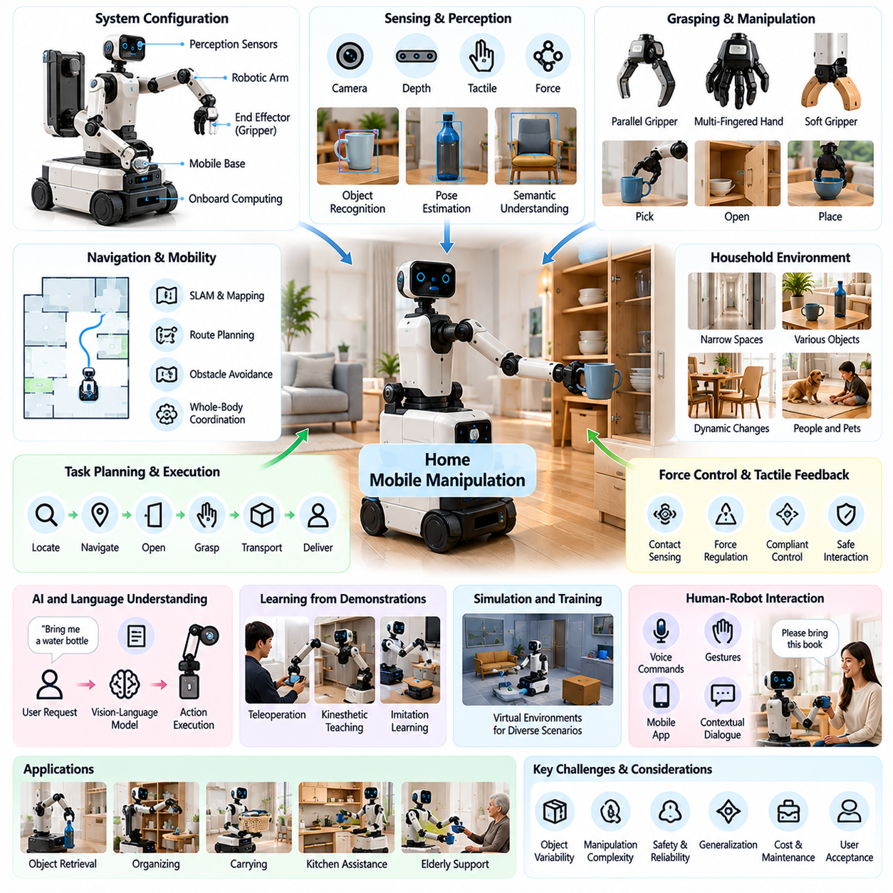{width="7.268055555555556in" height="7.268055555555556in"}

가정용 이동형 조작(Home Mobile Manipulation)은 자율주행(Autonomous Navigation)과 가정용 물체를 물리적으로 조작하는 능력을 결합함으로써 소비자용 피지컬 인공지능(Consumer Physical AI)의 중요한 발전을 나타낸다. 기존 청소 로봇과 달리 이동형 매니퓰레이터(Mobile Manipulator)는 주거 환경에서 물체에 접근하고, 파지하고, 운반하고, 재배치할 수 있다. 이러한 기능은 가정 자동화(Domestic Automation)를 이동 중심 서비스에서 일상적인 물리적 활동을 유연하게 지원하는 방향으로 확장한다.

가정용 이동형 매니퓰레이터(Home Mobile Manipulator)는 일반적으로 이동 베이스(Mobile Base), 하나 이상의 로봇 팔(Robotic Arm), 말단효과기(End Effector), 인식 센서(Perception Sensor), 온보드 컴퓨팅 시스템(Onboard Computing System)을 통합한다. 이동 플랫폼(Mobile Platform)은 방 사이의 이동을 담당하며, 매니퓰레이터(Manipulator)는 물체 취급(Object Handling)과 환경 상호작용(Environmental Interaction)을 수행한다. 성공적인 작동을 위해서는 주거 공간의 기하학적 제약조건(Geometric Constraint)과 안전 제약조건(Safety Constraint) 내에서 이동과 조작을 통합적으로 제어해야 한다.

가정환경(Household Environment)은 물체, 가구, 인간의 활동이 지속적으로 변화하기 때문에 상당한 기술적 과제를 제시한다. 좁은 복도, 불규칙한 표면, 열린 문, 이동 가능한 의자, 일시적인 장애물은 자율주행과 조작을 복잡하게 만든다. 로봇은 산업 시설에서 일반적으로 활용할 수 있는 표준화된 배치(Standardized Layout), 고정 작업대(Fixed Workstation), 통제된 물체 배치(Controlled Object Arrangement)에 의존하지 않고 이러한 변화에 적응해야 한다.

인식(Perception)은 가정용 물체를 식별하고 이를 조작하는 방법을 결정하는 데 필수적이다. 카메라(Camera), 깊이 센서(Depth Sensor), 촉각 센서(Tactile Sensor), 힘 측정(Force Measurement)은 물체의 형상(Object Geometry), 위치(Location), 방향(Orientation), 접촉 상태(Contact Condition)에 관한 정보를 제공한다. 의미론적 인식(Semantic Perception)은 로봇이 컵, 병, 의류, 식기, 보관 용기와 같은 기능적 범주(Functional Category)를 구별하고 적절한 상호작용 전략(Interaction Strategy)을 추정하도록 지원한다.

물체 조작(Object Manipulation)에는 3차원 위치(Three-Dimensional Position), 방향(Orientation), 물리적 특성(Physical Property)에 대한 정확한 추정이 필요하다. 가정용 물체는 크기, 무게, 재질, 강성(Rigidity), 표면 마찰(Surface Friction)이 매우 다양하다. 로봇은 물체 형상과 질량 분포(Mass Distribution)의 불확실성을 고려하면서 적절한 파지 지점(Grasp Point)과 접촉력(Contact Force)을 선택해야 한다. 깨지기 쉬운 물체, 변형 가능한 물체, 투명한 물체, 관절 구조를 가진 물체는 추가적인 복잡성을 유발한다.

이동형 조작 계획(Mobile Manipulation Planning)은 자율주행, 베이스 위치 결정(Base Positioning), 로봇 팔 동작(Arm Movement), 파지 실행(Grasp Execution)을 통합적으로 조정해야 한다. 로봇은 수납장에 접근하고, 이동 플랫폼을 정렬하고, 로봇 팔을 뻗어 문을 열고, 내부의 물체를 꺼내야 할 수 있다. 각 행동은 사용 가능한 작업 공간(Workspace)을 변화시키고 새로운 장애물을 발생시킬 수 있다. 통합 작업 및 동작 계획(Integrated Task and Motion Planning)은 상호 연결된 작업 전반에서 실행 가능성(Feasibility)을 유지하도록 지원한다.

전신 협조 제어(Whole-Body Coordination)는 로봇이 매니퓰레이터의 직접적인 작업 범위(Manipulator Workspace)를 벗어난 물체에 접근해야 할 때 중요해진다. 이동 베이스의 움직임은 도달 가능 영역(Reachability)을 확장하고, 로봇 팔의 자세 구성(Arm Configuration)을 개선하며, 충돌을 방지할 수 있다. 통합 제어(Coordinated Control)는 특히 물체를 운반하거나 가구를 조작할 때 안정성(Stability), 관절 한계(Joint Limit), 적재 하중 분포(Payload Distribution), 동적 상호작용(Dynamic Interaction)을 고려해야 한다.

파지 기술(Grasping Technology)은 이동형 매니퓰레이터가 다양한 가정용 물체를 안정적으로 취급할 수 있는지를 결정한다. 평행 그리퍼(Parallel Gripper)는 기계적 단순성(Mechanical Simplicity)을 제공하며, 다지형 로봇 손(Multi-Fingered Hand)은 복잡한 형상과 정교한 작업에 대한 적응성을 높인다. 소프트 로봇 그리퍼(Soft Robotic Gripper)와 유연한 메커니즘(Compliant Mechanism)은 접촉력을 줄이고 불확실성을 수용할 수 있다. 적절한 설계는 작업 다양성(Task Diversity), 비용(Cost), 신뢰성(Reliability), 유지관리 요구사항(Maintenance Requirement)에 따라 결정된다.

힘 및 촉각 피드백(Force and Tactile Feedback)은 접촉이 많은 가정 활동(Contact-Rich Household Activity)에서 특히 중요하다. 서랍 열기, 손잡이 조작, 식기 배치, 유연한 소재 취급은 단순한 시각적 위치 결정(Visual Positioning) 이상의 능력을 요구한다. 접촉 감지(Contact Sensing)는 로봇이 저항을 감지하고, 가해지는 힘을 조절하며, 실패한 상호작용을 인식하도록 한다. 유연 제어(Compliant Control)는 물체 손상이나 주변 구조물과의 위험한 접촉 가능성을 줄인다.

가사 작업(Household Task)은 독립적인 조작 동작보다 여러 단계의 연속적인 행동으로 구성되는 경우가 많다. 물체를 가져오는 작업에는 물체 위치 파악, 해당 위치로 이동, 수납 가구 열기, 물체 파지, 운반, 사용자에게 전달하는 과정이 포함될 수 있다. 장기 작업 계획(Long-Horizon Task Planning)은 작업 간 의존관계(Dependency), 환경 변화(Environmental Change), 중간 작업이 실패했을 때의 복구 전략(Recovery Strategy)을 관리해야 한다.

인공지능(Artificial Intelligence)은 학습된 인식(Learned Perception), 물체 이해(Object Understanding), 행동 선택(Action Selection)을 통해 가정용 이동형 조작의 적응 능력을 확장한다. 시각-언어 모델(Vision-Language Model, VLM)은 사용자 요청을 해석하고 언어적 설명을 관측된 가정용 물체와 연결할 수 있다. 시각-언어-행동 모델(Vision-Language-Action Model, VLA)은 작업과 관련된 로봇 행동을 생성할 수 있지만, 실제 실행에는 물리적 실행 가능성 검증(Physical Feasibility Check), 안전 제약조건(Safety Constraint), 신뢰할 수 있는 저수준 제어(Low-Level Control)가 필요하다.

시연 기반 학습(Learning from Demonstrations)은 가정용 조작 기술(Household Manipulation Skill)을 습득하기 위한 잠재적인 접근 방식이다. 인간 원격조작(Human Teleoperation), 직접 교시(Kinesthetic Teaching), 기록된 상호작용 궤적(Recorded Interaction Trajectory)은 물체 취급과 작업 실행의 사례를 제공할 수 있다. 모방학습(Imitation Learning)은 수동 프로그래밍(Manual Programming)의 필요성을 줄일 수 있지만, 학습 조건과 실제 가정환경의 차이는 적응(Adaptation)과 검증(Validation)이 없을 경우 성능을 제한할 수 있다.

시뮬레이션(Simulation)은 다양한 가정 배치와 물체 구성에서 조작 정책(Manipulation Policy)을 시험할 수 있도록 하여 개발을 지원한다. 가상 환경(Virtual Environment)은 서로 다른 가구 배치, 물체 특성, 조명 조건, 외란(Disturbance)을 포함하는 사례를 생성할 수 있다. 그러나 마찰(Friction), 접촉 동역학(Contact Dynamics), 변형 가능한 소재(Deformable Material), 센서 오차(Sensing Error)를 정확하게 재현하기 어렵기 때문에 시뮬레이션에서 현실로의 전이(Simulation-to-Reality Transfer)는 여전히 어려운 과제로 남아 있다.

인간-로봇 상호작용(Human-Robot Interaction)은 로봇 기술에 대한 전문 지식이 거의 없는 사용자도 활용할 수 있도록 설계되어야 한다. 자연어 명령(Natural Language Command), 제스처(Gesture), 모바일 인터페이스(Mobile Interface), 맥락 기반 대화(Contextual Dialogue)를 통해 작업 목표를 전달할 수 있다. 로봇은 모호한 요청을 명확히 하고, 자신의 한계를 설명하며, 이해하기 쉬운 상태 정보(Status Information)를 제공해야 한다. 예측 가능한 행동(Predictable Behavior)과 접근하기 쉬운 비상 제어(Emergency Control)는 가구 구성원 주변에서 작동할 때 특히 중요하다.

안전 요구사항(Safety Requirements)은 이동형 매니퓰레이터가 물체와 주변 구조물에 힘을 가하기 때문에 단순한 충돌 회피(Collision Avoidance)를 넘어선다. 잠재적 위험(Potential Hazard)에는 물체 낙하(Dropped Object), 불안정한 적재물(Unstable Payload), 끼임(Pinching), 전복(Tipping), 예상하지 못한 로봇 팔 움직임(Unexpected Arm Movement)이 포함된다. 안전한 작동을 위해서는 힘 제한(Force Limitation), 충돌 모니터링(Collision Monitoring), 안정성 평가(Stability Assessment), 비상 정지(Emergency Stopping), 인식이나 작업 이해가 불확실할 때의 보수적인 행동(Conservative Behavior)이 필요하다.

에너지 관리(Energy Management)는 가정용 이동형 조작의 실용성에 큰 영향을 미친다. 자율주행, 로봇 팔 구동(Arm Actuation), 센싱(Sensing), 온보드 인공지능 연산(Onboard AI Computation)은 제한된 배터리 용량(Battery Capacity)을 공유한다. 조작 작업은 특히 물체를 들어 올리거나 지속적으로 지지할 때 높은 순간 전력 수요(Peak Power Demand)를 발생시킬 수 있다. 유용한 작동 시간(Operating Duration)을 확보하려면 효율적인 기계 설계(Efficient Mechanical Design), 전력 인식 계획(Power-Aware Planning), 자율 충전(Autonomous Charging)이 필요하다.

하드웨어 설계(Hardware Design)는 정교한 조작 능력(Dexterity), 도달 범위(Reach), 적재 용량(Payload Capacity), 크기(Size), 무게(Weight), 경제성(Affordability) 사이의 균형을 유지해야 한다. 대형 매니퓰레이터(Larger Manipulator)는 무거운 물체를 취급할 수 있지만, 좁은 공간에서 전력 소비와 충돌 위험을 증가시킬 수 있다. 소형 플랫폼(Compact Platform)은 가정환경 적합성을 높이지만 작업 공간과 들어 올릴 수 있는 하중을 제한한다. 하드웨어-소프트웨어 공동 설계(Hardware-Software Co-Design)는 목표 소비자 응용 분야에 맞게 이러한 절충관계(Tradeoff)를 최적화하도록 지원한다.

신뢰성(Reliability)과 유지관리 용이성(Maintainability)은 가정 사용자가 복잡한 로봇 고장을 직접 진단할 것으로 기대하기 어렵기 때문에 매우 중요하다. 이동형 매니퓰레이터는 일반적인 외란을 견디고, 실패한 파지 동작으로부터 복구하며, 인간의 도움이 필요한 상황을 식별해야 한다. 모듈형 부품(Modular Component), 원격 진단(Remote Diagnostics), 소프트웨어 업데이트(Software Update), 접근하기 쉬운 유지관리 절차(Accessible Maintenance Procedure)는 소유 부담(Ownership Burden)을 줄이고 장기적인 사용성(Long-Term Usability)을 향상시킬 수 있다.

경제적 타당성(Economic Viability)은 이동형 조작이 특수 목적 가전제품(Specialized Appliance)이나 인간의 도움(Human Assistance)에 비해 충분한 가치를 제공하는지에 따라 결정된다. 개발 비용(Development Cost)에는 로봇 팔, 정밀 액추에이터(Precision Actuator), 센서, 컴퓨팅 하드웨어(Computing Hardware), 배터리, 안전 시스템(Safety System)이 포함된다. 상업용 제품은 유용한 작업 수행 범위(Useful Task Coverage), 개입 감소(Reduced Intervention), 신뢰할 수 있는 성능(Reliable Performance), 수용 가능한 총소유비용(Total Cost of Ownership)을 통해 이러한 비용을 정당화해야 한다.

평가(Evaluation)는 개별적인 자율주행이나 파지 성공률이 아니라 전체 가사 작업 수행 성능(Complete Household Task Performance)을 측정해야 한다. 관련 지표에는 작업 완료율(Task Completion Rate), 물체 취급 성공률(Object Handling Success Rate), 개입 빈도(Intervention Frequency), 실행 시간(Execution Time), 안전 사고(Safety Incident), 에너지 소비(Energy Consumption), 복구 효과성(Recovery Effectiveness)이 포함된다. 익숙하지 않은 가정과 다양한 물체에 대한 시험은 통제된 시연 환경을 넘어 기능이 일반화(Generalization)되는지를 판단하는 데 필수적이다.

개인화(Personalization)는 로봇이 가정 내부 구조(Household Layout), 선호하는 물체 위치(Preferred Object Location), 사용자 생활 패턴(User Routine), 개인별 보조 요구사항(Individual Assistance Requirement)을 학습하도록 하여 사용성을 향상시킬 수 있다. 지속적 공간 기억(Persistent Spatial Memory)과 의미론적 물체 지도(Semantic Object Map)는 효율적인 작업 수행을 지원할 수 있다. 그러나 로봇이 개인 소지품, 가정 활동, 민감한 생활공간을 관찰하는 경우 학습 과정은 투명성을 유지하고 개인정보 보호(Privacy)를 존중해야 한다.

미래의 가정용 이동형 매니퓰레이터(Future Home Mobile Manipulator)는 파운데이션 모델(Foundation Model), 다중모달 인식(Multimodal Perception), 적응형 제어(Adaptive Control), 재사용 가능한 조작 기술(Reusable Manipulation Skill)을 점차 통합할 수 있다. 이러한 시스템은 다양한 물체와 환경 사이에서 지식을 전이하면서 더 광범위한 연속적인 가사 활동을 수행할 수 있을 것이다. 기술 발전은 물리적 추론(Physical Reasoning), 접촉 중심 조작(Contact-Rich Manipulation), 불확실성 인식(Uncertainty Awareness), 익숙하지 않은 상황에 대한 안전한 적응(Safe Adaptation)을 개선하는 데 달려 있다.

궁극적으로 가정용 이동형 조작(Home Mobile Manipulation)은 특수 목적 가정 자동화(Specialized Domestic Automation)에서 범용 물리적 보조(General-Purpose Physical Assistance)로 전환하는 핵심적인 발전 단계이다. 상업적 잠재력(Commercial Potential)은 인간을 위해 설계된 환경에서 자율 이동(Autonomous Mobility)과 유용한 물체 상호작용(Useful Object Interaction)을 결합하는 데 있다. 광범위한 시장 도입(Widespread Adoption)을 위해서는 신뢰할 수 있는 성능(Reliable Performance), 직관적인 상호작용(Intuitive Interaction), 견고한 안전성(Robust Safety), 경제적인 하드웨어(Affordable Hardware), 일상적인 가정 편의성(Household Convenience)의 측정 가능한 개선이 필요하다.

## 07.05. Humanoid Assistance in the Home

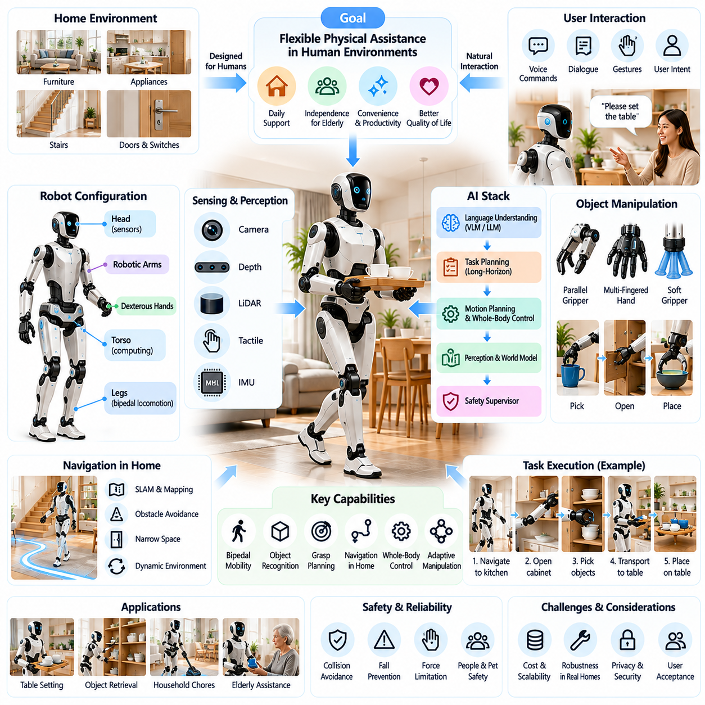{width="7.268055555555556in" height="7.268055555555556in"}

가정 내 휴머노이드 보조(Humanoid Assistance in the Home)는 인간의 활동을 위해 설계된 환경에서 유연한 물리적 지원(Flexible Physical Support)을 제공하고자 하는 피지컬 인공지능(Physical AI)의 새로운 발전 방향을 나타낸다. 특수 목적 가정용 로봇(Specialized Household Robot)과 달리 휴머노이드 시스템(Humanoid System)은 인간과 유사한 신체 구조(Human-Like Body Structure)를 활용하여 기존 가구, 가전제품, 도구, 건축 구조물과 상호작용한다. 장기적인 목표는 주거 인프라(Residential Infrastructure)를 광범위하게 변경하지 않고도 다양한 가사 작업(Domestic Task)을 수행하는 것이다.

휴머노이드 형태(Humanoid Form)는 가정 공간이 인간의 키, 도달 범위, 이동성, 조작 능력을 중심으로 구성되어 있기 때문에 잠재적인 이점을 제공한다. 문, 수납장, 조리대, 스위치, 계단은 인간의 신체적 특성(Human Physical Characteristic)을 반영한다. 따라서 휴머노이드 로봇(Humanoid Robot)은 익숙한 상호작용 방식(Familiar Interaction Pattern)을 활용하여 기존 가정 인프라에 접근할 수 있지만, 인간의 다재다능함(Human Versatility)을 재현하려면 기계 설계(Mechanical Design), 인식(Perception), 제어(Control) 분야에서 상당한 기술적 발전이 필요하다.

가정용 휴머노이드 로봇(Domestic Humanoid Robot)은 일반적으로 관절형 다리(Articulated Leg), 로봇 팔(Robotic Arm), 정교한 로봇 손(Dexterous Hand), 다중모달 센서(Multimodal Sensor), 온보드 컴퓨팅 플랫폼(Onboard Computing Platform)을 통합한다. 이러한 구성요소는 물리적 작업을 수행하면서 균형을 유지할 수 있는 통합 시스템(Coordinated System)으로 작동해야 한다. 기계적 구성(Mechanical Configuration)은 도달 가능성(Reachability), 적재 용량(Payload Capacity), 에너지 소비(Energy Consumption), 안정성(Stability), 좁은 주거 공간에서의 이동 능력에 큰 영향을 미친다.

가정 내 이동(Household Mobility)은 카펫, 문턱, 계단, 미끄러운 표면, 예상하지 못한 장애물과 관련된 과제를 제시한다. 이족 보행(Bipedal Locomotion)은 인간 중심 환경(Human-Oriented Environment)과의 호환성을 제공할 수 있지만, 동적 균형(Dynamic Balance)에 대한 요구사항과 상당한 제어 복잡성(Control Complexity)을 수반한다. 휴머노이드 시스템은 사람과 가정용 물체 주변에서 안정적으로 이동하면서 신체 상태(Body State), 지면 접촉(Ground Contact), 환경 조건(Environmental Condition)을 지속적으로 추정해야 한다.

전신 제어(Whole-Body Control)는 조작(Manipulation)과 보행(Locomotion)이 물리적으로 상호 연결되어 있기 때문에 필수적이다. 수납장 안으로 팔을 뻗거나 물체를 들어 올리거나 무거운 문을 여는 행동은 로봇의 질량중심(Center of Mass)을 이동시키고 접촉력(Contact Force)을 변화시킬 수 있다. 통합 제어(Coordinated Control)는 관절 운동(Joint Motion), 균형(Balance), 자세(Posture), 외부 상호작용(External Interaction)을 동시에 조절해야 한다. 안정적인 작업 수행은 정확한 동역학 추정(Dynamics Estimation)과 적절한 복구 전략(Recovery Strategy)에 달려 있다.

정교한 조작(Dexterous Manipulation)은 휴머노이드 로봇이 단순한 물체 운반을 넘어 의미 있는 가사 활동을 수행할 수 있는지를 결정한다. 가정용 물체는 형상(Geometry), 무게(Weight), 질감(Texture), 강성(Rigidity), 취약성(Fragility)이 다양하다. 식기, 의류, 용기, 가정용 도구를 취급하려면 불확실한 물리적 조건에서 신뢰할 수 있는 파지 계획(Grasp Planning), 힘 조절(Force Regulation), 촉각 피드백(Tactile Feedback), 물체별 조작 전략(Object-Specific Manipulation Strategy)이 필요하다.

인식 시스템(Perception System)은 동적으로 변화하는 가정환경(Dynamic Household Environment)에 대한 유용한 표현을 구축해야 한다. 카메라(Camera), 깊이 센서(Depth Sensor), 관성 측정(Inertial Measurement), 촉각 센싱(Tactile Sensing)은 물체 인식(Object Recognition), 공간 지도 작성(Spatial Mapping), 인간 감지(Human Detection), 접촉 추정(Contact Estimation)을 지원한다. 의미론적 장면 이해(Semantic Scene Understanding)는 로봇이 컵을 가져와야 할 물체로 식별하거나 서랍을 접근 가능한 보관 공간으로 인식하는 것처럼 물리적 물체와 기능적 역할(Functional Role)을 연결하도록 한다.

작업 계획(Task Planning)은 가정 내 명령이 여러 개의 상호 의존적인 행동을 요구할 때 더욱 어려워진다. 식탁을 준비하라는 요청에는 물체 위치 파악, 수납장 열기, 식기류 꺼내기, 가구 주변 이동, 물체의 정확한 배치가 포함될 수 있다. 장기 작업 계획(Long-Horizon Planning)은 변화하는 환경 조건, 사용할 수 없는 물체, 실행 실패(Execution Failure), 인간의 개입(Human Interruption)을 고려하면서 이러한 작업을 조정해야 한다.

자연어 상호작용(Natural Language Interaction)은 가정용 휴머노이드 보조(Domestic Humanoid Assistance)를 위한 접근하기 쉬운 인터페이스(Accessible Interface)를 제공한다. 사용자는 개별 관절 움직임을 지정하는 대신 음성(Speech), 제스처(Gesture), 대화형 명령(Conversational Instruction)을 통해 목표를 전달할 수 있다. 언어 모델(Language Model)은 의도 해석(Intention Interpretation)과 작업 순서 생성(Task Sequence Generation)을 지원할 수 있지만, 물리적 실행(Physical Execution)을 위해서는 명령을 관측된 환경 조건, 사용 가능한 기능, 명시적인 안전 제약조건(Explicit Safety Constraint)에 연결해야 한다.

시각-언어-행동 모델(Vision-Language-Action Model, VLA)과 로봇 파운데이션 모델(Robot Foundation Model)은 시각적 관측(Visual Observation), 언어 명령(Language Instruction), 실행 가능한 행동(Executable Behavior)을 연결하여 더 광범위한 작업 일반화(Task Generalization)를 지원할 수 있다. 이러한 아키텍처(Architecture)는 수동으로 프로그래밍된 작업 절차(Manually Programmed Routine)에 대한 의존도를 줄일 가능성이 있다. 그러나 가정 내 실제 배치(Household Deployment)를 위해서는 익숙하지 않은 물체에 대한 견고한 적응(Robust Adaptation), 신뢰할 수 있는 행동 검증(Action Verification), 불확실성 인식(Uncertainty Awareness), 학습된 정책(Learned Policy)과 안전 필수 제어(Safety-Critical Control)의 분리가 필요하다.

인간 시연 기반 학습(Learning from Human Demonstrations)은 다양한 가사 기술(Domestic Skill)을 습득하기 위한 가능한 접근 방식이다. 원격조작(Teleoperation), 동작 포착(Motion Capture), 기록된 조작 궤적(Recorded Manipulation Trajectory)은 작업 수행 방법을 보여줄 수 있다. 모방학습(Imitation Learning)은 유용한 행동을 재현할 수 있으며, 강화학습(Reinforcement Learning)과 시뮬레이션(Simulation)은 특정 제어 정책(Control Policy)을 개선할 수 있다. 인간과 로봇의 신체 구조 차이로 인해 시연된 동작을 실행 가능한 로봇 행동으로 변환하기 전에 신중한 적응(Adaptation)이 필요하다.

시뮬레이션 환경(Simulation Environment)은 휴머노이드 시스템이 가구 구성원을 불필요한 위험에 노출하지 않고 보행, 조작, 복구 동작(Recovery Behavior)을 연습하도록 한다. 물리 기반 학습(Physics-Based Training)은 가구 배치(Furniture Arrangement), 물체 특성(Object Property), 표면 마찰(Surface Friction), 외부 외란(External Disturbance)을 다양하게 변화시킬 수 있다. 그러나 접촉 동역학(Contact Dynamics), 변형 가능한 물체(Deformable Object), 액추에이터 한계(Actuator Limitation), 예상하지 못한 인간 행동(Unexpected Human Behavior)을 완전하게 모델링하기 어렵기 때문에 시뮬레이션에서 현실로의 전이(Simulation-to-Reality Transfer)는 여전히 어려운 과제로 남아 있다.

안전성(Safety)은 휴머노이드 로봇이 상당한 질량(Substantial Mass), 다수의 액추에이터(Multiple Actuator), 잠재적으로 불안정한 보행(Potentially Unstable Locomotion)을 사람 주변에서 결합하기 때문에 핵심적인 요구사항이다. 위험 요소(Hazard)에는 낙상(Fall), 충돌(Collision), 과도한 접촉력(Excessive Contact Force), 물체 낙하(Dropped Object), 의도하지 않은 움직임(Unintended Movement)이 포함된다. 안전한 배치(Safe Deployment)를 위해서는 기계적 안전장치(Mechanical Safeguard), 힘 제한(Force Limitation), 충돌 감시(Collision Monitoring), 비상 정지(Emergency Stopping), 낙상 위험 관리(Fall-Risk Management), 시스템 신뢰도가 낮아질 때의 보수적인 행동(Conservative Behavior)이 필요하다.

인간 인식형 자율주행 및 조작(Human-Aware Navigation and Manipulation)은 어린이, 고령 거주자, 방문객, 반려동물의 예측하기 어려운 움직임을 고려해야 한다. 로봇은 적절한 이격 거리(Separation Distance)를 유지하고, 발생 가능한 간섭(Possible Interference)을 예측하며, 사람이 있는 공간에서 행동을 조정해야 한다. 사회적으로 수용 가능한 행동(Socially Acceptable Behavior)을 위해서는 예측 가능한 움직임(Predictable Motion), 의도에 대한 명확한 전달(Clear Communication of Intentions), 사람이 접근할 때 일시 정지하거나 양보하는 능력도 필요하다.

보조 응용 분야(Assistive Application)는 일상적인 신체 활동을 수행하는 데 어려움을 겪는 사람들에게 가치를 제공할 수 있다. 휴머노이드 로봇은 물체 가져오기(Object Retrieval), 가정용 물품 운반(Household Supply Transportation), 일부 정리 작업(Organizational Task), 의사소통 지원(Communication Assistance)을 수행할 가능성이 있다. 그러나 직접적인 신체 돌봄(Direct Physical Caregiving), 사람 들어 올리기(Human Lifting), 의료적으로 민감한 활동(Medically Sensitive Activity)에는 훨씬 강화된 검증(Validation), 전문적인 안전장치(Specialized Safeguard), 적절한 인간 감독(Human Supervision)이 필요하다.

에너지 효율성(Energy Efficiency)은 실용적인 가정용 휴머노이드 운영(Practical Domestic Humanoid Operation)을 가로막는 주요 장애요인으로 남아 있다. 이족 보행(Bipedal Locomotion), 균형 제어(Balance Control), 로봇 팔 조작(Arm Manipulation), 센싱(Sensing), 온보드 인공지능 연산(Onboard AI Computation)은 배터리 자원(Battery Resource)에 지속적인 부담을 준다. 고출력 동작(High-Power Movement)과 지속적인 물체 지지(Sustained Object Holding)는 작동 시간(Operating Duration)을 더욱 단축할 수 있다. 따라서 고효율 액추에이터(Efficient Actuator), 경량 구조(Lightweight Structure), 전력 인식 계획(Power-Aware Planning), 자율 충전(Autonomous Charging)이 중요한 설계 우선순위(Design Priority)이다.

하드웨어 경제성(Hardware Affordability)은 휴머노이드 보조의 상업적 실현 가능성(Commercial Feasibility)에 큰 영향을 미친다. 다수의 정밀 액추에이터(Precision Actuator), 복잡한 동력 전달장치(Complex Transmission), 정교한 로봇 손(Dexterous Hand), 센서, 배터리, 컴퓨팅 시스템(Computing System)은 상당한 제조 비용(Manufacturing Cost)을 발생시킨다. 유용한 기능을 유지하면서 부품의 복잡성을 줄이려면 하드웨어-소프트웨어 공동 설계(Hardware-Software Co-Design), 모듈형 아키텍처(Modular Architecture), 확장 가능한 생산(Scalable Production), 목표 가사 작업(Target Household Task)에 대한 신중한 선정이 필요하다.

신뢰성(Reliability)과 유지관리 용이성(Maintainability) 역시 중요하다. 소비자 환경(Consumer Environment)에서는 전문 기술자의 빈번한 개입에 의존할 수 없기 때문이다. 휴머노이드 로봇은 실패한 행동(Unsuccessful Action)을 인식하고, 관리 가능한 외란(Manageable Disturbance)으로부터 복구하며, 도움이 필요한 상황을 전달해야 한다. 진단 시스템(Diagnostic System), 소프트웨어 업데이트(Software Update), 교체 가능한 부품(Replaceable Component), 예측 가능한 유지관리 절차(Predictable Maintenance Procedure)는 수용 가능한 제품 소유 경험(Product Ownership Experience)을 지원하는 데 필요하다.

개인정보 보호(Privacy)와 사이버보안(Cybersecurity)은 휴머노이드 로봇이 사적인 생활공간을 지속적으로 인식하고 연결된 가정용 시스템과 상호작용할 때 핵심적인 문제가 된다. 카메라, 마이크, 공간 지도(Spatial Map), 행동 기록(Behavioral Record)은 민감한 개인정보(Sensitive Personal Information)를 노출할 수 있다. 안전한 데이터 처리(Secure Processing), 통제된 데이터 접근(Controlled Data Access), 암호화(Encryption), 투명한 데이터 보관 정책(Transparent Retention Policy), 사용자 주도 개인정보 보호 설정(User-Directed Privacy Setting)을 시스템 아키텍처(System Architecture)에 반영해야 한다.

소비자 수용(Consumer Acceptance)은 기술적 능력(Technical Capability)만으로 결정되지 않는다. 사람들은 휴머노이드 로봇을 외형(Appearance), 움직임의 예측 가능성(Movement Predictability), 소음(Noise), 물리적 존재감(Physical Presence), 신뢰성(Trustworthiness), 인지된 유용성(Perceived Usefulness)에 따라 평가할 수 있다. 인간과 유사한 설계(Human-Like Design)는 가정 인프라와의 호환성을 높일 수 있지만, 과도한 의인화 기대(Anthropomorphic Expectation)는 지능(Intelligence), 감정 이해(Emotional Understanding), 실제 기능적 한계(Functional Limitation)에 대한 오해를 유발할 수 있다.

경제적 가치(Economic Value)는 개별적인 시연(Isolated Demonstration)이 아니라 현실적인 가사 작업 수행 성능(Realistic Household Task Performance)을 통해 평가해야 한다. 관련 지표에는 작업 완료 성공률(Successful Task Completion), 개입 빈도(Intervention Frequency), 운영 가용성(Operating Availability), 유지관리 비용(Maintenance Cost), 에너지 소비(Energy Consumption), 유효 보조 시간(Useful Hours of Assistance)이 포함된다. 휴머노이드의 다목적성(Humanoid Versatility)이 추가적인 복잡성과 소유 비용(Ownership Cost)을 정당화하는지 판단하려면 특수 목적 가전제품(Specialized Appliance) 및 기존 가정 서비스(Conventional Home Service)와의 비교가 필요하다.

단기 상용화(Near-Term Commercialization)는 휴머노이드 기능이 단순한 로봇 플랫폼(Simpler Robotic Platform)에 비해 명확한 이점을 제공하는 제한된 응용 분야(Constrained Application)에 집중할 가능성이 있다. 구조화된 가사 작업(Structured Household Task), 통제된 물체 운반(Controlled Object Transportation), 일부 보조 기능(Selected Assistance Function)은 실용적인 개발 경로(Development Pathway)를 제공할 수 있다. 범용 작동(General-Purpose Operation)으로 확장하려면 신뢰성(Reliability), 안전성(Safety), 작업 다양성(Task Diversity), 경제적 지속가능성(Economic Sustainability)에 관한 더욱 강력한 검증 근거가 단계적으로 확보되어야 한다.

미래의 가정용 휴머노이드 시스템(Future Domestic Humanoid System)은 다중모달 파운데이션 모델(Multimodal Foundation Model), 지속적 공간 기억(Persistent Spatial Memory), 적응형 조작(Adaptive Manipulation), 장기 추론(Long-Horizon Reasoning)을 결합하여 점점 더 복잡한 가사 활동을 수행할 수 있다. 기술 발전은 신뢰할 수 있는 물리적 제어(Reliable Physical Control)를 유지하면서 학습된 기술(Learned Skill)을 서로 다른 가정환경으로 전이하는 능력에 달려 있다. 이러한 전환 과정에서는 지속적인 평가(Continuous Evaluation), 인간 감독(Human Oversight), 명확하게 정의된 작동 범위(Clearly Defined Operating Boundary)가 필수적이다.

궁극적으로 가정 내 휴머노이드 보조(Humanoid Assistance in the Home)는 특수 목적 자동화(Specialized Automation)에서 적응 가능한 물리적 지능(Adaptable Physical Intelligence)으로 확장하려는 피지컬 인공지능(Physical AI)의 야심찬 발전 방향을 나타낸다. 그 잠재력은 인간 환경에 적합한 신체 구조(Human-Compatible Embodiment)를 활용하여 기존 생활공간에서 다양한 일상 활동을 지원하는 데 있다. 광범위한 도입(Widespread Adoption)은 신뢰할 수 있는 성능(Dependable Performance), 입증 가능한 안전성(Demonstrable Safety), 경제적인 운영(Affordable Operation), 직관적인 상호작용(Intuitive Interaction), 가정 내 삶의 질(Household Quality of Life)에 대한 실질적인 개선을 달성하는 데 달려 있다.

## 07.06. Elderly and Assistive Home Robotics

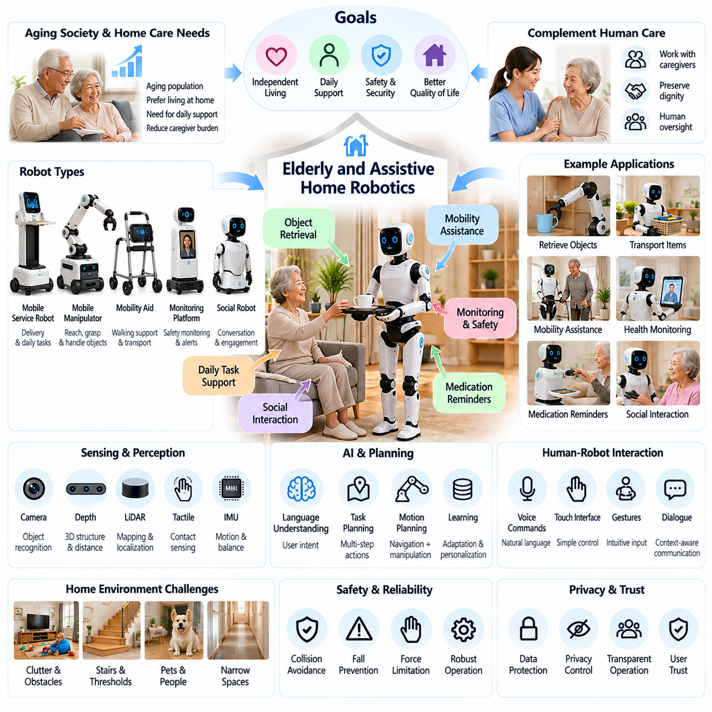{width="7.268055555555556in" height="7.268055555555556in"}

고령자 및 생활 보조 가정용 로봇(Elderly and Assistive Home Robotics)은 독립적인 생활(Independent Living), 일상생활 기능(Daily Functioning), 개인의 삶의 질(Personal Well-Being)을 지원하는 데 중점을 둔 피지컬 인공지능(Physical AI)의 중요한 응용 분야이다. 이러한 시스템은 환경 인식(Environmental Perception), 자율 이동(Autonomous Mobility), 물리적 보조(Physical Assistance), 인간 중심 상호작용(Human-Centered Interaction)을 결합하여 노화와 신체 기능 저하에 따른 실질적인 문제를 해결한다. 주요 목표는 인간의 돌봄(Human Care)을 보완하면서 존엄성(Dignity), 자율성(Autonomy), 안전성(Safety)을 유지하는 것이다.

인구 고령화(Population Aging)와 재택 지원(Home-Based Support)에 대한 수요 증가는 보조 로봇 기술(Assistive Robotic Technology)에 새로운 기회를 제공한다. 많은 고령자는 요양시설(Institutional Facility)로 이동하기보다 익숙한 주거 환경(Residential Environment)에서 계속 생활하기를 선호한다. 로봇은 반복적인 가사 활동의 부담을 줄이고, 필수 물품에 대한 접근성을 높이며, 돌봄 제공자(Caregiver)와의 의사소통을 지원할 수 있다. 다만 로봇의 기능은 개인별 요구사항(Individual Need)에 맞게 신중하게 선정되어야 한다.

가정용 보조 로봇(Assistive Home Robotics)은 이동형 서비스 로봇(Mobile Service Robot), 로봇 매니퓰레이터(Robotic Manipulator), 이동 보조 장치(Mobility Aid), 모니터링 플랫폼(Monitoring Platform), 사회적 상호작용 장치(Socially Interactive Device) 등 여러 시스템 범주를 포함한다. 각 범주는 서로 다른 기능적 요구사항(Functional Requirement)과 물리적 상호작용 수준(Physical Interaction Level)에 대응한다. 성공적인 배치(Deployment)는 하나의 범용 플랫폼(General-Purpose Platform)이 모든 보조 요구사항을 충족할 수 있다고 가정하기보다 적절한 로봇 기능(Robotic Capability)을 선택하는 데 달려 있다.

일상생활 보조(Daily Living Assistance)는 물체 가져오기(Object Retrieval), 물품 운반(Supply Transportation), 가정용 물품 정리(Household Item Organization), 일상 작업 지원(Routine Task Support)과 같은 활동에 중점을 둔다. 이동형 매니퓰레이터(Mobile Manipulator)는 사용자가 손을 뻗거나 운반하기 어려운 물체에 접근하도록 도울 수 있다. 이러한 응용 분야에는 신뢰할 수 있는 자율주행(Navigation), 물체 인식(Object Recognition), 파지(Grasping), 안전한 전달(Safe Delivery)이 필요하며, 특히 이동 능력 저하(Limited Mobility), 근력 감소(Reduced Strength), 균형 유지의 어려움(Balance Difficulty)이 있는 사용자에게 중요하다.

이동 보조(Mobility Assistance)는 로봇 장치가 인간의 움직임에 직접적인 영향을 미칠 수 있기 때문에 추가적인 기계적 및 안전상의 과제를 수반한다. 지능형 보행 보조기(Intelligent Walker), 전동 이동 플랫폼(Powered Mobility Platform), 로봇 지원 시스템(Robotic Support System)은 자율주행 보조(Navigation Assistance) 또는 제어된 이동 지원(Controlled Movement Support)을 제공할 수 있다. 이러한 장치의 설계에서는 사용자 안정성(User Stability), 제동 성능(Braking Performance), 지형 조건(Terrain Condition), 물리적 상호작용력(Physical Interaction Force), 예상하지 못한 시스템 고장(System Failure)의 결과를 고려해야 한다.

인간-로봇 상호작용(Human-Robot Interaction)은 다양한 감각 능력(Sensory Ability), 인지 능력(Cognitive Ability), 신체 능력(Physical Ability)을 수용해야 한다. 음성 명령(Voice Command), 터치 인터페이스(Touch Interface), 시각적 디스플레이(Visual Display), 단순화된 제어 장치(Simplified Control)는 상호 보완적인 의사소통 수단을 제공할 수 있다. 효과적인 시스템은 전문적인 기술 지식이나 복잡한 설정 절차에 대한 불필요한 의존을 피하면서 사용자의 요구사항에 맞게 상호작용 속도(Interaction Speed), 피드백 명확성(Feedback Clarity), 인터페이스 복잡성(Interface Complexity)을 조정한다.

개인화(Personalization)는 보조 요구사항(Assistance Requirement)이 개인마다 크게 다르고 시간이 지남에 따라 변화할 수 있기 때문에 특히 중요하다. 로봇은 선호하는 일상생활 패턴(Preferred Routine), 가정 내부 구조(Household Layout), 이동 패턴(Mobility Pattern), 의사소통 선호도(Communication Preference)에 적응할 수 있다. 그러나 개인화는 투명하고 되돌릴 수 있는 방식(Transparent and Reversible Manner)으로 이루어져야 하며, 사용자와 권한을 부여받은 돌봄 제공자(Authorized Caregiver)가 개인의 일상생활 통제권을 제거하지 않으면서 보조 수준(Assistance Level)을 조정할 수 있어야 한다.

환경 인식(Environmental Perception)은 보조 로봇이 가구, 좁은 통로, 반려동물, 이동하는 사람이 존재하는 주거 공간에서 작동하도록 한다. 카메라(Camera), 깊이 센서(Depth Sensor), 근접 센서(Proximity Sensor), 공간 지도 작성(Spatial Mapping)은 장애물 회피(Obstacle Avoidance)와 작업 수행(Task Execution)을 지원한다. 신뢰할 수 있는 인식(Reliable Perception)은 변화하는 조명, 복잡하게 놓인 물체(Clutter), 반사 표면(Reflective Surface), 예상하지 못한 물체를 고려해야 하며, 환경에 대한 이해가 불확실할 때도 안전한 행동(Safe Behavior)을 유지해야 한다.

모니터링 기능(Monitoring Function)은 비정상적인 가정 내 상황(Unusual Household Condition), 장시간 활동 부재(Prolonged Inactivity), 도움 요청(Request for Assistance)에 대한 상황 인식(Situational Awareness)을 지원할 수 있다. 로봇 플랫폼(Robotic Platform)은 이동, 환경 센싱(Environmental Sensing), 통신 기능(Communication Capability)을 결합하여 맥락 정보(Contextual Information)를 제공할 수 있다. 그러나 모니터링 관측(Monitoring Observation)을 확정적인 의료 평가(Medical Assessment)로 간주해서는 안 되며, 중요한 경보(Alert)에는 적절한 확인(Verification), 단계별 대응 절차(Escalation Procedure), 인간 감독(Human Oversight)이 필요하다.

낙상 관련 보조(Fall-Related Assistance)는 낙상이 심각한 피해를 초래할 수 있고 감지 기술(Detection Technology)이 완벽하지 않기 때문에 특히 신중한 시스템 설계(System Design)를 요구한다. 로봇은 잠재적인 위험 요소(Potential Hazard)를 식별하고 경고(Warning)를 전달하거나 낙상 의심 사고(Suspected Incident) 이후 도움을 요청하도록 지원할 수 있다. 사람을 직접 들어 올리거나 회복을 돕는 물리적 지원(Physical Lifting or Recovery Support)은 상당한 생체역학적 위험(Biomechanical Risk)을 수반하므로, 전용 장비(Purpose-Built Equipment), 검증된 안전장치(Validated Safeguard), 적절한 전문 감독(Professional Supervision) 없이 수행해서는 안 된다.

약물 관련 보조(Medication-Related Assistance)는 복약 알림(Reminder), 복약 일정 안내(Schedule Communication), 승인된 약품 용기(Approved Medication Container)의 위치 확인 또는 운반 지원을 포함할 수 있다. 이러한 기능은 적절하게 설정되었을 때 정기적인 복약 준수(Routine Adherence)를 개선할 수 있다. 그러나 로봇이 약물 변경(Medication Change), 투여 용량(Dosage), 임상적 치료 결정(Clinical Treatment Decision)을 독립적으로 판단해서는 안 된다. 약물 관리(Medication Management)는 잠재적으로 유해한 오류에 대비하여 전문적인 감독(Professional Oversight)과 명확한 책임 체계(Clear Accountability)를 유지해야 한다.

사회적 상호작용(Social Interaction)은 특히 시스템이 의사소통과 일상적인 참여(Everyday Engagement)를 촉진할 때 보조 로봇의 인지된 유용성(Perceived Usefulness)에 기여할 수 있다. 대화형 인터페이스(Conversational Interface)는 알림을 제공하고 예정된 활동을 설명하거나 가족과 사용자를 연결할 수 있다. 그러나 로봇 동반자 기능(Robotic Companionship)은 의미 있는 인간관계(Meaningful Human Relationship)를 대체하기보다 보완해야 하며, 시스템은 감정 이해(Emotional Understanding)나 돌봄 능력(Caregiving Capability)에 대해 사용자를 오도하지 않아야 한다.

인공지능 파운데이션 모델(Artificial Intelligence Foundation Model)은 자연어 요청(Natural Language Request)을 해석하고 맥락적 가정환경 상황(Contextual Household Situation)을 인식함으로써 보조 로봇의 유연성(Flexibility)을 향상시킬 수 있다. 시각-언어 모델(Vision-Language Model, VLM)은 음성 명령(Spoken Instruction)을 물체 및 환경 관측(Environmental Observation)과 연결할 수 있다. 행동 지향 모델(Action-Oriented Model)은 작업 수행(Task Execution)을 지원할 수 있지만, 안전 필수 행동(Safety-Critical Behavior)에는 명시적인 제약조건(Explicit Constraint), 불확실성 관리(Uncertainty Management), 물리적 실행 결과(Physical Outcome)에 대한 신뢰할 수 있는 검증이 필요하다.

시연 및 사용자 피드백 기반 학습(Learning from Demonstrations and User Feedback)은 로봇이 실용적인 보조 행동(Practical Assistance Behavior)을 습득하도록 지원할 수 있다. 원격조작(Teleoperation), 감독된 시연(Supervised Example), 기록된 작업 궤적(Recorded Task Trajectory)은 물체 취급(Object Handling)과 선호하는 상호작용 패턴(Preferred Interaction Pattern)에 관한 정보를 제공한다. 적응(Adaptation)은 가정과 사용자 간의 차이를 고려해야 하며, 학습 데이터 거버넌스(Training Data Governance)는 민감한 정보(Sensitive Information)를 보호하고 제한된 사례로부터 발생하는 안전하지 않은 일반화(Unsafe Generalization)를 방지해야 한다.

안전 공학(Safety Engineering)은 로봇 자체의 위험(Robotic Hazard)과 대상 사용자의 취약성(User Vulnerability)을 모두 고려해야 한다. 잠재적인 위험에는 충돌(Collision), 불안정한 물체(Unstable Object), 과도한 상호작용력(Excessive Interaction Force), 통로 차단(Blocked Pathway), 잘못된 작업 수행(Incorrect Task Execution)이 포함된다. 시스템에는 속도 제한(Speed Limitation), 힘 감시(Force Monitoring), 비상 정지(Emergency Stopping), 접근 가능한 수동 제어 전환(Accessible Manual Override), 고장 시 안전 동작(Fail-Safe Behavior)을 통합해야 한다. 위험 평가(Risk Assessment)는 실제 사용자 능력(Realistic User Capability)과 예측 가능한 오사용(Foreseeable Misuse)을 반영해야 한다.

개인정보 보호(Privacy)와 충분한 설명에 근거한 동의(Informed Consent)는 보조 로봇이 매우 사적인 생활환경에서 지속적으로 작동할 수 있기 때문에 기본적인 요구사항이다. 카메라, 마이크, 행동 관측(Behavioral Observation), 가정 내부 지도(Household Map)는 민감한 정보를 드러낼 수 있다. 책임 있는 배치(Responsible Deployment)를 위해서는 데이터 최소화(Data Minimization), 안전한 데이터 처리(Secure Processing), 명확한 접근 권한(Clear Access Permission), 이해하기 쉬운 동의 절차(Understandable Consent Procedure), 사용자가 정보 공유(Information Sharing)를 검토하거나 제한할 수 있는 메커니즘(Mechanism)이 필요하다.

돌봄 제공자 통합(Caregiver Integration)은 책임이 명확하게 정의되어 있을 때 서비스 효과성(Service Effectiveness)을 향상시킬 수 있다. 로봇은 작업 완료(Task Completion), 장비 상태(Equipment Status), 도움 요청(Assistance Request), 선택된 환경 경보(Environmental Alert)를 권한을 부여받은 돌봄 제공자(Authorized Caregiver)에게 전달할 수 있다. 정보는 관련성이 있고 적절한 수준으로 제한되며 설정 가능해야 한다. 인간 돌봄 제공자(Human Caregiver)는 임상적 판단(Clinical Judgment), 개인 돌봄 전문성(Personal Care Expertise), 개별 상황에 대한 복잡한 해석(Complex Interpretation)이 필요한 결정에 대한 책임을 유지해야 한다.

신뢰성(Reliability)은 보조 기술(Assistive Technology)이 중요한 일상생활 절차(Daily Routine)에 통합될 수 있기 때문에 필수적이다. 예상하지 못한 시스템 종료(Unexpected Shutdown), 통신 장애(Communication Failure), 자율주행 오류(Navigation Error), 기계적 고장(Mechanical Breakdown)은 보조 서비스에 대한 접근을 방해할 수 있다. 시스템은 이해하기 쉬운 고장 알림(Failure Notification), 복구 절차(Recovery Procedure), 유지관리 일정(Maintenance Schedule), 대체 지원 체계(Backup Arrangement)를 제공하여 필수적인 요구사항(Essential Need)이 로봇의 가용성(Robotic Availability)에만 의존하지 않도록 해야 한다.

접근성(Accessibility)과 포용적 설계(Inclusive Design)는 제품 개발(Product Development)의 초기 단계부터 적용되어야 한다. 인터페이스(Interface)는 청력(Hearing), 시력(Vision), 손의 정교한 움직임(Dexterity), 이동성(Mobility), 인지 기능(Cognitive Function)의 차이를 수용해야 한다. 조정 가능한 상호작용 방식(Adjustable Interaction Method), 읽기 쉬운 디스플레이(Readable Display), 이해하기 쉬운 언어(Understandable Language), 간단한 물리적 제어 장치(Straightforward Physical Control)는 사용성(Usability)을 향상시킨다. 고령자, 장애인, 돌봄 제공자가 참여하는 참여형 설계(Participatory Design)는 순수한 기술적 평가(Technical Evaluation)에서 놓치기 쉬운 요구사항을 발견할 수 있다.

경제적 실현 가능성(Economic Feasibility)은 유용한 보조 기능(Useful Assistance)과 장비 비용(Equipment Cost), 설치 비용(Installation Cost), 유지관리 비용(Maintenance Cost), 지속적인 서비스 비용(Ongoing Service Expense) 사이의 균형에 달려 있다. 이동 플랫폼(Mobile Platform), 매니퓰레이터(Manipulator), 센서(Sensor), 배터리(Battery), 지원 인프라(Support Infrastructure)는 소유 비용(Ownership Cost)을 증가시킬 수 있다. 상업적 모델(Commercial Model)에는 직접 구매(Direct Purchase), 구독 서비스(Subscription Service), 관리형 배치(Managed Deployment)가 포함될 수 있지만, 경제성(Affordability)은 신뢰성(Reliability), 지원 서비스 가용성(Support Availability), 측정 가능한 사용자 편익(Measurable User Benefit)과 함께 평가해야 한다.

성능 평가(Performance Evaluation)는 개별적인 로봇 시연(Isolated Robotic Demonstration)을 넘어 실제 환경에서의 보조 성과(Real-World Assistance Outcome)를 측정해야 한다. 관련 지표에는 작업 완료 성공률(Successful Task Completion), 사용자 개입 빈도(User Intervention Frequency), 안전 사고(Safety Event), 시스템 가용성(System Availability), 돌봄 제공자 업무 부담(Caregiver Workload), 사용자 만족도(User Satisfaction)가 포함된다. 장기 연구(Longer-Term Study)는 로봇 보조(Robotic Assistance)가 독립적인 생활(Independence)을 실질적으로 지원하고, 현실적인 부담(Practical Burden)을 줄이며, 개인의 요구사항이 변화해도 수용 가능한 상태를 유지하는지 평가해야 한다.

배치 전략(Deployment Strategy)은 명확하게 정의된 작업(Clearly Defined Task)과 작동 범위(Operating Boundary)에서 시작해야 한다. 물체 전달(Object Delivery), 가정 내 알림(Household Reminder), 의사소통 보조(Communication Assistance), 일부 이동 지원(Selected Mobility Support)은 실현 가능한 초기 응용 분야(Initial Application)를 제공할 수 있다. 기능 확장(Functionality Expansion)을 위해서는 다양한 주거 환경(Residential Environment)과 사용자 집단(User Population)에 걸친 체계적인 검증(Systematic Validation)이 필요하다. 고장이 개인의 안전(Personal Safety)이나 필수 돌봄(Essential Care)에 영향을 미칠 수 있는 경우에는 인간 감독(Human Supervision)과 대체 대응 절차(Fallback Procedure)가 계속 필요하다.

미래의 가정용 보조 로봇(Future Assistive Home Robotics)은 다중모달 인식(Multimodal Perception), 적응형 조작(Adaptive Manipulation), 개인화된 상호작용(Personalized Interaction), 통합된 돌봄 제공자 의사소통(Coordinated Caregiver Communication)을 결합할 수 있다. 더욱 고도화된 시스템은 변화하는 사용자 요구사항(User Need)에 적응하면서 일상 활동(Everyday Activity) 전반에 걸쳐 더욱 유연한 지원을 제공할 수 있을 것이다. 기술 발전은 견고한 안전 공학(Robust Safety Engineering), 경제적인 하드웨어(Affordable Hardware), 신뢰할 수 있는 인공지능(Trustworthy AI), 접근 가능한 인터페이스(Accessible Interface), 실제 가정환경에서 의미 있는 편익을 입증하는 근거(Evidence)에 달려 있다.

궁극적으로 고령자 및 생활 보조 가정용 로봇(Elderly and Assistive Home Robotics)은 독립적인 생활(Independent Living), 개인의 존엄성(Personal Dignity), 실질적인 삶의 질(Practical Quality of Life)에 얼마나 기여하는지를 기준으로 평가해야 한다. 피지컬 인공지능(Physical AI)은 반복적인 부담(Repetitive Burden)을 줄이고 일상적인 보조 서비스(Everyday Assistance)에 대한 접근성을 개선할 기회를 제공하지만, 기술적 능력(Technical Capability)만으로 돌봄 가치(Caregiving Value)가 입증되는 것은 아니다. 지속 가능한 도입(Sustainable Adoption)을 위해서는 인간 중심 설계(Human-Centered Design), 윤리적 거버넌스(Ethical Governance), 신뢰할 수 있는 운영(Dependable Operation), 사용자 및 돌봄 전문가(Care Professional)와의 지속적인 협력이 필요하다.

## 07.07. Personal Mobility and Carrying Assistance

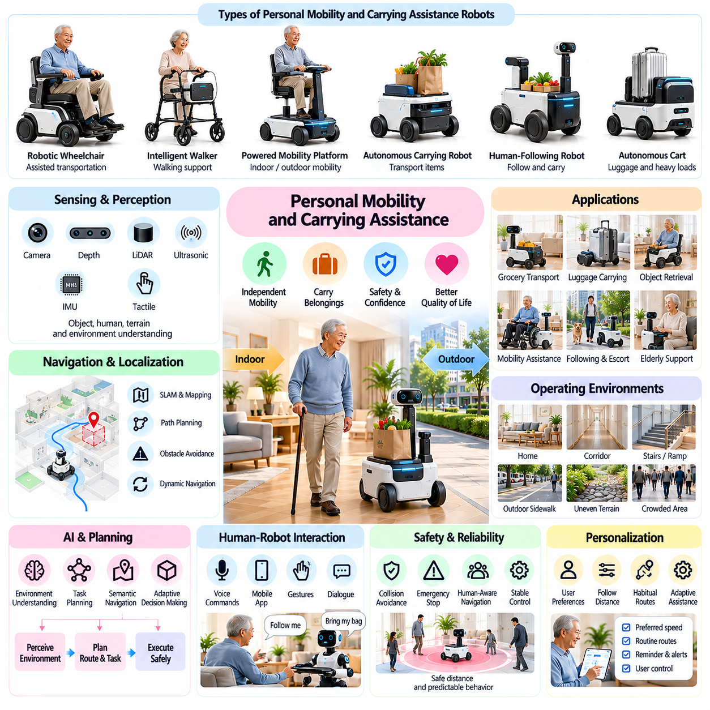{width="7.268055555555556in" height="7.268055555555556in"}

개인 이동 및 운반 보조(Personal Mobility and Carrying Assistance)는 자율 로봇 기술(Autonomous Robotics)을 일상적인 이동과 운송 작업으로 확장하는 피지컬 인공지능(Physical AI)의 중요한 응용 분야이다. 이러한 시스템은 개인이 주거 및 지역사회 환경(Residential and Community Environment)에서 이동하도록 지원하면서 개인 소지품(Personal Belongings)을 운반하는 데 필요한 신체적 부담(Physical Effort)을 줄인다. 그 가치는 지능형 자율주행(Intelligent Navigation), 인간 인식형 상호작용(Human-Aware Interaction), 기계적 지원(Mechanical Support), 신뢰할 수 있는 운영(Reliable Operation)을 결합하는 데서 발생한다.

개인 이동 보조(Personal Mobility Assistance)에는 로봇 휠체어(Robotic Wheelchair), 지능형 보행 보조기(Intelligent Walker), 전동 이동 플랫폼(Powered Mobility Platform), 자율 추종 장치(Autonomous Following Device)가 포함된다. 이러한 시스템은 서로 다른 수준의 사용자 이동 능력(User Mobility)과 신체적 능력(Physical Capability)에 대응한다. 일부 시스템은 직접적인 이동 수단(Direct Transportation)을 제공하며, 다른 시스템은 보행을 지원하거나 사용자와 함께 물체를 운반한다. 적절한 아키텍처(Architecture)를 선택하려면 개인별 요구사항(Individual Need), 환경 제약조건(Environmental Constraint), 안전 요구사항(Safety Requirement)을 이해해야 한다.

자율 이동 플랫폼(Autonomous Mobility Platform)은 인식 센서(Perception Sensor), 위치 추정 알고리즘(Localization Algorithm), 경로 계획(Path Planning), 운동 제어(Motion Control)를 통합하여 복잡한 환경에서 자율주행을 수행한다. 카메라(Camera), 레이저 스캐너(Laser Scanner), 초음파 센서(Ultrasonic Sensor), 관성 측정 장치(Inertial Measurement Unit, IMU)는 장애물, 지형, 차량 움직임에 관한 정보를 제공한다. 센서 융합(Sensor Fusion)은 환경 인식(Environmental Awareness)을 향상시키고 조명, 표면, 공간 점유 상태(Occupancy Condition)가 변화하는 상황에서도 신뢰할 수 있는 자율주행을 지원한다.

인간 추종 로봇(Human-Following Robot)은 운반 보조(Carrying Assistance)의 실용적인 유형이다. 이러한 플랫폼은 식료품, 여행 가방, 도구, 가정용 물품을 운반하면서 지정된 사용자와 일정한 거리(Controlled Distance)를 유지한다. 작동을 위해서는 신뢰할 수 있는 사람 식별(Person Identification), 연속적인 추적(Continuous Tracking), 장애물 회피(Obstacle Avoidance), 적응형 속도 제어(Adaptive Speed Control)가 필요하다. 다른 사람이 로봇의 이동 경로를 가로지르거나 사용자가 일시적으로 시야에서 사라지는 경우에도 추적 기능(Tracking Function)은 견고하게 유지되어야 한다.

운반 보조(Carrying Assistance)는 무겁거나 반복적인 하중 운반(Load Transportation)과 관련된 신체적 부담(Physical Strain)을 줄일 수 있다. 자율 운반 카트(Autonomous Cart)와 소형 이동 로봇(Compact Mobile Robot)은 사용자를 따라 방과 방 사이, 건물 사이 또는 가까운 목적지까지 이동할 수 있다. 기계적 설계(Mechanical Design)는 적재 용량(Payload Capacity), 플랫폼 크기(Platform Dimension), 기동성(Maneuverability), 에너지 소비(Energy Consumption) 사이의 균형을 유지해야 한다. 적재물의 안정적인 배치(Stable Load Placement)와 확실한 고정(Secure Retention)은 화물 이동(Shifting Cargo)과 예상하지 못한 전복(Unexpected Tipping)을 방지하는 데 필수적이다.

주거 환경에서의 자율주행(Navigation in Residential Environments)은 좁은 복도, 문턱, 가구, 카펫, 불규칙한 바닥 표면과 관련된 과제를 수반한다. 로봇은 주행 가능한 영역(Traversable Area)을 식별하고 충돌을 방지하도록 이동 궤적(Trajectory)을 조정해야 한다. 동적 경로 계획(Dynamic Path Planning)은 일시적인 장애물을 우회하도록 하며, 국소 제어 알고리즘(Local Control Algorithm)은 사용 가능한 통과 공간(Clearance)과 환경 불확실성(Environmental Uncertainty)에 따라 속도와 회전 동작을 조절한다.

실외 개인 이동(Outdoor Personal Mobility)은 보도, 경사로, 비탈길, 연석, 고르지 않은 지형이 서로 다른 기계적 요구사항(Mechanical Requirement)을 부과하기 때문에 추가적인 복잡성을 가진다. 비, 햇빛, 노면 이물질(Surface Debris), 보행자 혼잡(Pedestrian Congestion)과 같은 환경 조건은 센싱(Sensing)과 접지력(Traction)에 영향을 미칠 수 있다. 신뢰할 수 있는 시스템은 자신의 작동 한계(Operating Limit)를 인식하고 안정성(Stability), 제동 성능(Braking Capability), 장애물 극복 능력(Obstacle-Crossing Capability)을 초과하는 경로를 피해야 한다.

공유 자율성(Shared Autonomy)은 수동 제어(Manual Control)와 완전 자율 작동(Fully Autonomous Operation) 사이에서 실용적인 절충안을 제공한다. 사용자는 목적지(Destination)나 이동 방향(Movement Direction)을 지정하고, 로봇 시스템은 장애물 회피와 국소 이동 궤적 조정(Local Trajectory Adjustment)을 담당할 수 있다. 이러한 접근 방식은 사용자의 결정 권한(User Authority)을 유지하면서 운영 부담(Operational Workload)을 줄인다. 효과적인 공유 제어(Shared Control)를 위해서는 인간 명령(Human Command)과 자동화된 보조(Automated Assistance) 사이의 예측 가능한 전환(Predictable Transition)이 필요하다.

인간-로봇 상호작용(Human-Robot Interaction)은 사용자가 로봇의 움직임을 이해하고 신뢰해야 하기 때문에 이동 보조의 핵심 요소이다. 음성 명령(Voice Command), 모바일 애플리케이션(Mobile Application), 물리적 제어 장치(Physical Control), 제스처 인식(Gesture Recognition)은 상호 보완적인 인터페이스(Interface)를 제공할 수 있다. 로봇은 자율주행 의도(Navigation Intention), 목적지 변경(Destination Change), 작동상의 한계(Operational Limitation)를 명확하게 전달해야 한다. 접근 가능한 제어 장치(Accessible Control)는 손의 정교한 움직임(Dexterity), 시력(Vision), 이동성(Mobility)이 저하된 사용자에게 특히 중요하다.

안전 공학(Safety Engineering)은 충돌(Collision), 과속(Excessive Speed), 급제동(Sudden Braking), 불안정한 적재물(Unstable Load), 예상하지 못한 시스템 고장(Unexpected System Failure)을 다루어야 한다. 사람을 직접 운송하거나 지지하는 개인 이동 장치(Personal Mobility Device)에는 특히 엄격한 위험 관리(Risk Management)가 필요하다. 비상 정지(Emergency Stopping), 필요한 경우의 이중화 제동(Redundant Braking), 장애물 감시(Obstacle Monitoring), 안정성 평가(Stability Assessment), 고장 시 안전 동작(Fail-Safe Behavior)은 신뢰할 수 있는 운영을 위한 필수 설계 고려사항이다.

인간 인식형 자율주행(Human-Aware Navigation)은 로봇이 주변 보행자의 움직임과 의도를 고려하도록 요구한다. 개인 이동 플랫폼(Personal Mobility Platform)은 적절한 이격 거리(Separation Distance)를 유지하고, 혼잡한 구역에서는 속도를 줄이며, 필요한 경우 보행자에게 양보해야 한다. 예측형 운동 계획(Predictive Motion Planning)은 보행자 이동 궤적(Pedestrian Trajectory)을 예상하는 데 도움을 줄 수 있지만, 어린이, 반려동물, 예측하기 어려운 인간 행동이 존재하는 환경에서는 불확실성(Uncertainty)이 여전히 상당하다.

위치 추정 및 지도 작성 기술(Localization and Mapping Technology)은 로봇이 가정 내부 구조(Household Layout)와 주변 인프라(Surrounding Infrastructure)를 기준으로 자신의 위치를 이해하도록 한다. 동시적 위치 추정 및 지도 작성(Simultaneous Localization and Mapping, SLAM)은 신뢰할 수 있는 위치 기준(Positioning Reference)을 사용할 수 없는 환경에서도 작동을 지원할 수 있다. 그러나 가구 배치 변경(Furniture Arrangement Change), 반복적인 복도 구조(Repetitive Corridor), 반사 표면(Reflective Surface), 혼잡한 환경(Crowded Environment)은 위치 추정 정확도(Localization Accuracy)를 저하시킬 수 있으므로 복구 메커니즘(Recovery Mechanism)이 필요하다.

인공지능(Artificial Intelligence)은 의미론적 환경 이해(Semantic Environment Understanding)와 적응형 의사결정(Adaptive Decision-Making)을 통해 이동 보조 기능을 개선할 수 있다. 학습 기반 인식(Learning-Based Perception)은 문, 엘리베이터, 경사로, 보행자, 일시적인 장애물을 식별할 수 있다. 시각-언어 모델(Vision-Language Model, VLM)은 목적지 요청(Destination Request)과 맥락적 명령(Contextual Instruction)을 해석할 가능성이 있다. 그러나 운동 실행(Motion Execution)은 검증된 안전 한계(Verified Safety Limit)와 신뢰할 수 있는 저수준 제어(Reliable Low-Level Control)에 의해 제한되어야 한다.

개인화(Personalization)는 이동 로봇이 보행 속도(Walking Speed), 선호하는 추종 거리(Preferred Following Distance), 습관적인 이동 경로(Habitual Route), 개인별 상호작용 선호도(Individual Interaction Preference)에 적응하도록 한다. 시스템은 자주 방문하는 목적지(Frequently Visited Destination)를 학습하고 이에 따라 자율주행 동작(Navigation Behavior)을 조정할 수 있다. 이러한 적응은 이해하기 쉽고 설정 가능해야 하며, 특히 자동화된 결정(Automated Decision)이 개인의 이동(Personal Movement), 접근성(Accessibility), 환경적 위험(Environmental Risk)에 대한 노출에 영향을 미칠 때 더욱 중요하다.

에너지 관리(Energy Management)는 작동 거리(Operating Range), 적재 능력(Payload Capability), 실질적인 사용성(Practical Usability)에 직접적인 영향을 미친다. 배터리 구동 이동 플랫폼(Battery-Powered Mobility Platform)은 추진(Propulsion), 센싱(Sensing), 연산(Computation), 보조 기능(Auxiliary Function)에 에너지를 배분해야 한다. 무거운 적재물, 경사로, 반복적인 가속(Repeated Acceleration), 주행하기 어려운 표면은 에너지 소비를 증가시킨다. 전력 인식 경로 계획(Power-Aware Route Planning), 고효율 구동 시스템(Efficient Drive System), 접근하기 쉬운 충전 설비(Accessible Charging Arrangement)는 운영 가용성(Operating Availability)을 향상시킬 수 있다.

기계적 아키텍처(Mechanical Architecture)는 개인 이동 및 운반 로봇(Personal Mobility and Carrying Robot)의 적합성에 큰 영향을 미친다. 차동 구동 플랫폼(Differential-Drive Platform)은 단순한 구조와 작은 회전 반경을 제공하며, 전방향 이동 시스템(Omnidirectional System)은 제한된 공간에서 더 높은 기동성(Maneuverability)을 제공한다. 대형 바퀴(Larger Wheel)와 현가장치(Suspension Mechanism)는 장애물 통과 성능(Obstacle Traversal)을 향상시킬 수 있지만 크기와 비용을 증가시킨다. 설계 선택(Design Selection)은 예상 지형(Expected Terrain), 적재 하중(Payload), 사용자 상호작용 요구사항(User Interaction Requirement)을 반영해야 한다.

운반 보조(Carrying Assistance)는 통합 조작(Coordinated Manipulation)과 물체 전달(Object Delivery)을 위한 기회도 제공한다. 로봇 팔(Robotic Arm)이 장착된 이동 플랫폼(Mobile Platform)은 물체를 가져오거나 물품을 적재하고 접근 가능한 위치(Accessible Location)에 배치할 수 있다. 이러한 기능은 단순 운송(Passive Transportation)을 넘어 기능성을 확장하지만 추가적인 센싱(Sensing), 파지(Grasping), 안정성(Stability) 문제를 발생시킨다. 실용적인 구현(Practical Implementation)은 측정 가능한 사용자 편익(Measurable User Benefit)을 통해 증가된 기계적 복잡성(Mechanical Complexity)을 정당화해야 한다.

개인정보 보호(Privacy)와 사이버보안(Cybersecurity)은 이동 로봇이 위치 이력(Location History), 이동 패턴(Movement Pattern), 카메라 영상(Camera Image), 사용자 상호작용 기록(User Interaction Record)을 수집할 수 있기 때문에 중요하다. 이러한 정보는 일상생활 패턴(Daily Routine)과 개인 활동(Personal Activity)을 드러낼 수 있다. 책임 있는 시스템(Responsible System)은 불필요한 데이터 수집(Unnecessary Data Collection)을 최소화하고, 통신(Communication)을 보호하며, 접근 권한(Access)을 제한하고, 저장된 정보(Stored Information)와 데이터 공유(Data Sharing)에 대한 투명한 제어 기능을 제공해야 한다.

신뢰성(Reliability)은 사용자가 필수적인 일상 활동(Essential Daily Activity)을 위해 이동 보조(Mobility Assistance)에 의존하는 경우 특히 중요하다. 자율주행 실패(Navigation Failure), 배터리 방전(Battery Depletion), 센서 고장(Sensor Fault), 기계적 고장(Mechanical Breakdown)은 이동을 중단시키거나 사용자가 기대한 지원을 받지 못하게 할 수 있다. 시스템은 고장 상태(Fault Condition)를 명확하게 전달하고, 안전한 정지 동작(Safe Stopping Behavior)을 제공하며, 수동 복구(Manual Recovery)를 지원하고, 핵심 보조 기능(Critical Assistance Function)을 위한 대체 지원 체계(Backup Arrangement)를 마련해야 한다.

경제적 실현 가능성(Economic Viability)은 유용한 기능(Useful Capability)을 수용 가능한 구매 및 운영 비용(Acquisition and Operating Cost)과 일치시키는 데 달려 있다. 센서, 배터리, 구동 모터(Drive Motor), 안전 시스템(Safety System), 특수 기계 구조(Specialized Mechanical Structure)는 제품 가격(Product Pricing)에 영향을 미친다. 제조업체는 유지관리(Maintenance), 부품 교체(Component Replacement), 서비스 지원(Service Support), 예상 수명(Expected Lifetime)을 고려해야 한다. 구독 모델(Subscription Model)과 관리형 서비스 모델(Managed-Service Model)은 초기 구매 장벽(Initial Purchase Barrier)을 낮출 수 있지만 반복적인 재정 부담(Recurring Financial Commitment)을 발생시킨다.

성능 평가(Performance Evaluation)는 자율주행 정확도(Navigation Accuracy)만이 아니라 실제 환경에서의 보조 성능(Real-World Assistance)을 측정해야 한다. 관련 지표에는 작업 완료율(Task Completion Rate), 추종 정확도(Following Accuracy), 충돌 회피(Collision Avoidance), 적재물 취급 성능(Payload Handling), 이동 효율성(Travel Efficiency), 에너지 소비(Energy Consumption), 개입 빈도(Intervention Frequency), 사용자 만족도(User Satisfaction)가 포함된다. 다양한 실내외 환경(Indoor and Outdoor Environment)에서의 시험은 운영 신뢰성(Operational Reliability)을 판단하고 일상적인 도입(Everyday Adoption)에 영향을 미치는 한계를 식별하는 데 필요하다.

미래의 개인 이동 시스템(Future Personal Mobility System)은 자율주행(Autonomous Navigation), 적응형 운반 보조(Adaptive Carrying Assistance), 다중모달 상호작용(Multimodal Interaction), 지능형 환경 이해(Intelligent Environmental Understanding)를 결합할 수 있다. 스마트 빌딩(Smart Building) 및 연결형 인프라(Connected Infrastructure)와의 통합은 문, 엘리베이터, 충전 시설(Charging Facility)에 대한 협조적 접근(Coordinated Access)을 지원할 수 있다. 그러나 상호운용성(Interoperability), 접근성(Accessibility), 사이버보안(Cybersecurity), 신뢰할 수 있는 운영(Dependable Operation)이 이러한 기능의 실질적인 가치를 결정할 것이다.

궁극적으로 개인 이동 및 운반 보조(Personal Mobility and Carrying Assistance)는 피지컬 인공지능(Physical AI)이 개인의 독립성(Individual Independence)을 확장하고 일상적인 운송 작업(Everyday Transportation Task)의 부담을 줄일 수 있음을 보여준다. 성공 여부는 자율 이동(Autonomous Movement)을 인간 중심 설계(Human-Centered Design), 물리적 안전성(Physical Safety), 신뢰할 수 있는 인식(Reliable Perception), 경제적인 운영(Affordable Operation)과 통합하는 데 달려 있다. 지속적인 기술 개발은 특수 목적 이동 장치(Specialized Mobility Device)를 다양한 생활환경에서 이동과 물체 운반을 지원하는 적응형 로봇 동반자(Adaptable Robotic Companion)로 발전시킬 수 있을 것이다.

## 07.08. Home Security and Monitoring

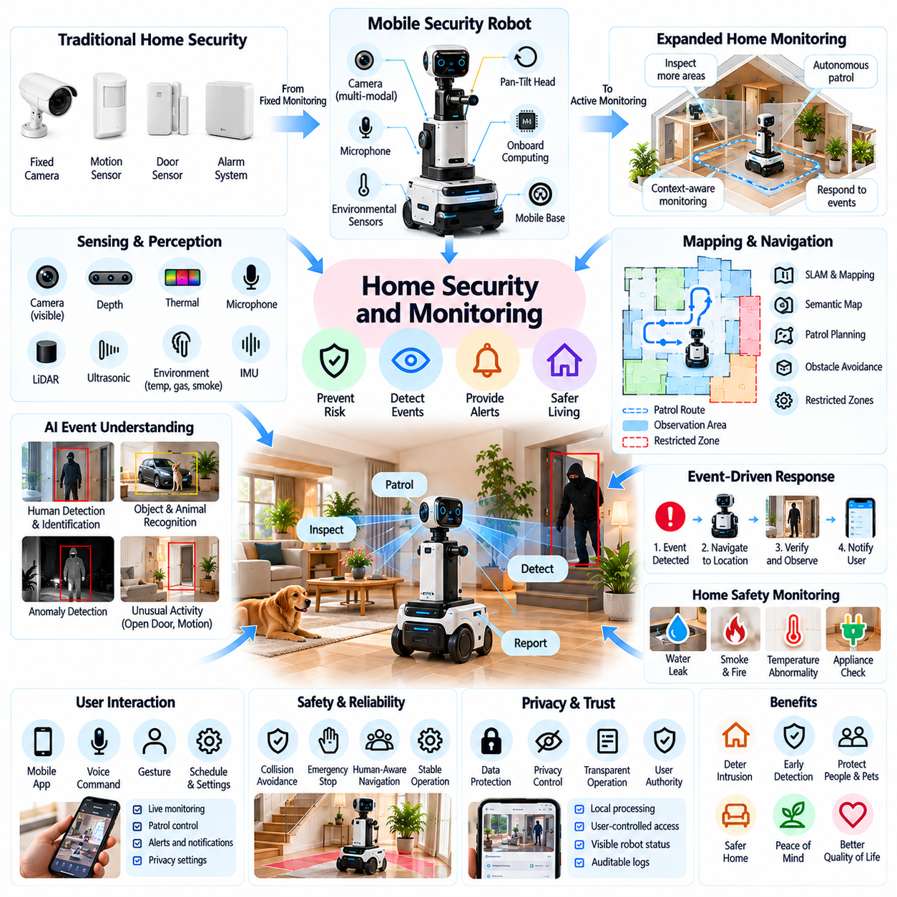{width="7.268055555555556in" height="7.268055555555556in"}

가정 보안 및 모니터링(Home Security and Monitoring)은 기존의 경보 시스템(Alarm System)과 고정형 감시 카메라(Fixed Surveillance Camera)를 넘어 주거 공간의 보호 기능을 확장하는 피지컬 인공지능(Physical AI)의 중요한 응용 분야이다. 지능형 로봇 시스템(Intelligent Robotic System)은 환경 인식(Environmental Perception), 자율 이동(Autonomous Mobility), 이벤트 인식(Event Recognition), 통신(Communication)을 결합하여 변화하는 가정 내 상황을 관찰한다. 주요 목적은 개인정보 보호(Privacy)와 개인의 자율성(Personal Autonomy)을 존중하면서 상황 인식(Situational Awareness)을 향상시키고, 잠재적인 위험(Potential Risk)을 식별하며, 적시에 대응(Timely Response)하도록 지원하는 것이다.

기존의 가정 보안 시스템(Traditional Home Security System)은 고정형 카메라(Stationary Camera), 동작 감지기(Motion Detector), 출입문 센서(Door Sensor), 중앙 집중식 경보 제어기(Centralized Alarm Controller)에 의존한다. 이러한 장치는 사전에 정의된 감시 구역(Predefined Monitoring Zone)에서는 효과적이지만 설치된 감시 범위(Installed Coverage)를 벗어난 영역에 대한 가시성(Visibility)은 제한적이다. 이동형 보안 로봇(Mobile Security Robot)은 센서의 위치를 변경하고, 특정 장소를 점검하며, 비정상적인 이벤트(Unusual Event)가 발생했을 때 추가적인 맥락 정보(Contextual Information)를 수집함으로써 주거 모니터링(Residential Monitoring)의 유연성을 확장할 수 있다.

자율 보안 로봇(Autonomous Security Robot)은 일반적으로 이동 플랫폼(Mobile Platform), 카메라(Camera), 깊이 센서(Depth Sensor), 마이크(Microphone), 환경 센서(Environmental Sensor), 온보드 컴퓨팅 시스템(Onboard Computing System)을 통합한다. 이러한 구성요소는 자율주행(Navigation), 관찰(Observation), 이벤트 분류(Event Classification), 원격 통신(Remote Communication)을 지원한다. 효과적인 시스템 통합(System Integration)을 위해서는 주거 공간에서 신뢰할 수 있는 작동(Reliable Operation)을 보장하도록 센싱 능력(Sensing Capability), 연산 성능(Computational Performance), 배터리 지속시간(Battery Endurance), 물리적 크기(Physical Dimension) 사이의 균형을 유지해야 한다.

환경 지도 작성(Environmental Mapping)은 모니터링 로봇(Monitoring Robot)이 가정 내부 구조(Household Layout)를 이해하고 주요 관찰 지점(Observation Point) 사이를 자율주행하도록 한다. 동시적 위치 추정 및 지도 작성(Simultaneous Localization and Mapping, SLAM)은 외부 위치 신호(External Positioning Signal)를 사용할 수 없는 환경에서도 위치 추정(Position Estimation)과 공간 표현(Spatial Representation)을 지원한다. 의미론적 지도(Semantic Map)는 출입구(Entrance), 창문(Window), 복도(Corridor), 보관 구역(Storage Area), 출입 제한 구역(Restricted Zone)을 식별하여 로봇이 모니터링 작업(Monitoring Task)을 의미 있는 가정 내 위치와 연결하도록 한다.

지능형 인식(Intelligent Perception)은 일상적인 가정 활동(Routine Household Activity)과 잠재적으로 비정상적인 이벤트(Potentially Unusual Event)를 구별한다. 컴퓨터 비전 알고리즘(Computer Vision Algorithm)은 사람의 존재(Human Presence), 움직이는 물체(Moving Object), 열린 문(Open Door), 감시 공간의 예상하지 못한 변화(Unexpected Change)를 인식할 수 있다. 그러나 일상적인 활동도 보안 사고(Security Incident)와 유사하게 나타날 수 있기 때문에 이벤트 해석(Event Interpretation)에는 불확실성(Uncertainty)이 존재한다. 신뢰할 수 있는 시스템은 여러 관측 결과(Multiple Observation)를 결합해야 하며, 개별 감지 결과(Isolated Detection Result)를 위험에 대한 확정적인 증거(Definitive Evidence)로 취급해서는 안 된다.

사람 감지 및 식별(Human Detection and Identification)은 추가적인 기술적·윤리적 고려사항(Technical and Ethical Consideration)을 수반한다. 보안 로봇(Security Robot)은 승인된 식별 방법(Authorized Identification Method)이나 맥락 정보(Contextual Information)를 이용하여 가정 구성원(Household Occupant)과 익숙하지 않은 방문자(Unfamiliar Visitor)를 구별할 수 있다. 인식 성능(Recognition Performance)은 낮은 조도(Poor Lighting), 가려짐(Occlusion), 외형 변화(Changing Appearance)에 따라 저하될 수 있다. 시스템은 불확실성을 명확하게 전달해야 하며, 자동화된 식별(Automated Identification)만을 근거로 중대한 혐의 판단이나 개입(Consequential Accusation or Intervention)을 수행해서는 안 된다.

자율 순찰 기능(Autonomous Patrol Functionality)은 이동형 로봇(Mobile Robot)이 사전에 정의된 경로(Predefined Route) 또는 선택된 구역(Selected Area)을 정해진 간격으로 점검하도록 한다. 순찰 계획(Patrol Planning)은 배터리 가용성(Battery Availability), 자율주행 안전성(Navigation Safety), 가정 내 활동(Household Activity), 관찰 위치의 상대적 중요도(Relative Importance)를 고려해야 한다. 적응형 순찰 전략(Adaptive Patrol Strategy)은 최근 이벤트와 관련된 구역을 우선적으로 점검할 수 있지만, 로봇의 움직임은 예측 가능해야 하며 거주자(Resident)에게 불필요한 방해(Unnecessary Disturbance)를 주지 않아야 한다.

이벤트 기반 모니터링(Event-Driven Monitoring)은 연결된 센서(Connected Sensor)가 비정상적인 상태(Unusual Condition)를 보고할 때 로봇이 대응하도록 한다. 출입문 센서(Door Sensor), 동작 감지기(Motion Detector), 환경 경보(Environmental Alarm)는 추가적인 관찰을 위해 관련 위치로 이동하는 자율주행(Navigation)을 유발할 수 있다. 로봇은 맥락 정보(Contextual Information)를 수집하고 그 결과를 권한을 부여받은 사용자(Authorized User)에게 전달할 수 있다. 이러한 대응은 안전한 작동 규칙(Safe Operating Rule) 내에서 이루어져야 하며, 비상 대피(Emergency Evacuation)나 긴급 대응 인력(Human Responder)의 활동을 방해해서는 안 된다.

가정 모니터링(Home Monitoring)은 침입 감지(Intrusion Detection)를 넘어 환경 안전(Environmental Safety)과 재산 보호(Property Protection)까지 포함한다. 적절한 센서가 장착된 로봇은 누수(Water Leak), 비정상적인 온도(Unusual Temperature), 연기 관련 경보(Smoke-Related Alarm), 잠재적으로 위험한 가전제품 상태(Potentially Unsafe Appliance Condition)의 관찰을 지원할 수 있다. 이러한 기능은 인증된 감지 장치(Certified Detection Device)를 대체하기보다 보완해야 하며, 특히 감지 지연(Delayed Detection)이나 잘못된 감지(Incorrect Detection)가 심각한 위험을 초래할 수 있는 경우 더욱 중요하다.

다중모달 센서 융합(Multimodal Sensor Fusion)은 시각(Visual), 음향(Acoustic), 열(Thermal), 환경 측정(Environmental Measurement)을 결합하여 모니터링 성능을 향상시킨다. 여러 정보원(Information Source)의 데이터는 일상적인 활동과 주의가 필요한 상황(Condition Requiring Attention)을 구별하는 데 도움을 줄 수 있다. 예를 들어 시각적 관찰(Visual Observation)은 출입문 센서 이벤트(Door Sensor Event)에 대한 맥락을 제공할 수 있다. 그러나 센서 간 불일치(Sensor Disagreement)와 데이터 누락(Missing Data)은 잘못된 결론(Misleading Conclusion)이나 불필요한 경보(Unnecessary Alarm)를 방지하도록 명시적으로 처리해야 한다.

인공지능 모델(Artificial Intelligence Model)은 주거 환경 이벤트(Residential Event)에 대한 맥락적 이해(Contextual Understanding)와 자연어 보고(Natural Language Reporting)를 지원할 수 있다. 시각-언어 모델(Vision-Language Model, VLM)은 관찰된 장면(Observed Scene)을 설명하고, 관련 물체(Relevant Object)를 식별하며, 가정 내 상황 변화(Changes in Household Condition)를 요약할 수 있다. 그러나 생성된 설명(Generated Description)에는 오류(Error)나 근거 없는 해석(Unsupported Interpretation)이 포함될 수 있다. 따라서 보안 관련 의사결정(Security-Related Decision)에는 증거 추적(Evidence Tracking), 신뢰도 평가(Confidence Assessment), 적절한 인간 검증(Human Verification)이 필요하다.

이상 탐지(Anomaly Detection)는 사전에 정의된 이벤트 범주(Predefined Event Category)만으로 모든 비정상적인 상황을 포착할 수 없을 때 보완적인 접근 방법을 제공한다. 학습 기반 시스템(Learning-Based System)은 평소 사람이 없는 시간대에 예상하지 못한 움직임이 발생하는 것과 같이 기존의 가정 활동 패턴(Established Household Activity Pattern)에서 벗어나는 상황을 식별할 수 있다. 그러나 비정상적인 행동(Unusual Behavior)이 반드시 위험(Danger)을 의미하는 것은 아니다. 오경보(False Alarm)를 관리하고 과도한 감시(Excessive Surveillance)를 방지하기 위해서는 적응형 임계값(Adaptive Threshold)과 맥락적 검증(Contextual Validation)이 필요하다.

인간-로봇 상호작용(Human-Robot Interaction)은 모니터링 동작(Monitoring Behavior)을 제어하기 위한 명확하고 접근 가능한 수단을 제공해야 한다. 거주자(Resident)는 모바일 애플리케이션(Mobile Application)이나 음성 인터페이스(Voice Interface)를 통해 순찰 일정(Patrol Schedule), 관찰 구역(Observation Zone), 경보 선호도(Alert Preference), 개인정보 보호 제한사항(Privacy Restriction)을 설정할 수 있다. 로봇은 자신의 작동 상태(Operating State)와 예정된 움직임(Intended Movement)을 전달해야 한다. 녹화 활성 상태(Active Recording)를 표시하는 가시적 표시 장치(Visible Indicator)는 거주자가 센싱 기능(Sensing Function)의 작동 여부를 이해하는 데 도움을 줄 수 있다.

원격 모니터링(Remote Monitoring)은 권한을 부여받은 사용자(Authorized User)가 집 밖에서도 경보(Alert)를 수신하고 선택된 관찰 정보(Selected Observation)를 확인하도록 한다. 보안 통신 채널(Secure Communication Channel)은 이벤트 알림(Event Notification), 실시간 영상(Live Video), 제한적인 원격 로봇 제어(Limited Remote Robot Control)를 지원할 수 있다. 원격 작동(Remote Operation)은 지연시간(Latency), 연결성(Connectivity), 접근 제어(Access Control)와 관련된 문제를 발생시킨다. 시스템은 승인되지 않은 명령 실행(Unauthorized Command Execution)을 방지하고 네트워크 통신(Network Communication)이 중단되더라도 안전한 로컬 동작(Safe Local Behavior)을 유지해야 한다.

개인정보 보호(Privacy)는 가정 모니터링(Household Monitoring)이 개인 활동(Personal Activity), 인간관계(Relationship), 일상생활 패턴(Daily Routine), 민감한 생활공간(Sensitive Living Space)을 드러낼 수 있기 때문에 기본적인 설계 요구사항(Design Requirement)이다. 지속적인 녹화(Continuous Recording)는 시스템의 보안상 이점(Security Benefit)을 초과하는 위험을 발생시킬 수 있다. 개인정보 보호 중심 아키텍처(Privacy-Aware Architecture)는 데이터 최소화(Data Minimization), 가능한 경우의 로컬 처리(Local Processing), 설정 가능한 녹화 정책(Configurable Recording Policy), 사적 공간(Private Area)에 대한 모니터링 제한을 우선적으로 적용해야 한다.

사이버보안(Cybersecurity)은 연결형 가정 보안 로봇(Connected Home Security Robot)의 신뢰성(Trustworthiness)에 직접적인 영향을 미친다. 공격자(Attacker)가 카메라, 마이크, 이동 제어 장치(Movement Control), 저장된 지도(Stored Map)에 접근하면 개인정보 보호(Privacy)와 물리적 안전(Physical Safety)이 모두 침해될 수 있다. 보호 조치(Protective Measure)에는 암호화 통신(Encrypted Communication), 안전한 인증(Secure Authentication), 소프트웨어 무결성 검증(Software Integrity Verification), 접근 기록(Access Logging), 적시 취약점 개선(Timely Vulnerability Remediation)이 포함된다. 보안 업데이트(Security Update)는 제품의 지원 수명(Supported Product Lifetime) 전반에 걸쳐 제공되어야 한다.

물리적 안전(Physical Safety)은 모니터링 로봇(Monitoring Robot)이 사람, 반려동물, 가구, 가정 내 장애물(Household Obstacle) 주변에서 작동하기 때문에 여전히 중요하다. 자율 이동(Autonomous Movement)에는 충돌 회피(Collision Avoidance), 속도 제한(Speed Limitation), 안정적인 자율주행(Stable Navigation), 비상 정지(Emergency Stopping)가 통합되어야 한다. 로봇은 침입 의심자(Suspected Intruder)에게 물리적으로 대항하거나 대피하려는 거주자(Occupant)의 이동을 방해해서는 안 된다. 로봇의 주요 역할(Primary Role)은 명확하게 정의된 안전 경계(Safety Boundary) 내에서 관찰(Observation), 통신(Communication), 보조(Assistance)를 수행하는 데 머물러야 한다.

신뢰성(Reliability)은 환경 변화(Environmental Change)와 구성요소의 한계(Component Limitation)에도 불구하고 로봇이 모니터링 기능(Monitoring Function)을 유지하는 능력에 달려 있다. 배터리 잔량 부족(Low Battery Level), 센서 오염(Sensor Contamination), 네트워크 장애(Network Outage), 자율주행 실패(Navigation Failure)는 감시 범위(Monitoring Coverage)를 감소시킬 수 있다. 자율 충전(Autonomous Charging), 고장 감지(Fault Detection), 복구 절차(Recovery Procedure), 투명한 가용성 보고(Transparent Availability Reporting)는 운영 연속성(Operational Continuity)을 향상시킨다. 필수 경보(Essential Alarm)는 하나의 이동 플랫폼(Single Mobile Platform)에만 의존해서는 안 된다.

스마트홈 인프라(Smart-Home Infrastructure)와의 통합은 카메라, 도어록(Door Lock), 조명 시스템(Lighting System), 경보 장치(Alarm Device), 로봇 모니터링 장치(Robotic Monitoring Device) 사이의 협조 기능(Coordination)을 향상시킬 수 있다. 공유된 이벤트 정보(Shared Event Information)는 로봇이 작동한 센서(Triggered Sensor)와 관련된 위치를 점검하도록 지원할 수 있다. 그러나 상호운용성(Interoperability)은 추가적인 의존성(Dependency)과 보안 고려사항(Security Consideration)을 발생시킨다. 접근 권한(Access Permission)은 특히 도어록이나 기타 안전 관련 장치(Safety-Relevant Device)에 영향을 미치는 로봇 동작을 제한해야 한다.

로봇 기반 가정 보안(Robotic Home Security)의 경제적 가치(Economic Value)는 이동성(Mobility)과 맥락적 지능(Contextual Intelligence)이 고정형 모니터링 시스템(Fixed Monitoring System)보다 측정 가능한 이점(Measurable Advantage)을 제공하는지에 달려 있다. 하드웨어 비용(Hardware Cost)에는 자율주행 센서(Navigation Sensor), 컴퓨팅 플랫폼(Computing Platform), 배터리(Battery), 통신 모듈(Communication Module), 유지관리 부품(Maintenance Component)이 포함된다. 제조업체(Manufacturer)는 향상된 감시 범위(Improved Coverage), 유용한 이벤트 검증(Useful Event Verification), 불필요한 경보 발생률 감소(Lower Unnecessary Alarm Rate), 신뢰할 수 있는 서비스 성능(Dependable Service Performance)을 통해 추가적인 복잡성(Additional Complexity)을 정당화해야 한다.

성능 평가(Performance Evaluation)는 감지 정확도(Detection Accuracy), 오경보 빈도(False Alarm Frequency), 모니터링 범위(Monitoring Coverage), 이벤트 대응 시간(Event Response Time), 자율주행 신뢰성(Navigation Reliability), 통신 가용성(Communication Availability)을 검토해야 한다. 개인정보 보호(Privacy Protection)와 사이버보안 복원력(Cybersecurity Resilience)도 동등하게 중요한 평가 항목(Assessment Dimension)이다. 실제 가정환경에서 성능이 신뢰할 수 있는 수준으로 유지되는지 판단하기 위해 변화하는 조명(Changing Lighting), 이동하는 거주자(Moving Occupant), 반려동물(Pet), 가구 재배치(Furniture Rearrangement), 네트워크 중단(Network Interruption)을 포함한 시험이 필요하다.

상업적 배치(Commercial Deployment)는 기존 보안 인프라(Existing Security Infrastructure)를 완전히 대체하기보다 보완적 모니터링(Supplemental Monitoring)에 우선적으로 집중할 수 있다. 이동형 로봇(Mobile Robot)은 특정 위치 점검(Targeted Inspection), 원격 시각 검증(Remote Visual Verification), 선택적인 환경 관찰(Selected Environmental Observation)을 제공할 수 있다. 이러한 접근 방식은 특수 목적의 인증된 경보 장치(Specialized Certified Alarm)가 핵심 감지 기능(Critical Detection Function)에 대한 책임을 유지하도록 하면서, 로봇 시스템이 추가적인 유연성(Flexibility)과 맥락적 상황 인식(Contextual Awareness)을 제공하도록 한다.

미래의 가정 보안 로봇(Future Home Security Robot)은 지속적인 공간 기억(Persistent Spatial Memory), 다중모달 인식(Multimodal Perception), 지능형 이벤트 분석(Intelligent Event Analysis), 연결된 가정용 장치(Connected Household Device)와의 협조 작동(Coordinated Operation)을 결합할 수 있다. 더욱 발전된 시스템은 변화하는 거주 상태(Occupancy Condition)와 환경 조건(Environmental Condition)에 맞추어 모니터링 활동(Monitoring Activity)을 조정할 수 있을 것이다. 이러한 발전을 위해서는 신뢰할 수 있는 인공지능(Trustworthy AI), 투명한 의사결정(Transparent Decision-Making), 안전한 시스템 통합(Secure System Integration), 침해적이거나 과도한 모니터링(Intrusive or Excessive Monitoring)에 대한 강력한 보호 조치가 필요하다.

궁극적으로 가정 보안 및 모니터링(Home Security and Monitoring)은 피지컬 인공지능(Physical AI)이 주거 환경 관찰(Residential Observation)을 적응형 맥락 인식 서비스(Adaptive Context-Aware Service)로 전환할 수 있음을 보여준다. 가장 큰 가치는 인간의 판단(Human Judgment)을 대체하는 것이 아니라 상황 인식(Awareness)을 개선하고 정보에 근거한 인간의 대응(Informed Human Response)을 지원하는 데 있다. 지속 가능한 도입(Sustainable Adoption)은 효과적인 보호(Effective Protection)와 개인정보 보호(Privacy), 사이버보안(Cybersecurity), 물리적 안전(Physical Safety), 신뢰성(Reliability), 경제성(Affordability), 가정 구성원의 권리(Rights of Household Occupants) 사이의 균형에 달려 있다.

## 07.09. Natural Language and Multimodal Interaction

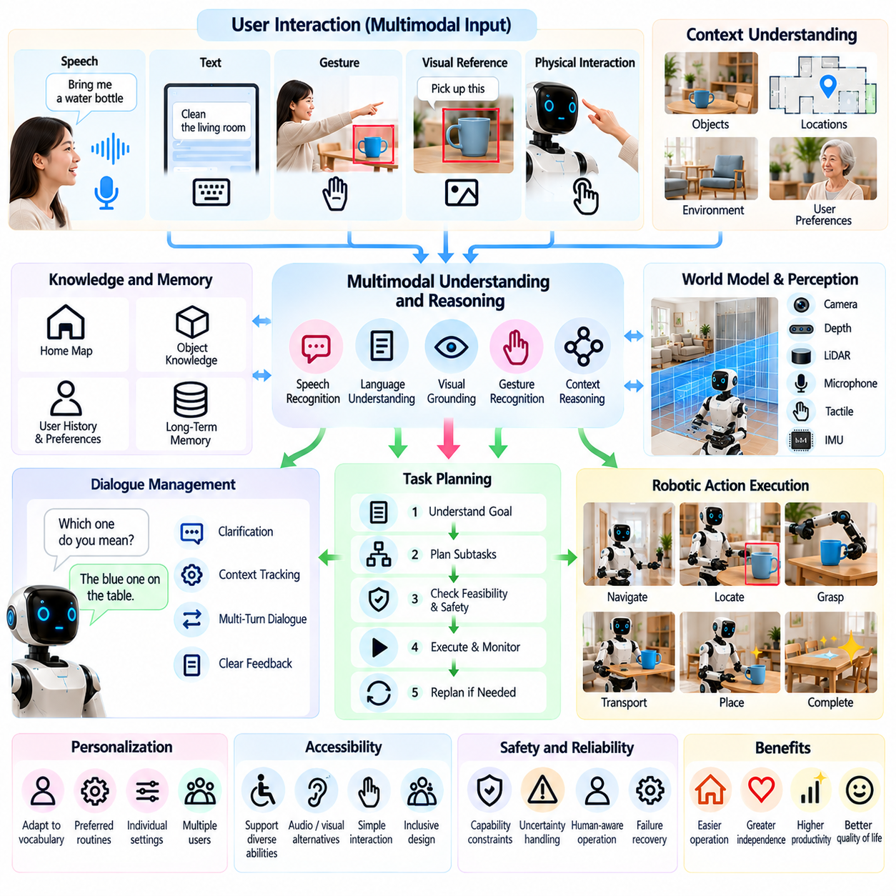{width="7.268055555555556in" height="7.268055555555556in"}

자연어 및 다중모달 상호작용(Natural Language and Multimodal Interaction)은 소비자 및 가정환경(Consumer and Home Environment)에서 피지컬 인공지능(Physical AI)을 구현하기 위한 핵심 기능이다. 이러한 기술은 사용자가 전문적인 프로그래밍 인터페이스(Specialized Programming Interface) 대신 음성(Speech), 텍스트(Text), 제스처(Gesture), 시각적 참조(Visual Reference), 물리적 행동(Physical Action)을 통해 로봇과 의사소통하도록 한다. 인간의 의도(Human Intention)를 환경 인식(Environmental Perception) 및 로봇 실행(Robotic Execution)과 연결함으로써 지능형 가정 시스템(Intelligent Home System)의 접근성(Accessibility), 유연성(Flexibility), 반응성(Responsiveness)을 향상시킨다.

자연어 상호작용(Natural Language Interaction)은 사용자가 물체 가져오기(Object Retrieval), 방 청소(Room Cleaning), 가정 내 상태 확인(Household Condition Checking)과 같은 목표를 일상적인 명령(Everyday Instruction)으로 표현하도록 한다. 고정형 명령 인터페이스(Fixed Command Interface)와 달리 언어 기반 시스템(Language-Based System)은 동일한 의도를 나타내는 다양한 표현을 해석해야 한다. 효과적인 자연어 이해(Natural Language Understanding)를 위해서는 사용자 목표(User Goal)를 인식하고, 관련 물체(Relevant Object)를 식별하며, 모호성(Ambiguity)을 해결하고, 명령을 실행 가능한 로봇 작업(Executable Robotic Task)으로 변환해야 한다.

음성 인식(Speech Recognition)은 음성 명령(Spoken Command)을 통해 손을 사용하지 않고도 로봇을 조작할 수 있기 때문에 가정용 로봇(Household Robot)의 주요 의사소통 채널(Communication Channel)을 제공한다. 자동 음성 인식(Automatic Speech Recognition, ASR)은 음향 신호(Acoustic Signal)를 텍스트 또는 구조화된 표현(Structured Representation)으로 변환하여 후속 처리를 가능하게 한다. 그러나 가정 내 소음(Household Noise), 텔레비전 음향(Television Audio), 중첩된 대화(Overlapping Conversation), 억양(Accent), 마이크 배치(Microphone Placement)는 인식 정확도(Recognition Accuracy)를 저하시킬 수 있으므로 견고한 음향 처리(Robust Acoustic Processing)와 불확실성 관리(Uncertainty Handling)가 필요하다.

자연어 이해(Natural Language Understanding)는 개별 단어를 인식하는 수준을 넘어 맥락적 의미(Contextual Meaning)를 해석하는 과정까지 포함한다. 다른 방에 있는 물건을 가져오라는 요청(Request)은 의도된 물체(Intended Object), 목적지(Destination), 관련 제약조건(Relevant Constraint)을 식별해야 한다. 언어 모델(Language Model)은 대화 이력(Conversation History)과 환경 관측(Environmental Observation)을 활용하여 지시 대상(Reference)을 명확하게 할 수 있지만, 해석이 불확실한 경우에는 근거 없는 가정(Unsupported Assumption)을 하기보다 명확화 질문(Clarification)을 수행해야 한다.

다중모달 상호작용(Multimodal Interaction)은 언어 정보(Linguistic Information)를 시각적 관측(Visual Observation), 공간 정보(Spatial Information), 청각 정보(Auditory Information), 촉각 관측(Tactile Observation)과 결합한다. 사용자가 짧은 명령을 말하면서 특정 물체를 가리키는 경우 로봇은 제스처(Gesture)를 올바른 물리적 대상(Physical Target)과 연결해야 한다. 이러한 과정에는 동기화된 인식(Synchronized Perception), 좌표 변환(Coordinate Transformation), 맥락적 추론(Contextual Reasoning)이 필요하며, 이를 통해 인간의 의사소통을 주변 환경의 물체 및 행동과 연결한다.

시각-언어 모델(Vision-Language Model, VLM)은 자연어 명령(Natural Language Instruction)과 시각적 관측(Visual Observation)을 연결하는 기반을 제공한다. 이러한 모델은 외형으로 설명된 물체(Object Described by Appearance)를 식별하고, 공간적 관계(Spatial Relationship)를 해석하며, 눈에 보이는 가정 내 장면(Household Scene)에 관한 질문에 답할 수 있다. 그러나 물체가 부분적으로 가려져 있거나(Partially Hidden), 외형이 유사하거나(Visually Similar), 로봇의 현재 시야(Field of View) 밖에 있는 경우 시각적 접지(Visual Grounding)가 어려워지므로 추가적인 센싱(Additional Sensing)이나 명확화(Clarification)가 필요하다.

시각-언어-행동 모델(Vision-Language-Action Model, VLA)은 다중모달 이해(Multimodal Understanding)를 물리적 작업 실행(Physical Task Execution)으로 확장한다. 이러한 모델은 시각 입력(Visual Input)과 언어 명령(Language Instruction)을 로봇의 이동 및 조작(Robotic Movement and Manipulation)을 안내할 수 있는 행동 표현(Action Representation)과 연결한다. 이러한 모델은 유연한 작업 일반화(Flexible Task Generalization)의 가능성을 제공하지만, 출력 행동(Output Action)은 로봇의 능력(Robot Capability), 충돌 회피(Collision Avoidance), 독립적으로 검증된 안전 요구사항(Independently Verified Safety Requirement)에 의해 제한되어야 한다.

제스처 인식(Gesture Recognition)은 음성 사용이 불편하거나 충분하지 않은 상황에서 직관적인 의사소통 수단(Intuitive Communication Mechanism)을 제공한다. 손가락으로 가리키기(Hand Pointing), 손 흔들기(Waving), 신체 방향(Body Orientation), 특정 움직임(Selected Movement)은 명령을 전달하거나 목표 위치(Target Location)를 지정할 수 있다. 신뢰할 수 있는 해석(Reliable Interpretation)은 카메라 위치(Camera Positioning), 가시성(Visibility), 개인별 움직임 차이(Individual Movement Difference), 문화적 관습(Cultural Convention)에 영향을 받는다. 시스템은 모호한 제스처(Ambiguous Gesture)만을 근거로 잠재적으로 위험한 행동(Potentially Hazardous Action)을 실행하지 않아야 한다.

대화 관리(Dialogue Management)는 여러 차례의 대화(Multiple Conversational Turns)가 필요한 상호작용을 지원한다. 가정용 로봇(Household Robot)은 사용자가 의도한 물체를 질문하거나, 목적지를 확인하거나, 요청된 행동을 완료할 수 없는 이유를 설명할 수 있다. 대화 맥락(Dialogue Context)을 유지하면 후속 명령(Follow-Up Instruction)을 이전 요청(Earlier Request)과 연결할 수 있다. 효과적인 대화(Effective Dialogue)는 간결하고 이해하기 쉬워야 하며, 로봇의 실제 능력(Actual Capability)과 일치해야 한다.

작업 계획(Task Planning)은 해석된 의도(Interpreted Intention)를 일련의 물리적 작업(Physical Operation)으로 변환한다. 방을 정리하라는 요청은 여러 위치로 이동하고, 물체를 식별하며, 물품을 조작하고, 완료 조건(Completion Condition)을 확인하는 과정을 요구할 수 있다. 계층적 계획(Hierarchical Planning)은 이러한 행동을 관리 가능한 하위 작업(Manageable Subtask)으로 구성하며, 실행 모니터링(Execution Monitoring)은 예상하지 못한 결과(Unexpected Outcome)를 감지하고 환경이 변화할 때 재계획(Replanning)을 지원한다.

언어를 물리적 세계에 접지하는 과정(Language Grounding in the Physical World)은 가정 내 명령(Household Instruction)에 암묵적인 가정(Implicit Assumption)이 자주 포함되기 때문에 특히 중요하다. 물체를 가까운 곳에 놓거나 방해되지 않도록 이동하라는 표현은 공간적 맥락(Spatial Context)과 사용자 선호도(User Preference)에 따라 의미가 달라진다. 로봇은 텍스트 기반 추론(Textual Reasoning)에만 의존하지 않고 언어적 개념(Linguistic Concept)을 측정 가능한 위치(Measurable Location), 물체 속성(Object Property), 물리적 제약조건(Physical Constraint)과 연결해야 한다.

개인화(Personalization)는 개인별 어휘(Individual Vocabulary), 선호 언어(Preferred Language), 발화 패턴(Speaking Pattern), 상호작용 습관(Interaction Habit)에 적응함으로써 의사소통을 개선할 수 있다. 로봇은 자주 사용하는 물체 이름(Commonly Used Object Name)이나 선호하는 확인 방식(Preferred Form of Confirmation)을 학습할 수 있다. 그러나 개인화는 설정 가능(Configurable)해야 하며, 명시적인 명령(Explicit Instruction)을 사용자에게 알리지 않고 변경해서는 안 된다. 가정용 시스템(Household System)은 여러 사용자(Multiple User)를 구별하고 서로 다른 접근 권한(Access Permission)을 존중해야 한다.

접근성(Accessibility)은 사용자의 감각 능력(Sensory Capability), 인지 능력(Cognitive Capability), 신체 능력(Physical Capability)이 서로 다르기 때문에 다중모달 상호작용(Multimodal Interaction)의 주요 장점이다. 음성 인터페이스(Speech Interface)는 손의 이동 능력(Hand Mobility)이 제한된 사용자를 지원할 수 있으며, 시각적 피드백(Visual Feedback)이나 촉각 피드백(Tactile Feedback)은 청각 정보(Audio)에 의존하기 어려운 사용자를 지원할 수 있다. 효과적인 시스템은 대체 상호작용 채널(Alternative Interaction Channel), 조정 가능한 피드백(Adjustable Feedback), 의사소통 실패(Communication Failure) 시 간단한 복구 절차(Straightforward Recovery Procedure)를 제공해야 한다.

상호작용 지연시간(Interaction Latency)은 사용자가 인식하는 반응성(Perceived Responsiveness)과 사용성(Usability)에 직접적인 영향을 미친다. 음성 처리(Speech Processing), 시각적 해석(Visual Interpretation), 언어 모델 추론(Language-Model Inference), 로봇 작업 계획(Robotic Planning)은 연산 지연(Computational Delay)을 발생시킨다. 엣지 컴퓨팅(Edge Computing)은 원격 연결(Remote Connection)에 대한 의존성을 줄일 수 있으며, 클라우드 서비스(Cloud Service)는 더 큰 모델(Larger Model)에 대한 접근을 제공할 수 있다. 하이브리드 아키텍처(Hybrid Architecture)는 응답 품질(Response Quality), 개인정보 보호(Privacy), 에너지 소비(Energy Consumption), 네트워크 가용성(Network Availability), 실시간 안전 제약조건(Real-Time Safety Constraint) 사이의 균형을 유지해야 한다.

불확실성 관리(Uncertainty Management)는 로봇이 개방형 인간 명령(Open-Ended Human Instruction)을 해석할 때 필수적이다. 모호한 언어(Ambiguous Language), 불완전한 관측(Incomplete Observation), 상충하는 센서 정보(Conflicting Sensor Information)는 잘못된 작업 해석(Incorrect Task Interpretation)을 초래할 수 있다. 시스템은 신뢰도(Confidence)를 추정하고 필요한 경우 명확화 질문(Clarification Request)을 수행하며, 불확실한 상황에서 되돌릴 수 없는 행동(Irreversible Action)을 피해야 한다. 오해(Misunderstanding)로 발생할 수 있는 결과가 심각할수록 확인 요구사항(Confirmation Requirement)을 강화해야 한다.

안전 인식형 상호작용(Safety-Aware Interaction)은 대화형 지능(Conversational Intelligence)과 안전 필수 운동 제어(Safety-Critical Motion Control)를 분리하도록 요구한다. 언어 모델(Language Model)이 행동(Action)을 제안할 수는 있지만, 독립적인 제어 계층(Independent Control Layer)은 작업공간 제약조건(Workspace Constraint), 물리적 실행 가능성(Physical Feasibility), 작동 권한(Operational Permission)을 검증해야 한다. 비상 정지(Emergency Stopping)와 수동 제어 전환(Manual Override)은 대화 상태(Dialogue State)와 관계없이 항상 사용 가능해야 한다. 음성 요청(Spoken Request)이 기존의 안전 제한사항(Established Safety Restriction)을 우회하도록 허용해서는 안 된다.

개인정보 보호(Privacy) 문제는 다중모달 로봇(Multimodal Robot)이 음성(Speech), 카메라 영상(Camera Image), 개인의 일상생활 패턴(Personal Routine), 가정 내 대화(Household Conversation)를 처리할 수 있기 때문에 발생한다. 지속적인 센싱(Continuous Sensing)은 시스템과 직접 상호작용하지 않은 거주자(Occupant)의 정보까지 노출할 수 있다. 책임 있는 아키텍처(Responsible Architecture)는 불필요한 녹화(Unnecessary Recording)를 최소화하고, 저장된 데이터(Stored Data)를 보호하며, 명확한 마이크 및 카메라 상태 표시 장치(Microphone and Camera Indicator)를 제공하고, 이해하기 쉬운 동의 절차(Consent Procedure)와 접근 제어(Access Control)를 지원해야 한다.

신뢰할 수 있는 의사소통(Trustworthy Communication)을 위해서는 로봇이 자신의 능력(Capability)과 한계(Limitation)를 정확하게 설명해야 한다. 시스템은 관측(Observation), 예측(Prediction), 불확실한 해석(Uncertain Interpretation)을 구별해야 하며, 생성된 설명(Generated Explanation)을 검증된 사실(Verified Fact)처럼 제시해서는 안 된다. 작업이 실패한 경우 로봇은 실제 결과(Actual Outcome)를 보고하고 의미 있는 복구 선택지(Meaningful Recovery Option)를 제공해야 한다. 투명한 의사소통(Transparent Communication)은 현실적인 기대(Realistic Expectation)를 형성하고 자동화(Automation)에 대한 안전하지 않은 의존(Unsafe Reliance)을 줄인다.

상호작용 기반 학습(Learning from Interaction)은 시간이 지남에 따라 언어 접지(Language Grounding)와 작업 실행(Task Execution)을 개선할 수 있다. 사용자 수정(User Correction), 성공적인 시연(Successful Demonstration), 작업 피드백(Task Feedback)은 선호하는 물체(Preferred Object), 행동(Behavior), 작동 조건(Operating Condition)에 관한 정보를 제공한다. 이러한 학습에는 오류의 우발적인 강화(Accidental Reinforcement of Errors)를 방지하기 위한 신중한 데이터 거버넌스(Data Governance)와 검증(Validation)이 필요하다. 업데이트(Update)는 안전 제약조건(Safety Constraint)을 유지해야 하며, 사용자가 부적절한 적응(Inappropriate Adaptation)을 수정할 수 있도록 해야 한다.

다중모달 상호작용 평가(Evaluation of Multimodal Interaction)는 음성 인식 정확도(Speech Recognition Accuracy)나 언어 모델 성능(Language-Model Performance)만을 검토해서는 안 된다. 관련 평가 지표(Evaluation Metric)에는 명령 이해(Instruction Understanding), 물체 접지(Object Grounding), 명확화 효과성(Clarification Effectiveness), 작업 완료(Task Completion), 응답 지연시간(Response Latency), 사용자 개입 빈도(User Intervention Frequency), 안전 성과(Safety Outcome)가 포함된다. 시험(Testing)은 소음이 있는 방(Noisy Room), 여러 화자(Multiple Speaker), 모호한 요청(Ambiguous Request), 변화하는 환경(Changing Environment), 다양한 의사소통 능력(Diverse Communication Ability)을 가진 사용자를 포함해야 한다.

상업적 도입(Commercial Adoption)은 자연스러운 상호작용(Natural Interaction)이 가정용 로봇(Household Robot)을 작동하는 데 필요한 노력(Operational Effort)을 얼마나 줄이는지에 달려 있다. 소비자(Consumer)는 광범위한 학습(Extensive Training)이나 복잡한 설정(Complicated Configuration) 없이 시스템이 실용적인 요청(Practical Request)을 이해하기를 기대한다. 제조업체(Manufacturer)는 모델 능력(Model Capability)을 연산 비용(Computational Cost), 에너지 효율(Energy Efficiency), 유지관리(Maintenance), 소프트웨어 신뢰성(Software Reliability)과 균형 있게 조정해야 한다. 일상생활에서의 일관된 성능(Consistent Everyday Performance)은 인상적이지만 신뢰할 수 없는 시연(Impressive but Unreliable Demonstration)보다 더 높은 가치를 가지는 경우가 많다.

미래의 가정용 로봇(Future Household Robot)은 지속적인 공간 기억(Persistent Spatial Memory), 대화형 추론(Conversational Reasoning), 다중모달 인식(Multimodal Perception), 적응형 조작(Adaptive Manipulation)을 통합된 상호작용 아키텍처(Unified Interaction Architecture) 안에서 결합할 수 있다. 사용자는 음성(Speech), 가리키기(Pointing), 시연(Demonstration), 맥락적 참조(Contextual Reference)를 조합하여 목표를 지정할 수 있을 것이다. 이러한 유연성(Flexibility)을 실현하려면 향상된 접지(Grounding), 효율적인 추론(Efficient Inference), 견고한 대화 관리(Robust Dialogue Management), 변화하는 가정환경에서의 신뢰할 수 있는 실행(Dependable Execution)이 필요하다.

궁극적으로 자연어 및 다중모달 상호작용(Natural Language and Multimodal Interaction)은 실용적인 가정용 피지컬 인공지능(Home Physical AI)을 위한 의사소통 기반(Communication Foundation)을 제공한다. 그 목적은 단순히 로봇이 대화하도록 만드는 것이 아니라 인간의 의도(Human Intention)를 안전하고 유용한 물리적 행동(Safe and Useful Physical Behavior)과 연결하는 데 있다. 지속 가능한 발전(Sustainable Progress)은 언어 이해(Language Understanding), 환경 접지(Environmental Grounding), 접근 가능한 설계(Accessible Design), 불확실성 관리(Uncertainty Management), 개인정보 보호(Privacy Protection), 신뢰할 수 있는 작업 실행(Reliable Task Execution)을 일관된 인간 중심 시스템(Coherent Human-Centered System)으로 통합하는 데 달려 있다.

## 07.10. Personalization and User Adaptation

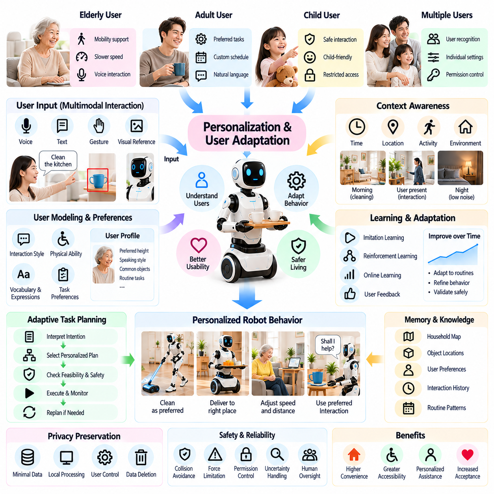{width="7.268055555555556in" height="7.268055555555556in"}

개인화 및 사용자 적응(Personalization and User Adaptation)은 개인의 선호도(Individual Preferences), 가정 내 생활 패턴(Household Routines), 신체적 능력(Physical Abilities)이 크게 달라지는 소비자 및 가정환경(Consumer and Home Environments)에서 피지컬 인공지능(Physical AI)을 구현하기 위한 핵심 기능이다. 표준화된 조건(Standardized Conditions)에서 작동하는 산업용 로봇(Industrial Robot)과 달리 가정용 로봇(Home Robot)은 다양한 사용자와 변화하는 상황에 맞추어 행동을 조정해야 한다. 효과적인 개인화(Effective Personalization)는 안전성(Safety)을 저해하지 않으면서 사용성(Usability), 작업 적합성(Task Relevance), 접근성(Accessibility), 장기적인 수용성(Long-Term Acceptance)을 향상시킨다.

개인화(Personalization)는 선호하는 상호작용 방식(Preferred Interaction Method), 청소 일정(Cleaning Schedule), 물체 위치(Object Location), 보조 요구사항(Assistance Requirement) 등 사용자 선호도(User Preference)를 이해하는 것에서 시작한다. 이러한 선호도는 명시적으로 설정(Explicit Configuration)하거나 반복적인 상호작용(Repeated Interaction)을 통해 점진적으로 추론할 수 있다. 그러나 추론된 선호도(Inferred Preference)는 확인된 명령(Confirmed Instruction)과 구별되어야 한다. 사용자는 자신의 요구사항이나 기대가 변화할 때 언제든지 개인화 설정(Personalized Setting)을 확인하고 수정하거나 삭제할 수 있어야 한다.

사용자 모델링(User Modeling)은 로봇 보조(Robotic Assistance)와 관련된 개인의 특성(Individual Characteristics)을 구조화하여 표현한다. 이러한 모델에는 의사소통 선호도(Communication Preference), 이동 능력의 제약(Mobility Limitation), 습관적인 활동(Habitual Activity), 선호하는 작업 결과(Preferred Task Outcome) 등이 포함될 수 있다. 실용적인 사용자 모델(Practical User Model)은 유용한 적응(Useful Adaptation)에 필요한 정보만 포함해야 한다. 과도한 사용자 프로파일링(Excessive Profiling)은 개인정보 보호 위험(Privacy Risk)을 증가시키고 로봇의 의사결정(Robotic Decision)에 부정적인 영향을 미치는 부정확한 가정(Inaccurate Assumption)을 유발할 수 있다.

맥락 인식형 적응(Context-Aware Adaptation)은 시간(Time), 위치(Location), 활동(Activity), 환경 조건(Environmental Condition)에 따라 로봇의 행동을 조정하도록 한다. 청소 로봇(Cleaning Robot)은 수면 시간(Sleeping Hours)에 작동 소음(Operating Noise)을 줄일 수 있으며, 서비스 로봇(Service Robot)은 가정 구성원이 있는 경우 이동 경로(Navigation Route)를 변경할 수 있다. 맥락적 추론(Contextual Reasoning)에는 신뢰할 수 있는 센싱(Reliable Sensing)과 명시적인 작동 제약조건(Explicit Operating Constraint)이 필요하다. 추론된 상황(Inferred Circumstance)이 항상 사용자의 실제 의도(Actual User Intention)를 나타내는 것은 아니기 때문이다.

가정 내 생활 패턴 학습(Household Routine Learning)은 작업 일정 계획(Task Scheduling)과 자원 할당(Resource Allocation)을 개선할 수 있다. 로봇은 청소 요구사항(Cleaning Requirement), 물체 사용(Object Usage), 선호하는 배송 시간(Preferred Delivery Time)에서 반복적으로 나타나는 패턴(Recurring Pattern)을 식별할 수 있다. 예측 기반 일정 계획(Predictive Scheduling)은 불필요한 상호작용(Unnecessary Interaction)을 줄이고 편의성(Convenience)을 향상시킬 수 있지만, 자동화된 생활 패턴(Automated Routine)은 언제든지 취소하거나 되돌릴 수 있어야 한다. 예상하지 못한 행동 변화(Unexpected Behavior Change)로 인해 로봇이 사생활을 침해하거나 방해가 되거나 잠재적으로 위험한 행동을 수행해서는 안 된다.

자연어 개인화(Natural Language Personalization)는 로봇이 익숙한 표현(Familiar Expression), 선호하는 어휘(Preferred Vocabulary), 개인별 의사소통 방식(Individual Communication Style)을 인식하도록 한다. 사용자는 가정 내 물체(Household Object)를 비공식적인 이름(Informal Name)으로 부르거나 축약된 표현(Abbreviated Phrase)으로 명령할 수 있다. 언어 모델(Language Model)은 이러한 표현을 알려진 물체(Known Object) 및 작업(Task)과 연결할 수 있다. 그러나 모호한 지시(Ambiguous Reference)에 대해서는 여전히 명확화(Clarification)가 필요하며, 특히 오해(Misunderstanding)가 물리적 손상(Physical Damage)이나 안전하지 않은 움직임(Unsafe Movement)을 초래할 수 있는 경우 더욱 중요하다.

다중모달 적응(Multimodal Adaptation)은 개인화를 음성(Speech)에서 제스처(Gesture), 시각적 단서(Visual Cue), 터치 인터페이스(Touch Interface), 물리적 상호작용 패턴(Physical Interaction Pattern)으로 확장한다. 로봇은 사용자가 선호하는 가리키기 제스처(Pointing Gesture)나 인터페이스 설정(Interface Setting)에 맞추어 반응을 조정할 수 있다. 여러 의사소통 채널(Multiple Communication Channel)을 지원하면 서로 다른 능력을 가진 사용자의 접근성(Accessibility)이 향상된다. 적응 시스템(Adaptive System)은 일시적인 행동 변화(Temporary Behavior Change)를 영구적인 사용자 선호도(Permanent User Preference)로 가정하지 않아야 한다.

물리적 보조(Physical Assistance)에는 이동 속도(Movement Speed), 상호작용 거리(Interaction Distance), 물체 배치(Object Placement), 조작 힘(Manipulation Force)에 대한 개인화가 필요하다. 이동형 보조 로봇(Mobile Assistant)은 천천히 접근하거나 개별 사용자에게 적합한 높이(Suitable Height)로 물체를 전달할 수 있다. 이러한 조정은 편안함(Comfort)과 사용성(Usability)을 향상시킬 수 있지만, 검증된 기계적 한계(Verified Mechanical Limit)와 안전 한계(Safety Limit) 내에서 이루어져야 한다. 학습된 선호도(Learned Preference)가 충돌 회피(Collision Avoidance)나 힘 제한(Force Restriction)을 무시하도록 허용해서는 안 된다.

다중 사용자 가정(Multi-User Household)에서는 가족 구성원(Family Member), 방문자(Visitor), 돌봄 제공자(Caregiver) 사이에 선호도(Preference)와 권한(Permission)이 다를 수 있기 때문에 새로운 문제가 발생한다. 로봇은 불필요한 생체정보(Biometric Information)를 수집하지 않으면서 권한이 부여된 사용자(Authorized User)를 구별해야 한다. 상충하는 요청(Conflicting Request)에 대해서는 투명한 우선순위 규칙(Transparent Priority Rule)과 적절한 확인(Appropriate Confirmation)이 필요하다. 개인화 시스템(Personalization System)은 한 사용자의 선호도가 다른 사람의 개인정보 보호(Privacy)나 안전 요구사항(Safety Requirement)을 알리지 않고 무시하지 않도록 해야 한다.

적응형 작업 계획(Adaptive Task Planning)은 사용자 선호도(User Preference)를 로봇 의사결정(Robotic Decision-Making)과 연결한다. 로봇은 대상 사용자(Intended User)에 따라 서로 다른 청소 순서(Cleaning Sequence), 물품 전달 위치(Delivery Location), 상호작용 방식(Interaction Method)을 선택할 수 있다. 작업 계획 시스템(Planning System)은 개인화된 목표(Personalized Objective)를 환경 제약조건(Environmental Constraint) 및 작업 실행 가능성(Task Feasibility)과 결합해야 한다. 성공적인 적응(Successful Adaptation)을 위해서는 이전에 선호했던 행동이 여전히 적절하다고 가정하지 않고 실제 결과(Actual Outcome)를 모니터링해야 한다.

온라인 학습(Online Learning)은 지속적인 작동(Continued Operation)과 사용자 피드백(User Feedback)을 통해 로봇의 행동을 개선하도록 한다. 수정 지시(Correction), 시연(Demonstration), 작업 완료 기록(Task Completion Record)은 유용한 적응 신호(Adaptation Signal)를 제공할 수 있다. 그러나 제한 없는 학습(Unrestricted Learning)은 불안정한 행동(Unstable Behavior)을 유발하거나 잘못된 패턴(Incorrect Pattern)을 강화할 수 있다. 안전한 시스템(Safe System)은 제안된 변경사항(Proposed Change)을 검증하고, 시험된 제어 정책(Tested Control Policy)을 유지하며, 성공적이지 못한 적응(Unsuccessful Adaptation)을 이전 상태로 되돌리는 기능(Reversion Mechanism)을 제공해야 한다.

강화학습(Reinforcement Learning)과 모방학습(Imitation Learning)은 개인화된 로봇 행동(Personalized Robotic Behavior)을 구현하기 위한 상호 보완적인 접근 방법(Complementary Approach)을 제공한다. 시연(Demonstration)은 선호하는 행동(Preferred Action)을 설정할 수 있으며, 신중하게 제약된 피드백 기반 최적화(Constrained Feedback-Based Optimization)는 작업 실행(Task Execution)을 개선할 수 있다. 학습 과정(Training Process)은 제한적인 가정 내 데이터(Limited Household Data)와 사용자 간 차이(User Variation)를 고려해야 한다. 시뮬레이션(Simulation)과 오프라인 평가(Offline Evaluation)는 업데이트된 행동(Updated Behavior)을 실제 물리적 환경(Physical Environment)에 배포하기 전에 위험을 줄일 수 있다.

장기 기억(Long-Term Memory)은 관련 선호도(Relevant Preference), 작업 이력(Task History), 환경 정보(Environmental Information)를 보존함으로써 반복적인 상호작용(Repeated Interaction)에서 연속성(Continuity)을 지원한다. 공간 기억(Spatial Memory)은 자주 사용하는 보관 위치(Frequently Used Storage Location)를 기록할 수 있으며, 상호작용 기억(Interaction Memory)은 선호하는 확인 방식(Preferred Confirmation Method)을 유지할 수 있다. 기억 시스템(Memory System)은 안정적인 선호도(Stable Preference)를 일시적인 명령(Temporary Instruction)이나 오래된 관측 정보(Outdated Observation)와 구별해야 한다. 데이터 보존 기간(Retention Period)과 삭제 제어 기능(Deletion Control)은 사용자가 이해하기 쉬워야 한다.

개인정보 보호형 개인화(Privacy-Preserving Personalization)는 가정 내 적응(Household Adaptation)이 일상생활 일정(Daily Schedule), 건강 관련 제약(Health-Related Limitation), 인간관계(Relationship), 사적인 활동(Private Activity)을 드러낼 수 있기 때문에 특히 중요하다. 엣지 처리(Edge Processing)는 민감한 관측 정보(Sensitive Observation)가 원격 서비스(Remote Service)로 불필요하게 전송되는 것을 줄일 수 있다. 데이터 최소화(Data Minimization), 암호화(Encryption), 접근 제어(Access Control), 명확한 데이터 보존 정책(Clear Retention Policy)은 개인화 과정을 관리해야 한다. 사용자는 어떤 정보가 저장되는지, 그리고 그 이유가 무엇인지 이해할 수 있어야 한다.

투명성(Transparency)은 사용자가 적응형 로봇 행동(Adaptive Robotic Behavior)에 대해 적절한 기대(Appropriate Expectation)를 형성하도록 한다. 로봇은 가정 내 생활 패턴(Household Routine)에 영향을 미치는 일정 계획(Scheduling), 자율주행(Navigation), 작업 실행(Task Execution)의 중요한 변경사항을 설명해야 한다. 사용자는 특정 의사결정(Decision)이 명시적인 설정(Explicit Setting), 학습된 선호도(Learned Preference), 즉각적인 환경 관측(Immediate Environmental Observation) 중 무엇에서 비롯되었는지 식별할 수 있어야 한다. 명확한 설명(Clear Explanation)은 예상하지 못한 행동(Unexpected Behavior)을 더 쉽게 수정하도록 한다.

인간의 제어권(Human Control)은 로봇의 자율성(Autonomy)이 점차 높아지더라도 기본적으로 유지되어야 한다. 개인화(Personalization)는 설정 가능한 자율성 수준(Configurable Autonomy Level), 확인 요구사항(Confirmation Requirement), 수동 제어 전환 옵션(Manual Override Option)을 제공해야 한다. 사용자는 일상적인 청소(Routine Cleaning)에는 자동 실행(Automatic Execution)을 선호하면서도 귀중품(Valuable Object)을 이동할 때는 명시적인 승인(Explicit Approval)을 요구할 수 있다. 이러한 구분은 필수 안전 보호 조치(Mandatory Safety Protection)를 약화시키지 않으면서 자동화(Automation)가 개인의 수용 수준(Individual Comfort Level)을 반영하도록 한다.

신뢰성(Reliability)은 개인화된 행동(Personalized Behavior)이 사용자와 환경에 따라 달라질 때 확보하기가 더욱 어려워진다. 적응(Adaptation)은 초기 시험(Initial Testing)에서 충분히 검토되지 않은 상호작용(Interaction)을 발생시킬 수 있다. 실행 중 모니터링(Runtime Monitoring), 행동 제약조건(Behavioral Constraint), 체계적인 검증(Systematic Validation)은 안전하지 않은 변화(Unsafe Change)를 감지하는 데 필요하다. 소프트웨어 업데이트(Software Update)는 필수적인 선호도(Essential Preference)를 유지하면서 변경된 모델(Revised Model), 센서(Sensor), 제어 시스템(Control System)과의 호환성(Compatibility)을 검증해야 한다.

접근성 중심 적응(Accessibility-Oriented Adaptation)은 서로 다른 감각 능력(Sensory Capability), 인지 능력(Cognitive Capability), 신체 능력(Physical Capability)을 가진 사용자를 지원할 수 있다. 조정 가능한 음성 속도(Adjustable Speech Speed), 인터페이스 복잡도(Interface Complexity), 알림 방식(Notification Method), 보조 수준(Assistance Level)은 실질적인 사용성(Practical Usability)을 향상시킬 수 있다. 그러나 적응 시스템(Adaptive System)은 과도한 개입(Excessive Intervention)을 통해 사용자 자율성(User Autonomy)을 감소시키지 않아야 한다. 포용적 설계(Inclusive Design)를 위해서는 추론된 능력 프로파일(Inferred Capability Profile)에 전적으로 의존하기보다 다양한 사용자(Diverse User)로부터 직접적인 피드백(Direct Feedback)을 수집해야 한다.

개인화 평가(Evaluation of Personalization)는 적응(Adaptation)이 일상적인 작동(Everyday Operation)에서 의미 있는 개선(Meaningful Improvement)을 만들어 내는지 측정해야 한다. 관련 지표(Relevant Indicator)에는 작업 성공률(Task Success), 사용자 수정 빈도(User Correction Frequency), 선호도 인식 정확도(Preference Recognition Accuracy), 상호작용 노력(Interaction Effort), 안전 이벤트(Safety Event), 장기적인 만족도(Long-Term Satisfaction)가 포함된다. 시험(Testing)은 변화하는 선호도(Changing Preference), 여러 가정 구성원(Multiple Household Member), 익숙하지 않은 상황(Unfamiliar Situation)을 고려해야 한다. 단기간의 시연(Short Demonstration)만으로는 지속 가능한 적응 품질(Sustainable Adaptation Quality)을 입증할 수 없다.

경제적 가치(Economic Value)는 개인화(Personalization)가 제품의 유용성(Product Usefulness)을 높이고 반복적인 설정(Repeated Configuration)에 필요한 노력을 줄일 때 발생한다. 제조업체(Manufacturer)는 적응형 소프트웨어(Adaptive Software), 사용자 프로파일(User Profile), 지속적인 서비스 개선(Continuing Service Improvement)을 통해 가정용 로봇(Home Robot)을 차별화할 수 있다. 그러나 클라우드 구독(Cloud Subscription)과 고급 개인화 기능(Advanced Personalization Feature)은 반복적인 비용(Recurring Cost)을 발생시킨다. 상업화 전략(Commercial Strategy)은 측정 가능한 이점(Measurable Benefit), 투명한 데이터 관리 관행(Transparent Data Practice), 신뢰할 수 있는 지원 서비스(Dependable Support)를 우선해야 한다.

스마트홈 플랫폼(Smart-Home Platform)과의 상호운용성(Interoperability)은 개인화(Personalization)를 연결된 가전제품(Connected Appliance), 환경 제어 시스템(Environmental Control System), 로봇 서비스(Robotic Service) 전반으로 확장할 수 있다. 공유된 선호도(Shared Preference)는 조명(Lighting), 청소 일정(Cleaning Schedule), 가정 내 보조(Household Assistance)를 조정할 수 있다. 그러나 시스템 통합(Integration)에는 권한 관리(Permission Management)와 장치 간 명확한 경계(Clear Boundary)가 필요하다. 한 시스템에 대한 개인화된 명령(Personalized Instruction)이 다른 연결 장치(Connected Device)의 관련 없는 행동(Unrelated Action)까지 자동으로 승인해서는 안 된다.

미래의 가정용 로봇(Future Home Robot)은 파운데이션 모델(Foundation Model), 지속적인 공간 기억(Persistent Spatial Memory), 다중모달 인식(Multimodal Perception), 지속 학습(Continual Learning)을 결합하여 더욱 정교한 사용자 적응(Sophisticated User Adaptation)을 지원할 수 있다. 이러한 기능은 로봇이 변화하는 생활 패턴(Changing Routine)을 이해하고 복잡한 가정 내 작업(Complex Household Task)을 조정하도록 할 수 있다. 기술 발전(Technological Progress)은 제한된 데이터로부터의 효율적인 학습(Efficient Learning from Limited Data), 신뢰할 수 있는 선호도 해석(Reliable Preference Interpretation), 안전 제약 기반 적응(Safety-Constrained Adaptation), 의도하지 않은 행동 변화(Unintended Behavioral Change)에 대한 보호에 달려 있다.

궁극적으로 개인화 및 사용자 적응(Personalization and User Adaptation)은 가정용 피지컬 인공지능(Home Physical AI)을 고정 기능 자동화(Fixed-Function Automation)에서 개인의 요구사항(Individual Need)과 생활환경(Living Environment)에 맞추어진 보조 시스템(Tailored Assistance System)으로 전환한다. 그 목적은 제한 없는 행동 예측(Unrestricted Behavioral Prediction)이 아니라 사람과 지능형 기계(Intelligent Machine) 사이의 신뢰할 수 있는 협력(Dependable Cooperation)을 구현하는 것이다. 지속 가능한 도입(Sustainable Adoption)을 위해서는 적응형 지능(Adaptive Intelligence)과 투명성(Transparency), 개인정보 보호(Privacy), 사용자 통제권(User Authority), 접근성(Accessibility), 일관되게 안전한 물리적 작동(Consistently Safe Physical Operation) 사이의 균형이 필요하다.

## 07.11. Privacy Trust and Social Acceptance

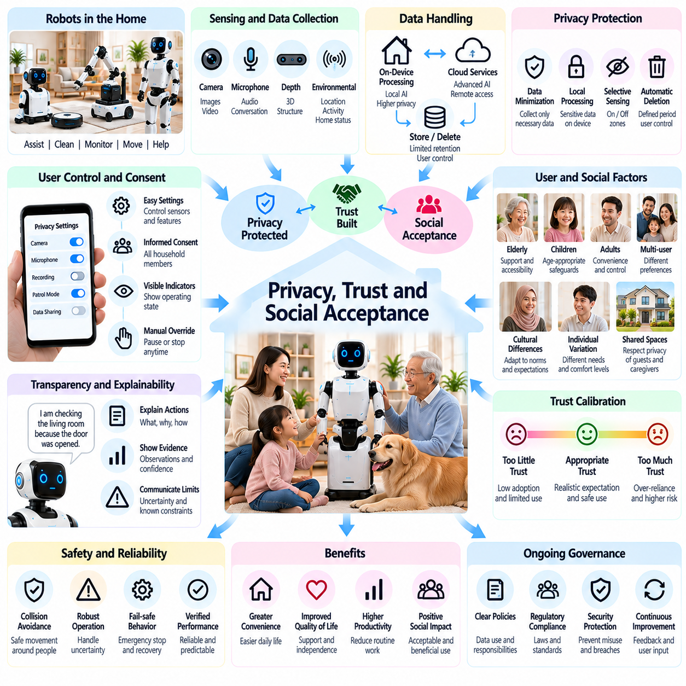{width="7.268055555555556in" height="7.268055555555556in"}

개인정보 보호, 신뢰 및 사회적 수용성(Privacy, Trust, and Social Acceptance)은 소비자 및 가정환경(Consumer and Home Environments)에서 피지컬 인공지능(Physical AI)이 성공적으로 도입되기 위한 기본 조건이다. 산업용 로봇(Industrial Robot)과 달리 가정용 로봇(Household Robot)은 개인정보(Personal Information), 인간관계(Relationship), 일상생활 패턴(Daily Routine)이 존재하는 사적인 공간(Intimate Space)에서 작동한다. 이러한 로봇의 수용성(Acceptance)은 기술적 성능(Technical Performance)뿐만 아니라 거주자(Resident)가 존중받고 보호받으며 로봇의 행동(Robotic Behavior)을 통제할 수 있다고 느끼는지에 달려 있다.

개인정보 보호 문제(Privacy Challenge)는 가정용 로봇(Home Robot)이 주변 환경을 이해하기 위해 카메라(Camera), 마이크(Microphone), 깊이 센서(Depth Sensor), 환경 모니터링(Environmental Monitoring)을 활용하기 때문에 발생한다. 이러한 센서는 대화(Conversation), 개인 활동(Personal Activity), 가정 내부 구조(Household Layout), 방문자 정보(Visitor Information)를 수집할 수 있다. 정당한 기능(Legitimate Function)을 위해 수집된 데이터라도 민감한 행동 패턴(Sensitive Behavioral Pattern)을 드러낼 수 있다. 따라서 개인정보 보호(Privacy Protection)는 시스템 배포(Deployment) 이후에 추가하는 것이 아니라 초기 시스템 설계(System Design) 단계부터 통합되어야 한다.

데이터 최소화(Data Minimization)는 개인정보 보호 중심 로봇 시스템(Privacy-Aware Robotic System)을 위한 실질적인 기반을 제공한다. 로봇은 승인된 작업(Authorized Task)에 필요한 정보만 수집하고 명확하게 정의된 기간(Defined Retention Period) 동안만 보관해야 한다. 센싱 하드웨어(Sensing Hardware)가 지속적인 녹화(Continuous Recording)를 지원한다는 이유만으로 이를 기본 설정(Default Setting)으로 적용해서는 안 된다. 선택적 활성화(Selective Activation), 임시 처리(Temporary Processing), 자동 삭제(Automatic Deletion)는 필수적인 로봇 기능(Essential Robotic Capability)을 유지하면서 불필요한 정보 노출(Unnecessary Exposure)을 줄일 수 있다.

엣지 컴퓨팅(Edge Computing)은 민감한 센서 정보(Sensitive Sensor Information)를 가정 내 장치(Household Device)에서 직접 처리함으로써 개인정보 보호(Privacy)를 지원할 수 있다. 로컬 인식(Local Perception)과 의사결정(Local Decision-Making)은 이미지(Image), 음성(Audio), 행동 기록(Behavioral Record)이 원격 서버(Remote Server)로 전송되는 양을 줄일 수 있다. 그러나 로컬 처리(Local Processing)가 보안 위험(Security Risk)을 제거하거나 기밀성(Confidentiality)을 보장하는 것은 아니다. 장치 보호(Device Protection), 소프트웨어 무결성(Software Integrity), 엄격하게 통제된 데이터 접근(Controlled Data Access)은 전체 작동 과정에서 계속 필요하다.

클라우드 연결성(Cloud Connectivity)은 데이터 저장(Data Storage), 제3자 접근(Third-Party Access), 서비스 의존성(Service Dependency), 국가 간 정보 이전(Cross-Border Information Transfer)에 관한 추가적인 우려를 발생시킨다. 원격 인공지능 서비스(Remote AI Service)는 인식 및 추론 능력(Recognition and Reasoning Capability)을 향상시킬 수 있지만, 가정 내 정보(Household Information)의 노출 범위를 확대할 수도 있다. 책임 있는 아키텍처(Responsible Architecture)는 로컬 처리(Local Processing)와 원격 처리(Remote Processing)를 명확하게 구분하고, 관련 데이터 흐름(Data Flow)을 공개하며, 클라우드 의존 기능(Cloud-Dependent Function)에 대한 실질적인 선택권(Meaningful Choice)을 제공해야 한다.

사전 동의(Informed Consent)는 여러 사람이 동일한 로봇과 상호작용하거나 로봇의 관찰 대상이 될 수 있는 공동 가정(Shared Household)에서 특히 어려운 문제이다. 주 구매자(Primary Purchaser)가 가족 구성원(Family Member), 방문자(Guest), 돌봄 제공자(Caregiver)의 개인정보 보호 선호도(Privacy Preference)를 자동으로 대표할 수는 없다. 시스템은 이해하기 쉬운 안내(Understandable Notice), 설정 가능한 관찰 구역(Configurable Observation Zone), 적절한 녹화 제한(Recording Restriction)을 제공해야 한다. 동의 체계(Consent Mechanism)는 공동 생활공간(Shared Living Space)의 실제 상황을 반영해야 한다.

사용자 통제권(User Control)은 자율형 가정 시스템(Autonomous Household System)에 대한 신뢰(Confidence)를 구축하는 데 필수적이다. 거주자(Resident)는 모니터링(Monitoring)을 일시 중지하고, 특정 센서(Selected Sensor)를 비활성화하며, 저장된 정보(Stored Information)를 확인하고, 로봇의 행동(Robotic Action)을 수동으로 중단하거나 변경할 수 있어야 한다. 이러한 제어 기능(Control Function)은 복잡한 설정(Complex Setting) 속에 숨겨져 있지 않고 직관적인 인터페이스(Straightforward Interface)를 통해 접근할 수 있어야 한다. 물리적 개인정보 보호 스위치(Physical Privacy Switch)와 가시적인 작동 상태 표시 장치(Visible Operating Indicator)는 그 작동이 기술적으로 검증 가능한 경우 추가적인 안심(Reassurance)을 제공할 수 있다.

신뢰(Trust)는 예측 가능하고(Predictable), 유능하며(Competent), 투명한(Transparent) 로봇 행동을 반복적으로 경험하면서 형성된다. 작업을 일관되게 완료하고, 자신의 한계(Limitation)를 설명하며, 수정 지시(Correction)에 적절하게 반응하는 로봇은 사용자 신뢰(User Confidence)를 얻을 가능성이 높다. 반대로 예상하지 못한 움직임(Unexpected Movement), 설명되지 않은 녹화(Unexplained Recording), 오해를 유발하는 설명(Misleading Explanation)은 수용성(Acceptance)을 빠르게 저하시킬 수 있다. 신뢰는 과장된 지능 주장(Exaggerated Claims of Intelligence)이 아니라 입증된 신뢰성(Demonstrated Reliability)에 기반해야 한다.

투명성(Transparency)은 로봇이 현재 무엇을 수행하고 있는지, 특정 행동(Action)을 선택한 이유가 무엇인지, 중요한 의사결정(Important Decision)에 어떤 정보가 영향을 미쳤는지를 전달하도록 요구한다. 설명(Explanation)은 직접 관측(Direct Observation)을 예측(Prediction)이나 불확실한 해석(Uncertain Interpretation)과 구별해야 한다. 사용자가 모든 연산 세부사항(Computational Detail)을 이해할 필요는 없지만, 중요한 결과를 초래하는 행동(Consequential Behavior)은 이해할 수 있어야 한다. 실패(Failure)와 한계(Limitation)에 대한 명확한 보고는 현실적인 기대(Realistic Expectation)와 정보에 근거한 감독(Informed Supervision)을 지원한다.

의인화 설계(Anthropomorphic Design)는 사람과 유사한 음성(Humanlike Voice), 제스처(Gesture), 표정(Expression), 신체 형태(Body Form)를 활용하여 로봇에 대한 친근감(Approachability)을 높일 수 있다. 그러나 지나친 인간 유사성(Excessive Human Resemblance)은 이해 능력(Understanding), 감정 인식(Emotional Awareness), 책임(Responsibility)에 관한 비현실적인 기대(Unrealistic Expectation)를 형성할 수 있다. 설계자(Designer)는 사용자가 모의된 사회적 반응(Simulated Social Response)을 인간의 판단(Human Judgment)으로 오인하도록 유도해서는 안 된다. 적절한 사회적 신호(Social Cue)는 기계의 실제 능력(Actual Machine Capability)을 불분명하게 만들지 않으면서 의사소통(Communication)을 개선해야 한다.

사회적 수용성(Social Acceptance)은 문화(Culture), 세대(Generation), 가정 구조(Household Structure), 개인의 기술 경험(Individual Experience with Technology)에 따라 달라진다. 일부 사용자는 선제적인 보조(Proactive Assistance)를 환영하지만, 다른 사용자는 제한된 자율성(Limited Autonomy)과 최소한의 관찰(Minimal Observation)을 선호할 수 있다. 개인 공간(Personal Space), 예절(Politeness), 가사 책임(Domestic Responsibility)에 대한 문화적 기대(Cultural Expectation)는 상호작용 선호도(Interaction Preference)에 영향을 미친다. 성공적인 제품(Successful Product)은 보편적인 로봇 행동 기준(Universal Model of Acceptable Robotic Conduct)을 가정하기보다 적응 가능한 행동(Adaptable Behavior)을 제공해야 한다.

어린이(Children)와 취약한 가정 구성원(Vulnerable Household Member)은 로봇의 능력(Robotic Capability)을 오해하거나 개인정보 보호 설정(Privacy Setting)을 관리하는 능력이 제한될 수 있기 때문에 특별한 주의가 필요하다. 로봇은 조작적인 상호작용 패턴(Manipulative Interaction Pattern), 오해를 유발하는 감정적 주장(Misleading Emotional Claim), 불필요한 개인정보 수집(Unnecessary Collection of Personal Information)을 피해야 한다. 연령에 적합한 보호 조치(Age-Appropriate Safeguard)와 접근 가능한 감독 제어 기능(Accessible Supervision Control)은 위험을 줄일 수 있다. 로봇 보조(Robotic Assistance)는 부적절한 의존(Inappropriate Dependence)을 유도하기보다 인간의 지원(Human Support)을 강화해야 한다.

신뢰 보정(Trust Calibration)은 사용자 신뢰(User Confidence)를 최대한 높이는 것보다 중요하다. 과도한 신뢰(Excessive Trust)는 거주자가 검증된 능력(Verified Ability)을 넘어 로봇에 의존하도록 만들 수 있으며, 지나치게 낮은 신뢰(Insufficient Trust)는 유용한 기술의 도입(Useful Adoption)을 방해한다. 시스템은 불확실성(Uncertainty)을 전달하고, 필요한 경우 도움을 요청하며, 안전하게 수행할 수 없는 작업(Task)을 명확하게 식별해야 한다. 입증된 성능(Demonstrated Performance)과 이해하기 쉬운 한계(Understandable Limitation)는 사용자가 적절한 기대(Appropriate Expectation)를 형성하도록 한다.

사이버보안(Cybersecurity)은 손상된 로봇(Compromised Robot)이 가정 내 정보(Household Information)를 노출하거나 물리적 위험(Physical Hazard)을 발생시킬 수 있기 때문에 개인정보 보호(Privacy) 및 신뢰(Trust)와 분리할 수 없다. 공격자(Attacker)는 카메라(Camera), 마이크(Microphone), 원격 제어 인터페이스(Remote-Control Interface), 저장된 공간 지도(Stored Spatial Map)의 취약점을 악용할 수 있다. 안전한 인증(Secure Authentication), 암호화 통신(Encrypted Communication), 소프트웨어 업데이트(Software Update), 접근 기록(Access Logging)은 이러한 위험을 줄인다. 보안 유지관리(Security Maintenance)는 초기 설치(Initial Installation) 이후 종료되는 것이 아니라 제품 수명주기(Product Lifecycle) 전반에 걸쳐 지속되어야 한다.

데이터 거버넌스(Data Governance)는 로봇 작동(Robotic Operation) 중 생성되는 정보의 수집(Collection), 저장(Storage), 공유(Sharing), 삭제(Deletion)에 관한 책임(Responsibility)을 정의한다. 제조업체(Manufacturer)는 데이터 보존 정책(Retention Policy), 승인된 접근(Authorized Access), 사고 대응 절차(Incident Response Procedure), 사용자 요청 처리 체계(User Request Mechanism)를 수립해야 한다. 모델 개선(Model Improvement)에 사용되는 데이터에는 적절한 권한(Permission)과 보호 조치(Safeguard)가 필요하다. 특히 장치 제조업체(Device Manufacturer), 클라우드 제공업체(Cloud Provider), 서비스 협력업체(Service Partner) 사이에서 정보가 이동하는 경우 명확한 책임성(Accountability)이 중요해진다.

사회적 수용성(Social Acceptance)은 공동 생활공간(Shared Living Space)에서 로봇이 보이는 물리적 행동(Physical Behavior)에도 영향을 받는다. 예측하기 어려운 자율주행(Unpredictable Navigation), 과도한 소음(Excessive Noise), 부적절한 접근 거리(Inappropriate Proximity), 반복적인 방해(Repeated Interruption)는 기술적 고장(Technical Failure)이 발생하지 않더라도 불편함(Discomfort)을 유발할 수 있다. 로봇은 개인적 경계(Personal Boundary)를 존중하고, 가정 내 활동(Household Activity)을 방해하지 않으며, 상호작용 시점(Interaction Timing)을 조정해야 한다. 따라서 물리적 예절(Physical Courtesy)은 신뢰할 수 있는 체화 지능(Trustworthy Embodied Intelligence)의 중요한 요소이다.

신뢰성(Reliability)과 유지관리성(Maintainability)은 장기적인 신뢰(Long-Term Confidence)에 큰 영향을 미친다. 잦은 소프트웨어 오류(Software Failure), 연결 중단(Connectivity Interruption), 자율주행 오류(Navigation Error), 지원 서비스 부족(Unavailable Support)은 가정용 로봇(Household Robot)을 유용한 도구보다 부담스러운 장치로 느끼게 할 수 있다. 예측 가능한 유지관리 요구사항(Predictable Maintenance Requirement), 투명한 고장 보고(Transparent Fault Reporting), 신뢰할 수 있는 복구 절차(Dependable Recovery Procedure)는 제품 소유 경험(Ownership Experience)을 개선한다. 신뢰는 제품 시연(Product Demonstration)에서 형성되는 것에 그치지 않고 일상적인 작동(Everyday Operation)을 통해 지속적으로 유지되어야 한다.

경제적 공정성(Economic Fairness)은 첨단 가정용 로봇(Advanced Home Robotics)이 초기에는 주로 고소득 가정(Higher-Income Household)에 제공될 수 있기 때문에 사회적 수용성(Social Acceptance)에 영향을 미친다. 제품 구매 가격(Purchase Price), 구독료(Subscription Fee), 수리 비용(Repair Expense), 교체 주기(Replacement Cycle)는 상당한 도입 장벽(Adoption Barrier)을 형성할 수 있다. 제조업체(Manufacturer)는 총소유비용(Total Cost of Ownership, TCO)을 명확하게 전달하고, 필수 안전 기능(Essential Safety Protection)이나 개인정보 보호 기능(Privacy Protection)을 고급 구독 서비스(Premium Subscription)에 종속시키지 않아야 한다. 합리적인 가격의 지원 서비스(Affordable Support)와 내구성 있는 제품(Durable Product)은 실질적인 접근성(Practical Accessibility)을 확대할 수 있다.

고용(Employment)과 사회적 관계(Social Relationship)는 더 폭넓은 윤리적 고려사항(Ethical Consideration)을 제기한다. 가정용 로봇(Household Robot)은 반복적인 가사 노동(Repetitive Domestic Work)을 줄이고 독립적인 생활(Independent Living)을 지원할 수 있지만, 돌봄(Caregiving)과 인간의 책임(Human Responsibility)에 대한 기대도 변화시킬 수 있다. 자동화(Automation)는 사회적 지원(Social Support)이나 정서적 지원(Emotional Support)을 완전히 대체할 수 있다고 가정하기보다 의미 있는 인간관계(Meaningful Human Relationship)를 보완해야 한다. 평가(Evaluation)는 가정 내 편의성(Household Convenience)뿐만 아니라 더 넓은 사회적 영향(Wider Social Consequence)도 고려해야 한다.

참여형 설계(Participatory Design)는 제품 개발(Product Development) 전반에 걸쳐 거주자(Resident), 돌봄 제공자(Caregiver), 접근성 전문가(Accessibility Specialist), 기타 이해관계자(Stakeholder)를 참여시킴으로써 수용성(Acceptance)을 향상시킬 수 있다. 실제 환경에서 수집한 피드백(Real-World Feedback)은 센싱(Sensing)에 대한 불편함, 혼란스러운 행동(Confusing Behavior), 상충하는 가정 내 선호도(Conflicting Household Preference) 등 통제된 실험실 시험(Controlled Laboratory Testing)에서 간과하기 쉬운 문제를 드러낸다. 반복적 평가(Iterative Evaluation)는 로봇 기능(Robotic Function)을 실제 요구사항(Actual Need)에 맞추고 더욱 포용적인 설계 의사결정(Inclusive Design Decision)을 지원한다.

규제 준수(Regulatory Compliance)와 독립적 평가(Independent Evaluation)는 개인정보 보호(Privacy), 사이버보안(Cybersecurity), 제품 안전(Product Safety), 소비자 권리(Consumer Rights)를 다룰 때 신뢰를 강화할 수 있다. 적용 가능한 요구사항(Applicable Requirement)은 관할 지역(Jurisdiction)과 제품 범주(Product Category)에 따라 달라지므로 상용화(Commercialization) 이전에 신중한 검토가 필요하다. 인증(Certification)과 외부 감사(External Audit)는 유용한 근거(Evidence)를 제공할 수 있지만 지속적인 모니터링(Continuous Monitoring)을 대체할 수는 없다. 신뢰할 수 있는 배포(Trustworthy Deployment)를 위해서는 문서화된 책임(Documented Responsibility)과 효과적인 시정 조치(Effective Corrective Action)가 필요하다.

성능 평가(Performance Assessment)는 기술적 지표(Technical Metric)와 함께 사용자가 인식하는 개인정보 보호 수준(Perceived Privacy), 신뢰 보정(Trust Calibration), 사용자 통제권(User Control), 사회적 편안함(Social Comfort), 지속적인 사용 의향(Willingness to Continue Using the Robot)을 포함해야 한다. 장기 추적 연구(Longitudinal Study)는 반복적인 상호작용(Repeated Interaction) 이후 태도(Attitude)가 변화할 수 있기 때문에 특히 중요하다. 평가(Evaluation)에는 서로 다른 연령(Age), 능력(Ability), 문화(Culture), 가정 구성(Household Arrangement)을 포함해야 한다. 긍정적인 초기 인상(Positive Initial Impression)만으로는 지속적인 사회적 수용성(Lasting Social Acceptance)을 입증할 수 없다.

미래의 가정용 피지컬 인공지능 시스템(Future Household Physical AI System)은 점차 높은 자율성(Autonomy), 사회적 표현 능력(Social Expressiveness), 개인적 맥락 기억 능력(Personal Context Memory)을 갖추게 될 수 있다. 이러한 발전은 편의성(Convenience)을 높이는 동시에 감시(Surveillance), 행동 영향력(Behavioral Influence), 의존성(Dependency)에 관한 우려를 심화시킬 수 있다. 책임 있는 개발(Responsible Development)을 위해서는 개인정보 보호형 학습(Privacy-Preserving Learning), 설명 가능한 행동(Explainable Behavior), 사용자 제어형 기억(User-Controlled Memory), 오용 방지 보호 조치(Safeguards Against Misuse)가 필요하다. 지능(Intelligence)이 향상될수록 책임성(Accountability)도 함께 강화되어야 한다.

궁극적으로 개인정보 보호, 신뢰 및 사회적 수용성(Privacy, Trust, and Social Acceptance)은 가정용 피지컬 인공지능(Home Physical AI)이 진정으로 유익한 기술(Beneficial Technology)이 될 수 있는지를 결정한다. 기술적 능력(Technical Capability)만으로는 침해적인 센싱(Intrusive Sensing), 불투명한 의사결정(Opaque Decision), 인간 통제권 감소(Reduced Human Control)를 정당화할 수 없다. 지속 가능한 도입(Sustainable Adoption)을 위해서는 존엄성(Dignity), 자율성(Autonomy), 보안(Security), 가정의 다양성(Household Diversity)을 존중하면서 실질적인 가치(Practical Value)를 입증하는 시스템이 필요하다. 핵심 목표(Central Objective)는 사람과 지능형 물리적 기계(Intelligent Physical Machine) 사이의 신뢰할 수 있는 협력(Trustworthy Cooperation)을 구현하는 것이다.

## 07.12. Safety in Unstructured Home Environments

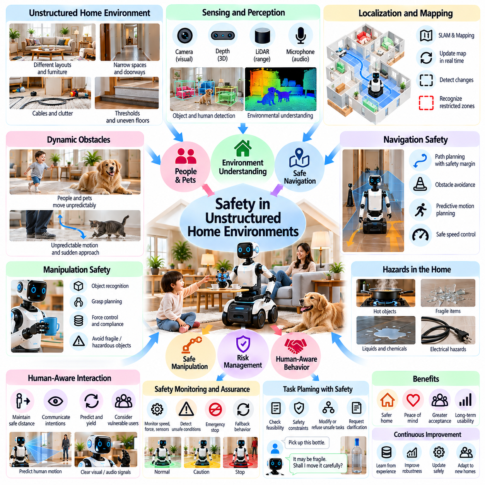{width="7.268055555555556in" height="7.268055555555556in"}

비정형 가정환경에서의 안전성(Safety in Unstructured Home Environments)은 일상적인 생활공간(Everyday Living Space)에 피지컬 인공지능(Physical AI)을 배치하기 위한 기본 요구사항(Fundamental Requirement)이다. 산업 시설(Industrial Facility)과 달리 가정에는 예측하기 어려운 공간 구조(Unpredictable Layout), 움직이는 거주자(Moving Occupant), 반려동물(Pet), 지속적으로 변화하는 장애물(Changing Obstacle)이 존재한다. 로봇은 제한적인 환경 통제(Limited Environmental Control)와 불완전한 정보(Incomplete Information) 속에서도 안전하게 작동해야 한다. 따라서 신뢰할 수 있는 가정용 자율성(Reliable Domestic Autonomy)을 구현하려면 지속적인 환경 인식(Continuous Perception), 적응형 경로 계획(Adaptive Planning), 물리적 안전장치(Physical Safeguard), 효과적인 인간 감독(Effective Human Supervision)이 필요하다.

가정환경(Household Environment)은 방의 크기(Room Dimension), 가구 배치(Furniture Arrangement), 바닥 재질(Floor Material), 이동 가능 공간(Available Movement Space)에서 상당한 다양성(Variation)을 보인다. 좁은 복도(Narrow Corridor), 문턱(Door Threshold), 카펫(Carpet), 전선(Cable), 어지럽게 놓인 물건(Clutter)은 자율주행(Navigation)을 어렵게 만들 수 있다. 특정 주거공간(Residence)에 맞추어 설계된 로봇이 다른 가정에서는 익숙하지 않은 조건(Unfamiliar Condition)에 직면할 수 있다. 안전한 작동(Safe Operation)을 위해서는 강건한 환경 모델링(Robust Environmental Modeling)과 특정 공간이 로봇의 이동 능력(Mobility Capability)을 초과하는지를 인식하는 능력이 필요하다.

동적 장애물(Dynamic Obstacle)은 사람과 동물이 예측하기 어렵게 움직이기 때문에 추가적인 불확실성(Uncertainty)을 발생시킨다. 어린이(Child)는 갑자기 로봇에 접근할 수 있으며, 반려동물(Pet)은 로봇의 이동 경로(Movement Path)에 들어오거나 움직이는 구성요소(Moving Component)와 상호작용할 수 있다. 움직임 예측(Motion Prediction)은 충돌 회피(Collision Avoidance)를 지원하지만, 예측된 이동 궤적(Predicted Trajectory)에는 여전히 불확실성이 존재한다. 취약한 거주자(Vulnerable Occupant) 주변에서 작동할 때는 보수적인 속도 제한(Conservative Speed Limit), 보호 정지 거리(Protective Stopping Distance), 지속적인 장애물 모니터링(Continuous Obstacle Monitoring)이 필수적이다.

환경 인식(Environmental Perception)은 카메라(Camera), 깊이 센서(Depth Sensor), 라이다(LiDAR), 근접 감지기(Proximity Detector), 접촉 센서(Contact Sensor)를 결합하여 위험요소(Hazard)를 식별한다. 센서 융합(Sensor Fusion)은 개별 센싱 방식(Sensing Modality)의 신뢰성이 저하되는 상황에서도 감지 범위(Coverage)를 개선할 수 있다. 그러나 반사 표면(Reflective Surface), 투명 물체(Transparent Object), 어두운 환경(Darkness), 가려짐(Occlusion)은 여전히 감지 실패(Detection Failure)를 발생시킬 수 있다. 안전 필수 시스템(Safety-Critical System)은 센싱 한계(Sensing Limitation)를 고려해야 하며, 관측되지 않은 공간(Unobserved Space)에 장애물이 없다고 가정해서는 안 된다.

위치 추정 및 지도 작성(Localization and Mapping)은 로봇의 위치(Robot Position)와 주변 기하 구조(Surrounding Geometry)에 대한 추정치를 유지함으로써 안전한 이동(Safe Movement)을 지원한다. 그러나 가구가 이동하거나 임시 장애물(Temporary Obstacle)이 나타나면 가정 내부 지도(Household Map)는 오래된 정보가 될 수 있다. 로봇은 작동 중에 국소 환경 표현(Local Environmental Representation)을 갱신하고, 저장된 지도(Stored Map)와 현재 관측(Current Observation) 사이의 불일치(Inconsistency)를 감지해야 한다. 위치 추정의 불확실성(Uncertain Localization)이 발생하면 속도 감소(Reduced Speed), 복구 동작(Recovery), 제어된 정지(Controlled Stopping)를 수행해야 한다.

자율주행 안전성(Navigation Safety)을 확보하려면 로봇의 크기(Robot Dimension), 정지 능력(Stopping Capability), 주변 활동(Surrounding Activity)을 고려하여 경로(Path)를 계획해야 한다. 좁은 통로나 사람이 있는 공간을 통과해야 하는 경우 최단 경로(Shortest Route)가 반드시 가장 안전한 경로(Safest Route)는 아니다. 위험 인식형 경로 계획기(Risk-Aware Planner)는 더 넓은 안전 여유 공간(Clearance)과 예측 가능한 움직임(Predictable Movement)을 우선할 수 있다. 국소 제어기(Local Controller)는 충돌 제약조건(Collision Constraint)을 준수하고 안정적인 움직임(Stable Motion)을 유지하면서 이동 궤적(Trajectory)을 지속적으로 조정해야 한다.

물체 조작(Manipulation)은 로봇 팔(Robotic Arm)과 그리퍼(Gripper)가 가정 내 물체(Household Object)와 직접 상호작용하기 때문에 이동형 자율주행(Mobile Navigation)과는 다른 위험을 발생시킨다. 잘못된 파지(Incorrect Grasping)는 물체를 떨어뜨리거나 파손하거나 주변 사람과 충돌하게 만들 수 있다. 안전한 물체 조작(Safe Manipulation)을 위해서는 물체 인식(Object Recognition), 힘 제어(Force Control), 파지 안정성 평가(Grasp Stability Assessment), 충돌 모니터링(Collision Monitoring)이 필요하다. 로봇은 적절한 능력(Capability)과 승인(Authorization)이 없는 상태에서 알 수 없는 물체(Unknown Object), 깨지기 쉬운 물체(Fragile Object), 날카로운 물체(Sharp Object), 위험물(Hazardous Object)을 취급하지 않아야 한다.

힘 제어 및 순응 제어(Force and Compliance Control)는 물리적 상호작용(Physical Interaction) 중 발생할 수 있는 부상 위험(Injury Risk)을 줄이는 데 도움이 된다. 임피던스 제어(Impedance Control), 토크 센싱(Torque Sensing), 순응형 기구(Compliant Mechanism)는 과도한 접촉력(Excessive Contact Force)을 제한할 수 있다. 그러나 기계적 순응성(Mechanical Compliance)만으로는 안전성을 보장할 수 없으며, 특히 끼임 지점(Pinch Point)이나 고중량 적재물(Heavy Payload) 주변에서는 더욱 그렇다. 하드웨어 제한(Hardware Limit), 보호 덮개(Protective Covering), 비상 정지(Emergency Stopping), 작업별 작동 제한(Task-Specific Operating Restriction)은 지능형 제어(Intelligent Control)를 보완해야 한다.

계단(Stair), 높은 표면(Elevated Surface), 바닥의 불연속 구간(Floor Discontinuity)은 상당한 이동 위험(Mobility Hazard)을 발생시킨다. 바퀴형 로봇(Wheeled Robot)은 기계적 한계(Mechanical Limit)를 초과하는 단차(Step), 틈(Gap), 급경사(Steep Slope)에 직면할 수 있다. 다리형 로봇(Legged Robot)은 균형 상실(Balance Loss)과 불안정한 발 디딤(Unstable Foothold)과 관련된 다른 위험에 직면한다. 지형 평가(Terrain Assessment)는 기하 구조(Geometry), 마찰(Friction), 하중 조건(Load Condition), 복구 가능성(Recovery Option)을 고려해야 한다. 로봇은 충분한 안전 여유(Safety Margin)를 확보하지 못한 지형 전환 구간(Terrain Transition)을 통과하지 않아야 한다.

가정 내 물체(Household Object)는 물리적 특성(Physical Property)을 알 수 없거나 추정하기 어려운 경우가 많기 때문에 다양한 위험요소(Diverse Hazard)를 발생시킨다. 뜨거운 조리도구(Hot Cookware), 유리 용기(Glass Container), 전기 케이블(Electrical Cable), 액체(Liquid), 세정용 화학물질(Cleaning Chemical)은 각각 다른 취급 주의사항(Handling Precaution)을 요구한다. 의미 기반 인식(Semantic Perception)은 잠재적인 물체 범주(Object Category)를 식별할 수 있지만, 인식 신뢰도(Recognition Confidence)가 안전한 물체 조작(Safe Manipulation)에 충분하지 않을 수 있다. 로봇은 재료 특성(Material Property)이나 위험 상태(Hazard Condition)가 불확실한 경우 행동(Action)을 제한해야 한다.

인간 인식형 행동(Human-Aware Behavior)은 가정 구성원(Household Occupant)이 로봇의 움직임(Robotic Motion)을 이해하지 못하거나 다음 행동(Next Action)을 예상하지 못할 수 있기 때문에 필수적이다. 로봇은 이해하기 쉬운 신호(Understandable Signal)를 통해 의도된 움직임(Intended Movement)을 전달하고 적절한 대인 거리(Interpersonal Distance)를 유지해야 한다. 앉아 있는 사람(Seated Individual), 어린이(Child), 이동 보조기구 사용자(Person Using Mobility Aid) 주변의 자율주행(Navigation)에는 추가적인 주의(Additional Caution)가 필요하다. 예측 가능한 행동(Predictable Behavior)과 접근 가능한 정지 제어 기능(Accessible Stopping Control)은 물리적 위험(Physical Risk)과 사용자 불편함(User Discomfort)을 모두 줄일 수 있다.

안전 인식형 작업 계획(Safety-Aware Task Planning)은 요청된 행동(Requested Action)이 현재 조건(Current Condition)에서 물리적으로 실행 가능하고 허용 가능한지를 평가해야 한다. 자연어 명령(Natural Language Command)은 중요한 제약조건(Important Constraint)을 생략하거나 안전하지 않은 행동(Unsafe Behavior)을 요구할 수 있다. 고수준 인공지능 모델(High-Level AI Model)은 작업 순서(Task Sequence)를 제안할 수 있지만, 독립적인 안전 메커니즘(Independent Safety Mechanism)이 실행 가능한 행동(Executable Action)을 검증해야 한다. 로봇은 명령(Instruction)이 확립된 안전 요구사항(Established Safety Requirement)과 충돌하는 경우 이를 거부하거나 수정하거나 명확한 설명을 요청해야 한다.

실행 중 안전 보증(Runtime Assurance)은 작업 실행(Task Execution) 과정에서 로봇 행동(Robotic Behavior)을 지속적으로 감독하는 기능을 제공한다. 모니터링 시스템(Monitoring System)은 속도(Speed), 이격 거리(Separation Distance), 액추에이터 한계(Actuator Limit), 센서 상태(Sensor Health), 위치 추정 신뢰도(Localization Confidence)를 평가할 수 있다. 안전하지 않은 조건(Unsafe Condition)이 감지되면 감독 제어기(Supervisory Controller)는 정상 작업 계획(Nominal Plan)을 무시하고 사전에 정의된 보호 대응(Predefined Protective Response)을 활성화해야 한다. 이러한 메커니즘은 학습 기반 의사결정 시스템(Learning-Based Decision System)이 예상하지 못한 출력을 생성하는 경우에도 효과적으로 작동해야 한다.

고장 안전 설계(Fail-Safe Design)는 고장(Failure)이 발생했을 때 제어되지 않은 움직임(Uncontrolled Movement)이 아니라 통제되고 예측 가능한 상태(Controlled and Predictable State)로 전환되도록 한다. 통신 두절(Loss of Communication), 프로세서 고장(Processor Fault), 배터리 부족(Low Battery Condition), 액추에이터 이상(Actuator Abnormality)에 대해서는 정의된 복구 동작(Defined Recovery Behavior)이 필요하다. 위험의 특성(Hazard Characteristic)에 따라 안전한 대응(Safe Response)에는 정지(Stopping), 운반 중인 물체 내려놓기(Lowering a Carried Object), 도움 요청(Requesting Assistance)이 포함될 수 있다. 비상 기능(Emergency Function)은 클라우드 연결(Cloud Connectivity)이나 언어 모델 의사결정(Language-Model Decision)에만 의존해서는 안 된다.

기능 안전 공학(Functional Safety Engineering)은 위험요소(Hazard)를 식별하고 보호 조치(Protective Measure)를 구현하기 위한 체계적인 접근 방법(Systematic Approach)을 제공한다. 위험 분석(Hazard Analysis)은 피해의 심각도(Severity), 노출 정도(Exposure), 위험 회피 가능성(Possibility of Avoiding Harm)을 고려한다. 위험 감소(Risk Reduction)에는 기계적 설계(Mechanical Design), 센싱 이중화(Sensing Redundancy), 소프트웨어 모니터링(Software Monitoring), 사용자 지침(User Instruction)이 활용될 수 있다. 적용 가능한 표준(Applicable Standard)과 규제 요구사항(Regulatory Requirement)은 제품 분류(Product Classification), 작동 조건(Operating Condition), 의도된 기능(Intended Function)에 따라 달라진다.

사이버보안(Cybersecurity)은 연결형 로봇(Connected Robot)이 원격 명령(Remote Command)이나 소프트웨어 업데이트(Software Update)를 수신할 수 있기 때문에 물리적 안전성(Physical Safety)에도 기여한다. 승인되지 않은 접근(Unauthorized Access)은 로봇의 움직임(Movement)을 변경하거나 안전장치(Safeguard)를 비활성화하거나 가정 내 정보(Household Information)를 노출할 수 있다. 안전한 인증(Secure Authentication), 암호화 통신(Encrypted Communication), 소프트웨어 무결성 검사(Software Integrity Check), 통제된 업데이트 절차(Controlled Update Procedure)는 이러한 위험을 줄인다. 안전 관련 기능(Safety-Related Function)에 영향을 미치는 보안 실패(Security Failure)에 대해서는 명시적인 감지 및 복구 전략(Detection and Recovery Strategy)이 필요하다.

학습 기반 적응(Learning-Based Adaptation)은 로봇 행동(Robotic Behavior)이 배포(Deployment) 이후 변화할 수 있기 때문에 추가적인 문제를 발생시킨다. 시뮬레이션(Simulation)이나 통제된 시연(Controlled Demonstration)에서 학습된 정책(Trained Policy)은 익숙하지 않은 가정환경(Unfamiliar Home Environment)에서 예측하기 어렵게 작동할 수 있다. 업데이트된 모델(Updated Model)은 물리적 행동(Physical Action)을 제어하기 전에 검증(Validation)을 거쳐야 한다. 안전 제약조건(Safety Constraint)은 학습된 정책(Learned Policy)과 독립적으로 강제될 수 있어야 하며, 롤백 메커니즘(Rollback Mechanism)은 성공적이지 못한 소프트웨어 변경(Unsuccessful Software Change)으로부터의 복구를 지원해야 한다.

시뮬레이션 및 디지털 환경(Simulation and Digital Environment)은 가정 구성원(Household Occupant)을 불필요한 위험(Unnecessary Risk)에 노출하지 않으면서 위험 시나리오(Hazardous Scenario)를 체계적으로 시험할 수 있도록 한다. 개발자(Developer)는 다양한 환경 구성(Configuration)에서 충돌(Collision), 센서 고장(Sensor Failure), 복잡한 장애물 환경(Cluttered Space), 비정상적인 인간 움직임(Unusual Human Movement)을 평가할 수 있다. 그러나 시뮬레이션(Simulation)은 물리적 접촉(Physical Contact), 재료 특성의 변화(Material Variation), 인간 행동(Human Behavior)을 완전히 재현할 수 없다. 따라서 실제 환경 시험(Real-World Testing)은 작동 신뢰도(Operational Confidence)를 확보하기 위해 여전히 필요하다.

안전성 평가(Safety Evaluation)는 충돌 빈도(Collision Frequency), 보호 정지 성능(Protective Stop Performance), 최소 이격 거리(Minimum Separation Distance), 조작 힘(Manipulation Force), 자율주행 실패(Navigation Failure), 복구 성공률(Recovery Success)을 측정해야 한다. 시험(Testing)에는 변화하는 가구 배치(Changing Furniture Arrangement), 낮은 조도(Poor Lighting), 예상하지 못한 장애물(Unexpected Obstacle), 동시다발적인 인간 활동(Simultaneous Human Activity)이 포함되어야 한다. 발생 빈도는 낮지만 심각한 사고(Rare but Severe Incident)에 특히 주의를 기울여야 한다. 전체 작업 성공률(Aggregate Task Success Rate)만으로는 가정 내 작동(Household Operation)이 허용 가능한 수준으로 안전하다는 것을 입증할 수 없다.

사용자 교육(User Training)과 인터페이스 설계(Interface Design)는 거주자(Resident)가 로봇의 능력(Robot Capability)을 오해하거나 예상하지 못한 방식으로 개입할 수 있기 때문에 안전성(Safety)에 영향을 미친다. 명확한 작동 지침(Clear Operating Instruction), 가시적인 상태 표시기(Visible Status Indicator), 접근 가능한 비상 제어 기능(Accessible Emergency Control), 이해하기 쉬운 경고(Understandable Warning)는 적절한 상호작용(Appropriate Interaction)을 지원한다. 제조업체(Manufacturer)는 금지된 사용 방식(Prohibited Use)과 유지관리 요구사항(Maintenance Requirement)을 명확하게 전달해야 한다. 안전 정보(Safety Information)는 서로 다른 연령(Age), 능력(Ability), 기술 경험(Technical Experience)을 가진 사람들도 활용할 수 있어야 한다.

신뢰성(Reliability)과 유지관리(Maintenance)는 장기적인 안전성(Long-Term Safety)과 밀접하게 연결되어 있다. 마모된 바퀴(Worn Wheel), 오염된 센서(Contaminated Sensor), 손상된 케이블(Damaged Cable), 성능이 저하된 배터리(Degraded Battery), 오래된 소프트웨어(Outdated Software)는 보호 성능(Protective Performance)을 점진적으로 저하시킬 수 있다. 예방 점검(Preventive Inspection), 자동 진단(Automated Diagnostics), 고장 보고(Fault Reporting)는 사고(Incident)가 발생하기 전에 성능 저하(Deterioration)를 식별하는 데 도움이 된다. 로봇은 필수 안전 구성요소(Essential Safety Component)가 요구 성능 수준(Required Performance Level)을 충족하지 못하는 경우 작동을 제한해야 한다.

상업적 배포(Commercial Deployment)를 위해서는 제조업체(Manufacturer)가 유용한 자율성(Useful Autonomy)과 허용 가능한 잔여 위험(Acceptable Residual Risk) 사이에서 균형을 유지해야 한다. 더 높은 기능적 능력(Higher Capability)이 모든 가정환경 조건(Household Condition)에서의 작동을 자동으로 정당화하는 것은 아니다. 명확하게 정의된 작동 경계(Operating Boundary), 보수적인 기본 행동(Conservative Default Behavior), 문서화된 검증 근거(Documented Validation Evidence)는 책임 있는 상용화(Responsible Commercialization)를 지원한다. 보험(Insurance), 제조물 책임(Product Liability), 서비스 지원(Service Support), 사고 보고(Incident Reporting) 역시 가정용 로봇(Home Robotics)의 실질적인 지속 가능성(Practical Sustainability)에 영향을 미친다.

미래의 가정용 로봇(Future Household Robot)은 다중모달 인식(Multimodal Perception), 예측형 월드 모델(Predictive World Model), 적응형 제어(Adaptive Control), 더욱 정교한 인간 움직임 이해(Human-Motion Understanding)를 결합할 수 있다. 이러한 기술은 위험 예측(Hazard Anticipation)과 복잡한 가정 내 공간(Crowded Domestic Space)에서의 협조적 움직임(Coordination)을 개선할 수 있다. 그러나 지능(Intelligence)의 향상은 새로운 고장 유형(New Failure Mode)도 발생시킨다. 기술 발전(Technological Progress)은 검증 가능한 안전 메커니즘(Verifiable Safety Mechanism), 투명한 한계(Transparent Limitation), 익숙하지 않은 조건(Unfamiliar Condition)에서도 유지되는 강건한 작동(Robust Operation)을 우선해야 한다.

궁극적으로 비정형 가정환경에서의 안전성(Safety in Unstructured Home Environments)은 지능형 인식 및 계획(Intelligent Perception and Planning)을 신뢰할 수 있는 공학적 안전장치(Dependable Engineering Safeguard)와 통합하는 데 달려 있다. 가정용 로봇(Household Robot)은 불확실성(Uncertainty)을 인식하고, 사람과의 근접성(Human Proximity)을 고려하며, 자신의 능력(Capability)을 초과하는 조건에서는 예측 가능한 방식(Predictable Manner)으로 대응해야 한다. 피지컬 인공지능(Physical AI)의 지속 가능한 도입(Sustainable Adoption)을 위해서는 안전성(Safety)이 통제된 시험(Controlled Testing)에서만 입증되는 기능이 아니라 실제 작동 전반에서 지속적으로 유지되는 특성(Continuous Operational Property)이 되어야 한다.

## 07.13. Product Cost Reliability and Maintenance

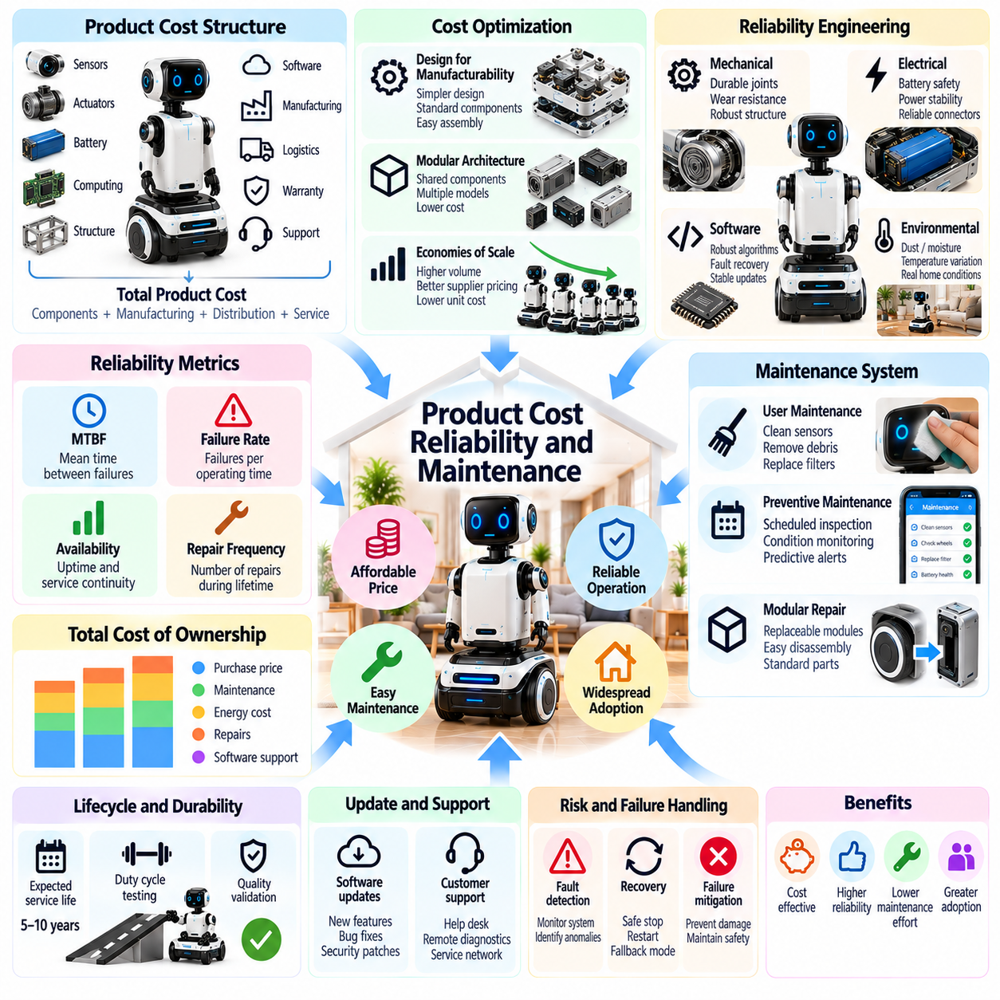{width="7.268055555555556in" height="7.268055555555556in"}

제품 비용, 신뢰성 및 유지관리(Product Cost, Reliability, and Maintenance)는 피지컬 인공지능(Physical AI)이 소비자 및 가정용 시장(Consumer and Home Market)에서 광범위하게 도입될 수 있는지를 결정하는 핵심 요소이다. 산업 고객(Industrial Customer)과 달리 일반 가정(Household)은 예산(Budget), 기술 전문성(Technical Expertise), 장비 가동 중단(Equipment Downtime)에 대한 허용 수준이 제한적이다. 성공적인 가정용 로봇(Home Robot)은 수용 가능한 구매 가격(Acceptable Purchase Price)으로 실질적인 가치(Practical Value)를 제공하면서 예상 사용 수명(Expected Service Life) 전반에 걸쳐 신뢰할 수 있는 작동(Dependable Operation)을 유지해야 한다.

제품 비용(Product Cost)은 센서(Sensor), 프로세서(Processor), 액추에이터(Actuator), 배터리(Battery), 기계 구조물(Mechanical Structure), 통신 인터페이스(Communication Interface)와 같은 하드웨어 구성요소(Hardware Component)에서 시작된다. 고급 환경 인식(Advanced Perception)과 물체 조작 능력(Manipulation Capability)은 정밀한 부품(Precise Component)과 복잡한 시스템 통합(Complex Integration)을 요구하기 때문에 제조 비용(Manufacturing Expense)을 증가시키는 경우가 많다. 비용 효율적인 엔지니어링(Cost-Effective Engineering)은 기능적 성능(Functional Performance)과 부품 가격(Component Price), 조립 복잡도(Assembly Complexity), 에너지 소비(Energy Consumption), 장기 내구성(Long-Term Durability) 사이의 균형을 유지해야 한다.

자재 명세서(Bill of Materials, BOM)는 직접적인 하드웨어 비용(Direct Hardware Cost)을 추정하기 위한 구조화된 기반(Structured Foundation)을 제공한다. 그러나 최종 제품 가격(Final Product Price)에는 제조 인건비(Manufacturing Labor), 시험(Testing), 물류(Logistics), 유통(Distribution), 보증(Warranty), 소프트웨어 개발(Software Development), 고객 지원(Customer Support) 비용도 포함되어야 한다. 소매 유통 마진(Retail Margin)과 지역별 규제 준수 요구사항(Regional Compliance Requirement)은 추가 비용(Additional Expense)을 발생시킨다. 따라서 제조업체(Manufacturer)는 부품 비용(Component Cost), 총생산비용(Total Production Cost), 지속 가능한 판매 가격(Sustainable Selling Price)을 구분해야 한다.

제조 용이성 설계(Design for Manufacturability, DFM)는 조립 구조(Assembly)를 단순화하고, 부품(Component)을 표준화하며, 특수 제조 공정(Specialized Manufacturing Process)을 최소화함으로써 생산 비용(Production Expense)을 절감한다. 모듈형 아키텍처(Modular Architecture)는 서로 다른 로봇 모델(Robot Model) 간에 공통 부품(Shared Component)을 사용할 수 있도록 지원한다. 그러나 지나친 표준화(Excessive Standardization)는 성능(Performance)을 제한하거나 불필요한 하드웨어 용량(Unnecessary Hardware Capacity)을 증가시킬 수 있다. 효과적인 제품 설계(Effective Product Design)는 제조 효율성(Manufacturing Efficiency), 기능 요구사항(Functional Requirement), 수리 용이성(Repairability), 부품 공급 가능성(Component Availability) 사이의 균형을 고려해야 한다.

규모의 경제(Economies of Scale)는 대량 구매(Larger Purchasing Volume), 자동화 조립(Automated Assembly), 개선된 공급업체 계약(Improved Supplier Agreement)을 통해 단위 제품 비용(Unit Cost)을 낮출 수 있다. 그러나 예상 비용 절감(Projected Cost Reduction)은 실제 생산량(Actual Production Volume)과 안정적인 수요(Stable Demand)에 따라 달라진다. 초기 단계 제조업체(Early-Stage Manufacturer)는 높은 금형 및 생산설비 비용(Tooling Cost), 낮은 제조 수율(Low Manufacturing Yield), 재고 위험(Inventory Risk)에 직면할 수 있다. 사업 계획(Business Planning)은 대중시장 가격 경쟁력(Mass-Market Pricing Advantage)이 즉시 확보된다고 가정하기보다 현실적인 생산 시나리오(Realistic Production Scenario)를 평가해야 한다.

신뢰성(Reliability)은 로봇이 지정된 작동 조건(Specified Operating Condition)에서 요구 기능(Required Function)을 일관되게 수행하는 능력을 의미한다. 가정용 로봇(Household Robot)은 반복적인 이동(Repeated Movement), 다양한 바닥 표면(Variable Floor Surface), 먼지(Dust), 습기(Moisture), 예측하기 어려운 사용자 상호작용(Unpredictable User Interaction)에 노출된다. 기계적 마모(Mechanical Wear)와 소프트웨어 고장(Software Failure)은 시간이 지남에 따라 성능(Performance)을 저하시킬 수 있다. 신뢰성 공학(Reliability Engineering)은 개별 부품의 내구성(Component Durability)뿐만 아니라 통합 로봇 시스템(Integrated Robotic System)의 전체적인 동작도 고려해야 한다.

기계적 신뢰성(Mechanical Reliability)은 모터(Motor), 동력전달장치(Transmission), 바퀴(Wheel), 관절(Joint), 베어링(Bearing), 구조 부품(Structural Component)의 내구성(Durability)에 달려 있다. 반복적인 가속(Repeated Acceleration), 진동(Vibration), 충격(Impact), 하중(Loading)은 피로(Fatigue) 또는 조기 마모(Premature Wear)를 발생시킬 수 있다. 적절한 재료 선정(Material Selection), 보호 설계(Protective Design), 보수적인 정격 하중(Conservative Load Rating)은 사용 수명(Service Life)을 향상시킬 수 있다. 공학적 검증(Engineering Validation)은 실험실 사양(Laboratory Specification)에만 의존하지 않고 실제 가정에서의 사용 주기(Realistic Household Duty Cycle)를 재현해야 한다.

전기적 신뢰성(Electrical Reliability)은 배터리(Battery), 전력 분배(Power Distribution), 커넥터(Connector), 충전 인터페이스(Charging Interface), 임베디드 전자장치(Embedded Electronics)와 관련된다. 온도 변화(Temperature Variation), 전기적 과도 현상(Electrical Transient), 커넥터 열화(Connector Degradation), 반복적인 충전 주기(Repeated Charging Cycle)는 작동 고장(Operational Failure)을 발생시킬 수 있다. 배터리 관리 시스템(Battery Management System, BMS)은 전압(Voltage), 전류(Current), 온도(Temperature), 배터리 상태(Health Condition)를 모니터링해야 한다. 보호 회로(Protective Circuit)와 제어된 충전 절차(Controlled Charging Procedure)는 안전하고 신뢰할 수 있는 전력 공급(Power Delivery)을 유지하는 데 도움이 된다.

소프트웨어 신뢰성(Software Reliability) 역시 중요하다. 가정용 로봇(Home Robot)은 환경 인식(Perception), 위치 추정(Localization), 자율주행(Navigation), 작업 계획(Task Planning), 통신 서비스(Communication Service)에 의존하기 때문이다. 예상하지 못한 입력(Unexpected Input), 자원 고갈(Resource Exhaustion), 네트워크 중단(Network Interruption), 소프트웨어 업데이트(Software Update)는 작동을 방해할 수 있다. 강건한 시스템(Robust System)에는 고장 감지(Fault Detection), 프로세스 격리(Process Isolation), 복구 메커니즘(Recovery Mechanism), 체계적인 시험(Systematic Testing)이 필요하다. 비핵심 서비스(Noncritical Service)를 사용할 수 없는 경우에도 필수 기능(Essential Function)은 예측 가능한 방식으로 유지되어야 한다.

신뢰성 지표(Reliability Metric)는 제품 성능(Product Performance)에 대한 측정 가능한 근거(Measurable Evidence)를 제공한다. 평균 고장 간격(Mean Time Between Failures, MTBF), 고장률(Failure Rate), 수리 빈도(Repair Frequency), 운영 가용성(Operational Availability)은 일관되게 정의된 경우 공학적 의사결정(Engineering Decision)을 지원할 수 있다. 가정별 사용 패턴(Household Usage Pattern)은 크게 다를 수 있으므로 단순 비교(Simple Comparison)는 잘못된 해석을 초래할 수 있다. 제조업체(Manufacturer)는 실제 제품 신뢰성(Actual Product Dependability)을 평가하기 위해 실험실 시험(Laboratory Testing), 현장 고장 기록(Field Failure Record), 고객 경험 데이터(Customer Experience Data)를 결합해야 한다.

유지관리 요구사항(Maintenance Requirement)은 사용자 만족도(User Satisfaction)와 총소유비용(Total Cost of Ownership)에 직접적인 영향을 미친다. 정기적인 유지관리(Routine Maintenance)에는 센서 청소(Sensor Cleaning), 이물질 제거(Debris Removal), 필터 교체(Filter Replacement), 바퀴 점검(Wheel Inspection), 충전 접점 관리(Charging Contact Maintenance)가 포함될 수 있다. 대부분의 가정 사용자는 전문 도구(Specialized Tool)를 보유하지 않으므로 복잡한 정비(Complex Servicing)는 최소화해야 한다. 명확한 유지관리 지침(Clear Maintenance Instruction)과 접근하기 쉬운 부품(Accessible Component)은 불편함(Inconvenience)을 줄이고 적절한 유지관리(Proper Upkeep)가 이루어질 가능성을 높인다.

예방 유지관리(Preventive Maintenance)는 기능적 고장(Functional Failure)이 발생하기 전에 예측 가능한 성능 저하(Predictable Deterioration)를 해결하는 것을 목표로 한다. 유지관리 일정(Maintenance Schedule)은 작동 시간(Operating Hour), 이동 거리(Travel Distance), 배터리 충전 주기(Battery Cycle), 관측된 부품 상태(Observed Component Condition)를 기준으로 설정할 수 있다. 상태 기반 유지관리(Condition-Based Maintenance)는 진동(Vibration), 온도(Temperature), 모터 전류(Motor Current), 진단 신호(Diagnostic Signal)를 활용하여 초기 문제(Emerging Problem)를 식별할 수 있다. 그러나 진단 모델(Diagnostic Model)은 사용자에게 불필요한 부담을 주는 과도한 오경보(Excessive False Alarm)를 방지해야 한다.

모듈형 수리 설계(Modular Repairability)는 로봇 전체를 분해하지 않고 손상된 구성요소(Damaged Component)를 교체할 수 있도록 하여 유지관리 비용(Maintenance Cost)을 줄일 수 있다. 교체 가능한 배터리(Replaceable Battery), 센서 모듈(Sensor Module), 바퀴(Wheel), 액추에이터 조립체(Actuator Assembly)는 정비 작업(Servicing)을 단순화할 수 있다. 표준화된 커넥터(Standardized Connector)와 문서화된 절차(Documented Procedure)는 수리 효율성(Repair Efficiency)을 향상시킨다. 다만 모듈형 설계(Modular Design)는 추가적인 커넥터 비용(Connector Cost), 패키징 제약조건(Packaging Constraint), 잠재적인 신뢰성 상충관계(Reliability Tradeoff)도 고려해야 한다.

원격 진단(Remote Diagnostics)과 무선 소프트웨어 업데이트(Over-the-Air Software Update, OTA)는 물리적인 수리 방문(Physical Repair Visit) 없이 일부 문제를 해결함으로써 서비스 효율성(Service Efficiency)을 개선할 수 있다. 보안이 확보된 원격 측정(Secure Telemetry)은 반복적인 고장(Recurring Fault), 설정 오류(Configuration Error), 소프트웨어 불안정성(Software Instability)을 식별할 수 있다. 업데이트(Update)는 검증(Validation)을 거쳐야 하며, 설치 실패(Unsuccessful Installation) 이후 복구 기능(Recovery Function)을 지원해야 한다. 원격 유지관리(Remote Maintenance)는 가정 내 개인정보 보호(Household Privacy)를 존중하고 개인정보(Personal Information)의 불필요한 전송(Unnecessary Transmission)을 방지해야 한다.

서비스 인프라(Service Infrastructure)는 로봇 배포 규모(Robot Deployment Scale)가 확대될수록 더욱 중요해진다. 제조업체(Manufacturer)는 예비 부품 재고(Spare-Parts Inventory), 수리 절차(Repair Procedure), 숙련된 기술자(Trained Technician), 보증 시스템(Warranty System), 고객 소통 채널(Customer Communication Channel)을 확보해야 한다. 하드웨어 성능(Hardware Performance)이 전반적으로 양호하더라도 서비스 제공 범위(Service Coverage)가 부족하면 고객 신뢰(Customer Confidence)가 저하될 수 있다. 따라서 시장 확대(Market Expansion) 과정에서는 지역별 서비스 역량(Regional Service Capability)과 예측 가능한 수리 소요시간(Predictable Repair Turnaround Time)을 고려해야 한다.

보증 설계(Warranty Design)는 공학적 신뢰성(Engineering Reliability)을 재무적 위험(Financial Risk)과 연결한다. 예상하지 못한 고장률(Unexpected Failure Rate)은 상당한 교체 비용(Replacement Cost), 운송 비용(Transportation Cost), 서비스 비용(Service Expense)을 발생시킬 수 있다. 제조업체(Manufacturer)는 부품 신뢰성(Component Reliability), 예상 사용량(Expected Usage), 현장 성능 데이터(Field Performance Data)를 활용하여 보증 충당금(Warranty Provision)을 추정해야 한다. 명확한 보증 범위 조건(Clear Coverage Condition)은 고객의 불확실성(Customer Uncertainty)을 줄인다. 보증 정책(Warranty Policy)은 적용 가능한 소비자 보호 요구사항(Consumer Protection Requirement)과 실제 수리 역량(Practical Repair Capability)에 부합해야 한다.

총소유비용(Total Cost of Ownership, TCO)은 초기 구매 가격(Initial Purchase Price)을 넘어 전기요금(Electricity Cost), 소모품(Consumable), 교체 부품(Replacement Part), 수리(Repair), 구독 서비스(Subscription), 최종 폐기(Eventual Disposal) 비용까지 포함한다. 구매 가격이 낮은 로봇이라도 유지관리가 빈번하거나 부품 교체가 어려우면 장기적으로 더 많은 비용이 발생할 수 있다. 경제성 평가(Economic Evaluation)는 예상 사용 수명(Expected Service Life)과 사용 강도(Usage Intensity)를 고려해야 한다. 투명한 소유 비용(Transparent Ownership Cost)은 소비자가 실질적인 가치(Genuine Value)를 평가하는 데 도움이 된다.

구독 기반 서비스(Subscription-Based Service)는 지속적인 소프트웨어 개선(Continuing Software Improvement), 클라우드 처리(Cloud Processing), 고급 보조 기능(Advanced Assistance Capability)을 제공할 수 있다. 그러나 기본 기능(Basic Functionality)이 지속적인 요금 지불(Ongoing Payment)에 의존하는 경우 반복적인 비용(Recurring Charge)은 소비자 수용성(Consumer Acceptance)을 저하시킬 수 있다. 제조업체(Manufacturer)는 필수 기능(Essential Function)과 선택형 서비스(Optional Service)를 명확하게 구분해야 한다. 장기적인 사업 지속 가능성(Long-Term Business Sustainability)을 위해서는 예측 가능한 서비스 수익(Predictable Service Revenue)과 경제성(Affordability), 신뢰성(Reliability), 고객 기대(Customer Expectation) 사이의 균형이 필요하다.

제품 수명주기 관리(Product Lifecycle Management, PLM)는 설계(Design), 제조(Manufacturing), 배포(Deployment), 유지관리(Maintenance), 업그레이드(Upgrade), 수명 종료 처리(End-of-Life Handling)를 통합적으로 조정한다. 부품 단종(Component Obsolescence)과 클라우드 서비스 종료(Discontinued Cloud Service)는 하드웨어(Hardware)가 정상적으로 작동하더라도 제품의 사용 가능 수명(Usable Product Life)을 단축할 수 있다. 장기 소프트웨어 지원(Long-Term Software Support)과 예비 부품 계획(Spare-Parts Planning)은 제품 내구성(Product Durability)을 향상시킨다. 수명주기 전략(Lifecycle Strategy)은 배터리 교체(Battery Replacement), 자원 회수(Material Recovery), 책임 있는 전자폐기물 관리(Responsible Electronic Waste Management)도 포함해야 한다.

현장 데이터(Field Data)는 차세대 제품(Future Product Generation)을 개선하기 위한 중요한 피드백 메커니즘(Feedback Mechanism)을 제공한다. 통합된 고장 기록(Aggregated Failure Record), 수리 이력(Repair History), 작동 조건(Operating Condition), 진단 추세(Diagnostic Trend)는 반복적으로 발생하는 취약점(Recurring Weakness)을 드러낼 수 있다. 엔지니어링 팀(Engineering Team)은 이러한 분석 결과(Finding)를 활용하여 부품 선정(Component Selection), 소프트웨어 아키텍처(Software Architecture), 유지관리 절차(Maintenance Procedure)를 개선할 수 있다. 데이터 수집(Data Collection)은 필요한 범위에 비례하고, 개인정보 보호(Privacy)를 고려하며, 정당한 신뢰성 개선 목표(Legitimate Reliability Objective)에 집중해야 한다.

상업적 성공(Commercial Success)을 위해서는 제품의 경제성(Product Affordability), 신뢰할 수 있는 성능(Dependable Performance), 지속 가능한 지원 비용(Sustainable Support Cost) 사이의 균형이 필요하다. 지나치게 공격적인 하드웨어 비용 절감(Aggressive Hardware Cost Reduction)은 고장(Failure), 보증 비용(Warranty Expense), 고객 불만(Customer Dissatisfaction)을 증가시킬 수 있다. 반대로 과도한 공학적 복잡성(Excessive Engineering Complexity)은 제품 가격을 소비자 예산(Consumer Budget) 범위 밖으로 높일 수 있다. 제품 최적화(Product Optimization)는 초기 자재 명세서(Bill of Materials, BOM) 비용만 최소화하기보다 수명주기 경제성(Lifecycle Economics)을 평가해야 한다.

미래의 가정용 로봇(Future Home Robot)은 저비용 센서(Lower-Cost Sensor), 통합 컴퓨팅 플랫폼(Integrated Computing Platform), 개선된 배터리 기술(Improved Battery Technology), 표준화된 로봇 구성요소(Standardized Robotic Component)의 발전으로 혜택을 얻을 수 있다. 자가 진단(Self-Diagnostics)과 예측 유지관리(Predictive Maintenance)의 발전은 서비스 요구사항(Service Requirement)을 더욱 줄일 수 있다. 그러나 자율성(Autonomy)과 물체 조작 능력(Manipulation Capability)의 향상은 추가적인 마모(Additional Wear)와 새로운 고장 유형(Failure Mode)을 발생시킨다. 제품 성숙도(Product Maturity)는 실제 가정환경(Real Household Condition)에서 일관된 성능(Consistent Performance)을 입증하는 데 달려 있다.

궁극적으로 제품 비용, 신뢰성 및 유지관리(Product Cost, Reliability, and Maintenance)는 가정용 피지컬 인공지능(Home Physical AI)이 실험적 기술(Experimental Technology)을 넘어 실용적인 가정용 투자(Practical Household Investment)가 될 수 있는지를 결정한다. 소비자는 구매 비용이 합리적이고(Affordable to Purchase), 작동이 간편하며(Straightforward to Operate), 유지관리 비용이 경제적인(Economical to Maintain) 로봇을 필요로 한다. 지속 가능한 도입(Sustainable Adoption)은 비용을 고려한 엔지니어링(Cost-Aware Engineering), 강건한 설계(Robust Design), 접근 가능한 정비 서비스(Accessible Servicing), 투명한 소유 비용 구조(Transparent Ownership Economics), 제조업체의 장기적인 책임(Long-Term Manufacturer Responsibility)을 통합하는 데 달려 있다.

## 07.14. Path to General Purpose Home Robots

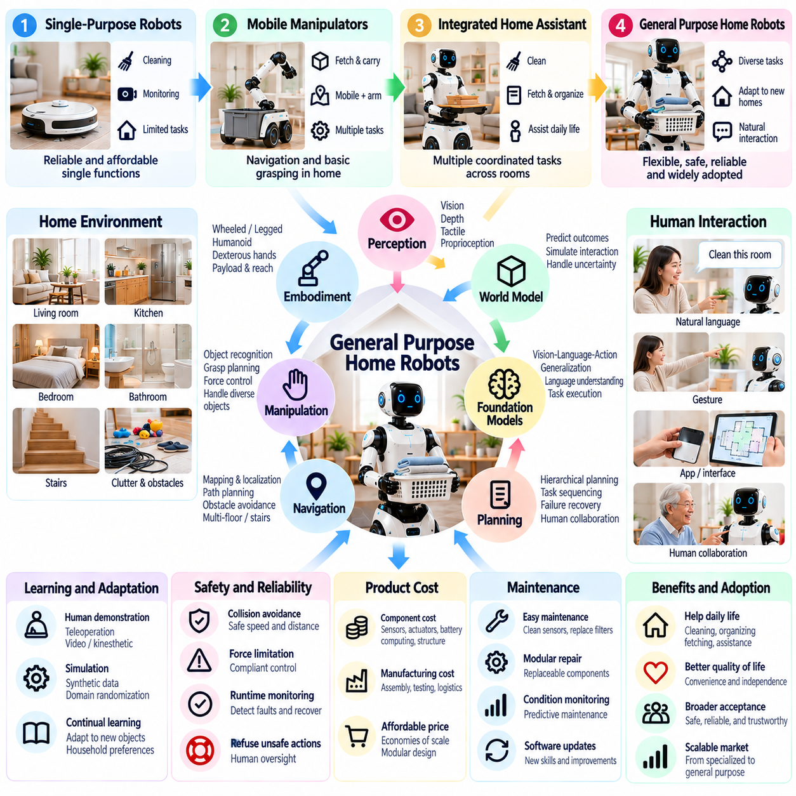{width="7.268055555555556in" height="7.268055555555556in"}

범용 가정용 로봇으로의 발전 경로(Path to General-Purpose Home Robots)는 특수 목적의 가정 자동화(Specialized Household Automation)에서 일상생활 환경(Everyday Environment)의 다양한 작업을 수행할 수 있는 적응형 피지컬 인공지능(Adaptable Physical AI)으로 전환하는 과정을 의미한다. 현재 소비자용 로봇(Consumer Robot)은 일반적으로 청소(Cleaning), 모니터링(Monitoring), 제한적인 보조(Limited Assistance)에 집중한다. 범용 시스템(General-Purpose System)은 변화하는 가정환경(Household Condition)에서 안전성(Safety), 경제성(Affordability), 신뢰성(Reliability)을 유지하면서 이동성(Mobility), 물체 조작(Manipulation), 환경 인식(Perception), 추론(Reasoning), 인간과의 상호작용(Human Interaction)을 통합해야 한다.

범용 능력(General-Purpose Capability)이 로봇이 상상할 수 있는 모든 가사 활동(Domestic Activity)을 수행해야 한다는 의미는 아니다. 실용적인 정의(Practical Definition)는 광범위한 재프로그래밍(Extensive Reprogramming) 없이 서로 다른 방(Room), 물체(Object), 사용자 요구사항(User Requirement)에 걸쳐 여러 유용한 작업(Useful Task)을 수행할 수 있는 능력을 강조한다. 작업 다양성(Task Diversity)은 작업 완료 품질(Completion Quality) 및 운영 독립성(Operational Independence)과 함께 평가되어야 한다. 광범위하지만 신뢰성이 낮은 기능(Broad but Unreliable Functionality)은 신중하게 선정된 신뢰할 수 있는 가정용 서비스(Dependable Household Service)보다 낮은 가치를 제공한다.

개발 경로(Development Pathway)는 신뢰할 수 있는 단일 목적 로봇(Single-Purpose Robot)에서 시작하여 통합 이동 조작(Integrated Mobile Manipulation)으로 발전한다. 청소 로봇(Cleaning Robot)은 성숙한 자율주행(Navigation) 및 일정 계획(Scheduling) 기술을 보여주며, 이동형 매니퓰레이터(Mobile Manipulator)는 물체를 운반하고 위치를 변경하는 능력을 추가한다. 더욱 발전된 시스템(Advanced System)은 청소(Cleaning), 물건 가져오기(Fetching), 정리(Organizing), 기본적인 가정 보조(Basic Household Assistance)를 통합적으로 수행할 수 있다. 기능이 확장될 때마다 센싱(Sensing), 제어(Control), 작업 계획(Task Planning), 안전성 검증(Safety Validation)에 대한 새로운 요구사항이 발생한다.

로봇 형태학(Robot Morphology)은 수행할 수 있는 가정 내 작업(Household Task)의 범위에 큰 영향을 미친다. 바퀴형 플랫폼(Wheeled Platform)은 접근 가능한 바닥(Accessible Floor)에서 효율적인 이동을 제공하며, 다리형 및 휴머노이드 구조(Legged and Humanoid Configuration)는 계단(Stair)이나 인간 중심 설비(Human-Oriented Fixture)가 있는 환경을 이동할 수 있다. 매니퓰레이터 도달 범위(Manipulator Reach), 적재 능력(Payload Capacity), 정교한 조작 능력(Dexterity), 물리적 크기(Physical Dimension)는 실질적인 유용성(Practical Usefulness)을 결정한다. 모든 가정에 최적인 단일 신체 구조(Single Body Configuration)는 존재하지 않으므로 체화 구조(Embodiment)는 핵심적인 설계 상충관계(Design Tradeoff)가 된다.

정교한 물체 조작(Dexterous Manipulation)은 가정 내 물체(Domestic Object)의 형태(Shape), 재질(Material), 무게(Weight), 파손 가능성(Fragility)이 매우 다양하기 때문에 여전히 중요한 기술적 장벽(Technical Barrier)이다. 로봇은 물체를 인식하고(Object Recognition), 파지 안정성(Grasp Stability)을 추정하며, 접촉력(Contact Force)을 조절하고, 실패한 행동(Unsuccessful Action)에서 복구할 수 있어야 한다. 의류 접기(Folding Clothing)나 유연한 포장재 취급(Handling Flexible Packaging)과 같은 작업은 복잡한 물리적 상호작용(Complex Physical Interaction)을 포함한다. 기술 발전을 위해서는 촉각 센싱(Tactile Sensing)과 적응형 엔드이펙터(Adaptable End Effector)가 지원하는 강건한 조작 정책(Robust Manipulation Policy)이 필요하다.

다중모달 인식(Multimodal Perception)은 유연한 가정 내 작동(Flexible Household Operation)에 필요한 환경 이해(Environmental Understanding)를 제공한다. 카메라(Camera), 깊이 센서(Depth Sensor), 촉각 센서(Tactile Sensor), 고유수용성 측정(Proprioceptive Measurement)은 물체(Object)와 로봇 상태(Robot State)에 관한 상호 보완적인 정보(Complementary Information)를 제공한다. 인식 시스템(Perception System)은 가려짐(Occlusion), 조명 변화(Changing Lighting), 복잡한 장애물 환경(Clutter), 익숙하지 않은 배치(Unfamiliar Arrangement)에서도 효과적으로 작동해야 한다. 신뢰할 수 있는 작동(Reliable Operation)을 위해서는 모든 인식 결과(Perception Result)가 정확하다고 가정하지 않고 불확실성(Uncertainty)을 인식하는 능력도 필요하다.

파운데이션 모델(Foundation Model)은 언어 명령(Language Instruction), 시각적 관측(Visual Observation), 행동 표현(Action Representation)을 연결함으로써 일반화(Generalization)를 개선할 수 있다. 시각-언어-행동 모델(Vision-Language-Action Model, VLA)은 다양한 시연(Diverse Demonstration)으로부터 작업 설명(Task Description)과 로봇 행동(Robotic Behavior) 사이의 관계를 학습할 수 있다. 그러나 언어적 능력(Linguistic Competence)이 물리적 수행 능력(Physical Competence)을 보장하는 것은 아니다. 고수준 모델 출력(High-Level Model Output)은 로봇의 능력(Robot Capability), 환경 제약조건(Environmental Constraint), 독립적으로 강제되는 안전 요구사항(Independently Enforced Safety Requirement)에 근거하여 실제 행동과 연결되어야 한다.

월드 모델(World Model)은 로봇의 행동(Robotic Action) 이후 물체와 환경이 어떻게 변화할 수 있는지를 예측함으로써 가정 내 작업 계획(Household Planning)을 지원할 수 있다. 이러한 예측(Prediction)은 로봇이 실행 전에 파지 시도(Grasp Attempt), 대안 이동 경로(Navigation Alternative), 다단계 작업 순서(Multi-Step Task Sequence)를 평가하는 데 도움이 된다. 그러나 가정환경의 물리 현상(Household Physics)에는 불확실한 마찰(Uncertain Friction), 변형 가능한 재료(Deformable Material), 예상하지 못한 인간의 개입(Unexpected Human Intervention)이 포함된다. 따라서 예측 모델(Predictive Model)은 실제 환경 관측(Real-World Observation)을 통한 지속적인 보정(Continuous Correction)을 지원해야 한다.

계층적 작업 계획(Hierarchical Planning)은 복잡한 가정 내 활동(Complex Domestic Activity)을 조정하는 데 필수적이다. 방을 정리하라는 요청(Request to Prepare a Room)에는 제자리에 있지 않은 물체(Misplaced Object)를 식별하고, 보관 위치(Storage Location)를 선택하며, 공간 사이를 이동하고, 여러 물체 조작 단계(Manipulation Step)를 수행하는 과정이 포함될 수 있다. 고수준 계획기(High-Level Planner)는 작업 목표(Task Objective)를 구성하고, 저수준 제어기(Lower-Level Controller)는 검증된 움직임(Verified Movement)을 실행한다. 지속적인 피드백(Continuous Feedback)은 로봇이 실패(Failure)를 감지하고, 계획(Plan)을 수정하며, 필요한 경우 도움을 요청하도록 한다.

인간 시연 기반 학습(Learning from Human Demonstrations)은 모든 움직임을 수동으로 프로그래밍(Manual Programming)하지 않고 가정 내 작업 기술(Household Skill)을 습득하기 위한 실용적인 방법이다. 원격조작(Teleoperation), 운동감각적 교시(Kinesthetic Teaching), 비디오 기반 학습(Video-Based Learning)은 유용한 행동(Useful Behavior)의 사례를 제공할 수 있다. 그러나 인간 신체(Human Body)와 로봇 기구(Robotic Mechanism) 사이의 차이는 기술 전이(Skill Transfer)를 어렵게 만든다. 학습 파이프라인(Training Pipeline)은 시연(Demonstration)을 로봇의 형태학(Robot Morphology)에 맞추어 변환하고 실제 물리적 환경(Physical Environment)에서 성능을 검증해야 한다.

시뮬레이션(Simulation)과 합성 데이터(Synthetic Data)는 가정 내부 구조(Household Layout), 물체 구성(Object Configuration), 비정상적인 사건(Unusual Event)에 대한 학습 범위(Training Coverage)를 확장할 수 있다. 도메인 무작위화(Domain Randomization)는 학습 시스템(Learning System)이 조명(Lighting), 마찰(Friction), 기하 구조(Geometry), 센서 잡음(Sensor Noise)의 다양한 변화에 노출되도록 한다. 그러나 시뮬레이션에서의 성공(Simulated Success)이 실제 환경에서의 신뢰할 수 있는 성능(Reliable Real-World Performance)을 입증하는 것은 아니다. 특히 접촉이 많은 물체 조작(Contact-Rich Manipulation), 인간과의 상호작용(Human Interaction), 발생 빈도는 낮지만 안전에 중대한 상황(Rare Safety-Critical Situation)에서는 물리적 검증(Physical Validation)이 필수적이다.

지속 학습(Continual Learning)은 가정용 로봇(Home Robot)이 배포(Deployment) 이후 새로운 물체(New Object), 가정 내 배치(Household Arrangement), 사용자 선호도(User Preference)에 적응하도록 한다. 지속적 기억(Persistent Memory)은 공간 지식(Spatial Knowledge)과 이전에 성공한 작업 전략(Previously Successful Task Strategy)을 보존할 수 있다. 그러나 적응(Adaptation)은 치명적 망각(Catastrophic Forgetting), 불안정한 정책(Unstable Policy), 승인되지 않은 행동 변화(Unauthorized Behavioral Change)를 방지해야 한다. 검증된 업데이트(Validated Update), 통제된 기억 보존(Controlled Memory Retention), 롤백 메커니즘(Rollback Mechanism)은 신뢰할 수 있는 장기 작동(Dependable Long-Term Operation)에 필요하다.

인간-로봇 협업(Human-Robot Collaboration)은 자율성(Autonomy)이 향상되더라도 계속 중요하다. 로봇은 제한 없는 독립적 실행(Unrestricted Independent Execution)을 시도하기보다 인간의 판단(Human Judgment), 도움(Assistance), 승인(Authorization)이 필요한 작업을 인식해야 한다. 자연어(Natural Language), 제스처(Gesture), 접근 가능한 인터페이스(Accessible Interface)는 공동 작업 계획(Shared Task Planning)을 지원할 수 있다. 효과적인 협업(Effective Collaboration)은 로봇의 능력(Capability), 불확실성(Uncertainty), 진행 상황(Progress), 인간의 개입을 요청하는 이유(Reason for Requesting Intervention)를 명확하게 전달하는 데 달려 있다.

범용 능력(General-Purpose Capability)이 확대되면 추가적인 물리적 위험(Physical Hazard)이 발생하기 때문에 안전 공학(Safety Engineering)도 함께 발전해야 한다. 로봇은 어린이(Child), 반려동물(Pet), 날카로운 물체(Sharp Object), 액체(Liquid), 전기 장비(Electrical Equipment), 불안정한 가구(Unstable Furniture)에 직면할 수 있다. 실행 중 모니터링(Runtime Monitoring), 힘 제한(Force Limit), 충돌 회피(Collision Avoidance), 비상 정지(Emergency Stopping)는 학습된 정책(Learned Policy)과 독립적으로 작동해야 한다. 자율성 확대(Expanding Autonomy)를 위해서는 다양한 작업(Diverse Task)에서 보호 메커니즘(Protective Mechanism)이 계속 효과적으로 작동한다는 근거가 필요하다.

경제적 실현 가능성(Economic Feasibility)은 범용 가정용 로봇(General-Purpose Home Robotics)의 또 다른 주요 제약조건(Major Constraint)이다. 정교한 로봇 손(Dexterous Hand), 다수의 액추에이터(Multiple Actuator), 고성능 프로세서(High-Performance Processor), 정밀 센서(Sophisticated Sensor)는 하드웨어 비용(Hardware Cost)과 유지관리 복잡도(Maintenance Complexity)를 증가시킨다. 제조업체(Manufacturer)는 추가적인 기능(Additional Capability)이 충분한 가정 내 가치(Household Value)를 창출하는지 평가해야 한다. 모듈형 구성요소(Modular Component), 효율적인 컴퓨팅(Efficient Computing), 확장 가능한 제조(Scalable Manufacturing), 정비 가능한 기계 설계(Serviceable Mechanical Design)는 더욱 접근 가능한 제품 가격(Accessible Product Pricing)을 지원할 수 있다.

신뢰성(Reliability)은 개별 작업 시연(Isolated Task Demonstration)이 아니라 장기간의 작동(Extended Operation)을 통해 입증되어야 한다. 가정용 로봇(Home Robot)은 반복적인 사용(Repeated Use), 경미한 환경 변화(Minor Environmental Change), 센서 오염(Sensor Contamination), 소프트웨어 중단(Software Interruption), 부품 마모(Component Wear)를 견딜 수 있어야 한다. 유용한 평가 지표(Useful Metric)에는 자율 작업 완료율(Autonomous Task Completion), 인간 개입 빈도(Intervention Frequency), 복구 성공률(Recovery Success), 유지관리 부담(Maintenance Burden)이 포함된다. 일반화된 능력(Generalized Capability)이 일상적인 작동(Everyday Operation)에서도 신뢰할 수 있는 수준으로 유지되는지 확인하려면 장기간 현장 시험(Long-Duration Field Trial)이 필요하다.

단계적 상용화 전략(Phased Commercialization Strategy)은 기술적 위험(Technical Risk)과 재무적 위험(Financial Risk)을 줄일 수 있다. 초기 제품(Initial Product)은 비교적 구조화된 가정환경(Relatively Structured Home)에서 가치가 높은 제한된 작업(High-Value Task)에 집중할 수 있다. 이후 제품 세대(Later Product Generation)는 성능(Performance)이 개선됨에 따라 물체 다양성(Object Diversity), 조작 복잡도(Manipulation Complexity), 환경 적용 범위(Environmental Coverage)를 확대할 수 있다. 명확한 작동 경계(Clear Operating Boundary)는 제조업체(Manufacturer)가 현실적인 고객 기대(Realistic Customer Expectation)를 형성하고 더 넓은 배포(Broader Deployment)를 위한 검증 근거(Validation Evidence)를 축적하도록 한다.

스마트홈 인프라(Smart-Home Infrastructure)와의 상호운용성(Interoperability)은 로봇의 유용성(Robotic Usefulness)을 물리적 물체 조작(Physical Manipulation) 이상으로 확장할 수 있다. 로봇은 가전제품(Appliance), 조명 시스템(Lighting System), 환경 센서(Environmental Sensor), 홈 자동화 플랫폼(Home Automation Platform)과 협력하여 복합 작업(Compound Task)을 수행할 수 있다. 공유된 맥락 정보(Shared Context)는 불필요한 센싱(Unnecessary Sensing)을 줄이고 일정 계획(Scheduling)을 개선할 수 있다. 그러나 시스템 통합(Integration)은 장치 권한(Device Permission), 사이버보안 보호(Cybersecurity Protection), 자동화된 행동(Automated Action)에 대한 명확한 책임(Responsibility)을 강제해야 한다.

사용자 수용성(User Acceptance)은 기술적 범용성(Technical Versatility) 이상의 요소에 달려 있다. 거주자(Resident)는 개인 소지품(Personal Belonging), 사적인 공간(Private Space), 취약한 가정 구성원(Vulnerable Household Member) 주변에서 작동하는 로봇을 신뢰할 수 있어야 한다. 개인화(Personalization)는 상호작용(Interaction)을 개선할 수 있지만, 개인정보 보호(Privacy Protection)와 사용자 통제권(User Control)은 핵심 요소로 유지되어야 한다. 투명한 한계(Transparent Limitation), 예측 가능한 행동(Predictable Behavior), 접근 가능한 유지관리(Accessible Maintenance), 이해하기 쉬운 비용(Understandable Cost)은 기술적 능력(Technological Capability)을 지속적인 가정 내 도입(Sustained Household Adoption)으로 연결하는 데 필요하다.

평가 프레임워크(Evaluation Framework)는 선별된 시연(Selected Demonstration)에 의존하기보다 작업(Task), 물체(Object), 환경(Environment), 사용자(User)에 걸친 일반화 성능(Generalization Performance)을 측정해야 한다. 벤치마크(Benchmark)는 익숙한 조건(Familiar Condition)과 실제로 익숙하지 않은 상황(Genuinely Unfamiliar Situation)을 구별해야 한다. 성공률(Success Rate)과 함께 안전 성능(Safety Performance), 개입 요구사항(Intervention Requirement), 작업 품질(Task Quality), 자원 소비(Resource Consumption)를 평가해야 한다. 표준화된 시험(Standardized Testing)은 비교 평가(Comparison)를 지원할 수 있지만, 실용적인 유용성(Practical Utility)을 검증하기 위해서는 장기적인 가정 내 시험(Long-Term Household Trial)이 여전히 필수적이다.

범용 로봇(General-Purpose Robot)으로의 발전은 단일한 범용 아키텍처(Single Universal Architecture)가 아니라 여러 체화 구조(Embodiment)와 능력 수준(Capability Level)을 통해 이루어질 가능성이 높다. 소형 이동형 매니퓰레이터(Compact Mobile Manipulator)는 접근성이 좋은 아파트(Accessible Apartment)에 적합할 수 있으며, 더 큰 플랫폼(Larger Platform)은 높은 작업 능력을 요구하는 가사 활동(Demanding Household Task)을 담당할 수 있다. 소프트웨어 기반 기술(Software Foundation)은 서로 다른 로봇 신체(Robot Body) 사이에서 점차 높은 재사용성(Reusability)을 확보할 수 있다. 그러나 지능 모델(Intelligence Model)을 공유하더라도 형태학 인식형 제어(Morphology-Aware Control)와 하드웨어별 검증(Hardware-Specific Validation)은 계속 필요하다.

체화 파운데이션 모델(Embodied Foundation Model), 촉각 인식(Tactile Perception), 적응형 물체 조작(Adaptive Manipulation), 로봇 데이터 엔진(Robot Data Engine)의 미래 발전은 가정 내 작업 기술 습득(Household Skill Acquisition)을 가속할 수 있다. 로봇 군집 학습(Fleet Learning)은 적절한 권한(Permission)과 개인정보 보호 조치(Privacy Safeguard)가 확보된 경우 다양한 운영 경험(Diverse Operational Experience)을 활용하여 모델을 개선할 수 있다. 그러나 더 큰 데이터셋(Larger Dataset)만으로 모든 물리적 불확실성(Physical Uncertainty)을 해결할 수는 없다. 기술 발전(Progress)을 위해서는 알고리즘(Algorithm), 하드웨어(Hardware), 시험(Testing), 수명주기 지원(Lifecycle Support)의 조화로운 개선이 필요하다.

궁극적으로 범용 가정용 로봇으로의 발전 경로(Path to General-Purpose Home Robots)는 신뢰할 수 있는 작동(Dependable Operation)을 유지하면서 유용한 자율성(Useful Autonomy)을 점진적으로 확대하는 과정이다. 성공(Success)은 단순히 인간과 유사한 행동(Humanlike Behavior)을 시연하는 것이 아니라 얼마나 많은 실질적인 가정 내 요구사항(Meaningful Household Need)을 안전하고 경제적으로 해결하는지에 따라 평가되어야 한다. 지속 가능한 피지컬 인공지능(Sustainable Physical AI)은 일반화 가능한 지능(Generalizable Intelligence), 유능한 체화 구조(Capable Embodiment), 엄격한 안전 공학(Rigorous Safety Engineering), 인간 중심 제품 설계(Human-Centered Product Design)의 통합을 통해 실현될 것이다.
