**Volume 12. Physical AI Business and Industry Applications**


# Chapter 08. Business Model Design

##  

## 08.01. From Robot Product to Physical AI Business

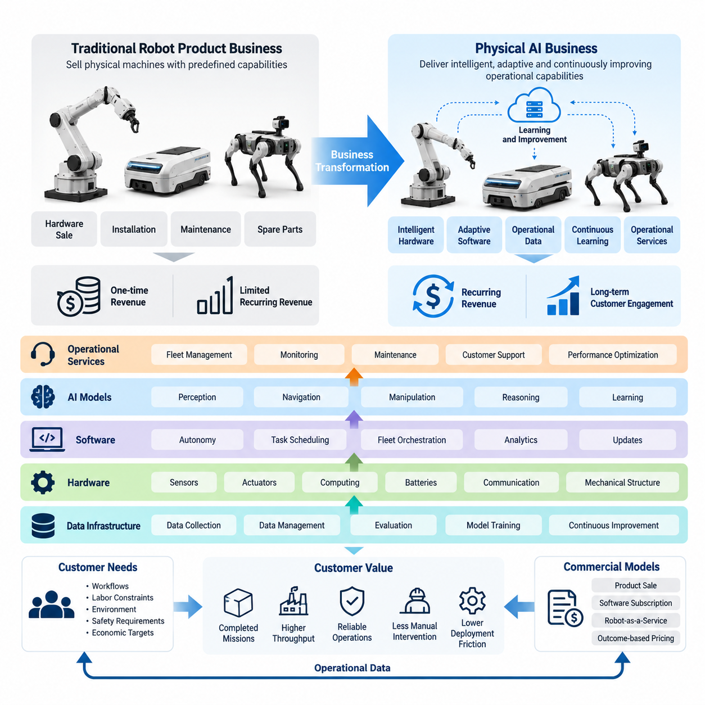{width="7.268055555555556in" height="7.268055555555556in"}

The transition from a conventional robot product business to a Physical AI business represents a fundamental change in how industrial automation creates, delivers, and captures economic value. Traditional robotics companies primarily commercialize physical machines with predefined capabilities, while Physical AI enterprises combine intelligent hardware, adaptive software, operational data, and continuous learning into integrated systems that improve throughout their deployment lifecycle.

In a conventional robotics business, commercial value is often concentrated at the point of equipment sale. Customers purchase robots based on specifications such as payload capacity, positioning accuracy, operating speed, and mechanical reliability. Additional revenue may come from installation, maintenance, and spare parts. Although this approach remains important, its dependence on hardware transactions can limit recurring revenue and long-term customer engagement.

Physical AI expands the commercial offering beyond equipment ownership by treating intelligence, autonomy, and operational performance as continuously deliverable capabilities. A robot becomes a physical execution platform connected to perception models, decision systems, learning infrastructure, and fleet management services. The business therefore shifts from selling isolated machines toward providing measurable operational outcomes supported by evolving software and intelligence.

This transformation changes the fundamental unit of customer value. Instead of evaluating a robot primarily by its technical specifications, customers increasingly assess the productive work it performs under actual operating conditions. Relevant outcomes include completed transport missions, successful manipulation tasks, production throughput, inspection coverage, service availability, and reductions in manual intervention. These operational metrics provide the foundation for sustainable Physical AI business models.

A Physical AI enterprise must distinguish technological capability from commercially valuable functionality. Advanced perception, autonomous navigation, manipulation intelligence, and multimodal reasoning have limited business significance unless they address identifiable operational problems. Successful commercialization therefore begins with understanding customer workflows, labor constraints, environmental conditions, safety requirements, and the economic consequences of automation performance.

The resulting value proposition combines physical execution with adaptable intelligence. Traditional automation often requires substantial engineering whenever workflows or operating conditions change. Physical AI seeks to reduce this dependency through reusable models, configurable behaviors, and learning-enabled adaptation. When implemented reliably, these capabilities can lower deployment friction, expand task coverage, and increase the productive lifetime of robotic equipment.

Hardware nevertheless remains a critical component of the business architecture. Sensors, actuators, computing systems, batteries, communication interfaces, and mechanical structures determine the physical limits within which intelligence operates. Commercial success requires balancing hardware cost, performance, durability, maintainability, and software compatibility. An advanced AI model cannot compensate economically for an unreliable or excessively expensive physical platform.

Software creates an additional layer of differentiation because many capabilities can be upgraded without replacing the underlying machine. Navigation improvements, perception updates, task scheduling algorithms, manipulation policies, and operational analytics may be delivered through controlled software releases. This enables vendors to maintain customer relationships after installation while offering functionality improvements, performance optimization, and new application capabilities.

The introduction of recurring software revenue changes the financial characteristics of robotics businesses. Subscription arrangements may cover autonomy software, fleet orchestration, analytics, cybersecurity updates, and advanced AI capabilities. Unlike one-time hardware revenue, recurring income can improve revenue visibility when customer retention is strong. However, sustainable profitability requires careful management of computing expenses, support obligations, software maintenance, and deployment complexity.

Robot-as-a-Service provides another commercialization mechanism by converting robot ownership into access to operational capabilities. Under this model, customers may pay recurring fees for equipment availability, software functionality, maintenance, and support. Providers retain varying degrees of asset ownership and operational responsibility. The model can reduce customers\' initial capital requirements but introduces financing, utilization, maintenance, and residual-value risks for service providers.

A more advanced commercial arrangement links compensation directly to operational output. Customers may pay according to completed missions, transported materials, inspected assets, or other verified results. Such outcome-based pricing aligns supplier incentives with customer productivity, but it requires reliable measurement and clear contractual boundaries. Environmental variability, customer-controlled delays, exceptional conditions, and service exclusions must be considered when defining performance commitments.

Physical AI business architecture can therefore be understood as several interdependent economic layers. Hardware enables physical interaction, software enables autonomous functionality, AI models provide adaptable intelligence, and operational services maintain performance. Data infrastructure connects these layers through monitoring, evaluation, and improvement. Each layer creates potential revenue opportunities while introducing different cost structures, competitive pressures, and contractual responsibilities.

Operational data becomes particularly important as deployed robot fleets expand. Real-world execution produces information about task success, environmental variation, equipment conditions, interventions, and failure patterns. With appropriate permissions and governance, selected data can support model evaluation, software improvement, and preventive maintenance. The commercial value emerges from converting operational experience into validated improvements that benefit customers.

A fleet-based learning architecture may create cumulative advantages when improvements developed from one deployment can be transferred to others. Shared perception capabilities, reusable task policies, standardized interfaces, and common failure-recovery strategies can reduce repeated engineering work. Nevertheless, these advantages depend on data quality, compatible hardware configurations, representative operating conditions, and disciplined validation before updated capabilities are deployed.

The transition also changes the role of system integration. Physical AI solutions must interact with warehouse management systems, manufacturing execution systems, enterprise resource planning platforms, facility infrastructure, and existing automation equipment. Integration is not simply an installation activity; it determines whether robotic intelligence can participate effectively in customer workflows. Standardized interfaces and reusable deployment tools are essential for reducing project-specific engineering costs.

Customer economics must be evaluated across the complete operating lifecycle rather than through equipment acquisition prices alone. Total cost of ownership includes purchase or service fees, integration, infrastructure modifications, energy consumption, maintenance, software subscriptions, supervision, downtime, and eventual replacement. Economic benefits may include labor productivity, higher throughput, improved consistency, reduced operational risk, and extended operating availability.

For suppliers, unit economics must incorporate more than manufacturing gross margin. Deployment engineering, customer acquisition, field support, warranty obligations, cloud infrastructure, financing costs, and ongoing AI development influence profitability. A business that generates attractive revenue from individual robot installations may still struggle to scale if each customer requires extensive customization or continuous human supervision.

Fleet utilization is another decisive factor because productive operating time determines how effectively deployed assets generate economic value. Robots that remain idle, experience frequent interventions, or operate below expected capacity create financial inefficiency regardless of their technical sophistication. Physical AI companies must therefore optimize task allocation, uptime, charging schedules, maintenance planning, and human escalation procedures as part of their commercial operations.

Safety, reliability, and regulatory compliance are integral business requirements rather than secondary engineering concerns. Autonomous machines operate in environments where failures may damage equipment, interrupt production, or endanger people. Providers must define operational boundaries, validate performance, implement fallback mechanisms, and allocate responsibility among manufacturers, software developers, integrators, and operators. Trustworthy operation directly affects adoption, insurance, and long-term commercial viability.

Scaling from a pilot installation to a repeatable business requires a shift from demonstration-oriented engineering to standardized delivery. Early deployments frequently involve extensive customization, manual calibration, and close technical supervision. Commercial scalability depends on reducing these activities through modular hardware, reusable software configurations, automated commissioning, remote diagnostics, standardized training, and repeatable acceptance testing.

The organizational structure of a Physical AI company must evolve alongside its technology and revenue model. Hardware engineering, AI development, product management, customer operations, field service, and commercial teams need coordinated objectives. Product decisions must reflect both technical feasibility and lifecycle profitability. Feedback from deployed systems should inform engineering priorities, while financial performance should influence platform standardization and service design.

Strategic differentiation increasingly depends on the combination of reliable embodiment, transferable intelligence, deployment efficiency, and operational expertise. Hardware performance alone may become insufficient when competitors offer comparable mechanical capabilities. Companies can strengthen their positions through validated autonomy, proprietary workflow knowledge, efficient fleet operations, trusted customer relationships, and integration ecosystems that make their solutions difficult to replace.

The long-term objective is not necessarily to eliminate hardware sales but to establish a business in which physical products, intelligent software, and operational services reinforce one another. Different customer segments may prefer capital purchases, subscriptions, managed services, or hybrid arrangements. A flexible commercial architecture allows providers to address these preferences while maintaining consistent technology foundations and measurable performance standards.

Ultimately, the evolution from robot product to Physical AI business represents a shift from equipment-centered transactions toward intelligence-enabled operational value. Sustainable competitive advantage emerges when companies can repeatedly deploy reliable machines, improve their capabilities, demonstrate customer economic benefits, and capture an appropriate share of the resulting value. The strongest business models align technological advancement with measurable productivity, lifecycle economics, and scalable service delivery.

기존 로봇 제품 사업(Robot Product Business)에서 피지컬 인공지능 사업(Physical AI Business)으로의 전환은 산업 자동화(Industrial Automation)가 경제적 가치(Economic Value)를 창출하고 제공하며 확보하는 방식의 근본적인 변화를 의미한다. 전통적인 로봇 기업은 주로 사전에 정의된 기능을 갖춘 물리적 기계(Physical Machine)를 상용화하는 반면, 피지컬 인공지능 기업은 지능형 하드웨어(Intelligent Hardware), 적응형 소프트웨어(Adaptive Software), 운영 데이터(Operational Data), 지속적 학습(Continuous Learning)을 통합하여 배포 수명주기(Deployment Lifecycle) 전반에 걸쳐 성능이 개선되는 시스템을 제공한다.

전통적인 로봇 사업(Traditional Robotics Business)에서는 상업적 가치(Commercial Value)가 장비 판매 시점에 집중되는 경우가 많다. 고객은 적재 용량(Payload Capacity), 위치 정밀도(Positioning Accuracy), 작동 속도(Operating Speed), 기계적 신뢰성(Mechanical Reliability) 등의 기술 사양을 기준으로 로봇을 구매한다. 추가 매출은 설치(Installation), 유지보수(Maintenance), 예비 부품(Spare Parts)에서 발생할 수 있다. 이러한 접근 방식은 여전히 중요하지만, 하드웨어 거래(Hardware Transactions)에 대한 의존도가 높아 반복 매출(Recurring Revenue)과 장기적인 고객 관계(Customer Engagement)를 확대하는 데 한계가 있다.

피지컬 인공지능(Physical AI)은 지능(Intelligence), 자율성(Autonomy), 운영 성능(Operational Performance)을 지속적으로 제공할 수 있는 역량으로 취급함으로써 장비 소유권(Equipment Ownership)을 넘어 상업적 제공 범위를 확장한다. 로봇은 인지 모델(Perception Models), 의사결정 시스템(Decision Systems), 학습 인프라(Learning Infrastructure), 로봇군 관리 서비스(Fleet Management Services)와 연결된 물리적 실행 플랫폼(Physical Execution Platform)이 된다. 이에 따라 사업은 개별 기계를 판매하는 방식에서 지속적으로 발전하는 소프트웨어와 지능을 기반으로 측정 가능한 운영 성과(Measurable Operational Outcomes)를 제공하는 방향으로 전환된다.

이러한 변화는 고객 가치(Customer Value)의 기본적인 평가 단위를 바꾼다. 고객은 로봇의 기술 사양(Technical Specifications)만을 평가하는 대신 실제 운영 환경(Actual Operating Conditions)에서 수행하는 생산적 작업(Productive Work)을 점점 더 중요하게 고려한다. 주요 성과에는 완료된 운송 임무(Completed Transport Missions), 성공적인 조작 작업(Successful Manipulation Tasks), 생산 처리량(Production Throughput), 검사 범위(Inspection Coverage), 서비스 가용성(Service Availability), 수동 개입 감소(Reduction in Manual Intervention)가 포함된다. 이러한 운영 지표(Operational Metrics)는 지속 가능한 피지컬 인공지능 사업 모델(Physical AI Business Models)의 기반을 제공한다.

피지컬 인공지능 기업(Physical AI Enterprise)은 기술적 역량(Technological Capability)과 상업적으로 가치 있는 기능(Commercially Valuable Functionality)을 구분해야 한다. 고급 인지(Advanced Perception), 자율주행(Autonomous Navigation), 조작 지능(Manipulation Intelligence), 멀티모달 추론(Multimodal Reasoning)은 명확한 운영 문제(Operational Problems)를 해결하지 못한다면 사업적 의미가 제한적이다. 따라서 성공적인 상용화(Commercialization)는 고객의 작업 흐름(Customer Workflows), 노동력 제약(Labor Constraints), 환경 조건(Environmental Conditions), 안전 요구사항(Safety Requirements), 자동화 성능의 경제적 영향(Economic Consequences)을 이해하는 것에서 시작된다.

이러한 가치 제안(Value Proposition)은 물리적 실행(Physical Execution)과 적응형 지능(Adaptive Intelligence)을 결합한다. 전통적인 자동화(Traditional Automation)는 작업 흐름이나 운영 조건이 변경될 때 상당한 엔지니어링 작업(Engineering Work)을 요구하는 경우가 많다. 피지컬 인공지능(Physical AI)은 재사용 가능한 모델(Reusable Models), 설정 가능한 동작(Configurable Behaviors), 학습 기반 적응(Learning-Enabled Adaptation)을 통해 이러한 의존성을 줄이고자 한다. 이러한 기능이 안정적으로 구현되면 배포 부담(Deployment Friction)을 낮추고 작업 적용 범위(Task Coverage)를 확대하며 로봇 장비의 생산적 수명(Productive Lifetime)을 연장할 수 있다.

그럼에도 하드웨어(Hardware)는 사업 아키텍처(Business Architecture)의 핵심 구성 요소로 남는다. 센서(Sensors), 액추에이터(Actuators), 컴퓨팅 시스템(Computing Systems), 배터리(Batteries), 통신 인터페이스(Communication Interfaces), 기계 구조(Mechanical Structures)는 지능이 작동할 수 있는 물리적 한계(Physical Limits)를 결정한다. 상업적 성공을 위해서는 하드웨어 비용(Hardware Cost), 성능(Performance), 내구성(Durability), 유지보수성(Maintainability), 소프트웨어 호환성(Software Compatibility) 사이의 균형이 필요하다. 첨단 인공지능 모델(Advanced AI Model)도 신뢰성이 낮거나 지나치게 비싼 물리적 플랫폼(Physical Platform)의 경제적 문제를 해결할 수는 없다.

소프트웨어(Software)는 기본 기계를 교체하지 않고도 많은 기능을 업그레이드할 수 있기 때문에 추가적인 차별화 요소(Differentiation)를 제공한다. 내비게이션 개선(Navigation Improvements), 인지 기능 업데이트(Perception Updates), 작업 스케줄링 알고리즘(Task Scheduling Algorithms), 조작 정책(Manipulation Policies), 운영 분석(Operational Analytics)은 통제된 소프트웨어 배포(Controlled Software Releases)를 통해 제공될 수 있다. 이를 통해 공급업체(Vendors)는 설치 이후에도 고객 관계를 유지하면서 기능 개선(Functionality Improvements), 성능 최적화(Performance Optimization), 새로운 응용 기능(New Application Capabilities)을 제공할 수 있다.

반복적인 소프트웨어 매출(Recurring Software Revenue)의 도입은 로봇 사업의 재무적 특성(Financial Characteristics)을 변화시킨다. 구독 계약(Subscription Arrangements)은 자율운영 소프트웨어(Autonomy Software), 로봇군 오케스트레이션(Fleet Orchestration), 분석(Analytics), 사이버보안 업데이트(Cybersecurity Updates), 고급 인공지능 기능(Advanced AI Capabilities)을 포함할 수 있다. 일회성 하드웨어 매출(One-Time Hardware Revenue)과 달리 반복 수익(Recurring Income)은 고객 유지율(Customer Retention)이 높을 경우 매출 예측 가능성(Revenue Visibility)을 개선할 수 있다. 그러나 지속 가능한 수익성(Sustainable Profitability)을 확보하려면 컴퓨팅 비용(Computing Expenses), 지원 의무(Support Obligations), 소프트웨어 유지보수(Software Maintenance), 배포 복잡성(Deployment Complexity)을 신중하게 관리해야 한다.

서비스형 로봇(Robot-as-a-Service, RaaS)은 로봇 소유권(Robot Ownership)을 운영 역량(Operational Capabilities)에 대한 접근 방식으로 전환하는 또 다른 상용화 메커니즘(Commercialization Mechanism)을 제공한다. 이 모델에서 고객은 장비 가용성(Equipment Availability), 소프트웨어 기능(Software Functionality), 유지보수(Maintenance), 기술 지원(Support)에 대해 정기적인 요금(Recurring Fees)을 지불할 수 있다. 공급업체는 자산 소유권(Asset Ownership)과 운영 책임(Operational Responsibility)을 다양한 수준으로 유지한다. 이 모델은 고객의 초기 자본 요구사항(Initial Capital Requirements)을 줄일 수 있지만 서비스 공급업체에는 금융 조달(Financing), 가동률(Utilization), 유지보수, 잔존 가치(Residual Value)에 관한 위험을 발생시킨다.

더 발전된 상업적 계약(Commercial Arrangement)은 보상을 운영 산출물(Operational Output)에 직접 연결한다. 고객은 완료된 임무(Completed Missions), 운송된 자재(Transported Materials), 검사된 자산(Inspected Assets), 기타 검증된 결과(Verified Results)에 따라 비용을 지불할 수 있다. 이러한 성과 기반 가격 책정(Outcome-Based Pricing)은 공급업체의 인센티브(Supplier Incentives)를 고객 생산성(Customer Productivity)과 일치시키지만 신뢰할 수 있는 측정(Reliable Measurement)과 명확한 계약상 경계(Contractual Boundaries)가 필요하다. 성능 약속(Performance Commitments)을 정의할 때는 환경 변동성(Environmental Variability), 고객이 통제하는 지연(Customer-Controlled Delays), 예외 상황(Exceptional Conditions), 서비스 제외 조건(Service Exclusions)을 고려해야 한다.

따라서 피지컬 인공지능 사업 아키텍처(Physical AI Business Architecture)는 상호 의존적인 여러 경제적 계층(Economic Layers)으로 이해할 수 있다. 하드웨어(Hardware)는 물리적 상호작용(Physical Interaction)을 가능하게 하고, 소프트웨어(Software)는 자율 기능(Autonomous Functionality)을 제공하며, 인공지능 모델(AI Models)은 적응형 지능(Adaptive Intelligence)을 제공하고, 운영 서비스(Operational Services)는 성능을 유지한다. 데이터 인프라(Data Infrastructure)는 모니터링(Monitoring), 평가(Evaluation), 개선(Improvement)을 통해 이러한 계층을 연결한다. 각 계층은 잠재적인 매출 기회(Revenue Opportunities)를 창출하는 동시에 서로 다른 비용 구조(Cost Structures), 경쟁 압력(Competitive Pressures), 계약상 책임(Contractual Responsibilities)을 발생시킨다.

배포된 로봇군(Deployed Robot Fleets)이 확대될수록 운영 데이터(Operational Data)는 특히 중요해진다. 실제 환경에서의 작업 수행(Real-World Execution)은 작업 성공(Task Success), 환경 변화(Environmental Variation), 장비 상태(Equipment Conditions), 개입(Interventions), 고장 패턴(Failure Patterns)에 관한 정보를 생성한다. 적절한 권한(Permissions)과 데이터 거버넌스(Data Governance)가 확보되면 선별된 데이터는 모델 평가(Model Evaluation), 소프트웨어 개선(Software Improvement), 예방 유지보수(Preventive Maintenance)에 활용될 수 있다. 상업적 가치(Commercial Value)는 운영 경험(Operational Experience)을 고객에게 도움이 되는 검증된 개선(Validated Improvements)으로 전환하는 과정에서 발생한다.

로봇군 기반 학습 아키텍처(Fleet-Based Learning Architecture)는 한 배포 환경에서 개발된 개선 사항을 다른 환경으로 이전할 수 있을 때 누적적 이점(Cumulative Advantages)을 창출할 수 있다. 공유 인지 기능(Shared Perception Capabilities), 재사용 가능한 작업 정책(Reusable Task Policies), 표준화된 인터페이스(Standardized Interfaces), 공통 장애 복구 전략(Common Failure-Recovery Strategies)은 반복적인 엔지니어링 작업(Repeated Engineering Work)을 줄일 수 있다. 그러나 이러한 이점은 데이터 품질(Data Quality), 호환 가능한 하드웨어 구성(Compatible Hardware Configurations), 대표성 있는 운영 조건(Representative Operating Conditions), 업데이트 기능 배포 이전의 체계적인 검증(Disciplined Validation)에 달려 있다.

이러한 전환은 시스템 통합(System Integration)의 역할도 변화시킨다. 피지컬 인공지능 솔루션(Physical AI Solutions)은 창고 관리 시스템(Warehouse Management Systems, WMS), 제조 실행 시스템(Manufacturing Execution Systems, MES), 전사적 자원 관리(Enterprise Resource Planning, ERP), 시설 인프라(Facility Infrastructure), 기존 자동화 장비(Existing Automation Equipment)와 상호작용해야 한다. 시스템 통합은 단순한 설치 활동(Installation Activity)이 아니라 로봇 지능(Robotic Intelligence)이 고객 작업 흐름(Customer Workflows)에 효과적으로 참여할 수 있는지를 결정한다. 표준화된 인터페이스(Standardized Interfaces)와 재사용 가능한 배포 도구(Reusable Deployment Tools)는 프로젝트별 엔지니어링 비용(Project-Specific Engineering Costs)을 줄이는 데 필수적이다.

고객 경제성(Customer Economics)은 장비 취득 가격(Equipment Acquisition Prices)만이 아니라 전체 운영 수명주기(Operating Lifecycle)를 기준으로 평가해야 한다. 총소유비용(Total Cost of Ownership, TCO)에는 구매비 또는 서비스 요금(Purchase or Service Fees), 시스템 통합(Integration), 인프라 변경(Infrastructure Modifications), 에너지 소비(Energy Consumption), 유지보수(Maintenance), 소프트웨어 구독(Software Subscriptions), 감독(Supervision), 가동 중단(Downtime), 최종 교체(Eventual Replacement)가 포함된다. 경제적 편익(Economic Benefits)에는 노동 생산성(Labor Productivity), 처리량 증가(Higher Throughput), 일관성 개선(Improved Consistency), 운영 위험 감소(Reduced Operational Risk), 운영 가용성 확대(Extended Operating Availability)가 포함될 수 있다.

공급업체(Suppliers)의 단위 경제성(Unit Economics)은 제조 매출총이익률(Manufacturing Gross Margin) 이상의 요소를 반영해야 한다. 배포 엔지니어링(Deployment Engineering), 고객 획득(Customer Acquisition), 현장 지원(Field Support), 보증 의무(Warranty Obligations), 클라우드 인프라(Cloud Infrastructure), 금융 비용(Financing Costs), 지속적인 인공지능 개발(Ongoing AI Development)은 수익성(Profitability)에 영향을 미친다. 개별 로봇 설치(Individual Robot Installations)에서 매력적인 매출을 창출하는 사업이라도 고객마다 광범위한 맞춤화(Extensive Customization)나 지속적인 인간 감독(Continuous Human Supervision)이 필요하다면 사업 확장(Scaling)에 어려움을 겪을 수 있다.

로봇군 가동률(Fleet Utilization)은 배포된 자산(Deployed Assets)이 경제적 가치(Economic Value)를 얼마나 효율적으로 창출하는지를 결정하기 때문에 또 다른 핵심 요소이다. 유휴 상태(Idle State)에 머물거나 빈번한 개입(Frequent Interventions)이 필요하거나 예상 생산능력(Expected Capacity)보다 낮게 작동하는 로봇은 기술적 수준과 관계없이 재무적 비효율성(Financial Inefficiency)을 발생시킨다. 따라서 피지컬 인공지능 기업은 상업적 운영(Commercial Operations)의 일부로 작업 할당(Task Allocation), 가동시간(Uptime), 충전 일정(Charging Schedules), 유지보수 계획(Maintenance Planning), 인간 개입 요청 절차(Human Escalation Procedures)를 최적화해야 한다.

안전성(Safety), 신뢰성(Reliability), 규제 준수(Regulatory Compliance)는 부차적인 엔지니어링 문제가 아니라 필수적인 사업 요구사항(Business Requirements)이다. 자율 기계(Autonomous Machines)는 고장이 장비 손상(Equipment Damage), 생산 중단(Production Interruption), 인명 위험(Human Safety Risks)을 초래할 수 있는 환경에서 작동한다. 공급업체는 운영 경계(Operational Boundaries)를 정의하고 성능을 검증하며 대체 안전 메커니즘(Fallback Mechanisms)을 구현하고 제조업체(Manufacturers), 소프트웨어 개발업체(Software Developers), 시스템 통합업체(System Integrators), 운영업체(Operators) 사이의 책임을 배분해야 한다. 신뢰할 수 있는 운영(Trustworthy Operation)은 도입(Adoption), 보험(Insurance), 장기적인 상업적 지속 가능성(Long-Term Commercial Viability)에 직접적인 영향을 미친다.

시범 설치(Pilot Installation)에서 반복 가능한 사업(Repeatable Business)으로 확장하려면 시연 중심 엔지니어링(Demonstration-Oriented Engineering)에서 표준화된 공급 체계(Standardized Delivery)로 전환해야 한다. 초기 배포(Early Deployments)에는 광범위한 맞춤화(Extensive Customization), 수동 보정(Manual Calibration), 밀접한 기술 감독(Close Technical Supervision)이 필요한 경우가 많다. 상업적 확장성(Commercial Scalability)은 모듈형 하드웨어(Modular Hardware), 재사용 가능한 소프트웨어 구성(Reusable Software Configurations), 자동 시운전(Automated Commissioning), 원격 진단(Remote Diagnostics), 표준화된 교육(Standardized Training), 반복 가능한 인수 시험(Repeatable Acceptance Testing)을 통해 이러한 활동을 줄이는 데 달려 있다.

피지컬 인공지능 기업(Physical AI Company)의 조직 구조(Organizational Structure)는 기술 및 매출 모델(Revenue Model)과 함께 발전해야 한다. 하드웨어 엔지니어링(Hardware Engineering), 인공지능 개발(AI Development), 제품 관리(Product Management), 고객 운영(Customer Operations), 현장 서비스(Field Service), 영업 조직(Commercial Teams)은 조율된 목표(Coordinated Objectives)를 가져야 한다. 제품 의사결정(Product Decisions)은 기술적 실현 가능성(Technical Feasibility)과 수명주기 수익성(Lifecycle Profitability)을 모두 반영해야 한다. 배포된 시스템(Deployed Systems)의 피드백(Feedback)은 엔지니어링 우선순위(Engineering Priorities)에 반영되어야 하며, 재무 성과(Financial Performance)는 플랫폼 표준화(Platform Standardization)와 서비스 설계(Service Design)에 영향을 주어야 한다.

전략적 차별화(Strategic Differentiation)는 신뢰할 수 있는 물리적 구현(Reliable Embodiment), 이전 가능한 지능(Transferable Intelligence), 배포 효율성(Deployment Efficiency), 운영 전문성(Operational Expertise)의 결합에 점점 더 의존한다. 경쟁업체가 유사한 기계적 역량(Mechanical Capabilities)을 제공할 경우 하드웨어 성능(Hardware Performance)만으로는 충분하지 않을 수 있다. 기업은 검증된 자율성(Validated Autonomy), 독자적인 작업 흐름 지식(Proprietary Workflow Knowledge), 효율적인 로봇군 운영(Efficient Fleet Operations), 신뢰할 수 있는 고객 관계(Trusted Customer Relationships), 교체를 어렵게 만드는 통합 생태계(Integration Ecosystems)를 통해 경쟁력을 강화할 수 있다.

장기적인 목표(Long-Term Objective)는 반드시 하드웨어 판매(Hardware Sales)를 제거하는 것이 아니라 물리적 제품(Physical Products), 지능형 소프트웨어(Intelligent Software), 운영 서비스(Operational Services)가 상호 강화하는 사업을 구축하는 것이다. 고객 세그먼트(Customer Segments)에 따라 자본 구매(Capital Purchases), 구독(Subscriptions), 관리형 서비스(Managed Services), 하이브리드 계약(Hybrid Arrangements)을 선호할 수 있다. 유연한 상업적 아키텍처(Flexible Commercial Architecture)는 공급업체가 일관된 기술 기반(Consistent Technology Foundations)과 측정 가능한 성능 기준(Measurable Performance Standards)을 유지하면서 이러한 선호에 대응할 수 있도록 한다.

궁극적으로 로봇 제품(Robot Product)에서 피지컬 인공지능 사업(Physical AI Business)으로의 발전은 장비 중심 거래(Equipment-Centered Transactions)에서 지능 기반 운영 가치(Intelligence-Enabled Operational Value)로의 전환을 의미한다. 지속 가능한 경쟁 우위(Sustainable Competitive Advantage)는 기업이 신뢰할 수 있는 기계를 반복적으로 배포하고, 기능을 개선하며, 고객의 경제적 편익(Customer Economic Benefits)을 입증하고, 창출된 가치의 적절한 몫(Appropriate Share of Value)을 확보할 수 있을 때 형성된다. 가장 강력한 사업 모델(Business Models)은 기술 발전(Technological Advancement)을 측정 가능한 생산성(Measurable Productivity), 수명주기 경제성(Lifecycle Economics), 확장 가능한 서비스 제공(Scalable Service Delivery)과 일치시키는 모델이다.

##  

## 08.02. Problem Solution Fit and Use Case Selection

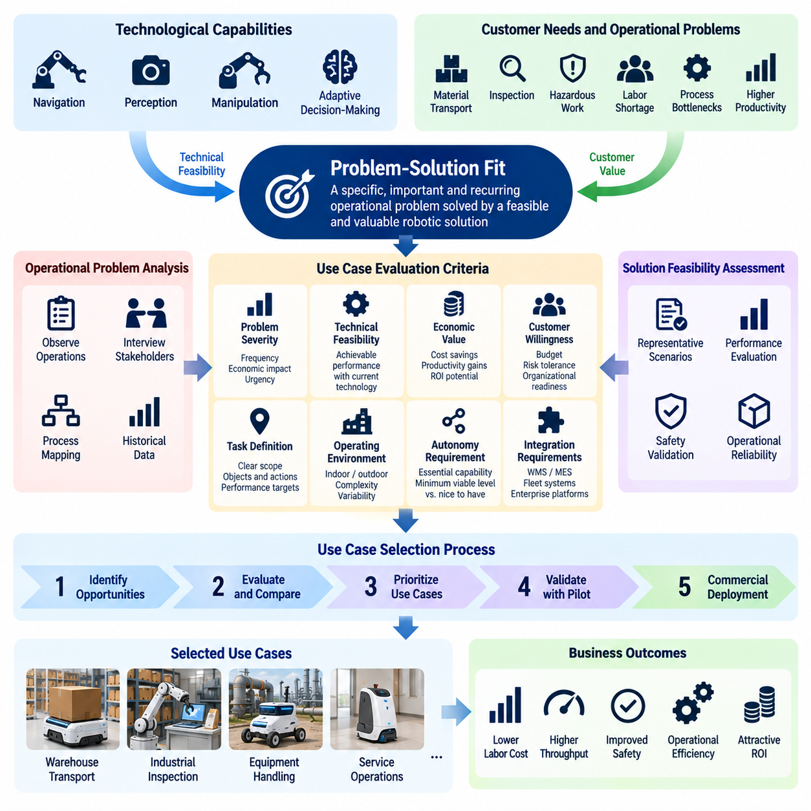{width="7.268055555555556in" height="7.268055555555556in"}

Problem-solution fit is the foundation of a commercially viable Physical AI business because technological sophistication alone does not guarantee customer adoption or economic value. It describes the degree to which an autonomous robotic solution addresses a specific, important, and recurring operational problem. Successful use case selection requires matching customer needs with technical feasibility, measurable business benefits, and realistic deployment conditions.

Physical AI companies frequently begin with advanced capabilities such as autonomous navigation, robotic manipulation, multimodal perception, or adaptive decision-making. However, customers generally purchase solutions to operational problems rather than technologies themselves. A robot capable of performing many impressive tasks may deliver less commercial value than a simpler system that reliably eliminates a costly bottleneck in a critical workflow.

Identifying suitable problems begins with a detailed understanding of existing operations. Companies must examine how work is performed, which resources are required, where delays occur, and why current processes underperform. Direct observation, operational interviews, process mapping, and historical performance records help distinguish genuine customer pain points from assumptions made during technology development.

A valuable operational problem typically exhibits sufficient frequency, economic significance, and organizational urgency. Repetitive material transport, labor-intensive inspection, hazardous maintenance, and unpredictable equipment handling are potential examples. However, the attractiveness of each application depends on actual task volumes, labor availability, environmental complexity, safety exposure, and the customer\'s willingness to change established procedures.

Problem severity should be evaluated independently from technological feasibility. A task may be technically straightforward but economically unimportant, while another may offer substantial value but require capabilities beyond current robotic systems. Effective opportunity selection identifies applications where operational importance and achievable automation performance overlap, creating a credible path toward practical deployment and customer acceptance.

Use case selection also requires defining the task boundary with sufficient precision. Broad objectives such as automating a warehouse or replacing manual inspection are too ambiguous for reliable engineering and financial evaluation. A useful definition specifies the objects handled, required actions, operating locations, environmental conditions, expected frequency, performance thresholds, and circumstances requiring human intervention.

The operational environment strongly influences solution feasibility. Structured factories and warehouses often provide predictable layouts, controlled traffic patterns, and repeatable tasks. Hospitals, construction sites, farms, and homes introduce greater variation in human activity, terrain, objects, and environmental conditions. These differences affect perception reliability, navigation performance, manipulation complexity, and the cost of maintaining safe autonomous operation.

Physical AI suitability depends on whether intelligence provides meaningful advantages over conventional automation. Fixed conveyors, industrial robots, and rule-based mobile platforms may already solve certain problems efficiently. Learning-enabled perception, adaptive planning, and generalized manipulation become commercially attractive when task variation, environmental uncertainty, or frequent workflow changes make traditional solutions excessively rigid or expensive.

A practical evaluation must distinguish essential autonomy from desirable functionality. Customers may require reliable navigation, obstacle avoidance, task execution, and recovery from predictable disturbances without needing unrestricted general-purpose intelligence. Defining the minimum viable autonomy level reduces unnecessary development complexity and allows engineering resources to concentrate on capabilities directly associated with operational value.

Technical feasibility should be assessed through representative operating scenarios rather than isolated demonstrations. Evaluation must include normal conditions, expected variations, difficult edge cases, and recovery situations. Relevant measures include task completion rate, cycle time, intervention frequency, localization reliability, manipulation success, and safety-related events. Performance must remain acceptable over sustained operation rather than during carefully prepared trials.

Economic feasibility requires establishing a credible baseline for the existing process. Labor hours, equipment utilization, production delays, error rates, safety incidents, and maintenance expenses provide reference values against which automation can be assessed. Expected benefits should be calculated using realistic operating assumptions, including partial automation, residual human supervision, and potential disruptions during implementation.

Customer willingness to pay is not identical to the theoretical economic value of automation. Purchasing decisions depend on budget ownership, capital approval procedures, operational risk tolerance, expected payback periods, and competing investment priorities. Even a technically successful application may encounter limited demand when the customer cannot capture sufficient benefits or lacks authority to reorganize the affected workflow.

Integration requirements represent another major selection criterion. A robot may perform its physical task successfully yet fail to generate operational value if it cannot exchange information with existing systems. Warehouse management, manufacturing execution, fleet coordination, and enterprise platforms often determine when tasks begin, how priorities change, and how completion is verified. Integration complexity must therefore be included in early feasibility assessments.

The organizational context can be as important as the physical environment. Automation changes responsibilities among operators, supervisors, maintenance personnel, and information technology teams. Successful adoption requires clear ownership of deployment decisions, operational support, exception handling, and performance evaluation. Applications with committed stakeholders and well-defined decision processes generally offer a more manageable path from pilot testing to production.

Use cases should be prioritized according to both commercial attractiveness and implementation risk. Commercial attractiveness reflects market demand, customer urgency, measurable savings, repeatability, and revenue potential. Implementation risk includes technical uncertainty, environmental variability, integration effort, safety requirements, and ongoing service costs. A balanced selection process avoids pursuing high-value opportunities that cannot be delivered reliably.

Scalability provides an additional distinction between an attractive engineering project and a sustainable business opportunity. A solution designed for one unusual facility may generate project revenue but require extensive customization elsewhere. More scalable applications share similar task structures, equipment interfaces, operating constraints, and performance expectations across multiple customers, allowing hardware, software, deployment procedures, and support resources to be reused.

A focused initial use case can establish the foundation for a broader Physical AI platform. For example, reliable autonomous material transport may lead to fleet coordination, inventory movement, machine tending, or mobile manipulation. Such expansion should follow demonstrated customer demand and technical compatibility rather than assumptions that every robotic capability will naturally translate into profitable adjacent markets.

Pilot projects should be designed to test explicit business and technical hypotheses. Before deployment, suppliers and customers should agree on baseline measurements, operating boundaries, acceptance criteria, and evaluation periods. A successful pilot demonstrates not only that the robot can perform a task but also that its performance is sufficiently reliable, economically meaningful, and operationally manageable to justify continued investment.

Failure analysis is essential during problem-solution validation. Unsuccessful missions, unexpected interventions, environmental disturbances, and integration failures reveal whether limitations arise from the technology, workflow design, or incorrect problem assumptions. These findings should inform decisions to improve the system, narrow the operational scope, modify the commercial proposition, or discontinue an unsuitable application.

The strongest evidence of problem-solution fit emerges when customers repeatedly use the solution, achieve measurable benefits, and demonstrate willingness to continue or expand deployment. Positive demonstrations and initial enthusiasm are insufficient without sustained operational results. Renewal decisions, additional robot orders, expanding task coverage, and reduced dependence on vendor support provide stronger indications of genuine commercial demand.

Ultimately, problem-solution fit and use case selection connect Physical AI innovation with practical industrial value creation. The objective is not to identify the most technologically ambitious robotic application, but to select problems where autonomous capabilities can deliver dependable and economically justified improvements. Disciplined selection establishes the basis for repeatable deployment, scalable business models, and long-term customer relationships.

문제-솔루션 적합성(Problem-Solution Fit)은 상업적으로 실현 가능한 피지컬 인공지능 사업(Physical AI Business)의 기반이다. 기술적 정교함(Technological Sophistication)만으로는 고객 도입(Customer Adoption)이나 경제적 가치(Economic Value)가 보장되지 않기 때문이다. 문제-솔루션 적합성은 자율 로봇 솔루션(Autonomous Robotic Solution)이 구체적이고 중요하며 반복적으로 발생하는 운영 문제(Operational Problem)를 얼마나 효과적으로 해결하는지를 나타낸다. 성공적인 활용 사례 선정(Use Case Selection)을 위해서는 고객 요구(Customer Needs)를 기술적 실현 가능성(Technical Feasibility), 측정 가능한 사업적 편익(Measurable Business Benefits), 현실적인 배포 조건(Realistic Deployment Conditions)과 일치시켜야 한다.

피지컬 인공지능 기업(Physical AI Companies)은 자율주행(Autonomous Navigation), 로봇 조작(Robotic Manipulation), 멀티모달 인지(Multimodal Perception), 적응형 의사결정(Adaptive Decision-Making)과 같은 첨단 기능(Advanced Capabilities)에서 사업을 시작하는 경우가 많다. 그러나 고객은 일반적으로 기술 자체가 아니라 운영 문제(Operational Problems)를 해결하기 위한 솔루션(Solutions)을 구매한다. 다양한 인상적인 작업을 수행할 수 있는 로봇이라도 핵심 작업 흐름(Critical Workflow)에서 비용이 많이 발생하는 병목 현상(Costly Bottleneck)을 안정적으로 제거하는 단순한 시스템보다 상업적 가치(Commercial Value)가 낮을 수 있다.

적합한 문제를 식별하는 과정(Problem Identification)은 기존 운영(Existing Operations)에 대한 상세한 이해에서 시작된다. 기업은 작업이 어떻게 수행되는지, 어떤 자원(Resources)이 필요한지, 지연(Delays)이 어디에서 발생하는지, 현재 프로세스(Current Processes)의 성능이 기대에 미치지 못하는 이유를 조사해야 한다. 직접 관찰(Direct Observation), 운영 담당자 인터뷰(Operational Interviews), 프로세스 매핑(Process Mapping), 과거 성능 기록(Historical Performance Records)은 기술 개발(Technology Development) 과정에서 형성된 가정과 실제 고객의 문제점(Customer Pain Points)을 구분하는 데 도움이 된다.

가치 있는 운영 문제(Valuable Operational Problem)는 일반적으로 충분한 발생 빈도(Frequency), 경제적 중요성(Economic Significance), 조직적 시급성(Organizational Urgency)을 갖는다. 반복적인 자재 운송(Repetitive Material Transport), 노동집약적 검사(Labor-Intensive Inspection), 위험한 유지보수(Hazardous Maintenance), 예측하기 어려운 장비 취급(Unpredictable Equipment Handling)이 잠재적인 사례에 해당한다. 그러나 각 응용 분야(Application)의 매력도는 실제 작업량(Task Volumes), 노동력 가용성(Labor Availability), 환경 복잡성(Environmental Complexity), 안전 위험 노출(Safety Exposure), 기존 절차를 변경하려는 고객의 의지(Customer Willingness)에 따라 달라진다.

문제의 심각성(Problem Severity)은 기술적 실현 가능성(Technical Feasibility)과 독립적으로 평가해야 한다. 어떤 작업은 기술적으로 간단하지만 경제적 중요성(Economic Importance)이 낮을 수 있으며, 다른 작업은 상당한 가치를 제공하지만 현재 로봇 시스템(Current Robotic Systems)의 역량을 넘어서는 기능이 필요할 수 있다. 효과적인 사업 기회 선정(Opportunity Selection)은 운영상 중요성(Operational Importance)과 달성 가능한 자동화 성능(Achievable Automation Performance)이 겹치는 응용 분야를 식별하여 실제 배포(Practical Deployment)와 고객 수용(Customer Acceptance)으로 이어질 수 있는 신뢰할 만한 경로를 구축하는 것이다.

활용 사례 선정(Use Case Selection)에서는 작업 범위(Task Boundary)를 충분히 정확하게 정의해야 한다. 창고 자동화(Automating a Warehouse)나 수동 검사 대체(Replacing Manual Inspection)와 같은 포괄적인 목표는 신뢰할 수 있는 엔지니어링 평가(Engineering Evaluation)와 재무 평가(Financial Evaluation)를 수행하기에 지나치게 모호하다. 유용한 정의에는 취급 대상 물체(Objects Handled), 필요한 동작(Required Actions), 운영 위치(Operating Locations), 환경 조건(Environmental Conditions), 예상 작업 빈도(Expected Frequency), 성능 기준(Performance Thresholds), 인간 개입이 필요한 상황(Human Intervention Conditions)이 명시되어야 한다.

운영 환경(Operational Environment)은 솔루션의 실현 가능성(Solution Feasibility)에 큰 영향을 미친다. 구조화된 공장(Structured Factories)과 창고(Warehouses)는 일반적으로 예측 가능한 배치(Predictable Layouts), 통제된 이동 경로(Controlled Traffic Patterns), 반복 가능한 작업(Repeatable Tasks)을 제공한다. 반면 병원(Hospitals), 건설 현장(Construction Sites), 농장(Farms), 가정(Homes)은 인간 활동(Human Activity), 지형(Terrain), 물체(Objects), 환경 조건(Environmental Conditions)에서 더 큰 변동성을 보인다. 이러한 차이는 인지 신뢰성(Perception Reliability), 주행 성능(Navigation Performance), 조작 복잡성(Manipulation Complexity), 안전한 자율운영(Safe Autonomous Operation)을 유지하는 비용에 영향을 미친다.

피지컬 인공지능의 적합성(Physical AI Suitability)은 지능(Intelligence)이 기존 자동화(Conventional Automation)보다 의미 있는 이점을 제공하는지에 달려 있다. 고정식 컨베이어(Fixed Conveyors), 산업용 로봇(Industrial Robots), 규칙 기반 이동 플랫폼(Rule-Based Mobile Platforms)은 이미 특정 문제를 효율적으로 해결할 수 있다. 학습 기반 인지(Learning-Enabled Perception), 적응형 계획(Adaptive Planning), 범용 조작(Generalized Manipulation)은 작업 변동성(Task Variation), 환경 불확실성(Environmental Uncertainty), 빈번한 작업 흐름 변경(Frequent Workflow Changes)으로 인해 기존 솔루션이 지나치게 경직되거나 비용이 높아지는 경우에 상업적 매력(Commercial Attractiveness)을 갖게 된다.

실용적인 평가(Practical Evaluation)에서는 필수적인 자율성(Essential Autonomy)과 바람직하지만 필수적이지 않은 기능(Desirable Functionality)을 구분해야 한다. 고객은 제한 없는 범용 지능(Unrestricted General-Purpose Intelligence)보다 신뢰할 수 있는 주행(Reliable Navigation), 장애물 회피(Obstacle Avoidance), 작업 실행(Task Execution), 예측 가능한 외란으로부터의 복구(Recovery from Predictable Disturbances)를 요구할 수 있다. 최소 실행 가능 자율성 수준(Minimum Viable Autonomy Level)을 정의하면 불필요한 개발 복잡성(Development Complexity)을 줄이고 운영 가치(Operational Value)와 직접적으로 연결되는 기능에 엔지니어링 자원(Engineering Resources)을 집중할 수 있다.

기술적 실현 가능성(Technical Feasibility)은 개별적인 시연(Isolated Demonstrations)이 아니라 대표적인 운영 시나리오(Representative Operating Scenarios)를 통해 평가해야 한다. 평가에는 정상 조건(Normal Conditions), 예상되는 변동(Expected Variations), 어려운 예외 상황(Difficult Edge Cases), 복구 상황(Recovery Situations)이 포함되어야 한다. 주요 지표에는 작업 완료율(Task Completion Rate), 사이클 타임(Cycle Time), 개입 빈도(Intervention Frequency), 위치 추정 신뢰성(Localization Reliability), 조작 성공률(Manipulation Success Rate), 안전 관련 사건(Safety-Related Events)이 포함된다. 성능은 세심하게 준비된 시험뿐 아니라 지속적인 운영(Sustained Operation)에서도 허용 가능한 수준을 유지해야 한다.

경제적 실현 가능성(Economic Feasibility)을 평가하려면 기존 프로세스(Existing Process)에 대한 신뢰할 수 있는 기준선(Baseline)을 설정해야 한다. 노동시간(Labor Hours), 장비 가동률(Equipment Utilization), 생산 지연(Production Delays), 오류율(Error Rates), 안전사고(Safety Incidents), 유지보수 비용(Maintenance Expenses)은 자동화 성능을 평가하는 기준값(Reference Values)을 제공한다. 예상 편익(Expected Benefits)은 부분 자동화(Partial Automation), 잔여 인간 감독(Residual Human Supervision), 구현 과정에서 발생할 수 있는 운영 중단(Potential Implementation Disruptions)을 포함한 현실적인 운영 가정(Realistic Operating Assumptions)을 기반으로 계산해야 한다.

고객의 지불 의사(Customer Willingness to Pay)는 자동화의 이론적 경제 가치(Theoretical Economic Value)와 동일하지 않다. 구매 결정(Purchasing Decisions)은 예산 소유권(Budget Ownership), 자본 투자 승인 절차(Capital Approval Procedures), 운영 위험 허용 수준(Operational Risk Tolerance), 예상 투자 회수 기간(Expected Payback Periods), 경쟁 투자 우선순위(Competing Investment Priorities)에 영향을 받는다. 기술적으로 성공적인 응용 분야라도 고객이 충분한 편익을 확보할 수 없거나 관련 작업 흐름을 재구성할 권한(Authority)이 부족하다면 시장 수요(Market Demand)가 제한될 수 있다.

시스템 통합 요구사항(Integration Requirements)은 또 다른 주요 선정 기준(Selection Criterion)이다. 로봇이 물리적 작업(Physical Task)을 성공적으로 수행하더라도 기존 시스템(Existing Systems)과 정보를 교환하지 못하면 운영 가치(Operational Value)를 창출하지 못할 수 있다. 창고 관리(Warehouse Management), 제조 실행(Manufacturing Execution), 로봇군 조정(Fleet Coordination), 기업 관리 플랫폼(Enterprise Platforms)은 작업 시작 시점(Task Initiation), 우선순위 변경(Priority Changes), 작업 완료 검증(Completion Verification)을 결정하는 경우가 많다. 따라서 통합 복잡성(Integration Complexity)은 초기 실현 가능성 평가(Early Feasibility Assessments)에 포함되어야 한다.

조직적 맥락(Organizational Context)은 물리적 환경(Physical Environment)만큼 중요할 수 있다. 자동화(Automation)는 작업자(Operators), 감독자(Supervisors), 유지보수 담당자(Maintenance Personnel), 정보기술 조직(Information Technology Teams) 사이의 책임을 변화시킨다. 성공적인 도입(Successful Adoption)을 위해서는 배포 의사결정(Deployment Decisions), 운영 지원(Operational Support), 예외 처리(Exception Handling), 성능 평가(Performance Evaluation)에 대한 명확한 책임 주체(Clear Ownership)가 필요하다. 적극적으로 참여하는 이해관계자(Committed Stakeholders)와 명확한 의사결정 절차(Well-Defined Decision Processes)를 갖춘 응용 분야는 일반적으로 시범 시험(Pilot Testing)에서 실제 운영(Production)으로 전환하기에 더 관리하기 쉬운 경로를 제공한다.

활용 사례(Use Cases)는 상업적 매력도(Commercial Attractiveness)와 구현 위험(Implementation Risk)을 모두 고려하여 우선순위를 결정해야 한다. 상업적 매력도는 시장 수요(Market Demand), 고객의 시급성(Customer Urgency), 측정 가능한 비용 절감(Measurable Savings), 반복 가능성(Repeatability), 매출 잠재력(Revenue Potential)을 반영한다. 구현 위험에는 기술적 불확실성(Technical Uncertainty), 환경 변동성(Environmental Variability), 통합 노력(Integration Effort), 안전 요구사항(Safety Requirements), 지속적인 서비스 비용(Ongoing Service Costs)이 포함된다. 균형 잡힌 선정 절차(Balanced Selection Process)는 안정적으로 제공할 수 없는 고부가가치 사업 기회(High-Value Opportunities)를 무리하게 추구하는 것을 방지한다.

확장성(Scalability)은 매력적인 엔지니어링 프로젝트(Engineering Project)와 지속 가능한 사업 기회(Sustainable Business Opportunity)를 구분하는 추가적인 요소이다. 특수한 시설(Unique Facility) 한 곳을 위해 설계된 솔루션은 프로젝트 매출(Project Revenue)을 창출할 수 있지만 다른 환경에서는 광범위한 맞춤화(Extensive Customization)가 필요할 수 있다. 확장성이 높은 응용 분야(Scalable Applications)는 여러 고객 사이에서 유사한 작업 구조(Task Structures), 장비 인터페이스(Equipment Interfaces), 운영 제약(Operating Constraints), 성능 기대치(Performance Expectations)를 공유하므로 하드웨어(Hardware), 소프트웨어(Software), 배포 절차(Deployment Procedures), 지원 자원(Support Resources)을 재사용할 수 있다.

초기에 집중된 활용 사례(Focused Initial Use Case)는 더 광범위한 피지컬 인공지능 플랫폼(Physical AI Platform)의 기반을 구축할 수 있다. 예를 들어 신뢰할 수 있는 자율 자재 운송(Autonomous Material Transport)은 로봇군 조정(Fleet Coordination), 재고 이동(Inventory Movement), 기계 투입 및 배출(Machine Tending), 이동형 조작(Mobile Manipulation)으로 확장될 수 있다. 이러한 확장은 모든 로봇 기능이 자연스럽게 수익성 있는 인접 시장(Profitable Adjacent Markets)으로 연결될 것이라는 가정이 아니라 입증된 고객 수요(Demonstrated Customer Demand)와 기술적 호환성(Technical Compatibility)을 기반으로 진행되어야 한다.

시범 프로젝트(Pilot Projects)는 명확한 사업적 가설(Business Hypotheses)과 기술적 가설(Technical Hypotheses)을 검증하도록 설계해야 한다. 배포 이전에 공급업체(Suppliers)와 고객(Customers)은 기준 측정값(Baseline Measurements), 운영 경계(Operating Boundaries), 인수 기준(Acceptance Criteria), 평가 기간(Evaluation Periods)에 합의해야 한다. 성공적인 시범 프로젝트(Successful Pilot)는 로봇이 작업을 수행할 수 있다는 사실뿐 아니라 지속적인 투자(Continued Investment)를 정당화할 만큼 성능이 충분히 신뢰할 수 있고, 경제적으로 의미 있으며, 운영상 관리 가능하다는 점을 입증해야 한다.

실패 분석(Failure Analysis)은 문제-솔루션 검증(Problem-Solution Validation) 과정에서 필수적이다. 실패한 임무(Unsuccessful Missions), 예상하지 못한 개입(Unexpected Interventions), 환경적 외란(Environmental Disturbances), 시스템 통합 실패(Integration Failures)는 한계가 기술(Technology), 작업 흐름 설계(Workflow Design), 잘못된 문제 가정(Incorrect Problem Assumptions) 중 어디에서 발생하는지를 보여준다. 이러한 결과는 시스템 개선(System Improvement), 운영 범위 축소(Narrowing Operational Scope), 상업적 가치 제안 수정(Modification of Commercial Proposition), 부적합한 응용 분야 중단(Discontinuation of Unsuitable Application)에 관한 의사결정에 반영되어야 한다.

문제-솔루션 적합성(Problem-Solution Fit)에 대한 가장 강력한 증거는 고객이 솔루션을 반복적으로 사용하고 측정 가능한 편익(Measurable Benefits)을 달성하며 배포를 지속하거나 확대하려는 의지(Willingness to Continue or Expand Deployment)를 보여줄 때 나타난다. 긍정적인 시연(Positive Demonstrations)과 초기 관심(Initial Enthusiasm)만으로는 지속적인 운영 성과(Sustained Operational Results)를 대체할 수 없다. 계약 갱신 결정(Renewal Decisions), 추가 로봇 주문(Additional Robot Orders), 작업 적용 범위 확대(Expanding Task Coverage), 공급업체 지원 의존도 감소(Reduced Dependence on Vendor Support)는 실제 상업적 수요(Genuine Commercial Demand)를 보여주는 더욱 강력한 지표이다.

궁극적으로 문제-솔루션 적합성(Problem-Solution Fit)과 활용 사례 선정(Use Case Selection)은 피지컬 인공지능 혁신(Physical AI Innovation)을 실질적인 산업 가치 창출(Practical Industrial Value Creation)과 연결한다. 목표는 기술적으로 가장 야심 찬 로봇 응용 분야(Technologically Ambitious Robotic Application)를 찾는 것이 아니라 자율 기능(Autonomous Capabilities)이 신뢰할 수 있고 경제적으로 정당화되는 개선(Dependable and Economically Justified Improvements)을 제공할 수 있는 문제를 선정하는 것이다. 체계적인 선정(Disciplined Selection)은 반복 가능한 배포(Repeatable Deployment), 확장 가능한 사업 모델(Scalable Business Models), 장기적인 고객 관계(Long-Term Customer Relationships)를 구축하는 기반이 된다.

##  

## 08.03. Customer Value Proposition

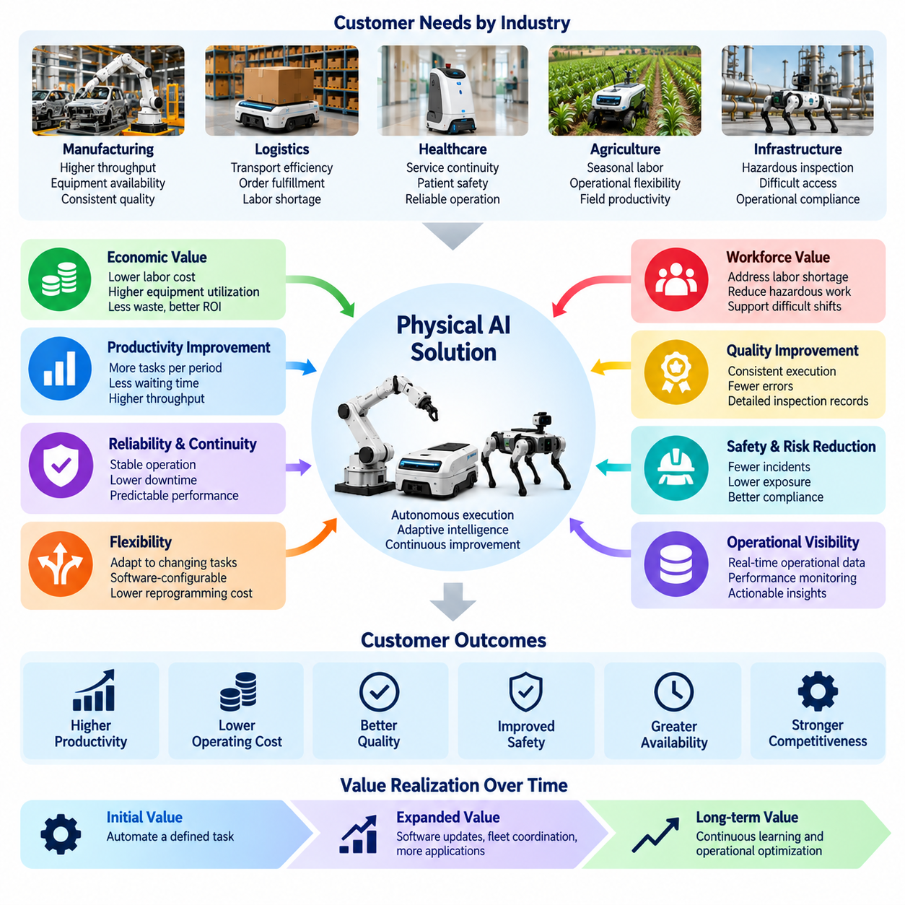{width="7.268055555555556in" height="7.268055555555556in"}

A customer value proposition defines the specific economic, operational, and strategic benefits that a Physical AI solution delivers to its intended customers. It explains why an organization should adopt intelligent robotic systems instead of continuing existing processes or purchasing conventional automation. An effective value proposition connects technological capabilities to measurable customer outcomes rather than emphasizing artificial intelligence as an isolated feature.

Physical AI creates customer value by combining autonomous physical execution with adaptive intelligence and continuous operational improvement. Unlike traditional equipment that performs narrowly predefined actions, intelligent robotic systems can potentially respond to environmental variation, changing task requirements, and operational uncertainty. These capabilities become commercially meaningful when they improve productivity, reliability, flexibility, or service quality under real operating conditions.

Customer value must be understood from the perspective of the organization purchasing and operating the solution. Manufacturing companies may prioritize production throughput and equipment availability, while logistics operators focus on transport efficiency and order fulfillment. Hospitals emphasize service continuity and patient safety, whereas agricultural businesses may value seasonal labor availability and operating flexibility. The same robotic technology can therefore support different value propositions across industries.

Economic value is often the most visible component of a Physical AI offering. Autonomous systems may reduce repetitive labor requirements, improve equipment utilization, extend operating hours, and decrease process-related waste. However, credible economic benefits must account for integration expenses, maintenance, energy consumption, software fees, and remaining human supervision. Customer value should be expressed through net operational improvement rather than gross automation potential.

Productivity improvement represents another central source of value. Physical AI can increase the number of tasks completed within a given period by reducing waiting time, coordinating equipment, and executing repetitive activities consistently. In manufacturing and logistics, productivity may be measured through units produced, missions completed, materials transported, or orders processed. The relevant metric should reflect the customer\'s actual operational bottleneck.

Reliability and operational continuity are particularly important in environments where interruptions create substantial financial consequences. Intelligent robots can contribute to stable operations through continuous monitoring, adaptive navigation, fault detection, and structured recovery procedures. Nevertheless, reliability must be demonstrated through sustained deployment evidence, including uptime, intervention frequency, mean time between failures, and recovery performance under representative operating conditions.

Flexibility creates value when customers face changing products, workflows, layouts, or demand patterns. Conventional automation frequently requires mechanical modification or extensive reprogramming to accommodate such changes. Physical AI may reduce adaptation costs through configurable task policies, reusable perception models, and software-defined behaviors. The resulting benefit is not unlimited generality but a lower cost of responding to operational variation within validated boundaries.

Workforce-related value extends beyond direct labor cost reduction. Physical AI can address persistent staffing shortages, support operations during difficult shifts, and reduce employee exposure to repetitive or physically demanding tasks. In hazardous environments, robotic systems may perform inspections or material handling activities that expose workers to elevated risks. These benefits should be evaluated alongside workforce training, supervision requirements, and organizational acceptance.

Quality improvement provides another important dimension of customer value. Intelligent robotic systems may deliver more consistent task execution, reduce handling errors, and generate detailed operational records. In inspection applications, AI-enabled perception can support repeatable defect identification and structured reporting. However, quality benefits depend on validated detection performance, controlled operating conditions, and effective procedures for managing uncertain or incorrect results.

Safety and risk reduction can strengthen the value proposition when robotic systems replace or assist dangerous activities. Applications include infrastructure inspection, hazardous material transport, difficult-access maintenance, and repetitive heavy-load handling. The economic benefit may involve fewer incidents, reduced exposure, and improved operational compliance. These claims require appropriate safety engineering, risk assessment, and evidence rather than assumptions that autonomy is inherently safer.

Customer value also emerges from improved visibility into physical operations. Connected robots generate information about task execution, equipment status, environmental conditions, and operational exceptions. When integrated with enterprise systems, these data can support performance monitoring, capacity planning, maintenance decisions, and process optimization. The value comes from actionable operational intelligence rather than data collection alone.

A strong value proposition distinguishes the immediate benefits of robot deployment from improvements that may develop over time. Initial value often comes from automating a clearly defined task, while subsequent value may arise from software updates, fleet coordination, expanded task coverage, and learning-based optimization. Customers should understand which benefits are available at installation and which depend on additional development, data collection, or operational maturity.

The value proposition must also address implementation effort and customer risk. Even economically attractive automation can encounter resistance when installation disrupts production, requires infrastructure modifications, or introduces uncertain maintenance obligations. Providers can reduce these barriers through standardized deployment procedures, transparent performance commitments, training, remote support, and clearly defined responsibilities for failures and exceptions.

Financial decision-makers and operational users frequently evaluate the same solution differently. Executives may focus on return on investment, scalability, and strategic competitiveness, while facility managers prioritize uptime, integration, and workflow stability. Operators may emphasize usability, safety, and reduced workload. Effective value proposition design accommodates these perspectives while maintaining a consistent explanation of the solution\'s overall business contribution.

Pricing should reflect the customer\'s realized value without exceeding the economic benefits that justify adoption. Hardware sales, software subscriptions, Robot-as-a-Service contracts, and outcome-based arrangements distribute costs and risks differently. The appropriate model depends on customer purchasing preferences, asset utilization, service responsibilities, and confidence in measurable performance. Value-based pricing requires a defensible connection between delivered outcomes and commercial compensation.

Customer value must be demonstrated through measurable evidence rather than promotional claims. Pilot deployments should establish baseline performance, define success criteria, and compare actual results against expected improvements. Relevant indicators include labor hours saved, throughput increases, task completion rates, operating availability, intervention requirements, and total operating costs. Evidence should account for representative conditions and sufficient observation periods.

A scalable value proposition must remain meaningful across multiple customers without requiring extensive redesign. Standardized hardware platforms, reusable software modules, common integration interfaces, and repeatable service processes help preserve customer benefits while controlling supplier costs. Industry-specific configurations may still be necessary, but excessive customization can weaken profitability and make commercial expansion difficult.

Competitive differentiation depends on delivering value that alternative solutions cannot reproduce easily or economically. Physical AI providers may differentiate through reliable autonomy, rapid deployment, low intervention requirements, flexible task adaptation, or integrated fleet services. The strongest differentiation is demonstrated through operational results that customers can verify, rather than through model complexity, sensor specifications, or generalized claims of intelligence.

Long-term customer relationships depend on maintaining the promised value throughout the deployment lifecycle. Software updates, preventive maintenance, operational analytics, and customer support must contribute to sustained performance. Providers should regularly review service outcomes, changing customer requirements, and opportunities for additional automation. Continuous improvement strengthens retention when customers can observe meaningful operational benefits.

Ultimately, the customer value proposition translates Physical AI capabilities into a clear business justification for adoption. Its purpose is to explain which customer problem is solved, how operational performance improves, what economic benefits are achievable, and why the proposed solution is preferable to available alternatives. A compelling proposition combines measurable outcomes, credible implementation assumptions, manageable risk, and a sustainable path toward long-term value creation.

고객 가치 제안(Customer Value Proposition)은 피지컬 인공지능 솔루션(Physical AI Solution)이 목표 고객(Target Customers)에게 제공하는 구체적인 경제적 편익(Economic Benefits), 운영적 편익(Operational Benefits), 전략적 편익(Strategic Benefits)을 정의한다. 이는 기업이 기존 프로세스(Existing Processes)를 유지하거나 전통적인 자동화(Conventional Automation)를 구매하는 대신 지능형 로봇 시스템(Intelligent Robotic Systems)을 도입해야 하는 이유를 설명한다. 효과적인 가치 제안(Effective Value Proposition)은 인공지능(Artificial Intelligence)을 독립적인 기능으로 강조하기보다 기술적 역량(Technological Capabilities)을 측정 가능한 고객 성과(Measurable Customer Outcomes)와 연결한다.

피지컬 인공지능(Physical AI)은 자율적인 물리적 실행(Autonomous Physical Execution), 적응형 지능(Adaptive Intelligence), 지속적인 운영 개선(Continuous Operational Improvement)을 결합하여 고객 가치(Customer Value)를 창출한다. 사전에 좁은 범위로 정의된 동작만 수행하는 전통적인 장비(Traditional Equipment)와 달리 지능형 로봇 시스템(Intelligent Robotic Systems)은 환경 변화(Environmental Variation), 변경되는 작업 요구사항(Changing Task Requirements), 운영 불확실성(Operational Uncertainty)에 대응할 수 있는 잠재력을 갖는다. 이러한 역량은 실제 운영 조건(Real Operating Conditions)에서 생산성(Productivity), 신뢰성(Reliability), 유연성(Flexibility), 서비스 품질(Service Quality)을 개선할 때 상업적으로 의미 있는 가치가 된다.

고객 가치(Customer Value)는 솔루션을 구매하고 운영하는 조직(Organization)의 관점에서 이해해야 한다. 제조 기업(Manufacturing Companies)은 생산 처리량(Production Throughput)과 장비 가용성(Equipment Availability)을 우선시할 수 있으며, 물류 운영업체(Logistics Operators)는 운송 효율성(Transport Efficiency)과 주문 이행(Order Fulfillment)에 집중한다. 병원(Hospitals)은 서비스 연속성(Service Continuity)과 환자 안전(Patient Safety)을 강조하는 반면, 농업 기업(Agricultural Businesses)은 계절적 노동력 확보(Seasonal Labor Availability)와 운영 유연성(Operating Flexibility)을 중요하게 평가할 수 있다. 따라서 동일한 로봇 기술(Robotic Technology)이라도 산업별로 서로 다른 가치 제안(Value Propositions)을 제공할 수 있다.

경제적 가치(Economic Value)는 피지컬 인공지능 제품 및 서비스(Physical AI Offering)에서 가장 명확하게 드러나는 구성 요소인 경우가 많다. 자율 시스템(Autonomous Systems)은 반복적인 노동력 요구(Repetitive Labor Requirements)를 줄이고, 장비 가동률(Equipment Utilization)을 높이며, 운영시간(Operating Hours)을 연장하고, 공정 관련 낭비(Process-Related Waste)를 감소시킬 수 있다. 그러나 신뢰할 수 있는 경제적 편익(Credible Economic Benefits)을 산정하려면 시스템 통합 비용(Integration Expenses), 유지보수(Maintenance), 에너지 소비(Energy Consumption), 소프트웨어 요금(Software Fees), 잔여 인간 감독(Remaining Human Supervision)을 고려해야 한다. 고객 가치는 총자동화 잠재력(Gross Automation Potential)이 아니라 순운영 개선 효과(Net Operational Improvement)를 기준으로 표현해야 한다.

생산성 향상(Productivity Improvement)은 또 다른 핵심 가치 원천(Central Source of Value)이다. 피지컬 인공지능(Physical AI)은 대기시간(Waiting Time)을 줄이고, 장비를 조정하며, 반복적인 활동(Repetitive Activities)을 일관되게 수행함으로써 일정 기간 내 완료되는 작업 수(Number of Tasks Completed)를 증가시킬 수 있다. 제조 및 물류(Manufacturing and Logistics) 분야에서는 생산 수량(Units Produced), 완료된 임무(Completed Missions), 운송된 자재(Materials Transported), 처리된 주문(Orders Processed)을 통해 생산성을 측정할 수 있다. 관련 지표(Relevant Metric)는 고객의 실제 운영 병목 현상(Operational Bottleneck)을 반영해야 한다.

신뢰성(Reliability)과 운영 연속성(Operational Continuity)은 운영 중단(Interruptions)이 상당한 재무적 손실(Financial Consequences)을 초래하는 환경에서 특히 중요하다. 지능형 로봇(Intelligent Robots)은 지속적인 모니터링(Continuous Monitoring), 적응형 주행(Adaptive Navigation), 고장 감지(Fault Detection), 체계적인 복구 절차(Structured Recovery Procedures)를 통해 안정적인 운영(Stable Operations)에 기여할 수 있다. 그러나 신뢰성은 가동시간(Uptime), 개입 빈도(Intervention Frequency), 평균 고장 간격(Mean Time Between Failures, MTBF), 대표적인 운영 조건(Representative Operating Conditions)에서의 복구 성능(Recovery Performance)을 포함한 지속적인 배포 증거(Sustained Deployment Evidence)를 통해 입증되어야 한다.

유연성(Flexibility)은 고객이 제품(Products), 작업 흐름(Workflows), 시설 배치(Layouts), 수요 패턴(Demand Patterns)의 변화에 직면할 때 가치를 창출한다. 전통적인 자동화(Conventional Automation)는 이러한 변화에 대응하기 위해 기계적 변경(Mechanical Modification)이나 광범위한 재프로그래밍(Extensive Reprogramming)을 요구하는 경우가 많다. 피지컬 인공지능(Physical AI)은 설정 가능한 작업 정책(Configurable Task Policies), 재사용 가능한 인지 모델(Reusable Perception Models), 소프트웨어 정의 동작(Software-Defined Behaviors)을 통해 적응 비용(Adaptation Costs)을 줄일 수 있다. 그 결과로 얻는 편익은 무제한적인 범용성(Unlimited Generality)이 아니라 검증된 운영 범위(Validated Boundaries) 내에서 운영 변화에 대응하는 비용을 낮추는 것이다.

인력 관련 가치(Workforce-Related Value)는 직접적인 인건비 절감(Direct Labor Cost Reduction)을 넘어선다. 피지컬 인공지능(Physical AI)은 지속적인 인력 부족(Persistent Staffing Shortages)에 대응하고, 근무가 어려운 시간대(Difficult Shifts)의 운영을 지원하며, 반복적이거나 육체적으로 부담이 큰 작업(Repetitive or Physically Demanding Tasks)에 대한 직원의 노출을 줄일 수 있다. 위험한 환경(Hazardous Environments)에서는 로봇 시스템(Robotic Systems)이 작업자를 높은 위험(Elevated Risks)에 노출시키는 검사(Inspection)나 자재 취급(Material Handling)을 수행할 수 있다. 이러한 편익은 인력 교육(Workforce Training), 감독 요구사항(Supervision Requirements), 조직적 수용성(Organizational Acceptance)과 함께 평가해야 한다.

품질 개선(Quality Improvement)은 고객 가치(Customer Value)의 또 다른 중요한 차원을 제공한다. 지능형 로봇 시스템(Intelligent Robotic Systems)은 더욱 일관된 작업 실행(Consistent Task Execution)을 제공하고, 취급 오류(Handling Errors)를 줄이며, 상세한 운영 기록(Operational Records)을 생성할 수 있다. 검사 응용 분야(Inspection Applications)에서는 인공지능 기반 인지(AI-Enabled Perception)가 반복 가능한 결함 식별(Repeatable Defect Identification)과 체계적인 보고(Structured Reporting)를 지원할 수 있다. 그러나 품질 관련 편익(Quality Benefits)은 검증된 검출 성능(Validated Detection Performance), 통제된 운영 조건(Controlled Operating Conditions), 불확실하거나 잘못된 결과(Uncertain or Incorrect Results)를 관리하는 효과적인 절차에 달려 있다.

안전성(Safety)과 위험 감소(Risk Reduction)는 로봇 시스템(Robotic Systems)이 위험한 활동(Dangerous Activities)을 대체하거나 지원할 때 가치 제안(Value Proposition)을 강화할 수 있다. 적용 사례에는 인프라 검사(Infrastructure Inspection), 위험물 운송(Hazardous Material Transport), 접근이 어려운 구역의 유지보수(Difficult-Access Maintenance), 반복적인 고중량물 취급(Repetitive Heavy-Load Handling)이 포함된다. 경제적 편익(Economic Benefit)은 사고 감소(Fewer Incidents), 위험 노출 감소(Reduced Exposure), 운영 규정 준수 개선(Improved Operational Compliance)으로 나타날 수 있다. 이러한 주장은 자율성이 본질적으로 더 안전하다는 가정이 아니라 적절한 안전 엔지니어링(Safety Engineering), 위험 평가(Risk Assessment), 객관적인 증거(Evidence)를 통해 뒷받침되어야 한다.

고객 가치(Customer Value)는 물리적 운영(Physical Operations)에 대한 가시성(Visibility)이 향상되는 과정에서도 발생한다. 연결된 로봇(Connected Robots)은 작업 실행(Task Execution), 장비 상태(Equipment Status), 환경 조건(Environmental Conditions), 운영 예외 상황(Operational Exceptions)에 관한 정보를 생성한다. 이러한 데이터(Data)가 기업 시스템(Enterprise Systems)과 통합되면 성능 모니터링(Performance Monitoring), 생산능력 계획(Capacity Planning), 유지보수 의사결정(Maintenance Decisions), 프로세스 최적화(Process Optimization)를 지원할 수 있다. 가치는 단순한 데이터 수집(Data Collection)이 아니라 실행 가능한 운영 인텔리전스(Actionable Operational Intelligence)에서 발생한다.

강력한 가치 제안(Strong Value Proposition)은 로봇 배포(Robot Deployment)를 통해 즉시 얻을 수 있는 편익(Immediate Benefits)과 시간이 지나면서 발전할 수 있는 개선 효과(Future Improvements)를 구분한다. 초기 가치(Initial Value)는 명확하게 정의된 작업의 자동화(Automation of a Clearly Defined Task)에서 발생하는 경우가 많으며, 이후에는 소프트웨어 업데이트(Software Updates), 로봇군 조정(Fleet Coordination), 작업 적용 범위 확대(Expanded Task Coverage), 학습 기반 최적화(Learning-Based Optimization)를 통해 추가 가치(Subsequent Value)가 창출될 수 있다. 고객은 설치 시점(Installation)에 이용 가능한 편익과 추가 개발(Additional Development), 데이터 수집(Data Collection), 운영 성숙도(Operational Maturity)에 따라 달라지는 편익을 명확하게 이해해야 한다.

가치 제안(Value Proposition)은 구현 노력(Implementation Effort)과 고객 위험(Customer Risk)도 다루어야 한다. 경제적으로 매력적인 자동화(Economically Attractive Automation)라도 설치 과정에서 생산을 방해하거나, 인프라 변경(Infrastructure Modifications)이 필요하거나, 불확실한 유지보수 의무(Uncertain Maintenance Obligations)를 발생시키면 도입 저항(Adoption Resistance)에 직면할 수 있다. 공급업체(Providers)는 표준화된 배포 절차(Standardized Deployment Procedures), 투명한 성능 약속(Transparent Performance Commitments), 교육(Training), 원격 지원(Remote Support), 고장 및 예외 상황(Failures and Exceptions)에 대한 명확한 책임 정의를 통해 이러한 장벽을 낮출 수 있다.

재무 의사결정자(Financial Decision-Makers)와 운영 사용자(Operational Users)는 동일한 솔루션(Solution)을 서로 다른 관점에서 평가하는 경우가 많다. 경영진(Executives)은 투자수익률(Return on Investment, ROI), 확장성(Scalability), 전략적 경쟁력(Strategic Competitiveness)에 집중할 수 있으며, 시설 관리자(Facility Managers)는 가동시간(Uptime), 시스템 통합(Integration), 작업 흐름 안정성(Workflow Stability)을 우선시한다. 작업자(Operators)는 사용 편의성(Usability), 안전성(Safety), 작업 부담 감소(Reduced Workload)를 중요하게 평가할 수 있다. 효과적인 가치 제안 설계(Value Proposition Design)는 솔루션의 전체적인 사업 기여도(Overall Business Contribution)에 대한 일관된 설명을 유지하면서 이러한 관점을 수용해야 한다.

가격 책정(Pricing)은 고객이 실제로 실현한 가치(Realized Value)를 반영하면서 도입을 정당화하는 경제적 편익(Economic Benefits)을 초과하지 않아야 한다. 하드웨어 판매(Hardware Sales), 소프트웨어 구독(Software Subscriptions), 서비스형 로봇 계약(Robot-as-a-Service Contracts), 성과 기반 계약(Outcome-Based Arrangements)은 비용(Costs)과 위험(Risks)을 서로 다른 방식으로 배분한다. 적절한 모델(Appropriate Model)은 고객의 구매 선호도(Customer Purchasing Preferences), 자산 가동률(Asset Utilization), 서비스 책임(Service Responsibilities), 측정 가능한 성능(Measurable Performance)에 대한 신뢰 수준에 따라 달라진다. 가치 기반 가격 책정(Value-Based Pricing)을 위해서는 제공된 성과(Delivered Outcomes)와 상업적 보상(Commercial Compensation) 사이에 합리적으로 입증할 수 있는 연관성이 필요하다.

고객 가치(Customer Value)는 홍보성 주장(Promotional Claims)이 아니라 측정 가능한 증거(Measurable Evidence)를 통해 입증되어야 한다. 시범 배포(Pilot Deployments)에서는 기준 성능(Baseline Performance)을 설정하고, 성공 기준(Success Criteria)을 정의하며, 실제 결과(Actual Results)를 예상 개선 효과(Expected Improvements)와 비교해야 한다. 관련 지표(Relevant Indicators)에는 절감된 노동시간(Labor Hours Saved), 처리량 증가(Throughput Increases), 작업 완료율(Task Completion Rates), 운영 가용성(Operating Availability), 개입 요구사항(Intervention Requirements), 총운영비용(Total Operating Costs)이 포함된다. 이러한 증거는 대표적인 운영 조건(Representative Conditions)과 충분한 관찰 기간(Sufficient Observation Periods)을 반영해야 한다.

확장 가능한 가치 제안(Scalable Value Proposition)은 광범위한 재설계(Extensive Redesign) 없이 여러 고객에게 의미 있는 가치를 유지해야 한다. 표준화된 하드웨어 플랫폼(Standardized Hardware Platforms), 재사용 가능한 소프트웨어 모듈(Reusable Software Modules), 공통 통합 인터페이스(Common Integration Interfaces), 반복 가능한 서비스 프로세스(Repeatable Service Processes)는 공급업체 비용(Supplier Costs)을 통제하면서 고객 편익(Customer Benefits)을 유지하는 데 도움이 된다. 산업별 구성(Industry-Specific Configurations)이 여전히 필요할 수 있지만 과도한 맞춤화(Excessive Customization)는 수익성(Profitability)을 약화시키고 상업적 확장(Commercial Expansion)을 어렵게 만들 수 있다.

경쟁적 차별화(Competitive Differentiation)는 대체 솔루션(Alternative Solutions)이 쉽거나 경제적으로 재현할 수 없는 가치를 제공하는 데 달려 있다. 피지컬 인공지능 공급업체(Physical AI Providers)는 신뢰할 수 있는 자율성(Reliable Autonomy), 신속한 배포(Rapid Deployment), 낮은 개입 요구사항(Low Intervention Requirements), 유연한 작업 적응(Flexible Task Adaptation), 통합 로봇군 서비스(Integrated Fleet Services)를 통해 차별화할 수 있다. 가장 강력한 차별화는 모델 복잡성(Model Complexity), 센서 사양(Sensor Specifications), 일반적인 지능 주장(Generalized Claims of Intelligence)이 아니라 고객이 검증할 수 있는 운영 성과(Verifiable Operational Results)를 통해 입증된다.

장기적인 고객 관계(Long-Term Customer Relationships)는 배포 수명주기(Deployment Lifecycle) 전반에 걸쳐 약속된 가치(Promised Value)를 유지하는 데 달려 있다. 소프트웨어 업데이트(Software Updates), 예방 유지보수(Preventive Maintenance), 운영 분석(Operational Analytics), 고객 지원(Customer Support)은 지속적인 성능(Sustained Performance)에 기여해야 한다. 공급업체(Providers)는 서비스 성과(Service Outcomes), 변화하는 고객 요구사항(Changing Customer Requirements), 추가 자동화 기회(Additional Automation Opportunities)를 정기적으로 검토해야 한다. 고객이 의미 있는 운영 편익(Meaningful Operational Benefits)을 확인할 수 있을 때 지속적인 개선(Continuous Improvement)은 고객 유지(Customer Retention)를 강화한다.

궁극적으로 고객 가치 제안(Customer Value Proposition)은 피지컬 인공지능 역량(Physical AI Capabilities)을 도입을 위한 명확한 사업적 정당성(Clear Business Justification)으로 전환한다. 그 목적은 어떤 고객 문제(Customer Problem)를 해결하는지, 운영 성능(Operational Performance)이 어떻게 개선되는지, 어떤 경제적 편익(Economic Benefits)을 달성할 수 있는지, 제안된 솔루션(Proposed Solution)이 기존 대안(Available Alternatives)보다 우수한 이유를 설명하는 것이다. 설득력 있는 가치 제안(Compelling Value Proposition)은 측정 가능한 성과(Measurable Outcomes), 신뢰할 수 있는 구현 가정(Credible Implementation Assumptions), 관리 가능한 위험(Manageable Risk), 장기적인 가치 창출(Long-Term Value Creation)을 위한 지속 가능한 경로(Sustainable Path)를 결합한다.

##  

## 08.04. Product vs Platform Business Models

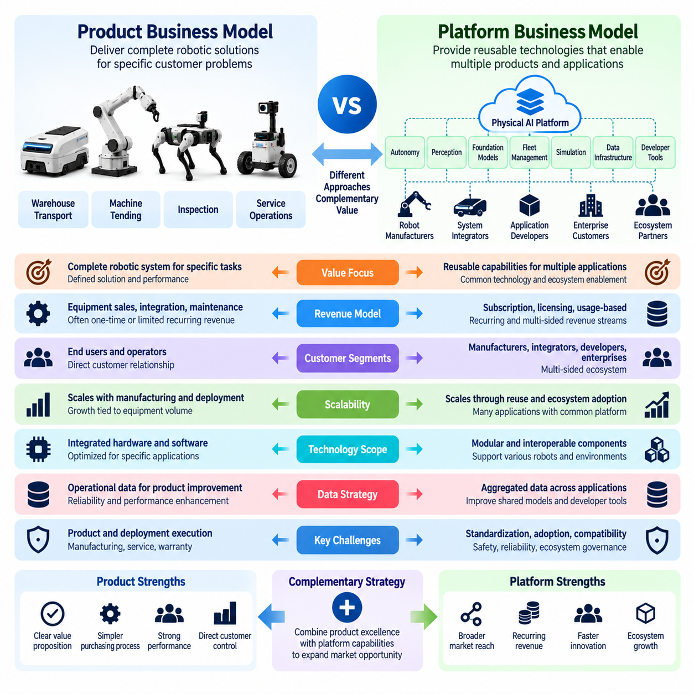{width="7.268055555555556in" height="7.268055555555556in"}

Product and platform business models represent two distinct approaches to commercializing Physical AI technologies. A product business focuses on delivering a defined robotic solution to a specific customer problem, while a platform business provides reusable technological capabilities that support multiple products, applications, or ecosystem participants. Understanding this distinction is essential for designing revenue structures, development strategies, and sustainable competitive advantages.

A product-oriented Physical AI company typically develops complete robotic systems for identifiable operational tasks. Examples include autonomous mobile robots for warehouse transport, robotic manipulators for machine tending, and inspection robots for industrial facilities. Commercial value is delivered through the performance of the finished solution, including its hardware, embedded intelligence, integration capabilities, and associated maintenance services.

Product business models generally offer clear customer accountability because one supplier is responsible for delivering a functioning system. Customers can evaluate specifications, operational performance, acquisition costs, and expected productivity improvements. This approach simplifies purchasing decisions and supports direct relationships with end users. However, growth may remain closely connected to manufacturing capacity, deployment resources, and equipment replacement cycles.

Platform-oriented Physical AI businesses concentrate on reusable infrastructure that enables multiple robotic applications. A platform may include autonomy software, perception models, robot foundation models, fleet management systems, simulation environments, data pipelines, and standardized interfaces. Instead of delivering only a finished robot, the provider supplies capabilities that other developers, manufacturers, integrators, or customers can incorporate into their solutions.

The central economic distinction concerns how value is created and scaled. Product businesses generate value by repeatedly manufacturing and deploying successful solutions, while platform businesses seek to distribute common capabilities across many implementations. A well-designed platform can reduce duplicated engineering, accelerate application development, and support multiple revenue streams. Nevertheless, platform scalability depends on interoperability, adoption, reliability, and continuing ecosystem participation.

Hardware economics strongly influence product-oriented strategies. Manufacturing costs, component procurement, inventory, quality assurance, warranty obligations, and logistics directly affect profitability. Higher production volumes may improve purchasing efficiency and manufacturing utilization, but physical equipment still requires capital and operational resources. Product companies must therefore balance competitive pricing with adequate margins and sufficient investment in software development.

Platform economics place greater emphasis on initial development investment and the marginal cost of serving additional users. Reusable software components can potentially support many customers without equivalent increases in hardware production. However, cloud computing, model inference, cybersecurity, technical support, customization, and infrastructure operations create continuing expenses. The financial advantages of software platforms emerge only when standardization limits incremental delivery costs.

Revenue models also differ between the two approaches. Product businesses commonly earn revenue from equipment sales, installation, integration, maintenance, and optional software upgrades. Platform businesses may charge subscription fees, licensing fees, usage-based payments, developer access fees, or enterprise support contracts. Hybrid companies combine equipment revenue with recurring payments for autonomy, fleet coordination, analytics, and advanced intelligence services.

Customer relationships reflect these different commercial structures. Product suppliers interact primarily with equipment buyers, operational managers, and maintenance organizations. Platform providers may serve robot manufacturers, application developers, system integrators, and enterprise technology teams. Consequently, platform businesses often require extensive documentation, software development kits, application programming interfaces, compatibility testing, and partner support programs.

The scope of technological ownership is another strategic consideration. A product company can optimize hardware and software together for a limited set of applications, achieving strong performance through integrated engineering. A platform company must support greater variation in sensors, actuators, computing systems, robot morphology, and operating environments. This flexibility increases market reach but introduces abstraction complexity and broader validation requirements.

Physical AI platforms face challenges beyond those encountered in conventional digital software businesses. Their outputs influence physical motion, manipulation, and interaction with people and infrastructure. Compatibility therefore involves more than software interfaces; it requires verified control behavior, timing constraints, safety boundaries, and hardware-specific performance. A platform cannot assume that an intelligent policy validated on one robot will operate safely on another embodiment.

Data architecture plays an important role in both models. Product companies collect operational information to improve reliability, diagnose failures, and enhance their own robotic systems. Platform providers may aggregate appropriately authorized data across different applications and robot configurations to improve shared models and development tools. Potential learning advantages depend on data governance, representation consistency, quality control, and the ability to transfer improvements across deployments.

Network effects may strengthen platform businesses when additional participants improve the value available to others. Developers can contribute applications, integrators can expand deployment coverage, and equipment manufacturers can increase compatible hardware choices. However, these effects are not automatic. They require stable interfaces, attractive commercial incentives, trustworthy governance, and sufficient interoperability to encourage continued ecosystem investment.

Product businesses can establish competitive advantages through mechanical performance, reliability, manufacturing efficiency, application expertise, and customer service. Platform businesses may differentiate through software maturity, model performance, developer productivity, ecosystem breadth, and integration efficiency. In both cases, defensibility ultimately depends on measurable customer outcomes rather than technological complexity or the number of supported features.

Market entry strategy often favors a focused product before broader platform expansion. A company can validate a specific application, establish customer relationships, and accumulate operational experience through an integrated robotic solution. Reusable software modules and standardized interfaces developed during this process may later become platform assets. This sequence reduces the risk of investing heavily in infrastructure before meaningful customer demand has been demonstrated.

Premature platform development can create substantial strategic risk. Companies may spend excessive resources building generalized architectures, developer tools, and compatibility layers without sufficient adoption. Broad technical flexibility can also compromise the performance of early applications. Effective platform strategy therefore requires identifying which capabilities are genuinely reusable, which customer segments share requirements, and which functions justify common infrastructure.

Hybrid product-platform models are particularly relevant to Physical AI because physical embodiment and intelligent software remain closely interconnected. A company may sell autonomous robots while operating a shared autonomy stack, fleet management platform, and continuous learning infrastructure. Standardized software supports multiple robot configurations, while deployed products generate operational feedback that informs future development and platform improvement.

The commercial architecture of a hybrid model must avoid unnecessary complexity. Customers should understand which capabilities are included in equipment purchases, which require subscriptions, and which services involve additional charges. Internally, companies must distinguish hardware margins, software revenue, deployment expenses, and support costs. Transparent allocation of costs and responsibilities helps determine whether the combined business creates sustainable profitability.

Platform governance becomes increasingly important as external participants depend on shared infrastructure. Providers must establish policies for interface changes, software compatibility, data access, intellectual property, cybersecurity, and operational responsibility. Clear governance reduces uncertainty for developers and customers while protecting system integrity. In safety-critical applications, platform updates also require controlled validation and deployment procedures.

Choosing between product and platform strategies requires evaluating organizational capabilities, market maturity, available capital, and customer expectations. Product models may offer faster commercialization when specific operational needs are well understood. Platform models may provide broader long-term opportunities when multiple customers require similar intelligence infrastructure. Neither approach is inherently superior, and both must demonstrate economically sustainable value creation.

Ultimately, Physical AI business design should treat product and platform models as complementary strategic options rather than mutually exclusive categories. Products translate intelligent technology into dependable physical outcomes, while platforms enable reuse, extensibility, and ecosystem development. The strongest commercial architecture aligns hardware differentiation, software scalability, customer adoption, and lifecycle economics with a realistic path from initial deployment to sustained business growth.

제품 사업 모델(Product Business Model)과 플랫폼 사업 모델(Platform Business Model)은 피지컬 인공지능 기술(Physical AI Technologies)을 상용화하는 두 가지 서로 다른 접근 방식이다. 제품 사업(Product Business)은 특정 고객 문제(Customer Problem)를 해결하기 위해 정의된 로봇 솔루션(Robotic Solution)을 제공하는 데 집중하는 반면, 플랫폼 사업(Platform Business)은 여러 제품(Products), 응용 분야(Applications), 생태계 참여자(Ecosystem Participants)를 지원하는 재사용 가능한 기술 역량(Reusable Technological Capabilities)을 제공한다. 이러한 차이를 이해하는 것은 매출 구조(Revenue Structures), 개발 전략(Development Strategies), 지속 가능한 경쟁 우위(Sustainable Competitive Advantages)를 설계하는 데 필수적이다.

제품 중심 피지컬 인공지능 기업(Product-Oriented Physical AI Company)은 일반적으로 명확하게 식별할 수 있는 운영 작업(Operational Tasks)을 위한 완전한 로봇 시스템(Complete Robotic Systems)을 개발한다. 대표적인 사례로는 창고 운송용 자율이동로봇(Autonomous Mobile Robots), 기계 투입 및 배출용 로봇 매니퓰레이터(Robotic Manipulators), 산업 시설용 검사 로봇(Inspection Robots)이 있다. 상업적 가치(Commercial Value)는 하드웨어(Hardware), 내장형 지능(Embedded Intelligence), 시스템 통합 기능(Integration Capabilities), 관련 유지보수 서비스(Associated Maintenance Services)를 포함한 완성된 솔루션(Finished Solution)의 성능을 통해 제공된다.

제품 사업 모델(Product Business Models)은 일반적으로 하나의 공급업체(Supplier)가 정상적으로 작동하는 시스템(Functional System)의 제공을 책임지기 때문에 고객에 대한 책임 소재(Customer Accountability)가 명확하다. 고객은 기술 사양(Specifications), 운영 성능(Operational Performance), 취득 비용(Acquisition Costs), 예상 생산성 향상(Expected Productivity Improvements)을 평가할 수 있다. 이러한 접근 방식은 구매 의사결정(Purchasing Decisions)을 단순화하고 최종 사용자(End Users)와의 직접적인 관계를 지원한다. 그러나 사업 성장은 제조 능력(Manufacturing Capacity), 배포 자원(Deployment Resources), 장비 교체 주기(Equipment Replacement Cycles)와 밀접하게 연결될 수 있다.

플랫폼 중심 피지컬 인공지능 사업(Platform-Oriented Physical AI Business)은 여러 로봇 응용 분야(Robotic Applications)를 가능하게 하는 재사용 가능한 인프라(Reusable Infrastructure)에 집중한다. 플랫폼(Platform)에는 자율운영 소프트웨어(Autonomy Software), 인지 모델(Perception Models), 로봇 파운데이션 모델(Robot Foundation Models), 로봇군 관리 시스템(Fleet Management Systems), 시뮬레이션 환경(Simulation Environments), 데이터 파이프라인(Data Pipelines), 표준화된 인터페이스(Standardized Interfaces)가 포함될 수 있다. 공급업체는 완성된 로봇(Finished Robot)만 제공하는 것이 아니라 다른 개발자(Developers), 제조업체(Manufacturers), 시스템 통합업체(System Integrators), 고객(Customers)이 자체 솔루션에 통합할 수 있는 기술 역량을 제공한다.

두 모델의 핵심적인 경제적 차이(Central Economic Distinction)는 가치가 창출되고 확장되는 방식(How Value Is Created and Scaled)에 있다. 제품 사업(Product Businesses)은 성공적인 솔루션을 반복적으로 제조하고 배포함으로써 가치를 창출하는 반면, 플랫폼 사업(Platform Businesses)은 공통 기능(Common Capabilities)을 다양한 구현 환경(Implementations)에 배포하여 가치를 창출하고자 한다. 잘 설계된 플랫폼(Well-Designed Platform)은 중복 엔지니어링(Duplicated Engineering)을 줄이고, 응용 프로그램 개발(Application Development)을 가속화하며, 다양한 매출원(Revenue Streams)을 지원할 수 있다. 그러나 플랫폼 확장성(Platform Scalability)은 상호운용성(Interoperability), 도입(Adoption), 신뢰성(Reliability), 지속적인 생태계 참여(Continuing Ecosystem Participation)에 달려 있다.

하드웨어 경제성(Hardware Economics)은 제품 중심 전략(Product-Oriented Strategies)에 큰 영향을 미친다. 제조 비용(Manufacturing Costs), 부품 조달(Component Procurement), 재고(Inventory), 품질 보증(Quality Assurance), 보증 의무(Warranty Obligations), 물류(Logistics)는 수익성(Profitability)에 직접적인 영향을 준다. 생산량(Production Volumes)이 증가하면 구매 효율성(Purchasing Efficiency)과 제조 설비 가동률(Manufacturing Utilization)이 개선될 수 있지만, 물리적 장비(Physical Equipment)는 여전히 자본(Capital)과 운영 자원(Operational Resources)을 필요로 한다. 따라서 제품 기업(Product Companies)은 경쟁력 있는 가격(Competitive Pricing), 적절한 이익률(Adequate Margins), 충분한 소프트웨어 개발 투자(Sufficient Investment in Software Development) 사이의 균형을 유지해야 한다.

플랫폼 경제성(Platform Economics)은 초기 개발 투자(Initial Development Investment)와 추가 사용자에게 서비스를 제공하는 한계비용(Marginal Cost)에 더 큰 비중을 둔다. 재사용 가능한 소프트웨어 구성 요소(Reusable Software Components)는 하드웨어 생산량(Hardware Production)을 동일한 비율로 늘리지 않고도 많은 고객을 지원할 수 있다. 그러나 클라우드 컴퓨팅(Cloud Computing), 모델 추론(Model Inference), 사이버보안(Cybersecurity), 기술 지원(Technical Support), 맞춤화(Customization), 인프라 운영(Infrastructure Operations)은 지속적인 비용을 발생시킨다. 소프트웨어 플랫폼(Software Platforms)의 재무적 이점(Financial Advantages)은 표준화(Standardization)를 통해 추가 제공 비용(Incremental Delivery Costs)을 제한할 수 있을 때 나타난다.

매출 모델(Revenue Models) 역시 두 접근 방식 사이에서 차이를 보인다. 제품 사업(Product Businesses)은 일반적으로 장비 판매(Equipment Sales), 설치(Installation), 시스템 통합(Integration), 유지보수(Maintenance), 선택적 소프트웨어 업그레이드(Optional Software Upgrades)를 통해 매출을 창출한다. 플랫폼 사업(Platform Businesses)은 구독료(Subscription Fees), 라이선스 요금(Licensing Fees), 사용량 기반 요금(Usage-Based Payments), 개발자 접근 요금(Developer Access Fees), 기업 기술 지원 계약(Enterprise Support Contracts)을 부과할 수 있다. 하이브리드 기업(Hybrid Companies)은 장비 매출(Equipment Revenue)에 자율운영(Autonomy), 로봇군 조정(Fleet Coordination), 분석(Analytics), 고급 지능 서비스(Advanced Intelligence Services)에 대한 반복 결제(Recurring Payments)를 결합한다.

고객 관계(Customer Relationships)는 이러한 상업적 구조(Commercial Structures)의 차이를 반영한다. 제품 공급업체(Product Suppliers)는 주로 장비 구매자(Equipment Buyers), 운영 관리자(Operational Managers), 유지보수 조직(Maintenance Organizations)과 상호작용한다. 플랫폼 공급업체(Platform Providers)는 로봇 제조업체(Robot Manufacturers), 응용 프로그램 개발자(Application Developers), 시스템 통합업체(System Integrators), 기업 기술 조직(Enterprise Technology Teams)에 서비스를 제공할 수 있다. 따라서 플랫폼 사업(Platform Businesses)에는 광범위한 기술 문서(Documentation), 소프트웨어 개발 키트(Software Development Kits, SDKs), 응용 프로그램 프로그래밍 인터페이스(Application Programming Interfaces, APIs), 호환성 시험(Compatibility Testing), 파트너 지원 프로그램(Partner Support Programs)이 필요한 경우가 많다.

기술 소유 범위(Scope of Technological Ownership)는 또 다른 전략적 고려사항(Strategic Consideration)이다. 제품 기업(Product Company)은 제한된 응용 분야(Limited Applications)에 맞춰 하드웨어(Hardware)와 소프트웨어(Software)를 함께 최적화하여 통합 엔지니어링(Integrated Engineering)을 통해 높은 성능을 달성할 수 있다. 반면 플랫폼 기업(Platform Company)은 센서(Sensors), 액추에이터(Actuators), 컴퓨팅 시스템(Computing Systems), 로봇 형태(Robot Morphology), 운영 환경(Operating Environments)의 더 큰 다양성을 지원해야 한다. 이러한 유연성(Flexibility)은 시장 접근 범위(Market Reach)를 확대하지만 추상화 복잡성(Abstraction Complexity)과 더 광범위한 검증 요구사항(Broader Validation Requirements)을 발생시킨다.

피지컬 인공지능 플랫폼(Physical AI Platforms)은 기존 디지털 소프트웨어 사업(Conventional Digital Software Businesses)에서 발생하는 문제를 넘어서는 도전 과제(Challenges)에 직면한다. 플랫폼의 출력(Outputs)은 물리적 움직임(Physical Motion), 조작(Manipulation), 사람 및 인프라와의 상호작용(Interaction with People and Infrastructure)에 영향을 미친다. 따라서 호환성(Compatibility)은 단순한 소프트웨어 인터페이스(Software Interfaces)를 넘어 검증된 제어 동작(Verified Control Behavior), 시간 제약(Timing Constraints), 안전 경계(Safety Boundaries), 하드웨어별 성능(Hardware-Specific Performance)을 요구한다. 플랫폼은 하나의 로봇에서 검증된 지능형 정책(Intelligent Policy)이 다른 로봇 형태(Embodiment)에서도 안전하게 작동할 것이라고 가정할 수 없다.

데이터 아키텍처(Data Architecture)는 두 모델 모두에서 중요한 역할을 한다. 제품 기업(Product Companies)은 신뢰성(Reliability)을 개선하고, 고장(Failures)을 진단하며, 자체 로봇 시스템(Robotic Systems)을 향상시키기 위해 운영 정보(Operational Information)를 수집한다. 플랫폼 공급업체(Platform Providers)는 적절한 권한(Appropriate Authorization)을 확보한 데이터를 서로 다른 응용 분야(Applications)와 로봇 구성(Robot Configurations)에서 통합하여 공유 모델(Shared Models)과 개발 도구(Development Tools)를 개선할 수 있다. 잠재적인 학습 이점(Potential Learning Advantages)은 데이터 거버넌스(Data Governance), 표현 일관성(Representation Consistency), 품질 관리(Quality Control), 배포 환경 간 개선 사항 이전 능력(Ability to Transfer Improvements Across Deployments)에 달려 있다.

네트워크 효과(Network Effects)는 추가 참여자(Additional Participants)가 다른 참여자에게 제공되는 가치(Value)를 향상시킬 때 플랫폼 사업(Platform Businesses)을 강화할 수 있다. 개발자(Developers)는 응용 프로그램(Applications)을 제공하고, 시스템 통합업체(System Integrators)는 배포 범위(Deployment Coverage)를 확대하며, 장비 제조업체(Equipment Manufacturers)는 호환 가능한 하드웨어 선택지(Compatible Hardware Choices)를 늘릴 수 있다. 그러나 이러한 효과는 자동으로 발생하지 않는다. 지속적인 생태계 투자(Continued Ecosystem Investment)를 장려하려면 안정적인 인터페이스(Stable Interfaces), 매력적인 상업적 인센티브(Attractive Commercial Incentives), 신뢰할 수 있는 거버넌스(Trustworthy Governance), 충분한 상호운용성(Sufficient Interoperability)이 필요하다.

제품 사업(Product Businesses)은 기계적 성능(Mechanical Performance), 신뢰성(Reliability), 제조 효율성(Manufacturing Efficiency), 응용 분야 전문성(Application Expertise), 고객 서비스(Customer Service)를 통해 경쟁 우위(Competitive Advantages)를 확보할 수 있다. 플랫폼 사업(Platform Businesses)은 소프트웨어 성숙도(Software Maturity), 모델 성능(Model Performance), 개발자 생산성(Developer Productivity), 생태계 범위(Ecosystem Breadth), 통합 효율성(Integration Efficiency)을 통해 차별화할 수 있다. 두 경우 모두 지속 가능한 경쟁력(Defensibility)은 궁극적으로 기술적 복잡성(Technological Complexity)이나 지원 기능 수(Number of Supported Features)가 아니라 측정 가능한 고객 성과(Measurable Customer Outcomes)에 달려 있다.

시장 진입 전략(Market Entry Strategy)은 광범위한 플랫폼 확장(Broader Platform Expansion)에 앞서 특정 제품(Focused Product)에 집중하는 방식을 선호하는 경우가 많다. 기업은 통합 로봇 솔루션(Integrated Robotic Solution)을 통해 특정 응용 분야(Specific Application)를 검증하고, 고객 관계(Customer Relationships)를 구축하며, 운영 경험(Operational Experience)을 축적할 수 있다. 이 과정에서 개발된 재사용 가능한 소프트웨어 모듈(Reusable Software Modules)과 표준화된 인터페이스(Standardized Interfaces)는 이후 플랫폼 자산(Platform Assets)이 될 수 있다. 이러한 순서는 의미 있는 고객 수요(Meaningful Customer Demand)가 입증되기 전에 인프라(Infrastructure)에 과도하게 투자하는 위험을 줄인다.

성급한 플랫폼 개발(Premature Platform Development)은 상당한 전략적 위험(Strategic Risk)을 발생시킬 수 있다. 기업은 충분한 도입(Adoption)이 이루어지지 않은 상태에서 범용 아키텍처(Generalized Architectures), 개발자 도구(Developer Tools), 호환성 계층(Compatibility Layers)을 구축하는 데 과도한 자원(Resources)을 투입할 수 있다. 광범위한 기술적 유연성(Broad Technical Flexibility)은 초기 응용 분야(Early Applications)의 성능을 저하시킬 수도 있다. 따라서 효과적인 플랫폼 전략(Effective Platform Strategy)은 실제로 재사용 가능한 기능(Genuinely Reusable Capabilities), 공통 요구사항(Shared Requirements)을 가진 고객 세그먼트(Customer Segments), 공통 인프라(Common Infrastructure)를 정당화하는 기능을 식별해야 한다.

하이브리드 제품-플랫폼 모델(Hybrid Product-Platform Models)은 물리적 구현(Physical Embodiment)과 지능형 소프트웨어(Intelligent Software)가 긴밀하게 연결되어 있기 때문에 피지컬 인공지능(Physical AI)에서 특히 중요하다. 기업은 자율 로봇(Autonomous Robots)을 판매하면서 공통 자율운영 소프트웨어 스택(Shared Autonomy Stack), 로봇군 관리 플랫폼(Fleet Management Platform), 지속적 학습 인프라(Continuous Learning Infrastructure)를 운영할 수 있다. 표준화된 소프트웨어(Standardized Software)는 여러 로봇 구성(Robot Configurations)을 지원하며, 배포된 제품(Deployed Products)은 향후 개발(Future Development)과 플랫폼 개선(Platform Improvement)에 활용되는 운영 피드백(Operational Feedback)을 생성한다.

하이브리드 모델(Hybrid Model)의 상업적 아키텍처(Commercial Architecture)는 불필요한 복잡성(Unnecessary Complexity)을 피해야 한다. 고객은 장비 구매(Equipment Purchases)에 포함되는 기능, 구독(Subscriptions)이 필요한 기능, 추가 요금(Additional Charges)이 발생하는 서비스를 명확하게 이해해야 한다. 기업 내부적으로는 하드웨어 이익률(Hardware Margins), 소프트웨어 매출(Software Revenue), 배포 비용(Deployment Expenses), 지원 비용(Support Costs)을 구분해야 한다. 비용과 책임의 투명한 배분(Transparent Allocation of Costs and Responsibilities)은 결합된 사업(Combined Business)이 지속 가능한 수익성(Sustainable Profitability)을 창출하는지 판단하는 데 도움이 된다.

외부 참여자(External Participants)가 공유 인프라(Shared Infrastructure)에 의존하게 될수록 플랫폼 거버넌스(Platform Governance)의 중요성이 커진다. 공급업체(Providers)는 인터페이스 변경(Interface Changes), 소프트웨어 호환성(Software Compatibility), 데이터 접근(Data Access), 지식재산권(Intellectual Property), 사이버보안(Cybersecurity), 운영 책임(Operational Responsibility)에 관한 정책을 수립해야 한다. 명확한 거버넌스(Clear Governance)는 시스템 무결성(System Integrity)을 보호하면서 개발자(Developers)와 고객(Customers)의 불확실성을 줄인다. 안전이 중요한 응용 분야(Safety-Critical Applications)에서는 플랫폼 업데이트(Platform Updates)에도 통제된 검증(Controlled Validation)과 배포 절차(Deployment Procedures)가 필요하다.

제품 전략(Product Strategy)과 플랫폼 전략(Platform Strategy) 사이의 선택은 조직 역량(Organizational Capabilities), 시장 성숙도(Market Maturity), 가용 자본(Available Capital), 고객 기대(Customer Expectations)를 평가해야 한다. 특정 운영 요구사항(Specific Operational Needs)이 명확하게 이해되는 경우 제품 모델(Product Models)은 더 빠른 상용화(Faster Commercialization)를 제공할 수 있다. 여러 고객이 유사한 지능 인프라(Intelligence Infrastructure)를 필요로 하는 경우 플랫폼 모델(Platform Models)은 더 광범위한 장기적 기회(Broader Long-Term Opportunities)를 제공할 수 있다. 어느 접근 방식도 본질적으로 우월하지 않으며, 두 모델 모두 경제적으로 지속 가능한 가치 창출(Economically Sustainable Value Creation)을 입증해야 한다.

궁극적으로 피지컬 인공지능 사업 설계(Physical AI Business Design)는 제품 모델(Product Models)과 플랫폼 모델(Platform Models)을 상호 배타적인 범주(Mutually Exclusive Categories)가 아니라 상호 보완적인 전략적 선택지(Complementary Strategic Options)로 다루어야 한다. 제품(Products)은 지능형 기술(Intelligent Technology)을 신뢰할 수 있는 물리적 성과(Dependable Physical Outcomes)로 전환하는 반면, 플랫폼(Platforms)은 재사용성(Reuse), 확장 가능성(Extensibility), 생태계 개발(Ecosystem Development)을 가능하게 한다. 가장 강력한 상업적 아키텍처(Commercial Architecture)는 하드웨어 차별화(Hardware Differentiation), 소프트웨어 확장성(Software Scalability), 고객 도입(Customer Adoption), 수명주기 경제성(Lifecycle Economics)을 초기 배포(Initial Deployment)에서 지속적인 사업 성장(Sustained Business Growth)으로 이어지는 현실적인 경로(Realistic Path)와 일치시키는 구조이다.

##  

## 08.05. Robot as a Service RaaS

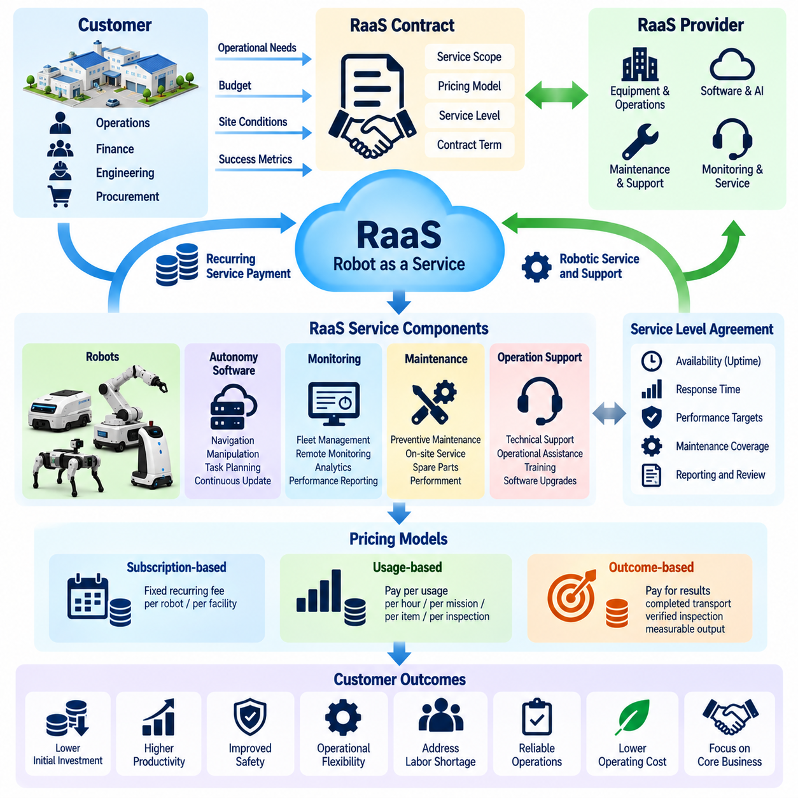{width="7.268055555555556in" height="7.268055555555556in"}

Robot-as-a-Service (RaaS) is a business model that provides access to robotic capabilities through recurring service payments rather than requiring customers to purchase and own equipment outright. It transforms robotics from a primarily capital-intensive equipment transaction into an ongoing operational service. In Physical AI, RaaS can combine intelligent hardware, autonomy software, maintenance, monitoring, and technical support within a unified commercial offering.

The central value of RaaS is its ability to align robotic automation costs with ongoing operational needs. Traditional robot purchases often require substantial upfront capital expenditure, integration investment, and internal maintenance resources. RaaS arrangements distribute payments over time and may transfer selected operational responsibilities to the provider. This structure can make automation more accessible to organizations with limited investment budgets or uncertain future demand.

A typical RaaS offering includes physical robots, embedded control software, autonomy functions, remote monitoring, and defined maintenance services. Depending on the contract, it may also cover installation, commissioning, software updates, replacement equipment, and operational assistance. The exact service boundary is commercially important because customers must understand which responsibilities remain internal and which are assumed by the provider.

RaaS differs from conventional equipment leasing because it can incorporate continuing operational performance obligations rather than merely financing asset access. A lease primarily establishes payment and ownership arrangements, while a service-oriented contract may include availability commitments, software functionality, preventive maintenance, and performance reporting. Nevertheless, some commercial offerings combine leasing and services, making contractual definitions more important than marketing terminology.

Subscription-based pricing is one of the most common RaaS structures. Customers pay a recurring fee per robot, per facility, or per contracted service capacity. Pricing may vary according to robot configuration, operating hours, maintenance coverage, software capabilities, and service response requirements. Predictable payments simplify budgeting, but contracts must clarify additional charges for integration, consumables, excessive usage, and exceptional support.

Usage-based pricing connects service fees to measurable robot activity. Charges may depend on operating hours, completed transport missions, handled items, inspected assets, or other verified outputs. This approach can improve alignment between customer costs and actual utilization. However, reliable metering, transparent reporting, and agreed definitions of successful task completion are necessary to prevent billing disputes and distorted operating incentives.

Outcome-based RaaS arrangements go further by linking compensation to delivered operational results. A logistics customer might pay for successfully completed material movements, while an inspection customer may purchase verified inspection coverage. Such agreements can strengthen customer confidence when providers accept greater performance responsibility. They also expose providers to demand fluctuations, environmental constraints, and factors outside their direct control.

For customers, RaaS can reduce initial financial barriers and accelerate automation adoption. Instead of committing substantial capital before operational benefits are demonstrated, organizations can evaluate robotic services through recurring operating budgets. Nevertheless, accounting classification depends on contract substance and applicable standards. A subscription label alone does not guarantee operating expense treatment or eliminate recognized lease liabilities.

The economic attractiveness of RaaS must be assessed over the complete contract period. Recurring payments may reduce initial expenditure while increasing total lifetime spending relative to direct ownership. Customers should compare service fees, expected utilization, maintenance coverage, downtime risk, technology upgrades, and contract flexibility. The appropriate decision depends on the value of risk transfer and operational support as well as direct financial cost.

For providers, RaaS fundamentally changes cash flow and capital requirements. Equipment manufacturing, procurement, deployment, and commissioning expenses may occur before sufficient subscription revenue has been collected. Providers must finance deployed assets while managing recurring maintenance and operating costs. Consequently, fleet growth can increase financing needs even when contracted revenue and customer demand are expanding.

RaaS unit economics depend on the relationship between recurring revenue and the complete cost of providing robotic services. Important expenses include equipment depreciation, financing, maintenance, field support, software infrastructure, insurance, connectivity, and eventual refurbishment. Profitability requires sufficient contribution margin over the asset lifecycle, while contract duration and customer retention determine how reliably initial investment can be recovered.

Robot utilization is a decisive factor in RaaS profitability. Equipment generating revenue during only a small fraction of available operating time may produce inadequate returns despite technically successful deployment. Providers must therefore monitor productive hours, completed missions, idle periods, charging time, and intervention frequency. Fleet optimization and effective customer demand planning can improve revenue efficiency without proportionally increasing installed equipment.

Service-level agreements establish measurable expectations between customers and RaaS providers. Contracts may specify robot availability, response times, maintenance procedures, software support, and escalation responsibilities. Performance commitments should distinguish provider-controlled failures from customer infrastructure problems, unavailable work, and exceptional environmental conditions. Clear definitions support accountability while limiting disputes over service performance.

Maintenance and lifecycle management become central operating capabilities under RaaS. Providers have direct financial incentives to improve equipment durability, diagnose faults remotely, and perform preventive maintenance before failures interrupt service. Modular components, standardized spare parts, and efficient repair procedures can reduce service costs. Asset refurbishment and redeployment may further improve lifecycle economics when equipment remains technically suitable.

Physical AI strengthens the RaaS proposition through software-defined functionality and continuous operational improvement. Navigation policies, perception systems, task scheduling, and fleet coordination can potentially be updated across deployed robots. Such improvements may increase productivity without replacing entire machines. However, software releases require compatibility testing, controlled deployment, and safety validation to prevent unexpected operational disruptions.

Remote operations infrastructure is particularly important for managing distributed RaaS fleets. Centralized monitoring can provide visibility into robot health, task completion, battery condition, connectivity, and operational exceptions. Remote diagnostics and structured intervention procedures may reduce on-site service requirements. Nevertheless, communication failures and uncertain autonomous behavior require local safety mechanisms and clearly defined fallback procedures.

Customer onboarding and deployment standardization strongly influence service profitability. Every installation may require site mapping, infrastructure integration, workflow configuration, operator training, and acceptance testing. Excessive customization increases deployment costs and delays revenue generation. Standardized robot platforms, reusable software configurations, and documented commissioning processes help providers scale service delivery across multiple facilities.

Contract design must address asset ownership, minimum service periods, termination rights, and responsibilities for damage or misuse. Providers may require minimum commitments to recover deployment costs, while customers often seek flexibility as operational demand changes. Agreements should also define equipment relocation, software access, data rights, cybersecurity obligations, and end-of-contract procedures. These provisions determine how commercial risk is distributed.

RaaS providers must carefully manage the relationship between growth and financial sustainability. Rapid deployment can increase recurring revenue while simultaneously expanding capital expenditure, working capital requirements, and service obligations. Financial planning should consider customer acquisition costs, deployment payback, equipment useful life, contract renewal probability, and asset residual value. Sustainable expansion requires balancing fleet growth with available financing capacity.

RaaS can also support broader Physical AI platform strategies. A shared software architecture may connect multiple robot types through common fleet management, monitoring, analytics, and learning infrastructure. As deployments expand, appropriately governed operational data can inform reliability improvements and reusable autonomy capabilities. These advantages depend on standardized interfaces, consistent data quality, and demonstrated transferability across operating environments.

Ultimately, Robot-as-a-Service converts robotic automation into a continuing commercial relationship centered on operational capability rather than equipment ownership alone. Its success depends on aligning customer value, service reliability, asset utilization, financing, and lifecycle profitability. A sustainable RaaS business must deliver measurable productivity while maintaining predictable service quality and sufficient economic returns throughout the deployed fleet\'s operating life.

서비스형 로봇(Robot-as-a-Service, RaaS)은 고객이 장비를 직접 구매하고 소유하는 대신 정기적인 서비스 요금(Recurring Service Payments)을 통해 로봇 기능(Robotic Capabilities)을 이용하도록 제공하는 사업 모델(Business Model)이다. 이는 로봇 산업(Robotics)을 주로 자본 집약적인 장비 거래(Capital-Intensive Equipment Transaction)에서 지속적인 운영 서비스(Ongoing Operational Service)로 전환한다. 피지컬 인공지능(Physical AI)에서 서비스형 로봇(RaaS)은 지능형 하드웨어(Intelligent Hardware), 자율운영 소프트웨어(Autonomy Software), 유지보수(Maintenance), 모니터링(Monitoring), 기술 지원(Technical Support)을 통합된 상업적 서비스(Unified Commercial Offering)로 결합할 수 있다.

서비스형 로봇(RaaS)의 핵심 가치(Central Value)는 로봇 자동화 비용(Robotic Automation Costs)을 지속적인 운영 요구사항(Ongoing Operational Needs)과 일치시킬 수 있다는 점이다. 전통적인 로봇 구매(Traditional Robot Purchases)는 상당한 초기 자본적 지출(Upfront Capital Expenditure), 시스템 통합 투자(Integration Investment), 내부 유지보수 자원(Internal Maintenance Resources)을 요구하는 경우가 많다. 서비스형 로봇 계약(RaaS Arrangements)은 비용 지급을 시간에 걸쳐 분산하고 일부 운영 책임(Operational Responsibilities)을 공급업체(Provider)로 이전할 수 있다. 이러한 구조는 투자 예산(Investment Budgets)이 제한적이거나 미래 수요(Future Demand)가 불확실한 조직에서도 자동화(Automation)를 보다 쉽게 도입할 수 있도록 한다.

일반적인 서비스형 로봇 제공 모델(Typical RaaS Offering)에는 물리적 로봇(Physical Robots), 내장형 제어 소프트웨어(Embedded Control Software), 자율운영 기능(Autonomy Functions), 원격 모니터링(Remote Monitoring), 명시된 유지보수 서비스(Defined Maintenance Services)가 포함된다. 계약(Contract)에 따라 설치(Installation), 시운전(Commissioning), 소프트웨어 업데이트(Software Updates), 대체 장비(Replacement Equipment), 운영 지원(Operational Assistance)도 포함될 수 있다. 정확한 서비스 범위(Service Boundary)는 고객이 어떤 책임을 내부적으로 유지하고 어떤 책임을 공급업체가 부담하는지 이해해야 한다는 점에서 상업적으로 중요하다.

서비스형 로봇(RaaS)은 단순히 자산 이용(Asset Access)에 필요한 금융을 제공하는 것이 아니라 지속적인 운영 성능 의무(Continuing Operational Performance Obligations)를 포함할 수 있다는 점에서 전통적인 장비 리스(Conventional Equipment Leasing)와 구별된다. 리스(Lease)는 주로 지급 조건(Payment Arrangements)과 소유권 구조(Ownership Arrangements)를 규정하는 반면, 서비스 중심 계약(Service-Oriented Contract)은 가용성 보장(Availability Commitments), 소프트웨어 기능(Software Functionality), 예방 유지보수(Preventive Maintenance), 성능 보고(Performance Reporting)를 포함할 수 있다. 다만 일부 상업적 서비스(Commercial Offerings)는 리스와 서비스를 결합하므로 마케팅 용어(Marketing Terminology)보다 계약상 정의(Contractual Definitions)가 더 중요하다.

구독 기반 가격 책정(Subscription-Based Pricing)은 가장 일반적인 서비스형 로봇(RaaS) 구조 중 하나이다. 고객은 로봇당(Per Robot), 시설당(Per Facility), 또는 계약된 서비스 용량(Contracted Service Capacity)에 따라 정기 요금(Recurring Fee)을 지불한다. 가격(Pricing)은 로봇 구성(Robot Configuration), 운영시간(Operating Hours), 유지보수 범위(Maintenance Coverage), 소프트웨어 기능(Software Capabilities), 서비스 대응 요구사항(Service Response Requirements)에 따라 달라질 수 있다. 예측 가능한 요금(Predictable Payments)은 예산 편성(Budgeting)을 단순화하지만, 계약에는 시스템 통합(Integration), 소모품(Consumables), 초과 사용(Excessive Usage), 예외적인 지원(Exceptional Support)에 대한 추가 비용을 명확하게 규정해야 한다.

사용량 기반 가격 책정(Usage-Based Pricing)은 서비스 요금(Service Fees)을 측정 가능한 로봇 활동(Measurable Robot Activity)과 연결한다. 요금(Charges)은 운영시간(Operating Hours), 완료된 운송 임무(Completed Transport Missions), 취급된 물품(Handled Items), 검사된 자산(Inspected Assets), 기타 검증된 산출물(Verified Outputs)에 따라 결정될 수 있다. 이러한 접근 방식은 고객 비용(Customer Costs)과 실제 가동률(Actual Utilization) 사이의 일치도를 높일 수 있다. 그러나 청구 분쟁(Billing Disputes)과 왜곡된 운영 인센티브(Distorted Operating Incentives)를 방지하려면 신뢰할 수 있는 사용량 계측(Reliable Metering), 투명한 보고(Transparent Reporting), 성공적인 작업 완료(Successful Task Completion)에 대한 합의된 정의가 필요하다.

성과 기반 서비스형 로봇 계약(Outcome-Based RaaS Arrangements)은 보상(Compensation)을 실제로 제공된 운영 성과(Delivered Operational Results)와 연결함으로써 한 단계 더 발전한다. 물류 고객(Logistics Customer)은 성공적으로 완료된 자재 이동(Successfully Completed Material Movements)에 대해 비용을 지불할 수 있으며, 검사 고객(Inspection Customer)은 검증된 검사 범위(Verified Inspection Coverage)를 구매할 수 있다. 이러한 계약은 공급업체가 더 큰 성능 책임(Performance Responsibility)을 수용할 때 고객 신뢰(Customer Confidence)를 강화할 수 있다. 동시에 공급업체는 수요 변동(Demand Fluctuations), 환경적 제약(Environmental Constraints), 직접 통제할 수 없는 요인(Factors Outside Direct Control)에 노출된다.

고객 관점에서 서비스형 로봇(RaaS)은 초기 재무적 장벽(Initial Financial Barriers)을 낮추고 자동화 도입(Automation Adoption)을 가속화할 수 있다. 조직은 운영 편익(Operational Benefits)이 입증되기 전에 상당한 자본(Capital)을 투입하는 대신 반복적인 운영 예산(Recurring Operating Budgets)을 통해 로봇 서비스(Robotic Services)를 평가할 수 있다. 그러나 회계상 분류(Accounting Classification)는 계약의 실질(Contract Substance)과 적용되는 회계기준(Applicable Accounting Standards)에 따라 결정된다. 구독(Subscription)이라는 명칭만으로 운영비용(Operating Expense) 처리가 보장되거나 인식해야 하는 리스 부채(Recognized Lease Liabilities)가 없어지는 것은 아니다.

서비스형 로봇(RaaS)의 경제적 매력도(Economic Attractiveness)는 전체 계약 기간(Complete Contract Period)을 기준으로 평가해야 한다. 정기적인 요금(Recurring Payments)은 초기 지출(Initial Expenditure)을 줄일 수 있지만 직접 소유(Direct Ownership)와 비교하면 전체 수명주기 지출(Total Lifetime Spending)이 증가할 수 있다. 고객은 서비스 요금(Service Fees), 예상 가동률(Expected Utilization), 유지보수 범위(Maintenance Coverage), 가동 중단 위험(Downtime Risk), 기술 업그레이드(Technology Upgrades), 계약 유연성(Contract Flexibility)을 비교해야 한다. 적절한 의사결정(Appropriate Decision)은 직접적인 재무 비용(Direct Financial Cost)뿐 아니라 위험 이전(Risk Transfer)과 운영 지원(Operational Support)의 가치에도 달려 있다.

공급업체 관점에서 서비스형 로봇(RaaS)은 현금흐름(Cash Flow)과 자본 요구사항(Capital Requirements)을 근본적으로 변화시킨다. 장비 제조(Equipment Manufacturing), 조달(Procurement), 배포(Deployment), 시운전(Commissioning)에 필요한 비용은 충분한 구독 매출(Subscription Revenue)이 회수되기 전에 발생할 수 있다. 공급업체는 반복적인 유지보수 비용(Recurring Maintenance Costs)과 운영비용(Operating Costs)을 관리하면서 배포된 자산(Deployed Assets)에 필요한 자금을 조달해야 한다. 따라서 계약 매출(Contracted Revenue)과 고객 수요(Customer Demand)가 증가하더라도 로봇군 규모 확대(Fleet Growth)는 자금 조달 필요성(Financing Needs)을 증가시킬 수 있다.

서비스형 로봇의 단위 경제성(RaaS Unit Economics)은 반복 매출(Recurring Revenue)과 로봇 서비스 제공에 필요한 전체 비용(Complete Cost of Providing Robotic Services) 사이의 관계에 달려 있다. 주요 비용에는 장비 감가상각(Equipment Depreciation), 금융 비용(Financing), 유지보수(Maintenance), 현장 지원(Field Support), 소프트웨어 인프라(Software Infrastructure), 보험(Insurance), 연결성(Connectivity), 향후 재정비(Eventual Refurbishment)가 포함된다. 수익성(Profitability)을 확보하려면 자산 수명주기(Asset Lifecycle) 동안 충분한 공헌이익(Contribution Margin)이 발생해야 하며, 계약 기간(Contract Duration)과 고객 유지율(Customer Retention)은 초기 투자(Initial Investment)를 얼마나 안정적으로 회수할 수 있는지를 결정한다.

로봇 가동률(Robot Utilization)은 서비스형 로봇(RaaS)의 수익성을 결정하는 핵심 요소(Decisive Factor)이다. 사용 가능한 운영시간(Available Operating Time) 중 극히 일부에서만 매출을 창출하는 장비는 기술적으로 성공적인 배포(Technically Successful Deployment)를 달성하더라도 충분한 투자수익(Investment Returns)을 제공하지 못할 수 있다. 따라서 공급업체는 생산적 운영시간(Productive Hours), 완료된 임무(Completed Missions), 유휴시간(Idle Periods), 충전시간(Charging Time), 개입 빈도(Intervention Frequency)를 모니터링해야 한다. 로봇군 최적화(Fleet Optimization)와 효과적인 고객 수요 계획(Customer Demand Planning)은 설치 장비(Installed Equipment)를 비례적으로 늘리지 않고도 매출 효율성(Revenue Efficiency)을 개선할 수 있다.

서비스 수준 협약(Service-Level Agreements, SLAs)은 고객과 서비스형 로봇 공급업체(RaaS Providers) 사이의 측정 가능한 기대 수준(Measurable Expectations)을 설정한다. 계약에는 로봇 가용성(Robot Availability), 대응시간(Response Times), 유지보수 절차(Maintenance Procedures), 소프트웨어 지원(Software Support), 문제 확대 대응 책임(Escalation Responsibilities)이 명시될 수 있다. 성능 약속(Performance Commitments)은 공급업체가 통제할 수 있는 고장(Provider-Controlled Failures)과 고객 인프라 문제(Customer Infrastructure Problems), 작업 부재(Unavailable Work), 예외적인 환경 조건(Exceptional Environmental Conditions)을 구분해야 한다. 명확한 정의(Clear Definitions)는 책임성(Accountability)을 강화하면서 서비스 성능(Service Performance)에 관한 분쟁을 줄인다.

유지보수(Maintenance)와 수명주기 관리(Lifecycle Management)는 서비스형 로봇(RaaS)에서 핵심적인 운영 역량(Central Operating Capabilities)이 된다. 공급업체는 장비 내구성(Equipment Durability)을 향상시키고, 고장(Faults)을 원격으로 진단하며, 서비스 중단(Service Interruptions)이 발생하기 전에 예방 유지보수(Preventive Maintenance)를 수행할 직접적인 재무적 동기(Financial Incentives)를 갖는다. 모듈형 구성 요소(Modular Components), 표준화된 예비 부품(Standardized Spare Parts), 효율적인 수리 절차(Efficient Repair Procedures)는 서비스 비용(Service Costs)을 줄일 수 있다. 장비가 기술적으로 적합한 상태를 유지한다면 자산 재정비(Asset Refurbishment)와 재배포(Redeployment)는 수명주기 경제성(Lifecycle Economics)을 추가로 개선할 수 있다.

피지컬 인공지능(Physical AI)은 소프트웨어 정의 기능(Software-Defined Functionality)과 지속적인 운영 개선(Continuous Operational Improvement)을 통해 서비스형 로봇(RaaS)의 가치 제안(Value Proposition)을 강화한다. 주행 정책(Navigation Policies), 인지 시스템(Perception Systems), 작업 일정 관리(Task Scheduling), 로봇군 조정(Fleet Coordination)은 배포된 로봇 전체에 걸쳐 업데이트될 수 있다. 이러한 개선은 전체 장비(Entire Machines)를 교체하지 않고도 생산성(Productivity)을 향상시킬 수 있다. 그러나 소프트웨어 배포(Software Releases)에는 예상하지 못한 운영 중단(Unexpected Operational Disruptions)을 방지하기 위한 호환성 시험(Compatibility Testing), 통제된 배포(Controlled Deployment), 안전성 검증(Safety Validation)이 필요하다.

원격 운영 인프라(Remote Operations Infrastructure)는 분산된 서비스형 로봇군(Distributed RaaS Fleets)을 관리하는 데 특히 중요하다. 중앙집중식 모니터링(Centralized Monitoring)은 로봇 상태(Robot Health), 작업 완료(Task Completion), 배터리 상태(Battery Condition), 통신 연결성(Connectivity), 운영 예외 상황(Operational Exceptions)에 대한 가시성(Visibility)을 제공할 수 있다. 원격 진단(Remote Diagnostics)과 체계적인 개입 절차(Structured Intervention Procedures)는 현장 서비스 요구사항(On-Site Service Requirements)을 줄일 수 있다. 그러나 통신 장애(Communication Failures)와 불확실한 자율 동작(Uncertain Autonomous Behavior)에 대비하려면 로컬 안전 메커니즘(Local Safety Mechanisms)과 명확하게 정의된 대체 운영 절차(Fallback Procedures)가 필요하다.

고객 온보딩(Customer Onboarding)과 배포 표준화(Deployment Standardization)는 서비스 수익성(Service Profitability)에 큰 영향을 미친다. 각 설치(Installation)에는 현장 지도 작성(Site Mapping), 인프라 통합(Infrastructure Integration), 작업 흐름 설정(Workflow Configuration), 작업자 교육(Operator Training), 인수 시험(Acceptance Testing)이 필요할 수 있다. 과도한 맞춤화(Excessive Customization)는 배포 비용(Deployment Costs)을 증가시키고 매출 발생(Revenue Generation)을 지연시킨다. 표준화된 로봇 플랫폼(Standardized Robot Platforms), 재사용 가능한 소프트웨어 설정(Reusable Software Configurations), 문서화된 시운전 절차(Documented Commissioning Processes)는 공급업체가 여러 시설에 걸쳐 서비스 제공(Service Delivery)을 확장하는 데 도움이 된다.

계약 설계(Contract Design)는 자산 소유권(Asset Ownership), 최소 서비스 기간(Minimum Service Periods), 계약 해지 권리(Termination Rights), 손상 또는 오용(Damage or Misuse)에 대한 책임을 다루어야 한다. 공급업체는 배포 비용(Deployment Costs)을 회수하기 위해 최소 계약 의무(Minimum Commitments)를 요구할 수 있으며, 고객은 운영 수요(Operational Demand)의 변화에 대응할 수 있는 유연성(Flexibility)을 원하는 경우가 많다. 계약은 장비 이전(Equipment Relocation), 소프트웨어 접근(Software Access), 데이터 권리(Data Rights), 사이버보안 의무(Cybersecurity Obligations), 계약 종료 절차(End-of-Contract Procedures)도 정의해야 한다. 이러한 조항은 상업적 위험(Commercial Risk)이 어떻게 배분되는지를 결정한다.

서비스형 로봇 공급업체(RaaS Providers)는 성장(Growth)과 재무적 지속 가능성(Financial Sustainability) 사이의 관계를 신중하게 관리해야 한다. 빠른 배포(Rapid Deployment)는 반복 매출(Recurring Revenue)을 증가시키는 동시에 자본적 지출(Capital Expenditure), 운전자본 요구사항(Working Capital Requirements), 서비스 의무(Service Obligations)를 확대할 수 있다. 재무 계획(Financial Planning)에는 고객 획득 비용(Customer Acquisition Costs), 배포 투자회수 기간(Deployment Payback), 장비 내용연수(Equipment Useful Life), 계약 갱신 확률(Contract Renewal Probability), 자산 잔존가치(Asset Residual Value)를 고려해야 한다. 지속 가능한 확장(Sustainable Expansion)을 위해서는 로봇군 성장(Fleet Growth)과 가용 자금 조달 능력(Available Financing Capacity) 사이의 균형이 필요하다.

서비스형 로봇(RaaS)은 더 광범위한 피지컬 인공지능 플랫폼 전략(Physical AI Platform Strategies)도 지원할 수 있다. 공유 소프트웨어 아키텍처(Shared Software Architecture)는 공통 로봇군 관리(Common Fleet Management), 모니터링(Monitoring), 분석(Analytics), 학습 인프라(Learning Infrastructure)를 통해 여러 로봇 유형(Robot Types)을 연결할 수 있다. 배포 규모(Deployments)가 확대되면 적절한 거버넌스(Appropriate Governance)에 따라 관리되는 운영 데이터(Operational Data)를 활용하여 신뢰성 개선(Reliability Improvements)과 재사용 가능한 자율운영 기능(Reusable Autonomy Capabilities)을 발전시킬 수 있다. 이러한 이점은 표준화된 인터페이스(Standardized Interfaces), 일관된 데이터 품질(Consistent Data Quality), 운영 환경 간 검증된 전이 가능성(Demonstrated Transferability Across Operating Environments)에 달려 있다.

궁극적으로 서비스형 로봇(Robot-as-a-Service, RaaS)은 로봇 자동화(Robotic Automation)를 단순한 장비 소유(Equipment Ownership)가 아니라 운영 역량(Operational Capability)을 중심으로 하는 지속적인 상업적 관계(Continuing Commercial Relationship)로 전환한다. 성공 여부는 고객 가치(Customer Value), 서비스 신뢰성(Service Reliability), 자산 가동률(Asset Utilization), 자금 조달(Financing), 수명주기 수익성(Lifecycle Profitability)을 일치시키는 데 달려 있다. 지속 가능한 서비스형 로봇 사업(Sustainable RaaS Business)은 배포된 로봇군(Deployed Fleet)의 운영 수명(Operating Life) 전반에 걸쳐 예측 가능한 서비스 품질(Predictable Service Quality)과 충분한 경제적 수익(Economic Returns)을 유지하면서 측정 가능한 생산성(Measurable Productivity)을 제공해야 한다.

##  

## 08.06. AI and Software Subscription Models

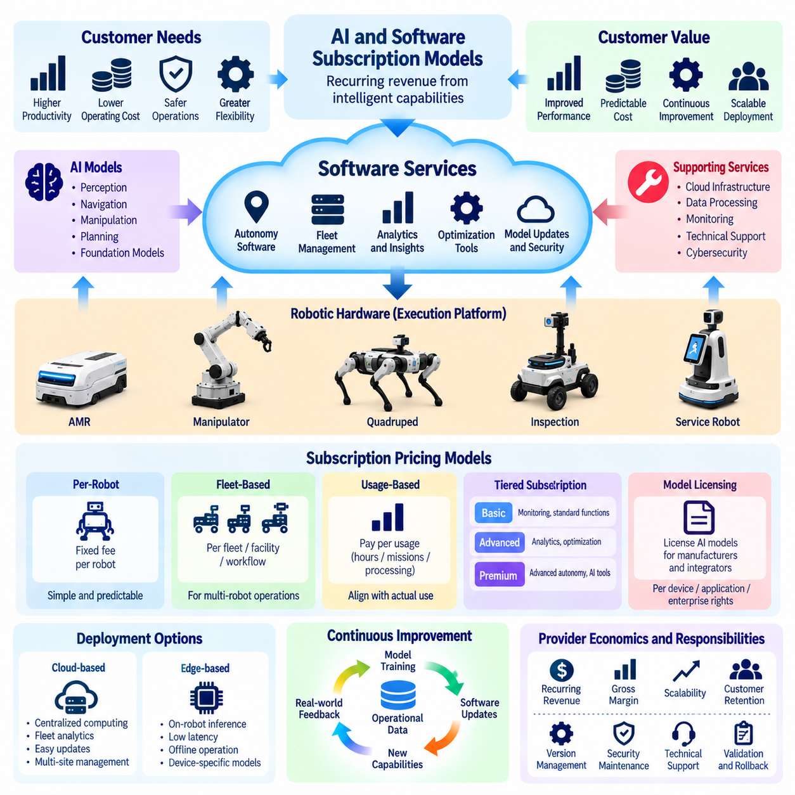{width="7.268055555555556in" height="7.268055555555556in"}

AI and software subscription models enable Physical AI companies to generate recurring revenue from intelligent capabilities rather than relying exclusively on robotic hardware sales. These models commercialize autonomy software, perception algorithms, fleet management, operational analytics, and continuous intelligence improvements. Their strategic importance lies in transforming software from a supporting component into an independently measurable source of customer value.

Traditional robotic systems often bundle software into the initial equipment purchase, with limited opportunities for recurring monetization. Physical AI introduces software capabilities that can evolve throughout the robot lifecycle through model updates, improved task policies, and additional functionality. Subscription arrangements allow providers to maintain these capabilities continuously while establishing predictable revenue relationships with customers.

The foundation of an effective subscription model is a clearly defined software service that customers consider valuable beyond basic robot operation. Essential safety functions and minimum operational capabilities should remain reliably available under the agreed product terms. Premium subscriptions may provide advanced autonomy, multi-robot coordination, optimization tools, predictive maintenance, or specialized application intelligence that delivers additional measurable benefits.

Per-robot subscription pricing charges customers according to the number of deployed robotic units using a software service. This structure is relatively simple to understand, administer, and forecast. However, robots may differ significantly in utilization, computing requirements, and commercial value. Providers must therefore determine whether uniform pricing accurately reflects service costs or whether differentiated tiers are needed for different equipment classes.

Fleet-based subscription models price software according to the scale or capabilities of an entire robotic operation. Customers may purchase management access for a defined number of robots, facilities, or coordinated workflows. This approach is suitable for fleet orchestration, traffic management, task allocation, and centralized monitoring. Its value becomes more apparent when coordinated operation improves overall system productivity.

Usage-based software pricing connects charges to actual consumption of intelligent services. Relevant measures include inference requests, cloud processing time, processed sensor data, autonomous operating hours, or completed optimization tasks. Usage-based models can align revenue with infrastructure consumption, but they require accurate metering and transparent billing. Unpredictable charges may discourage adoption unless customers receive spending controls and clear usage forecasts.

Tiered subscriptions allow customers to select software packages according to operational complexity and required functionality. A basic tier may include monitoring and standard fleet management, while advanced tiers provide analytics, predictive optimization, or specialized autonomy modules. Effective tier design separates genuinely differentiated capabilities without creating unnecessary complexity or withholding functionality essential to safe and dependable operation.

AI model licensing introduces additional commercial possibilities. Providers may license perception models, manipulation policies, navigation intelligence, or robot foundation models to equipment manufacturers and system integrators. Fees can depend on deployed devices, supported applications, software versions, or enterprise-wide rights. Licensing agreements must specify permitted usage, intellectual property ownership, model updates, redistribution restrictions, and responsibility for deployment validation.

Cloud-based subscription services provide centralized computing, fleet analytics, data processing, and model management. They can simplify updates and support customers operating robots across multiple facilities. However, physical robotic systems often require low-latency control and continued operation during connectivity interruptions. Commercial architectures should distinguish cloud-dependent intelligence services from safety-critical functions that must remain available locally.

Edge AI subscriptions offer another approach by licensing intelligent capabilities that execute directly on robotic hardware. Customers may pay for access to optimized perception, navigation, or manipulation models deployed on embedded computing systems. This architecture can reduce communication latency and cloud dependence, although it introduces device compatibility, software protection, update management, and hardware-specific performance challenges.

Continuous software improvement is a major justification for recurring subscription payments. Providers may deliver improved models, expanded task coverage, cybersecurity updates, and operational optimization throughout the contract period. Nevertheless, customers must distinguish routine defect correction from genuinely new functionality. Subscription value is strongest when improvements produce observable gains in productivity, reliability, flexibility, or operating efficiency.

Software subscriptions also create substantial responsibilities for providers. Reliable service delivery requires version management, technical support, cybersecurity maintenance, compatibility testing, and documented release procedures. Physical AI updates may alter robot behavior in real environments, making validation especially important. Providers must control deployment risks and establish rollback procedures when new software introduces unexpected performance problems.

Subscription economics depend on recurring revenue exceeding the complete cost of delivering and maintaining software services. Important expenses include cloud infrastructure, inference computation, data storage, model development, customer support, and ongoing engineering. Gross margins can improve as standardized software reaches more customers, but extensive customization and computationally expensive AI workloads may limit expected scalability.

Customer retention is essential because subscription profitability develops over repeated billing periods. Providers must monitor renewal rates, software adoption, active usage, service quality, and customer satisfaction. A customer who pays for advanced capabilities but rarely uses them may eventually cancel or downgrade. Effective subscription management therefore requires demonstrating continuing operational value rather than depending solely on contractual renewal mechanisms.

AI and software subscriptions can complement hardware sales and Robot-as-a-Service offerings. A robot manufacturer may sell equipment while charging separately for advanced fleet optimization or specialized intelligence. A RaaS provider may bundle essential software into its service fee and offer optional premium modules. Clear commercial boundaries are necessary to prevent duplicate charges and ensure that customers understand which capabilities each agreement includes.

Enterprise customers frequently require customized subscription terms addressing data security, deployment location, service availability, and system integration. Some organizations prefer on-premises software installations or private cloud environments because of operational confidentiality and regulatory requirements. Providers should design licensing and support structures that accommodate these constraints without creating excessive engineering fragmentation or unsustainable service obligations.

Data rights and model improvement policies are particularly important in subscription-based Physical AI services. Operational data may reveal production processes, facility layouts, equipment performance, or commercially sensitive activities. Contracts should define data ownership, permitted processing, retention periods, access controls, and whether customer information can contribute to shared model training. Trustworthy governance supports adoption and reduces legal uncertainty.

Value-based subscription pricing connects software fees to measurable operational improvements rather than feature availability alone. Advanced scheduling software may justify recurring charges through higher throughput, while predictive maintenance intelligence may create value through reduced downtime. Providers should establish baseline metrics and credible attribution methods. Pricing must reflect the customer\'s realized benefits while accounting for service delivery costs and competitive alternatives.

Subscription growth requires disciplined product management and a scalable software architecture. Standardized interfaces, modular services, automated deployment pipelines, and centralized monitoring reduce the cost of supporting diverse customers. Product roadmaps should prioritize features with broad demand and demonstrable value. Excessive customer-specific development can transform a subscription business into a labor-intensive integration operation.

Ultimately, AI and software subscription models establish recurring commercial relationships around the continuing intelligence of Physical AI systems. Their success depends on clear functionality, measurable customer outcomes, dependable software operations, transparent pricing, and sustainable unit economics. When properly designed, subscriptions support continuous technological improvement while enabling customers to obtain increasing operational value from deployed robotic assets.

인공지능 및 소프트웨어 구독 모델(AI and Software Subscription Models)은 피지컬 인공지능 기업(Physical AI Companies)이 로봇 하드웨어 판매(Robotic Hardware Sales)에만 의존하지 않고 지능형 기능(Intelligent Capabilities)을 통해 반복 매출(Recurring Revenue)을 창출할 수 있도록 한다. 이러한 모델은 자율운영 소프트웨어(Autonomy Software), 인지 알고리즘(Perception Algorithms), 로봇군 관리(Fleet Management), 운영 분석(Operational Analytics), 지속적인 지능 개선(Continuous Intelligence Improvements)을 상용화한다. 전략적 중요성(Strategic Importance)은 소프트웨어를 보조적인 구성 요소(Supporting Component)에서 독립적으로 측정 가능한 고객 가치(Customer Value)의 원천으로 전환하는 데 있다.

전통적인 로봇 시스템(Traditional Robotic Systems)은 소프트웨어(Software)를 초기 장비 구매(Initial Equipment Purchase)에 포함하는 경우가 많으며, 반복적인 수익화(Recurring Monetization) 기회는 제한적이다. 피지컬 인공지능(Physical AI)은 모델 업데이트(Model Updates), 개선된 작업 정책(Improved Task Policies), 추가 기능(Additional Functionality)을 통해 로봇 수명주기(Robot Lifecycle) 전반에 걸쳐 발전할 수 있는 소프트웨어 기능(Software Capabilities)을 도입한다. 구독 계약(Subscription Arrangements)은 공급업체(Providers)가 이러한 기능을 지속적으로 유지하면서 고객과 예측 가능한 매출 관계(Predictable Revenue Relationships)를 구축할 수 있도록 한다.

효과적인 구독 모델(Effective Subscription Model)의 기반은 고객이 기본적인 로봇 운영(Basic Robot Operation)을 넘어서는 가치를 인정하는 명확하게 정의된 소프트웨어 서비스(Clearly Defined Software Service)이다. 필수 안전 기능(Essential Safety Functions)과 최소 운영 기능(Minimum Operational Capabilities)은 합의된 제품 조건(Agreed Product Terms)에 따라 안정적으로 이용할 수 있어야 한다. 프리미엄 구독(Premium Subscriptions)은 고급 자율운영(Advanced Autonomy), 다중 로봇 조정(Multi-Robot Coordination), 최적화 도구(Optimization Tools), 예지보전(Predictive Maintenance), 특화된 응용 지능(Specialized Application Intelligence)을 제공하여 추가적으로 측정 가능한 편익(Measurable Benefits)을 창출할 수 있다.

로봇당 구독 가격 책정(Per-Robot Subscription Pricing)은 소프트웨어 서비스(Software Service)를 사용하는 배포된 로봇 수(Number of Deployed Robotic Units)에 따라 고객에게 요금을 부과한다. 이러한 구조는 이해(Understanding), 관리(Administration), 예측(Forecasting)이 비교적 간단하다. 그러나 로봇마다 가동률(Utilization), 컴퓨팅 요구사항(Computing Requirements), 상업적 가치(Commercial Value)가 크게 다를 수 있다. 따라서 공급업체는 일률적인 가격 책정(Uniform Pricing)이 서비스 비용(Service Costs)을 정확하게 반영하는지, 아니면 서로 다른 장비 등급(Equipment Classes)에 대해 차등화된 요금제(Differentiated Tiers)가 필요한지 판단해야 한다.

로봇군 기반 구독 모델(Fleet-Based Subscription Models)은 전체 로봇 운영(Entire Robotic Operation)의 규모 또는 기능에 따라 소프트웨어 가격을 책정한다. 고객은 정해진 로봇 수(Number of Robots), 시설 수(Number of Facilities), 또는 조정된 작업 흐름(Coordinated Workflows)에 대한 관리 접근 권한(Management Access)을 구매할 수 있다. 이러한 접근 방식은 로봇군 오케스트레이션(Fleet Orchestration), 교통 관리(Traffic Management), 작업 할당(Task Allocation), 중앙집중식 모니터링(Centralized Monitoring)에 적합하다. 여러 로봇의 조정된 운영(Coordinated Operation)이 전체 시스템 생산성(Overall System Productivity)을 향상시킬 때 그 가치가 더욱 명확해진다.

사용량 기반 소프트웨어 가격 책정(Usage-Based Software Pricing)은 지능형 서비스(Intelligent Services)의 실제 사용량(Actual Consumption)에 요금을 연결한다. 관련 측정 기준(Relevant Measures)에는 추론 요청(Inference Requests), 클라우드 처리시간(Cloud Processing Time), 처리된 센서 데이터(Processed Sensor Data), 자율운영 시간(Autonomous Operating Hours), 완료된 최적화 작업(Completed Optimization Tasks)이 포함된다. 사용량 기반 모델(Usage-Based Models)은 매출(Revenue)을 인프라 사용량(Infrastructure Consumption)과 일치시킬 수 있지만 정확한 사용량 계측(Accurate Metering)과 투명한 청구(Transparent Billing)가 필요하다. 고객에게 지출 통제 기능(Spending Controls)과 명확한 사용량 예측(Clear Usage Forecasts)이 제공되지 않으면 예측하기 어려운 요금(Unpredictable Charges)이 도입을 저해할 수 있다.

계층형 구독(Tiered Subscriptions)은 고객이 운영 복잡성(Operational Complexity)과 필요한 기능(Required Functionality)에 따라 소프트웨어 패키지(Software Packages)를 선택할 수 있도록 한다. 기본 요금제(Basic Tier)에는 모니터링(Monitoring)과 표준 로봇군 관리(Standard Fleet Management)가 포함될 수 있으며, 고급 요금제(Advanced Tiers)는 분석(Analytics), 예측 최적화(Predictive Optimization), 특화된 자율운영 모듈(Specialized Autonomy Modules)을 제공할 수 있다. 효과적인 요금제 설계(Effective Tier Design)는 불필요한 복잡성(Unnecessary Complexity)을 만들거나 안전하고 신뢰할 수 있는 운영(Safe and Dependable Operation)에 필수적인 기능을 제한하지 않으면서 실질적으로 차별화된 기능(Genuinely Differentiated Capabilities)을 구분해야 한다.

인공지능 모델 라이선싱(AI Model Licensing)은 추가적인 상업적 가능성(Commercial Possibilities)을 제공한다. 공급업체는 인지 모델(Perception Models), 조작 정책(Manipulation Policies), 주행 지능(Navigation Intelligence), 로봇 파운데이션 모델(Robot Foundation Models)을 장비 제조업체(Equipment Manufacturers)와 시스템 통합업체(System Integrators)에 라이선스 형태로 제공할 수 있다. 요금(Fees)은 배포된 장치(Deployed Devices), 지원되는 응용 분야(Supported Applications), 소프트웨어 버전(Software Versions), 기업 전체 사용 권한(Enterprise-Wide Rights)에 따라 결정될 수 있다. 라이선스 계약(Licensing Agreements)은 허용된 사용 범위(Permitted Usage), 지식재산권 소유권(Intellectual Property Ownership), 모델 업데이트(Model Updates), 재배포 제한(Redistribution Restrictions), 배포 검증 책임(Responsibility for Deployment Validation)을 명시해야 한다.

클라우드 기반 구독 서비스(Cloud-Based Subscription Services)는 중앙집중식 컴퓨팅(Centralized Computing), 로봇군 분석(Fleet Analytics), 데이터 처리(Data Processing), 모델 관리(Model Management)를 제공한다. 이러한 서비스는 업데이트(Updates)를 단순화하고 여러 시설에서 로봇을 운영하는 고객을 지원할 수 있다. 그러나 물리적 로봇 시스템(Physical Robotic Systems)은 낮은 지연시간의 제어(Low-Latency Control)와 통신 연결이 중단되는 상황(Connectivity Interruptions)에서도 지속적인 운영(Continued Operation)을 요구하는 경우가 많다. 상업적 아키텍처(Commercial Architectures)는 클라우드 의존형 지능 서비스(Cloud-Dependent Intelligence Services)와 로컬에서 지속적으로 이용할 수 있어야 하는 안전 필수 기능(Safety-Critical Functions)을 구분해야 한다.

엣지 인공지능 구독(Edge AI Subscriptions)은 로봇 하드웨어(Robotic Hardware)에서 직접 실행되는 지능형 기능(Intelligent Capabilities)에 라이선스를 부여하는 또 다른 접근 방식이다. 고객은 임베디드 컴퓨팅 시스템(Embedded Computing Systems)에 배포된 최적화된 인지 모델(Optimized Perception Models), 주행 모델(Navigation Models), 조작 모델(Manipulation Models)의 사용 권한에 대해 비용을 지불할 수 있다. 이러한 아키텍처(Architecture)는 통신 지연(Communication Latency)과 클라우드 의존성(Cloud Dependence)을 줄일 수 있지만 장치 호환성(Device Compatibility), 소프트웨어 보호(Software Protection), 업데이트 관리(Update Management), 하드웨어별 성능(Hardware-Specific Performance)과 관련된 과제를 발생시킨다.

지속적인 소프트웨어 개선(Continuous Software Improvement)은 반복적인 구독료(Recurring Subscription Payments)를 정당화하는 주요 근거이다. 공급업체는 계약 기간(Contract Period) 동안 개선된 모델(Improved Models), 확장된 작업 적용 범위(Expanded Task Coverage), 사이버보안 업데이트(Cybersecurity Updates), 운영 최적화(Operational Optimization)를 제공할 수 있다. 그러나 고객은 일반적인 결함 수정(Routine Defect Correction)과 실질적으로 새로운 기능(Genuinely New Functionality)을 구분할 수 있어야 한다. 구독 가치(Subscription Value)는 개선 사항이 생산성(Productivity), 신뢰성(Reliability), 유연성(Flexibility), 운영 효율성(Operating Efficiency)의 관찰 가능한 향상(Observable Gains)을 만들어 낼 때 가장 강력해진다.

소프트웨어 구독(Software Subscriptions)은 공급업체에 상당한 책임(Substantial Responsibilities)도 발생시킨다. 신뢰할 수 있는 서비스 제공(Reliable Service Delivery)을 위해서는 버전 관리(Version Management), 기술 지원(Technical Support), 사이버보안 유지관리(Cybersecurity Maintenance), 호환성 시험(Compatibility Testing), 문서화된 릴리스 절차(Documented Release Procedures)가 필요하다. 피지컬 인공지능 업데이트(Physical AI Updates)는 실제 환경(Real Environments)에서 로봇 동작(Robot Behavior)을 변화시킬 수 있으므로 검증(Validation)이 특히 중요하다. 공급업체는 배포 위험(Deployment Risks)을 통제하고 새로운 소프트웨어가 예상하지 못한 성능 문제(Unexpected Performance Problems)를 발생시킬 경우 복구할 수 있는 롤백 절차(Rollback Procedures)를 수립해야 한다.

구독 경제성(Subscription Economics)은 반복 매출(Recurring Revenue)이 소프트웨어 서비스(Software Services)를 제공하고 유지하는 전체 비용(Complete Cost)을 초과하는지에 달려 있다. 주요 비용(Important Expenses)에는 클라우드 인프라(Cloud Infrastructure), 추론 연산(Inference Computation), 데이터 저장(Data Storage), 모델 개발(Model Development), 고객 지원(Customer Support), 지속적인 엔지니어링(Ongoing Engineering)이 포함된다. 표준화된 소프트웨어(Standardized Software)가 더 많은 고객에게 제공되면 매출총이익률(Gross Margins)이 개선될 수 있지만, 광범위한 맞춤화(Extensive Customization)와 높은 연산 비용이 필요한 인공지능 작업(Computationally Expensive AI Workloads)은 예상되는 확장성(Expected Scalability)을 제한할 수 있다.

고객 유지(Customer Retention)는 구독 수익성(Subscription Profitability)이 반복적인 청구 기간(Repeated Billing Periods)에 걸쳐 형성되기 때문에 필수적이다. 공급업체는 갱신율(Renewal Rates), 소프트웨어 도입률(Software Adoption), 활성 사용량(Active Usage), 서비스 품질(Service Quality), 고객 만족도(Customer Satisfaction)를 모니터링해야 한다. 고급 기능(Advanced Capabilities)에 대한 비용을 지불하지만 실제로 거의 사용하지 않는 고객은 결국 구독을 취소(Cancel)하거나 낮은 요금제로 변경(Downgrade)할 수 있다. 따라서 효과적인 구독 관리(Effective Subscription Management)는 계약상 갱신 메커니즘(Contractual Renewal Mechanisms)에만 의존하지 않고 지속적인 운영 가치(Continuing Operational Value)를 입증해야 한다.

인공지능 및 소프트웨어 구독(AI and Software Subscriptions)은 하드웨어 판매(Hardware Sales)와 서비스형 로봇(Robot-as-a-Service, RaaS) 제공 모델을 보완할 수 있다. 로봇 제조업체(Robot Manufacturer)는 장비를 판매하면서 고급 로봇군 최적화(Advanced Fleet Optimization)나 특화된 지능(Specialized Intelligence)에 대해 별도의 요금을 부과할 수 있다. 서비스형 로봇 공급업체(RaaS Provider)는 필수 소프트웨어(Essential Software)를 서비스 요금(Service Fee)에 포함하고 선택적인 프리미엄 모듈(Optional Premium Modules)을 제공할 수 있다. 중복 청구(Duplicate Charges)를 방지하고 고객이 각 계약에 포함된 기능을 이해할 수 있도록 명확한 상업적 경계(Clear Commercial Boundaries)를 설정해야 한다.

기업 고객(Enterprise Customers)은 데이터 보안(Data Security), 배포 위치(Deployment Location), 서비스 가용성(Service Availability), 시스템 통합(System Integration)을 다루는 맞춤형 구독 조건(Customized Subscription Terms)을 요구하는 경우가 많다. 일부 조직은 운영 기밀성(Operational Confidentiality)과 규제 요구사항(Regulatory Requirements) 때문에 온프레미스 소프트웨어 설치(On-Premises Software Installations)나 프라이빗 클라우드 환경(Private Cloud Environments)을 선호한다. 공급업체는 과도한 엔지니어링 분산(Excessive Engineering Fragmentation)이나 지속 불가능한 서비스 의무(Unsustainable Service Obligations)를 발생시키지 않으면서 이러한 제약을 수용할 수 있는 라이선싱 구조(Licensing Structures)와 지원 구조(Support Structures)를 설계해야 한다.

데이터 권리(Data Rights)와 모델 개선 정책(Model Improvement Policies)은 구독 기반 피지컬 인공지능 서비스(Subscription-Based Physical AI Services)에서 특히 중요하다. 운영 데이터(Operational Data)는 생산 공정(Production Processes), 시설 배치(Facility Layouts), 장비 성능(Equipment Performance), 상업적으로 민감한 활동(Commercially Sensitive Activities)을 드러낼 수 있다. 계약은 데이터 소유권(Data Ownership), 허용된 처리 범위(Permitted Processing), 보존 기간(Retention Periods), 접근 통제(Access Controls), 고객 정보(Customer Information)를 공유 모델 학습(Shared Model Training)에 활용할 수 있는지 여부를 정의해야 한다. 신뢰할 수 있는 거버넌스(Trustworthy Governance)는 도입(Adoption)을 지원하고 법적 불확실성(Legal Uncertainty)을 줄인다.

가치 기반 구독 가격 책정(Value-Based Subscription Pricing)은 소프트웨어 요금(Software Fees)을 단순한 기능 제공 여부(Feature Availability)가 아니라 측정 가능한 운영 개선(Measurable Operational Improvements)과 연결한다. 고급 일정 관리 소프트웨어(Advanced Scheduling Software)는 처리량 증가(Higher Throughput)를 통해 반복 요금(Recurring Charges)을 정당화할 수 있으며, 예지보전 지능(Predictive Maintenance Intelligence)은 가동 중단시간 감소(Reduced Downtime)를 통해 가치를 창출할 수 있다. 공급업체는 기준 지표(Baseline Metrics)와 신뢰할 수 있는 성과 귀속 방법(Credible Attribution Methods)을 설정해야 한다. 가격 책정(Pricing)은 서비스 제공 비용(Service Delivery Costs)과 경쟁 대안(Competitive Alternatives)을 고려하면서 고객이 실현한 편익(Realized Benefits)을 반영해야 한다.

구독 사업 성장(Subscription Growth)을 위해서는 체계적인 제품 관리(Disciplined Product Management)와 확장 가능한 소프트웨어 아키텍처(Scalable Software Architecture)가 필요하다. 표준화된 인터페이스(Standardized Interfaces), 모듈형 서비스(Modular Services), 자동화된 배포 파이프라인(Automated Deployment Pipelines), 중앙집중식 모니터링(Centralized Monitoring)은 다양한 고객을 지원하는 비용을 줄인다. 제품 로드맵(Product Roadmaps)은 광범위한 수요(Broad Demand)와 입증 가능한 가치(Demonstrable Value)를 가진 기능을 우선시해야 한다. 과도한 고객별 개발(Excessive Customer-Specific Development)은 구독 사업(Subscription Business)을 노동 집약적인 시스템 통합 사업(Labor-Intensive Integration Operation)으로 변화시킬 수 있다.

궁극적으로 인공지능 및 소프트웨어 구독 모델(AI and Software Subscription Models)은 피지컬 인공지능 시스템(Physical AI Systems)의 지속적으로 발전하는 지능(Continuing Intelligence)을 중심으로 반복적인 상업적 관계(Recurring Commercial Relationships)를 구축한다. 성공 여부는 명확한 기능(Clear Functionality), 측정 가능한 고객 성과(Measurable Customer Outcomes), 신뢰할 수 있는 소프트웨어 운영(Dependable Software Operations), 투명한 가격 책정(Transparent Pricing), 지속 가능한 단위 경제성(Sustainable Unit Economics)에 달려 있다. 적절하게 설계된 구독 모델(Subscription Models)은 지속적인 기술 개선(Continuous Technological Improvement)을 지원하는 동시에 고객이 배포된 로봇 자산(Deployed Robotic Assets)으로부터 점점 더 높은 운영 가치(Increasing Operational Value)를 얻을 수 있도록 한다.

##  

## 08.07. Data and Intelligence as a Service

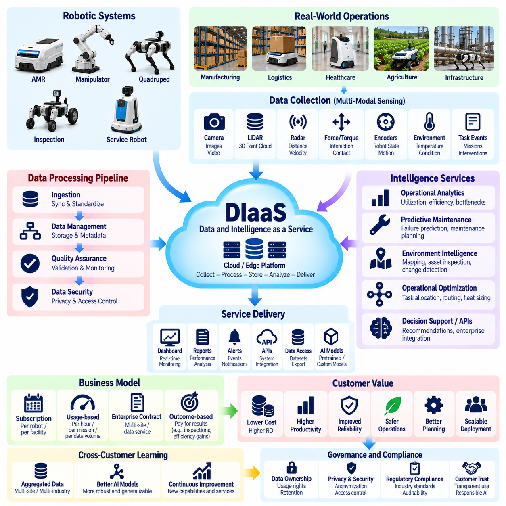{width="7.268055555555556in" height="7.268055555555556in"}

Data and Intelligence as a Service (DIaaS) represents a business model in which Physical AI providers commercialize operational data, analytical insights, and reusable intelligence capabilities as continuing services. Rather than generating revenue solely from robotic equipment or software licenses, providers deliver information and decision-support functions that improve customer operations. The commercial focus shifts from collecting data to producing measurable business outcomes.

Physical AI systems generate valuable information through continuous interaction with real environments. Cameras, lidar, force sensors, joint encoders, and operational controllers capture observations about objects, movement, equipment conditions, and task execution. When properly processed, these observations can reveal workflow inefficiencies, equipment degradation, environmental changes, and opportunities for operational optimization across industrial facilities.

The distinction between Data as a Service and Intelligence as a Service concerns the level of interpretation provided. Data services deliver structured information, historical records, and accessible datasets, while intelligence services transform observations into predictions, recommendations, or automated decisions. In Physical AI, both approaches may operate together, allowing customers to obtain reliable operational visibility and actionable recommendations from the same infrastructure.

A foundational requirement is a dependable data collection architecture connecting deployed robots, edge computing systems, and centralized information platforms. Sensor observations, robot states, task events, intervention records, and performance metrics must be synchronized and organized. Standardized schemas, accurate timestamps, and consistent metadata enable information from different robots and facilities to support meaningful analysis.

Data quality determines whether collected information can support commercially valuable intelligence. Incomplete sensor records, inconsistent event definitions, calibration errors, and inaccurate timestamps may produce misleading conclusions. Providers therefore require automated validation, anomaly detection, data lineage, and quality monitoring. Customers should receive information with documented limitations rather than assuming that large data volumes guarantee reliable insights.

Operational analytics is among the most practical DIaaS applications. Providers can offer dashboards and reports covering robot utilization, mission completion, travel efficiency, congestion, downtime, and intervention frequency. These services help facility managers identify bottlenecks and evaluate improvement opportunities. Their value increases when analytical results are connected to operational decisions and measurable productivity changes.

Predictive maintenance intelligence creates value by identifying emerging equipment problems before they cause significant interruptions. Models may analyze motor currents, vibration, temperature, battery behavior, and fault histories to estimate degradation or failure risk. Customers can use these predictions to schedule inspections and maintenance more effectively. Commercial performance depends on prediction accuracy, false alarm rates, and avoided downtime.

Environment intelligence extends beyond monitoring the robots themselves. Mobile platforms can collect observations about warehouse layouts, infrastructure conditions, obstacles, inventory locations, and changing workspaces. When authorized and appropriately validated, these observations can support facility mapping, asset inspection, and operational planning. This transforms deployed robotic fleets into distributed sensing infrastructure with additional commercial applications.

Intelligence services may also provide recommendations for task allocation, fleet sizing, route optimization, and resource scheduling. Analytical models can combine historical workload patterns with real-time operating conditions to identify more efficient configurations. However, recommendations must account for safety constraints, operational priorities, and uncertain demand. Automated optimization should remain subject to appropriate validation and human oversight.

Commercial delivery models can include recurring subscriptions, usage-based fees, enterprise data contracts, and outcome-linked service agreements. Customers may pay according to monitored robots, processed data volumes, analytical modules, or supported facilities. Intelligence services with demonstrable financial benefits may justify value-based pricing. Pricing structures should remain understandable and avoid charging customers repeatedly for the same underlying capabilities.

Data ownership and usage rights are central to the DIaaS business model. Robotic observations may expose production volumes, facility configurations, employee activities, and commercially sensitive processes. Contracts must specify ownership, collection permissions, processing purposes, retention periods, and permitted secondary uses. Providers cannot assume that operating a robot grants unrestricted rights to commercialize information collected at customer sites.

Privacy, cybersecurity, and confidentiality requirements directly influence service architecture. Sensitive information may require anonymization, access restrictions, encryption, local processing, or separation between customer environments. Data governance should also define auditability, deletion procedures, and incident responsibilities. Compliance requirements vary by jurisdiction and application, making contractual clarity and technical safeguards essential for trustworthy service delivery.

Cross-customer intelligence creates potential economies of learning when information can be combined lawfully and technically. Aggregated operational patterns may help providers improve failure prediction, navigation policies, and task optimization across deployments. However, differences in robot morphology, sensor configuration, and operating environments can limit transferability. Shared learning must respect customer permissions and prevent disclosure of confidential information.

Federated learning and privacy-preserving analytics can support intelligence development when raw customer data cannot be centralized. Models may be trained or adapted within separate environments while selected updates are combined under controlled conditions. These methods can reduce certain data-sharing requirements but do not automatically eliminate privacy or security risks. Their usefulness depends on model architecture, communication costs, and governance.

Data network effects may emerge as larger deployment fleets generate broader operational experience and improve shared intelligence services. Better models can increase customer value, supporting additional adoption and further data collection. Nevertheless, network effects require relevant data diversity, consistent quality, effective learning pipelines, and demonstrated improvements. More data does not necessarily produce better intelligence when observations are redundant or poorly governed.

Service reliability is particularly important when intelligence outputs influence physical operations. Incorrect predictions or optimization recommendations may cause inefficient scheduling, unnecessary maintenance, or unsafe operational decisions. Providers should monitor model accuracy, distribution shifts, uncertainty, and service availability. Critical decisions require defined safety boundaries, escalation mechanisms, and procedures for handling unreliable recommendations.

The economics of DIaaS depend on the balance between recurring revenue and the cost of collecting, processing, storing, and interpreting information. Major expenses include connectivity, cloud infrastructure, data engineering, model training, inference, security, and customer support. Standardized analytical products can improve margins, while customer-specific pipelines and expensive computational workloads may undermine scalability.

Successful commercialization requires separating raw data availability from higher-value intelligence outcomes. Customers may have limited willingness to pay for information they already possess, but stronger demand for insights that reduce downtime, improve throughput, or support better decisions. Providers should establish performance baselines and quantify operational improvements. The strongest services translate analytical accuracy into verifiable economic benefits.

DIaaS can complement robot sales, Robot-as-a-Service contracts, and software subscriptions without replacing their core functions. A provider may bundle basic operational reporting with equipment services while charging separately for predictive analytics or advanced optimization. Transparent service boundaries help prevent overlapping fees. Integration with enterprise resource planning, manufacturing execution, and warehouse management systems can increase practical usefulness.

Ultimately, Data and Intelligence as a Service extends the Physical AI business beyond executing physical tasks toward continuously improving customer operations through information and intelligence. Sustainable value depends on reliable data, responsible governance, effective analytics, measurable outcomes, and scalable delivery economics. The most defensible services convert real-world robotic experience into trusted operational decisions that customers can repeatedly use and justify economically.

서비스형 데이터 및 인텔리전스(Data and Intelligence as a Service, DIaaS)는 피지컬 인공지능 공급업체(Physical AI Providers)가 운영 데이터(Operational Data), 분석적 통찰(Analytical Insights), 재사용 가능한 지능 기능(Reusable Intelligence Capabilities)을 지속적인 서비스(Continuing Services)로 상용화하는 사업 모델(Business Model)이다. 공급업체는 로봇 장비(Robotic Equipment)나 소프트웨어 라이선스(Software Licenses)만으로 매출을 창출하는 대신 고객 운영(Customer Operations)을 개선하는 정보(Information)와 의사결정 지원 기능(Decision-Support Functions)을 제공한다. 상업적 초점(Commercial Focus)은 데이터 수집(Data Collection)에서 측정 가능한 사업 성과(Measurable Business Outcomes)를 창출하는 방향으로 이동한다.

피지컬 인공지능 시스템(Physical AI Systems)은 실제 환경(Real Environments)과 지속적으로 상호작용하면서 가치 있는 정보(Valuable Information)를 생성한다. 카메라(Cameras), 라이다(Lidar), 힘 센서(Force Sensors), 관절 엔코더(Joint Encoders), 운영 제어기(Operational Controllers)는 객체(Objects), 움직임(Movement), 장비 상태(Equipment Conditions), 작업 실행(Task Execution)에 관한 관측 데이터(Observations)를 수집한다. 이러한 관측 데이터를 적절하게 처리하면 산업 시설(Industrial Facilities) 전반의 작업 흐름 비효율성(Workflow Inefficiencies), 장비 성능 저하(Equipment Degradation), 환경 변화(Environmental Changes), 운영 최적화 기회(Operational Optimization Opportunities)를 파악할 수 있다.

서비스형 데이터(Data as a Service)와 서비스형 인텔리전스(Intelligence as a Service)의 차이는 제공되는 정보의 해석 수준(Level of Interpretation)에 있다. 데이터 서비스(Data Services)는 구조화된 정보(Structured Information), 과거 기록(Historical Records), 접근 가능한 데이터셋(Accessible Datasets)을 제공하는 반면, 인텔리전스 서비스(Intelligence Services)는 관측 데이터(Observations)를 예측(Predictions), 권고사항(Recommendations), 자동화된 의사결정(Automated Decisions)으로 변환한다. 피지컬 인공지능(Physical AI)에서는 두 접근 방식이 함께 작동하여 고객이 동일한 인프라(Infrastructure)에서 신뢰할 수 있는 운영 가시성(Operational Visibility)과 실행 가능한 권고사항(Actionable Recommendations)을 확보할 수 있다.

기본적인 요구사항(Foundational Requirement)은 배포된 로봇(Deployed Robots), 엣지 컴퓨팅 시스템(Edge Computing Systems), 중앙집중식 정보 플랫폼(Centralized Information Platforms)을 연결하는 신뢰할 수 있는 데이터 수집 아키텍처(Dependable Data Collection Architecture)이다. 센서 관측 데이터(Sensor Observations), 로봇 상태(Robot States), 작업 이벤트(Task Events), 개입 기록(Intervention Records), 성능 지표(Performance Metrics)는 시간적으로 동기화되고 체계적으로 구성되어야 한다. 표준화된 스키마(Standardized Schemas), 정확한 타임스탬프(Accurate Timestamps), 일관된 메타데이터(Consistent Metadata)는 서로 다른 로봇과 시설에서 수집된 정보를 의미 있는 분석(Meaningful Analysis)에 활용할 수 있도록 한다.

데이터 품질(Data Quality)은 수집된 정보가 상업적으로 가치 있는 인텔리전스(Commercially Valuable Intelligence)를 지원할 수 있는지를 결정한다. 불완전한 센서 기록(Incomplete Sensor Records), 일관되지 않은 이벤트 정의(Inconsistent Event Definitions), 보정 오류(Calibration Errors), 부정확한 타임스탬프(Inaccurate Timestamps)는 잘못된 결론(Misleading Conclusions)을 초래할 수 있다. 따라서 공급업체는 자동화된 검증(Automated Validation), 이상 탐지(Anomaly Detection), 데이터 계보 관리(Data Lineage), 품질 모니터링(Quality Monitoring)을 갖추어야 한다. 고객에게는 대량의 데이터(Large Data Volumes)가 신뢰할 수 있는 통찰(Reliable Insights)을 보장한다고 가정하기보다 명시된 한계(Documented Limitations)를 포함한 정보를 제공해야 한다.

운영 분석(Operational Analytics)은 서비스형 데이터 및 인텔리전스(DIaaS)의 가장 실용적인 응용 분야(Practical Applications) 중 하나이다. 공급업체는 로봇 가동률(Robot Utilization), 임무 완료(Mission Completion), 이동 효율성(Travel Efficiency), 혼잡도(Congestion), 가동 중단시간(Downtime), 개입 빈도(Intervention Frequency)를 다루는 대시보드(Dashboards)와 보고서(Reports)를 제공할 수 있다. 이러한 서비스는 시설 관리자(Facility Managers)가 병목 현상(Bottlenecks)을 파악하고 개선 기회(Improvement Opportunities)를 평가하도록 지원한다. 분석 결과(Analytical Results)가 운영 의사결정(Operational Decisions)과 측정 가능한 생산성 변화(Measurable Productivity Changes)에 연결될 때 그 가치는 더욱 높아진다.

예지보전 인텔리전스(Predictive Maintenance Intelligence)는 심각한 운영 중단(Significant Interruptions)을 일으키기 전에 장비 문제(Equipment Problems)의 초기 징후를 식별함으로써 가치를 창출한다. 모델(Models)은 모터 전류(Motor Currents), 진동(Vibration), 온도(Temperature), 배터리 동작(Battery Behavior), 고장 이력(Fault Histories)을 분석하여 성능 저하(Degradation)나 고장 위험(Failure Risk)을 추정할 수 있다. 고객은 이러한 예측(Predictions)을 활용하여 검사(Inspections)와 유지보수(Maintenance)를 보다 효과적으로 계획할 수 있다. 상업적 성과(Commercial Performance)는 예측 정확도(Prediction Accuracy), 오경보율(False Alarm Rates), 방지된 가동 중단시간(Avoided Downtime)에 달려 있다.

환경 인텔리전스(Environment Intelligence)는 로봇 자체에 대한 모니터링(Monitoring)을 넘어선다. 이동형 플랫폼(Mobile Platforms)은 창고 배치(Warehouse Layouts), 인프라 상태(Infrastructure Conditions), 장애물(Obstacles), 재고 위치(Inventory Locations), 변화하는 작업 공간(Changing Workspaces)에 관한 관측 데이터를 수집할 수 있다. 적절한 권한(Authorization)을 확보하고 검증(Validation)을 수행하면 이러한 관측 데이터는 시설 지도 작성(Facility Mapping), 자산 검사(Asset Inspection), 운영 계획(Operational Planning)을 지원할 수 있다. 이를 통해 배포된 로봇군(Deployed Robotic Fleets)은 추가적인 상업적 응용 분야(Additional Commercial Applications)를 가진 분산형 센싱 인프라(Distributed Sensing Infrastructure)로 전환된다.

인텔리전스 서비스(Intelligence Services)는 작업 할당(Task Allocation), 로봇군 규모 산정(Fleet Sizing), 경로 최적화(Route Optimization), 자원 일정 관리(Resource Scheduling)에 관한 권고사항(Recommendations)을 제공할 수도 있다. 분석 모델(Analytical Models)은 과거 작업 부하 패턴(Historical Workload Patterns)과 실시간 운영 조건(Real-Time Operating Conditions)을 결합하여 더욱 효율적인 구성(Efficient Configurations)을 식별할 수 있다. 그러나 권고사항은 안전 제약(Safety Constraints), 운영 우선순위(Operational Priorities), 불확실한 수요(Uncertain Demand)를 고려해야 한다. 자동화된 최적화(Automated Optimization)는 적절한 검증(Validation)과 인간 감독(Human Oversight)을 전제로 수행되어야 한다.

상업적 제공 모델(Commercial Delivery Models)에는 반복 구독(Recurring Subscriptions), 사용량 기반 요금(Usage-Based Fees), 기업 데이터 계약(Enterprise Data Contracts), 성과 연계 서비스 계약(Outcome-Linked Service Agreements)이 포함될 수 있다. 고객은 모니터링 대상 로봇 수(Monitored Robots), 처리된 데이터 양(Processed Data Volumes), 분석 모듈(Analytical Modules), 지원 시설(Supported Facilities)에 따라 비용을 지불할 수 있다. 입증 가능한 재무적 편익(Demonstrable Financial Benefits)을 제공하는 인텔리전스 서비스는 가치 기반 가격 책정(Value-Based Pricing)을 정당화할 수 있다. 가격 구조(Pricing Structures)는 이해하기 쉬워야 하며 동일한 기반 기능(Underlying Capabilities)에 대해 고객에게 반복적으로 요금을 부과하는 것을 피해야 한다.

데이터 소유권(Data Ownership)과 사용 권한(Usage Rights)은 서비스형 데이터 및 인텔리전스(DIaaS) 사업 모델의 핵심 요소이다. 로봇 관측 데이터(Robotic Observations)는 생산량(Production Volumes), 시설 구성(Facility Configurations), 직원 활동(Employee Activities), 상업적으로 민감한 공정(Commercially Sensitive Processes)을 노출할 수 있다. 계약(Contracts)은 소유권(Ownership), 수집 권한(Collection Permissions), 처리 목적(Processing Purposes), 보존 기간(Retention Periods), 허용되는 2차 활용(Permitted Secondary Uses)을 명시해야 한다. 공급업체는 로봇을 운영한다는 사실만으로 고객 현장(Customer Sites)에서 수집된 정보를 제한 없이 상용화할 권리(Unrestricted Commercialization Rights)가 있다고 가정할 수 없다.

개인정보 보호(Privacy), 사이버보안(Cybersecurity), 기밀 유지(Confidentiality) 요구사항은 서비스 아키텍처(Service Architecture)에 직접적인 영향을 미친다. 민감한 정보(Sensitive Information)에는 익명화(Anonymization), 접근 제한(Access Restrictions), 암호화(Encryption), 로컬 처리(Local Processing), 고객 환경 간 분리(Separation Between Customer Environments)가 필요할 수 있다. 데이터 거버넌스(Data Governance)는 감사 가능성(Auditability), 삭제 절차(Deletion Procedures), 사고 대응 책임(Incident Responsibilities)도 정의해야 한다. 규정 준수 요구사항(Compliance Requirements)은 관할권(Jurisdiction)과 응용 분야(Application)에 따라 달라지므로 신뢰할 수 있는 서비스 제공(Trustworthy Service Delivery)을 위해 계약의 명확성(Contractual Clarity)과 기술적 보호조치(Technical Safeguards)가 필수적이다.

고객 간 인텔리전스 공유(Cross-Customer Intelligence)는 정보를 법적·기술적으로 결합할 수 있을 때 학습의 규모의 경제(Economies of Learning)를 창출할 가능성이 있다. 통합된 운영 패턴(Aggregated Operational Patterns)은 공급업체가 여러 배포 환경(Deployments)에서 고장 예측(Failure Prediction), 주행 정책(Navigation Policies), 작업 최적화(Task Optimization)를 개선하도록 지원할 수 있다. 그러나 로봇 형태(Robot Morphology), 센서 구성(Sensor Configuration), 운영 환경(Operating Environments)의 차이는 전이 가능성(Transferability)을 제한할 수 있다. 공유 학습(Shared Learning)은 고객의 허용 범위(Customer Permissions)를 준수하고 기밀 정보(Confidential Information)의 노출을 방지해야 한다.

연합학습(Federated Learning)과 개인정보 보호형 분석(Privacy-Preserving Analytics)은 고객의 원시 데이터(Raw Customer Data)를 중앙집중화할 수 없는 상황에서 인텔리전스 개발(Intelligence Development)을 지원할 수 있다. 모델(Models)은 분리된 환경(Separate Environments)에서 학습되거나 적응될 수 있으며, 선택된 업데이트(Selected Updates)는 통제된 조건(Controlled Conditions)에서 결합될 수 있다. 이러한 방법은 일부 데이터 공유 요구사항(Data-Sharing Requirements)을 줄일 수 있지만 개인정보 보호 위험(Privacy Risks)이나 보안 위험(Security Risks)을 자동으로 제거하지는 않는다. 활용 가능성(Usefulness)은 모델 아키텍처(Model Architecture), 통신 비용(Communication Costs), 거버넌스(Governance)에 달려 있다.

데이터 네트워크 효과(Data Network Effects)는 배포된 로봇군(Deployment Fleets)의 규모가 확대되면서 더욱 폭넓은 운영 경험(Broader Operational Experience)이 축적되고 공유 인텔리전스 서비스(Shared Intelligence Services)가 개선될 때 나타날 수 있다. 개선된 모델(Better Models)은 고객 가치(Customer Value)를 높여 추가 도입(Additional Adoption)과 추가 데이터 수집(Further Data Collection)을 촉진할 수 있다. 그러나 네트워크 효과(Network Effects)를 실현하려면 관련성 높은 데이터 다양성(Relevant Data Diversity), 일관된 품질(Consistent Quality), 효과적인 학습 파이프라인(Effective Learning Pipelines), 입증된 개선 효과(Demonstrated Improvements)가 필요하다. 관측 데이터가 중복되거나 적절하게 관리되지 않는다면 데이터 양이 증가하더라도 더 나은 인텔리전스(Better Intelligence)가 보장되지는 않는다.

서비스 신뢰성(Service Reliability)은 인텔리전스 출력(Intelligence Outputs)이 물리적 운영(Physical Operations)에 영향을 미칠 때 특히 중요하다. 잘못된 예측(Incorrect Predictions)이나 최적화 권고사항(Optimization Recommendations)은 비효율적인 일정 관리(Inefficient Scheduling), 불필요한 유지보수(Unnecessary Maintenance), 안전하지 않은 운영 의사결정(Unsafe Operational Decisions)을 초래할 수 있다. 공급업체는 모델 정확도(Model Accuracy), 데이터 분포 변화(Distribution Shifts), 불확실성(Uncertainty), 서비스 가용성(Service Availability)을 모니터링해야 한다. 중요한 의사결정(Critical Decisions)에는 명확하게 정의된 안전 경계(Safety Boundaries), 문제 확대 대응 메커니즘(Escalation Mechanisms), 신뢰할 수 없는 권고사항(Unreliable Recommendations)을 처리하는 절차가 필요하다.

서비스형 데이터 및 인텔리전스(DIaaS)의 경제성(Economics)은 반복 매출(Recurring Revenue)과 정보 수집(Collection), 처리(Processing), 저장(Storage), 해석(Interpretation)에 필요한 비용 사이의 균형에 달려 있다. 주요 비용(Major Expenses)에는 연결성(Connectivity), 클라우드 인프라(Cloud Infrastructure), 데이터 엔지니어링(Data Engineering), 모델 학습(Model Training), 추론(Inference), 보안(Security), 고객 지원(Customer Support)이 포함된다. 표준화된 분석 제품(Standardized Analytical Products)은 이익률(Margins)을 개선할 수 있지만, 고객별 데이터 파이프라인(Customer-Specific Pipelines)과 높은 연산 비용(Expensive Computational Workloads)은 확장성(Scalability)을 저하시킬 수 있다.

성공적인 상용화(Successful Commercialization)를 위해서는 원시 데이터의 가용성(Raw Data Availability)과 더 높은 가치를 제공하는 인텔리전스 성과(Higher-Value Intelligence Outcomes)를 구분해야 한다. 고객은 이미 보유하고 있는 정보(Information)에 대해서는 지불 의사(Willingness to Pay)가 제한적일 수 있지만, 가동 중단시간(Downtime)을 줄이고 처리량(Throughput)을 높이거나 더 나은 의사결정(Better Decisions)을 지원하는 통찰(Insights)에 대해서는 더 높은 수요를 보일 수 있다. 공급업체는 기준 성능 지표(Performance Baselines)를 설정하고 운영 개선 효과(Operational Improvements)를 정량화해야 한다. 가장 강력한 서비스(Strongest Services)는 분석 정확도(Analytical Accuracy)를 검증 가능한 경제적 편익(Verifiable Economic Benefits)으로 전환한다.

서비스형 데이터 및 인텔리전스(DIaaS)는 로봇 판매(Robot Sales), 서비스형 로봇 계약(Robot-as-a-Service Contracts), 소프트웨어 구독(Software Subscriptions)의 핵심 기능을 대체하지 않으면서 이를 보완할 수 있다. 공급업체는 기본 운영 보고(Basic Operational Reporting)를 장비 서비스(Equipment Services)에 포함하고, 예측 분석(Predictive Analytics)이나 고급 최적화(Advanced Optimization)에 대해서는 별도 요금을 부과할 수 있다. 투명한 서비스 범위(Transparent Service Boundaries)는 중복 요금(Overlapping Fees)을 방지하는 데 도움이 된다. 전사적 자원관리(Enterprise Resource Planning, ERP), 제조실행시스템(Manufacturing Execution Systems, MES), 창고관리시스템(Warehouse Management Systems, WMS)과의 통합은 실질적인 활용성(Practical Usefulness)을 높일 수 있다.

궁극적으로 서비스형 데이터 및 인텔리전스(Data and Intelligence as a Service, DIaaS)는 피지컬 인공지능 사업(Physical AI Business)을 물리적 작업 수행(Executing Physical Tasks)에서 정보(Information)와 인텔리전스(Intelligence)를 활용한 고객 운영의 지속적인 개선(Continuously Improving Customer Operations)으로 확장한다. 지속 가능한 가치(Sustainable Value)는 신뢰할 수 있는 데이터(Reliable Data), 책임 있는 거버넌스(Responsible Governance), 효과적인 분석(Effective Analytics), 측정 가능한 성과(Measurable Outcomes), 확장 가능한 서비스 제공 경제성(Scalable Delivery Economics)에 달려 있다. 가장 강력한 방어력을 가진 서비스(Most Defensible Services)는 실제 로봇 운영 경험(Real-World Robotic Experience)을 고객이 반복적으로 활용하고 경제적으로 정당화할 수 있는 신뢰할 수 있는 운영 의사결정(Trusted Operational Decisions)으로 전환한다.

##  

## 08.08. Hardware Software Service Revenue Mix

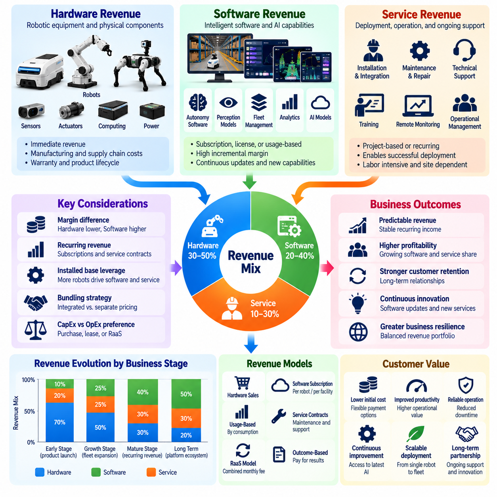{width="7.268055555555556in" height="7.268055555555556in"}

The hardware, software, and service revenue mix defines how a Physical AI company distributes its commercial income across robotic equipment, intelligent software, and continuing operational support. This composition influences profitability, cash flow, customer relationships, and long-term business resilience. An effective revenue strategy recognizes that each component creates value differently and carries distinct cost structures, growth characteristics, and financial risks.

Hardware revenue typically originates from robot sales, sensors, actuators, controllers, computing modules, and related equipment. It provides immediate income when systems are delivered and accepted, subject to contractual accounting requirements. However, hardware businesses face material costs, manufacturing expenses, inventory obligations, and warranty risks. Their profitability depends on production efficiency, component sourcing, product reliability, and competitive pricing.

Software revenue emerges from autonomy platforms, perception models, fleet management systems, analytics, and specialized AI capabilities. Companies may monetize these functions through licenses, subscriptions, usage-based fees, or software upgrades. Compared with hardware, standardized software can potentially generate higher gross margins because additional customers do not require equivalent manufacturing expenditure. Nevertheless, development, computing, and support costs remain significant.

Service revenue includes installation, system integration, commissioning, maintenance, technical support, training, and operational management. These activities enable customers to deploy robotic systems successfully and sustain performance throughout their operating lives. Service income may be project-based, recurring, or linked to performance commitments. Its profitability depends heavily on labor productivity, deployment standardization, and the frequency of customer interventions.

The relative contribution of these revenue categories changes as a Physical AI company matures. Early-stage businesses often depend on hardware sales and integration projects because customers initially purchase complete solutions. As the installed fleet expands, maintenance contracts, software subscriptions, and operational intelligence services can become more important. This transition creates opportunities for recurring revenue but requires disciplined investment in supporting infrastructure.

Revenue composition should be evaluated alongside gross margin rather than sales volume alone. Hardware may account for the largest share of revenue while contributing a smaller proportion of gross profit. Software subscriptions may generate less revenue initially but provide attractive incremental margins when delivery is standardized. Services can strengthen customer retention, although extensive on-site labor and customization may reduce their financial contribution.

Recurring revenue improves business visibility by creating predictable income streams from subscriptions, maintenance agreements, and managed services. However, recurring contracts do not automatically guarantee profitability or stable cash flow. Providers must consider renewal rates, customer concentration, service obligations, and operating expenses. Long-term contracts can also create financial exposure when fixed prices fail to reflect rising maintenance or infrastructure costs.

The installed base of deployed robots is a central driver of future software and service revenue. Each operational robot may create demand for software access, technical support, spare parts, maintenance, and performance analytics. Companies should measure revenue per deployed robot, software attachment rates, service contract penetration, and customer retention. These indicators reveal whether equipment deployment produces sustainable commercial relationships.

Hardware and software bundling is an important pricing decision. An integrated purchase price simplifies procurement and can reduce customer uncertainty about essential functionality. Separating advanced software into subscriptions creates recurring monetization opportunities and allows differentiated service levels. Nevertheless, providers must avoid charging separately for capabilities necessary to deliver the basic performance and safety promised with the equipment.

Service bundling presents similar tradeoffs. Including installation, commissioning, and initial training within the equipment price may accelerate customer adoption and simplify purchasing decisions. Separately priced integration and maintenance contracts can improve cost transparency and recover site-specific expenses. The appropriate structure depends on deployment complexity, customer expectations, competitive conditions, and the provider\'s ability to estimate service requirements accurately.

Revenue mix strategy must account for differences between capital expenditure and operating expenditure preferences. Some customers favor direct equipment ownership and separate maintenance agreements, while others prefer recurring payments that combine hardware access, software, and support. Robot-as-a-Service arrangements can satisfy the latter preference but shift asset financing and lifecycle responsibilities toward the provider. Commercial flexibility should not obscure the underlying economics.

Customer lifetime value provides a framework for assessing the combined contribution of hardware, software, and services. Initial equipment sales may establish the relationship, while subsequent subscriptions, maintenance renewals, upgrades, and fleet expansion generate additional income. Customer acquisition costs, deployment expenses, gross margins, retention, and discounting must be included. High lifetime revenue is not sufficient when ongoing service obligations consume most of the contribution.

The balance between standardized offerings and customized projects also shapes revenue quality. Custom engineering and integration may generate substantial short-term sales but require specialized personnel and repeated development effort. Standardized software modules and repeatable service packages can improve scalability. Companies should distinguish reusable product development from customer-specific engineering to understand which revenue streams support sustainable expansion.

Financial reporting should separate hardware, software, and service performance even when customers purchase integrated packages. Management needs visibility into segment revenue, direct costs, gross margins, deferred revenue, and contractual obligations. Appropriate allocation methods are necessary when multiple deliverables are sold together. Consistent reporting helps identify profitable offerings and prevents strong equipment sales from concealing losses in software or service delivery.

Pricing decisions should reflect the different value drivers of each component. Hardware pricing may depend on equipment specifications, manufacturing costs, and competitive alternatives. Software pricing can reflect functionality, fleet size, utilization, or measurable productivity gains. Service pricing should account for response requirements, operating environments, labor intensity, and performance commitments. A coherent structure connects customer value with sustainable supplier economics.

Revenue diversification can improve resilience when individual categories face different market pressures. Hardware demand may fluctuate with customer investment cycles, while maintenance and software subscriptions can provide continuity across the installed base. However, diversification introduces management complexity and potentially conflicting incentives. Companies must ensure that each revenue stream reinforces customer outcomes rather than encouraging unnecessary features or services.

Physical AI creates opportunities for software revenue to grow through continuous model improvement and expanded autonomy capabilities. A common intelligence platform may support multiple robot models and customer applications, reducing duplicated development. As deployed systems generate appropriately governed operational feedback, software performance may improve. Commercial benefits depend on validated functionality, customer willingness to pay, and effective distribution of updates.

Service profitability can improve through remote diagnostics, predictive maintenance, modular hardware, and automated fleet monitoring. These capabilities reduce unnecessary site visits and improve the efficiency of technical support. Nevertheless, service organizations require adequate staffing, spare parts availability, and escalation procedures. Providers should monitor support cost per robot, mean time to repair, field intervention frequency, and contract-level contribution margins.

An optimal revenue mix is not necessarily the combination with the highest software percentage or the greatest recurring revenue. It is the structure that produces sustainable cash flow, acceptable risk, competitive customer value, and sufficient returns on invested capital. Different applications may justify different compositions. Standardized warehouse robots, specialized industrial manipulators, and managed inspection fleets can require substantially different commercial architectures.

Ultimately, hardware, software, and service revenue should be designed as an integrated economic system rather than independent sales categories. Hardware establishes physical capability, software expands intelligence and adaptability, and services maintain dependable operational performance. A sustainable Physical AI business aligns these components with customer needs, transparent pricing, measurable lifecycle profitability, and a scalable path toward long-term growth.

하드웨어, 소프트웨어 및 서비스 매출 구성(Hardware, Software, and Service Revenue Mix)은 피지컬 인공지능 기업(Physical AI Company)이 로봇 장비(Robotic Equipment), 지능형 소프트웨어(Intelligent Software), 지속적인 운영 지원(Continuing Operational Support)에서 발생하는 상업적 수익(Commercial Income)을 어떻게 배분하는지를 정의한다. 이러한 구성은 수익성(Profitability), 현금흐름(Cash Flow), 고객 관계(Customer Relationships), 장기적인 사업 회복탄력성(Long-Term Business Resilience)에 영향을 미친다. 효과적인 매출 전략(Effective Revenue Strategy)은 각 구성 요소가 서로 다른 방식으로 가치를 창출하며 고유한 비용 구조(Cost Structures), 성장 특성(Growth Characteristics), 재무적 위험(Financial Risks)을 가진다는 점을 인식해야 한다.

하드웨어 매출(Hardware Revenue)은 일반적으로 로봇 판매(Robot Sales), 센서(Sensors), 액추에이터(Actuators), 제어기(Controllers), 컴퓨팅 모듈(Computing Modules), 관련 장비(Related Equipment)에서 발생한다. 계약상 회계 요구사항(Contractual Accounting Requirements)에 따라 시스템이 납품되고 검수되면 즉각적인 수익(Immediate Income)을 제공할 수 있다. 그러나 하드웨어 사업(Hardware Businesses)은 재료비(Material Costs), 제조 비용(Manufacturing Expenses), 재고 부담(Inventory Obligations), 보증 위험(Warranty Risks)에 직면한다. 수익성은 생산 효율성(Production Efficiency), 부품 조달(Component Sourcing), 제품 신뢰성(Product Reliability), 경쟁력 있는 가격 책정(Competitive Pricing)에 달려 있다.

소프트웨어 매출(Software Revenue)은 자율운영 플랫폼(Autonomy Platforms), 인지 모델(Perception Models), 로봇군 관리 시스템(Fleet Management Systems), 분석(Analytics), 특화된 인공지능 기능(Specialized AI Capabilities)에서 발생한다. 기업은 라이선스(Licenses), 구독(Subscriptions), 사용량 기반 요금(Usage-Based Fees), 소프트웨어 업그레이드(Software Upgrades)를 통해 이러한 기능을 수익화할 수 있다. 하드웨어와 비교할 때 표준화된 소프트웨어(Standardized Software)는 추가 고객을 확보하더라도 동일한 수준의 제조 비용이 발생하지 않으므로 더 높은 매출총이익률(Gross Margins)을 창출할 가능성이 있다. 그러나 개발 비용(Development Costs), 컴퓨팅 비용(Computing Costs), 지원 비용(Support Costs)은 여전히 상당한 수준으로 유지된다.

서비스 매출(Service Revenue)에는 설치(Installation), 시스템 통합(System Integration), 시운전(Commissioning), 유지보수(Maintenance), 기술 지원(Technical Support), 교육(Training), 운영 관리(Operational Management)가 포함된다. 이러한 활동은 고객이 로봇 시스템(Robotic Systems)을 성공적으로 배포하고 운영 수명(Operating Lives) 전반에 걸쳐 성능을 유지하도록 지원한다. 서비스 수익(Service Income)은 프로젝트 기반(Project-Based), 반복형(Recurring), 또는 성능 약속(Performance Commitments)과 연계된 형태로 발생할 수 있다. 서비스 수익성(Service Profitability)은 노동 생산성(Labor Productivity), 배포 표준화(Deployment Standardization), 고객 개입 빈도(Frequency of Customer Interventions)에 크게 좌우된다.

이러한 매출 범주(Revenue Categories)의 상대적 기여도(Relative Contribution)는 피지컬 인공지능 기업(Physical AI Company)이 성장하고 성숙해짐에 따라 변화한다. 초기 단계 기업(Early-Stage Businesses)은 고객이 처음에는 완전한 솔루션(Complete Solutions)을 구매하기 때문에 하드웨어 판매(Hardware Sales)와 시스템 통합 프로젝트(Integration Projects)에 의존하는 경우가 많다. 설치된 로봇군(Installed Fleet)이 확대되면 유지보수 계약(Maintenance Contracts), 소프트웨어 구독(Software Subscriptions), 운영 인텔리전스 서비스(Operational Intelligence Services)의 중요성이 커질 수 있다. 이러한 전환은 반복 매출(Recurring Revenue)의 기회를 창출하지만 지원 인프라(Supporting Infrastructure)에 대한 체계적인 투자가 필요하다.

매출 구성(Revenue Composition)은 단순한 판매량(Sales Volume)뿐 아니라 매출총이익률(Gross Margin)과 함께 평가해야 한다. 하드웨어(Hardware)는 전체 매출(Revenue)에서 가장 큰 비중을 차지하면서도 매출총이익(Gross Profit)에 대한 기여 비중은 상대적으로 낮을 수 있다. 소프트웨어 구독(Software Subscriptions)은 초기 매출 규모가 작더라도 서비스 제공 방식(Delivery)이 표준화되면 매력적인 추가 이익률(Incremental Margins)을 제공할 수 있다. 서비스(Services)는 고객 유지(Customer Retention)를 강화할 수 있지만 광범위한 현장 인력 투입(Extensive On-Site Labor)과 맞춤화(Customization)는 재무적 기여도(Financial Contribution)를 낮출 수 있다.

반복 매출(Recurring Revenue)은 구독(Subscriptions), 유지보수 계약(Maintenance Agreements), 관리형 서비스(Managed Services)를 통해 예측 가능한 수익 흐름(Predictable Income Streams)을 형성함으로써 사업 가시성(Business Visibility)을 개선한다. 그러나 반복 계약(Recurring Contracts)이 자동으로 수익성(Profitability)이나 안정적인 현금흐름(Stable Cash Flow)을 보장하는 것은 아니다. 공급업체(Providers)는 계약 갱신율(Renewal Rates), 고객 집중도(Customer Concentration), 서비스 의무(Service Obligations), 운영비용(Operating Expenses)을 고려해야 한다. 장기 계약(Long-Term Contracts)은 고정 가격(Fixed Prices)이 증가하는 유지보수 비용(Maintenance Costs)이나 인프라 비용(Infrastructure Costs)을 반영하지 못할 때 재무적 위험(Financial Exposure)을 발생시킬 수도 있다.

배포된 로봇의 설치 기반(Installed Base of Deployed Robots)은 미래 소프트웨어 및 서비스 매출(Future Software and Service Revenue)을 결정하는 핵심 동인(Central Driver)이다. 운영 중인 각 로봇(Operational Robot)은 소프트웨어 접근(Software Access), 기술 지원(Technical Support), 예비 부품(Spare Parts), 유지보수(Maintenance), 성능 분석(Performance Analytics)에 대한 수요를 창출할 수 있다. 기업은 배포 로봇당 매출(Revenue per Deployed Robot), 소프트웨어 부가 판매율(Software Attachment Rates), 서비스 계약 보급률(Service Contract Penetration), 고객 유지율(Customer Retention)을 측정해야 한다. 이러한 지표(Indicators)는 장비 배포(Equipment Deployment)가 지속 가능한 상업적 관계(Sustainable Commercial Relationships)로 이어지는지를 보여준다.

하드웨어와 소프트웨어의 번들링(Hardware and Software Bundling)은 중요한 가격 책정 의사결정(Pricing Decision)이다. 통합 구매 가격(Integrated Purchase Price)은 조달(Procurement)을 단순화하고 필수 기능(Essential Functionality)에 대한 고객의 불확실성(Customer Uncertainty)을 줄일 수 있다. 고급 소프트웨어(Advanced Software)를 별도의 구독(Subscriptions)으로 분리하면 반복적인 수익화(Recurring Monetization) 기회를 창출하고 차별화된 서비스 수준(Differentiated Service Levels)을 제공할 수 있다. 그러나 공급업체는 장비와 함께 약속한 기본 성능(Basic Performance)과 안전성(Safety)을 제공하는 데 필요한 기능에 대해 별도 요금을 부과하는 것을 피해야 한다.

서비스 번들링(Service Bundling)에도 유사한 상충관계(Tradeoffs)가 존재한다. 설치(Installation), 시운전(Commissioning), 초기 교육(Initial Training)을 장비 가격(Equipment Price)에 포함하면 고객 도입(Customer Adoption)을 가속화하고 구매 의사결정(Purchasing Decisions)을 단순화할 수 있다. 반면 별도로 가격을 책정한 시스템 통합 및 유지보수 계약(Integration and Maintenance Contracts)은 비용 투명성(Cost Transparency)을 높이고 현장별 비용(Site-Specific Expenses)을 회수할 수 있도록 한다. 적절한 구조(Appropriate Structure)는 배포 복잡성(Deployment Complexity), 고객 기대(Customer Expectations), 경쟁 조건(Competitive Conditions), 서비스 요구사항(Service Requirements)을 정확하게 추정하는 공급업체의 능력에 달려 있다.

매출 구성 전략(Revenue Mix Strategy)은 자본적 지출(Capital Expenditure, CAPEX)과 운영비용(Operating Expenditure, OPEX)에 대한 고객 선호도(Customer Preferences)의 차이를 고려해야 한다. 일부 고객은 장비 직접 소유(Direct Equipment Ownership)와 별도의 유지보수 계약(Separate Maintenance Agreements)을 선호하는 반면, 다른 고객은 하드웨어 이용(Hardware Access), 소프트웨어(Software), 지원(Support)을 결합한 반복 결제(Recurring Payments)를 선호한다. 서비스형 로봇(Robot-as-a-Service, RaaS) 계약은 후자의 선호를 충족할 수 있지만 자산 금융(Asset Financing)과 수명주기 책임(Lifecycle Responsibilities)을 공급업체로 이전한다. 상업적 유연성(Commercial Flexibility)이 근본적인 경제성(Underlying Economics)을 불명확하게 만들어서는 안 된다.

고객 생애가치(Customer Lifetime Value, CLV)는 하드웨어(Hardware), 소프트웨어(Software), 서비스(Services)의 결합된 기여도(Combined Contribution)를 평가하는 프레임워크(Framework)를 제공한다. 초기 장비 판매(Initial Equipment Sales)는 고객 관계(Customer Relationship)를 형성하고, 이후 구독(Subscriptions), 유지보수 계약 갱신(Maintenance Renewals), 업그레이드(Upgrades), 로봇군 확장(Fleet Expansion)을 통해 추가 수익(Additional Income)이 발생할 수 있다. 고객 획득 비용(Customer Acquisition Costs), 배포 비용(Deployment Expenses), 매출총이익률(Gross Margins), 고객 유지율(Retention), 할인율 적용(Discounting)을 포함해야 한다. 지속적인 서비스 의무(Ongoing Service Obligations)가 대부분의 공헌이익(Contribution)을 소모한다면 높은 고객 생애 매출(High Lifetime Revenue)만으로는 충분하지 않다.

표준화된 제품 및 서비스(Standardized Offerings)와 맞춤형 프로젝트(Customized Projects) 사이의 균형도 매출의 질(Revenue Quality)을 결정한다. 맞춤형 엔지니어링(Custom Engineering)과 시스템 통합(Integration)은 상당한 단기 매출(Short-Term Sales)을 창출할 수 있지만 전문 인력(Specialized Personnel)과 반복적인 개발 노력(Repeated Development Effort)을 요구한다. 표준화된 소프트웨어 모듈(Standardized Software Modules)과 반복 가능한 서비스 패키지(Repeatable Service Packages)는 확장성(Scalability)을 개선할 수 있다. 기업은 어떤 매출원(Revenue Streams)이 지속 가능한 확장(Sustainable Expansion)을 지원하는지 이해하기 위해 재사용 가능한 제품 개발(Reusable Product Development)과 고객별 엔지니어링(Customer-Specific Engineering)을 구분해야 한다.

고객이 통합 패키지(Integrated Packages)를 구매하더라도 재무 보고(Financial Reporting)에서는 하드웨어(Hardware), 소프트웨어(Software), 서비스(Services)의 성과를 구분해야 한다. 경영진(Management)은 부문별 매출(Segment Revenue), 직접 비용(Direct Costs), 매출총이익률(Gross Margins), 이연수익(Deferred Revenue), 계약상 의무(Contractual Obligations)를 파악할 수 있어야 한다. 여러 제공 항목(Multiple Deliverables)이 함께 판매되는 경우 적절한 배분 방법(Appropriate Allocation Methods)이 필요하다. 일관된 보고(Consistent Reporting)는 수익성 있는 제품 및 서비스(Profitable Offerings)를 식별하고 높은 장비 매출(Strong Equipment Sales)이 소프트웨어 또는 서비스 제공 손실(Losses in Software or Service Delivery)을 가리는 것을 방지하는 데 도움이 된다.

가격 책정 의사결정(Pricing Decisions)은 각 구성 요소(Component)의 서로 다른 가치 동인(Value Drivers)을 반영해야 한다. 하드웨어 가격 책정(Hardware Pricing)은 장비 사양(Equipment Specifications), 제조 비용(Manufacturing Costs), 경쟁 대안(Competitive Alternatives)에 따라 결정될 수 있다. 소프트웨어 가격 책정(Software Pricing)은 기능(Functionality), 로봇군 규모(Fleet Size), 가동률(Utilization), 측정 가능한 생산성 향상(Measurable Productivity Gains)을 반영할 수 있다. 서비스 가격 책정(Service Pricing)은 대응 요구사항(Response Requirements), 운영 환경(Operating Environments), 노동 집약도(Labor Intensity), 성능 약속(Performance Commitments)을 고려해야 한다. 일관된 가격 구조(Coherent Pricing Structure)는 고객 가치(Customer Value)를 지속 가능한 공급업체 경제성(Sustainable Supplier Economics)과 연결한다.

매출 다각화(Revenue Diversification)는 개별 매출 범주(Individual Revenue Categories)가 서로 다른 시장 압력(Market Pressures)에 직면할 때 사업 회복탄력성(Business Resilience)을 개선할 수 있다. 하드웨어 수요(Hardware Demand)는 고객 투자 주기(Customer Investment Cycles)에 따라 변동할 수 있지만 유지보수(Maintenance)와 소프트웨어 구독(Software Subscriptions)은 설치 기반(Installed Base)을 중심으로 매출 연속성(Revenue Continuity)을 제공할 수 있다. 그러나 다각화(Diversification)는 관리 복잡성(Management Complexity)과 잠재적으로 상충하는 인센티브(Conflicting Incentives)를 발생시킨다. 기업은 각 매출원(Revenue Stream)이 불필요한 기능(Unnecessary Features)이나 서비스(Services)를 장려하기보다 고객 성과(Customer Outcomes)를 강화하도록 해야 한다.

피지컬 인공지능(Physical AI)은 지속적인 모델 개선(Continuous Model Improvement)과 확장된 자율운영 기능(Expanded Autonomy Capabilities)을 통해 소프트웨어 매출(Software Revenue)이 성장할 기회를 제공한다. 공통 지능 플랫폼(Common Intelligence Platform)은 여러 로봇 모델(Robot Models)과 고객 응용 분야(Customer Applications)를 지원하여 중복 개발(Duplicated Development)을 줄일 수 있다. 배포된 시스템(Deployed Systems)이 적절한 거버넌스(Appropriate Governance)에 따라 관리되는 운영 피드백(Operational Feedback)을 생성하면 소프트웨어 성능(Software Performance)이 개선될 수 있다. 상업적 편익(Commercial Benefits)은 검증된 기능(Validated Functionality), 고객의 지불 의사(Customer Willingness to Pay), 효과적인 업데이트 배포(Effective Distribution of Updates)에 달려 있다.

서비스 수익성(Service Profitability)은 원격 진단(Remote Diagnostics), 예지보전(Predictive Maintenance), 모듈형 하드웨어(Modular Hardware), 자동화된 로봇군 모니터링(Automated Fleet Monitoring)을 통해 개선될 수 있다. 이러한 기능은 불필요한 현장 방문(Unnecessary Site Visits)을 줄이고 기술 지원(Technical Support)의 효율성을 높인다. 그러나 서비스 조직(Service Organizations)에는 충분한 인력(Adequate Staffing), 예비 부품 가용성(Spare Parts Availability), 문제 확대 대응 절차(Escalation Procedures)가 필요하다. 공급업체는 로봇당 지원 비용(Support Cost per Robot), 평균 수리시간(Mean Time to Repair, MTTR), 현장 개입 빈도(Field Intervention Frequency), 계약별 공헌이익률(Contract-Level Contribution Margins)을 모니터링해야 한다.

최적의 매출 구성(Optimal Revenue Mix)은 반드시 소프트웨어 비중(Software Percentage)이 가장 높거나 반복 매출(Recurring Revenue)이 가장 큰 조합을 의미하지 않는다. 이는 지속 가능한 현금흐름(Sustainable Cash Flow), 수용 가능한 위험(Acceptable Risk), 경쟁력 있는 고객 가치(Competitive Customer Value), 투하자본에 대한 충분한 수익(Sufficient Returns on Invested Capital)을 창출하는 구조를 의미한다. 서로 다른 응용 분야(Applications)는 서로 다른 매출 구성을 정당화할 수 있다. 표준화된 창고 로봇(Standardized Warehouse Robots), 특화된 산업용 매니퓰레이터(Specialized Industrial Manipulators), 관리형 검사 로봇군(Managed Inspection Fleets)은 상당히 다른 상업적 아키텍처(Commercial Architectures)를 필요로 할 수 있다.

궁극적으로 하드웨어, 소프트웨어 및 서비스 매출(Hardware, Software, and Service Revenue)은 독립적인 판매 범주(Independent Sales Categories)가 아니라 통합된 경제 시스템(Integrated Economic System)으로 설계되어야 한다. 하드웨어(Hardware)는 물리적 역량(Physical Capability)을 구축하고, 소프트웨어(Software)는 지능(Intelligence)과 적응성(Adaptability)을 확장하며, 서비스(Services)는 신뢰할 수 있는 운영 성능(Dependable Operational Performance)을 유지한다. 지속 가능한 피지컬 인공지능 사업(Sustainable Physical AI Business)은 이러한 구성 요소를 고객 요구사항(Customer Needs), 투명한 가격 책정(Transparent Pricing), 측정 가능한 수명주기 수익성(Measurable Lifecycle Profitability), 장기 성장을 위한 확장 가능한 경로(Scalable Path Toward Long-Term Growth)와 일치시켜야 한다.

##  

## 08.09. System Integration and Project Business

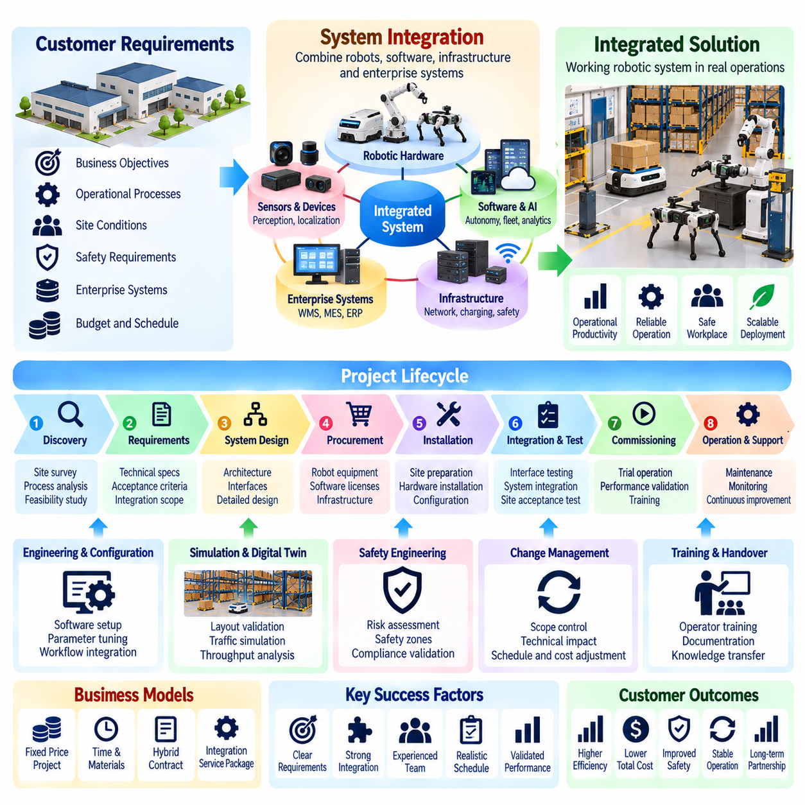{width="7.268055555555556in" height="7.268055555555556in"}

System integration and project-based business models enable Physical AI companies to deliver complete operational solutions rather than isolated robotic products. Customers typically require robots, software, infrastructure, and existing enterprise systems to function together reliably. Integration providers create value by converting technological capabilities into working industrial processes, accepting responsibility for deployment coordination, technical compatibility, and measurable operational outcomes.

Physical AI integration projects commonly involve robotic hardware, autonomy software, fleet management, communication networks, safety systems, and enterprise applications. A mobile robot deployment may require connections to warehouse management, manufacturing execution, or enterprise resource planning systems. Successful integration ensures that information, commands, and operational responsibilities move consistently across these components without disrupting established workflows.

Project development begins with understanding the customer\'s operating environment and business objectives. Site surveys examine facility layouts, material flows, equipment interfaces, network conditions, and safety requirements. Engineers identify operational constraints and determine whether proposed robotic capabilities can satisfy them. Accurate discovery reduces the likelihood of expensive redesign, unrealistic performance commitments, and disputes during final acceptance.

Requirements engineering translates customer expectations into verifiable technical and commercial specifications. These may include payload capacity, throughput, navigation accuracy, operating hours, system availability, and integration interfaces. Requirements should distinguish mandatory functions from optional improvements and identify dependencies on customer infrastructure. Clear acceptance criteria establish a shared definition of project completion and reduce contractual ambiguity.

System architecture determines how robotic subsystems interact with the customer\'s operational infrastructure. Integrators must define communication protocols, data interfaces, control responsibilities, and failure-handling mechanisms. Standardized APIs and modular architectures can reduce engineering effort across projects. However, legacy equipment and proprietary enterprise systems frequently require adapters, custom middleware, or specialized integration procedures.

Physical installation introduces challenges that cannot be resolved through software configuration alone. Charging stations, network equipment, safety devices, floor conditions, access controls, and mechanical interfaces may require modification. These site-specific activities influence deployment schedules and project costs. Integration plans should account for facility preparation, installation access, operational interruptions, and coordination with customer contractors.

Safety engineering is a fundamental responsibility in Physical AI integration. Robots must operate within environments containing workers, vehicles, machinery, and changing obstacles. Risk assessments should address collision hazards, emergency stopping, restricted zones, and interactions with existing equipment. Responsibility for safety validation must be clearly assigned among robot manufacturers, system integrators, facility operators, and other relevant parties.

Project execution generally progresses through design, procurement, configuration, installation, integration testing, commissioning, and acceptance. Each phase should have defined deliverables, dependencies, and approval responsibilities. Structured milestone management helps identify schedule deviations before they affect final delivery. Projects involving multiple suppliers require particularly careful coordination because delays in one subsystem can prevent completion of the entire installation.

Simulation and digital twins can improve project planning by evaluating robot routes, traffic interactions, workspace constraints, and expected throughput before physical deployment. These tools support layout decisions and early identification of integration problems. Nevertheless, simulated performance must be validated against real operating conditions. Differences in human activity, equipment behavior, and environmental variability can significantly affect actual results.

Testing should progress from individual components to complete operational workflows. Interface testing verifies communication between robots and external systems, while integrated testing evaluates coordinated task execution. Site acceptance testing confirms performance under agreed conditions. Testing procedures should include normal operation, foreseeable failures, recovery behavior, and safety responses rather than relying exclusively on successful demonstration scenarios.

Commercial contracts must define project scope, responsibilities, deliverables, payment milestones, and acceptance procedures. Fixed-price contracts provide customers with cost predictability but expose integrators to estimation errors and unexpected engineering effort. Time-and-materials contracts offer flexibility but create budget uncertainty. Hybrid arrangements may combine fixed prices for standardized components with separately controlled charges for uncertain integration work.

Scope management is essential because customer requirements often evolve during deployment. Additional interfaces, workflow changes, new safety constraints, and facility modifications can create substantial unplanned effort. Formal change-control procedures should document technical impacts, schedule consequences, and commercial adjustments. Without disciplined scope control, apparently profitable integration projects can become financially unsustainable.

Project profitability depends on more than the difference between equipment purchase prices and customer invoices. Direct costs include engineering labor, hardware procurement, software configuration, installation, travel, subcontractors, testing, and warranty provisions. Indirect expenses include project management, technical administration, and shared development resources. Accurate cost allocation is necessary to understand actual project contribution margins.

Cash flow management is especially important in large integration projects. Hardware purchases and engineering expenses may occur long before customer payments are received. Milestone billing, advance payments, procurement schedules, and working capital planning help reduce financing pressure. Providers should also consider retention payments and delayed acceptance. Strong reported project revenue does not necessarily indicate sufficient operating cash flow.

System integrators can differentiate themselves through industry expertise, reusable software connectors, standardized deployment methods, and proven operational reliability. Knowledge of manufacturing processes, warehouse operations, or healthcare workflows can be as valuable as robotics expertise. Repeatable engineering assets reduce delivery time and improve quality. Competitive advantage increasingly depends on combining domain understanding with scalable integration technology.

Partnership structures influence project delivery and commercial responsibility. Robot manufacturers may collaborate with local integrators, automation contractors, enterprise software vendors, and infrastructure specialists. Effective partnerships require clear boundaries for installation, configuration, maintenance, warranty support, and customer communication. Poorly defined responsibilities can create service delays and disputes when integrated systems fail to meet expectations.

The relationship between project business and recurring revenue deserves strategic attention. Initial integration generates deployment income, while maintenance, software subscriptions, fleet monitoring, and optimization services can provide continuing revenue. Providers should design integration architectures that support future expansion without excessive customization. A successful project becomes more valuable when it establishes a scalable installed base and a long-term customer relationship.

Project performance should be measured through schedule adherence, budget variance, acceptance success, system availability, throughput achievement, and customer satisfaction. Post-deployment reviews can identify recurring engineering problems and opportunities for standardization. Integrators should also track change-order frequency, support requirements, and realized project margins. These metrics help distinguish sustainable delivery capability from isolated project success.

Scaling a project-based Physical AI business requires reducing dependence on unique engineering solutions. Reference architectures, reusable interfaces, deployment templates, automated testing, and documented commissioning procedures can improve consistency. Standardization should preserve necessary customer flexibility while limiting uncontrolled customization. The objective is to transform accumulated project experience into repeatable delivery capabilities and predictable economics.

Ultimately, system integration and project business models connect Physical AI innovation with practical industrial adoption. Their success depends on accurate requirements, dependable architecture, disciplined execution, safety assurance, contractual clarity, and sustainable project economics. Companies that combine technical integration expertise with standardized delivery methods can convert complex robotic technologies into reliable customer operations while creating foundations for recurring services and long-term growth.

시스템 통합 및 프로젝트 기반 사업 모델(System Integration and Project-Based Business Models)은 피지컬 인공지능 기업(Physical AI Companies)이 개별 로봇 제품(Isolated Robotic Products)이 아닌 완전한 운영 솔루션(Complete Operational Solutions)을 제공할 수 있도록 한다. 고객은 일반적으로 로봇(Robots), 소프트웨어(Software), 인프라(Infrastructure), 기존 기업 시스템(Existing Enterprise Systems)이 안정적으로 함께 작동하기를 요구한다. 시스템 통합 공급업체(Integration Providers)는 기술적 역량(Technological Capabilities)을 실제로 작동하는 산업 공정(Working Industrial Processes)으로 전환하고, 배포 조정(Deployment Coordination), 기술적 호환성(Technical Compatibility), 측정 가능한 운영 성과(Measurable Operational Outcomes)에 대한 책임을 수행함으로써 가치를 창출한다.

피지컬 인공지능 시스템 통합 프로젝트(Physical AI Integration Projects)에는 일반적으로 로봇 하드웨어(Robotic Hardware), 자율운영 소프트웨어(Autonomy Software), 로봇군 관리(Fleet Management), 통신 네트워크(Communication Networks), 안전 시스템(Safety Systems), 기업용 응용 시스템(Enterprise Applications)이 포함된다. 이동로봇 배포(Mobile Robot Deployment)에는 창고관리시스템(Warehouse Management Systems, WMS), 제조실행시스템(Manufacturing Execution Systems, MES), 전사적 자원관리 시스템(Enterprise Resource Planning Systems, ERP)과의 연결이 필요할 수 있다. 성공적인 시스템 통합(Successful Integration)은 기존 작업 흐름(Established Workflows)을 방해하지 않으면서 정보(Information), 명령(Commands), 운영 책임(Operational Responsibilities)이 이러한 구성 요소 사이에서 일관되게 전달되도록 보장한다.

프로젝트 개발(Project Development)은 고객의 운영 환경(Operating Environment)과 사업 목표(Business Objectives)를 이해하는 것에서 시작된다. 현장 조사(Site Surveys)는 시설 배치(Facility Layouts), 자재 흐름(Material Flows), 장비 인터페이스(Equipment Interfaces), 네트워크 상태(Network Conditions), 안전 요구사항(Safety Requirements)을 검토한다. 엔지니어(Engineers)는 운영 제약조건(Operational Constraints)을 식별하고 제안된 로봇 기능(Proposed Robotic Capabilities)이 이를 충족할 수 있는지 판단한다. 정확한 사전 조사(Accurate Discovery)는 비용이 많이 드는 재설계(Expensive Redesign), 비현실적인 성능 약속(Unrealistic Performance Commitments), 최종 검수(Final Acceptance) 과정에서 발생하는 분쟁(Disputes)의 가능성을 줄인다.

요구사항 엔지니어링(Requirements Engineering)은 고객 기대사항(Customer Expectations)을 검증 가능한 기술 및 상업적 사양(Verifiable Technical and Commercial Specifications)으로 변환한다. 여기에는 적재하중(Payload Capacity), 처리량(Throughput), 주행 정확도(Navigation Accuracy), 운영시간(Operating Hours), 시스템 가용성(System Availability), 통합 인터페이스(Integration Interfaces)가 포함될 수 있다. 요구사항(Requirements)은 필수 기능(Mandatory Functions)과 선택적 개선사항(Optional Improvements)을 구분하고 고객 인프라(Customer Infrastructure)에 대한 의존성(Dependencies)을 명시해야 한다. 명확한 인수 기준(Acceptance Criteria)은 프로젝트 완료(Project Completion)에 대한 공동의 정의(Shared Definition)를 수립하고 계약상 모호성(Contractual Ambiguity)을 줄인다.

시스템 아키텍처(System Architecture)는 로봇 하위 시스템(Robotic Subsystems)이 고객의 운영 인프라(Operational Infrastructure)와 어떻게 상호작용하는지를 결정한다. 시스템 통합업체(System Integrators)는 통신 프로토콜(Communication Protocols), 데이터 인터페이스(Data Interfaces), 제어 책임(Control Responsibilities), 장애 처리 메커니즘(Failure-Handling Mechanisms)을 정의해야 한다. 표준화된 응용 프로그램 인터페이스(Standardized Application Programming Interfaces, APIs)와 모듈형 아키텍처(Modular Architectures)는 프로젝트 간 엔지니어링 작업량(Engineering Effort)을 줄일 수 있다. 그러나 레거시 장비(Legacy Equipment)와 독점적인 기업 시스템(Proprietary Enterprise Systems)은 어댑터(Adapters), 맞춤형 미들웨어(Custom Middleware), 특수 통합 절차(Specialized Integration Procedures)를 요구하는 경우가 많다.

물리적 설치(Physical Installation)는 소프트웨어 설정(Software Configuration)만으로 해결할 수 없는 과제를 발생시킨다. 충전 스테이션(Charging Stations), 네트워크 장비(Network Equipment), 안전 장치(Safety Devices), 바닥 상태(Floor Conditions), 접근 제어(Access Controls), 기계적 인터페이스(Mechanical Interfaces)는 변경이 필요할 수 있다. 이러한 현장별 작업(Site-Specific Activities)은 배포 일정(Deployment Schedules)과 프로젝트 비용(Project Costs)에 영향을 미친다. 통합 계획(Integration Plans)은 시설 준비(Facility Preparation), 설치 접근성(Installation Access), 운영 중단(Operational Interruptions), 고객 측 계약업체(Customer Contractors)와의 조정을 고려해야 한다.

안전 엔지니어링(Safety Engineering)은 피지컬 인공지능 시스템 통합(Physical AI Integration)의 기본적인 책임(Fundamental Responsibility)이다. 로봇은 작업자(Workers), 차량(Vehicles), 기계(Machinery), 변화하는 장애물(Changing Obstacles)이 존재하는 환경에서 작동해야 한다. 위험성 평가(Risk Assessments)는 충돌 위험(Collision Hazards), 비상 정지(Emergency Stopping), 제한 구역(Restricted Zones), 기존 장비와의 상호작용(Interactions with Existing Equipment)을 다루어야 한다. 안전 검증(Safety Validation)에 대한 책임은 로봇 제조업체(Robot Manufacturers), 시스템 통합업체(System Integrators), 시설 운영자(Facility Operators), 기타 관련 당사자(Relevant Parties) 사이에서 명확하게 배분되어야 한다.

프로젝트 실행(Project Execution)은 일반적으로 설계(Design), 조달(Procurement), 설정(Configuration), 설치(Installation), 통합 시험(Integration Testing), 시운전(Commissioning), 인수(Acceptance)의 단계를 거친다. 각 단계에는 명확한 산출물(Defined Deliverables), 의존관계(Dependencies), 승인 책임(Approval Responsibilities)이 설정되어야 한다. 체계적인 마일스톤 관리(Structured Milestone Management)는 일정 편차(Schedule Deviations)가 최종 납품(Final Delivery)에 영향을 미치기 전에 이를 식별하도록 지원한다. 여러 공급업체(Multiple Suppliers)가 참여하는 프로젝트는 하나의 하위 시스템(Subsystem)에서 발생한 지연이 전체 설치(Entire Installation)의 완료를 방해할 수 있으므로 특히 세심한 조정(Careful Coordination)이 필요하다.

시뮬레이션(Simulation)과 디지털 트윈(Digital Twins)은 실제 배포(Physical Deployment) 이전에 로봇 경로(Robot Routes), 교통 상호작용(Traffic Interactions), 작업 공간 제약(Workspace Constraints), 예상 처리량(Expected Throughput)을 평가하여 프로젝트 계획(Project Planning)을 개선할 수 있다. 이러한 도구는 배치 설계 의사결정(Layout Decisions)과 통합 문제(Integration Problems)의 조기 식별(Early Identification)을 지원한다. 그러나 시뮬레이션 성능(Simulated Performance)은 실제 운영 조건(Real Operating Conditions)을 기준으로 검증되어야 한다. 인간 활동(Human Activity), 장비 동작(Equipment Behavior), 환경 변동성(Environmental Variability)의 차이는 실제 결과(Actual Results)에 상당한 영향을 미칠 수 있다.

시험(Testing)은 개별 구성 요소(Individual Components)에서 완전한 운영 작업 흐름(Complete Operational Workflows)으로 단계적으로 확대되어야 한다. 인터페이스 시험(Interface Testing)은 로봇과 외부 시스템(External Systems) 사이의 통신을 검증하고, 통합 시험(Integrated Testing)은 조정된 작업 실행(Coordinated Task Execution)을 평가한다. 현장 인수시험(Site Acceptance Testing, SAT)은 합의된 조건(Agreed Conditions)에서 성능을 확인한다. 시험 절차(Testing Procedures)는 성공적인 시연 사례(Successful Demonstration Scenarios)에만 의존하지 않고 정상 운영(Normal Operation), 예측 가능한 장애(Foreseeable Failures), 복구 동작(Recovery Behavior), 안전 대응(Safety Responses)을 포함해야 한다.

상업적 계약(Commercial Contracts)은 프로젝트 범위(Project Scope), 책임(Responsibilities), 산출물(Deliverables), 대금 지급 마일스톤(Payment Milestones), 인수 절차(Acceptance Procedures)를 정의해야 한다. 고정가격 계약(Fixed-Price Contracts)은 고객에게 비용 예측 가능성(Cost Predictability)을 제공하지만 시스템 통합업체를 견적 오류(Estimation Errors)와 예상하지 못한 엔지니어링 작업(Unexpected Engineering Effort)에 노출시킨다. 시간 및 재료비 기반 계약(Time-and-Materials Contracts)은 유연성(Flexibility)을 제공하지만 예산 불확실성(Budget Uncertainty)을 발생시킨다. 혼합형 계약(Hybrid Arrangements)은 표준화된 구성 요소(Standardized Components)에 대한 고정가격과 불확실한 통합 작업(Uncertain Integration Work)에 대해 별도로 통제되는 비용을 결합할 수 있다.

프로젝트 범위 관리(Scope Management)는 배포 과정(Deployment)에서 고객 요구사항(Customer Requirements)이 자주 변경되기 때문에 필수적이다. 추가 인터페이스(Additional Interfaces), 작업 흐름 변경(Workflow Changes), 새로운 안전 제약(New Safety Constraints), 시설 변경(Facility Modifications)은 상당한 계획 외 작업(Unplanned Effort)을 발생시킬 수 있다. 공식적인 변경 관리 절차(Formal Change-Control Procedures)는 기술적 영향(Technical Impacts), 일정상 결과(Schedule Consequences), 상업적 조정(Commercial Adjustments)을 문서화해야 한다. 체계적인 범위 통제(Disciplined Scope Control)가 없다면 수익성이 있어 보이는 시스템 통합 프로젝트(Apparently Profitable Integration Projects)도 재무적으로 지속 불가능한 상태(Financially Unsustainable State)에 이를 수 있다.

프로젝트 수익성(Project Profitability)은 단순히 장비 구매 가격(Equipment Purchase Prices)과 고객 청구 금액(Customer Invoices)의 차이만으로 결정되지 않는다. 직접 비용(Direct Costs)에는 엔지니어링 인건비(Engineering Labor), 하드웨어 조달(Hardware Procurement), 소프트웨어 설정(Software Configuration), 설치(Installation), 출장(Travel), 하도급업체(Subcontractors), 시험(Testing), 보증 충당 비용(Warranty Provisions)이 포함된다. 간접 비용(Indirect Expenses)에는 프로젝트 관리(Project Management), 기술 행정(Technical Administration), 공통 개발 자원(Shared Development Resources)이 포함된다. 실제 프로젝트 공헌이익률(Actual Project Contribution Margins)을 이해하려면 정확한 비용 배분(Accurate Cost Allocation)이 필요하다.

현금흐름 관리(Cash Flow Management)는 대규모 시스템 통합 프로젝트(Large Integration Projects)에서 특히 중요하다. 하드웨어 구매(Hardware Purchases)와 엔지니어링 비용(Engineering Expenses)은 고객 대금(Customer Payments)을 수령하기 훨씬 전에 발생할 수 있다. 마일스톤 기반 청구(Milestone Billing), 선수금(Advance Payments), 조달 일정(Procurement Schedules), 운전자본 계획(Working Capital Planning)은 자금 조달 압박(Financing Pressure)을 줄이는 데 도움이 된다. 공급업체는 유보금 지급(Retention Payments)과 인수 지연(Delayed Acceptance)도 고려해야 한다. 장부상 높은 프로젝트 매출(Strong Reported Project Revenue)이 반드시 충분한 영업 현금흐름(Sufficient Operating Cash Flow)을 의미하는 것은 아니다.

시스템 통합업체(System Integrators)는 산업별 전문성(Industry Expertise), 재사용 가능한 소프트웨어 커넥터(Reusable Software Connectors), 표준화된 배포 방법(Standardized Deployment Methods), 검증된 운영 신뢰성(Proven Operational Reliability)을 통해 차별화할 수 있다. 제조 공정(Manufacturing Processes), 창고 운영(Warehouse Operations), 의료 서비스 작업 흐름(Healthcare Workflows)에 대한 지식은 로봇 기술 전문성(Robotics Expertise)만큼 가치가 있을 수 있다. 반복 사용 가능한 엔지니어링 자산(Repeatable Engineering Assets)은 납품 시간(Delivery Time)을 줄이고 품질(Quality)을 개선한다. 경쟁우위(Competitive Advantage)는 산업 분야에 대한 이해(Domain Understanding)와 확장 가능한 통합 기술(Scalable Integration Technology)을 결합하는 능력에 점점 더 크게 의존한다.

파트너십 구조(Partnership Structures)는 프로젝트 납품(Project Delivery)과 상업적 책임(Commercial Responsibility)에 영향을 미친다. 로봇 제조업체(Robot Manufacturers)는 지역 시스템 통합업체(Local Integrators), 자동화 계약업체(Automation Contractors), 기업용 소프트웨어 공급업체(Enterprise Software Vendors), 인프라 전문업체(Infrastructure Specialists)와 협력할 수 있다. 효과적인 파트너십(Effective Partnerships)을 위해서는 설치(Installation), 설정(Configuration), 유지보수(Maintenance), 보증 지원(Warranty Support), 고객 커뮤니케이션(Customer Communication)에 대한 명확한 책임 경계(Clear Responsibility Boundaries)가 필요하다. 통합 시스템(Integrated Systems)이 기대 성능(Expected Performance)을 충족하지 못할 때 책임이 불명확하면 서비스 지연(Service Delays)과 분쟁(Disputes)이 발생할 수 있다.

프로젝트 사업(Project Business)과 반복 매출(Recurring Revenue) 사이의 관계는 전략적으로 중요하게 다루어야 한다. 초기 시스템 통합(Initial Integration)은 배포 수익(Deployment Income)을 창출하고, 유지보수(Maintenance), 소프트웨어 구독(Software Subscriptions), 로봇군 모니터링(Fleet Monitoring), 최적화 서비스(Optimization Services)는 지속적인 매출(Continuing Revenue)을 제공할 수 있다. 공급업체는 과도한 맞춤화(Excessive Customization) 없이 향후 확장(Future Expansion)을 지원하는 통합 아키텍처(Integration Architectures)를 설계해야 한다. 성공적인 프로젝트(Successful Project)는 확장 가능한 설치 기반(Scalable Installed Base)과 장기적인 고객 관계(Long-Term Customer Relationship)를 구축할 때 더 큰 가치를 가진다.

프로젝트 성과(Project Performance)는 일정 준수율(Schedule Adherence), 예산 편차(Budget Variance), 인수 성공(Acceptance Success), 시스템 가용성(System Availability), 처리량 목표 달성(Throughput Achievement), 고객 만족도(Customer Satisfaction)를 통해 측정해야 한다. 배포 후 검토(Post-Deployment Reviews)는 반복적으로 발생하는 엔지니어링 문제(Recurring Engineering Problems)와 표준화 기회(Standardization Opportunities)를 식별할 수 있다. 시스템 통합업체는 변경 주문 빈도(Change-Order Frequency), 지원 요구사항(Support Requirements), 실현된 프로젝트 이익률(Realized Project Margins)도 추적해야 한다. 이러한 지표(Metrics)는 지속 가능한 납품 역량(Sustainable Delivery Capability)과 개별 프로젝트의 일시적인 성공(Isolated Project Success)을 구분하는 데 도움이 된다.

프로젝트 기반 피지컬 인공지능 사업(Project-Based Physical AI Business)을 확장하려면 개별적인 엔지니어링 솔루션(Unique Engineering Solutions)에 대한 의존도를 줄여야 한다. 참조 아키텍처(Reference Architectures), 재사용 가능한 인터페이스(Reusable Interfaces), 배포 템플릿(Deployment Templates), 자동화된 시험(Automated Testing), 문서화된 시운전 절차(Documented Commissioning Procedures)는 일관성(Consistency)을 개선할 수 있다. 표준화(Standardization)는 통제되지 않는 맞춤화(Uncontrolled Customization)를 제한하면서 필요한 고객 유연성(Customer Flexibility)을 유지해야 한다. 목표는 축적된 프로젝트 경험(Accumulated Project Experience)을 반복 가능한 납품 역량(Repeatable Delivery Capabilities)과 예측 가능한 경제성(Predictable Economics)으로 전환하는 것이다.

궁극적으로 시스템 통합 및 프로젝트 사업 모델(System Integration and Project Business Models)은 피지컬 인공지능 혁신(Physical AI Innovation)을 실질적인 산업 도입(Practical Industrial Adoption)과 연결한다. 성공 여부는 정확한 요구사항(Accurate Requirements), 신뢰할 수 있는 아키텍처(Dependable Architecture), 체계적인 실행(Disciplined Execution), 안전성 보증(Safety Assurance), 계약의 명확성(Contractual Clarity), 지속 가능한 프로젝트 경제성(Sustainable Project Economics)에 달려 있다. 기술적 통합 전문성(Technical Integration Expertise)과 표준화된 납품 방법(Standardized Delivery Methods)을 결합하는 기업은 복잡한 로봇 기술(Complex Robotic Technologies)을 신뢰할 수 있는 고객 운영(Reliable Customer Operations)으로 전환하면서 반복 서비스(Recurring Services)와 장기 성장(Long-Term Growth)을 위한 기반을 구축할 수 있다.

##  

## 08.10. Fleet Service and Operations Business

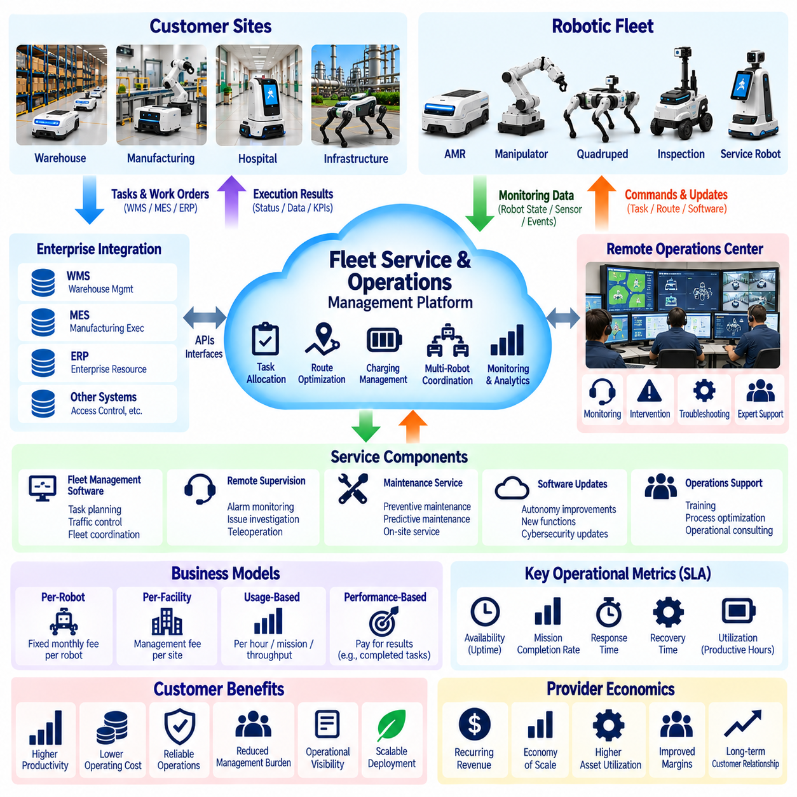{width="7.268055555555556in" height="7.268055555555556in"}

Fleet service and operations business models enable Physical AI providers to generate continuing revenue by managing deployed robotic fleets throughout their operational lifecycles. Rather than focusing exclusively on equipment delivery, these businesses assume responsibility for fleet availability, task execution, monitoring, and operational improvement. Their value depends on maintaining dependable robotic performance while reducing the management burden placed on customers.

A fleet operations service typically combines robotic hardware, fleet management software, remote supervision, technical support, and performance analytics. Customers may retain ownership of their robots or obtain equipment through leasing and Robot-as-a-Service agreements. The provider\'s commercial role is to ensure coordinated operation across multiple machines. Clear service boundaries distinguish fleet operations from basic software licensing and conventional maintenance contracts.

Fleet management platforms form the technological foundation of these services. They coordinate task allocation, traffic control, route planning, charging schedules, and robot status monitoring. Integration with warehouse management, manufacturing execution, and enterprise resource planning systems connects robotic activities to business workflows. Effective orchestration improves resource utilization and reduces operational conflicts among robots sharing the same environment.

Remote operations centers allow providers to supervise fleets distributed across multiple customer facilities. Operators can monitor alarms, investigate abnormal behavior, review mission failures, and coordinate recovery procedures. Centralized supervision may reduce the need for dedicated personnel at every site. However, staffing requirements depend on fleet complexity, intervention frequency, operating hours, and the consequences of delayed responses.

Human intervention remains important even when robots perform most tasks autonomously. Fleet service agreements should define when remote assistance, teleoperation, or on-site intervention is permitted and required. Providers must establish escalation procedures for navigation failures, blocked routes, equipment faults, and unexpected environmental conditions. Human oversight should support autonomous operations without creating hidden labor costs that undermine scalability.

Service-level agreements establish measurable expectations for operational performance. Common indicators include fleet availability, robot uptime, mission completion rates, incident response times, and recovery times. Contract terms should distinguish failures attributable to the provider from disruptions caused by customer infrastructure or external conditions. Clearly defined measurement methods reduce disputes and connect commercial obligations to operational reality.

Fleet availability and productive utilization are related but different measures. A robot may remain technically operational while spending significant time waiting for assignments, charging, or navigating inefficient routes. Providers should evaluate productive operating hours, completed tasks, throughput, and idle time alongside uptime. Revenue models based solely on equipment availability may overlook opportunities to improve actual customer productivity.

Commercial pricing may be structured per robot, per facility, per operating hour, or according to completed tasks. Fixed monthly management fees offer predictable billing, while usage-based arrangements connect charges more closely to operational activity. Performance-linked contracts may reward higher throughput or reduced downtime. Pricing must account for the provider\'s controllable responsibilities and avoid exposing either party to poorly defined operational risks.

Fleet service economics depend heavily on the relationship between managed fleet size and operational support costs. Revenue can increase as additional robots join a common management platform, but staffing, connectivity, maintenance, and infrastructure expenses also grow. Economies of scale emerge when standardized tools allow one operations team to supervise more robots without proportional increases in labor. Intervention rates are therefore a critical economic variable.

The ratio of managed robots to operations personnel provides a useful indicator of service scalability. However, a single staffing ratio cannot describe every deployment. Complex manipulation tasks, hazardous environments, and unpredictable public spaces may require more supervision than structured warehouse transport. Providers should calculate staffing requirements using observed intervention frequency, average handling time, shift coverage, and operational risk.

Operational data supports continuous improvement of fleet services. Mission histories, congestion events, battery cycles, charging delays, and failure records can reveal inefficient processes. Analytics may guide changes to robot allocation, routing policies, and maintenance schedules. Providers should establish feedback loops that convert operational observations into validated improvements while respecting customer data rights and security requirements.

Predictive maintenance strengthens fleet operations by reducing unexpected equipment failures. Monitoring battery health, motor conditions, sensor performance, and fault patterns can support proactive service planning. Maintenance activities should be coordinated with workload demand to minimize disruption. The commercial benefit depends on avoiding downtime without introducing excessive inspections, replacement costs, or false maintenance alarms.

Fleet operations must also address charging and energy management. Poor charging schedules can reduce available capacity during peak demand, while unnecessary charging interruptions may lower throughput. Intelligent scheduling considers battery state, task priority, charging infrastructure, and expected workloads. For large fleets, coordinated energy management can improve utilization and reduce infrastructure congestion without compromising battery safety.

Integration with customer workflows determines whether managed fleets deliver meaningful business value. Task requests may originate from production systems, warehouse applications, or facility management platforms. The operations provider must ensure that assignments, completion confirmations, and exceptions are communicated reliably. Changes to customer processes can affect fleet performance, making interface governance and coordinated change management essential.

Cybersecurity and operational resilience are central to remotely managed robotic fleets. Communication failures, unauthorized access, software defects, and cloud service interruptions can disrupt operations. Providers need secure authentication, network segmentation, monitoring, backup procedures, and appropriate local fallback capabilities. Safety-critical robot functions must remain protected even when centralized management services become unavailable.

Customer responsibilities must be clearly defined in managed fleet contracts. Facility operators may control floor conditions, wireless networks, pedestrian access, loading procedures, and production schedules. Providers may control fleet software, remote monitoring, robot configuration, and designated maintenance activities. Shared responsibility arrangements should specify incident reporting, access permissions, operating constraints, and procedures for resolving performance disputes.

Fleet expansion introduces additional operational and commercial complexity. Adding robots may increase throughput, but congestion, charging limitations, and shared resource conflicts can reduce marginal productivity. Providers should evaluate capacity through simulation, operational data, and controlled deployment tests. Expansion decisions should consider whether additional robots produce sufficient incremental value to justify equipment, software, and support expenses.

Financial management requires tracking recurring revenue, gross margin, customer retention, and support costs at both fleet and contract levels. Important measures include revenue per managed robot, intervention cost per mission, support labor per operating hour, and contract contribution margin. Providers should distinguish profitable fleet growth from expansion that increases revenue while disproportionately increasing service obligations.

Standardization is essential for scaling fleet operations across customers and locations. Common software interfaces, monitoring dashboards, incident classifications, recovery procedures, and training programs reduce operational complexity. Nevertheless, standardized services must accommodate legitimate differences in facility layouts, safety requirements, and task characteristics. Modular service packages provide flexibility without requiring entirely customized operating models.

Ultimately, fleet service and operations businesses transform Physical AI from a deployed technology into a continuously managed operational capability. Their long-term success depends on reliable autonomy, effective human supervision, measurable service performance, disciplined cost control, and scalable fleet orchestration. Providers that consistently improve customer productivity while maintaining sustainable service economics can build durable recurring revenue and long-term operational partnerships.

로봇군 서비스 및 운영 사업 모델(Fleet Service and Operations Business Models)은 피지컬 인공지능 공급업체(Physical AI Providers)가 배포된 로봇군(Deployed Robotic Fleets)의 운영 수명주기(Operational Lifecycles) 전반을 관리함으로써 지속적인 매출(Continuing Revenue)을 창출할 수 있도록 한다. 이러한 사업은 장비 납품(Equipment Delivery)에만 집중하는 대신 로봇군 가용성(Fleet Availability), 작업 실행(Task Execution), 모니터링(Monitoring), 운영 개선(Operational Improvement)에 대한 책임을 수행한다. 사업의 가치는 신뢰할 수 있는 로봇 성능(Dependable Robotic Performance)을 유지하면서 고객의 관리 부담(Management Burden)을 줄이는 데 달려 있다.

로봇군 운영 서비스(Fleet Operations Service)는 일반적으로 로봇 하드웨어(Robotic Hardware), 로봇군 관리 소프트웨어(Fleet Management Software), 원격 감독(Remote Supervision), 기술 지원(Technical Support), 성능 분석(Performance Analytics)을 결합한다. 고객은 로봇 소유권(Robot Ownership)을 유지하거나 리스(Leasing) 및 서비스형 로봇(Robot-as-a-Service, RaaS) 계약을 통해 장비를 이용할 수 있다. 공급업체의 상업적 역할(Commercial Role)은 여러 로봇 사이의 조정된 운영(Coordinated Operation)을 보장하는 것이다. 명확한 서비스 범위(Service Boundaries)는 로봇군 운영(Fleet Operations)을 기본 소프트웨어 라이선싱(Basic Software Licensing) 및 전통적인 유지보수 계약(Conventional Maintenance Contracts)과 구분한다.

로봇군 관리 플랫폼(Fleet Management Platforms)은 이러한 서비스의 기술적 기반(Technological Foundation)을 형성한다. 플랫폼은 작업 할당(Task Allocation), 교통 제어(Traffic Control), 경로 계획(Route Planning), 충전 일정(Charging Schedules), 로봇 상태 모니터링(Robot Status Monitoring)을 조정한다. 창고관리시스템(Warehouse Management Systems, WMS), 제조실행시스템(Manufacturing Execution Systems, MES), 전사적 자원관리 시스템(Enterprise Resource Planning Systems, ERP)과의 통합은 로봇 활동(Robotic Activities)을 업무 흐름(Business Workflows)에 연결한다. 효과적인 오케스트레이션(Effective Orchestration)은 자원 활용률(Resource Utilization)을 높이고 동일한 환경을 공유하는 로봇 사이의 운영 충돌(Operational Conflicts)을 줄인다.

원격 운영센터(Remote Operations Centers)는 공급업체가 여러 고객 시설(Customer Facilities)에 분산된 로봇군을 감독할 수 있도록 한다. 운영자(Operators)는 경보(Alarms)를 모니터링하고, 비정상 동작(Abnormal Behavior)을 조사하며, 임무 실패(Mission Failures)를 검토하고, 복구 절차(Recovery Procedures)를 조정할 수 있다. 중앙집중식 감독(Centralized Supervision)은 각 현장에 전담 인력(Dedicated Personnel)을 배치할 필요성을 줄일 수 있다. 그러나 인력 요구사항(Staffing Requirements)은 로봇군 복잡성(Fleet Complexity), 개입 빈도(Intervention Frequency), 운영시간(Operating Hours), 대응 지연의 결과(Consequences of Delayed Responses)에 따라 달라진다.

로봇이 대부분의 작업을 자율적으로 수행하더라도 인간 개입(Human Intervention)은 여전히 중요하다. 로봇군 서비스 계약(Fleet Service Agreements)은 원격 지원(Remote Assistance), 원격조작(Teleoperation), 현장 개입(On-Site Intervention)이 언제 허용되고 필요한지를 정의해야 한다. 공급업체는 주행 실패(Navigation Failures), 경로 차단(Blocked Routes), 장비 고장(Equipment Faults), 예상하지 못한 환경 조건(Unexpected Environmental Conditions)에 대한 단계별 대응 절차(Escalation Procedures)를 수립해야 한다. 인간 감독(Human Oversight)은 확장성(Scalability)을 저해하는 숨겨진 인건비(Hidden Labor Costs)를 발생시키지 않으면서 자율운영(Autonomous Operations)을 지원해야 한다.

서비스 수준 계약(Service-Level Agreements, SLAs)은 운영 성능(Operational Performance)에 대한 측정 가능한 기대 수준(Measurable Expectations)을 설정한다. 일반적인 지표(Common Indicators)에는 로봇군 가용성(Fleet Availability), 로봇 가동시간(Robot Uptime), 임무 완료율(Mission Completion Rates), 사고 대응시간(Incident Response Times), 복구시간(Recovery Times)이 포함된다. 계약 조건(Contract Terms)은 공급업체에 귀속되는 장애(Provider-Attributable Failures)와 고객 인프라(Customer Infrastructure) 또는 외부 조건(External Conditions)으로 발생한 운영 중단(Disruptions)을 구분해야 한다. 명확하게 정의된 측정 방법(Measurement Methods)은 분쟁(Disputes)을 줄이고 상업적 의무(Commercial Obligations)를 실제 운영 상황(Operational Reality)과 연결한다.

로봇군 가용성(Fleet Availability)과 생산적 활용률(Productive Utilization)은 서로 관련되어 있지만 다른 측정 지표(Measures)이다. 로봇은 기술적으로 정상 작동하는 상태(Technically Operational State)를 유지하면서도 작업 할당 대기(Waiting for Assignments), 충전(Charging), 비효율적인 경로 주행(Navigating Inefficient Routes)에 상당한 시간을 소비할 수 있다. 공급업체는 가동시간(Uptime)과 함께 생산적 운영시간(Productive Operating Hours), 완료된 작업(Completed Tasks), 처리량(Throughput), 유휴시간(Idle Time)을 평가해야 한다. 장비 가용성(Equipment Availability)에만 기반한 매출 모델(Revenue Models)은 실제 고객 생산성(Actual Customer Productivity)을 개선할 기회를 놓칠 수 있다.

상업적 가격 책정(Commercial Pricing)은 로봇당(Per Robot), 시설당(Per Facility), 운영시간당(Per Operating Hour), 완료된 작업(Completed Tasks)에 따라 구성될 수 있다. 고정 월간 관리 요금(Fixed Monthly Management Fees)은 예측 가능한 청구(Predictable Billing)를 제공하며, 사용량 기반 계약(Usage-Based Arrangements)은 요금을 실제 운영 활동(Operational Activity)에 더욱 밀접하게 연결한다. 성과 연계 계약(Performance-Linked Contracts)은 처리량 증가(Higher Throughput)나 가동 중단시간 감소(Reduced Downtime)에 보상을 제공할 수 있다. 가격 책정(Pricing)은 공급업체가 통제할 수 있는 책임(Controllable Responsibilities)을 고려해야 하며, 명확하게 정의되지 않은 운영 위험(Poorly Defined Operational Risks)에 어느 한쪽 당사자도 노출되지 않도록 해야 한다.

로봇군 서비스 경제성(Fleet Service Economics)은 관리 대상 로봇군 규모(Managed Fleet Size)와 운영 지원 비용(Operational Support Costs) 사이의 관계에 크게 좌우된다. 추가 로봇이 공통 관리 플랫폼(Common Management Platform)에 연결되면 매출(Revenue)이 증가할 수 있지만 인력(Staffing), 연결성(Connectivity), 유지보수(Maintenance), 인프라 비용(Infrastructure Expenses)도 함께 증가한다. 표준화된 도구(Standardized Tools)를 통해 하나의 운영팀(Operations Team)이 인력 증가에 비례하지 않고 더 많은 로봇을 감독할 수 있을 때 규모의 경제(Economies of Scale)가 발생한다. 따라서 개입률(Intervention Rates)은 핵심적인 경제적 변수(Critical Economic Variable)이다.

관리 대상 로봇 수 대비 운영 인력 비율(Ratio of Managed Robots to Operations Personnel)은 서비스 확장성(Service Scalability)을 평가하는 유용한 지표(Useful Indicator)이다. 그러나 하나의 인력 배치 비율(Staffing Ratio)만으로 모든 배포 환경(Deployments)을 설명할 수는 없다. 복잡한 조작 작업(Complex Manipulation Tasks), 위험 환경(Hazardous Environments), 예측하기 어려운 공공장소(Unpredictable Public Spaces)는 구조화된 창고 운송(Structured Warehouse Transport)보다 더 많은 감독(Supervision)을 요구할 수 있다. 공급업체는 관측된 개입 빈도(Observed Intervention Frequency), 평균 처리시간(Average Handling Time), 교대근무 운영 범위(Shift Coverage), 운영 위험(Operational Risk)을 이용하여 인력 요구사항(Staffing Requirements)을 산정해야 한다.

운영 데이터(Operational Data)는 로봇군 서비스(Fleet Services)의 지속적인 개선(Continuous Improvement)을 지원한다. 임무 이력(Mission Histories), 혼잡 이벤트(Congestion Events), 배터리 충방전 주기(Battery Cycles), 충전 지연(Charging Delays), 장애 기록(Failure Records)은 비효율적인 프로세스(Inefficient Processes)를 드러낼 수 있다. 분석(Analytics)은 로봇 할당(Robot Allocation), 경로 정책(Routing Policies), 유지보수 일정(Maintenance Schedules)의 변경을 안내할 수 있다. 공급업체는 고객 데이터 권리(Customer Data Rights)와 보안 요구사항(Security Requirements)을 준수하면서 운영 관측 결과(Operational Observations)를 검증된 개선사항(Validated Improvements)으로 전환하는 피드백 루프(Feedback Loops)를 구축해야 한다.

예지보전(Predictive Maintenance)은 예상하지 못한 장비 고장(Unexpected Equipment Failures)을 줄임으로써 로봇군 운영(Fleet Operations)을 강화한다. 배터리 상태(Battery Health), 모터 상태(Motor Conditions), 센서 성능(Sensor Performance), 고장 패턴(Fault Patterns)을 모니터링하면 사전 예방적 서비스 계획(Proactive Service Planning)을 지원할 수 있다. 유지보수 활동(Maintenance Activities)은 운영 중단(Disruption)을 최소화하도록 작업 부하 수요(Workload Demand)와 조정되어야 한다. 상업적 편익(Commercial Benefit)은 과도한 검사(Excessive Inspections), 교체 비용(Replacement Costs), 잘못된 유지보수 경보(False Maintenance Alarms)를 발생시키지 않으면서 가동 중단시간(Downtime)을 방지하는 데 달려 있다.

로봇군 운영(Fleet Operations)은 충전 및 에너지 관리(Charging and Energy Management)도 다루어야 한다. 부적절한 충전 일정(Poor Charging Schedules)은 최대 수요 시간(Peak Demand)에 사용 가능한 용량(Available Capacity)을 감소시킬 수 있으며, 불필요한 충전 중단(Unnecessary Charging Interruptions)은 처리량(Throughput)을 낮출 수 있다. 지능형 일정 관리(Intelligent Scheduling)는 배터리 상태(Battery State), 작업 우선순위(Task Priority), 충전 인프라(Charging Infrastructure), 예상 작업 부하(Expected Workloads)를 고려한다. 대규모 로봇군(Large Fleets)에서 조정된 에너지 관리(Coordinated Energy Management)는 배터리 안전(Battery Safety)을 저해하지 않으면서 활용률(Utilization)을 높이고 인프라 혼잡(Infrastructure Congestion)을 줄일 수 있다.

고객 작업 흐름(Customer Workflows)과의 통합(Integration)은 관리형 로봇군(Managed Fleets)이 의미 있는 사업 가치(Meaningful Business Value)를 제공하는지를 결정한다. 작업 요청(Task Requests)은 생산 시스템(Production Systems), 창고 응용 시스템(Warehouse Applications), 시설 관리 플랫폼(Facility Management Platforms)에서 발생할 수 있다. 운영 서비스 공급업체(Operations Provider)는 작업 할당(Assignments), 완료 확인(Completion Confirmations), 예외 상황(Exceptions)이 신뢰성 있게 전달되도록 보장해야 한다. 고객 프로세스(Customer Processes)의 변경은 로봇군 성능(Fleet Performance)에 영향을 미칠 수 있으므로 인터페이스 거버넌스(Interface Governance)와 조정된 변경 관리(Coordinated Change Management)가 필수적이다.

사이버보안(Cybersecurity)과 운영 회복탄력성(Operational Resilience)은 원격으로 관리되는 로봇군(Remotely Managed Robotic Fleets)의 핵심 요소이다. 통신 장애(Communication Failures), 무단 접근(Unauthorized Access), 소프트웨어 결함(Software Defects), 클라우드 서비스 중단(Cloud Service Interruptions)은 운영을 방해할 수 있다. 공급업체는 안전한 인증(Secure Authentication), 네트워크 분리(Network Segmentation), 모니터링(Monitoring), 백업 절차(Backup Procedures), 적절한 로컬 대체 운영 기능(Local Fallback Capabilities)을 갖추어야 한다. 안전 필수 로봇 기능(Safety-Critical Robot Functions)은 중앙집중식 관리 서비스(Centralized Management Services)를 이용할 수 없게 되더라도 보호되어야 한다.

관리형 로봇군 계약(Managed Fleet Contracts)에서는 고객의 책임(Customer Responsibilities)을 명확하게 정의해야 한다. 시설 운영자(Facility Operators)는 바닥 상태(Floor Conditions), 무선 네트워크(Wireless Networks), 보행자 접근(Pedestrian Access), 적재 절차(Loading Procedures), 생산 일정(Production Schedules)을 관리할 수 있다. 공급업체(Providers)는 로봇군 소프트웨어(Fleet Software), 원격 모니터링(Remote Monitoring), 로봇 설정(Robot Configuration), 지정된 유지보수 활동(Designated Maintenance Activities)을 관리할 수 있다. 공동 책임 체계(Shared Responsibility Arrangements)는 사고 보고(Incident Reporting), 접근 권한(Access Permissions), 운영 제약조건(Operating Constraints), 성능 분쟁 해결 절차(Procedures for Resolving Performance Disputes)를 명시해야 한다.

로봇군 확장(Fleet Expansion)은 추가적인 운영 및 상업적 복잡성(Operational and Commercial Complexity)을 발생시킨다. 로봇을 추가하면 처리량(Throughput)이 증가할 수 있지만 혼잡(Congestion), 충전 제약(Charging Limitations), 공유 자원 충돌(Shared Resource Conflicts)은 한계 생산성(Marginal Productivity)을 감소시킬 수 있다. 공급업체는 시뮬레이션(Simulation), 운영 데이터(Operational Data), 통제된 배포 시험(Controlled Deployment Tests)을 통해 처리 용량(Capacity)을 평가해야 한다. 확장 의사결정(Expansion Decisions)은 추가 로봇(Additional Robots)이 장비(Equipment), 소프트웨어(Software), 지원 비용(Support Expenses)을 정당화할 만큼 충분한 추가 가치(Incremental Value)를 창출하는지를 고려해야 한다.

재무 관리(Financial Management)를 위해서는 로봇군(Fleet)과 계약(Contract) 수준에서 반복 매출(Recurring Revenue), 매출총이익률(Gross Margin), 고객 유지율(Customer Retention), 지원 비용(Support Costs)을 추적해야 한다. 중요한 측정 지표(Important Measures)에는 관리 로봇당 매출(Revenue per Managed Robot), 임무당 개입 비용(Intervention Cost per Mission), 운영시간당 지원 인건비(Support Labor per Operating Hour), 계약 공헌이익률(Contract Contribution Margin)이 포함된다. 공급업체는 수익성 있는 로봇군 성장(Profitable Fleet Growth)과 매출은 증가하지만 서비스 의무(Service Obligations)가 불균형적으로 증가하는 확장을 구분해야 한다.

표준화(Standardization)는 여러 고객과 지역에 걸쳐 로봇군 운영(Fleet Operations)을 확장하는 데 필수적이다. 공통 소프트웨어 인터페이스(Common Software Interfaces), 모니터링 대시보드(Monitoring Dashboards), 사고 분류 체계(Incident Classifications), 복구 절차(Recovery Procedures), 교육 프로그램(Training Programs)은 운영 복잡성(Operational Complexity)을 줄인다. 그러나 표준화된 서비스(Standardized Services)는 시설 배치(Facility Layouts), 안전 요구사항(Safety Requirements), 작업 특성(Task Characteristics)의 정당한 차이를 수용해야 한다. 모듈형 서비스 패키지(Modular Service Packages)는 완전히 맞춤화된 운영 모델(Entirely Customized Operating Models)을 요구하지 않으면서 유연성(Flexibility)을 제공한다.

궁극적으로 로봇군 서비스 및 운영 사업(Fleet Service and Operations Businesses)은 피지컬 인공지능(Physical AI)을 단순히 배포된 기술(Deployed Technology)에서 지속적으로 관리되는 운영 역량(Continuously Managed Operational Capability)으로 전환한다. 장기적인 성공(Long-Term Success)은 신뢰할 수 있는 자율운영(Reliable Autonomy), 효과적인 인간 감독(Effective Human Supervision), 측정 가능한 서비스 성능(Measurable Service Performance), 체계적인 비용 통제(Disciplined Cost Control), 확장 가능한 로봇군 오케스트레이션(Scalable Fleet Orchestration)에 달려 있다. 지속 가능한 서비스 경제성(Sustainable Service Economics)을 유지하면서 고객 생산성(Customer Productivity)을 일관되게 개선하는 공급업체는 안정적인 반복 매출(Durable Recurring Revenue)과 장기적인 운영 파트너십(Long-Term Operational Partnerships)을 구축할 수 있다.

##  

## 08.11. Maintenance Support and Lifecycle Revenue

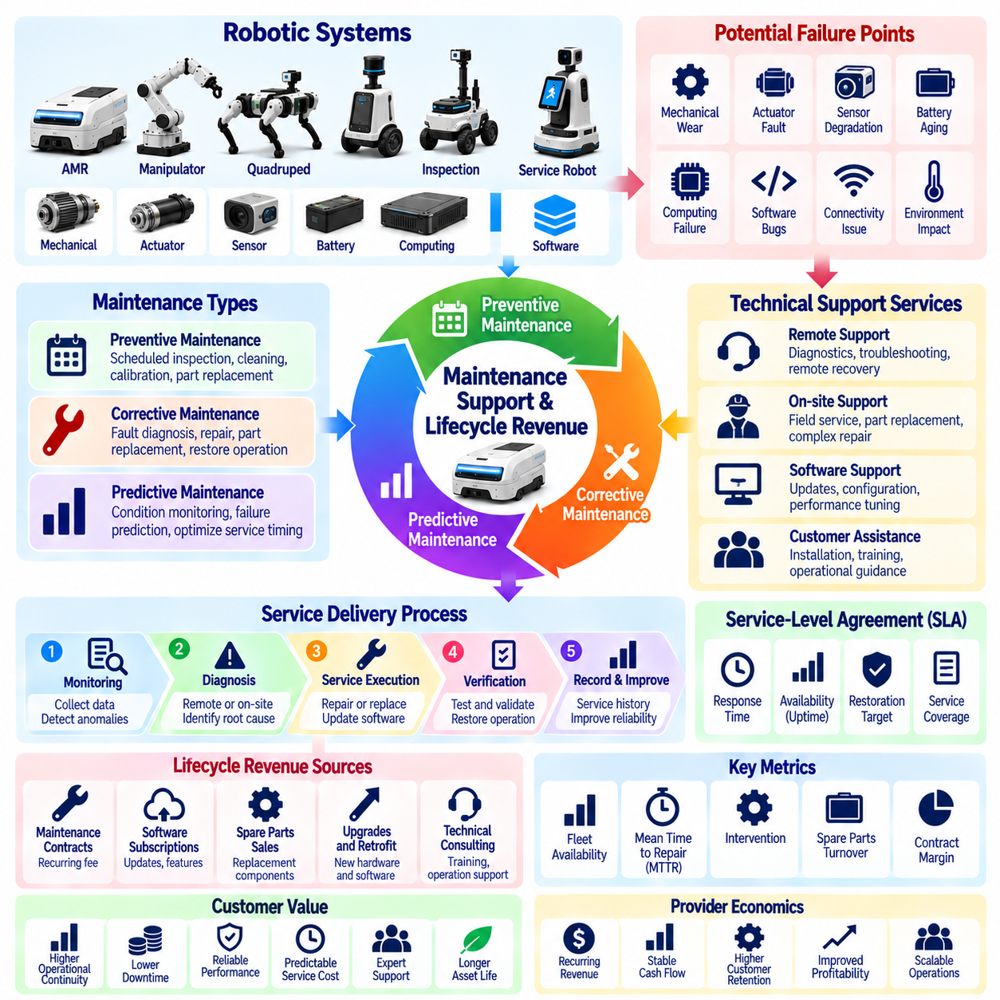{width="7.268055555555556in" height="7.268055555555556in"}

Maintenance, support, and lifecycle revenue represent essential components of sustainable Physical AI business models. Unlike one-time equipment sales, these activities generate continuing income by preserving robot performance, availability, and operational value throughout the installed system\'s useful life. Their commercial importance increases as deployed fleets expand and customers become more dependent on reliable autonomous operations.

Robotic maintenance includes preventive inspections, corrective repairs, component replacement, calibration, and software-related servicing. Physical AI systems combine mechanical structures, actuators, sensors, batteries, computing hardware, and intelligent software, creating multiple potential failure points. Effective maintenance programs address these interconnected elements while minimizing interruptions to customer workflows and avoiding unnecessary service expenditure.

Preventive maintenance follows scheduled intervals based on operating hours, usage cycles, manufacturer recommendations, and environmental conditions. Activities may include inspecting drive systems, checking electrical connections, cleaning sensors, and evaluating battery health. Standardized maintenance procedures improve consistency and reduce unexpected failures. However, excessive scheduled servicing can increase costs without delivering proportional reliability improvements.

Corrective maintenance restores functionality after faults or failures occur. Providers must establish diagnostic procedures, replacement strategies, repair responsibilities, and escalation mechanisms. Mean time to repair, spare parts availability, and technician response times directly influence service performance. Efficient corrective maintenance requires accurate fault identification and modular system designs that allow damaged components to be replaced without extensive disassembly.

Predictive maintenance uses operational data to identify potential equipment degradation before functional failure. Sensor measurements, motor currents, vibration patterns, battery characteristics, and fault histories can support condition monitoring. Statistical models and machine learning algorithms may estimate failure probabilities or remaining useful life. Predictions must be validated carefully because false alarms and missed failures can create substantial operational costs.

Technical support extends beyond physical repair to include software configuration, connectivity troubleshooting, navigation recovery, and fleet management assistance. Customers may require support during installation, routine operation, software upgrades, and unexpected incidents. Multilevel support organizations can separate basic troubleshooting from advanced engineering investigations. Clear escalation procedures improve response efficiency and prevent recurring problems from overwhelming specialized personnel.

Service-level agreements define maintenance and support obligations through measurable performance commitments. Contracts may specify response times, restoration targets, support availability, preventive maintenance schedules, and spare parts responsibilities. Premium service tiers can offer extended operating-hour coverage or faster intervention. Providers must price these commitments according to actual delivery capabilities, geographic coverage, and the financial consequences of service failures.

Lifecycle revenue begins with equipment deployment but can continue through maintenance contracts, software subscriptions, replacement components, upgrades, and technical consulting. A robot\'s installed life may include several generations of software and selected hardware improvements. Providers should map expected revenue and service costs across the entire ownership period. This approach reveals whether initial sales create profitable long-term relationships or expensive support obligations.

Spare parts management is particularly important for robotic fleets operating continuously. Providers must balance inventory availability against storage costs, component obsolescence, and working capital requirements. Critical components may require regional stocking or guaranteed supplier access. Demand forecasting should consider fleet size, operating intensity, historical failure rates, and product age. Poor inventory planning can increase downtime even when technicians are available.

Software maintenance introduces recurring responsibilities that differ from conventional mechanical servicing. Updates may address security vulnerabilities, compatibility problems, autonomy performance, or operational defects. Providers should maintain version control, regression testing, rollback capabilities, and deployment records. Updates affecting navigation, manipulation, or safety-related behavior require appropriate validation before release into customer environments.

Remote diagnostics can significantly improve support efficiency by allowing technicians to investigate faults without visiting customer sites. Secure access to logs, system health indicators, configuration data, and event histories enables faster problem identification. Remote recovery may resolve selected issues, but safety-critical interventions require controlled procedures. Remote support architectures must also protect customer confidentiality, access permissions, and operational security.

Lifecycle economics should distinguish recurring revenue from recurring profit. Maintenance contracts may generate predictable billing while producing uncertain labor, travel, replacement, and warranty costs. Providers should calculate contract contribution margins using expected intervention frequency, technician time, spare parts consumption, and infrastructure expenses. Underpriced service commitments can become increasingly unprofitable as the installed fleet ages.

Warranty management establishes the boundary between manufacturer obligations and separately purchased services. Contracts should clarify coverage periods, eligible defects, exclusions, customer responsibilities, and repair procedures. Extended warranties may create additional revenue but also introduce long-term financial exposure. Providers need reliable failure statistics and appropriate reserves to avoid treating warranty-related cash receipts as unrestricted profit.

Hardware upgrades offer additional lifecycle revenue when customers require greater capability or improved efficiency. Examples include sensor replacements, battery upgrades, computing modules, and improved manipulation components. Modular architectures can make these upgrades economically practical without replacing complete robots. Upgrade proposals should demonstrate measurable customer benefits and account for compatibility, installation costs, and remaining equipment life.

End-of-life planning is another important dimension of lifecycle service. Aging robots may experience rising failure rates, declining component availability, and increasing software compatibility challenges. Providers should establish policies for repair support, security updates, refurbishment, and product retirement. Transparent end-of-support schedules help customers plan replacements and reduce disputes arising from unexpected service discontinuation.

Refurbishment and remanufacturing can extend asset usefulness while creating secondary revenue opportunities. Returned robots may undergo inspection, component replacement, testing, and recertification before redeployment or resale. These activities can improve resource efficiency and reduce equipment acquisition costs. However, refurbished products require consistent quality standards, traceability, warranty policies, and realistic assessments of remaining useful life.

Customer retention is closely connected to maintenance and support quality. Reliable service reduces operational uncertainty and strengthens confidence in the provider\'s technology. Poor response times, recurring failures, or unclear responsibilities can undermine relationships even when the original equipment performs well. Service interactions also provide opportunities to identify emerging customer needs, recommend appropriate upgrades, and support future fleet expansion.

Maintenance performance should be monitored through equipment availability, mean time between failures, mean time to repair, first-time fix rates, and service cost per robot. Financial indicators should include maintenance contract renewal rates, spare parts margins, warranty expenses, and lifecycle contribution margins. Combining operational and commercial measurements helps management identify whether reliability improvements translate into sustainable economic value.

Scaling lifecycle services requires standardized diagnostics, technician training, modular replacement procedures, and reliable service information systems. Centralized knowledge bases can capture recurring failures and effective repair methods across customer sites. Regional service partners may expand geographic coverage, provided that technical quality and contractual accountability remain consistent. Automation should reduce repetitive support work without weakening safety or customer responsiveness.

Ultimately, maintenance, support, and lifecycle revenue transform robotic equipment into a long-term commercial relationship centered on dependable performance. Sustainable success requires balancing customer uptime, service responsiveness, asset longevity, and provider profitability. Physical AI companies that design maintainability into their products and manage lifecycle obligations systematically can establish recurring income while improving customer trust and operational continuity.

유지보수, 기술 지원 및 수명주기 매출(Maintenance, Support, and Lifecycle Revenue)은 지속 가능한 피지컬 인공지능 사업 모델(Sustainable Physical AI Business Models)의 핵심 구성 요소이다. 일회성 장비 판매(One-Time Equipment Sales)와 달리 이러한 활동은 설치된 로봇 시스템(Installed Robotic Systems)의 사용 수명(Useful Life) 전반에 걸쳐 성능(Performance), 가용성(Availability), 운영 가치(Operational Value)를 유지함으로써 지속적인 수익(Continuing Income)을 창출한다. 배포된 로봇군(Deployed Fleets)이 확대되고 고객이 신뢰할 수 있는 자율운영(Reliable Autonomous Operations)에 더욱 의존하게 될수록 그 상업적 중요성(Commercial Importance)은 증가한다.

로봇 유지보수(Robotic Maintenance)에는 예방 점검(Preventive Inspections), 고장 수리(Corrective Repairs), 부품 교체(Component Replacement), 교정(Calibration), 소프트웨어 관련 정비(Software-Related Servicing)가 포함된다. 피지컬 인공지능 시스템(Physical AI Systems)은 기계 구조물(Mechanical Structures), 액추에이터(Actuators), 센서(Sensors), 배터리(Batteries), 컴퓨팅 하드웨어(Computing Hardware), 지능형 소프트웨어(Intelligent Software)를 결합하므로 다양한 잠재적 고장 지점(Potential Failure Points)이 존재한다. 효과적인 유지보수 프로그램(Effective Maintenance Programs)은 이러한 상호 연결된 요소를 관리하면서 고객 작업 흐름(Customer Workflows)의 중단을 최소화하고 불필요한 서비스 비용(Unnecessary Service Expenditure)을 방지한다.

예방보전(Preventive Maintenance)은 운영시간(Operating Hours), 사용 주기(Usage Cycles), 제조업체 권장사항(Manufacturer Recommendations), 환경 조건(Environmental Conditions)에 따라 설정된 일정 간격(Scheduled Intervals)을 기준으로 수행된다. 주요 활동에는 구동 시스템 점검(Drive System Inspection), 전기 연결 상태 확인(Electrical Connection Checks), 센서 청소(Sensor Cleaning), 배터리 상태 평가(Battery Health Evaluation)가 포함될 수 있다. 표준화된 유지보수 절차(Standardized Maintenance Procedures)는 일관성(Consistency)을 높이고 예상하지 못한 고장(Unexpected Failures)을 줄인다. 그러나 과도한 정기 정비(Excessive Scheduled Servicing)는 신뢰성 개선(Reliability Improvements)에 비례하는 효과 없이 비용만 증가시킬 수 있다.

고장보전(Corrective Maintenance)은 결함(Faults)이나 고장(Failures)이 발생한 이후 시스템의 기능(Functionality)을 복구한다. 공급업체(Providers)는 진단 절차(Diagnostic Procedures), 부품 교체 전략(Replacement Strategies), 수리 책임(Repair Responsibilities), 단계별 대응 체계(Escalation Mechanisms)를 수립해야 한다. 평균 수리시간(Mean Time to Repair, MTTR), 예비 부품 가용성(Spare Parts Availability), 기술자 대응시간(Technician Response Times)은 서비스 성능(Service Performance)에 직접적인 영향을 미친다. 효율적인 고장보전(Efficient Corrective Maintenance)을 위해서는 정확한 고장 식별(Accurate Fault Identification)과 광범위한 분해(Extensive Disassembly) 없이 손상된 부품을 교체할 수 있는 모듈형 시스템 설계(Modular System Designs)가 필요하다.

예지보전(Predictive Maintenance)은 운영 데이터(Operational Data)를 활용하여 기능적 고장(Functional Failure)이 발생하기 전에 잠재적인 장비 성능 저하(Potential Equipment Degradation)를 식별한다. 센서 측정값(Sensor Measurements), 모터 전류(Motor Currents), 진동 패턴(Vibration Patterns), 배터리 특성(Battery Characteristics), 고장 이력(Fault Histories)은 상태 모니터링(Condition Monitoring)을 지원할 수 있다. 통계 모델(Statistical Models)과 기계학습 알고리즘(Machine Learning Algorithms)은 고장 확률(Failure Probabilities)이나 잔여 유효수명(Remaining Useful Life, RUL)을 추정할 수 있다. 잘못된 경보(False Alarms)와 감지하지 못한 고장(Missed Failures)은 상당한 운영 비용(Operational Costs)을 발생시킬 수 있으므로 예측 결과(Predictions)는 신중하게 검증되어야 한다.

기술 지원(Technical Support)은 물리적 수리(Physical Repair)를 넘어 소프트웨어 설정(Software Configuration), 연결 문제 해결(Connectivity Troubleshooting), 주행 복구(Navigation Recovery), 로봇군 관리 지원(Fleet Management Assistance)을 포함한다. 고객은 설치(Installation), 일상 운영(Routine Operation), 소프트웨어 업그레이드(Software Upgrades), 예상하지 못한 사고(Unexpected Incidents)가 발생했을 때 지원을 필요로 할 수 있다. 다단계 지원 조직(Multilevel Support Organizations)은 기본적인 문제 해결(Basic Troubleshooting)과 고급 엔지니어링 조사(Advanced Engineering Investigations)를 구분할 수 있다. 명확한 단계별 대응 절차(Clear Escalation Procedures)는 대응 효율성(Response Efficiency)을 높이고 반복적인 문제(Recurring Problems)가 전문 인력(Specialized Personnel)에 과도한 부담을 주는 것을 방지한다.

서비스 수준 계약(Service-Level Agreements, SLAs)은 측정 가능한 성능 약속(Measurable Performance Commitments)을 통해 유지보수 및 지원 의무(Maintenance and Support Obligations)를 정의한다. 계약에는 대응시간(Response Times), 복구 목표(Restoration Targets), 지원 가용시간(Support Availability), 예방보전 일정(Preventive Maintenance Schedules), 예비 부품 책임(Spare Parts Responsibilities)이 명시될 수 있다. 프리미엄 서비스 등급(Premium Service Tiers)은 운영시간 외 지원 확대(Extended Operating-Hour Coverage)나 신속한 개입(Faster Intervention)을 제공할 수 있다. 공급업체는 실제 서비스 제공 역량(Actual Delivery Capabilities), 지역별 서비스 범위(Geographic Coverage), 서비스 실패에 따른 재무적 결과(Financial Consequences of Service Failures)를 고려하여 이러한 약속의 가격을 책정해야 한다.

수명주기 매출(Lifecycle Revenue)은 장비 배포(Equipment Deployment)에서 시작되지만 유지보수 계약(Maintenance Contracts), 소프트웨어 구독(Software Subscriptions), 교체 부품(Replacement Components), 업그레이드(Upgrades), 기술 컨설팅(Technical Consulting)을 통해 지속될 수 있다. 로봇의 설치 후 사용기간(Installed Life)에는 여러 세대의 소프트웨어(Software Generations)와 선택적인 하드웨어 개선(Selected Hardware Improvements)이 포함될 수 있다. 공급업체는 전체 소유기간(Entire Ownership Period)에 걸쳐 예상 매출(Expected Revenue)과 서비스 비용(Service Costs)을 분석해야 한다. 이러한 접근법은 초기 판매(Initial Sales)가 수익성 있는 장기 고객 관계(Profitable Long-Term Relationships)를 형성하는지, 아니면 비용 부담이 큰 지원 의무(Expensive Support Obligations)를 발생시키는지를 보여준다.

예비 부품 관리(Spare Parts Management)는 연속적으로 운영되는 로봇군(Robotic Fleets)에서 특히 중요하다. 공급업체는 재고 가용성(Inventory Availability)과 보관 비용(Storage Costs), 부품 노후화(Component Obsolescence), 운전자본 요구사항(Working Capital Requirements) 사이의 균형을 유지해야 한다. 핵심 부품(Critical Components)은 지역별 재고 확보(Regional Stocking) 또는 보장된 공급업체 접근성(Guaranteed Supplier Access)이 필요할 수 있다. 수요 예측(Demand Forecasting)은 로봇군 규모(Fleet Size), 운영 강도(Operating Intensity), 과거 고장률(Historical Failure Rates), 제품 사용 연수(Product Age)를 고려해야 한다. 부적절한 재고 계획(Poor Inventory Planning)은 기술자가 대기하고 있더라도 가동 중단시간(Downtime)을 증가시킬 수 있다.

소프트웨어 유지보수(Software Maintenance)는 기존의 기계적 정비(Conventional Mechanical Servicing)와 다른 반복적인 책임(Recurring Responsibilities)을 발생시킨다. 업데이트(Updates)는 보안 취약점(Security Vulnerabilities), 호환성 문제(Compatibility Problems), 자율운영 성능(Autonomy Performance), 운영 결함(Operational Defects)을 해결할 수 있다. 공급업체는 버전 관리(Version Control), 회귀 시험(Regression Testing), 이전 버전 복구 기능(Rollback Capabilities), 배포 기록(Deployment Records)을 유지해야 한다. 주행(Navigation), 조작(Manipulation), 안전 관련 동작(Safety-Related Behavior)에 영향을 미치는 업데이트는 고객 환경(Customer Environments)에 배포하기 전에 적절한 검증(Appropriate Validation)을 거쳐야 한다.

원격 진단(Remote Diagnostics)은 기술자가 고객 현장을 방문하지 않고도 고장을 조사할 수 있도록 하여 지원 효율성(Support Efficiency)을 크게 개선할 수 있다. 로그(Logs), 시스템 상태 지표(System Health Indicators), 설정 데이터(Configuration Data), 이벤트 이력(Event Histories)에 대한 안전한 접근(Secure Access)은 더욱 신속한 문제 식별(Faster Problem Identification)을 가능하게 한다. 원격 복구(Remote Recovery)는 일부 문제를 해결할 수 있지만 안전 필수 개입(Safety-Critical Interventions)에는 통제된 절차(Controlled Procedures)가 필요하다. 원격 지원 아키텍처(Remote Support Architectures)는 고객 기밀성(Customer Confidentiality), 접근 권한(Access Permissions), 운영 보안(Operational Security)도 보호해야 한다.

수명주기 경제성(Lifecycle Economics)은 반복 매출(Recurring Revenue)과 반복 이익(Recurring Profit)을 구분해야 한다. 유지보수 계약(Maintenance Contracts)은 예측 가능한 청구 수익(Predictable Billing)을 창출할 수 있지만 인건비(Labor Costs), 출장비(Travel Costs), 교체 비용(Replacement Costs), 보증 비용(Warranty Costs)은 불확실할 수 있다. 공급업체는 예상 개입 빈도(Expected Intervention Frequency), 기술자 작업시간(Technician Time), 예비 부품 소비량(Spare Parts Consumption), 인프라 비용(Infrastructure Expenses)을 이용하여 계약별 공헌이익률(Contract Contribution Margins)을 계산해야 한다. 지나치게 낮게 책정된 서비스 약속(Underpriced Service Commitments)은 설치된 로봇군(Installed Fleet)이 노후화될수록 수익성을 더욱 악화시킬 수 있다.

보증 관리(Warranty Management)는 제조업체 의무(Manufacturer Obligations)와 별도로 구매한 서비스(Separately Purchased Services) 사이의 경계를 설정한다. 계약은 보증 기간(Coverage Periods), 보증 대상 결함(Eligible Defects), 제외사항(Exclusions), 고객 책임(Customer Responsibilities), 수리 절차(Repair Procedures)를 명확하게 규정해야 한다. 연장 보증(Extended Warranties)은 추가 매출(Additional Revenue)을 창출할 수 있지만 장기적인 재무 위험(Long-Term Financial Exposure)도 발생시킨다. 공급업체는 보증 관련 현금 수입(Warranty-Related Cash Receipts)을 제한 없이 사용할 수 있는 이익(Unrestricted Profit)으로 취급하지 않도록 신뢰할 수 있는 고장 통계(Reliable Failure Statistics)와 적절한 충당금(Appropriate Reserves)을 확보해야 한다.

하드웨어 업그레이드(Hardware Upgrades)는 고객이 더 높은 기능(Capability)이나 개선된 효율성(Improved Efficiency)을 요구할 때 추가적인 수명주기 매출(Additional Lifecycle Revenue)을 제공한다. 대표적인 사례에는 센서 교체(Sensor Replacements), 배터리 업그레이드(Battery Upgrades), 컴퓨팅 모듈(Computing Modules), 개선된 조작 구성 요소(Improved Manipulation Components)가 포함된다. 모듈형 아키텍처(Modular Architectures)는 로봇 전체를 교체하지 않고도 이러한 업그레이드를 경제적으로 실현할 수 있도록 한다. 업그레이드 제안(Upgrade Proposals)은 측정 가능한 고객 편익(Measurable Customer Benefits)을 입증하고 호환성(Compatibility), 설치 비용(Installation Costs), 장비의 잔여 수명(Remaining Equipment Life)을 고려해야 한다.

수명 종료 계획(End-of-Life Planning)은 수명주기 서비스(Lifecycle Service)의 또 다른 중요한 영역이다. 노후화된 로봇(Aging Robots)은 고장률 증가(Rising Failure Rates), 부품 가용성 감소(Declining Component Availability), 소프트웨어 호환성 문제 증가(Increasing Software Compatibility Challenges)를 경험할 수 있다. 공급업체는 수리 지원(Repair Support), 보안 업데이트(Security Updates), 재정비(Refurbishment), 제품 운영 종료(Product Retirement)에 대한 정책을 수립해야 한다. 투명한 지원 종료 일정(Transparent End-of-Support Schedules)은 고객이 교체 계획(Replacement Planning)을 수립하도록 지원하고 예상하지 못한 서비스 중단(Unexpected Service Discontinuation)으로 발생하는 분쟁을 줄인다.

재정비 및 재제조(Refurbishment and Remanufacturing)는 자산 활용 수명(Asset Usefulness)을 연장하면서 2차 매출 기회(Secondary Revenue Opportunities)를 창출할 수 있다. 반환된 로봇(Returned Robots)은 재배포(Redeployment) 또는 재판매(Resale) 전에 점검(Inspection), 부품 교체(Component Replacement), 시험(Testing), 재인증(Recertification)을 거칠 수 있다. 이러한 활동은 자원 효율성(Resource Efficiency)을 개선하고 장비 획득 비용(Equipment Acquisition Costs)을 줄일 수 있다. 그러나 재정비 제품(Refurbished Products)에는 일관된 품질 기준(Consistent Quality Standards), 추적성(Traceability), 보증 정책(Warranty Policies), 잔여 유효수명(Remaining Useful Life)에 대한 현실적인 평가가 필요하다.

고객 유지(Customer Retention)는 유지보수 및 기술 지원 품질(Maintenance and Support Quality)과 밀접하게 연결되어 있다. 신뢰할 수 있는 서비스(Reliable Service)는 운영 불확실성(Operational Uncertainty)을 줄이고 공급업체 기술(Provider Technology)에 대한 신뢰를 강화한다. 느린 대응시간(Poor Response Times), 반복적인 고장(Recurring Failures), 불명확한 책임(Unclear Responsibilities)은 초기 장비(Original Equipment)가 정상적으로 작동하더라도 고객 관계(Customer Relationships)를 약화시킬 수 있다. 서비스 접점(Service Interactions)은 새롭게 나타나는 고객 요구사항(Emerging Customer Needs)을 식별하고 적절한 업그레이드(Appropriate Upgrades)를 제안하며 향후 로봇군 확장(Future Fleet Expansion)을 지원하는 기회도 제공한다.

유지보수 성능(Maintenance Performance)은 장비 가용성(Equipment Availability), 평균 고장간격(Mean Time Between Failures, MTBF), 평균 수리시간(Mean Time to Repair, MTTR), 최초 수리 성공률(First-Time Fix Rates), 로봇당 서비스 비용(Service Cost per Robot)을 통해 모니터링해야 한다. 재무 지표(Financial Indicators)에는 유지보수 계약 갱신율(Maintenance Contract Renewal Rates), 예비 부품 이익률(Spare Parts Margins), 보증 비용(Warranty Expenses), 수명주기 공헌이익률(Lifecycle Contribution Margins)이 포함되어야 한다. 운영 측정 지표(Operational Measurements)와 상업적 측정 지표(Commercial Measurements)를 결합하면 신뢰성 개선(Reliability Improvements)이 지속 가능한 경제적 가치(Sustainable Economic Value)로 이어지는지를 경영진이 판단하는 데 도움이 된다.

수명주기 서비스(Lifecycle Services)를 확장하려면 표준화된 진단(Standardized Diagnostics), 기술자 교육(Technician Training), 모듈형 교체 절차(Modular Replacement Procedures), 신뢰할 수 있는 서비스 정보 시스템(Reliable Service Information Systems)이 필요하다. 중앙집중식 지식 기반(Centralized Knowledge Bases)은 여러 고객 현장(Customer Sites)에서 반복적으로 발생하는 고장(Recurring Failures)과 효과적인 수리 방법(Effective Repair Methods)을 축적할 수 있다. 지역 서비스 파트너(Regional Service Partners)는 기술적 품질(Technical Quality)과 계약상 책임(Contractual Accountability)이 일관되게 유지된다면 서비스 제공 지역(Geographic Coverage)을 확대할 수 있다. 자동화(Automation)는 안전성(Safety)이나 고객 대응성(Customer Responsiveness)을 약화시키지 않으면서 반복적인 지원 업무(Repetitive Support Work)를 줄여야 한다.

궁극적으로 유지보수, 기술 지원 및 수명주기 매출(Maintenance, Support, and Lifecycle Revenue)은 로봇 장비(Robotic Equipment)를 신뢰할 수 있는 성능(Dependable Performance)을 중심으로 한 장기적인 상업적 관계(Long-Term Commercial Relationship)로 전환한다. 지속 가능한 성공(Sustainable Success)을 위해서는 고객 가동시간(Customer Uptime), 서비스 대응성(Service Responsiveness), 자산 수명(Asset Longevity), 공급업체 수익성(Provider Profitability) 사이의 균형이 필요하다. 제품 설계 단계에서 유지보수 용이성(Maintainability)을 반영하고 수명주기 의무(Lifecycle Obligations)를 체계적으로 관리하는 피지컬 인공지능 기업(Physical AI Companies)은 고객 신뢰(Customer Trust)와 운영 연속성(Operational Continuity)을 개선하면서 반복 수익(Recurring Income)을 구축할 수 있다.

##  

## 08.12. Pricing and Value Based Pricing

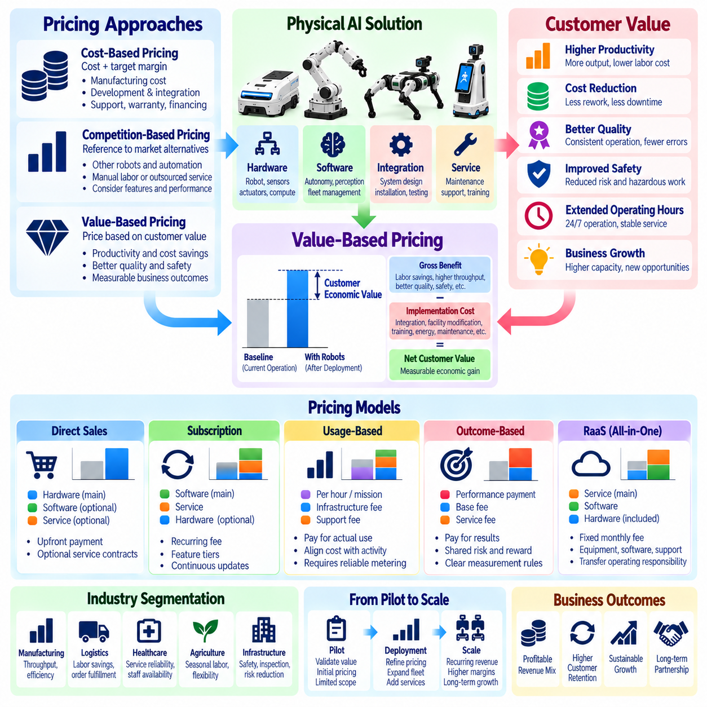{width="7.268055555555556in" height="7.268055555555556in"}

Pricing is a central strategic decision in Physical AI business models because it determines how technological capability is converted into commercial revenue and customer value. Unlike conventional equipment pricing, Physical AI pricing must account for hardware, intelligent software, integration, maintenance, and operational outcomes. An effective pricing strategy balances customer affordability, measurable economic benefits, competitive positioning, and sustainable supplier profitability.

Cost-based pricing establishes selling prices by adding a target margin to the estimated cost of delivering a robotic solution. Relevant costs include equipment manufacturing, software development allocation, deployment engineering, technical support, warranty provisions, and financing expenses. This approach provides a financial baseline but may overlook differences in customer value. A solution with identical delivery costs can produce substantially different economic benefits across applications.

Competition-based pricing uses alternative technologies and market offerings as reference points. Customers may compare autonomous robots with conventional automation, manual labor, outsourced services, or competing robotic platforms. These comparisons establish practical expectations regarding acquisition costs and recurring fees. However, direct price comparisons can be misleading when solutions differ in reliability, flexibility, deployment complexity, and operational performance.

Value-based pricing determines commercial charges according to the economic benefits a solution creates for customers rather than relying primarily on supplier costs. Physical AI can generate value through labor productivity, higher throughput, reduced errors, improved safety, and extended operating hours. Providers must translate these improvements into credible financial outcomes. Pricing becomes more defensible when customers can connect payments to measurable business results.

Customer value assessment begins by establishing a reliable operational baseline. Providers should document existing labor requirements, task volumes, cycle times, equipment utilization, error rates, and operating expenses. Expected robotic performance can then be compared against this baseline under realistic conditions. Without accurate reference data, projected savings may exaggerate the benefits of automation and weaken confidence in proposed pricing.

The economic value of Physical AI includes both direct savings and additional business benefits. Direct savings may arise from reduced repetitive labor, lower rework expenses, or decreased equipment downtime. Additional value may include increased production capacity, improved service consistency, and reduced exposure to hazardous tasks. These benefits should be evaluated carefully because not every operational improvement produces an immediate or independently measurable financial return.

Value-based pricing requires distinguishing gross operational benefits from net customer value. Implementation expenses, facility modifications, training, supervision, energy consumption, and continuing maintenance reduce the savings available to customers. Providers should calculate the customer\'s expected economic gain after these costs. A commercially sustainable price allows both the supplier and customer to capture an appropriate share of the value created.

Pricing structures differ according to the commercial delivery model. Direct robot sales typically combine an equipment purchase price with optional software and service contracts. Subscription models charge recurring fees for software capabilities or operational access. Robot-as-a-Service agreements may bundle equipment, maintenance, and support into periodic payments. Each structure distributes ownership, financing, utilization, and performance risks differently.

Usage-based pricing links customer payments to measurable consumption, such as robot operating hours, completed missions, transported units, or processed orders. This approach can reduce upfront commitments and align expenses with activity levels. However, providers must define measurement methods and distinguish productive usage from idle operation. Pricing should also account for fixed infrastructure and support costs that remain even when utilization declines.

Outcome-based pricing connects compensation to agreed operational results, including throughput improvements, reduced downtime, or successful task completion. Such contracts can strengthen alignment between provider incentives and customer objectives. Nevertheless, outcomes often depend on customer workflows, infrastructure, and demand conditions. Contracts should establish controllable performance variables, measurement boundaries, and procedures for addressing external disruptions.

Tiered pricing enables providers to serve customers with different operational requirements and willingness to pay. Basic packages may include essential autonomy, standard support, and limited analytics. Higher tiers can offer advanced fleet optimization, predictive maintenance, expanded integrations, and faster service response. Differentiation should reflect genuine value rather than artificially restricting functions necessary for safe and reliable operation.

Pricing segmentation recognizes that different industries assign different economic values to the same robotic capability. Warehouse operators may prioritize throughput and labor efficiency, while hospitals emphasize service reliability and staff availability. Industrial inspection customers may value reduced exposure to hazardous environments. Providers should adapt commercial packages to these priorities while maintaining transparent and consistent pricing principles.

Pilot pricing presents a particular challenge because early deployments involve uncertainty and substantial engineering effort. Free or heavily discounted pilots may encourage experimentation but can create unrealistic expectations for production pricing. Paid pilots can establish customer commitment and recover part of the validation cost. Agreements should specify evaluation objectives, deployment duration, acceptance criteria, and commercial conditions for subsequent expansion.

Discounting must be managed carefully as customers transition from pilot deployments to larger fleets. Volume discounts may reflect genuine economies of scale in manufacturing, installation, software administration, and technical support. However, larger fleets can also increase integration complexity and service obligations. Discounts should therefore depend on demonstrable cost efficiencies and long-term contract value rather than equipment quantity alone.

Pricing decisions must consider total cost of ownership and customer investment constraints. Customers evaluate acquisition expenses, recurring payments, maintenance, energy, staffing, and expected asset life when comparing alternatives. A lower purchase price may not represent better value if operational expenses remain high. Providers can improve commercial clarity by presenting lifecycle cost estimates alongside measurable productivity and reliability assumptions.

Willingness to pay depends on the customer\'s alternatives, financial priorities, perceived risk, and confidence in promised performance. Procurement teams may emphasize budget limits, while operations managers prioritize productivity and continuity. Financial executives often evaluate payback periods, cash flow, and investment returns. Successful pricing proposals connect these different perspectives through a consistent and evidence-based economic justification.

Pricing governance becomes increasingly important as Physical AI companies expand across products, customers, and regions. Standard price structures, approval procedures, discount policies, and contract templates help maintain commercial discipline. Management should monitor realized selling prices, gross margins, renewal rates, and customer profitability. Exceptions should be justified by measurable strategic or economic benefits rather than short-term sales pressure.

Continuous performance measurement supports pricing refinement after deployment. Actual task completion rates, operating hours, intervention costs, maintenance expenses, and customer productivity improvements reveal whether initial assumptions were accurate. Providers can use these observations to adjust future quotations and service packages. Existing contracts should be modified only according to agreed terms, preserving transparency and customer trust.

Pricing strategy should evolve as autonomy improves and deployment costs decline. Standardized hardware, reusable software modules, and remote support can reduce delivery expenses, while improved intelligence may increase customer value. Providers must decide how to distribute these gains between competitive price reductions and improved margins. Long-term advantage comes from combining measurable customer benefits with efficient and repeatable service delivery.

Ultimately, value-based pricing transforms Physical AI commercialization from selling robotic equipment into exchanging measurable operational improvements for sustainable revenue. Effective pricing integrates cost discipline, customer economics, performance evidence, contractual risk allocation, and competitive positioning. Companies that demonstrate credible value and price their offerings transparently can accelerate adoption while building profitable, scalable, and durable customer relationships.

가격 책정(Pricing)은 피지컬 인공지능 사업 모델(Physical AI Business Models)에서 핵심적인 전략적 의사결정(Strategic Decision)이다. 이는 기술적 역량(Technological Capability)이 상업적 매출(Commercial Revenue)과 고객 가치(Customer Value)로 전환되는 방식을 결정하기 때문이다. 기존의 장비 가격 책정(Conventional Equipment Pricing)과 달리 피지컬 인공지능 가격 책정(Physical AI Pricing)은 하드웨어(Hardware), 지능형 소프트웨어(Intelligent Software), 시스템 통합(Integration), 유지보수(Maintenance), 운영 성과(Operational Outcomes)를 고려해야 한다. 효과적인 가격 전략(Effective Pricing Strategy)은 고객의 구매 부담 수준(Customer Affordability), 측정 가능한 경제적 편익(Measurable Economic Benefits), 경쟁적 포지셔닝(Competitive Positioning), 지속 가능한 공급업체 수익성(Sustainable Supplier Profitability) 사이의 균형을 유지한다.

원가 기반 가격 책정(Cost-Based Pricing)은 로봇 솔루션(Robotic Solution)을 제공하는 데 필요한 예상 원가(Estimated Cost)에 목표 이익률(Target Margin)을 추가하여 판매 가격(Selling Prices)을 결정한다. 관련 비용(Relevant Costs)에는 장비 제조(Equipment Manufacturing), 소프트웨어 개발비 배분(Software Development Allocation), 배포 엔지니어링(Deployment Engineering), 기술 지원(Technical Support), 보증 충당금(Warranty Provisions), 금융 비용(Financing Expenses)이 포함된다. 이러한 접근법은 재무적 기준선(Financial Baseline)을 제공하지만 고객 가치(Customer Value)의 차이를 간과할 수 있다. 동일한 공급 원가(Delivery Costs)를 가진 솔루션이라도 응용 분야(Applications)에 따라 상당히 다른 경제적 편익(Economic Benefits)을 창출할 수 있다.

경쟁 기반 가격 책정(Competition-Based Pricing)은 대체 기술(Alternative Technologies)과 시장에 제공되는 제품 및 서비스(Market Offerings)를 기준으로 활용한다. 고객은 자율로봇(Autonomous Robots)을 기존 자동화(Conventional Automation), 수작업 인력(Manual Labor), 외주 서비스(Outsourced Services), 경쟁 로봇 플랫폼(Competing Robotic Platforms)과 비교할 수 있다. 이러한 비교는 도입 비용(Acquisition Costs)과 반복 요금(Recurring Fees)에 대한 현실적인 기대 수준(Practical Expectations)을 형성한다. 그러나 솔루션마다 신뢰성(Reliability), 유연성(Flexibility), 배포 복잡성(Deployment Complexity), 운영 성능(Operational Performance)이 다르므로 단순한 가격 비교(Direct Price Comparisons)는 잘못된 판단을 초래할 수 있다.

가치 기반 가격 책정(Value-Based Pricing)은 주로 공급업체 원가(Supplier Costs)에 의존하는 대신 솔루션이 고객에게 창출하는 경제적 편익(Economic Benefits)을 기준으로 상업적 요금(Commercial Charges)을 결정한다. 피지컬 인공지능(Physical AI)은 노동 생산성(Labor Productivity), 처리량 증가(Higher Throughput), 오류 감소(Reduced Errors), 안전성 개선(Improved Safety), 운영시간 확대(Extended Operating Hours)를 통해 가치를 창출할 수 있다. 공급업체는 이러한 개선 효과를 신뢰할 수 있는 재무적 성과(Credible Financial Outcomes)로 전환해야 한다. 고객이 지불 금액(Payments)을 측정 가능한 사업 성과(Measurable Business Results)와 연결할 수 있을 때 가격 책정의 타당성(Pricing Defensibility)은 더욱 높아진다.

고객 가치 평가(Customer Value Assessment)는 신뢰할 수 있는 운영 기준선(Reliable Operational Baseline)을 수립하는 것에서 시작된다. 공급업체는 기존 인력 요구량(Existing Labor Requirements), 작업량(Task Volumes), 사이클 타임(Cycle Times), 장비 활용률(Equipment Utilization), 오류율(Error Rates), 운영비용(Operating Expenses)을 문서화해야 한다. 이후 현실적인 조건(Realistic Conditions)에서 예상 로봇 성능(Expected Robotic Performance)을 이러한 기준선과 비교할 수 있다. 정확한 기준 데이터(Accurate Reference Data)가 없다면 예상 절감액(Projected Savings)이 자동화 편익(Automation Benefits)을 과장하고 제안 가격(Proposed Pricing)에 대한 신뢰를 약화시킬 수 있다.

피지컬 인공지능(Physical AI)의 경제적 가치(Economic Value)에는 직접적인 비용 절감(Direct Savings)과 추가적인 사업 편익(Additional Business Benefits)이 모두 포함된다. 직접 절감(Direct Savings)은 반복 작업 인력 감소(Reduced Repetitive Labor), 재작업 비용 감소(Lower Rework Expenses), 장비 가동 중단시간 감소(Decreased Equipment Downtime)에서 발생할 수 있다. 추가적인 가치(Additional Value)에는 생산능력 증가(Increased Production Capacity), 서비스 일관성 개선(Improved Service Consistency), 위험 작업 노출 감소(Reduced Exposure to Hazardous Tasks)가 포함될 수 있다. 모든 운영 개선(Operational Improvement)이 즉각적이거나 독립적으로 측정 가능한 재무적 수익(Financial Return)을 창출하는 것은 아니므로 이러한 편익은 신중하게 평가해야 한다.

가치 기반 가격 책정(Value-Based Pricing)에서는 총운영 편익(Gross Operational Benefits)과 고객 순가치(Net Customer Value)를 구분해야 한다. 구현 비용(Implementation Expenses), 시설 변경(Facility Modifications), 교육(Training), 감독(Supervision), 에너지 소비(Energy Consumption), 지속적인 유지보수(Continuing Maintenance)는 고객이 실제로 확보할 수 있는 절감액(Savings Available to Customers)을 감소시킨다. 공급업체는 이러한 비용을 반영한 고객의 예상 경제적 이익(Expected Economic Gain)을 계산해야 한다. 상업적으로 지속 가능한 가격(Commercially Sustainable Price)은 공급업체와 고객 모두가 창출된 가치(Value Created)의 적절한 몫(Appropriate Share)을 확보할 수 있도록 한다.

가격 구조(Pricing Structures)는 상업적 제공 모델(Commercial Delivery Model)에 따라 달라진다. 로봇 직접 판매(Direct Robot Sales)는 일반적으로 장비 구매 가격(Equipment Purchase Price)과 선택적인 소프트웨어 및 서비스 계약(Optional Software and Service Contracts)을 결합한다. 구독 모델(Subscription Models)은 소프트웨어 기능(Software Capabilities)이나 운영 접근 권한(Operational Access)에 대해 반복 요금(Recurring Fees)을 부과한다. 서비스형 로봇(Robot-as-a-Service, RaaS) 계약은 장비(Equipment), 유지보수(Maintenance), 지원(Support)을 정기 결제(Periodic Payments)에 포함할 수 있다. 각 구조는 소유권(Ownership), 금융 부담(Financing), 활용률(Utilization), 성능 위험(Performance Risks)을 서로 다르게 배분한다.

사용량 기반 가격 책정(Usage-Based Pricing)은 로봇 운영시간(Robot Operating Hours), 완료된 임무(Completed Missions), 운송된 물품 수량(Transported Units), 처리된 주문(Processed Orders)과 같은 측정 가능한 사용량(Measurable Consumption)에 고객 지불 금액(Customer Payments)을 연계한다. 이러한 접근법은 초기 계약 부담(Upfront Commitments)을 줄이고 비용(Expenses)을 활동 수준(Activity Levels)에 맞출 수 있다. 그러나 공급업체는 측정 방법(Measurement Methods)을 정의하고 생산적 사용(Productive Usage)과 유휴 운영(Idle Operation)을 구분해야 한다. 또한 활용률(Utilization)이 감소하더라도 지속적으로 발생하는 고정 인프라 비용(Fixed Infrastructure Costs)과 지원 비용(Support Costs)을 가격에 반영해야 한다.

성과 기반 가격 책정(Outcome-Based Pricing)은 처리량 개선(Throughput Improvements), 가동 중단시간 감소(Reduced Downtime), 성공적인 작업 완료(Successful Task Completion) 등 합의된 운영 결과(Agreed Operational Results)에 보상(Compensation)을 연결한다. 이러한 계약은 공급업체의 인센티브(Provider Incentives)와 고객 목표(Customer Objectives) 사이의 일치성을 강화할 수 있다. 그러나 운영 성과(Outcomes)는 고객 작업 흐름(Customer Workflows), 인프라(Infrastructure), 수요 조건(Demand Conditions)에 의존하는 경우가 많다. 따라서 계약은 통제 가능한 성능 변수(Controllable Performance Variables), 측정 범위(Measurement Boundaries), 외부 운영 중단(External Disruptions)에 대응하는 절차를 설정해야 한다.

등급별 가격 책정(Tiered Pricing)은 서로 다른 운영 요구사항(Operational Requirements)과 지불 의사(Willingness to Pay)를 가진 고객에게 서비스를 제공할 수 있도록 한다. 기본 패키지(Basic Packages)에는 필수 자율운영 기능(Essential Autonomy), 표준 지원(Standard Support), 제한적인 분석 기능(Limited Analytics)이 포함될 수 있다. 상위 등급(Higher Tiers)은 고급 로봇군 최적화(Advanced Fleet Optimization), 예지보전(Predictive Maintenance), 확장된 시스템 통합(Expanded Integrations), 신속한 서비스 대응(Faster Service Response)을 제공할 수 있다. 차별화(Differentiation)는 안전하고 신뢰할 수 있는 운영(Safe and Reliable Operation)에 필요한 기능을 인위적으로 제한하기보다 실질적인 가치(Genuine Value)를 반영해야 한다.

가격 세분화(Pricing Segmentation)는 산업마다 동일한 로봇 기능(Robotic Capability)에 부여하는 경제적 가치(Economic Value)가 다르다는 점을 반영한다. 창고 운영업체(Warehouse Operators)는 처리량(Throughput)과 노동 효율성(Labor Efficiency)을 우선시할 수 있으며, 병원(Hospitals)은 서비스 신뢰성(Service Reliability)과 의료진 가용성(Staff Availability)을 중요하게 평가할 수 있다. 산업 검사 고객(Industrial Inspection Customers)은 위험 환경에 대한 노출 감소(Reduced Exposure to Hazardous Environments)를 높이 평가할 수 있다. 공급업체는 투명하고 일관된 가격 책정 원칙(Transparent and Consistent Pricing Principles)을 유지하면서 이러한 우선순위(Priorities)에 맞춰 상업적 패키지(Commercial Packages)를 조정해야 한다.

파일럿 가격 책정(Pilot Pricing)은 초기 배포(Early Deployments)에 불확실성(Uncertainty)과 상당한 엔지니어링 작업(Substantial Engineering Effort)이 수반되기 때문에 특별한 과제를 제기한다. 무료 또는 대폭 할인된 파일럿(Free or Heavily Discounted Pilots)은 실험(Experimentation)을 촉진할 수 있지만 양산 및 본격 운영 가격(Production Pricing)에 대한 비현실적인 기대(Unrealistic Expectations)를 형성할 수 있다. 유료 파일럿(Paid Pilots)은 고객의 참여 의지(Customer Commitment)를 확인하고 검증 비용(Validation Cost)의 일부를 회수할 수 있다. 계약에는 평가 목표(Evaluation Objectives), 배포 기간(Deployment Duration), 인수 기준(Acceptance Criteria), 후속 확장(Subsequent Expansion)에 적용할 상업적 조건(Commercial Conditions)을 명시해야 한다.

할인 정책(Discounting)은 고객이 파일럿 배포(Pilot Deployments)에서 대규모 로봇군(Larger Fleets)으로 전환할 때 신중하게 관리해야 한다. 물량 할인(Volume Discounts)은 제조(Manufacturing), 설치(Installation), 소프트웨어 관리(Software Administration), 기술 지원(Technical Support)에서 발생하는 실제 규모의 경제(Genuine Economies of Scale)를 반영할 수 있다. 그러나 대규모 로봇군은 시스템 통합 복잡성(Integration Complexity)과 서비스 의무(Service Obligations)를 증가시킬 수도 있다. 따라서 할인은 단순한 장비 수량(Equipment Quantity)이 아니라 입증 가능한 비용 효율성(Demonstrable Cost Efficiencies)과 장기 계약 가치(Long-Term Contract Value)를 기준으로 결정해야 한다.

가격 책정 의사결정(Pricing Decisions)은 총소유비용(Total Cost of Ownership, TCO)과 고객의 투자 제약(Customer Investment Constraints)을 고려해야 한다. 고객은 대안을 비교할 때 도입 비용(Acquisition Expenses), 반복 결제(Recurring Payments), 유지보수(Maintenance), 에너지(Energy), 인력(Staffing), 예상 자산 수명(Expected Asset Life)을 평가한다. 운영비용(Operational Expenses)이 높게 유지된다면 낮은 구매 가격(Lower Purchase Price)이 반드시 더 높은 가치(Better Value)를 의미하지는 않는다. 공급업체는 측정 가능한 생산성(Measurable Productivity)과 신뢰성 가정(Reliability Assumptions)을 함께 제시하는 수명주기 비용 추정(Lifecycle Cost Estimates)을 통해 상업적 명확성(Commercial Clarity)을 높일 수 있다.

지불 의사(Willingness to Pay)는 고객의 대안(Alternatives), 재무적 우선순위(Financial Priorities), 인지된 위험(Perceived Risk), 약속된 성능(Promised Performance)에 대한 신뢰에 따라 달라진다. 구매 담당 조직(Procurement Teams)은 예산 한도(Budget Limits)를 강조할 수 있으며, 운영 관리자(Operations Managers)는 생산성(Productivity)과 운영 연속성(Continuity)을 우선시한다. 재무 담당 임원(Financial Executives)은 투자 회수기간(Payback Periods), 현금흐름(Cash Flow), 투자수익률(Investment Returns)을 평가하는 경우가 많다. 성공적인 가격 제안(Successful Pricing Proposals)은 일관되고 근거에 기반한 경제적 타당성(Consistent and Evidence-Based Economic Justification)을 통해 이러한 서로 다른 관점을 연결한다.

가격 거버넌스(Pricing Governance)는 피지컬 인공지능 기업(Physical AI Companies)이 제품(Products), 고객(Customers), 지역(Regions)을 확대할수록 더욱 중요해진다. 표준 가격 구조(Standard Price Structures), 승인 절차(Approval Procedures), 할인 정책(Discount Policies), 계약서 템플릿(Contract Templates)은 상업적 규율(Commercial Discipline)을 유지하는 데 도움이 된다. 경영진(Management)은 실제 판매 가격(Realized Selling Prices), 매출총이익률(Gross Margins), 계약 갱신율(Renewal Rates), 고객별 수익성(Customer Profitability)을 모니터링해야 한다. 예외적인 가격 조건(Exceptions)은 단기 판매 압력(Short-Term Sales Pressure)이 아니라 측정 가능한 전략적 또는 경제적 편익(Measurable Strategic or Economic Benefits)에 의해 정당화되어야 한다.

지속적인 성능 측정(Continuous Performance Measurement)은 배포 이후 가격 책정의 개선(Pricing Refinement)을 지원한다. 실제 작업 완료율(Actual Task Completion Rates), 운영시간(Operating Hours), 개입 비용(Intervention Costs), 유지보수 비용(Maintenance Expenses), 고객 생산성 개선(Customer Productivity Improvements)은 초기 가정(Initial Assumptions)의 정확성을 보여준다. 공급업체는 이러한 관측 결과(Observations)를 활용하여 향후 견적(Future Quotations)과 서비스 패키지(Service Packages)를 조정할 수 있다. 기존 계약(Existing Contracts)은 합의된 조건(Agreed Terms)에 따라서만 변경해야 하며, 이를 통해 투명성(Transparency)과 고객 신뢰(Customer Trust)를 유지해야 한다.

가격 전략(Pricing Strategy)은 자율운영 기술(Autonomy)이 개선되고 배포 비용(Deployment Costs)이 감소함에 따라 발전해야 한다. 표준화된 하드웨어(Standardized Hardware), 재사용 가능한 소프트웨어 모듈(Reusable Software Modules), 원격 지원(Remote Support)은 서비스 제공 비용(Delivery Expenses)을 줄일 수 있으며, 향상된 지능(Improved Intelligence)은 고객 가치(Customer Value)를 높일 수 있다. 공급업체는 이러한 이익(Gains)을 경쟁력 있는 가격 인하(Competitive Price Reductions)와 이익률 개선(Improved Margins) 사이에 어떻게 배분할지 결정해야 한다. 장기적인 경쟁우위(Long-Term Advantage)는 측정 가능한 고객 편익(Measurable Customer Benefits)과 효율적이고 반복 가능한 서비스 제공(Efficient and Repeatable Service Delivery)을 결합하는 데서 발생한다.

궁극적으로 가치 기반 가격 책정(Value-Based Pricing)은 피지컬 인공지능의 상용화(Physical AI Commercialization)를 로봇 장비 판매(Selling Robotic Equipment)에서 측정 가능한 운영 개선(Measurable Operational Improvements)을 지속 가능한 매출(Sustainable Revenue)과 교환하는 사업으로 전환한다. 효과적인 가격 책정(Effective Pricing)은 원가 관리(Cost Discipline), 고객 경제성(Customer Economics), 성능 근거(Performance Evidence), 계약상 위험 배분(Contractual Risk Allocation), 경쟁적 포지셔닝(Competitive Positioning)을 통합한다. 신뢰할 수 있는 가치(Credible Value)를 입증하고 제품 및 서비스(Offerings)의 가격을 투명하게 책정하는 기업은 수익성(Profitability), 확장성(Scalability), 지속성(Durability)을 갖춘 고객 관계(Customer Relationships)를 구축하면서 시장 도입(Adoption)을 가속화할 수 있다.

##  

## 08.13. CAPEX vs OPEX Customer Models

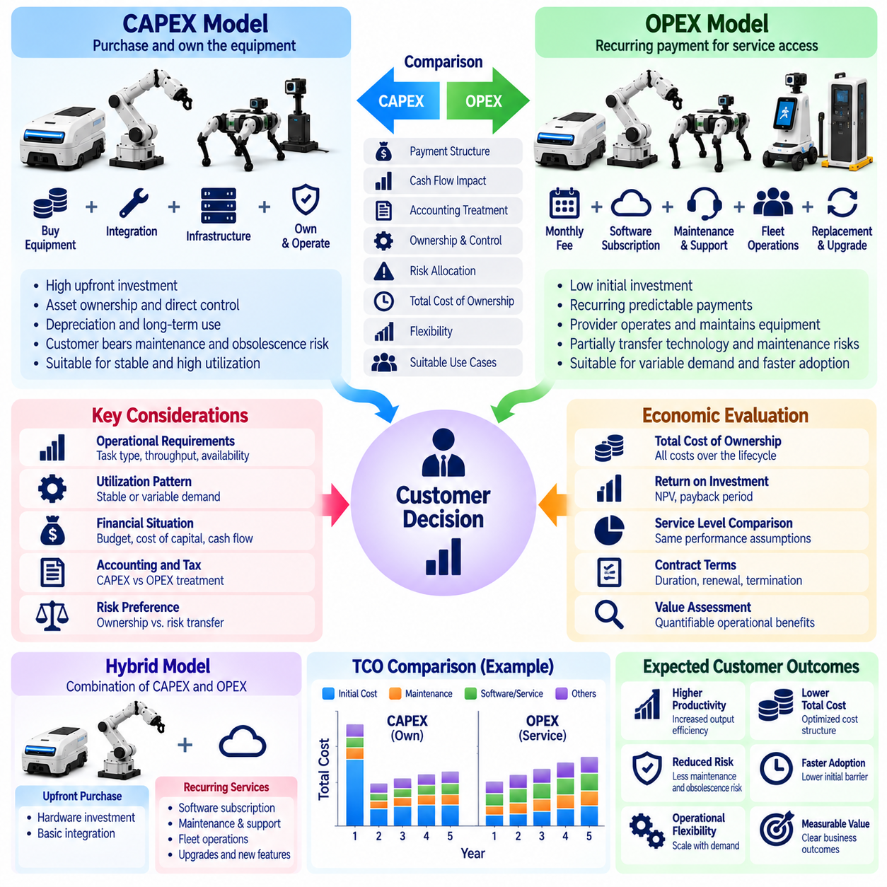{width="7.268055555555556in" height="7.268055555555556in"}

Capital expenditure and operating expenditure models represent two distinct approaches to financing and consuming Physical AI solutions. Capital expenditure, or CAPEX, generally involves purchasing robotic equipment and recognizing qualifying investments as assets. Operating expenditure, or OPEX, emphasizes recurring payments for services, subscriptions, or equipment access. The choice affects customer cash flow, financial reporting, risk allocation, and adoption decisions.

Under a CAPEX model, customers typically purchase robots, supporting infrastructure, and integration services through an initial investment. Equipment ownership provides direct control over asset deployment, maintenance policies, and long-term utilization. The customer assumes responsibility for financing and much of the asset-related risk. This structure can be attractive when operational requirements are stable and equipment will remain productive over an extended period.

CAPEX investments often require formal budgeting, capital approval, and financial justification before deployment. Customers may evaluate expected productivity improvements, equipment life, depreciation, and investment returns. Large initial payments can delay adoption even when automation promises substantial long-term savings. Physical AI providers must therefore support investment proposals with credible performance assumptions and clearly documented lifecycle costs.

OPEX-oriented models reduce initial purchasing requirements by converting access to robotic capabilities into recurring commercial payments. Robot-as-a-Service, managed fleet contracts, and software subscriptions can support this approach. Customers may pay monthly fees, usage charges, or task-based rates instead of purchasing complete systems. However, contractual payment structures do not automatically determine accounting classification under applicable standards.

The distinction between commercial OPEX pricing and accounting treatment is particularly important. A subscription or service contract may contain an embedded lease that requires recognition of a right-of-use asset and lease liability. Accounting outcomes depend on contractual control, identified assets, substitution rights, and applicable reporting standards. Providers should avoid promising off-balance-sheet treatment without qualified accounting assessment.

Customer cash flow differs significantly between upfront purchases and recurring payment arrangements. CAPEX generally concentrates cash requirements near deployment, while service-based models distribute payments across the contract term. Recurring charges may improve short-term liquidity but increase total payments over longer periods. Financial comparisons should consider financing costs, payment timing, residual asset value, and the customer\'s cost of capital.

Ownership and operational responsibility are central differences between these models. Under direct purchase arrangements, customers may own equipment and manage maintenance through internal teams or external contracts. Under managed service models, providers may retain ownership and assume defined operational obligations. Actual responsibility depends on contract terms, including insurance, repairs, software support, and equipment replacement.

Risk allocation can influence customer preference as strongly as payment structure. CAPEX customers face exposure to equipment obsolescence, unexpected repair expenses, and lower-than-expected utilization. Service agreements may transfer selected technology and maintenance risks to providers. However, minimum commitments, early termination charges, and performance exclusions can return substantial risks to customers. Contract transparency is therefore essential.

Physical AI providers must also evaluate the financial consequences of offering OPEX-oriented contracts. When suppliers retain equipment ownership, they may need to finance manufacturing, installation, and replacement assets before receiving recurring revenue. This creates working capital and funding requirements that differ from equipment sales. Sustainable service models depend on adequate financing, predictable collections, and disciplined asset management.

The economics of CAPEX and OPEX should be compared over a consistent evaluation horizon. Total cost of ownership analysis includes acquisition or subscription payments, installation, maintenance, software, energy, supervision, and end-of-life expenses. Net present value methods can account for differences in payment timing. Comparisons must use equivalent service levels, expected utilization, and clearly stated financial assumptions.

Customer utilization patterns strongly affect the relative attractiveness of each model. High and predictable robot usage may favor ownership when equipment costs can be distributed across substantial productive output. Variable or seasonal demand may favor flexible service arrangements. Nevertheless, minimum billing commitments can reduce this flexibility. Pricing should reflect actual utilization uncertainty and the provider\'s unavoidable fixed costs.

Contract duration also shapes financial and operational outcomes. Long-term agreements can lower periodic payments by spreading equipment recovery across more years, but they reduce customer flexibility. Shorter contracts may carry higher fees because providers face redeployment and residual value risks. Renewal options, purchase rights, and termination provisions should be evaluated alongside headline prices to understand the complete economic commitment.

Hybrid commercial models combine upfront investment with recurring services. Customers may purchase robotic hardware while subscribing to autonomy software, fleet orchestration, technical support, and predictive maintenance. Alternatively, providers may charge an initial deployment fee followed by ongoing operational payments. Hybrid structures can balance customer ownership preferences with the supplier\'s need for recurring revenue and continued service engagement.

Financing arrangements provide another alternative to a simple CAPEX-versus-OPEX decision. Equipment loans, finance leases, operating leases, and third-party financing can alter payment schedules and risk distribution. Their accounting and tax consequences depend on jurisdiction and contract substance. Physical AI suppliers may partner with financing institutions to support adoption without retaining all equipment-related funding obligations.

Tax considerations can influence customer decisions but should not determine the model independently. Depreciation allowances, deductible service expenses, financing interest, and investment incentives may affect after-tax economics. Eligibility and timing vary across jurisdictions and accounting circumstances. Providers should present tax-sensitive scenarios cautiously and encourage customers to obtain qualified advice rather than assuming universal financial advantages.

Procurement processes differ between capital purchases and recurring service commitments. CAPEX projects may involve engineering validation, investment committees, and multiyear budget planning. OPEX contracts may be reviewed through operating budgets, procurement departments, and service management functions. Approval thresholds and governance policies vary by organization. Commercial proposals should align with the customer\'s actual decision process.

Performance guarantees can strengthen either model when operational uncertainty limits adoption. Purchase contracts may include acceptance testing, warranty coverage, and optional maintenance commitments. Service agreements may establish uptime, throughput, and response-time obligations. Guarantees must define measurement methods, customer dependencies, remedies, and exclusions. Unrealistic commitments can undermine supplier profitability regardless of payment structure.

Providers should monitor different financial indicators across CAPEX and OPEX portfolios. Equipment sales emphasize order intake, delivery margin, cash collection, and warranty exposure. Recurring service contracts require attention to annual recurring revenue, contract margin, customer retention, asset utilization, and capital recovery. Comparing these indicators helps management evaluate growth quality rather than focusing exclusively on reported revenue.

As Physical AI markets mature, customer preferences may evolve from experimental equipment purchases toward standardized operational services. Greater deployment reliability, improved remote support, and reusable software can make recurring models more economical. Nevertheless, customers with specialized requirements may continue to prefer ownership. Providers benefit from offering flexible commercial structures supported by consistent operational and financial measurement.

Ultimately, CAPEX and OPEX customer models represent alternative ways to distribute investment, ownership, cash flow, and operational risk. Neither approach is universally superior. The appropriate structure depends on utilization, financing conditions, customer capabilities, accounting requirements, and expected lifecycle value. Physical AI companies that communicate these tradeoffs clearly can reduce adoption barriers while protecting sustainable long-term economics.

자본적 지출(Capital Expenditure, CAPEX)과 운영비용(Operating Expenditure, OPEX) 모델은 피지컬 인공지능 솔루션(Physical AI Solutions)의 자금 조달(Financing)과 이용(Consumption)에 대한 두 가지 서로 다른 접근방식을 나타낸다. 자본적 지출(CAPEX)은 일반적으로 로봇 장비(Robotic Equipment)를 구매하고 자산 인식 요건을 충족하는 투자(Qualifying Investments)를 자산(Assets)으로 인식하는 방식이다. 운영비용(OPEX)은 서비스(Services), 구독(Subscriptions), 장비 이용(Equipment Access)에 대한 반복적인 지불(Recurring Payments)을 강조한다. 이러한 선택은 고객의 현금흐름(Cash Flow), 재무보고(Financial Reporting), 위험 배분(Risk Allocation), 도입 의사결정(Adoption Decisions)에 영향을 미친다.

자본적 지출 모델(CAPEX Model)에서 고객은 일반적으로 초기 투자(Initial Investment)를 통해 로봇(Robots), 지원 인프라(Supporting Infrastructure), 시스템 통합 서비스(Integration Services)를 구매한다. 장비 소유권(Equipment Ownership)은 자산 배포(Asset Deployment), 유지보수 정책(Maintenance Policies), 장기 활용(Long-Term Utilization)에 대한 직접적인 통제권(Direct Control)을 제공한다. 고객은 자금 조달(Financing)과 자산 관련 위험(Asset-Related Risk)의 상당 부분을 부담한다. 이러한 구조는 운영 요구사항(Operational Requirements)이 안정적이고 장비가 장기간 생산적으로 활용될 것으로 예상되는 경우 매력적일 수 있다.

자본적 지출 투자(CAPEX Investments)는 배포 이전에 공식적인 예산 편성(Formal Budgeting), 자본 투자 승인(Capital Approval), 재무적 타당성 검토(Financial Justification)를 요구하는 경우가 많다. 고객은 예상 생산성 개선(Expected Productivity Improvements), 장비 수명(Equipment Life), 감가상각(Depreciation), 투자수익(Investment Returns)을 평가할 수 있다. 대규모 초기 지출(Large Initial Payments)은 자동화(Automation)가 상당한 장기 비용 절감(Long-Term Savings)을 제공하더라도 도입을 지연시킬 수 있다. 따라서 피지컬 인공지능 공급업체(Physical AI Providers)는 신뢰할 수 있는 성능 가정(Credible Performance Assumptions)과 명확하게 문서화된 수명주기 비용(Lifecycle Costs)을 통해 투자 제안(Investment Proposals)을 뒷받침해야 한다.

운영비용 중심 모델(OPEX-Oriented Models)은 로봇 기능(Robotic Capabilities)에 대한 접근을 반복적인 상업적 지불(Recurring Commercial Payments)로 전환함으로써 초기 구매 요구사항(Initial Purchasing Requirements)을 줄인다. 서비스형 로봇(Robot-as-a-Service, RaaS), 관리형 로봇군 계약(Managed Fleet Contracts), 소프트웨어 구독(Software Subscriptions)이 이러한 접근방식을 지원할 수 있다. 고객은 전체 시스템(Complete Systems)을 구매하는 대신 월정액 요금(Monthly Fees), 사용량 기반 요금(Usage Charges), 작업 기반 요금(Task-Based Rates)을 지불할 수 있다. 그러나 계약상 지불 구조(Contractual Payment Structures)가 적용 회계기준(Applicable Accounting Standards)에 따른 회계 분류(Accounting Classification)를 자동으로 결정하는 것은 아니다.

상업적 운영비용 가격 책정(Commercial OPEX Pricing)과 회계처리(Accounting Treatment)의 구분은 특히 중요하다. 구독 계약(Subscription Contract)이나 서비스 계약(Service Contract)에는 사용권 자산(Right-of-Use Asset)과 리스부채(Lease Liability)의 인식을 요구하는 내재된 리스(Embedded Lease)가 포함될 수 있다. 회계처리 결과(Accounting Outcomes)는 계약상 통제권(Contractual Control), 식별된 자산(Identified Assets), 대체권(Substitution Rights), 적용되는 재무보고 기준(Applicable Reporting Standards)에 따라 달라진다. 공급업체는 적격한 회계 검토(Qualified Accounting Assessment) 없이 재무상태표 외 처리(Off-Balance-Sheet Treatment)를 보장해서는 안 된다.

고객의 현금흐름(Customer Cash Flow)은 초기 구매(Upfront Purchases)와 반복 지불 방식(Recurring Payment Arrangements) 사이에서 상당한 차이를 보인다. 자본적 지출(CAPEX)은 일반적으로 배포 시점(Deployment)에 현금 소요(Cash Requirements)가 집중되는 반면, 서비스 기반 모델(Service-Based Models)은 계약기간(Contract Term)에 걸쳐 지불을 분산한다. 반복 요금(Recurring Charges)은 단기 유동성(Short-Term Liquidity)을 개선할 수 있지만 장기간에 걸친 총지불액(Total Payments)을 증가시킬 수 있다. 재무적 비교(Financial Comparisons)에서는 금융 비용(Financing Costs), 지불 시점(Payment Timing), 잔존 자산 가치(Residual Asset Value), 고객의 자본비용(Cost of Capital)을 고려해야 한다.

소유권(Ownership)과 운영 책임(Operational Responsibility)은 두 모델을 구분하는 핵심 요소이다. 직접 구매 계약(Direct Purchase Arrangements)에서는 고객이 장비를 소유하고 내부 조직(Internal Teams)이나 외부 계약(External Contracts)을 통해 유지보수(Maintenance)를 관리할 수 있다. 관리형 서비스 모델(Managed Service Models)에서는 공급업체가 소유권을 유지하고 정의된 운영 의무(Defined Operational Obligations)를 부담할 수 있다. 실제 책임(Actual Responsibility)은 보험(Insurance), 수리(Repairs), 소프트웨어 지원(Software Support), 장비 교체(Equipment Replacement)를 포함하는 계약 조건(Contract Terms)에 따라 결정된다.

위험 배분(Risk Allocation)은 지불 구조(Payment Structure)만큼이나 고객의 선호(Customer Preference)에 큰 영향을 미칠 수 있다. 자본적 지출 고객(CAPEX Customers)은 장비 노후화(Equipment Obsolescence), 예상하지 못한 수리 비용(Unexpected Repair Expenses), 예상보다 낮은 활용률(Lower-Than-Expected Utilization)에 따른 위험을 부담한다. 서비스 계약(Service Agreements)은 일부 기술 위험(Technology Risks)과 유지보수 위험(Maintenance Risks)을 공급업체로 이전할 수 있다. 그러나 최소 이용 약정(Minimum Commitments), 조기 해지 비용(Early Termination Charges), 성능 보장 제외사항(Performance Exclusions)은 상당한 위험을 다시 고객에게 부담시킬 수 있다. 따라서 계약의 투명성(Contract Transparency)이 필수적이다.

피지컬 인공지능 공급업체(Physical AI Providers)는 운영비용 중심 계약(OPEX-Oriented Contracts)을 제공할 때 발생하는 재무적 영향(Financial Consequences)도 평가해야 한다. 공급업체가 장비 소유권(Equipment Ownership)을 유지하는 경우 반복 매출(Recurring Revenue)을 수령하기 전에 제조(Manufacturing), 설치(Installation), 교체 자산(Replacement Assets)에 필요한 자금을 조달해야 할 수 있다. 이는 장비 판매(Equipment Sales)와 다른 운전자본 및 자금 조달 요구사항(Working Capital and Funding Requirements)을 발생시킨다. 지속 가능한 서비스 모델(Sustainable Service Models)은 충분한 자금 조달(Adequate Financing), 예측 가능한 대금 회수(Predictable Collections), 체계적인 자산 관리(Disciplined Asset Management)에 달려 있다.

자본적 지출(CAPEX)과 운영비용(OPEX)의 경제성(Economics)은 일관된 평가기간(Consistent Evaluation Horizon)을 기준으로 비교해야 한다. 총소유비용 분석(Total Cost of Ownership Analysis, TCO Analysis)에는 구매 또는 구독 비용(Acquisition or Subscription Payments), 설치(Installation), 유지보수(Maintenance), 소프트웨어(Software), 에너지(Energy), 감독(Supervision), 수명 종료 비용(End-of-Life Expenses)이 포함된다. 순현재가치 분석(Net Present Value Methods, NPV)은 지불 시점(Payment Timing)의 차이를 반영할 수 있다. 비교에는 동등한 서비스 수준(Equivalent Service Levels), 예상 활용률(Expected Utilization), 명확하게 제시된 재무적 가정(Clearly Stated Financial Assumptions)을 사용해야 한다.

고객의 활용 패턴(Customer Utilization Patterns)은 각 모델의 상대적인 매력도(Relative Attractiveness)에 큰 영향을 미친다. 로봇 사용량(Robot Usage)이 높고 예측 가능하다면 장비 비용(Equipment Costs)을 상당한 생산적 산출량(Productive Output)에 분산할 수 있으므로 소유 방식(Ownership)이 유리할 수 있다. 변동적이거나 계절적인 수요(Variable or Seasonal Demand)는 유연한 서비스 계약(Flexible Service Arrangements)에 유리할 수 있다. 그러나 최소 청구 약정(Minimum Billing Commitments)은 이러한 유연성을 감소시킬 수 있다. 가격 책정(Pricing)은 실제 활용률의 불확실성(Utilization Uncertainty)과 공급업체가 피할 수 없는 고정비(Unavoidable Fixed Costs)를 반영해야 한다.

계약기간(Contract Duration)도 재무적 및 운영적 성과(Financial and Operational Outcomes)를 결정하는 중요한 요소이다. 장기 계약(Long-Term Agreements)은 장비 투자비 회수(Equipment Recovery)를 더 오랜 기간에 분산함으로써 정기 지불액(Periodic Payments)을 낮출 수 있지만 고객의 유연성(Customer Flexibility)을 감소시킨다. 단기 계약(Shorter Contracts)은 공급업체가 재배치 위험(Redeployment Risks)과 잔존가치 위험(Residual Value Risks)을 부담하기 때문에 더 높은 요금을 요구할 수 있다. 전체 경제적 약정(Complete Economic Commitment)을 이해하려면 표면적인 가격(Headline Prices)과 함께 갱신 선택권(Renewal Options), 구매 권리(Purchase Rights), 계약 종료 조항(Termination Provisions)을 평가해야 한다.

혼합형 상업 모델(Hybrid Commercial Models)은 초기 투자(Upfront Investment)와 반복 서비스(Recurring Services)를 결합한다. 고객은 로봇 하드웨어(Robotic Hardware)를 구매하면서 자율운영 소프트웨어(Autonomy Software), 로봇군 오케스트레이션(Fleet Orchestration), 기술 지원(Technical Support), 예지보전(Predictive Maintenance)을 구독할 수 있다. 또는 공급업체가 초기 배포 비용(Initial Deployment Fee)을 청구한 이후 지속적인 운영 요금(Ongoing Operational Payments)을 부과할 수 있다. 혼합형 구조(Hybrid Structures)는 고객의 소유권 선호(Ownership Preferences)와 공급업체의 반복 매출(Recurring Revenue) 및 지속적인 서비스 관계(Continued Service Engagement)에 대한 요구 사이의 균형을 유지할 수 있다.

금융 조달 방식(Financing Arrangements)은 단순한 자본적 지출과 운영비용(CAPEX-versus-OPEX) 선택을 넘어서는 또 다른 대안을 제공한다. 장비 대출(Equipment Loans), 금융리스(Finance Leases), 운용리스(Operating Leases), 제3자 금융(Third-Party Financing)은 지불 일정(Payment Schedules)과 위험 배분(Risk Distribution)을 변화시킬 수 있다. 이러한 방식의 회계 및 세무상 결과(Accounting and Tax Consequences)는 관할권(Jurisdiction)과 계약의 실질(Contract Substance)에 따라 달라진다. 피지컬 인공지능 공급업체는 모든 장비 관련 자금 조달 의무(Equipment-Related Funding Obligations)를 직접 부담하지 않으면서 도입을 지원하기 위해 금융기관(Financing Institutions)과 협력할 수 있다.

세무 고려사항(Tax Considerations)은 고객의 의사결정(Customer Decisions)에 영향을 미칠 수 있지만 그것만으로 모델을 결정해서는 안 된다. 감가상각 공제(Depreciation Allowances), 손금산입 가능한 서비스 비용(Deductible Service Expenses), 금융 이자(Financing Interest), 투자 인센티브(Investment Incentives)는 세후 경제성(After-Tax Economics)에 영향을 줄 수 있다. 적용 자격(Eligibility)과 적용 시점(Timing)은 관할권(Jurisdictions)과 회계 상황(Accounting Circumstances)에 따라 달라진다. 공급업체는 보편적인 재무적 이점(Universal Financial Advantages)을 가정하기보다 세금에 민감한 시나리오(Tax-Sensitive Scenarios)를 신중하게 제시하고 고객이 적격한 전문가의 자문(Qualified Advice)을 받도록 권장해야 한다.

구매 및 조달 절차(Procurement Processes)는 자본 구매(Capital Purchases)와 반복 서비스 계약(Recurring Service Commitments) 사이에서 차이가 있다. 자본적 지출 프로젝트(CAPEX Projects)는 엔지니어링 검증(Engineering Validation), 투자심의위원회(Investment Committees), 다년간 예산 계획(Multiyear Budget Planning)을 포함할 수 있다. 운영비용 계약(OPEX Contracts)은 운영 예산(Operating Budgets), 구매 부서(Procurement Departments), 서비스 관리 조직(Service Management Functions)을 통해 검토될 수 있다. 승인 기준(Approval Thresholds)과 거버넌스 정책(Governance Policies)은 조직마다 다르다. 상업적 제안(Commercial Proposals)은 고객의 실제 의사결정 절차(Actual Decision Process)에 부합해야 한다.

성능 보장(Performance Guarantees)은 운영 불확실성(Operational Uncertainty)이 도입을 제한하는 경우 어느 모델에서든 계약의 매력도를 높일 수 있다. 구매 계약(Purchase Contracts)에는 인수시험(Acceptance Testing), 보증 범위(Warranty Coverage), 선택적 유지보수 약정(Optional Maintenance Commitments)이 포함될 수 있다. 서비스 계약(Service Agreements)은 가동시간(Uptime), 처리량(Throughput), 대응시간(Response-Time)에 관한 의무를 설정할 수 있다. 성능 보장(Guarantees)은 측정 방법(Measurement Methods), 고객 측 의존 조건(Customer Dependencies), 구제 조치(Remedies), 제외사항(Exclusions)을 정의해야 한다. 비현실적인 약속(Unrealistic Commitments)은 지불 구조와 관계없이 공급업체 수익성(Supplier Profitability)을 저해할 수 있다.

공급업체는 자본적 지출 및 운영비용 사업 포트폴리오(CAPEX and OPEX Portfolios)에서 서로 다른 재무 지표(Financial Indicators)를 모니터링해야 한다. 장비 판매(Equipment Sales)는 수주 실적(Order Intake), 납품 이익률(Delivery Margin), 대금 회수(Cash Collection), 보증 위험(Warranty Exposure)을 중시한다. 반복 서비스 계약(Recurring Service Contracts)은 연간 반복 매출(Annual Recurring Revenue, ARR), 계약 이익률(Contract Margin), 고객 유지율(Customer Retention), 자산 활용률(Asset Utilization), 투자자본 회수(Capital Recovery)에 주의를 기울여야 한다. 이러한 지표를 비교하면 경영진은 보고 매출(Reported Revenue)에만 집중하지 않고 성장의 질(Growth Quality)을 평가할 수 있다.

피지컬 인공지능 시장(Physical AI Markets)이 성숙함에 따라 고객의 선호(Customer Preferences)는 실험적인 장비 구매(Experimental Equipment Purchases)에서 표준화된 운영 서비스(Standardized Operational Services)로 변화할 수 있다. 배포 신뢰성(Deployment Reliability)의 향상, 원격 지원(Remote Support)의 개선, 재사용 가능한 소프트웨어(Reusable Software)는 반복 매출 모델(Recurring Models)의 경제성을 높일 수 있다. 그러나 특수한 요구사항(Specialized Requirements)을 가진 고객은 계속해서 소유 방식(Ownership)을 선호할 수 있다. 공급업체는 일관된 운영 및 재무 측정(Consistent Operational and Financial Measurement)을 기반으로 유연한 상업적 구조(Flexible Commercial Structures)를 제공함으로써 이점을 확보할 수 있다.

궁극적으로 자본적 지출 및 운영비용 고객 모델(CAPEX and OPEX Customer Models)은 투자(Investment), 소유권(Ownership), 현금흐름(Cash Flow), 운영 위험(Operational Risk)을 배분하는 서로 다른 방식이다. 어느 접근법도 모든 상황에서 우월하지는 않다. 적절한 구조(Appropriate Structure)는 활용률(Utilization), 금융 조건(Financing Conditions), 고객 역량(Customer Capabilities), 회계 요구사항(Accounting Requirements), 예상 수명주기 가치(Expected Lifecycle Value)에 따라 결정된다. 이러한 상충관계(Tradeoffs)를 명확하게 설명하는 피지컬 인공지능 기업(Physical AI Companies)은 지속 가능한 장기 경제성(Sustainable Long-Term Economics)을 보호하면서 도입 장벽(Adoption Barriers)을 낮출 수 있다.

##  

## 08.14. Total Cost of Ownership

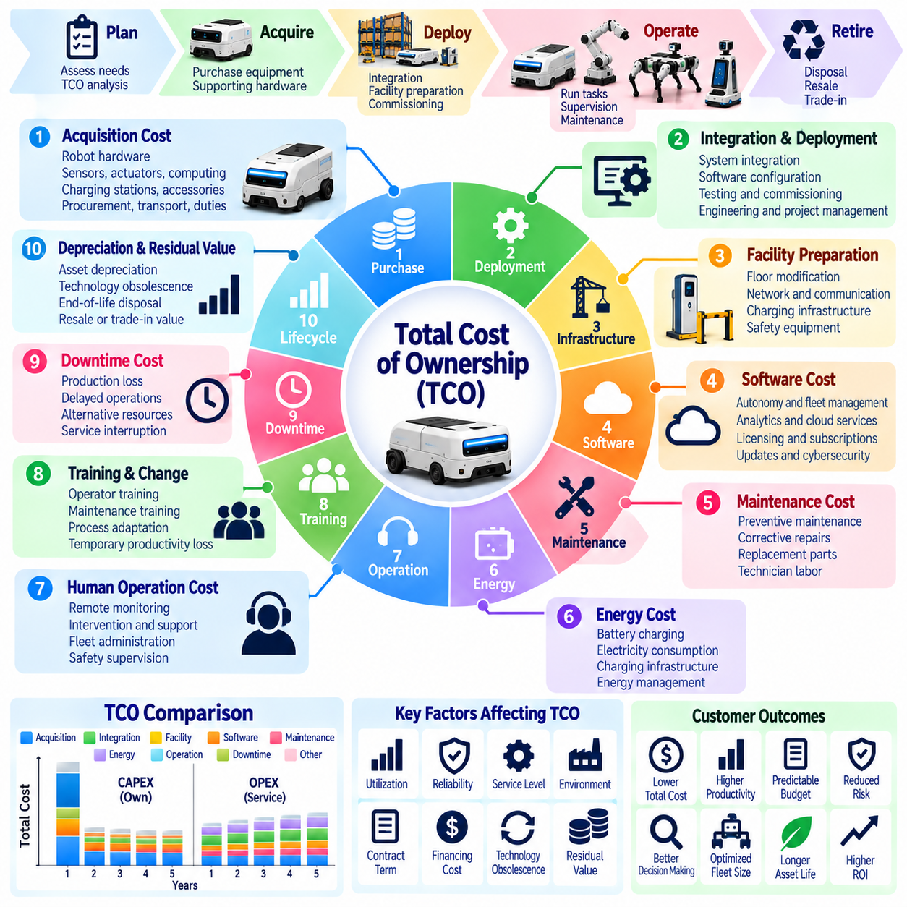{width="7.268055555555556in" height="7.268055555555556in"}

Total Cost of Ownership, or TCO, measures the complete economic cost of acquiring, deploying, operating, maintaining, and retiring a Physical AI system throughout its useful life. Unlike purchase price comparisons, TCO captures both visible expenditures and less obvious operational obligations. It provides a consistent financial framework for evaluating robotic investments, comparing deployment alternatives, and understanding the long-term consequences of automation decisions.

The initial acquisition cost includes robotic hardware, sensors, actuators, computing modules, batteries, and supporting equipment. Additional expenses may arise from charging stations, safety infrastructure, networking equipment, and specialized attachments. Procurement costs can also include transportation, import duties, and supplier qualification. Accurate TCO estimation requires identifying all components necessary for a functional deployment rather than considering robot prices alone.

Deployment and integration expenses often represent a substantial portion of ownership costs. Physical AI installations may require facility mapping, workflow redesign, software configuration, system interfaces, commissioning, and acceptance testing. Integration with warehouse management or manufacturing execution systems can increase engineering requirements. These costs should be estimated separately because deployment complexity varies considerably between customers and operating environments.

Facility preparation introduces additional investment requirements that may be overlooked during early planning. Floor modifications, wireless network improvements, charging locations, safety barriers, and electrical upgrades can affect deployment economics. Some environments also require changes to material handling processes or pedestrian traffic patterns. TCO analysis should include infrastructure changes directly attributable to robotic operation.

Recurring software costs form an important component of Physical AI ownership. Customers may pay for autonomy software, fleet management platforms, analytics, cybersecurity updates, and enterprise integrations. Subscription fees can depend on robot count, operating hours, enabled features, or service tiers. Long-term cost projections should account for contractual escalation, software compatibility, and potential changes in licensing requirements.

Maintenance costs include preventive servicing, corrective repairs, calibration, replacement parts, and technician labor. Mechanical wear, battery degradation, sensor contamination, and actuator failures can create recurring expenses. Service costs depend on operating intensity, environmental conditions, equipment design, and maintenance strategy. Reliable TCO estimates distinguish scheduled maintenance from unexpected failures and major component replacements.

Energy consumption contributes to operating costs, particularly for fleets running multiple shifts. Battery charging efficiency, idle power demand, computing workloads, and charging infrastructure losses influence electricity usage. Energy expenses should be calculated using realistic duty cycles and applicable electricity tariffs. Charging interruptions may also create indirect costs when they reduce available robot capacity during periods of high demand.

Human supervision remains a significant cost even when robots perform tasks autonomously. Operators may monitor missions, resolve navigation exceptions, assist with manipulation failures, and coordinate recovery procedures. Additional personnel may be required for fleet administration, safety oversight, and technical support. TCO models should reflect actual intervention frequency and staffing requirements rather than assuming completely unattended operation.

Training and organizational change also contribute to ownership costs. Employees may need instruction in robot operation, emergency procedures, maintenance routines, and software interfaces. Supervisors must adapt scheduling and performance management practices to automated workflows. Temporary productivity reductions during adoption should be considered. Effective training can reduce long-term errors and support expenses despite increasing initial implementation costs.

Downtime introduces indirect economic losses that are not always visible in accounting records. Robot failures, network interruptions, charging delays, and software defects may disrupt production or material movement. The financial impact depends on whether alternative equipment or personnel can maintain operations. TCO analysis should estimate downtime-related losses separately and avoid counting the same productivity effects more than once.

Reliability and availability strongly influence the economic efficiency of robotic assets. Two robots with similar purchase prices may have different ownership costs because of failure frequency, repair duration, and replacement component requirements. Mean time between failures and mean time to repair provide useful reliability indicators. Their financial significance depends on workload criticality, redundancy, and the operational consequences of service interruptions.

Fleet utilization determines how ownership costs are distributed across productive activity. Fixed costs remain even when robots are idle, making low utilization particularly expensive on a per-task basis. High utilization can improve cost efficiency but may accelerate component wear and increase maintenance requirements. TCO should therefore be evaluated alongside productive operating hours, completed missions, and cost per successful task.

Asset depreciation and residual value affect financial comparisons over the ownership period. Hardware may lose economic value because of physical wear, technological obsolescence, or changing customer requirements. At the end of deployment, robots may be resold, refurbished, redeployed, or recycled. Expected residual values should be conservative and supported by realistic secondary-market or refurbishment assumptions.

Financing and payment structures change the timing and composition of ownership costs. Direct purchases concentrate investment near deployment, while leases and service contracts distribute payments over time. Interest, financing fees, insurance, and contractual termination charges may alter the total financial burden. Comparisons should distinguish cash expenditures from accounting expenses and use consistent discounting assumptions when calculating present value.

Risk-related expenses should be incorporated where they can be estimated credibly. Insurance premiums, cybersecurity controls, safety compliance, regulatory inspections, and incident response capabilities may create continuing obligations. Unexpected accidents or security events can also generate financial exposure. Scenario analysis is often more appropriate than assigning unsupported precise costs to rare events with uncertain probabilities.

The TCO evaluation horizon should reflect the expected useful life and commercial purpose of the system. Short horizons may exaggerate the relative burden of upfront investments, while excessively long horizons may underestimate replacement and obsolescence risks. Sensitivity analysis can test alternative assumptions for utilization, maintenance, energy prices, labor requirements, and equipment lifespan. Transparent assumptions improve decision quality.

Comparative TCO analysis must evaluate alternatives under equivalent operational conditions. Manual operations, conventional automation, purchased robots, and Robot-as-a-Service contracts may differ in capacity, flexibility, service coverage, and risk allocation. Financial comparisons should normalize task volumes, operating hours, and required performance levels. Otherwise, an apparently cheaper solution may simply deliver a lower level of operational capability.

TCO should be connected to productivity and return-on-investment analysis without confusing costs with benefits. Cost reductions, increased throughput, improved quality, and avoided disruptions represent potential economic benefits rather than ownership expenses. A complete business case compares these benefits against lifecycle costs. Separating cost categories from value creation prevents double counting and produces more defensible investment conclusions.

Continuous TCO monitoring becomes important after deployment because actual costs frequently differ from initial forecasts. Providers and customers should track maintenance expenditure, energy consumption, support labor, software charges, downtime, and component replacement. Comparing actual results with budgeted assumptions reveals cost drivers and improvement opportunities. Fleet-level data can support more accurate estimates for subsequent deployments.

Ultimately, Total Cost of Ownership provides the economic foundation for sustainable Physical AI investment decisions. Its value lies in revealing the complete cost structure rather than identifying the lowest equipment price. Effective TCO analysis integrates acquisition, integration, operation, maintenance, financing, risk, and retirement costs within a consistent framework. Organizations that manage these factors systematically can improve deployment economics and make more reliable automation decisions.

총소유비용(Total Cost of Ownership, TCO)은 피지컬 인공지능 시스템(Physical AI System)의 전체 사용 수명(Useful Life)에 걸쳐 도입(Acquisition), 배포(Deployment), 운영(Operation), 유지보수(Maintenance), 폐기(Retirement)에 필요한 모든 경제적 비용(Economic Cost)을 측정한다. 구매 가격 비교(Purchase Price Comparisons)와 달리 총소유비용(TCO)은 명시적인 지출(Visible Expenditures)과 쉽게 드러나지 않는 운영 의무(Operational Obligations)를 모두 포함한다. 이는 로봇 투자(Robotic Investments)를 평가하고 배포 대안(Deployment Alternatives)을 비교하며 자동화 의사결정(Automation Decisions)의 장기적인 영향을 이해하기 위한 일관된 재무적 프레임워크(Financial Framework)를 제공한다.

초기 도입 비용(Initial Acquisition Cost)에는 로봇 하드웨어(Robotic Hardware), 센서(Sensors), 액추에이터(Actuators), 컴퓨팅 모듈(Computing Modules), 배터리(Batteries), 지원 장비(Supporting Equipment)가 포함된다. 충전 스테이션(Charging Stations), 안전 인프라(Safety Infrastructure), 네트워크 장비(Networking Equipment), 특수 부착 장치(Specialized Attachments)에서도 추가 비용이 발생할 수 있다. 조달 비용(Procurement Costs)에는 운송비(Transportation), 수입 관세(Import Duties), 공급업체 적격성 평가(Supplier Qualification)가 포함될 수 있다. 정확한 총소유비용 추정(TCO Estimation)을 위해서는 로봇 가격(Robot Prices)만 고려하는 것이 아니라 정상적인 배포(Functional Deployment)에 필요한 모든 구성 요소를 식별해야 한다.

배포 및 시스템 통합 비용(Deployment and Integration Expenses)은 전체 소유비용(Ownership Costs)에서 상당한 비중을 차지하는 경우가 많다. 피지컬 인공지능 설치(Physical AI Installations)에는 시설 지도 작성(Facility Mapping), 작업 흐름 재설계(Workflow Redesign), 소프트웨어 설정(Software Configuration), 시스템 인터페이스(System Interfaces), 시운전(Commissioning), 인수시험(Acceptance Testing)이 필요할 수 있다. 창고관리시스템(Warehouse Management Systems, WMS)이나 제조실행시스템(Manufacturing Execution Systems, MES)과의 통합은 엔지니어링 요구사항(Engineering Requirements)을 증가시킬 수 있다. 배포 복잡성(Deployment Complexity)은 고객과 운영 환경에 따라 상당히 달라지므로 이러한 비용은 별도로 추정해야 한다.

시설 준비(Facility Preparation)는 초기 계획(Early Planning) 단계에서 간과하기 쉬운 추가 투자 요구사항(Additional Investment Requirements)을 발생시킨다. 바닥 구조 변경(Floor Modifications), 무선 네트워크 개선(Wireless Network Improvements), 충전 위치(Charging Locations), 안전 장벽(Safety Barriers), 전기 설비 개선(Electrical Upgrades)은 배포 경제성(Deployment Economics)에 영향을 미칠 수 있다. 일부 환경에서는 자재 취급 프로세스(Material Handling Processes)나 보행자 이동 동선(Pedestrian Traffic Patterns)의 변경도 필요하다. 총소유비용 분석(TCO Analysis)에는 로봇 운영(Robotic Operation)에 직접적으로 기인하는 인프라 변경(Infrastructure Changes)을 포함해야 한다.

반복적인 소프트웨어 비용(Recurring Software Costs)은 피지컬 인공지능 소유비용(Physical AI Ownership Costs)의 중요한 구성 요소이다. 고객은 자율운영 소프트웨어(Autonomy Software), 로봇군 관리 플랫폼(Fleet Management Platforms), 데이터 분석(Analytics), 사이버보안 업데이트(Cybersecurity Updates), 기업 시스템 통합(Enterprise Integrations)에 대한 비용을 지불할 수 있다. 구독 요금(Subscription Fees)은 로봇 수(Robot Count), 운영시간(Operating Hours), 활성화된 기능(Enabled Features), 서비스 등급(Service Tiers)에 따라 달라질 수 있다. 장기 비용 예측(Long-Term Cost Projections)에서는 계약상 요금 인상(Contractual Escalation), 소프트웨어 호환성(Software Compatibility), 라이선스 요구사항(Licensing Requirements)의 잠재적인 변화를 고려해야 한다.

유지보수 비용(Maintenance Costs)에는 예방 정비(Preventive Servicing), 고장 수리(Corrective Repairs), 교정(Calibration), 교체 부품(Replacement Parts), 기술자 인건비(Technician Labor)가 포함된다. 기계적 마모(Mechanical Wear), 배터리 성능 저하(Battery Degradation), 센서 오염(Sensor Contamination), 액추에이터 고장(Actuator Failures)은 반복적인 비용(Recurring Expenses)을 발생시킬 수 있다. 서비스 비용(Service Costs)은 운영 강도(Operating Intensity), 환경 조건(Environmental Conditions), 장비 설계(Equipment Design), 유지보수 전략(Maintenance Strategy)에 따라 달라진다. 신뢰할 수 있는 총소유비용 추정(Reliable TCO Estimates)을 위해서는 정기 유지보수(Scheduled Maintenance)와 예상하지 못한 고장(Unexpected Failures), 주요 부품 교체(Major Component Replacements)를 구분해야 한다.

에너지 소비(Energy Consumption)는 특히 여러 교대조(Multiple Shifts)로 운영되는 로봇군(Fleets)의 운영비용(Operating Costs)에 영향을 미친다. 배터리 충전 효율(Battery Charging Efficiency), 유휴 전력 수요(Idle Power Demand), 컴퓨팅 작업 부하(Computing Workloads), 충전 인프라 손실(Charging Infrastructure Losses)은 전력 사용량(Electricity Usage)을 결정한다. 에너지 비용(Energy Expenses)은 현실적인 운전 주기(Realistic Duty Cycles)와 적용 전기요금(Applicable Electricity Tariffs)을 사용하여 계산해야 한다. 충전 중단(Charging Interruptions)은 수요가 높은 시간대(Periods of High Demand)에 사용 가능한 로봇 용량(Available Robot Capacity)을 감소시킬 경우 간접비용(Indirect Costs)을 발생시킬 수도 있다.

로봇이 작업을 자율적으로 수행하더라도 인간 감독(Human Supervision)은 여전히 중요한 비용 요소이다. 운영자(Operators)는 임무(Missions)를 모니터링하고 주행 예외 상황(Navigation Exceptions)을 해결하며 조작 실패(Manipulation Failures)를 지원하고 복구 절차(Recovery Procedures)를 조정할 수 있다. 로봇군 관리(Fleet Administration), 안전 감독(Safety Oversight), 기술 지원(Technical Support)을 위해 추가 인력(Additional Personnel)이 필요할 수도 있다. 총소유비용 모델(TCO Models)은 완전한 무인 운영(Completely Unattended Operation)을 가정하기보다 실제 개입 빈도(Actual Intervention Frequency)와 인력 요구사항(Staffing Requirements)을 반영해야 한다.

교육 및 조직 변화(Training and Organizational Change)도 소유비용(Ownership Costs)에 포함된다. 직원들은 로봇 운영(Robot Operation), 비상 절차(Emergency Procedures), 유지보수 작업(Maintenance Routines), 소프트웨어 인터페이스(Software Interfaces)에 대한 교육을 받아야 할 수 있다. 관리자는 자동화된 작업 흐름(Automated Workflows)에 맞추어 일정 관리(Scheduling)와 성과 관리(Performance Management) 방식을 조정해야 한다. 도입 과정(Adoption)에서 발생하는 일시적인 생산성 감소(Temporary Productivity Reductions)도 고려해야 한다. 효과적인 교육(Effective Training)은 초기 구현 비용(Initial Implementation Costs)을 증가시키더라도 장기적인 오류(Long-Term Errors)와 지원 비용(Support Expenses)을 줄일 수 있다.

가동 중단시간(Downtime)은 회계 기록(Accounting Records)에 항상 명확하게 나타나지 않는 간접적인 경제적 손실(Indirect Economic Losses)을 발생시킨다. 로봇 고장(Robot Failures), 네트워크 중단(Network Interruptions), 충전 지연(Charging Delays), 소프트웨어 결함(Software Defects)은 생산(Production)이나 자재 이동(Material Movement)을 방해할 수 있다. 재무적 영향(Financial Impact)은 대체 장비(Alternative Equipment)나 인력(Personnel)이 운영을 유지할 수 있는지에 따라 달라진다. 총소유비용 분석(TCO Analysis)은 가동 중단 관련 손실(Downtime-Related Losses)을 별도로 추정하고 동일한 생산성 영향(Productivity Effects)을 중복 계산(Double Counting)하지 않도록 해야 한다.

신뢰성(Reliability)과 가용성(Availability)은 로봇 자산(Robotic Assets)의 경제적 효율성(Economic Efficiency)에 큰 영향을 미친다. 구매 가격(Purchase Prices)이 비슷한 두 로봇이라도 고장 빈도(Failure Frequency), 수리 소요시간(Repair Duration), 교체 부품 요구사항(Replacement Component Requirements)에 따라 소유비용(Ownership Costs)이 달라질 수 있다. 평균 고장간격(Mean Time Between Failures, MTBF)과 평균 수리시간(Mean Time to Repair, MTTR)은 유용한 신뢰성 지표(Reliability Indicators)를 제공한다. 이러한 지표의 재무적 중요성(Financial Significance)은 작업의 중요도(Workload Criticality), 이중화(Redundancy), 서비스 중단의 운영상 결과(Operational Consequences of Service Interruptions)에 따라 달라진다.

로봇군 활용률(Fleet Utilization)은 소유비용(Ownership Costs)이 생산적 활동(Productive Activity)에 어떻게 배분되는지를 결정한다. 로봇이 유휴 상태(Idle State)에 있더라도 고정비(Fixed Costs)는 계속 발생하므로 낮은 활용률(Low Utilization)은 작업당 비용(Cost per Task)을 특히 높게 만든다. 높은 활용률(High Utilization)은 비용 효율성(Cost Efficiency)을 개선할 수 있지만 부품 마모(Component Wear)를 가속화하고 유지보수 요구사항(Maintenance Requirements)을 증가시킬 수도 있다. 따라서 총소유비용(TCO)은 생산적 운영시간(Productive Operating Hours), 완료된 임무(Completed Missions), 성공적인 작업당 비용(Cost per Successful Task)과 함께 평가해야 한다.

자산 감가상각(Asset Depreciation)과 잔존가치(Residual Value)는 소유기간(Ownership Period) 동안의 재무적 비교(Financial Comparisons)에 영향을 미친다. 하드웨어(Hardware)는 물리적 마모(Physical Wear), 기술적 노후화(Technological Obsolescence), 고객 요구사항 변화(Changing Customer Requirements)로 인해 경제적 가치(Economic Value)가 감소할 수 있다. 배포 종료 시점(End of Deployment)에 로봇은 재판매(Resale), 재정비(Refurbishment), 재배치(Redeployment), 재활용(Recycling)될 수 있다. 예상 잔존가치(Expected Residual Values)는 보수적으로 설정하고 현실적인 중고시장(Secondary Market) 또는 재정비 가정(Refurbishment Assumptions)을 근거로 산정해야 한다.

금융 조달 및 지불 구조(Financing and Payment Structures)는 소유비용(Ownership Costs)의 발생 시점과 구성을 변화시킨다. 직접 구매(Direct Purchases)는 배포 시점(Deployment)에 투자가 집중되는 반면, 리스(Leases)와 서비스 계약(Service Contracts)은 지불을 기간에 걸쳐 분산한다. 이자(Interest), 금융 수수료(Financing Fees), 보험(Insurance), 계약상 해지 비용(Contractual Termination Charges)은 전체 재무 부담(Total Financial Burden)을 변화시킬 수 있다. 비교할 때는 현금 지출(Cash Expenditures)과 회계상 비용(Accounting Expenses)을 구분하고 현재가치(Present Value)를 계산하는 경우 일관된 할인 가정(Consistent Discounting Assumptions)을 적용해야 한다.

위험 관련 비용(Risk-Related Expenses)은 신뢰할 수 있는 추정이 가능한 경우 총소유비용(TCO)에 포함해야 한다. 보험료(Insurance Premiums), 사이버보안 통제(Cybersecurity Controls), 안전 규정 준수(Safety Compliance), 규제 검사(Regulatory Inspections), 사고 대응 역량(Incident Response Capabilities)은 지속적인 의무(Continuing Obligations)를 발생시킬 수 있다. 예상하지 못한 사고(Unexpected Accidents)나 보안 사고(Security Events)도 재무적 위험(Financial Exposure)을 초래할 수 있다. 발생 확률이 불확실한 드문 사건(Rare Events)에 근거 없는 정밀한 비용(Unsupported Precise Costs)을 부여하기보다는 시나리오 분석(Scenario Analysis)을 활용하는 것이 더 적절한 경우가 많다.

총소유비용 평가기간(TCO Evaluation Horizon)은 시스템의 예상 사용 수명(Expected Useful Life)과 상업적 목적(Commercial Purpose)을 반영해야 한다. 짧은 평가기간(Short Horizons)은 초기 투자(Upfront Investments)의 상대적 부담을 과장할 수 있으며, 지나치게 긴 평가기간(Excessively Long Horizons)은 교체 위험(Replacement Risks)과 기술적 노후화 위험(Obsolescence Risks)을 과소평가할 수 있다. 민감도 분석(Sensitivity Analysis)은 활용률(Utilization), 유지보수(Maintenance), 에너지 가격(Energy Prices), 인력 요구사항(Labor Requirements), 장비 수명(Equipment Lifespan)에 대한 대안적 가정(Alternative Assumptions)을 검증할 수 있다. 투명한 가정(Transparent Assumptions)은 의사결정의 품질(Decision Quality)을 향상시킨다.

비교 총소유비용 분석(Comparative TCO Analysis)은 동등한 운영 조건(Equivalent Operational Conditions)에서 대안들을 평가해야 한다. 수작업 운영(Manual Operations), 기존 자동화(Conventional Automation), 구매형 로봇(Purchased Robots), 서비스형 로봇(Robot-as-a-Service, RaaS) 계약은 처리능력(Capacity), 유연성(Flexibility), 서비스 범위(Service Coverage), 위험 배분(Risk Allocation)에서 차이가 있을 수 있다. 재무적 비교(Financial Comparisons)는 작업량(Task Volumes), 운영시간(Operating Hours), 요구 성능 수준(Required Performance Levels)을 동일한 기준으로 정규화(Normalize)해야 한다. 그렇지 않으면 겉보기에 더 저렴한 솔루션(Apparently Cheaper Solution)이 실제로는 더 낮은 운영 역량(Lower Operational Capability)을 제공하는 것일 수 있다.

총소유비용(TCO)은 비용(Costs)과 편익(Benefits)을 혼동하지 않으면서 생산성 분석(Productivity Analysis) 및 투자수익률 분석(Return-on-Investment Analysis, ROI Analysis)과 연결되어야 한다. 비용 절감(Cost Reductions), 처리량 증가(Increased Throughput), 품질 개선(Improved Quality), 운영 중단 방지(Avoided Disruptions)는 소유비용(Ownership Expenses)이 아니라 잠재적인 경제적 편익(Potential Economic Benefits)에 해당한다. 완전한 사업 타당성 분석(Complete Business Case)은 이러한 편익을 수명주기 비용(Lifecycle Costs)과 비교한다. 비용 항목(Cost Categories)과 가치 창출(Value Creation)을 분리하면 중복 계산(Double Counting)을 방지하고 더욱 타당한 투자 결론(Defensible Investment Conclusions)을 도출할 수 있다.

실제 비용(Actual Costs)은 초기 예측(Initial Forecasts)과 다른 경우가 많으므로 배포 이후에는 지속적인 총소유비용 모니터링(Continuous TCO Monitoring)이 중요해진다. 공급업체(Providers)와 고객(Customers)은 유지보수 지출(Maintenance Expenditure), 에너지 소비(Energy Consumption), 지원 인건비(Support Labor), 소프트웨어 요금(Software Charges), 가동 중단시간(Downtime), 부품 교체(Component Replacement)를 추적해야 한다. 실제 결과(Actual Results)를 예산상 가정(Budgeted Assumptions)과 비교하면 비용 발생 요인(Cost Drivers)과 개선 기회(Improvement Opportunities)를 파악할 수 있다. 로봇군 수준 데이터(Fleet-Level Data)는 후속 배포(Subsequent Deployments)를 위한 더욱 정확한 비용 추정(Cost Estimates)을 지원할 수 있다.

궁극적으로 총소유비용(Total Cost of Ownership, TCO)은 지속 가능한 피지컬 인공지능 투자 의사결정(Sustainable Physical AI Investment Decisions)을 위한 경제적 기반(Economic Foundation)을 제공한다. 그 가치는 가장 낮은 장비 가격(Lowest Equipment Price)을 찾는 것이 아니라 전체 비용 구조(Complete Cost Structure)를 드러내는 데 있다. 효과적인 총소유비용 분석(Effective TCO Analysis)은 도입(Acquisition), 시스템 통합(Integration), 운영(Operation), 유지보수(Maintenance), 금융 조달(Financing), 위험(Risk), 수명 종료(Retirement) 비용을 일관된 프레임워크(Consistent Framework) 안에서 통합한다. 이러한 요소를 체계적으로 관리하는 조직(Organizations)은 배포 경제성(Deployment Economics)을 개선하고 더욱 신뢰할 수 있는 자동화 의사결정(Reliable Automation Decisions)을 내릴 수 있다.

##  

## 08.15. ROI Payback and Productivity Modeling

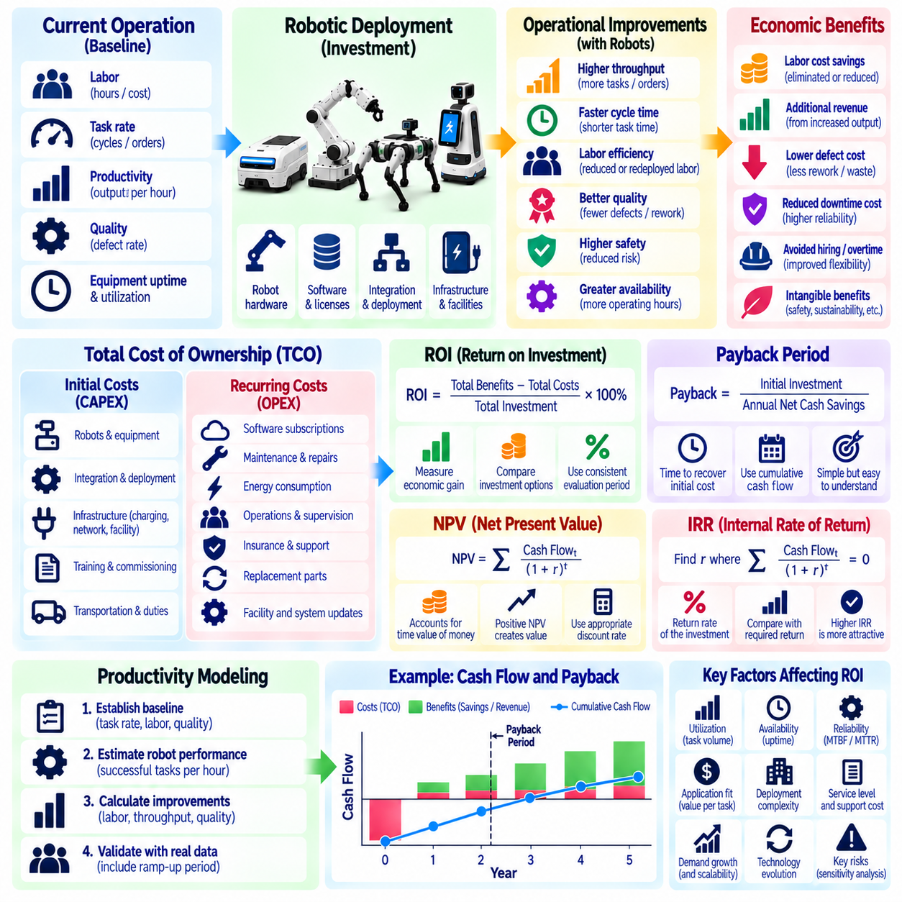{width="7.268055555555556in" height="7.268055555555556in"}

Return on investment, payback period, and productivity modeling provide the financial foundation for evaluating Physical AI deployment decisions. These methods translate robotic performance into measurable economic outcomes and help determine whether automation creates sufficient value. A reliable investment model connects technical capability, operational improvements, lifecycle costs, and financial returns using consistent assumptions and verifiable data.

Return on investment, or ROI, measures the economic gain generated relative to the resources invested. A basic calculation divides net investment benefit by total investment cost and expresses the result as a percentage. For Physical AI, benefits may include labor savings, additional throughput, reduced defects, and lower downtime. The calculation must specify its evaluation period and avoid mixing one-time investment costs with recurring annual benefits.

Payback period measures the time required for cumulative net cash benefits to recover the initial investment. Simple payback divides upfront investment by annual net cash savings when those savings remain approximately constant. More realistic models calculate cumulative cash flow across successive periods. Payback is easy to communicate but does not fully capture the time value of money or benefits occurring after investment recovery.

Discounted cash flow analysis provides a more complete assessment of long-term investment value. Net present value converts future net cash flows into present values using an appropriate discount rate. Internal rate of return identifies the discount rate at which net present value becomes zero. These methods account for payment timing and investment risk, although their reliability depends on realistic cash flow forecasts and justified discount assumptions.

Productivity modeling begins by establishing the current operating baseline before robotic deployment. Relevant measurements include task completion rates, cycle times, labor hours, equipment availability, and process interruptions. Baseline data should represent normal operating variability rather than isolated peak performance. Without reliable measurements, automation benefits may be overstated and investment conclusions may become misleading.

Robot productivity must be measured through useful completed work rather than nominal technical specifications. Maximum travel speed, manipulation frequency, or theoretical operating hours do not necessarily represent actual output. Real deployments involve charging, waiting, congestion, human intervention, and occasional failures. Effective productivity models estimate successful tasks per operating hour under representative workload and environmental conditions.

Labor productivity improvements are a common source of economic value, but reduced task time does not always produce direct payroll savings. Employees may be reassigned to higher-value activities rather than removed from the workforce. Financial models should distinguish eliminated labor expense, avoided future hiring, overtime reduction, and redeployed capacity. Only benefits supported by realistic organizational changes should be treated as realized cash savings.

Throughput improvements can generate additional revenue when customer demand and downstream capacity support higher output. A robotic system may increase completed orders, transported materials, or production cycles without proportionally increasing labor. However, additional throughput has limited financial value when demand is insufficient or other processes remain constrained. Models should use incremental contribution margin rather than gross revenue when estimating profit benefits.

Quality improvements can contribute to ROI by reducing defects, rework, material waste, and process variability. Physical AI systems may improve consistency through repeatable sensing, planning, and control. The economic benefit depends on existing defect rates, the cost of correction, and the reliability of automated execution. Quality-related savings should be measured separately from productivity gains to prevent overlapping benefit calculations.

Robot availability and utilization strongly influence realized financial performance. Availability describes whether equipment is capable of operating, while utilization measures how much available capacity performs productive work. A highly reliable robot may still deliver poor economic returns when task demand is low. Productivity models should therefore combine uptime, productive operating hours, mission success rates, and actual task volumes.

Investment cost modeling must include more than the robotic equipment purchase price. Initial expenditures may cover integration, charging infrastructure, facility changes, commissioning, training, and safety preparation. Recurring expenses include software subscriptions, maintenance, energy, supervision, insurance, and component replacement. Using lifecycle cost estimates prevents attractive but incomplete ROI calculations based only on hardware acquisition.

Deployment ramp-up should be reflected in financial forecasts because robotic productivity rarely reaches its steady-state level immediately. Early operations may involve mapping adjustments, workflow changes, operator training, and software tuning. Models should represent gradual improvements in utilization and task success rates. Ignoring ramp-up costs and temporary productivity losses can make payback estimates unrealistically optimistic.

Fleet-level productivity requires consideration of interactions between multiple robots. Adding robots may improve throughput initially, but congestion, shared charging resources, and traffic conflicts can reduce marginal gains. Fleet simulations and operational measurements help estimate capacity under different deployment sizes. Economic models should evaluate incremental productivity per additional robot rather than assuming output increases proportionally with fleet size.

Scenario analysis helps decision-makers understand uncertainty in investment outcomes. Conservative, expected, and optimistic cases can vary task demand, robot utilization, maintenance expenses, labor savings, and system availability. Sensitivity analysis identifies which assumptions have the greatest influence on ROI and payback. These methods are particularly valuable when deployment data is limited or operational conditions may change.

Risk-adjusted modeling should consider potential disruptions and unexpected costs without relying on unsupported precision. Equipment failures, integration delays, regulatory requirements, and changes in customer demand may alter expected returns. Financial models can incorporate contingency allowances and alternative operating scenarios. Transparent risk treatment improves investment credibility and supports decisions about deployment scale and contractual guarantees.

Pilot deployments provide an opportunity to validate the assumptions used in ROI and productivity models. Measured task completion, intervention frequency, charging behavior, maintenance needs, and labor interaction can replace preliminary estimates. Pilot results should be evaluated against predefined acceptance criteria. Scaling decisions should rely on representative evidence rather than demonstrations conducted under unusually favorable conditions.

Customer and supplier financial perspectives must remain distinct. Customers evaluate productivity benefits, avoided costs, and investment returns, while suppliers consider selling margins, service obligations, capital requirements, and contract profitability. A deployment may create substantial customer value without producing adequate supplier margins. Sustainable commercial agreements require an economically viable distribution of benefits and responsibilities.

Financial performance should be monitored continuously after deployment. Actual operating costs, completed tasks, labor allocation, downtime, and maintenance events should be compared with the original business case. Differences between forecast and realized performance reveal operational improvement opportunities and modeling weaknesses. Updated forecasts can guide fleet expansion, contract renewal, and future capital allocation decisions.

Productivity models should also recognize benefits that are difficult to monetize precisely. Improved workplace safety, reduced employee fatigue, greater operational flexibility, and enhanced service consistency may influence investment decisions. These outcomes can be documented using operational indicators and qualitative evidence. They should not be converted into arbitrary financial savings merely to improve reported ROI.

Ultimately, ROI, payback, and productivity modeling connect Physical AI engineering performance with business investment decisions. Their effectiveness depends on realistic operating baselines, complete cost accounting, measurable benefits, and transparent uncertainty. Organizations that validate assumptions through pilots and operational data can distinguish promising automation opportunities from economically weak deployments and scale investments with greater confidence.

투자수익률(Return on Investment, ROI), 투자 회수기간(Payback Period), 생산성 모델링(Productivity Modeling)은 피지컬 인공지능(Physical AI)의 배포 의사결정(Deployment Decisions)을 평가하기 위한 재무적 기반(Financial Foundation)을 제공한다. 이러한 방법은 로봇 성능(Robotic Performance)을 측정 가능한 경제적 성과(Measurable Economic Outcomes)로 전환하고 자동화(Automation)가 충분한 가치를 창출하는지 판단하는 데 도움을 준다. 신뢰할 수 있는 투자 모델(Investment Model)은 일관된 가정(Consistent Assumptions)과 검증 가능한 데이터(Verifiable Data)를 사용하여 기술적 역량(Technical Capability), 운영 개선(Operational Improvements), 수명주기 비용(Lifecycle Costs), 재무적 수익(Financial Returns)을 연결한다.

투자수익률(Return on Investment, ROI)은 투입된 자원(Resources Invested)에 비해 창출된 경제적 이익(Economic Gain)을 측정한다. 기본적인 계산(Basic Calculation)은 순투자편익(Net Investment Benefit)을 총투자비용(Total Investment Cost)으로 나누고 그 결과를 백분율(Percentage)로 표현한다. 피지컬 인공지능(Physical AI)의 편익에는 인건비 절감(Labor Savings), 추가 처리량(Additional Throughput), 불량 감소(Reduced Defects), 가동 중단시간 감소(Lower Downtime)가 포함될 수 있다. 계산 시에는 평가기간(Evaluation Period)을 명시하고 일회성 투자비용(One-Time Investment Costs)과 반복적인 연간 편익(Recurring Annual Benefits)을 혼용하지 않아야 한다.

투자 회수기간(Payback Period)은 누적 순현금 편익(Cumulative Net Cash Benefits)이 초기 투자금(Initial Investment)을 회수하는 데 필요한 시간을 측정한다. 단순 투자 회수기간(Simple Payback)은 연간 순현금 절감액(Annual Net Cash Savings)이 대체로 일정할 때 초기 투자금(Upfront Investment)을 해당 절감액으로 나누어 계산한다. 보다 현실적인 모델(Realistic Models)은 연속된 기간(Successive Periods)에 걸친 누적 현금흐름(Cumulative Cash Flow)을 계산한다. 투자 회수기간은 설명하기 쉽지만 화폐의 시간가치(Time Value of Money)나 투자금 회수 이후에 발생하는 편익(Benefits After Investment Recovery)을 충분히 반영하지 못한다.

할인현금흐름 분석(Discounted Cash Flow Analysis, DCF)은 장기 투자 가치(Long-Term Investment Value)를 더욱 종합적으로 평가한다. 순현재가치(Net Present Value, NPV)는 적절한 할인율(Discount Rate)을 사용하여 미래 순현금흐름(Future Net Cash Flows)을 현재가치(Present Values)로 환산한다. 내부수익률(Internal Rate of Return, IRR)은 순현재가치가 0이 되는 할인율을 나타낸다. 이러한 방법은 지불 시점(Payment Timing)과 투자 위험(Investment Risk)을 고려하지만, 분석의 신뢰성(Reliability)은 현실적인 현금흐름 예측(Realistic Cash Flow Forecasts)과 타당한 할인율 가정(Justified Discount Assumptions)에 달려 있다.

생산성 모델링(Productivity Modeling)은 로봇 배포(Robotic Deployment) 이전의 현재 운영 기준선(Current Operating Baseline)을 수립하는 것에서 시작된다. 관련 측정 지표(Relevant Measurements)에는 작업 완료율(Task Completion Rates), 사이클 타임(Cycle Times), 노동시간(Labor Hours), 장비 가용성(Equipment Availability), 공정 중단(Process Interruptions)이 포함된다. 기준 데이터(Baseline Data)는 일시적인 최고 성능(Isolated Peak Performance)이 아니라 정상적인 운영 변동성(Normal Operating Variability)을 나타내야 한다. 신뢰할 수 있는 측정값(Reliable Measurements)이 없다면 자동화 편익(Automation Benefits)이 과대평가되고 투자 결론(Investment Conclusions)이 잘못 도출될 수 있다.

로봇 생산성(Robot Productivity)은 명목상의 기술 사양(Nominal Technical Specifications)이 아니라 실제로 완료된 유효 작업(Useful Completed Work)을 기준으로 측정해야 한다. 최대 이동속도(Maximum Travel Speed), 조작 빈도(Manipulation Frequency), 이론적 운영시간(Theoretical Operating Hours)이 반드시 실제 산출량(Actual Output)을 의미하지는 않는다. 실제 배포 환경(Real Deployments)에서는 충전(Charging), 대기(Waiting), 혼잡(Congestion), 인간 개입(Human Intervention), 간헐적인 고장(Occasional Failures)이 발생한다. 효과적인 생산성 모델(Effective Productivity Models)은 대표적인 작업 부하(Representative Workload)와 환경 조건(Environmental Conditions)에서 운영시간당 성공적으로 완료된 작업(Successful Tasks per Operating Hour)을 추정한다.

노동 생산성 개선(Labor Productivity Improvements)은 경제적 가치(Economic Value)의 일반적인 원천이지만 작업시간 감소(Reduced Task Time)가 항상 직접적인 급여 비용 절감(Direct Payroll Savings)으로 이어지는 것은 아니다. 직원들은 인력 감축(Removal from the Workforce) 대신 더 높은 부가가치 활동(Higher-Value Activities)으로 재배치될 수 있다. 재무 모델(Financial Models)은 실제로 제거된 인건비(Eliminated Labor Expense), 향후 채용 회피(Avoided Future Hiring), 초과근무 감소(Overtime Reduction), 재배치된 업무 역량(Redeployed Capacity)을 구분해야 한다. 현실적인 조직 변화(Realistic Organizational Changes)로 뒷받침되는 편익만을 실현된 현금 절감액(Realized Cash Savings)으로 취급해야 한다.

처리량 개선(Throughput Improvements)은 고객 수요(Customer Demand)와 후속 공정의 처리능력(Downstream Capacity)이 증가된 산출량(Higher Output)을 수용할 수 있을 때 추가 매출(Additional Revenue)을 창출할 수 있다. 로봇 시스템(Robotic System)은 인력을 비례적으로 늘리지 않으면서 완료 주문(Completed Orders), 운송 자재(Transported Materials), 생산 사이클(Production Cycles)을 증가시킬 수 있다. 그러나 수요가 부족하거나 다른 공정이 제약 상태(Constrained)에 있다면 추가 처리량의 재무적 가치(Financial Value)는 제한적이다. 모델은 이익 편익(Profit Benefits)을 추정할 때 총매출(Gross Revenue)이 아니라 증분 공헌이익(Incremental Contribution Margin)을 사용해야 한다.

품질 개선(Quality Improvements)은 불량(Defects), 재작업(Rework), 자재 낭비(Material Waste), 공정 변동성(Process Variability)을 줄임으로써 투자수익률(ROI)에 기여할 수 있다. 피지컬 인공지능 시스템(Physical AI Systems)은 반복 가능한 인식(Repeatable Sensing), 계획(Planning), 제어(Control)를 통해 일관성(Consistency)을 개선할 수 있다. 경제적 편익(Economic Benefit)은 기존 불량률(Existing Defect Rates), 수정 비용(Cost of Correction), 자동화 실행의 신뢰성(Reliability of Automated Execution)에 따라 달라진다. 품질 관련 절감액(Quality-Related Savings)은 편익 계산(Benefit Calculations)이 중복되지 않도록 생산성 향상(Productivity Gains)과 별도로 측정해야 한다.

로봇 가용성(Robot Availability)과 활용률(Utilization)은 실제 재무 성과(Realized Financial Performance)에 큰 영향을 미친다. 가용성(Availability)은 장비가 운영 가능한 상태인지 나타내며, 활용률(Utilization)은 사용 가능한 용량(Available Capacity)이 생산적 작업(Productive Work)에 얼마나 사용되는지를 측정한다. 신뢰성이 높은 로봇(Highly Reliable Robot)이라도 작업 수요(Task Demand)가 낮으면 경제적 수익(Economic Returns)이 저조할 수 있다. 따라서 생산성 모델(Productivity Models)은 가동시간(Uptime), 생산적 운영시간(Productive Operating Hours), 임무 성공률(Mission Success Rates), 실제 작업량(Actual Task Volumes)을 함께 고려해야 한다.

투자비용 모델링(Investment Cost Modeling)은 로봇 장비 구매 가격(Robotic Equipment Purchase Price) 이상의 비용을 포함해야 한다. 초기 지출(Initial Expenditures)에는 시스템 통합(Integration), 충전 인프라(Charging Infrastructure), 시설 변경(Facility Changes), 시운전(Commissioning), 교육(Training), 안전 준비(Safety Preparation)가 포함될 수 있다. 반복 비용(Recurring Expenses)에는 소프트웨어 구독(Software Subscriptions), 유지보수(Maintenance), 에너지(Energy), 감독(Supervision), 보험(Insurance), 부품 교체(Component Replacement)가 포함된다. 수명주기 비용 추정(Lifecycle Cost Estimates)을 사용하면 하드웨어 도입비(Hardware Acquisition)만을 기준으로 계산한 매력적이지만 불완전한 투자수익률(Incomplete ROI Calculations)을 방지할 수 있다.

배포 초기 안정화 과정(Deployment Ramp-Up)은 로봇 생산성(Robotic Productivity)이 일반적으로 즉시 정상 운영 수준(Steady-State Level)에 도달하지 않으므로 재무 예측(Financial Forecasts)에 반영되어야 한다. 초기 운영(Early Operations)에는 지도 조정(Mapping Adjustments), 작업 흐름 변경(Workflow Changes), 운영자 교육(Operator Training), 소프트웨어 조정(Software Tuning)이 수반될 수 있다. 모델은 활용률(Utilization)과 작업 성공률(Task Success Rates)이 점진적으로 개선되는 과정을 나타내야 한다. 초기 안정화 비용(Ramp-Up Costs)과 일시적인 생산성 손실(Temporary Productivity Losses)을 무시하면 투자 회수기간 추정(Payback Estimates)이 비현실적으로 낙관적일 수 있다.

로봇군 수준의 생산성(Fleet-Level Productivity)은 여러 로봇 사이의 상호작용(Interactions)을 고려해야 한다. 로봇을 추가하면 초기에는 처리량(Throughput)이 증가할 수 있지만 혼잡(Congestion), 공유 충전 자원(Shared Charging Resources), 교통 충돌(Traffic Conflicts)로 인해 한계 생산성 증가(Marginal Gains)가 감소할 수 있다. 로봇군 시뮬레이션(Fleet Simulations)과 운영 측정(Operational Measurements)은 다양한 배포 규모(Deployment Sizes)에서 처리능력(Capacity)을 추정하는 데 도움이 된다. 경제성 모델(Economic Models)은 로봇군 규모(Fleet Size)에 비례하여 산출량(Output)이 증가한다고 가정하기보다 추가 로봇당 증분 생산성(Incremental Productivity per Additional Robot)을 평가해야 한다.

시나리오 분석(Scenario Analysis)은 의사결정자(Decision-Makers)가 투자 성과(Investment Outcomes)의 불확실성(Uncertainty)을 이해하도록 돕는다. 보수적 시나리오(Conservative Case), 예상 시나리오(Expected Case), 낙관적 시나리오(Optimistic Case)는 작업 수요(Task Demand), 로봇 활용률(Robot Utilization), 유지보수 비용(Maintenance Expenses), 인건비 절감(Labor Savings), 시스템 가용성(System Availability)에 서로 다른 가정을 적용할 수 있다. 민감도 분석(Sensitivity Analysis)은 투자수익률(ROI)과 투자 회수기간(Payback)에 가장 큰 영향을 미치는 가정을 식별한다. 이러한 방법은 배포 데이터(Deployment Data)가 제한적이거나 운영 조건(Operational Conditions)이 변경될 수 있는 경우 특히 유용하다.

위험 조정 모델링(Risk-Adjusted Modeling)은 근거 없는 정밀성(Unsupported Precision)에 의존하지 않으면서 잠재적인 운영 중단(Potential Disruptions)과 예상하지 못한 비용(Unexpected Costs)을 고려해야 한다. 장비 고장(Equipment Failures), 시스템 통합 지연(Integration Delays), 규제 요구사항(Regulatory Requirements), 고객 수요 변화(Changes in Customer Demand)는 예상 수익(Expected Returns)을 변화시킬 수 있다. 재무 모델(Financial Models)은 예비비(Contingency Allowances)와 대안적 운영 시나리오(Alternative Operating Scenarios)를 포함할 수 있다. 투명한 위험 반영(Transparent Risk Treatment)은 투자 타당성(Investment Credibility)을 높이고 배포 규모(Deployment Scale)와 계약상 성능 보장(Contractual Guarantees)에 관한 의사결정을 지원한다.

파일럿 배포(Pilot Deployments)는 투자수익률 및 생산성 모델(ROI and Productivity Models)에 사용된 가정을 검증할 기회를 제공한다. 측정된 작업 완료율(Measured Task Completion), 개입 빈도(Intervention Frequency), 충전 동작(Charging Behavior), 유지보수 요구사항(Maintenance Needs), 인력과의 상호작용(Labor Interaction)은 초기 추정값(Preliminary Estimates)을 대체할 수 있다. 파일럿 결과(Pilot Results)는 사전에 정의된 인수 기준(Predefined Acceptance Criteria)에 따라 평가해야 한다. 확장 의사결정(Scaling Decisions)은 비정상적으로 유리한 조건(Unusually Favorable Conditions)에서 수행된 시연(Demonstrations)이 아니라 대표성 있는 실증 자료(Representative Evidence)에 근거해야 한다.

고객과 공급업체의 재무적 관점(Customer and Supplier Financial Perspectives)은 명확하게 구분되어야 한다. 고객(Customers)은 생산성 편익(Productivity Benefits), 회피된 비용(Avoided Costs), 투자수익(Investment Returns)을 평가하는 반면, 공급업체(Suppliers)는 판매 이익률(Selling Margins), 서비스 의무(Service Obligations), 자본 요구사항(Capital Requirements), 계약 수익성(Contract Profitability)을 고려한다. 배포 프로젝트(Deployment)는 상당한 고객 가치(Customer Value)를 창출하면서도 공급업체에는 충분한 이익률(Adequate Supplier Margins)을 제공하지 못할 수 있다. 지속 가능한 상업적 계약(Sustainable Commercial Agreements)을 위해서는 편익(Benefits)과 책임(Responsibilities)의 경제적으로 타당한 배분(Economically Viable Distribution)이 필요하다.

재무 성과(Financial Performance)는 배포 이후 지속적으로 모니터링해야 한다. 실제 운영비용(Actual Operating Costs), 완료된 작업(Completed Tasks), 인력 배치(Labor Allocation), 가동 중단시간(Downtime), 유지보수 이벤트(Maintenance Events)를 최초 사업 타당성 분석(Original Business Case)과 비교해야 한다. 예측 성과(Forecast Performance)와 실현 성과(Realized Performance)의 차이는 운영 개선 기회(Operational Improvement Opportunities)와 모델링의 취약점(Modeling Weaknesses)을 보여준다. 갱신된 예측(Updated Forecasts)은 로봇군 확장(Fleet Expansion), 계약 갱신(Contract Renewal), 향후 자본 배분(Future Capital Allocation)에 관한 의사결정을 지원할 수 있다.

생산성 모델(Productivity Models)은 정확한 금전적 가치 산정(Precise Monetization)이 어려운 편익도 인식해야 한다. 작업장 안전 개선(Improved Workplace Safety), 직원 피로 감소(Reduced Employee Fatigue), 운영 유연성 확대(Greater Operational Flexibility), 서비스 일관성 향상(Enhanced Service Consistency)은 투자 의사결정(Investment Decisions)에 영향을 미칠 수 있다. 이러한 성과는 운영 지표(Operational Indicators)와 정성적 근거(Qualitative Evidence)를 통해 문서화할 수 있다. 단지 보고된 투자수익률(Reported ROI)을 높이기 위해 이러한 성과를 임의적인 재무 절감액(Arbitrary Financial Savings)으로 환산해서는 안 된다.

궁극적으로 투자수익률(ROI), 투자 회수기간(Payback), 생산성 모델링(Productivity Modeling)은 피지컬 인공지능의 엔지니어링 성능(Physical AI Engineering Performance)을 사업 투자 의사결정(Business Investment Decisions)과 연결한다. 이러한 방법의 효과성(Effectiveness)은 현실적인 운영 기준선(Realistic Operating Baselines), 완전한 비용 산정(Complete Cost Accounting), 측정 가능한 편익(Measurable Benefits), 투명한 불확실성(Transparent Uncertainty)에 달려 있다. 파일럿(Pilots)과 운영 데이터(Operational Data)를 통해 가정을 검증하는 조직은 유망한 자동화 기회(Promising Automation Opportunities)와 경제성이 낮은 배포(Economically Weak Deployments)를 구분하고 더 높은 확신을 가지고 투자를 확대할 수 있다.

##  

## 08.16. Unit Economics and Fleet Economics

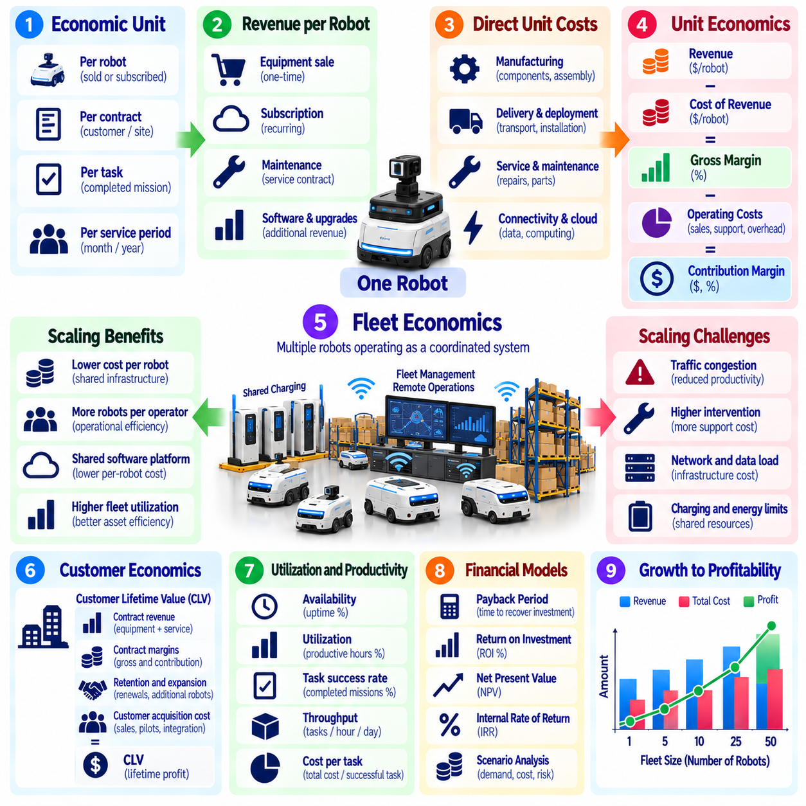{width="7.268055555555556in" height="7.268055555555556in"}

Unit economics and fleet economics provide essential frameworks for evaluating the financial sustainability of Physical AI businesses. Unit economics examines revenue, costs, and profitability associated with an individual robot or service contract. Fleet economics extends this analysis to multiple robots operating as a coordinated system. Together, these approaches reveal whether business growth improves profitability or merely increases revenue and operational complexity.

The economic unit must be defined before financial performance can be measured consistently. Depending on the business model, a unit may represent a robot sold, an active robot subscription, a customer installation, or a completed task. Different definitions produce different revenue and cost relationships. Providers should select units that reflect their commercial obligations and maintain consistent measurement across customers, deployments, and reporting periods.

Revenue per robot depends on pricing structure, utilization, contract duration, and service scope. Equipment sales generate revenue primarily at delivery, while subscription and Robot-as-a-Service models distribute revenue across operating periods. Additional income may arise from software upgrades, maintenance contracts, and technical support. Financial models should distinguish recognized revenue from cash receipts and contractual commitments.

Direct unit costs include manufacturing, purchased components, assembly, testing, transportation, and deployment activities attributable to each robot. Recurring service models also incur maintenance, connectivity, cloud processing, technical support, and asset replacement expenses. Accurate cost allocation is necessary to understand unit profitability. Shared corporate overhead should be distinguished from costs directly caused by individual deployments.

Gross margin measures the proportion of revenue remaining after deducting the applicable cost of revenue. Hardware gross margin reflects manufacturing and delivery economics, while service gross margin reflects the cost of fulfilling continuing obligations. A profitable equipment sale does not guarantee a profitable lifecycle relationship. Providers should analyze hardware, software, and service margins separately before evaluating combined contract profitability.

Contribution margin provides another perspective by subtracting variable and directly attributable operating costs from revenue. It helps determine whether adding another robot, customer, or contract contributes positively to covering shared expenses. A positive contribution margin is necessary for scalable growth but does not guarantee overall profitability. Fixed development, administration, and infrastructure costs must eventually be recovered.

Robot-as-a-Service unit economics require careful consideration of equipment financing and capital recovery. Providers may purchase or manufacture robots before receiving subscription payments, creating substantial initial cash requirements. Monthly revenue must support servicing costs and recover invested capital over the expected economic life. Asset depreciation, financing charges, residual value, and contract termination risk influence the overall investment return.

Customer acquisition cost measures the resources required to secure a new customer or deployment contract. Sales engineering, demonstrations, pilot support, procurement negotiations, and commercial onboarding can create substantial expenses. These costs should be compared with expected customer lifetime value. Long sales cycles and highly customized deployments may weaken economics even when individual robot contracts generate attractive recurring margins.

Customer lifetime value represents the expected economic contribution from a customer relationship over its duration. It depends on contract margins, retention, expansion opportunities, and future service obligations. Revenue alone is an insufficient basis for estimating lifetime value because support and capital costs may increase over time. Providers should use realistic renewal assumptions and avoid treating uncertain expansion revenue as guaranteed income.

Fleet economics introduces coordination effects that do not appear in single-robot calculations. Shared charging infrastructure, fleet management software, remote supervision, and maintenance resources can reduce average costs as fleet size increases. However, traffic congestion, communication demands, and operational intervention may also grow. Fleet profitability depends on whether shared efficiencies exceed the additional complexity created by expansion.

Fleet utilization is a critical determinant of economic performance. Robots generate greater value when available capacity is converted into productive work, but operating hours alone do not guarantee useful output. Providers should monitor completed missions, successful tasks, throughput, idle time, and charging delays. Cost per successful task provides a practical measure for comparing operational efficiency across fleet sizes and customer environments.

The marginal economics of adding robots must be evaluated independently from average fleet performance. An additional robot may improve throughput when demand exceeds existing capacity, but contribute little when workloads are limited. Shared bottlenecks can also reduce the productivity of existing robots. Expansion decisions should compare incremental revenue and customer value against incremental equipment, infrastructure, and support costs.

Human intervention strongly influences fleet service profitability. Remote operators may supervise many autonomous robots, but navigation failures, manipulation errors, and recovery events create labor requirements. The ratio of managed robots to support personnel depends on task complexity and intervention frequency. Providers should measure intervention cost per mission and evaluate whether operational staffing grows proportionally with fleet size.

Maintenance economics change as robotic assets age. Early deployments may experience limited component replacement, while older fleets can require more frequent repairs, battery replacement, and major servicing. Warranty coverage and customer service agreements determine which party bears these costs. Lifecycle profitability models should incorporate age-dependent maintenance expenses rather than assuming constant support costs throughout deployment.

Fleet-level fixed costs include management platforms, operations centers, monitoring infrastructure, cybersecurity systems, and specialized engineering resources. These investments can support many robots, creating opportunities for economies of scale. Nevertheless, capacity thresholds may require additional servers, personnel, or facilities. Financial models should represent these step changes instead of assuming fixed costs remain unchanged indefinitely.

Standardization improves unit economics by reducing engineering effort and operational variability. Reusable software modules, common hardware interfaces, automated deployment tools, and standardized maintenance procedures lower repeated delivery costs. Product customization can generate additional revenue but may increase integration and support expenses. Providers should evaluate whether customization premiums adequately compensate for the resulting lifecycle complexity.

Contract-level profitability requires combining revenue and cost information across the full service period. Important measures include revenue per active robot, contribution margin per contract, service cost per operating hour, and capital recovery time. Fleet-level analysis should additionally examine shared infrastructure utilization and supervisory labor efficiency. These indicators reveal whether growth creates sustainable economic returns.

Scenario analysis is necessary because unit and fleet economics depend on uncertain operating conditions. Changes in utilization, failure rates, component prices, contract renewals, and financing costs can materially affect profitability. Conservative and expected scenarios help identify financial exposure before large-scale deployment. Sensitivity analysis highlights the variables that deserve the greatest operational attention and commercial protection.

Scaling decisions should consider cash flow as well as accounting profitability. Rapid fleet expansion may require substantial investment in robots, spare parts, charging infrastructure, and deployment teams before corresponding revenue is collected. Profitable contracts can still create liquidity pressure when capital recovery is slow. Providers should align growth plans with financing capacity, customer payment terms, and expected deployment schedules.

Ultimately, unit economics and fleet economics connect individual robot performance with the financial viability of a scalable Physical AI business. Sustainable growth requires positive contribution margins, disciplined capital allocation, high productive utilization, efficient support operations, and predictable lifecycle costs. Companies that measure these relationships consistently can identify profitable applications, optimize fleet expansion, and build durable recurring revenue.

단위 경제성(Unit Economics)과 로봇군 경제성(Fleet Economics)은 피지컬 인공지능 사업(Physical AI Businesses)의 재무적 지속 가능성(Financial Sustainability)을 평가하기 위한 핵심 프레임워크(Essential Frameworks)를 제공한다. 단위 경제성(Unit Economics)은 개별 로봇(Individual Robot) 또는 서비스 계약(Service Contract)과 관련된 매출(Revenue), 비용(Costs), 수익성(Profitability)을 분석한다. 로봇군 경제성(Fleet Economics)은 이러한 분석을 하나의 조정된 시스템(Coordinated System)으로 운영되는 여러 로봇으로 확장한다. 두 접근법은 사업 성장(Business Growth)이 수익성을 개선하는지, 아니면 단순히 매출과 운영 복잡성(Operational Complexity)만 증가시키는지를 보여준다.

재무 성과(Financial Performance)를 일관되게 측정하려면 먼저 경제적 분석 단위(Economic Unit)를 정의해야 한다. 사업 모델(Business Model)에 따라 하나의 단위(Unit)는 판매된 로봇(Robot Sold), 활성 로봇 구독(Active Robot Subscription), 고객 설치 현장(Customer Installation), 완료된 작업(Completed Task)을 의미할 수 있다. 서로 다른 단위 정의(Unit Definitions)는 서로 다른 매출 및 비용 관계(Revenue and Cost Relationships)를 만들어낸다. 공급업체(Providers)는 상업적 의무(Commercial Obligations)를 반영하는 단위를 선택하고 고객(Customers), 배포 현장(Deployments), 보고기간(Reporting Periods)에 걸쳐 일관된 측정(Consistent Measurement)을 유지해야 한다.

로봇당 매출(Revenue per Robot)은 가격 구조(Pricing Structure), 활용률(Utilization), 계약기간(Contract Duration), 서비스 범위(Service Scope)에 따라 달라진다. 장비 판매(Equipment Sales)는 주로 납품 시점(Delivery)에 매출을 발생시키는 반면, 구독 모델(Subscription Models)과 서비스형 로봇(Robot-as-a-Service, RaaS) 모델은 운영기간(Operating Periods)에 걸쳐 매출을 분산한다. 추가 수익(Additional Income)은 소프트웨어 업그레이드(Software Upgrades), 유지보수 계약(Maintenance Contracts), 기술 지원(Technical Support)에서 발생할 수 있다. 재무 모델(Financial Models)은 인식 매출(Recognized Revenue), 현금 수입(Cash Receipts), 계약상 약정(Contractual Commitments)을 구분해야 한다.

직접 단위 원가(Direct Unit Costs)에는 각 로봇에 귀속되는 제조(Manufacturing), 구매 부품(Purchased Components), 조립(Assembly), 시험(Testing), 운송(Transportation), 배포 활동(Deployment Activities)이 포함된다. 반복 서비스 모델(Recurring Service Models)에서는 유지보수(Maintenance), 연결 서비스(Connectivity), 클라우드 처리(Cloud Processing), 기술 지원(Technical Support), 자산 교체(Asset Replacement) 비용도 발생한다. 단위 수익성(Unit Profitability)을 이해하려면 정확한 원가 배분(Accurate Cost Allocation)이 필요하다. 공통 기업 간접비(Shared Corporate Overhead)는 개별 배포(Individual Deployments)에서 직접 발생하는 비용과 구분해야 한다.

매출총이익률(Gross Margin)은 매출(Revenue)에서 해당 매출원가(Cost of Revenue)를 차감한 후 남는 비율을 측정한다. 하드웨어 매출총이익률(Hardware Gross Margin)은 제조 및 납품 경제성(Manufacturing and Delivery Economics)을 반영하며, 서비스 매출총이익률(Service Gross Margin)은 지속적인 의무(Continuing Obligations)를 이행하는 데 필요한 비용을 반영한다. 수익성 있는 장비 판매(Profitable Equipment Sale)가 반드시 수익성 있는 수명주기 고객 관계(Profitable Lifecycle Relationship)를 보장하는 것은 아니다. 공급업체는 통합 계약 수익성(Combined Contract Profitability)을 평가하기 전에 하드웨어(Hardware), 소프트웨어(Software), 서비스(Service)의 이익률을 각각 분석해야 한다.

공헌이익(Contribution Margin)은 매출(Revenue)에서 변동비(Variable Costs)와 직접 귀속 가능한 운영비용(Directly Attributable Operating Costs)을 차감하여 또 다른 관점의 수익성을 제공한다. 이는 로봇(Robot), 고객(Customer), 계약(Contract)을 추가하는 것이 공통 비용(Shared Expenses)을 충당하는 데 긍정적으로 기여하는지를 판단하는 데 도움이 된다. 양(+)의 공헌이익(Positive Contribution Margin)은 확장 가능한 성장(Scalable Growth)에 필요한 조건이지만 전체 수익성(Overall Profitability)을 보장하지는 않는다. 고정 개발비(Fixed Development Costs), 관리비(Administration Costs), 인프라 비용(Infrastructure Costs)도 궁극적으로 회수되어야 한다.

서비스형 로봇(Robot-as-a-Service, RaaS)의 단위 경제성(Unit Economics)은 장비 금융 조달(Equipment Financing)과 투자자본 회수(Capital Recovery)를 신중하게 고려해야 한다. 공급업체는 구독료(Subscription Payments)를 수령하기 전에 로봇을 구매하거나 제조해야 할 수 있으며, 이로 인해 상당한 초기 현금 소요(Initial Cash Requirements)가 발생한다. 월간 매출(Monthly Revenue)은 서비스 제공 비용(Servicing Costs)을 충당하고 예상 경제적 수명(Expected Economic Life)에 걸쳐 투자자본(Invested Capital)을 회수할 수 있어야 한다. 자산 감가상각(Asset Depreciation), 금융 비용(Financing Charges), 잔존가치(Residual Value), 계약 해지 위험(Contract Termination Risk)은 전체 투자수익(Overall Investment Return)에 영향을 미친다.

고객획득비용(Customer Acquisition Cost, CAC)은 신규 고객(New Customer)이나 배포 계약(Deployment Contract)을 확보하는 데 필요한 자원을 측정한다. 영업 엔지니어링(Sales Engineering), 시연(Demonstrations), 파일럿 지원(Pilot Support), 구매 협상(Procurement Negotiations), 상업적 도입 지원(Commercial Onboarding)은 상당한 비용을 발생시킬 수 있다. 이러한 비용은 예상 고객생애가치(Expected Customer Lifetime Value)와 비교해야 한다. 긴 영업 주기(Long Sales Cycles)와 고도로 맞춤화된 배포(Highly Customized Deployments)는 개별 로봇 계약(Individual Robot Contracts)이 매력적인 반복 이익률(Recurring Margins)을 창출하더라도 경제성을 약화시킬 수 있다.

고객생애가치(Customer Lifetime Value, CLV)는 고객 관계(Customer Relationship)가 유지되는 기간 동안 예상되는 경제적 기여(Expected Economic Contribution)를 나타낸다. 이는 계약 이익률(Contract Margins), 고객 유지율(Retention), 확장 기회(Expansion Opportunities), 미래 서비스 의무(Future Service Obligations)에 따라 달라진다. 지원 비용(Support Costs)과 자본비용(Capital Costs)은 시간이 지남에 따라 증가할 수 있으므로 매출(Revenue)만으로 생애가치(Lifetime Value)를 추정하는 것은 충분하지 않다. 공급업체는 현실적인 계약 갱신 가정(Realistic Renewal Assumptions)을 사용하고 불확실한 확장 매출(Uncertain Expansion Revenue)을 보장된 수익(Guaranteed Income)으로 취급하지 않아야 한다.

로봇군 경제성(Fleet Economics)은 단일 로봇 계산(Single-Robot Calculations)에서는 나타나지 않는 조정 효과(Coordination Effects)를 포함한다. 공유 충전 인프라(Shared Charging Infrastructure), 로봇군 관리 소프트웨어(Fleet Management Software), 원격 감독(Remote Supervision), 유지보수 자원(Maintenance Resources)은 로봇군 규모(Fleet Size)가 증가함에 따라 평균 비용(Average Costs)을 줄일 수 있다. 그러나 교통 혼잡(Traffic Congestion), 통신 요구량(Communication Demands), 운영 개입(Operational Intervention)도 함께 증가할 수 있다. 로봇군 수익성(Fleet Profitability)은 공유 자원의 효율성(Shared Efficiencies)이 확장으로 발생하는 추가 복잡성(Additional Complexity)을 얼마나 초과하는지에 달려 있다.

로봇군 활용률(Fleet Utilization)은 경제적 성과(Economic Performance)를 결정하는 핵심 요소이다. 로봇은 사용 가능한 용량(Available Capacity)이 생산적 작업(Productive Work)으로 전환될 때 더 높은 가치를 창출하지만, 운영시간(Operating Hours)만으로 유효한 산출량(Useful Output)이 보장되지는 않는다. 공급업체는 완료된 임무(Completed Missions), 성공적인 작업(Successful Tasks), 처리량(Throughput), 유휴시간(Idle Time), 충전 지연(Charging Delays)을 모니터링해야 한다. 성공적인 작업당 비용(Cost per Successful Task)은 로봇군 규모(Fleet Sizes)와 고객 환경(Customer Environments)에 따른 운영 효율성(Operational Efficiency)을 비교하는 실용적인 지표를 제공한다.

로봇 추가에 따른 한계 경제성(Marginal Economics)은 평균 로봇군 성과(Average Fleet Performance)와 독립적으로 평가해야 한다. 작업 수요(Task Demand)가 기존 처리능력(Existing Capacity)을 초과할 때 추가 로봇(Additional Robot)은 처리량(Throughput)을 개선할 수 있지만, 작업 부하(Workloads)가 제한적이라면 기여도가 낮을 수 있다. 공유 병목현상(Shared Bottlenecks)은 기존 로봇(Existing Robots)의 생산성도 감소시킬 수 있다. 확장 의사결정(Expansion Decisions)에서는 증분 매출(Incremental Revenue)과 고객 가치(Customer Value)를 추가 장비(Incremental Equipment), 인프라(Infrastructure), 지원 비용(Support Costs)과 비교해야 한다.

인간 개입(Human Intervention)은 로봇군 서비스 수익성(Fleet Service Profitability)에 큰 영향을 미친다. 원격 운영자(Remote Operators)는 다수의 자율로봇(Autonomous Robots)을 감독할 수 있지만, 주행 실패(Navigation Failures), 조작 오류(Manipulation Errors), 복구 이벤트(Recovery Events)는 인력 투입(Labor Requirements)을 발생시킨다. 관리 대상 로봇 수 대비 지원 인력 비율(Ratio of Managed Robots to Support Personnel)은 작업 복잡성(Task Complexity)과 개입 빈도(Intervention Frequency)에 따라 달라진다. 공급업체는 임무당 개입 비용(Intervention Cost per Mission)을 측정하고 로봇군 규모(Fleet Size)에 비례하여 운영 인력(Operational Staffing)이 증가하는지를 평가해야 한다.

유지보수 경제성(Maintenance Economics)은 로봇 자산(Robotic Assets)이 노후화됨에 따라 변화한다. 초기 배포(Early Deployments)에서는 부품 교체(Component Replacement)가 제한적일 수 있지만, 오래된 로봇군(Older Fleets)은 더 빈번한 수리(Frequent Repairs), 배터리 교체(Battery Replacement), 주요 정비(Major Servicing)가 필요할 수 있다. 보증 범위(Warranty Coverage)와 고객 서비스 계약(Customer Service Agreements)은 이러한 비용을 어느 당사자가 부담하는지 결정한다. 수명주기 수익성 모델(Lifecycle Profitability Models)은 배포기간(Deployment) 전체에 걸쳐 지원 비용(Support Costs)이 일정하다고 가정하기보다 자산 연령에 따른 유지보수 비용(Age-Dependent Maintenance Expenses)을 반영해야 한다.

로봇군 수준의 고정비(Fleet-Level Fixed Costs)에는 관리 플랫폼(Management Platforms), 운영센터(Operations Centers), 모니터링 인프라(Monitoring Infrastructure), 사이버보안 시스템(Cybersecurity Systems), 전문 엔지니어링 자원(Specialized Engineering Resources)이 포함된다. 이러한 투자는 많은 로봇을 지원할 수 있으므로 규모의 경제(Economies of Scale)를 창출할 기회를 제공한다. 그러나 처리 용량의 임계점(Capacity Thresholds)에 도달하면 추가 서버(Additional Servers), 인력(Personnel), 시설(Facilities)이 필요할 수 있다. 재무 모델(Financial Models)은 고정비(Fixed Costs)가 무기한 변하지 않는다고 가정하기보다 이러한 단계적 비용 증가(Step Changes)를 반영해야 한다.

표준화(Standardization)는 엔지니어링 작업량(Engineering Effort)과 운영 변동성(Operational Variability)을 줄여 단위 경제성(Unit Economics)을 개선한다. 재사용 가능한 소프트웨어 모듈(Reusable Software Modules), 공통 하드웨어 인터페이스(Common Hardware Interfaces), 자동화된 배포 도구(Automated Deployment Tools), 표준화된 유지보수 절차(Standardized Maintenance Procedures)는 반복적인 서비스 제공 비용(Repeated Delivery Costs)을 낮춘다. 제품 맞춤화(Product Customization)는 추가 매출(Additional Revenue)을 창출할 수 있지만 시스템 통합 및 지원 비용(Integration and Support Expenses)을 증가시킬 수 있다. 공급업체는 맞춤화에 따른 추가 요금(Customization Premiums)이 수명주기 복잡성(Lifecycle Complexity)의 증가를 충분히 보상하는지 평가해야 한다.

계약 수준 수익성(Contract-Level Profitability)을 평가하려면 전체 서비스 기간(Full Service Period)에 걸친 매출 및 비용 정보(Revenue and Cost Information)를 통합해야 한다. 중요한 측정 지표(Important Measures)에는 활성 로봇당 매출(Revenue per Active Robot), 계약당 공헌이익(Contribution Margin per Contract), 운영시간당 서비스 비용(Service Cost per Operating Hour), 투자자본 회수기간(Capital Recovery Time)이 포함된다. 로봇군 수준 분석(Fleet-Level Analysis)에서는 공유 인프라 활용률(Shared Infrastructure Utilization)과 감독 인력 효율성(Supervisory Labor Efficiency)도 검토해야 한다. 이러한 지표는 사업 성장(Growth)이 지속 가능한 경제적 수익(Sustainable Economic Returns)을 창출하는지 보여준다.

단위 경제성(Unit Economics)과 로봇군 경제성(Fleet Economics)은 불확실한 운영 조건(Uncertain Operating Conditions)에 의존하므로 시나리오 분석(Scenario Analysis)이 필요하다. 활용률(Utilization), 고장률(Failure Rates), 부품 가격(Component Prices), 계약 갱신(Contract Renewals), 금융 비용(Financing Costs)의 변화는 수익성(Profitability)에 중대한 영향을 미칠 수 있다. 보수적 시나리오(Conservative Scenarios)와 예상 시나리오(Expected Scenarios)는 대규모 배포(Large-Scale Deployment) 이전에 재무적 위험(Financial Exposure)을 식별하는 데 도움이 된다. 민감도 분석(Sensitivity Analysis)은 운영 관리(Operational Attention)와 상업적 위험 보호(Commercial Protection)가 가장 필요한 변수(Variables)를 강조한다.

확장 의사결정(Scaling Decisions)은 회계상 수익성(Accounting Profitability)뿐 아니라 현금흐름(Cash Flow)도 고려해야 한다. 급속한 로봇군 확장(Rapid Fleet Expansion)은 관련 매출(Corresponding Revenue)이 회수되기 전에 로봇(Robots), 예비 부품(Spare Parts), 충전 인프라(Charging Infrastructure), 배포 인력(Deployment Teams)에 상당한 투자를 요구할 수 있다. 수익성 있는 계약(Profitable Contracts)이라도 투자자본 회수(Capital Recovery)가 느리면 유동성 압박(Liquidity Pressure)을 발생시킬 수 있다. 공급업체는 성장 계획(Growth Plans)을 자금 조달 역량(Financing Capacity), 고객 지불 조건(Customer Payment Terms), 예상 배포 일정(Expected Deployment Schedules)에 맞추어야 한다.

궁극적으로 단위 경제성(Unit Economics)과 로봇군 경제성(Fleet Economics)은 개별 로봇 성능(Individual Robot Performance)을 확장 가능한 피지컬 인공지능 사업(Scalable Physical AI Business)의 재무적 실현 가능성(Financial Viability)과 연결한다. 지속 가능한 성장(Sustainable Growth)을 위해서는 양(+)의 공헌이익(Positive Contribution Margins), 체계적인 자본 배분(Disciplined Capital Allocation), 높은 생산적 활용률(High Productive Utilization), 효율적인 지원 운영(Efficient Support Operations), 예측 가능한 수명주기 비용(Predictable Lifecycle Costs)이 필요하다. 이러한 관계를 일관되게 측정하는 기업은 수익성 있는 응용 분야(Profitable Applications)를 식별하고 로봇군 확장(Fleet Expansion)을 최적화하며 지속 가능한 반복 매출(Durable Recurring Revenue)을 구축할 수 있다.

##  

## 08.17. Hardware Gross Margin and Service Margin

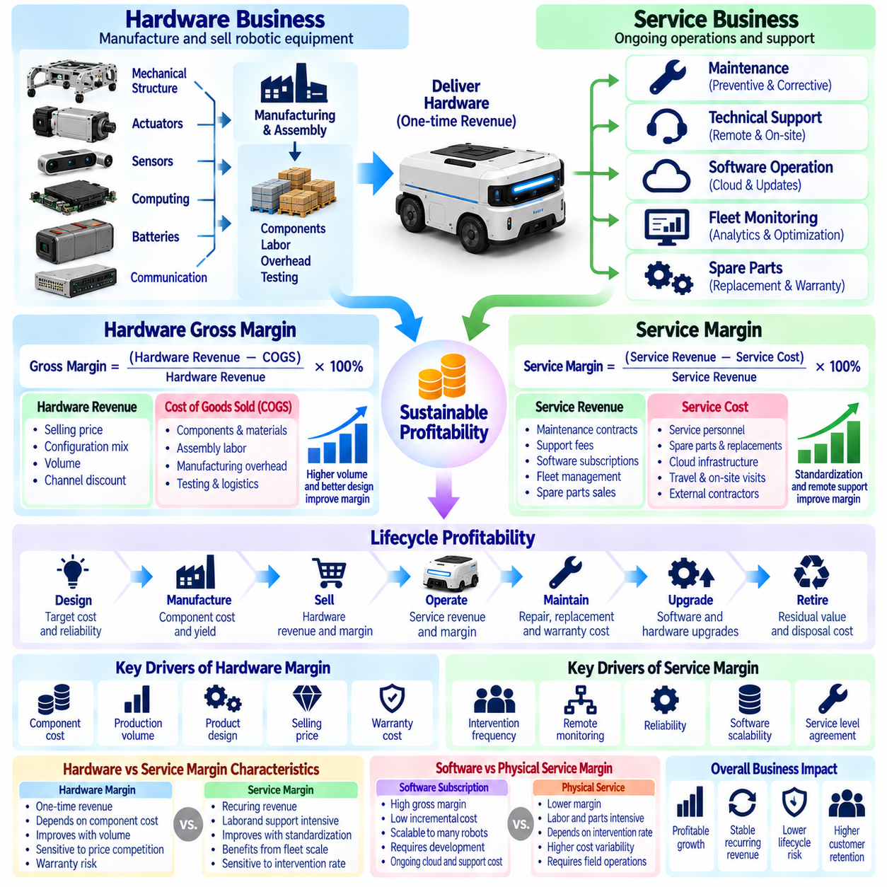{width="7.268055555555556in" height="7.268055555555556in"}

Hardware gross margin and service margin are fundamental indicators of profitability in Physical AI businesses. Hardware gross margin measures the profitability of manufacturing and selling robotic equipment, while service margin evaluates the economics of delivering ongoing operational support. These measures reveal different cost structures and business risks. Understanding their relationship is essential for developing sustainable pricing, product strategies, and recurring revenue models.

Hardware gross margin is calculated by subtracting the cost of goods sold from hardware revenue and dividing the result by hardware revenue. The cost of goods sold includes materials, purchased components, assembly labor, manufacturing overhead, and applicable production testing expenses. A positive margin indicates that equipment revenue exceeds its direct production costs. However, it does not necessarily cover research, development, sales, or corporate administration expenses.

Physical AI hardware typically combines mechanical structures, actuators, sensors, computing modules, batteries, and communication devices. Component costs vary according to performance requirements, supplier availability, production volume, and technical specifications. High-performance actuators and specialized sensing systems can represent substantial portions of manufacturing cost. Effective margin management requires detailed component-level cost visibility and disciplined engineering tradeoffs.

Manufacturing scale can improve hardware gross margin through volume purchasing, process optimization, and improved production yields. Higher production quantities may reduce component prices and distribute fixed manufacturing overhead across more units. Nevertheless, scaling also introduces inventory exposure, quality control requirements, and working capital demands. Margin projections should distinguish demonstrated manufacturing efficiencies from anticipated economies of scale.

Product architecture strongly influences manufacturing economics. Modular hardware designs, standardized interfaces, common components, and reusable subsystems can reduce assembly complexity and procurement costs. Design for manufacturability and design for assembly help minimize production steps and quality defects. Engineering decisions should balance cost reduction with reliability, maintainability, safety, and performance rather than optimizing manufacturing cost alone.

Hardware pricing must reflect market competition, customer value, product differentiation, and required profitability. Premium robotic capabilities may support higher selling prices when they create measurable operational benefits. However, aggressive discounting can reduce margins even when manufacturing efficiency improves. Providers should evaluate selling price, configuration mix, warranty exposure, and channel discounts together when establishing hardware profitability targets.

Service margin measures the profitability of recurring activities such as maintenance, technical support, software operations, fleet monitoring, and field servicing. It is generally calculated by subtracting the cost of delivering services from associated service revenue and dividing by service revenue. Service costs may include personnel, spare parts, cloud infrastructure, communications, and external contractors. Accurate classification is necessary for meaningful margin comparisons.

Service contracts can generate predictable recurring revenue, but profitability depends on the actual workload required to fulfill customer obligations. Unlimited support commitments, frequent site visits, and extensive customization can create unexpected expenses. Service-level agreements define response times, availability targets, and support responsibilities. Pricing should reflect these commitments and include sufficient allowance for expected maintenance and intervention requirements.

Maintenance service economics are closely connected to equipment reliability and lifecycle behavior. Robots operating in demanding environments may require more frequent inspections, component replacements, and corrective repairs. Battery degradation, actuator wear, and sensor failures can increase support costs as fleets age. Service margin forecasts should incorporate realistic failure distributions and replacement schedules rather than assuming constant maintenance expense.

Remote monitoring and predictive maintenance can improve service margins by reducing unnecessary site visits and identifying developing failures before major interruptions occur. Fleet telemetry, diagnostic analytics, and automated alerts support more efficient maintenance scheduling. However, these capabilities require software development, data infrastructure, and specialized personnel. Their economic value depends on whether avoided service costs exceed the expenses of implementation.

Software subscriptions often exhibit different margin characteristics from physical maintenance services. Once developed, software functionality may be delivered to additional robots at relatively low incremental cost, although cloud processing, cybersecurity, support, and licensing expenses remain. Shared software platforms can support scalable recurring revenue. Providers should separate software subscription margins from labor-intensive service margins to identify the underlying profitability drivers.

Warranty obligations create an important connection between hardware and service economics. Manufacturing defects or premature component failures may generate repair expenses after equipment delivery. Warranty provisions should reflect expected claims and applicable accounting requirements. Poor product quality can initially appear as acceptable hardware profitability while creating substantial future support liabilities. Integrated lifecycle analysis is therefore essential.

Hardware and service margins may be influenced by different revenue recognition and cost allocation practices. Equipment revenue is commonly recognized when contractual performance obligations are satisfied, while recurring service revenue is generally recognized over the service period. Bundled contracts require appropriate allocation of transaction prices and related costs. Consistent accounting treatment prevents misleading comparisons between hardware and service performance.

Robot-as-a-Service business models combine hardware investment with continuing service delivery. Providers retain significant equipment-related financial exposure while receiving revenue over time. Depreciation, financing costs, maintenance, and operational support must be incorporated into contract economics using consistent accounting and cash flow models. A positive reported service margin does not automatically imply that the underlying robot investment earns an adequate financial return.

Installed fleet size influences service profitability through shared infrastructure and operating efficiency. Centralized monitoring, standardized maintenance procedures, and common spare parts inventories can reduce average support costs. However, geographic dispersion, customer-specific requirements, and increasing fleet age may offset these benefits. Service margin analysis should therefore distinguish scale advantages from the additional complexity associated with fleet expansion.

Customer segmentation can reveal substantial differences in hardware and service margins. Large industrial customers may negotiate lower equipment prices but purchase extensive support contracts, while smaller customers may require higher onboarding effort per robot. Operating conditions, geographic location, contract duration, and customization requirements also affect profitability. Segment-level analysis helps providers identify attractive customer profiles and establish differentiated pricing strategies.

Margin optimization requires coordination between engineering, manufacturing, commercial, and service organizations. Reducing component costs may improve hardware margins but increase maintenance expenses if reliability declines. Conversely, more durable components may reduce immediate hardware profitability while improving lifecycle service economics. Cross-functional decisions should consider total contract contribution and customer value rather than maximizing individual margins independently.

Performance monitoring should track hardware gross margin by product configuration and service margin by contract, customer, and fleet. Useful operational indicators include component cost variance, manufacturing yield, warranty claims, service hours, repair frequency, and support cost per active robot. Comparing planned and realized margins reveals pricing weaknesses and operational inefficiencies. These measurements also support product redesign and more accurate future quotations.

Long-term profitability depends on balancing hardware competitiveness with sustainable service delivery. Excessively low equipment margins may require unrealistic future service earnings, while overpriced support contracts can discourage customer adoption. Providers should evaluate combined lifecycle margins, capital requirements, renewal probability, and customer retention. Transparent cost allocation and realistic assumptions are essential for maintaining financial discipline.

Ultimately, hardware gross margin and service margin provide complementary views of Physical AI business performance. Hardware margins reflect product design, sourcing, manufacturing, and pricing effectiveness, while service margins reflect operational reliability, support efficiency, and recurring delivery costs. Organizations that manage both within an integrated lifecycle framework can improve profitability, strengthen customer relationships, and support scalable business growth.

하드웨어 매출총이익률(Hardware Gross Margin)과 서비스 이익률(Service Margin)은 피지컬 인공지능 사업(Physical AI Businesses)의 수익성(Profitability)을 평가하는 기본적인 지표이다. 하드웨어 매출총이익률은 로봇 장비(Robotic Equipment)의 제조 및 판매 수익성을 측정하며, 서비스 이익률은 지속적인 운영 지원(Ongoing Operational Support)을 제공하는 경제성을 평가한다. 이러한 지표는 서로 다른 비용 구조(Cost Structures)와 사업 위험(Business Risks)을 보여준다. 두 지표의 관계를 이해하는 것은 지속 가능한 가격 전략(Pricing Strategies), 제품 전략(Product Strategies), 반복 매출 모델(Recurring Revenue Models)을 개발하는 데 필수적이다.

하드웨어 매출총이익률(Hardware Gross Margin)은 하드웨어 매출(Hardware Revenue)에서 매출원가(Cost of Goods Sold, COGS)를 차감한 금액을 하드웨어 매출로 나누어 계산한다. 매출원가에는 원자재(Materials), 구매 부품(Purchased Components), 조립 인건비(Assembly Labor), 제조 간접비(Manufacturing Overhead), 해당 생산시험 비용(Production Testing Expenses)이 포함된다. 양(+)의 이익률(Positive Margin)은 장비 매출(Equipment Revenue)이 직접 생산비용(Direct Production Costs)을 초과한다는 의미이다. 그러나 이것이 연구(Research), 개발(Development), 영업(Sales), 기업 관리비(Corporate Administration Expenses)까지 충당한다는 것을 반드시 의미하지는 않는다.

피지컬 인공지능 하드웨어(Physical AI Hardware)는 일반적으로 기계 구조물(Mechanical Structures), 액추에이터(Actuators), 센서(Sensors), 컴퓨팅 모듈(Computing Modules), 배터리(Batteries), 통신 장치(Communication Devices)로 구성된다. 부품 원가(Component Costs)는 성능 요구사항(Performance Requirements), 공급업체 가용성(Supplier Availability), 생산량(Production Volume), 기술 사양(Technical Specifications)에 따라 달라진다. 고성능 액추에이터(High-Performance Actuators)와 특수 센싱 시스템(Specialized Sensing Systems)은 제조원가(Manufacturing Cost)의 상당 부분을 차지할 수 있다. 효과적인 이익률 관리(Margin Management)를 위해서는 부품 수준의 상세한 원가 가시성(Component-Level Cost Visibility)과 체계적인 엔지니어링 절충(Engineering Tradeoffs)이 필요하다.

제조 규모 확대(Manufacturing Scale)는 대량 구매(Volume Purchasing), 공정 최적화(Process Optimization), 생산 수율 개선(Improved Production Yields)을 통해 하드웨어 매출총이익률(Hardware Gross Margin)을 높일 수 있다. 생산 수량(Production Quantities)이 증가하면 부품 가격(Component Prices)이 낮아지고 고정 제조 간접비(Fixed Manufacturing Overhead)가 더 많은 제품에 분산될 수 있다. 그러나 생산 확대(Scaling)는 재고 위험(Inventory Exposure), 품질관리 요구사항(Quality Control Requirements), 운전자본 수요(Working Capital Demands)도 증가시킨다. 이익률 예측(Margin Projections)에서는 이미 입증된 제조 효율성(Demonstrated Manufacturing Efficiencies)과 예상되는 규모의 경제(Anticipated Economies of Scale)를 구분해야 한다.

제품 아키텍처(Product Architecture)는 제조 경제성(Manufacturing Economics)에 큰 영향을 미친다. 모듈형 하드웨어 설계(Modular Hardware Designs), 표준화된 인터페이스(Standardized Interfaces), 공통 부품(Common Components), 재사용 가능한 하위 시스템(Reusable Subsystems)은 조립 복잡성(Assembly Complexity)과 조달 비용(Procurement Costs)을 줄일 수 있다. 제조 용이성 설계(Design for Manufacturability, DFM)와 조립 용이성 설계(Design for Assembly, DFA)는 생산 공정(Production Steps)과 품질 불량(Quality Defects)을 최소화하는 데 도움이 된다. 엔지니어링 의사결정(Engineering Decisions)은 제조원가만 최적화하기보다 원가 절감(Cost Reduction)과 신뢰성(Reliability), 유지보수성(Maintainability), 안전성(Safety), 성능(Performance) 사이의 균형을 고려해야 한다.

하드웨어 가격 책정(Hardware Pricing)은 시장 경쟁(Market Competition), 고객 가치(Customer Value), 제품 차별화(Product Differentiation), 요구 수익성(Required Profitability)을 반영해야 한다. 고급 로봇 기능(Premium Robotic Capabilities)은 측정 가능한 운영 편익(Measurable Operational Benefits)을 창출할 경우 더 높은 판매 가격(Higher Selling Prices)을 정당화할 수 있다. 그러나 공격적인 할인(Aggressive Discounting)은 제조 효율성(Manufacturing Efficiency)이 개선되더라도 이익률(Margins)을 감소시킬 수 있다. 공급업체(Providers)는 하드웨어 수익성 목표(Hardware Profitability Targets)를 수립할 때 판매 가격(Selling Price), 제품 구성 비중(Configuration Mix), 보증 비용 위험(Warranty Exposure), 판매 채널 할인(Channel Discounts)을 함께 평가해야 한다.

서비스 이익률(Service Margin)은 유지보수(Maintenance), 기술 지원(Technical Support), 소프트웨어 운영(Software Operations), 로봇군 모니터링(Fleet Monitoring), 현장 서비스(Field Servicing)와 같은 반복적인 활동(Recurring Activities)의 수익성을 측정한다. 일반적으로 관련 서비스 매출(Service Revenue)에서 서비스 제공 원가(Cost of Delivering Services)를 차감한 금액을 서비스 매출로 나누어 계산한다. 서비스 비용(Service Costs)에는 인력(Personnel), 예비 부품(Spare Parts), 클라우드 인프라(Cloud Infrastructure), 통신(Communications), 외부 계약업체(External Contractors)가 포함될 수 있다. 의미 있는 이익률 비교(Margin Comparisons)를 위해서는 정확한 비용 분류(Accurate Classification)가 필요하다.

서비스 계약(Service Contracts)은 예측 가능한 반복 매출(Predictable Recurring Revenue)을 창출할 수 있지만, 수익성은 고객 의무(Customer Obligations)를 이행하는 데 필요한 실제 작업량(Actual Workload)에 따라 달라진다. 무제한 지원 약정(Unlimited Support Commitments), 빈번한 현장 방문(Frequent Site Visits), 광범위한 맞춤화(Extensive Customization)는 예상하지 못한 비용(Unexpected Expenses)을 발생시킬 수 있다. 서비스 수준 협약(Service-Level Agreements, SLAs)은 대응시간(Response Times), 가용성 목표(Availability Targets), 지원 책임(Support Responsibilities)을 정의한다. 가격 책정(Pricing)은 이러한 약정을 반영하고 예상 유지보수 및 개입 요구사항(Expected Maintenance and Intervention Requirements)을 충당할 수 있는 충분한 비용 여유를 포함해야 한다.

유지보수 서비스 경제성(Maintenance Service Economics)은 장비 신뢰성(Equipment Reliability)과 수명주기 특성(Lifecycle Behavior)에 밀접하게 연결된다. 가혹한 환경(Demanding Environments)에서 운영되는 로봇은 더 빈번한 점검(Inspections), 부품 교체(Component Replacements), 고장 수리(Corrective Repairs)가 필요할 수 있다. 배터리 성능 저하(Battery Degradation), 액추에이터 마모(Actuator Wear), 센서 고장(Sensor Failures)은 로봇군(Fleets)이 노후화됨에 따라 지원 비용(Support Costs)을 증가시킬 수 있다. 서비스 이익률 예측(Service Margin Forecasts)은 유지보수 비용(Maintenance Expense)이 일정하다고 가정하기보다 현실적인 고장 분포(Failure Distributions)와 교체 일정(Replacement Schedules)을 반영해야 한다.

원격 모니터링(Remote Monitoring)과 예지보전(Predictive Maintenance)은 불필요한 현장 방문(Unnecessary Site Visits)을 줄이고 심각한 운영 중단(Major Interruptions)이 발생하기 전에 고장 징후(Developing Failures)를 식별함으로써 서비스 이익률(Service Margins)을 개선할 수 있다. 로봇군 원격측정 데이터(Fleet Telemetry), 진단 분석(Diagnostic Analytics), 자동 경보(Automated Alerts)는 더욱 효율적인 유지보수 일정 관리(Maintenance Scheduling)를 지원한다. 그러나 이러한 기능에는 소프트웨어 개발(Software Development), 데이터 인프라(Data Infrastructure), 전문 인력(Specialized Personnel)이 필요하다. 경제적 가치(Economic Value)는 회피된 서비스 비용(Avoided Service Costs)이 구현 비용(Implementation Expenses)을 초과하는지에 따라 결정된다.

소프트웨어 구독(Software Subscriptions)은 물리적 유지보수 서비스(Physical Maintenance Services)와 다른 이익률 특성(Margin Characteristics)을 보이는 경우가 많다. 소프트웨어 기능(Software Functionality)은 일단 개발되면 비교적 낮은 증분 비용(Incremental Cost)으로 추가 로봇에 제공될 수 있지만, 클라우드 처리(Cloud Processing), 사이버보안(Cybersecurity), 지원(Support), 라이선스 비용(Licensing Expenses)은 계속 발생한다. 공유 소프트웨어 플랫폼(Shared Software Platforms)은 확장 가능한 반복 매출(Scalable Recurring Revenue)을 지원할 수 있다. 공급업체는 근본적인 수익성 결정 요인(Underlying Profitability Drivers)을 파악하기 위해 소프트웨어 구독 이익률(Software Subscription Margins)과 노동집약적 서비스 이익률(Labor-Intensive Service Margins)을 구분해야 한다.

보증 의무(Warranty Obligations)는 하드웨어 경제성(Hardware Economics)과 서비스 경제성(Service Economics)을 연결하는 중요한 요소이다. 제조 결함(Manufacturing Defects)이나 조기 부품 고장(Premature Component Failures)은 장비 납품(Equipment Delivery) 이후 수리 비용(Repair Expenses)을 발생시킬 수 있다. 보증충당부채(Warranty Provisions)는 예상 보증 청구(Expected Claims)와 적용 가능한 회계 요구사항(Applicable Accounting Requirements)을 반영해야 한다. 낮은 제품 품질(Poor Product Quality)은 초기에는 수용 가능한 하드웨어 수익성(Acceptable Hardware Profitability)으로 나타나더라도 향후 상당한 지원 부채(Future Support Liabilities)를 발생시킬 수 있다. 따라서 통합 수명주기 분석(Integrated Lifecycle Analysis)이 필수적이다.

하드웨어 및 서비스 이익률(Hardware and Service Margins)은 서로 다른 매출 인식(Revenue Recognition) 및 원가 배분(Cost Allocation) 관행의 영향을 받을 수 있다. 장비 매출(Equipment Revenue)은 일반적으로 계약상 수행의무(Contractual Performance Obligations)가 충족될 때 인식되며, 반복 서비스 매출(Recurring Service Revenue)은 일반적으로 서비스 제공기간(Service Period)에 걸쳐 인식된다. 결합 계약(Bundled Contracts)에서는 거래가격(Transaction Prices)과 관련 비용(Related Costs)을 적절하게 배분해야 한다. 일관된 회계 처리(Consistent Accounting Treatment)는 하드웨어와 서비스 성과(Hardware and Service Performance) 사이의 오해를 유발하는 비교(Misleading Comparisons)를 방지한다.

서비스형 로봇(Robot-as-a-Service, RaaS) 사업 모델은 하드웨어 투자(Hardware Investment)와 지속적인 서비스 제공(Continuing Service Delivery)을 결합한다. 공급업체는 상당한 장비 관련 재무적 위험(Equipment-Related Financial Exposure)을 부담하면서 일정 기간에 걸쳐 매출(Revenue)을 수령한다. 감가상각(Depreciation), 금융 비용(Financing Costs), 유지보수(Maintenance), 운영 지원(Operational Support)은 일관된 회계 및 현금흐름 모델(Accounting and Cash Flow Models)을 사용하여 계약 경제성(Contract Economics)에 반영해야 한다. 보고된 서비스 이익률(Reported Service Margin)이 양(+)의 값을 나타내더라도 기초 로봇 투자(Underlying Robot Investment)가 적절한 재무적 수익(Adequate Financial Return)을 창출한다는 의미는 아니다.

설치된 로봇군 규모(Installed Fleet Size)는 공유 인프라(Shared Infrastructure)와 운영 효율성(Operating Efficiency)을 통해 서비스 수익성(Service Profitability)에 영향을 미친다. 중앙집중식 모니터링(Centralized Monitoring), 표준화된 유지보수 절차(Standardized Maintenance Procedures), 공통 예비 부품 재고(Common Spare Parts Inventories)는 평균 지원 비용(Average Support Costs)을 줄일 수 있다. 그러나 지리적 분산(Geographic Dispersion), 고객별 요구사항(Customer-Specific Requirements), 로봇군 노후화(Increasing Fleet Age)는 이러한 편익을 상쇄할 수 있다. 따라서 서비스 이익률 분석(Service Margin Analysis)은 규모 확대의 이점(Scale Advantages)과 로봇군 확장(Fleet Expansion)에 따른 추가 복잡성(Additional Complexity)을 구분해야 한다.

고객 세분화(Customer Segmentation)는 하드웨어 및 서비스 이익률(Hardware and Service Margins)의 상당한 차이를 보여줄 수 있다. 대규모 산업 고객(Large Industrial Customers)은 낮은 장비 가격(Lower Equipment Prices)을 협상하는 대신 광범위한 지원 계약(Extensive Support Contracts)을 구매할 수 있으며, 소규모 고객(Smaller Customers)은 로봇당 더 많은 초기 도입 지원(Onboarding Effort)이 필요할 수 있다. 운영 조건(Operating Conditions), 지리적 위치(Geographic Location), 계약기간(Contract Duration), 맞춤화 요구사항(Customization Requirements)도 수익성(Profitability)에 영향을 미친다. 고객 세그먼트 수준 분석(Segment-Level Analysis)은 공급업체가 매력적인 고객 유형(Attractive Customer Profiles)을 식별하고 차별화된 가격 전략(Differentiated Pricing Strategies)을 수립하는 데 도움이 된다.

이익률 최적화(Margin Optimization)를 위해서는 엔지니어링(Engineering), 제조(Manufacturing), 영업(Commercial), 서비스 조직(Service Organizations) 간의 협력이 필요하다. 부품 원가 절감(Component Cost Reduction)은 하드웨어 이익률(Hardware Margins)을 개선할 수 있지만 신뢰성(Reliability)이 저하되면 유지보수 비용(Maintenance Expenses)이 증가할 수 있다. 반대로 내구성이 높은 부품(More Durable Components)은 초기 하드웨어 수익성(Immediate Hardware Profitability)을 낮추더라도 수명주기 서비스 경제성(Lifecycle Service Economics)을 개선할 수 있다. 부서 간 의사결정(Cross-Functional Decisions)은 개별 이익률(Individual Margins)을 독립적으로 극대화하기보다 전체 계약 공헌이익(Total Contract Contribution)과 고객 가치(Customer Value)를 고려해야 한다.

성과 모니터링(Performance Monitoring)은 제품 구성(Product Configuration)별 하드웨어 매출총이익률(Hardware Gross Margin)과 계약(Contract), 고객(Customer), 로봇군(Fleet)별 서비스 이익률(Service Margin)을 추적해야 한다. 유용한 운영 지표(Operational Indicators)에는 부품 원가 차이(Component Cost Variance), 제조 수율(Manufacturing Yield), 보증 청구(Warranty Claims), 서비스 작업시간(Service Hours), 수리 빈도(Repair Frequency), 활성 로봇당 지원 비용(Support Cost per Active Robot)이 포함된다. 계획 이익률(Planned Margins)과 실현 이익률(Realized Margins)을 비교하면 가격 책정의 취약점(Pricing Weaknesses)과 운영 비효율성(Operational Inefficiencies)을 파악할 수 있다. 이러한 측정은 제품 재설계(Product Redesign)와 더욱 정확한 향후 견적(Future Quotations)도 지원한다.

장기 수익성(Long-Term Profitability)은 하드웨어 경쟁력(Hardware Competitiveness)과 지속 가능한 서비스 제공(Sustainable Service Delivery) 사이의 균형에 달려 있다. 지나치게 낮은 장비 이익률(Excessively Low Equipment Margins)은 비현실적인 미래 서비스 수익(Future Service Earnings)에 의존하게 만들 수 있으며, 과도하게 높은 지원 계약 가격(Overpriced Support Contracts)은 고객 도입(Customer Adoption)을 저해할 수 있다. 공급업체는 통합 수명주기 이익률(Combined Lifecycle Margins), 자본 요구사항(Capital Requirements), 계약 갱신 가능성(Renewal Probability), 고객 유지율(Customer Retention)을 평가해야 한다. 투명한 원가 배분(Transparent Cost Allocation)과 현실적인 가정(Realistic Assumptions)은 재무적 규율(Financial Discipline)을 유지하는 데 필수적이다.

궁극적으로 하드웨어 매출총이익률(Hardware Gross Margin)과 서비스 이익률(Service Margin)은 피지컬 인공지능 사업 성과(Physical AI Business Performance)를 상호 보완적인 관점(Complementary Views)에서 보여준다. 하드웨어 이익률(Hardware Margins)은 제품 설계(Product Design), 부품 조달(Sourcing), 제조(Manufacturing), 가격 책정(Pricing)의 효과성을 반영하며, 서비스 이익률(Service Margins)은 운영 신뢰성(Operational Reliability), 지원 효율성(Support Efficiency), 반복적인 서비스 제공 비용(Recurring Delivery Costs)을 반영한다. 통합 수명주기 프레임워크(Integrated Lifecycle Framework) 안에서 두 지표를 함께 관리하는 조직은 수익성(Profitability)을 개선하고 고객 관계(Customer Relationships)를 강화하며 확장 가능한 사업 성장(Scalable Business Growth)을 지원할 수 있다.

##  

## 08.18. Utilization Uptime and Revenue Efficiency

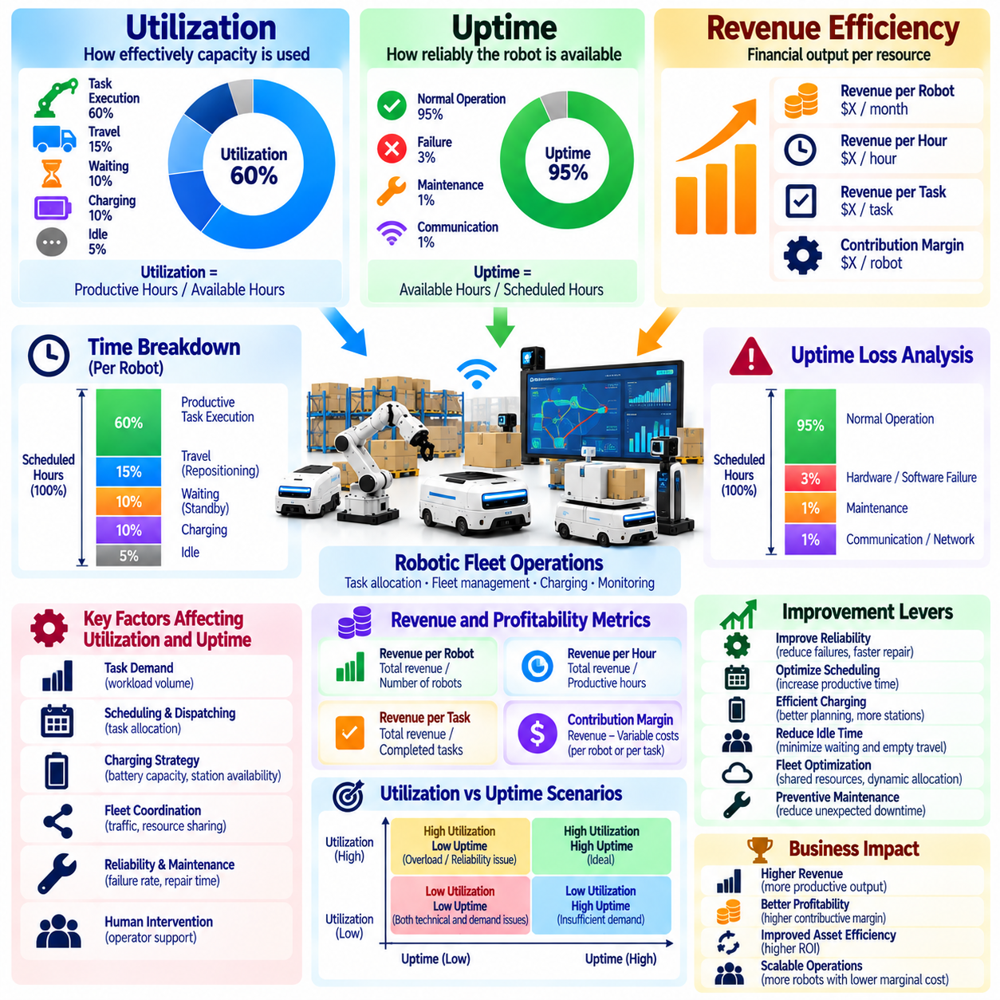{width="7.268055555555556in" height="7.268055555555556in"}

Utilization, uptime, and revenue efficiency are essential measures of economic performance in Physical AI operations. Utilization indicates how effectively robotic capacity is used, uptime measures operational availability, and revenue efficiency evaluates financial output relative to deployed resources. These indicators connect technical reliability with commercial performance. Their combined analysis helps providers identify whether robotic assets generate sufficient value throughout their operating lives.

Utilization measures the proportion of available operating time devoted to productive activities. A robot may remain powered on and technically available without completing economically valuable work. Waiting for assignments, traveling without payloads, and remaining idle between missions can reduce effective utilization. Accurate measurement requires distinguishing productive task execution from standby time, repositioning, charging, and other nonproductive activities.

Uptime describes the proportion of scheduled operating time during which a robot is capable of performing its intended functions. Hardware failures, software crashes, communication interruptions, and safety-related shutdowns can reduce uptime. High uptime is necessary for dependable service delivery but does not guarantee high productivity. A robot may achieve excellent technical availability while remaining underutilized because customer demand or task scheduling is insufficient.

Availability and utilization should be measured using clearly defined denominators. Scheduled operating hours, technically available hours, and productive operating hours represent different quantities. Availability can be calculated as available hours divided by scheduled hours, while utilization can be expressed as productive hours divided by available hours. Consistent definitions prevent misleading comparisons between robots, customer sites, and reporting periods.

Revenue efficiency measures the relationship between generated revenue and the resources required to produce it. Common indicators include revenue per active robot, revenue per productive hour, and revenue per completed task. These measures vary according to pricing models and customer contracts. Equipment sales, subscriptions, and usage-based services require different interpretations because revenue recognition and operational activity do not necessarily occur simultaneously.

Robot-as-a-Service business models depend particularly strongly on productive utilization. Providers often retain ownership of robotic assets while collecting recurring fees from customers. Fixed monthly subscriptions may produce stable revenue even when utilization fluctuates, but low activity can weaken customer retention and renewal prospects. Usage-based contracts directly connect revenue to completed work, making operational efficiency a critical determinant of financial performance.

The relationship between uptime and utilization creates a useful framework for diagnosing performance limitations. Low uptime indicates technical reliability or maintenance problems, while high uptime combined with low utilization suggests insufficient demand, poor scheduling, or workflow constraints. High utilization with frequent failures may indicate excessive operating intensity. Distinguishing these conditions allows providers to select appropriate operational and commercial improvements.

Task success rate is another important factor in revenue efficiency. Robots may spend considerable time executing missions that fail, require human intervention, or must be repeated. Such activity consumes energy, equipment life, and support resources without delivering proportional customer value. Effective productivity should therefore be measured using successfully completed tasks rather than attempted missions or total movement distance.

Charging behavior can significantly influence productive operating capacity. Battery capacity, charging duration, charging station availability, and scheduling strategies determine how much time robots can perform useful work. Poor charging coordination may create bottlenecks during peak demand periods. Fleet-level optimization can improve utilization by distributing charging activities across lower-demand periods while preserving sufficient energy reserves for reliable operation.

Fleet scheduling and task allocation influence both utilization and revenue generation. Intelligent dispatching can reduce idle time, unnecessary travel, and competition for shared resources. However, maximizing individual robot activity does not always maximize total system throughput. Coordinated fleet management should prioritize successful task completion, balanced workloads, and customer service requirements rather than keeping every robot continuously occupied.

Demand variability introduces additional complexity into utilization modeling. Warehouses, factories, hospitals, and service environments may experience changing workloads across shifts, weekdays, or seasons. Robots sized for peak demand can remain underutilized during quieter periods. Financial models should account for realistic demand profiles and evaluate whether flexible fleet allocation, shared capacity, or adjusted service contracts can improve asset efficiency.

Revenue per robot must be interpreted alongside operating costs and capital requirements. A robot generating substantial revenue may still produce weak financial returns if maintenance, supervision, energy, or financing expenses are excessive. Contribution margin per active robot provides a more informative measure of economic performance. Providers should connect revenue efficiency with lifecycle profitability rather than treating revenue growth as sufficient evidence of business success.

Marginal utilization becomes important when expanding a robotic fleet. Adding robots may increase total capacity without increasing demand proportionally, reducing average utilization. Conversely, insufficient fleet capacity can create missed orders, delayed missions, and service-level violations. Expansion decisions should compare incremental revenue opportunities against equipment investment and additional operating costs under realistic workload conditions.

Maintenance planning influences the balance between uptime and long-term reliability. Preventive maintenance requires scheduled interruptions but can reduce unexpected failures and expensive repairs. Delaying maintenance to maximize short-term uptime may increase future downtime and component replacement costs. Effective asset management evaluates maintenance timing according to total productive availability, operational risk, and lifecycle economic performance.

Human intervention affects both utilization and service profitability. Navigation exceptions, manipulation failures, and recovery procedures can interrupt productive operation and require supervisory labor. Remote assistance may restore service quickly, but frequent intervention increases operating costs. Providers should monitor intervention frequency, recovery duration, and support cost per successful mission to determine whether autonomy improvements generate measurable financial benefits.

Performance measurement requires reliable operational data. Fleet management systems can record robot states, mission assignments, task completion, charging periods, failures, and maintenance events. Integrating these records with contract and billing information enables revenue efficiency analysis. Data definitions should remain consistent across hardware generations, customer environments, and software versions to support meaningful comparisons.

Service-level agreements connect technical performance with commercial obligations. Contracts may specify availability targets, response times, mission completion requirements, or throughput commitments. Failure to meet these conditions can result in penalties, service credits, or customer dissatisfaction. Revenue efficiency models should consider the financial consequences of missed performance targets and the operational costs required to maintain contractual service quality.

Optimization efforts should avoid treating maximum utilization as an unconditional objective. Robots operating continuously may experience accelerated wear, insufficient maintenance windows, and reduced flexibility during demand surges. Some reserve capacity is valuable for handling unexpected tasks and equipment failures. The economically optimal utilization level balances productive output, reliability, customer responsiveness, and the marginal cost of additional activity.

Continuous improvement requires comparing expected and realized performance across the deployed fleet. Providers should examine utilization trends, downtime causes, successful task volumes, revenue per robot, and contribution margins. Differences between customer sites may reveal workflow limitations or opportunities for software improvements. These insights can guide fleet resizing, pricing adjustments, maintenance strategies, and future deployment planning.

Ultimately, utilization, uptime, and revenue efficiency translate robotic operating performance into measurable business outcomes. Uptime establishes technical readiness, utilization determines how effectively capacity is employed, and revenue efficiency evaluates the commercial value generated. Physical AI providers that manage these indicators together can improve asset productivity, strengthen contract profitability, and scale robotic services with greater financial discipline.

활용률(Utilization), 가동률(Uptime), 매출 효율성(Revenue Efficiency)은 피지컬 인공지능 운영(Physical AI Operations)의 경제적 성과(Economic Performance)를 평가하는 핵심 지표이다. 활용률은 로봇 용량(Robotic Capacity)이 얼마나 효과적으로 사용되는지를 나타내고, 가동률은 운영 가용성(Operational Availability)을 측정하며, 매출 효율성은 배포된 자원(Deployed Resources) 대비 재무적 산출(Financial Output)을 평가한다. 이러한 지표는 기술적 신뢰성(Technical Reliability)과 상업적 성과(Commercial Performance)를 연결한다. 통합 분석(Combined Analysis)을 통해 공급업체는 로봇 자산(Robotic Assets)이 전체 운영 수명(Operating Lives)에 걸쳐 충분한 가치를 창출하는지 파악할 수 있다.

활용률(Utilization)은 사용 가능한 운영시간(Available Operating Time) 중 생산적 활동(Productive Activities)에 사용된 시간의 비율을 측정한다. 로봇은 전원이 켜져 있고 기술적으로 사용 가능한 상태(Technically Available State)이더라도 경제적으로 가치 있는 작업(Economically Valuable Work)을 완료하지 못할 수 있다. 작업 배정을 기다리거나 적재물 없이 이동하거나 임무 사이에 유휴 상태(Idle State)로 머무는 것은 실효 활용률(Effective Utilization)을 감소시킬 수 있다. 정확한 측정(Accurate Measurement)을 위해서는 생산적 작업 수행(Productive Task Execution)을 대기시간(Standby Time), 위치 재조정(Repositioning), 충전(Charging), 기타 비생산적 활동(Nonproductive Activities)과 구분해야 한다.

가동률(Uptime)은 예정된 운영시간(Scheduled Operating Time) 중 로봇이 의도된 기능(Intended Functions)을 수행할 수 있는 상태로 유지되는 시간의 비율을 나타낸다. 하드웨어 고장(Hardware Failures), 소프트웨어 충돌(Software Crashes), 통신 중단(Communication Interruptions), 안전 관련 정지(Safety-Related Shutdowns)는 가동률을 감소시킬 수 있다. 높은 가동률(High Uptime)은 안정적인 서비스 제공(Dependable Service Delivery)에 필요하지만 높은 생산성(High Productivity)을 보장하지는 않는다. 로봇은 기술적 가용성(Technical Availability)이 우수하더라도 고객 수요(Customer Demand)나 작업 일정(Task Scheduling)이 부족하면 낮은 활용률(Underutilization)을 보일 수 있다.

가용성(Availability)과 활용률(Utilization)은 명확하게 정의된 분모(Clearly Defined Denominators)를 사용하여 측정해야 한다. 예정 운영시간(Scheduled Operating Hours), 기술적으로 사용 가능한 시간(Technically Available Hours), 생산적 운영시간(Productive Operating Hours)은 서로 다른 수량을 나타낸다. 가용성은 사용 가능한 시간(Available Hours)을 예정 운영시간(Scheduled Hours)으로 나누어 계산할 수 있으며, 활용률은 생산적 운영시간(Productive Hours)을 사용 가능한 시간(Available Hours)으로 나누어 표현할 수 있다. 일관된 정의(Consistent Definitions)는 로봇, 고객 현장(Customer Sites), 보고기간(Reporting Periods) 사이에서 잘못된 비교(Misleading Comparisons)가 발생하는 것을 방지한다.

매출 효율성(Revenue Efficiency)은 창출된 매출(Generated Revenue)과 이를 생산하는 데 필요한 자원(Resources Required) 사이의 관계를 측정한다. 일반적인 지표(Common Indicators)에는 활성 로봇당 매출(Revenue per Active Robot), 생산적 운영시간당 매출(Revenue per Productive Hour), 완료 작업당 매출(Revenue per Completed Task)이 포함된다. 이러한 지표는 가격 모델(Pricing Models)과 고객 계약(Customer Contracts)에 따라 달라진다. 장비 판매(Equipment Sales), 구독(Subscriptions), 사용량 기반 서비스(Usage-Based Services)는 매출 인식(Revenue Recognition)과 운영 활동(Operational Activity)이 반드시 동시에 발생하지 않으므로 서로 다른 해석이 필요하다.

서비스형 로봇(Robot-as-a-Service, RaaS) 사업 모델은 특히 생산적 활용률(Productive Utilization)에 크게 의존한다. 공급업체(Providers)는 고객으로부터 반복 요금(Recurring Fees)을 수령하면서 로봇 자산(Robotic Assets)의 소유권을 유지하는 경우가 많다. 고정 월간 구독(Fixed Monthly Subscriptions)은 활용률(Utilization)이 변동하더라도 안정적인 매출(Stable Revenue)을 창출할 수 있지만, 낮은 활동 수준(Low Activity)은 고객 유지(Customer Retention)와 계약 갱신 가능성(Renewal Prospects)을 약화시킬 수 있다. 사용량 기반 계약(Usage-Based Contracts)은 매출을 완료된 작업(Completed Work)에 직접 연결하므로 운영 효율성(Operational Efficiency)이 재무 성과(Financial Performance)를 결정하는 핵심 요소가 된다.

가동률(Uptime)과 활용률(Utilization)의 관계는 성능 제약(Performance Limitations)을 진단하는 데 유용한 프레임워크(Framework)를 제공한다. 낮은 가동률(Low Uptime)은 기술적 신뢰성(Technical Reliability)이나 유지보수(Maintenance) 문제를 나타내며, 높은 가동률과 낮은 활용률(High Uptime with Low Utilization)의 조합은 수요 부족(Insufficient Demand), 비효율적인 일정 관리(Poor Scheduling), 작업 흐름 제약(Workflow Constraints)을 시사한다. 잦은 고장(Frequent Failures)을 동반한 높은 활용률(High Utilization)은 과도한 운영 강도(Excessive Operating Intensity)를 나타낼 수 있다. 이러한 상태를 구분하면 공급업체는 적절한 운영 및 상업적 개선(Operational and Commercial Improvements)을 선택할 수 있다.

작업 성공률(Task Success Rate)은 매출 효율성(Revenue Efficiency)에 영향을 미치는 또 다른 중요한 요소이다. 로봇은 실패하거나 인간 개입(Human Intervention)이 필요하거나 반복 수행해야 하는 임무(Missions)를 실행하는 데 상당한 시간을 소비할 수 있다. 이러한 활동은 고객 가치(Customer Value)를 비례적으로 제공하지 못하면서 에너지(Energy), 장비 수명(Equipment Life), 지원 자원(Support Resources)을 소모한다. 따라서 실효 생산성(Effective Productivity)은 시도한 임무(Attempted Missions)나 총 이동거리(Total Movement Distance)가 아니라 성공적으로 완료된 작업(Successfully Completed Tasks)을 기준으로 측정해야 한다.

충전 동작(Charging Behavior)은 생산적 운영 용량(Productive Operating Capacity)에 상당한 영향을 미칠 수 있다. 배터리 용량(Battery Capacity), 충전시간(Charging Duration), 충전 스테이션 가용성(Charging Station Availability), 일정 관리 전략(Scheduling Strategies)은 로봇이 유효한 작업(Useful Work)을 수행할 수 있는 시간을 결정한다. 비효율적인 충전 조정(Poor Charging Coordination)은 최대 수요 시간대(Peak Demand Periods)에 병목현상(Bottlenecks)을 발생시킬 수 있다. 로봇군 수준 최적화(Fleet-Level Optimization)는 안정적인 운영(Reliable Operation)에 필요한 충분한 에너지 예비량(Energy Reserves)을 유지하면서 충전 활동(Charging Activities)을 수요가 낮은 시간대(Lower-Demand Periods)에 분산하여 활용률(Utilization)을 개선할 수 있다.

로봇군 일정 관리(Fleet Scheduling)와 작업 할당(Task Allocation)은 활용률(Utilization)과 매출 창출(Revenue Generation) 모두에 영향을 미친다. 지능형 배차(Intelligent Dispatching)는 유휴시간(Idle Time), 불필요한 이동(Unnecessary Travel), 공유 자원 경쟁(Competition for Shared Resources)을 줄일 수 있다. 그러나 개별 로봇의 활동량(Individual Robot Activity)을 극대화하는 것이 항상 전체 시스템 처리량(Total System Throughput)을 극대화하는 것은 아니다. 조정된 로봇군 관리(Coordinated Fleet Management)는 모든 로봇을 지속적으로 작동시키기보다 성공적인 작업 완료(Successful Task Completion), 균형 잡힌 작업 부하(Balanced Workloads), 고객 서비스 요구사항(Customer Service Requirements)을 우선해야 한다.

수요 변동성(Demand Variability)은 활용률 모델링(Utilization Modeling)에 추가적인 복잡성을 발생시킨다. 창고(Warehouses), 공장(Factories), 병원(Hospitals), 서비스 환경(Service Environments)은 교대조(Shifts), 요일(Weekdays), 계절(Seasons)에 따라 작업 부하(Workloads)가 달라질 수 있다. 최대 수요(Peak Demand)에 맞춰 규모가 결정된 로봇은 수요가 적은 기간(Quieter Periods)에 낮은 활용률(Underutilization)을 보일 수 있다. 재무 모델(Financial Models)은 현실적인 수요 프로파일(Realistic Demand Profiles)을 반영하고 유연한 로봇군 배분(Flexible Fleet Allocation), 공유 용량(Shared Capacity), 조정된 서비스 계약(Adjusted Service Contracts)이 자산 효율성(Asset Efficiency)을 개선할 수 있는지 평가해야 한다.

로봇당 매출(Revenue per Robot)은 운영비용(Operating Costs) 및 자본 요구사항(Capital Requirements)과 함께 해석해야 한다. 상당한 매출(Substantial Revenue)을 창출하는 로봇이라도 유지보수(Maintenance), 감독(Supervision), 에너지(Energy), 금융 비용(Financing Expenses)이 과도하면 낮은 재무적 수익(Weak Financial Returns)을 발생시킬 수 있다. 활성 로봇당 공헌이익(Contribution Margin per Active Robot)은 경제적 성과(Economic Performance)를 평가하는 데 더 유용한 지표를 제공한다. 공급업체는 매출 증가(Revenue Growth)만을 사업 성공(Business Success)의 충분한 근거로 간주하기보다 매출 효율성(Revenue Efficiency)을 수명주기 수익성(Lifecycle Profitability)과 연결해야 한다.

로봇군(Robotic Fleet)을 확장할 때는 한계 활용률(Marginal Utilization)이 중요해진다. 로봇을 추가하면 총용량(Total Capacity)은 증가하지만 수요(Demand)가 비례적으로 증가하지 않을 수 있으며, 이로 인해 평균 활용률(Average Utilization)이 감소할 수 있다. 반대로 로봇군 용량(Fleet Capacity)이 부족하면 주문 기회 상실(Missed Orders), 임무 지연(Delayed Missions), 서비스 수준 위반(Service-Level Violations)이 발생할 수 있다. 확장 의사결정(Expansion Decisions)은 현실적인 작업 부하 조건(Realistic Workload Conditions)에서 증분 매출 기회(Incremental Revenue Opportunities)를 장비 투자(Equipment Investment) 및 추가 운영비용(Additional Operating Costs)과 비교해야 한다.

유지보수 계획(Maintenance Planning)은 가동률(Uptime)과 장기 신뢰성(Long-Term Reliability) 사이의 균형에 영향을 미친다. 예방 정비(Preventive Maintenance)는 계획된 운영 중단(Scheduled Interruptions)을 필요로 하지만 예상하지 못한 고장(Unexpected Failures)과 고비용 수리(Expensive Repairs)를 줄일 수 있다. 단기 가동률(Short-Term Uptime)을 극대화하기 위해 유지보수를 지연하면 향후 가동 중단시간(Future Downtime)과 부품 교체 비용(Component Replacement Costs)이 증가할 수 있다. 효과적인 자산 관리(Effective Asset Management)는 전체 생산적 가용성(Total Productive Availability), 운영 위험(Operational Risk), 수명주기 경제적 성과(Lifecycle Economic Performance)를 기준으로 유지보수 시점(Maintenance Timing)을 평가한다.

인간 개입(Human Intervention)은 활용률(Utilization)과 서비스 수익성(Service Profitability) 모두에 영향을 미친다. 주행 예외 상황(Navigation Exceptions), 조작 실패(Manipulation Failures), 복구 절차(Recovery Procedures)는 생산적 운영(Productive Operation)을 중단시키고 감독 인력(Supervisory Labor)을 필요로 할 수 있다. 원격 지원(Remote Assistance)은 서비스를 신속하게 복구할 수 있지만 잦은 개입(Frequent Intervention)은 운영비용(Operating Costs)을 증가시킨다. 공급업체는 자율성 개선(Autonomy Improvements)이 측정 가능한 재무적 편익(Measurable Financial Benefits)을 창출하는지 판단하기 위해 개입 빈도(Intervention Frequency), 복구 소요시간(Recovery Duration), 성공적인 임무당 지원 비용(Support Cost per Successful Mission)을 모니터링해야 한다.

성과 측정(Performance Measurement)에는 신뢰할 수 있는 운영 데이터(Reliable Operational Data)가 필요하다. 로봇군 관리 시스템(Fleet Management Systems, FMS)은 로봇 상태(Robot States), 임무 할당(Mission Assignments), 작업 완료(Task Completion), 충전 기간(Charging Periods), 고장(Failures), 유지보수 이벤트(Maintenance Events)를 기록할 수 있다. 이러한 기록을 계약 및 청구 정보(Contract and Billing Information)와 통합하면 매출 효율성 분석(Revenue Efficiency Analysis)이 가능해진다. 의미 있는 비교(Meaningful Comparisons)를 지원하기 위해 데이터 정의(Data Definitions)는 하드웨어 세대(Hardware Generations), 고객 환경(Customer Environments), 소프트웨어 버전(Software Versions)에 걸쳐 일관되게 유지되어야 한다.

서비스 수준 협약(Service-Level Agreements, SLAs)은 기술적 성능(Technical Performance)을 상업적 의무(Commercial Obligations)와 연결한다. 계약(Contracts)에는 가용성 목표(Availability Targets), 대응시간(Response Times), 임무 완료 요구사항(Mission Completion Requirements), 처리량 약정(Throughput Commitments)이 명시될 수 있다. 이러한 조건을 충족하지 못하면 위약금(Penalties), 서비스 크레딧(Service Credits), 고객 불만(Customer Dissatisfaction)이 발생할 수 있다. 매출 효율성 모델(Revenue Efficiency Models)은 성능 목표 미달(Missed Performance Targets)의 재무적 결과(Financial Consequences)와 계약상 서비스 품질(Contractual Service Quality)을 유지하는 데 필요한 운영비용(Operational Costs)을 고려해야 한다.

최적화 활동(Optimization Efforts)에서는 최대 활용률(Maximum Utilization)을 무조건적인 목표(Unconditional Objective)로 취급하지 않아야 한다. 지속적으로 운영되는 로봇은 마모(Accelerated Wear)가 빨라지고 유지보수 가능 시간(Maintenance Windows)이 부족해지며 수요 급증(Demand Surges)에 대응하는 유연성(Flexibility)이 감소할 수 있다. 일정 수준의 예비 용량(Reserve Capacity)은 예상하지 못한 작업(Unexpected Tasks)과 장비 고장(Equipment Failures)에 대응하는 데 가치가 있다. 경제적으로 최적인 활용률(Economically Optimal Utilization Level)은 생산적 산출량(Productive Output), 신뢰성(Reliability), 고객 대응성(Customer Responsiveness), 추가 활동의 한계비용(Marginal Cost of Additional Activity) 사이의 균형을 고려한다.

지속적인 개선(Continuous Improvement)을 위해서는 배포된 로봇군(Deployed Fleet)의 예상 성과(Expected Performance)와 실현 성과(Realized Performance)를 비교해야 한다. 공급업체는 활용률 추세(Utilization Trends), 가동 중단 원인(Downtime Causes), 성공적인 작업량(Successful Task Volumes), 로봇당 매출(Revenue per Robot), 공헌이익(Contribution Margins)을 분석해야 한다. 고객 현장(Customer Sites) 간의 차이는 작업 흐름의 제약(Workflow Limitations)이나 소프트웨어 개선 기회(Software Improvement Opportunities)를 보여줄 수 있다. 이러한 분석 결과(Insights)는 로봇군 규모 조정(Fleet Resizing), 가격 조정(Pricing Adjustments), 유지보수 전략(Maintenance Strategies), 향후 배포 계획(Future Deployment Planning)에 활용될 수 있다.

궁극적으로 활용률(Utilization), 가동률(Uptime), 매출 효율성(Revenue Efficiency)은 로봇 운영 성능(Robotic Operating Performance)을 측정 가능한 사업 성과(Measurable Business Outcomes)로 전환한다. 가동률은 기술적 준비 상태(Technical Readiness)를 나타내고, 활용률은 용량(Capacity)이 얼마나 효과적으로 사용되는지를 결정하며, 매출 효율성은 창출된 상업적 가치(Commercial Value)를 평가한다. 이러한 지표를 통합적으로 관리하는 피지컬 인공지능 공급업체(Physical AI Providers)는 자산 생산성(Asset Productivity)을 개선하고 계약 수익성(Contract Profitability)을 강화하며 더욱 체계적인 재무 관리(Financial Discipline)를 바탕으로 로봇 서비스를 확장할 수 있다.

##  

## 08.19. Data Network Effects and Learning Flywheels

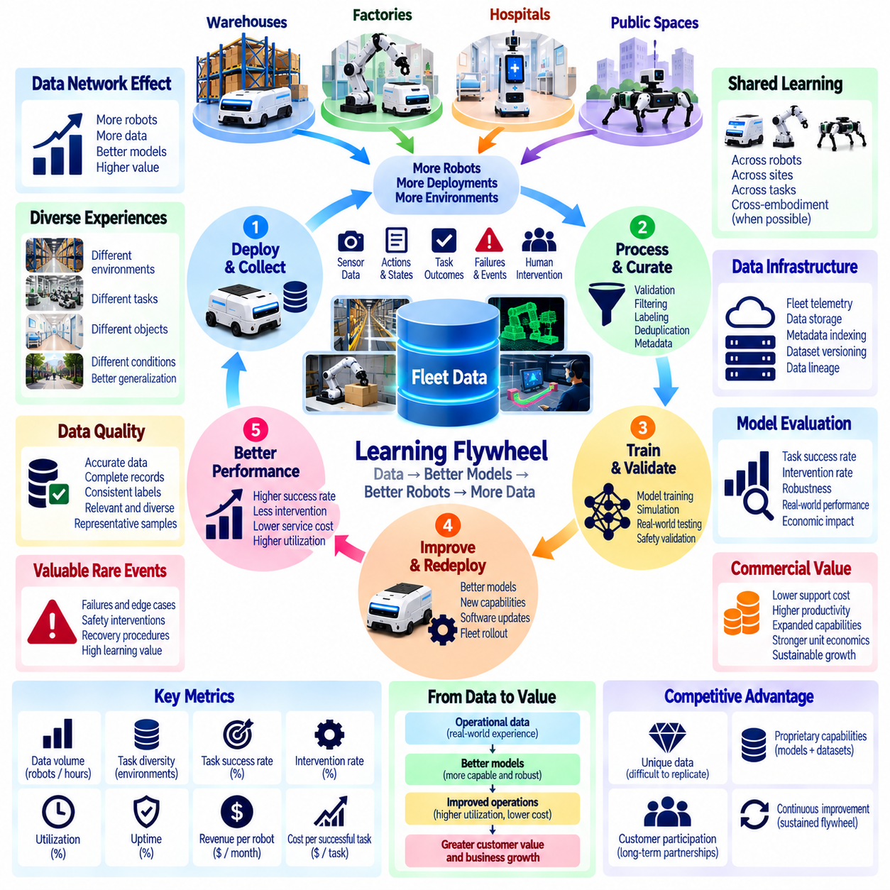{width="7.268055555555556in" height="7.268055555555556in"}

Data network effects and learning flywheels describe how Physical AI systems can improve through accumulated operational experience across deployed robots. As more robots perform tasks, they generate information about environments, objects, actions, failures, and human interactions. When this information improves shared intelligence, subsequent deployments may become more capable and efficient. The resulting feedback loop can create long-term competitive advantages.

A data network effect emerges when additional users, robots, or deployments increase the value of a shared intelligence system. Unlike conventional network effects, where value often depends on direct interactions between participants, Physical AI benefits primarily from improved models and operational knowledge. These effects are not automatic. Data must be relevant, accessible, sufficiently diverse, and effectively incorporated into learning processes.

The learning flywheel begins with real-world deployment. Robots execute missions while collecting sensor observations, control actions, task outcomes, and operational metadata. These records reveal both successful behaviors and limitations encountered under realistic conditions. Selected experiences are processed into training and evaluation datasets. Improved models are then validated and redeployed, generating new observations that support subsequent learning cycles.

Fleet-scale data collection expands the diversity of experiences available for model development. Robots operating in different facilities encounter variations in lighting, floor conditions, object geometry, human behavior, and workflow requirements. This diversity can improve generalization beyond a single deployment environment. However, collecting more data from nearly identical situations may provide limited additional learning value compared with capturing previously unseen conditions.

Data quality is as important as collection volume. Sensor synchronization errors, incomplete task records, inaccurate labels, and inconsistent metadata can reduce training effectiveness. Effective data engines use validation, filtering, deduplication, and quality scoring to identify reliable examples. A smaller collection of representative, well-structured experiences may contribute more to model improvement than a much larger dataset containing redundant or unreliable observations.

Rare events and failure cases often provide disproportionate learning value. Navigation deadlocks, unexpected obstacles, manipulation failures, safety interventions, and recovery procedures reveal weaknesses that successful routine missions may not expose. Capturing these events requires appropriate logging and event-triggered recording. Their inclusion in training and testing can improve robustness, provided that safety-critical behaviors undergo rigorous validation before deployment.

Human intervention creates another valuable source of learning signals. Teleoperation sessions, corrective demonstrations, and operator-assisted recovery can reveal appropriate actions when autonomous policies encounter uncertainty. These examples can support imitation learning, policy refinement, and improved exception handling. Nevertheless, operator actions must be evaluated for consistency and safety because human intervention data is not automatically suitable as a training target.

Shared learning across robot fleets depends on the compatibility of hardware, sensors, action representations, and software interfaces. Identical robots can often exchange experience more directly than heterogeneous platforms. Cross-embodiment learning may require normalization, task abstractions, or embodiment-conditioned models. A scalable data strategy should distinguish knowledge that transfers broadly from behaviors dependent on specific mechanical capabilities.

Data infrastructure enables operational experience to become reusable organizational intelligence. Fleet telemetry systems, episode storage, metadata indexing, and dataset versioning support the identification of useful training examples. Traceable data lineage connects observations to robot configurations, environments, and model versions. Without these capabilities, increasing fleet size may generate storage and processing costs without producing corresponding improvements in learning efficiency.

Model improvement must be measured against operational outcomes rather than training metrics alone. Higher prediction accuracy or lower training loss does not necessarily improve task completion, safety, or economic performance. Evaluation should examine mission success, intervention frequency, recovery capability, generalization, and performance under unfamiliar conditions. Controlled deployment comparisons help determine whether updated models create meaningful improvements in real environments.

Learning flywheels can improve commercial performance by reducing support costs and expanding automation capabilities. Better navigation and manipulation policies may decrease human interventions, failed missions, and maintenance-related disruptions. Improved autonomy can increase productive utilization and reduce service delivery costs. These benefits strengthen unit economics when model development and data infrastructure expenses remain proportionate to the operational value created.

The commercial advantage of accumulated data depends on its uniqueness and practical usefulness. Proprietary observations from demanding environments may be difficult for competitors to reproduce, particularly when they include rare failures and corrective actions. However, raw data ownership does not guarantee differentiation. Competitive value emerges when organizations transform distinctive experience into validated capabilities that customers recognize and are willing to purchase.

Customer participation is essential to fleet learning but introduces governance requirements. Industrial facilities may restrict the collection or transfer of images, production information, employee activity, and confidential operational records. Contracts should specify data ownership, permitted uses, retention periods, and access rights. Privacy-preserving processing, selective collection, and on-premise learning approaches can support improvement while respecting customer restrictions.

Data network effects may also encounter diminishing returns. Once common operating conditions are well represented, additional routine observations may contribute little new information. Learning performance can plateau because of model limitations, insufficient task diversity, or inconsistent data quality. Active learning and targeted data acquisition help identify information gaps. The objective is to maximize learning value per collected episode rather than data volume alone.

Simulation and synthetic data can reinforce the learning flywheel by extending coverage beyond observed deployments. Real-world failures can inform the creation of challenging simulated scenarios, while simulation can generate additional examples for training and evaluation. Domain randomization helps explore variations in environmental conditions. However, synthetic improvements must be verified against real-world performance because simulation assumptions may not capture every operational constraint.

Continuous deployment creates risks when model updates alter established robot behavior. A new policy may improve performance on common tasks while degrading reliability in specific environments. Version control, regression testing, staged rollout, and rollback mechanisms are therefore necessary. Safety-critical capabilities require additional validation and operational safeguards. A successful learning flywheel must improve intelligence without compromising deployment stability or customer trust.

Fleet growth can strengthen learning efficiency when data collection and model improvement are coordinated. Additional deployments increase opportunities to discover new tasks, environments, and failure patterns. Improved models can make future deployments easier, potentially reducing integration costs and increasing customer adoption. Yet this reinforcing cycle depends on effective data sharing, sufficient engineering capacity, and the ability to distribute validated improvements across the installed fleet.

The economics of learning flywheels require balancing development investment against fleet-wide benefits. Data ingestion, annotation, computing, model training, validation, and deployment infrastructure create substantial costs. Their returns depend on how many robots benefit from each improvement and how much operational value is generated. Shared models can produce attractive economies of scale when development costs are distributed across a growing installed base.

Strategic partnerships can expand the learning ecosystem beyond a single provider. Customers, system integrators, component suppliers, and software developers may contribute complementary operational knowledge. Standardized interfaces and agreed data governance can enable collaborative improvement. However, intellectual property rights, commercial incentives, and security responsibilities must be clearly defined to maintain sustainable cooperation.

Ultimately, data network effects and learning flywheels can transform Physical AI from a collection of deployed machines into an improving intelligence platform. Their strength depends on diverse operational experience, disciplined data engineering, validated model updates, and responsible governance. Organizations that connect fleet learning with measurable customer outcomes can improve autonomy, strengthen service economics, and establish durable competitive differentiation.

데이터 네트워크 효과(Data Network Effects)와 학습 플라이휠(Learning Flywheels)은 배포된 로봇(Deployed Robots) 전반에 걸쳐 축적된 운영 경험(Accumulated Operational Experience)을 통해 피지컬 인공지능 시스템(Physical AI Systems)이 어떻게 개선될 수 있는지를 설명한다. 더 많은 로봇이 작업을 수행할수록 환경(Environments), 객체(Objects), 행동(Actions), 실패(Failures), 인간과의 상호작용(Human Interactions)에 관한 정보가 생성된다. 이러한 정보가 공유 지능(Shared Intelligence)을 개선하면 이후 배포되는 로봇은 더욱 높은 능력(Capability)과 효율성(Efficiency)을 확보할 수 있다. 이와 같은 피드백 순환(Feedback Loop)은 장기적인 경쟁우위(Long-Term Competitive Advantages)를 창출할 수 있다.

데이터 네트워크 효과(Data Network Effect)는 추가적인 사용자(Users), 로봇(Robots), 배포 현장(Deployments)이 공유 지능 시스템(Shared Intelligence System)의 가치를 증가시킬 때 발생한다. 참여자 간 직접적인 상호작용(Direct Interactions)에 의해 가치가 결정되는 경우가 많은 전통적인 네트워크 효과(Conventional Network Effects)와 달리, 피지컬 인공지능(Physical AI)은 주로 개선된 모델(Improved Models)과 운영 지식(Operational Knowledge)으로부터 이익을 얻는다. 이러한 효과는 자동으로 발생하지 않는다. 데이터는 관련성(Relevance), 접근 가능성(Accessibility), 충분한 다양성(Diversity)을 갖추어야 하며 학습 과정(Learning Processes)에 효과적으로 통합되어야 한다.

학습 플라이휠(Learning Flywheel)은 실제 환경 배포(Real-World Deployment)에서 시작된다. 로봇은 임무(Missions)를 수행하면서 센서 관측값(Sensor Observations), 제어 행동(Control Actions), 작업 결과(Task Outcomes), 운영 메타데이터(Operational Metadata)를 수집한다. 이러한 기록은 현실적인 조건(Realistic Conditions)에서 나타나는 성공적인 행동(Successful Behaviors)과 한계(Limitations)를 모두 보여준다. 선별된 경험(Selected Experiences)은 학습 및 평가 데이터셋(Training and Evaluation Datasets)으로 처리된다. 이후 개선된 모델(Improved Models)을 검증하고 재배포하면 새로운 관측값(New Observations)이 생성되어 다음 학습 주기(Subsequent Learning Cycles)를 지원한다.

로봇군 규모의 데이터 수집(Fleet-Scale Data Collection)은 모델 개발(Model Development)에 활용할 수 있는 경험의 다양성(Experience Diversity)을 확대한다. 서로 다른 시설(Facilities)에서 운영되는 로봇은 조명(Lighting), 바닥 상태(Floor Conditions), 객체 형상(Object Geometry), 인간 행동(Human Behavior), 작업 흐름 요구사항(Workflow Requirements)의 차이를 경험한다. 이러한 다양성은 단일 배포 환경(Single Deployment Environment)을 넘어서는 일반화 성능(Generalization)을 개선할 수 있다. 그러나 거의 동일한 상황에서 더 많은 데이터를 수집하는 것은 이전에 관측하지 못한 조건(Previously Unseen Conditions)을 확보하는 것에 비해 추가적인 학습 가치(Additional Learning Value)가 제한적일 수 있다.

데이터 품질(Data Quality)은 수집량(Collection Volume)만큼 중요하다. 센서 동기화 오류(Sensor Synchronization Errors), 불완전한 작업 기록(Incomplete Task Records), 부정확한 라벨(Inaccurate Labels), 일관되지 않은 메타데이터(Inconsistent Metadata)는 학습 효과(Training Effectiveness)를 감소시킬 수 있다. 효과적인 데이터 엔진(Data Engines)은 검증(Validation), 필터링(Filtering), 중복 제거(Deduplication), 품질 점수화(Quality Scoring)를 활용하여 신뢰할 수 있는 사례(Reliable Examples)를 식별한다. 대표성이 높고 체계적으로 구성된 소규모 경험 데이터(Representative, Well-Structured Experiences)는 중복되거나 신뢰성이 낮은 관측값을 포함하는 훨씬 큰 데이터셋보다 모델 개선(Model Improvement)에 더 크게 기여할 수 있다.

희귀 이벤트(Rare Events)와 실패 사례(Failure Cases)는 상대적으로 매우 높은 학습 가치(Learning Value)를 제공하는 경우가 많다. 주행 교착상태(Navigation Deadlocks), 예상하지 못한 장애물(Unexpected Obstacles), 조작 실패(Manipulation Failures), 안전 개입(Safety Interventions), 복구 절차(Recovery Procedures)는 일상적인 성공 임무(Successful Routine Missions)에서 드러나지 않는 취약점(Weaknesses)을 보여준다. 이러한 이벤트를 수집하려면 적절한 로깅(Logging)과 이벤트 기반 기록(Event-Triggered Recording)이 필요하다. 학습 및 시험(Training and Testing)에 이러한 사례를 포함하면 강건성(Robustness)을 개선할 수 있지만, 안전 필수 행동(Safety-Critical Behaviors)은 배포 전에 엄격한 검증(Rigorous Validation)을 거쳐야 한다.

인간 개입(Human Intervention)은 또 다른 중요한 학습 신호(Learning Signals)의 원천이다. 원격조작 세션(Teleoperation Sessions), 교정 시연(Corrective Demonstrations), 운영자 지원 복구(Operator-Assisted Recovery)는 자율 정책(Autonomous Policies)이 불확실성(Uncertainty)에 직면했을 때 적절한 행동(Appropriate Actions)을 보여줄 수 있다. 이러한 사례는 모방학습(Imitation Learning), 정책 개선(Policy Refinement), 예외 처리 개선(Improved Exception Handling)을 지원할 수 있다. 그러나 인간 개입 데이터(Human Intervention Data)가 자동으로 적절한 학습 목표(Training Target)가 되는 것은 아니므로 운영자 행동(Operator Actions)의 일관성(Consistency)과 안전성(Safety)을 평가해야 한다.

로봇군 간 공유 학습(Shared Learning Across Robot Fleets)은 하드웨어(Hardware), 센서(Sensors), 행동 표현(Action Representations), 소프트웨어 인터페이스(Software Interfaces)의 호환성(Compatibility)에 의존한다. 동일한 로봇(Identical Robots)은 일반적으로 이기종 플랫폼(Heterogeneous Platforms)보다 경험(Experience)을 더 직접적으로 교환할 수 있다. 서로 다른 로봇 형태 간 학습(Cross-Embodiment Learning)에는 정규화(Normalization), 작업 추상화(Task Abstractions), 로봇 형태 조건부 모델(Embodiment-Conditioned Models)이 필요할 수 있다. 확장 가능한 데이터 전략(Scalable Data Strategy)은 폭넓게 전이되는 지식(Broadly Transferable Knowledge)과 특정 기계적 능력(Specific Mechanical Capabilities)에 의존하는 행동을 구분해야 한다.

데이터 인프라(Data Infrastructure)는 운영 경험(Operational Experience)을 재사용 가능한 조직 지능(Reusable Organizational Intelligence)으로 전환할 수 있게 한다. 로봇군 원격측정 시스템(Fleet Telemetry Systems), 에피소드 저장소(Episode Storage), 메타데이터 색인(Metadata Indexing), 데이터셋 버전 관리(Dataset Versioning)는 유용한 학습 사례(Useful Training Examples)를 식별하는 데 도움이 된다. 추적 가능한 데이터 계보(Traceable Data Lineage)는 관측값(Observations)을 로봇 구성(Robot Configurations), 환경(Environments), 모델 버전(Model Versions)과 연결한다. 이러한 기능이 없으면 로봇군 규모(Fleet Size)의 증가는 학습 효율성(Learning Efficiency)의 상응하는 개선 없이 저장 및 처리 비용(Storage and Processing Costs)만 증가시킬 수 있다.

모델 개선(Model Improvement)은 학습 지표(Training Metrics)만이 아니라 운영 결과(Operational Outcomes)를 기준으로 측정해야 한다. 예측 정확도(Prediction Accuracy)가 높아지거나 학습 손실(Training Loss)이 감소하더라도 작업 완료(Task Completion), 안전성(Safety), 경제적 성과(Economic Performance)가 반드시 개선되는 것은 아니다. 평가는 임무 성공률(Mission Success), 개입 빈도(Intervention Frequency), 복구 능력(Recovery Capability), 일반화 성능(Generalization), 익숙하지 않은 조건(Unfamiliar Conditions)에서의 성능을 검토해야 한다. 통제된 배포 비교(Controlled Deployment Comparisons)는 업데이트된 모델(Updated Models)이 실제 환경(Real Environments)에서 의미 있는 개선(Meaningful Improvements)을 창출하는지 판단하는 데 도움이 된다.

학습 플라이휠(Learning Flywheels)은 지원 비용(Support Costs)을 줄이고 자동화 능력(Automation Capabilities)을 확장함으로써 상업적 성과(Commercial Performance)를 개선할 수 있다. 향상된 주행 및 조작 정책(Navigation and Manipulation Policies)은 인간 개입(Human Interventions), 실패한 임무(Failed Missions), 유지보수 관련 운영 중단(Maintenance-Related Disruptions)을 감소시킬 수 있다. 개선된 자율성(Improved Autonomy)은 생산적 활용률(Productive Utilization)을 높이고 서비스 제공 비용(Service Delivery Costs)을 줄일 수 있다. 이러한 편익은 모델 개발(Model Development)과 데이터 인프라(Data Infrastructure) 비용이 창출되는 운영 가치(Operational Value)에 비례하는 수준으로 유지될 때 단위 경제성(Unit Economics)을 강화한다.

축적된 데이터(Accumulated Data)의 상업적 우위(Commercial Advantage)는 고유성(Uniqueness)과 실용적 유용성(Practical Usefulness)에 달려 있다. 까다로운 환경(Demanding Environments)에서 수집한 독점적 관측 데이터(Proprietary Observations)는 특히 희귀한 실패(Rare Failures)와 교정 행동(Corrective Actions)을 포함할 경우 경쟁업체(Competitors)가 재현하기 어려울 수 있다. 그러나 원시 데이터 소유권(Raw Data Ownership)만으로 차별화(Differentiation)가 보장되는 것은 아니다. 경쟁적 가치(Competitive Value)는 조직이 고유한 경험(Distinctive Experience)을 고객이 인정하고 구매할 의사가 있는 검증된 능력(Validated Capabilities)으로 전환할 때 창출된다.

고객 참여(Customer Participation)는 로봇군 학습(Fleet Learning)에 필수적이지만 데이터 거버넌스 요구사항(Data Governance Requirements)을 수반한다. 산업 시설(Industrial Facilities)은 이미지(Images), 생산 정보(Production Information), 직원 활동(Employee Activity), 기밀 운영 기록(Confidential Operational Records)의 수집 또는 이전을 제한할 수 있다. 계약(Contracts)에서는 데이터 소유권(Data Ownership), 허용된 사용 목적(Permitted Uses), 보존기간(Retention Periods), 접근 권한(Access Rights)을 명시해야 한다. 개인정보 보호형 처리(Privacy-Preserving Processing), 선택적 수집(Selective Collection), 온프레미스 학습(On-Premise Learning)은 고객 제한사항(Customer Restrictions)을 준수하면서 시스템 개선을 지원할 수 있다.

데이터 네트워크 효과(Data Network Effects)는 수확체감(Diminishing Returns)에 직면할 수도 있다. 일반적인 운영 조건(Common Operating Conditions)이 충분히 표현되고 나면 추가적인 일상 관측값(Routine Observations)은 새로운 정보를 거의 제공하지 못할 수 있다. 모델의 한계(Model Limitations), 작업 다양성 부족(Insufficient Task Diversity), 일관되지 않은 데이터 품질(Inconsistent Data Quality)로 인해 학습 성능(Learning Performance)이 정체될 수 있다. 능동학습(Active Learning)과 목표 지향적 데이터 수집(Targeted Data Acquisition)은 정보 격차(Information Gaps)를 식별하는 데 도움이 된다. 목표는 단순한 데이터 수집량(Data Volume)이 아니라 수집된 에피소드당 학습 가치(Learning Value per Collected Episode)를 극대화하는 것이다.

시뮬레이션(Simulation)과 합성 데이터(Synthetic Data)는 관측된 배포 환경(Observed Deployments)을 넘어 적용 범위(Coverage)를 확장함으로써 학습 플라이휠(Learning Flywheel)을 강화할 수 있다. 실제 환경의 실패(Real-World Failures)는 까다로운 시뮬레이션 시나리오(Challenging Simulated Scenarios)를 만드는 데 활용할 수 있으며, 시뮬레이션은 학습 및 평가(Training and Evaluation)를 위한 추가 사례(Additional Examples)를 생성할 수 있다. 도메인 무작위화(Domain Randomization)는 환경 조건(Environmental Conditions)의 다양한 변화를 탐색하는 데 도움이 된다. 그러나 시뮬레이션 가정(Simulation Assumptions)이 모든 운영 제약(Operational Constraints)을 반영하지 못할 수 있으므로 합성 데이터 기반 개선(Synthetic Improvements)은 실제 환경 성능(Real-World Performance)을 통해 검증해야 한다.

지속적인 배포(Continuous Deployment)는 모델 업데이트(Model Updates)가 기존 로봇 행동(Established Robot Behavior)을 변경할 때 위험을 발생시킨다. 새로운 정책(New Policy)은 일반적인 작업(Common Tasks)의 성능을 개선하면서 특정 환경(Specific Environments)의 신뢰성(Reliability)을 저하시킬 수 있다. 따라서 버전 관리(Version Control), 회귀시험(Regression Testing), 단계적 배포(Staged Rollout), 롤백 메커니즘(Rollback Mechanisms)이 필요하다. 안전 필수 기능(Safety-Critical Capabilities)에는 추가적인 검증(Additional Validation)과 운영 안전장치(Operational Safeguards)가 요구된다. 성공적인 학습 플라이휠(Successful Learning Flywheel)은 배포 안정성(Deployment Stability)이나 고객 신뢰(Customer Trust)를 훼손하지 않으면서 지능(Intelligence)을 개선해야 한다.

로봇군 성장(Fleet Growth)은 데이터 수집(Data Collection)과 모델 개선(Model Improvement)이 조정될 때 학습 효율성(Learning Efficiency)을 강화할 수 있다. 추가 배포(Additional Deployments)는 새로운 작업(New Tasks), 환경(Environments), 실패 패턴(Failure Patterns)을 발견할 기회를 증가시킨다. 개선된 모델(Improved Models)은 향후 배포(Future Deployments)를 더 쉽게 만들어 통합 비용(Integration Costs)을 줄이고 고객 도입(Customer Adoption)을 확대할 가능성이 있다. 그러나 이러한 강화 순환(Reinforcing Cycle)은 효과적인 데이터 공유(Effective Data Sharing), 충분한 엔지니어링 역량(Sufficient Engineering Capacity), 검증된 개선사항(Validated Improvements)을 설치된 로봇군(Installed Fleet) 전체에 배포할 수 있는 능력에 달려 있다.

학습 플라이휠의 경제성(Economics of Learning Flywheels)은 개발 투자(Development Investment)와 로봇군 전체의 편익(Fleet-Wide Benefits) 사이의 균형을 요구한다. 데이터 수집 및 적재(Data Ingestion), 주석 작업(Annotation), 컴퓨팅(Computing), 모델 학습(Model Training), 검증(Validation), 배포 인프라(Deployment Infrastructure)는 상당한 비용을 발생시킨다. 투자수익(Returns)은 각 개선사항(Improvement)의 혜택을 받는 로봇 수와 창출되는 운영 가치(Operational Value)의 규모에 따라 달라진다. 공유 모델(Shared Models)은 개발 비용(Development Costs)이 증가하는 설치 기반(Growing Installed Base)에 분산될 때 매력적인 규모의 경제(Economies of Scale)를 창출할 수 있다.

전략적 파트너십(Strategic Partnerships)은 학습 생태계(Learning Ecosystem)를 단일 공급업체(Single Provider)의 범위를 넘어 확장할 수 있다. 고객(Customers), 시스템 통합업체(System Integrators), 부품 공급업체(Component Suppliers), 소프트웨어 개발업체(Software Developers)는 상호 보완적인 운영 지식(Complementary Operational Knowledge)을 제공할 수 있다. 표준화된 인터페이스(Standardized Interfaces)와 합의된 데이터 거버넌스(Agreed Data Governance)는 협력적 개선(Collaborative Improvement)을 가능하게 한다. 그러나 지속 가능한 협력(Sustainable Cooperation)을 유지하려면 지식재산권(Intellectual Property Rights), 상업적 인센티브(Commercial Incentives), 보안 책임(Security Responsibilities)을 명확하게 정의해야 한다.

궁극적으로 데이터 네트워크 효과(Data Network Effects)와 학습 플라이휠(Learning Flywheels)은 피지컬 인공지능(Physical AI)을 단순히 배포된 기계들의 집합(Collection of Deployed Machines)에서 지속적으로 개선되는 지능 플랫폼(Improving Intelligence Platform)으로 전환할 수 있다. 이러한 효과의 강도(Strength)는 다양한 운영 경험(Diverse Operational Experience), 체계적인 데이터 엔지니어링(Disciplined Data Engineering), 검증된 모델 업데이트(Validated Model Updates), 책임 있는 거버넌스(Responsible Governance)에 달려 있다. 로봇군 학습(Fleet Learning)을 측정 가능한 고객 성과(Measurable Customer Outcomes)와 연결하는 조직은 자율성(Autonomy)을 개선하고 서비스 경제성(Service Economics)을 강화하며 지속 가능한 경쟁 차별화(Durable Competitive Differentiation)를 구축할 수 있다.

##  

## 08.20. Platform Effects and Ecosystem Strategy

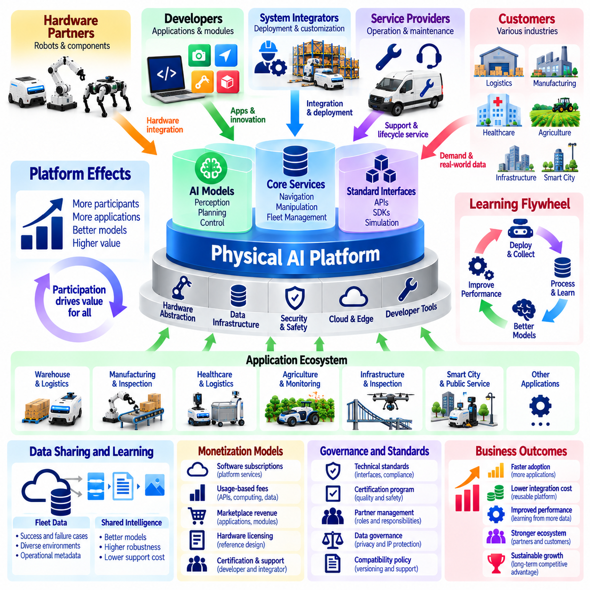{width="7.268055555555556in" height="7.268055555555556in"}

Platform effects and ecosystem strategy are central to building scalable Physical AI businesses beyond individual robot products. A platform connects hardware, software, artificial intelligence, developers, integrators, and customers through reusable technical capabilities. As participation increases, complementary solutions can expand the platform\'s usefulness. Sustainable platform value depends on interoperability, reliable operations, and economic benefits shared across participants.

A Physical AI platform differs from a conventional robot product because it supports multiple applications, deployments, and external contributors. Rather than delivering every function through proprietary development, platform providers establish common interfaces and reusable services. These foundations enable partners to create specialized capabilities. The business objective is to reduce repeated integration effort while increasing the range of customer problems addressed.

Platform effects emerge when additional participants improve the value available to existing participants. More developers can produce applications, more integrators can expand deployment coverage, and more customers can create demand for complementary services. These relationships may reinforce one another, but growth alone does not guarantee network effects. Participants must receive measurable benefits from the expanding ecosystem.

The technical foundation of a Physical AI platform includes robot operating interfaces, perception services, navigation capabilities, manipulation frameworks, and fleet management systems. Common application programming interfaces allow different modules to exchange commands and operational information. Standardized abstractions reduce dependence on specific hardware configurations. Reliable interfaces are essential because physical operations require predictable behavior and safety.

Hardware interoperability is particularly important for platforms supporting heterogeneous robotic fleets. Different robots may use distinct sensors, actuators, controllers, and communication protocols. Hardware abstraction layers and standardized capability descriptions can simplify application portability. Nevertheless, mechanical limitations and safety requirements remain embodiment-specific. Platforms must distinguish transferable software functions from behaviors requiring robot-specific validation.

Software development kits, documentation, simulation environments, and testing tools lower barriers to ecosystem participation. Developers can build applications without recreating foundational robotics capabilities. Consistent development workflows reduce integration time and improve software quality. Platform providers should maintain compatibility policies, versioning practices, and technical support channels that allow third-party solutions to evolve alongside core systems.

An application ecosystem can expand the commercial reach of Physical AI platforms. Industry-specific modules may support warehouse transport, manufacturing inspection, hospital logistics, agricultural monitoring, or infrastructure maintenance. Specialized developers contribute domain knowledge that platform owners may lack. A common foundation enables these solutions to share infrastructure while adapting to different operational requirements.

System integrators play a critical role in translating platform capabilities into working customer deployments. They connect robots with enterprise systems, facility infrastructure, safety procedures, and operational workflows. A strong integrator network can increase geographic reach and reduce the platform provider\'s direct deployment burden. However, inconsistent integration quality can damage customer trust, making certification and partner training important.

Ecosystem strategy requires clearly defined roles and commercial incentives. Platform providers may supply core software and intelligence, hardware partners may deliver robotic systems, and application developers may provide specialized functionality. Integrators and service organizations contribute deployment and lifecycle support. Revenue-sharing arrangements should reflect responsibilities, customer ownership, intellectual property, and the costs of maintaining shared infrastructure.

Platform monetization can combine software subscriptions, usage-based fees, developer services, certification programs, and marketplace transactions. Hardware licensing or reference architecture agreements may provide additional revenue opportunities. Different participants may require different pricing structures. Commercial design should encourage adoption without creating excessive participation costs that discourage innovation or limit ecosystem growth.

A marketplace can improve the discovery and distribution of compatible Physical AI applications. Customers may obtain validated software modules, industry workflows, and integration components through a common commercial channel. Developers benefit from access to a larger installed base. Marketplace success depends on application quality, transparent pricing, technical compatibility, and reliable mechanisms for handling updates, support, and disputes.

Data sharing can strengthen platform effects by improving common intelligence and operational services. Fleet observations may reveal recurring failure patterns, environmental variations, and opportunities for model improvement. Shared learning can benefit multiple participants when appropriate permissions and governance are established. However, customer confidentiality, intellectual property restrictions, and competitive concerns may limit unrestricted data exchange.

Platform governance establishes the rules that determine participation, technical compliance, and commercial conduct. Governance mechanisms may include interface standards, security requirements, application certification, and dispute resolution procedures. Excessive control can discourage external innovation, while insufficient oversight can create fragmentation and operational risk. Effective governance balances ecosystem openness with the reliability required for physical systems.

Security and safety requirements distinguish Physical AI ecosystems from many purely digital platforms. Third-party software may influence robot movement, manipulation, and interaction with people or equipment. Permission boundaries, runtime monitoring, secure updates, and controlled access are therefore essential. Platform providers should define responsibility for safety validation and incident response across hardware manufacturers, developers, integrators, and operators.

Platform architecture must support scalability without excessive complexity. Modular services, containerized applications, standardized communication protocols, and centralized lifecycle management can simplify deployment across many customers. Edge computing may handle time-critical functions, while cloud services support fleet analytics and software distribution. Architectural decisions should reflect latency, connectivity, cybersecurity, and customer infrastructure constraints.

Switching costs and ecosystem dependence can influence customer retention. Customers may invest in integrations, operational training, applications, and data structures built around a particular platform. These investments can encourage continued adoption but may also create concerns about vendor lock-in. Open interfaces, data portability, and transparent commercial terms can strengthen trust while preserving differentiation through service quality and technical capability.

Platform effects must be evaluated using operational and economic indicators rather than participant counts alone. Useful measures include active developers, deployed applications, partner-generated revenue, integration time, customer retention, and revenue per connected robot. Application adoption and deployment success reveal whether ecosystem activity produces practical value. These measures help distinguish genuine platform advantages from superficial growth in registrations or partnerships.

The transition from product business to platform business requires substantial investment. Providers must maintain developer infrastructure, documentation, compatibility testing, partner support, and ecosystem governance. These expenses may precede meaningful marketplace or licensing revenue. A phased strategy can begin with proven internal capabilities and selected partners before opening broader participation. Commercial sustainability depends on balancing platform investment with adoption and monetization.

Competitive differentiation emerges when ecosystem participants create complementary value that competitors cannot easily reproduce. A broad application portfolio, reliable integration tools, specialized partners, and accumulated operational expertise can reinforce customer preference. However, ecosystem size alone is insufficient if solutions lack quality or economic relevance. Platform leadership requires continuous improvement in technical foundations and participant outcomes.

Ultimately, platform effects and ecosystem strategy can transform Physical AI providers from equipment suppliers into coordinators of interconnected technologies and services. Successful platforms combine reusable architectures, aligned incentives, trusted governance, and measurable customer value. By enabling partners to innovate while maintaining operational reliability, Physical AI businesses can expand market coverage, diversify revenue, and establish durable competitive advantages.

플랫폼 효과(Platform Effects)와 생태계 전략(Ecosystem Strategy)은 개별 로봇 제품(Individual Robot Products)을 넘어 확장 가능한 피지컬 인공지능 사업(Scalable Physical AI Businesses)을 구축하는 데 핵심적인 요소이다. 플랫폼(Platform)은 재사용 가능한 기술적 기능(Reusable Technical Capabilities)을 통해 하드웨어(Hardware), 소프트웨어(Software), 인공지능(Artificial Intelligence), 개발자(Developers), 통합업체(Integrators), 고객(Customers)을 연결한다. 참여가 증가하면 상호 보완적인 솔루션(Complementary Solutions)이 플랫폼의 유용성(Platform Usefulness)을 확대할 수 있다. 지속 가능한 플랫폼 가치(Sustainable Platform Value)는 상호운용성(Interoperability), 안정적인 운영(Reliable Operations), 참여자 간 공유되는 경제적 편익(Shared Economic Benefits)에 달려 있다.

피지컬 인공지능 플랫폼(Physical AI Platform)은 여러 응용 분야(Applications), 배포 환경(Deployments), 외부 기여자(External Contributors)를 지원한다는 점에서 기존 로봇 제품(Conventional Robot Product)과 차별화된다. 플랫폼 공급업체(Platform Providers)는 모든 기능을 독자적인 개발(Proprietary Development)로 제공하기보다 공통 인터페이스(Common Interfaces)와 재사용 가능한 서비스(Reusable Services)를 구축한다. 이러한 기반(Foundations)은 파트너(Partners)가 전문화된 기능(Specialized Capabilities)을 개발할 수 있도록 한다. 사업 목표(Business Objective)는 반복적인 통합 작업(Repeated Integration Effort)을 줄이면서 해결할 수 있는 고객 문제(Customer Problems)의 범위를 확대하는 것이다.

플랫폼 효과(Platform Effects)는 추가 참여자(Additional Participants)가 기존 참여자(Existing Participants)에게 제공되는 가치를 높일 때 발생한다. 더 많은 개발자(Developers)는 응용 프로그램(Applications)을 생산할 수 있고, 더 많은 시스템 통합업체(Integrators)는 배포 범위(Deployment Coverage)를 확대할 수 있으며, 더 많은 고객(Customers)은 보완 서비스(Complementary Services)에 대한 수요를 창출할 수 있다. 이러한 관계는 상호 강화(Reinforcement)될 수 있지만 참여자 증가(Growth)만으로 네트워크 효과(Network Effects)가 보장되는 것은 아니다. 참여자는 확대되는 생태계(Expanding Ecosystem)에서 측정 가능한 편익(Measurable Benefits)을 얻어야 한다.

피지컬 인공지능 플랫폼(Physical AI Platform)의 기술적 기반(Technical Foundation)에는 로봇 운영 인터페이스(Robot Operating Interfaces), 인지 서비스(Perception Services), 자율주행 기능(Navigation Capabilities), 조작 프레임워크(Manipulation Frameworks), 로봇군 관리 시스템(Fleet Management Systems)이 포함된다. 공통 응용 프로그램 프로그래밍 인터페이스(Application Programming Interfaces, APIs)는 서로 다른 모듈(Modules)이 명령(Commands)과 운영 정보(Operational Information)를 교환할 수 있도록 한다. 표준화된 추상화(Standardized Abstractions)는 특정 하드웨어 구성(Hardware Configurations)에 대한 의존성을 줄인다. 물리적 운영(Physical Operations)에서는 예측 가능한 동작(Predictable Behavior)과 안전성(Safety)이 요구되므로 신뢰할 수 있는 인터페이스(Reliable Interfaces)가 필수적이다.

하드웨어 상호운용성(Hardware Interoperability)은 특히 이기종 로봇군(Heterogeneous Robotic Fleets)을 지원하는 플랫폼에서 중요하다. 서로 다른 로봇은 각기 다른 센서(Sensors), 액추에이터(Actuators), 제어기(Controllers), 통신 프로토콜(Communication Protocols)을 사용할 수 있다. 하드웨어 추상화 계층(Hardware Abstraction Layers)과 표준화된 기능 기술(Standardized Capability Descriptions)은 응용 프로그램 이식성(Application Portability)을 높일 수 있다. 그러나 기계적 한계(Mechanical Limitations)와 안전 요구사항(Safety Requirements)은 여전히 로봇 형태(Embodiment)에 따라 달라진다. 플랫폼은 전이 가능한 소프트웨어 기능(Transferable Software Functions)과 로봇별 검증(Robot-Specific Validation)이 필요한 행동을 구분해야 한다.

소프트웨어 개발 키트(Software Development Kits, SDKs), 문서화(Documentation), 시뮬레이션 환경(Simulation Environments), 시험 도구(Testing Tools)는 생태계 참여(Ecosystem Participation)의 진입장벽(Barriers)을 낮춘다. 개발자(Developers)는 기본적인 로봇 기술(Foundational Robotics Capabilities)을 다시 개발하지 않고도 응용 프로그램(Applications)을 구축할 수 있다. 일관된 개발 작업 흐름(Consistent Development Workflows)은 통합시간(Integration Time)을 줄이고 소프트웨어 품질(Software Quality)을 개선한다. 플랫폼 공급업체는 타사 솔루션(Third-Party Solutions)이 핵심 시스템(Core Systems)과 함께 발전할 수 있도록 호환성 정책(Compatibility Policies), 버전 관리 관행(Versioning Practices), 기술 지원 채널(Technical Support Channels)을 유지해야 한다.

응용 프로그램 생태계(Application Ecosystem)는 피지컬 인공지능 플랫폼(Physical AI Platforms)의 상업적 적용 범위(Commercial Reach)를 확대할 수 있다. 산업별 특화 모듈(Industry-Specific Modules)은 창고 운송(Warehouse Transport), 제조 검사(Manufacturing Inspection), 병원 물류(Hospital Logistics), 농업 모니터링(Agricultural Monitoring), 인프라 유지보수(Infrastructure Maintenance)를 지원할 수 있다. 전문 개발업체(Specialized Developers)는 플랫폼 소유업체(Platform Owners)가 보유하지 못한 산업 분야 지식(Domain Knowledge)을 제공한다. 공통 기반(Common Foundation)은 이러한 솔루션이 서로 다른 운영 요구사항(Operational Requirements)에 적응하면서 인프라(Infrastructure)를 공유할 수 있도록 한다.

시스템 통합업체(System Integrators)는 플랫폼 기능(Platform Capabilities)을 실제로 작동하는 고객 배포 시스템(Working Customer Deployments)으로 전환하는 데 중요한 역할을 한다. 이들은 로봇을 기업 시스템(Enterprise Systems), 시설 인프라(Facility Infrastructure), 안전 절차(Safety Procedures), 운영 작업 흐름(Operational Workflows)과 연결한다. 강력한 통합업체 네트워크(Strong Integrator Network)는 지리적 사업 범위(Geographic Reach)를 확대하고 플랫폼 공급업체의 직접 배포 부담(Direct Deployment Burden)을 줄일 수 있다. 그러나 일관되지 않은 통합 품질(Inconsistent Integration Quality)은 고객 신뢰(Customer Trust)를 훼손할 수 있으므로 인증(Certification)과 파트너 교육(Partner Training)이 중요하다.

생태계 전략(Ecosystem Strategy)에는 명확하게 정의된 역할(Roles)과 상업적 인센티브(Commercial Incentives)가 필요하다. 플랫폼 공급업체(Platform Providers)는 핵심 소프트웨어(Core Software)와 지능(Intelligence)을 제공하고, 하드웨어 파트너(Hardware Partners)는 로봇 시스템(Robotic Systems)을 공급하며, 응용 프로그램 개발업체(Application Developers)는 전문화된 기능(Specialized Functionality)을 제공할 수 있다. 시스템 통합업체(Integrators)와 서비스 조직(Service Organizations)은 배포(Deployment) 및 수명주기 지원(Lifecycle Support)에 기여한다. 수익 배분 계약(Revenue-Sharing Arrangements)은 책임(Responsibilities), 고객 소유권(Customer Ownership), 지식재산권(Intellectual Property), 공유 인프라 유지비용(Costs of Maintaining Shared Infrastructure)을 반영해야 한다.

플랫폼 수익화(Platform Monetization)는 소프트웨어 구독(Software Subscriptions), 사용량 기반 요금(Usage-Based Fees), 개발자 서비스(Developer Services), 인증 프로그램(Certification Programs), 마켓플레이스 거래(Marketplace Transactions)를 결합할 수 있다. 하드웨어 라이선싱(Hardware Licensing)이나 참조 아키텍처 계약(Reference Architecture Agreements)은 추가적인 매출 기회(Revenue Opportunities)를 제공할 수 있다. 참여자 유형(Different Participants)에 따라 서로 다른 가격 구조(Pricing Structures)가 필요할 수 있다. 상업적 설계(Commercial Design)는 혁신(Innovation)을 저해하거나 생태계 성장(Ecosystem Growth)을 제한하는 과도한 참여 비용(Excessive Participation Costs)을 발생시키지 않으면서 도입(Adoption)을 장려해야 한다.

마켓플레이스(Marketplace)는 호환 가능한 피지컬 인공지능 응용 프로그램(Compatible Physical AI Applications)의 검색(Discovery)과 배포(Distribution)를 개선할 수 있다. 고객은 공통 상업 채널(Common Commercial Channel)을 통해 검증된 소프트웨어 모듈(Validated Software Modules), 산업별 작업 흐름(Industry Workflows), 통합 구성요소(Integration Components)를 확보할 수 있다. 개발자는 더 큰 설치 기반(Larger Installed Base)에 접근함으로써 이익을 얻는다. 마켓플레이스의 성공(Marketplace Success)은 응용 프로그램 품질(Application Quality), 투명한 가격(Transparent Pricing), 기술적 호환성(Technical Compatibility), 업데이트(Updates), 지원(Support), 분쟁(Disputes)을 처리하는 신뢰할 수 있는 메커니즘(Reliable Mechanisms)에 달려 있다.

데이터 공유(Data Sharing)는 공통 지능(Common Intelligence)과 운영 서비스(Operational Services)를 개선함으로써 플랫폼 효과(Platform Effects)를 강화할 수 있다. 로봇군 관측 데이터(Fleet Observations)는 반복적인 실패 패턴(Recurring Failure Patterns), 환경적 변동(Environmental Variations), 모델 개선 기회(Model Improvement Opportunities)를 보여줄 수 있다. 적절한 권한(Permissions)과 거버넌스(Governance)가 확립되면 공유 학습(Shared Learning)은 여러 참여자(Multiple Participants)에게 편익을 제공할 수 있다. 그러나 고객 기밀성(Customer Confidentiality), 지식재산권 제한(Intellectual Property Restrictions), 경쟁상 우려(Competitive Concerns)는 제한 없는 데이터 교환(Unrestricted Data Exchange)을 어렵게 만들 수 있다.

플랫폼 거버넌스(Platform Governance)는 참여(Participation), 기술적 준수(Technical Compliance), 상업적 활동(Commercial Conduct)을 결정하는 규칙을 수립한다. 거버넌스 메커니즘(Governance Mechanisms)에는 인터페이스 표준(Interface Standards), 보안 요구사항(Security Requirements), 응용 프로그램 인증(Application Certification), 분쟁 해결 절차(Dispute Resolution Procedures)가 포함될 수 있다. 과도한 통제(Excessive Control)는 외부 혁신(External Innovation)을 저해할 수 있으며, 감독 부족(Insufficient Oversight)은 파편화(Fragmentation)와 운영 위험(Operational Risk)을 초래할 수 있다. 효과적인 거버넌스(Effective Governance)는 생태계 개방성(Ecosystem Openness)과 물리적 시스템(Physical Systems)에 요구되는 신뢰성(Reliability) 사이의 균형을 유지한다.

보안 및 안전 요구사항(Security and Safety Requirements)은 피지컬 인공지능 생태계(Physical AI Ecosystems)를 순수 디지털 플랫폼(Purely Digital Platforms)과 구별하는 중요한 특징이다. 타사 소프트웨어(Third-Party Software)는 로봇 이동(Robot Movement), 조작(Manipulation), 사람이나 장비와의 상호작용(Interaction with People or Equipment)에 영향을 미칠 수 있다. 따라서 권한 경계(Permission Boundaries), 실행시간 모니터링(Runtime Monitoring), 보안 업데이트(Secure Updates), 접근 통제(Controlled Access)가 필수적이다. 플랫폼 공급업체는 하드웨어 제조업체(Hardware Manufacturers), 개발업체(Developers), 통합업체(Integrators), 운영자(Operators) 간의 안전 검증(Safety Validation)과 사고 대응(Incident Response)에 대한 책임을 정의해야 한다.

플랫폼 아키텍처(Platform Architecture)는 과도한 복잡성(Excessive Complexity) 없이 확장성(Scalability)을 지원해야 한다. 모듈형 서비스(Modular Services), 컨테이너화된 응용 프로그램(Containerized Applications), 표준화된 통신 프로토콜(Standardized Communication Protocols), 중앙집중식 수명주기 관리(Centralized Lifecycle Management)는 여러 고객에 걸친 배포(Deployment)를 단순화할 수 있다. 엣지 컴퓨팅(Edge Computing)은 시간 제약이 중요한 기능(Time-Critical Functions)을 처리하고, 클라우드 서비스(Cloud Services)는 로봇군 분석(Fleet Analytics)과 소프트웨어 배포(Software Distribution)를 지원할 수 있다. 아키텍처 의사결정(Architectural Decisions)은 지연시간(Latency), 연결성(Connectivity), 사이버보안(Cybersecurity), 고객 인프라 제약(Customer Infrastructure Constraints)을 반영해야 한다.

전환 비용(Switching Costs)과 생태계 의존성(Ecosystem Dependence)은 고객 유지(Customer Retention)에 영향을 미칠 수 있다. 고객은 특정 플랫폼(Particular Platform)을 중심으로 구축된 통합 시스템(Integrations), 운영 교육(Operational Training), 응용 프로그램(Applications), 데이터 구조(Data Structures)에 투자할 수 있다. 이러한 투자는 지속적인 도입(Continued Adoption)을 장려할 수 있지만 공급업체 종속(Vendor Lock-In)에 대한 우려도 발생시킬 수 있다. 개방형 인터페이스(Open Interfaces), 데이터 이동성(Data Portability), 투명한 상업 조건(Transparent Commercial Terms)은 서비스 품질(Service Quality)과 기술적 역량(Technical Capability)을 통한 차별화(Differentiation)를 유지하면서 고객 신뢰(Customer Trust)를 강화할 수 있다.

플랫폼 효과(Platform Effects)는 단순한 참여자 수(Participant Counts)가 아니라 운영 및 경제적 지표(Operational and Economic Indicators)를 사용하여 평가해야 한다. 유용한 측정 지표(Useful Measures)에는 활성 개발자(Active Developers), 배포된 응용 프로그램(Deployed Applications), 파트너 창출 매출(Partner-Generated Revenue), 통합시간(Integration Time), 고객 유지율(Customer Retention), 연결된 로봇당 매출(Revenue per Connected Robot)이 포함된다. 응용 프로그램 도입(Application Adoption)과 배포 성공(Deployment Success)은 생태계 활동(Ecosystem Activity)이 실질적인 가치(Practical Value)를 창출하는지 보여준다. 이러한 지표는 진정한 플랫폼 경쟁우위(Genuine Platform Advantages)를 등록자나 파트너십 수의 피상적인 증가(Superficial Growth)와 구분하는 데 도움이 된다.

제품 사업(Product Business)에서 플랫폼 사업(Platform Business)으로 전환하려면 상당한 투자(Substantial Investment)가 필요하다. 공급업체는 개발자 인프라(Developer Infrastructure), 문서화(Documentation), 호환성 시험(Compatibility Testing), 파트너 지원(Partner Support), 생태계 거버넌스(Ecosystem Governance)를 유지해야 한다. 이러한 비용은 의미 있는 마켓플레이스 매출(Marketplace Revenue)이나 라이선스 매출(Licensing Revenue)이 발생하기 전에 먼저 지출될 수 있다. 단계적 전략(Phased Strategy)은 검증된 내부 기능(Proven Internal Capabilities)과 선별된 파트너(Selected Partners)에서 시작하여 더 폭넓은 참여(Broader Participation)로 확대할 수 있다. 상업적 지속 가능성(Commercial Sustainability)은 플랫폼 투자(Platform Investment)와 도입(Adoption), 수익화(Monetization) 사이의 균형에 달려 있다.

경쟁 차별화(Competitive Differentiation)는 생태계 참여자(Ecosystem Participants)가 경쟁업체(Competitors)가 쉽게 재현할 수 없는 보완적 가치(Complementary Value)를 창출할 때 나타난다. 폭넓은 응용 프로그램 포트폴리오(Broad Application Portfolio), 신뢰할 수 있는 통합 도구(Reliable Integration Tools), 전문 파트너(Specialized Partners), 축적된 운영 전문성(Accumulated Operational Expertise)은 고객 선호(Customer Preference)를 강화할 수 있다. 그러나 솔루션(Solutions)에 품질(Quality)이나 경제적 관련성(Economic Relevance)이 부족하다면 생태계 규모(Ecosystem Size)만으로는 충분하지 않다. 플랫폼 리더십(Platform Leadership)을 유지하려면 기술적 기반(Technical Foundations)과 참여자 성과(Participant Outcomes)를 지속적으로 개선해야 한다.

궁극적으로 플랫폼 효과(Platform Effects)와 생태계 전략(Ecosystem Strategy)은 피지컬 인공지능 공급업체(Physical AI Providers)를 단순한 장비 공급업체(Equipment Suppliers)에서 상호 연결된 기술과 서비스(Interconnected Technologies and Services)를 조정하는 주체(Coordinators)로 전환할 수 있다. 성공적인 플랫폼(Successful Platforms)은 재사용 가능한 아키텍처(Reusable Architectures), 일치된 인센티브(Aligned Incentives), 신뢰할 수 있는 거버넌스(Trusted Governance), 측정 가능한 고객 가치(Measurable Customer Value)를 결합한다. 운영 신뢰성(Operational Reliability)을 유지하면서 파트너의 혁신(Partner Innovation)을 지원함으로써 피지컬 인공지능 사업(Physical AI Businesses)은 시장 적용 범위(Market Coverage)를 확대하고 매출원을 다각화(Diversify Revenue)하며 지속 가능한 경쟁우위(Durable Competitive Advantages)를 구축할 수 있다.

##  

## 08.21. Pilot to Production Scaling

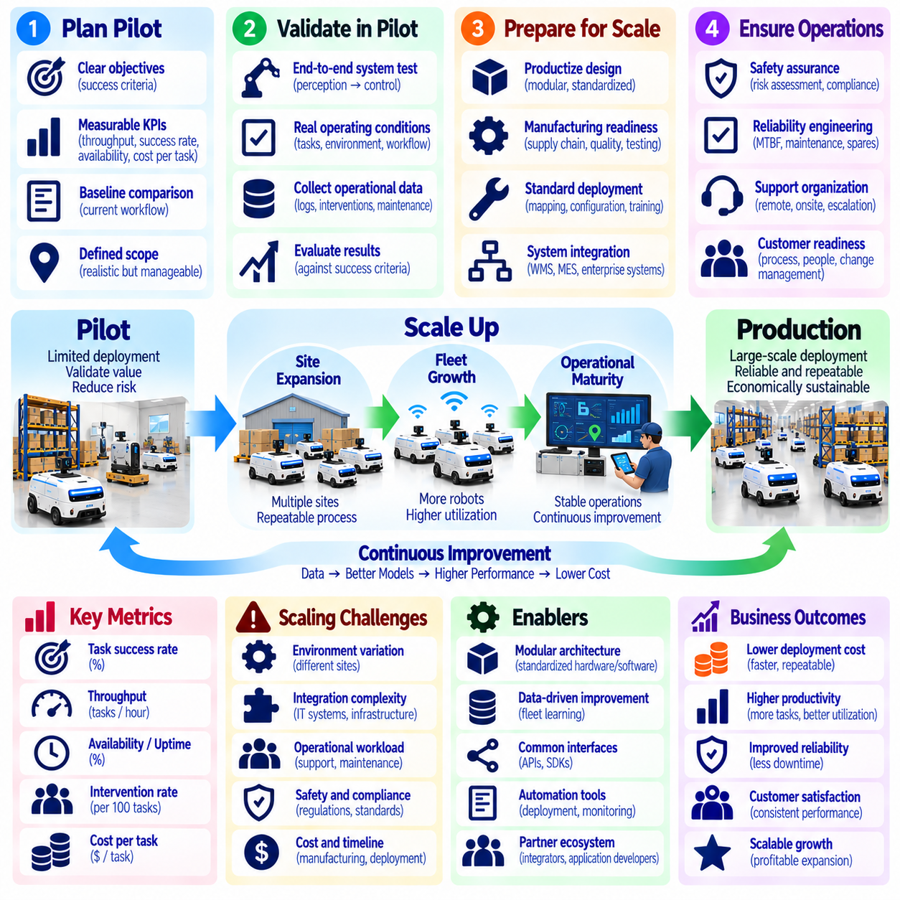{width="7.268055555555556in" height="7.268055555555556in"}

Pilot-to-production scaling is the process of transforming a limited Physical AI demonstration into a reliable, repeatable, and economically sustainable operational deployment. A pilot validates technical feasibility and initial customer value, while production requires consistent performance across larger workloads and multiple environments. Successful scaling depends on engineering maturity, operational readiness, organizational alignment, and a commercially viable delivery model.

A pilot should begin with clearly defined objectives and measurable acceptance criteria. These may include task completion rate, throughput, operational availability, safety performance, intervention frequency, and cost per successful task. Baseline measurements of existing workflows establish a reference for evaluating improvement. Without agreed success criteria, pilot results may demonstrate interesting technology without providing sufficient evidence for investment decisions.

Pilot scope must balance representative operating conditions with manageable implementation risk. Testing only under simplified conditions may produce misleading results, while attempting full operational complexity too early can overwhelm development resources. A suitable pilot includes realistic tasks, environmental variations, and normal workflow constraints. Its boundaries should be documented so that performance claims are not extended beyond the conditions actually evaluated.

Technical validation must examine the complete robotic system rather than individual algorithms alone. Perception, localization, planning, control, manipulation, communication, and safety mechanisms interact during operation. Strong performance in isolated demonstrations does not guarantee dependable end-to-end behavior. Production readiness requires integrated testing under expected workloads, including degraded conditions, recovery procedures, and foreseeable operational disturbances.

Operational data collected during pilots provides evidence for scaling decisions. Robot logs, mission records, intervention events, maintenance histories, and customer workflow measurements reveal recurring limitations. These observations should be organized into actionable engineering priorities. Failure patterns that appear insignificant during short demonstrations may become costly when repeated across hundreds of robots and thousands of operating hours.

Production scaling requires moving from prototype-oriented engineering toward standardized product architecture. Custom wiring, manually configured software, and site-specific modifications may be acceptable during early experimentation but create substantial deployment costs at scale. Modular hardware, controlled software releases, standardized interfaces, and documented configurations improve repeatability. Engineering teams should minimize unnecessary variation while preserving required application flexibility.

Manufacturing readiness becomes increasingly important as deployment volume grows. Suppliers must deliver consistent components, production processes must achieve predictable quality, and assembly procedures must support repeatable testing. Manufacturing documentation, inspection criteria, and traceability systems help identify defects before installation. Production capacity should expand according to validated demand rather than optimistic deployment forecasts alone.

Site deployment processes must become systematic and reproducible. Mapping, network configuration, safety assessment, workflow integration, charging infrastructure, and customer training should follow documented procedures. Automated configuration and commissioning tools can reduce installation time and human error. Deployment teams should measure commissioning duration, integration effort, and acceptance failures to identify opportunities for operational improvement.

Integration with customer infrastructure often determines whether a successful pilot can become a production system. Physical AI deployments may depend on warehouse management systems, manufacturing execution systems, enterprise software, access controls, and facility equipment. Interfaces must support reliable data exchange and exception handling. Integration responsibilities, maintenance ownership, and change management procedures should be agreed before large-scale rollout.

Safety assurance must evolve with deployment scale. A pilot operating under close engineering supervision may rely on controls that are impractical for routine production. Larger deployments require documented risk assessments, validated protective functions, operator training, and clear incident response procedures. Safety performance must remain consistent across different sites and operating conditions. Applicable regulatory and customer requirements should be incorporated into release decisions.

Reliability engineering is essential because small failure probabilities can create significant operational burdens across large fleets. Mean time between failures, recovery duration, component wear, and software stability should be evaluated using representative operating data. Preventive maintenance plans and spare parts strategies must reflect expected asset behavior. Reliability improvements often provide greater economic value than adding advanced functions that are rarely used.

The transition to production also requires a scalable support organization. Engineering teams cannot remain responsible for every routine deployment issue or customer intervention. Defined support tiers, remote diagnostics, service documentation, and escalation procedures enable predictable operations. Support capacity should be planned according to fleet size, failure rates, geographic distribution, and service-level commitments rather than robot count alone.

Customer organizational readiness is as important as technical readiness. Employees must understand how robotic systems change responsibilities, workflows, and exception handling. Operations managers need performance dashboards and clear ownership of daily decisions. Training, communication, and feedback mechanisms help reduce resistance and operational confusion. Successful production adoption requires the robotic system to become part of normal business processes rather than remain an isolated experiment.

Commercial validation should establish whether pilot benefits remain attractive under realistic production economics. Full deployment costs include equipment, integration, infrastructure, maintenance, supervision, software, and financing. Productivity improvements should be measured against actual operating baselines and sustained workload conditions. Return on investment, payback period, and contribution margin must account for utilization changes, service obligations, and lifecycle costs.

A staged rollout reduces the risks associated with rapid fleet expansion. Providers may progress from a single validated site to multiple robots, additional workflows, and geographically distributed deployments. Each expansion stage should confirm performance, reliability, safety, and economic assumptions before further investment. Defined decision gates allow organizations to pause, redesign, or accelerate deployment according to evidence rather than commercial pressure.

Scaling across multiple customers requires distinguishing reusable capabilities from site-specific engineering. Common robot software, deployment tools, and operational procedures should be packaged as standardized products. Customer-specific requirements may still require configuration or limited customization. Providers should monitor engineering hours per deployment and the percentage of functionality reused. These measures indicate whether business growth is becoming more efficient.

Fleet management infrastructure must accommodate increasing operational complexity. Larger fleets require coordinated task allocation, traffic management, charging schedules, software updates, and performance monitoring. Centralized visibility helps operators identify congestion, failures, and capacity imbalances. Infrastructure scalability should be tested before deployment volume exceeds system limits. Shared services must remain reliable as robot populations and customer environments expand.

Financial planning must account for the working capital required during production expansion. Robots, spare parts, installation teams, and support infrastructure may require investment before customer payments are received. Rapid growth can therefore create liquidity pressure even when individual contracts appear profitable. Providers should coordinate manufacturing commitments, customer payment milestones, inventory levels, and financing capacity with realistic rollout schedules.

Production performance should be continuously compared with pilot assumptions. Actual utilization, uptime, throughput, intervention costs, customer satisfaction, and contract margins may differ from initial projections. Structured performance reviews identify whether problems originate in technology, workflow design, customer demand, or service delivery. Feedback from deployed systems should guide product improvements and future commercial commitments.

Ultimately, pilot-to-production scaling is not simply an increase in robot quantity but a transition toward repeatable industrial capability. Technical validation must be combined with standardized engineering, dependable manufacturing, safe operations, scalable support, and disciplined financial management. Physical AI providers that establish evidence-based expansion processes can convert promising demonstrations into sustainable deployments and long-term customer value.

파일럿에서 양산 운영으로의 확장(Pilot-to-Production Scaling)은 제한된 규모의 피지컬 인공지능 시연(Physical AI Demonstration)을 신뢰할 수 있고 반복 가능하며 경제적으로 지속 가능한 운영 배포(Operational Deployment)로 전환하는 과정이다. 파일럿(Pilot)은 기술적 실현 가능성(Technical Feasibility)과 초기 고객 가치(Initial Customer Value)를 검증하는 반면, 양산 운영(Production)은 더 큰 작업 부하(Larger Workloads)와 다양한 환경(Multiple Environments)에서 일관된 성능(Consistent Performance)을 요구한다. 성공적인 확장(Successful Scaling)은 엔지니어링 성숙도(Engineering Maturity), 운영 준비도(Operational Readiness), 조직적 정렬(Organizational Alignment), 상업적으로 실현 가능한 제공 모델(Commercially Viable Delivery Model)에 달려 있다.

파일럿(Pilot)은 명확하게 정의된 목표(Objectives)와 측정 가능한 인수 기준(Measurable Acceptance Criteria)으로 시작해야 한다. 이러한 기준에는 작업 완료율(Task Completion Rate), 처리량(Throughput), 운영 가용성(Operational Availability), 안전 성능(Safety Performance), 개입 빈도(Intervention Frequency), 성공적인 작업당 비용(Cost per Successful Task)이 포함될 수 있다. 기존 작업 흐름(Existing Workflows)에 대한 기준선 측정(Baseline Measurements)은 개선 효과(Improvement)를 평가하기 위한 비교 기준(Reference)을 제공한다. 합의된 성공 기준(Agreed Success Criteria)이 없으면 파일럿 결과(Pilot Results)는 흥미로운 기술을 보여줄 수는 있지만 투자 의사결정(Investment Decisions)에 필요한 충분한 근거를 제공하지 못할 수 있다.

파일럿 범위(Pilot Scope)는 대표적인 운영 조건(Representative Operating Conditions)과 관리 가능한 구현 위험(Manageable Implementation Risk) 사이의 균형을 유지해야 한다. 단순화된 조건(Simplified Conditions)에서만 시험하면 잘못된 결과(Misleading Results)가 발생할 수 있으며, 초기 단계부터 전체 운영 복잡성(Full Operational Complexity)을 구현하려고 하면 개발 자원(Development Resources)에 과도한 부담이 발생할 수 있다. 적절한 파일럿(Suitable Pilot)에는 현실적인 작업(Realistic Tasks), 환경 변화(Environmental Variations), 정상적인 작업 흐름 제약(Normal Workflow Constraints)이 포함되어야 한다. 실제 평가된 조건(Conditions Actually Evaluated)을 넘어 성능 주장(Performance Claims)이 확대되지 않도록 파일럿의 범위와 한계(Boundaries)를 문서화해야 한다.

기술 검증(Technical Validation)은 개별 알고리즘(Individual Algorithms)만이 아니라 전체 로봇 시스템(Complete Robotic System)을 대상으로 수행해야 한다. 인지(Perception), 위치추정(Localization), 계획(Planning), 제어(Control), 조작(Manipulation), 통신(Communication), 안전 메커니즘(Safety Mechanisms)은 운영 과정에서 상호작용한다. 개별 시연(Isolated Demonstrations)에서 우수한 성능을 보였다고 해서 신뢰할 수 있는 종단 간 동작(Dependable End-to-End Behavior)이 보장되는 것은 아니다. 양산 운영 준비도(Production Readiness)를 확보하려면 성능 저하 조건(Degraded Conditions), 복구 절차(Recovery Procedures), 예측 가능한 운영 장애(Foreseeable Operational Disturbances)를 포함하여 예상 작업 부하(Expected Workloads)에서 통합시험(Integrated Testing)을 수행해야 한다.

파일럿 과정에서 수집된 운영 데이터(Operational Data)는 확장 의사결정(Scaling Decisions)을 위한 근거를 제공한다. 로봇 로그(Robot Logs), 임무 기록(Mission Records), 개입 이벤트(Intervention Events), 유지보수 이력(Maintenance Histories), 고객 작업 흐름 측정값(Customer Workflow Measurements)은 반복적으로 발생하는 한계(Recurring Limitations)를 보여준다. 이러한 관측 결과(Observations)는 실행 가능한 엔지니어링 우선순위(Actionable Engineering Priorities)로 정리되어야 한다. 짧은 시연(Short Demonstrations)에서는 중요하지 않게 보이는 실패 패턴(Failure Patterns)도 수백 대의 로봇과 수천 시간의 운영시간(Operating Hours)에 걸쳐 반복되면 상당한 비용을 발생시킬 수 있다.

양산 운영 확장(Production Scaling)을 위해서는 시제품 중심 엔지니어링(Prototype-Oriented Engineering)에서 표준화된 제품 아키텍처(Standardized Product Architecture)로 전환해야 한다. 맞춤형 배선(Custom Wiring), 수동으로 설정된 소프트웨어(Manually Configured Software), 현장별 수정(Site-Specific Modifications)은 초기 실험(Early Experimentation)에서는 허용될 수 있지만 대규모 확장 시 상당한 배포 비용(Deployment Costs)을 발생시킨다. 모듈형 하드웨어(Modular Hardware), 통제된 소프트웨어 릴리스(Controlled Software Releases), 표준화된 인터페이스(Standardized Interfaces), 문서화된 구성(Documented Configurations)은 반복 가능성(Repeatability)을 향상시킨다. 엔지니어링 팀(Engineering Teams)은 필요한 응용 유연성(Application Flexibility)을 유지하면서 불필요한 변형(Unnecessary Variation)을 최소화해야 한다.

배포 규모(Deployment Volume)가 증가할수록 제조 준비도(Manufacturing Readiness)의 중요성이 커진다. 공급업체(Suppliers)는 일관된 품질의 부품(Consistent Components)을 공급해야 하고, 생산 공정(Production Processes)은 예측 가능한 품질(Predictable Quality)을 달성해야 하며, 조립 절차(Assembly Procedures)는 반복 가능한 시험(Repeatable Testing)을 지원해야 한다. 제조 문서(Manufacturing Documentation), 검사 기준(Inspection Criteria), 추적성 시스템(Traceability Systems)은 설치 전에 결함(Defects)을 식별하는 데 도움이 된다. 생산 능력(Production Capacity)은 낙관적인 배포 예측(Optimistic Deployment Forecasts)만이 아니라 검증된 수요(Validated Demand)에 따라 확대되어야 한다.

현장 배포 프로세스(Site Deployment Processes)는 체계적이고 재현 가능(Systematic and Reproducible)해야 한다. 지도 작성(Mapping), 네트워크 설정(Network Configuration), 안전 평가(Safety Assessment), 작업 흐름 통합(Workflow Integration), 충전 인프라(Charging Infrastructure), 고객 교육(Customer Training)은 문서화된 절차(Documented Procedures)에 따라 수행되어야 한다. 자동화된 설정 및 시운전 도구(Automated Configuration and Commissioning Tools)는 설치시간(Installation Time)과 인적 오류(Human Error)를 줄일 수 있다. 배포 팀(Deployment Teams)은 운영 개선(Operational Improvement)의 기회를 파악하기 위해 시운전 소요시간(Commissioning Duration), 통합 작업량(Integration Effort), 인수시험 실패(Acceptance Failures)를 측정해야 한다.

고객 인프라(Customer Infrastructure)와의 통합(Integration)은 성공적인 파일럿(Successful Pilot)이 양산 운영 시스템(Production System)으로 전환될 수 있는지를 결정하는 경우가 많다. 피지컬 인공지능 배포(Physical AI Deployments)는 창고 관리 시스템(Warehouse Management Systems, WMS), 제조 실행 시스템(Manufacturing Execution Systems, MES), 기업용 소프트웨어(Enterprise Software), 출입 통제 시스템(Access Controls), 시설 장비(Facility Equipment)에 의존할 수 있다. 인터페이스(Interfaces)는 신뢰할 수 있는 데이터 교환(Reliable Data Exchange)과 예외 처리(Exception Handling)를 지원해야 한다. 대규모 전개(Large-Scale Rollout) 전에 통합 책임(Integration Responsibilities), 유지보수 주체(Maintenance Ownership), 변경 관리 절차(Change Management Procedures)에 대한 합의가 이루어져야 한다.

안전 보증(Safety Assurance)은 배포 규모(Deployment Scale)에 맞춰 발전해야 한다. 엔지니어의 밀접한 감독(Close Engineering Supervision)하에 운영되는 파일럿(Pilot)은 일상적인 양산 운영(Routine Production)에서는 실용적이지 않은 통제 수단(Controls)에 의존할 수 있다. 대규모 배포(Larger Deployments)에는 문서화된 위험 평가(Documented Risk Assessments), 검증된 보호 기능(Validated Protective Functions), 운영자 교육(Operator Training), 명확한 사고 대응 절차(Incident Response Procedures)가 필요하다. 안전 성능(Safety Performance)은 서로 다른 현장(Sites)과 운영 조건(Operating Conditions)에서도 일관되게 유지되어야 한다. 적용 가능한 규제 요구사항(Regulatory Requirements)과 고객 요구사항(Customer Requirements)은 출시 의사결정(Release Decisions)에 반영되어야 한다.

신뢰성 엔지니어링(Reliability Engineering)은 작은 고장 확률(Small Failure Probabilities)도 대규모 로봇군(Large Fleets)에서는 상당한 운영 부담(Operational Burdens)을 초래할 수 있기 때문에 필수적이다. 평균 고장 간격(Mean Time Between Failures, MTBF), 복구 소요시간(Recovery Duration), 부품 마모(Component Wear), 소프트웨어 안정성(Software Stability)은 대표적인 운영 데이터(Representative Operating Data)를 사용하여 평가해야 한다. 예방 정비 계획(Preventive Maintenance Plans)과 예비 부품 전략(Spare Parts Strategies)은 예상되는 자산 동작(Expected Asset Behavior)을 반영해야 한다. 신뢰성 개선(Reliability Improvements)은 사용 빈도가 낮은 고급 기능(Advanced Functions)을 추가하는 것보다 더 큰 경제적 가치(Economic Value)를 제공하는 경우가 많다.

양산 운영으로의 전환(Transition to Production)에는 확장 가능한 지원 조직(Scalable Support Organization)도 필요하다. 엔지니어링 팀(Engineering Teams)이 모든 일상적인 배포 문제(Routine Deployment Issues)나 고객 개입(Customer Intervention)을 계속 담당할 수는 없다. 명확하게 정의된 지원 단계(Support Tiers), 원격 진단(Remote Diagnostics), 서비스 문서(Service Documentation), 문제 상향 처리 절차(Escalation Procedures)는 예측 가능한 운영(Predictable Operations)을 가능하게 한다. 지원 역량(Support Capacity)은 단순한 로봇 수(Robot Count)만이 아니라 로봇군 규모(Fleet Size), 고장률(Failure Rates), 지리적 분포(Geographic Distribution), 서비스 수준 약정(Service-Level Commitments)을 고려하여 계획해야 한다.

고객 조직의 준비도(Customer Organizational Readiness)는 기술적 준비도(Technical Readiness)만큼 중요하다. 직원(Employees)은 로봇 시스템(Robotic Systems)이 업무 책임(Responsibilities), 작업 흐름(Workflows), 예외 처리(Exception Handling)를 어떻게 변화시키는지 이해해야 한다. 운영 관리자(Operations Managers)에게는 성능 대시보드(Performance Dashboards)와 일상적인 의사결정(Daily Decisions)에 대한 명확한 책임 주체(Clear Ownership)가 필요하다. 교육(Training), 의사소통(Communication), 피드백 메커니즘(Feedback Mechanisms)은 변화에 대한 저항(Resistance)과 운영 혼란(Operational Confusion)을 줄이는 데 도움이 된다. 성공적인 양산 운영 도입(Production Adoption)을 위해서는 로봇 시스템이 고립된 실험(Isolated Experiment)에 머무르지 않고 정상적인 업무 프로세스(Normal Business Processes)의 일부가 되어야 한다.

상업적 검증(Commercial Validation)은 파일럿 편익(Pilot Benefits)이 현실적인 양산 운영 경제성(Realistic Production Economics)에서도 매력적인 수준으로 유지되는지 확인해야 한다. 전체 배포 비용(Full Deployment Costs)에는 장비(Equipment), 통합(Integration), 인프라(Infrastructure), 유지보수(Maintenance), 감독(Supervision), 소프트웨어(Software), 금융 비용(Financing)이 포함된다. 생산성 개선(Productivity Improvements)은 실제 운영 기준선(Actual Operating Baselines)과 지속적인 작업 부하 조건(Sustained Workload Conditions)을 기준으로 측정해야 한다. 투자수익률(Return on Investment, ROI), 투자회수기간(Payback Period), 공헌이익(Contribution Margin)은 활용률 변화(Utilization Changes), 서비스 의무(Service Obligations), 수명주기 비용(Lifecycle Costs)을 반영해야 한다.

단계적 전개(Staged Rollout)는 급격한 로봇군 확장(Rapid Fleet Expansion)에 따른 위험을 줄인다. 공급업체(Providers)는 검증된 단일 현장(Single Validated Site)에서 시작하여 여러 대의 로봇(Multiple Robots), 추가 작업 흐름(Additional Workflows), 지리적으로 분산된 배포(Geographically Distributed Deployments)로 발전할 수 있다. 각 확장 단계(Expansion Stage)에서는 추가 투자(Further Investment)에 앞서 성능(Performance), 신뢰성(Reliability), 안전성(Safety), 경제적 가정(Economic Assumptions)을 확인해야 한다. 명확하게 정의된 의사결정 관문(Decision Gates)은 조직이 상업적 압박(Commercial Pressure)이 아니라 객관적 근거(Evidence)에 따라 배포를 일시 중단하거나 재설계하거나 가속할 수 있도록 한다.

여러 고객(Multiple Customers)으로 확장하려면 재사용 가능한 기능(Reusable Capabilities)과 현장별 엔지니어링(Site-Specific Engineering)을 구분해야 한다. 공통 로봇 소프트웨어(Common Robot Software), 배포 도구(Deployment Tools), 운영 절차(Operational Procedures)는 표준화된 제품(Standardized Products)으로 패키징되어야 한다. 고객별 요구사항(Customer-Specific Requirements)에 따라 설정(Configuration)이나 제한적인 맞춤화(Limited Customization)가 여전히 필요할 수 있다. 공급업체는 배포당 엔지니어링 시간(Engineering Hours per Deployment)과 기능 재사용 비율(Percentage of Functionality Reused)을 모니터링해야 한다. 이러한 지표는 사업 성장(Business Growth)이 점차 효율적으로 이루어지고 있는지를 보여준다.

로봇군 관리 인프라(Fleet Management Infrastructure)는 증가하는 운영 복잡성(Operational Complexity)을 수용할 수 있어야 한다. 대규모 로봇군(Larger Fleets)에는 조정된 작업 할당(Coordinated Task Allocation), 교통 관리(Traffic Management), 충전 일정(Charging Schedules), 소프트웨어 업데이트(Software Updates), 성능 모니터링(Performance Monitoring)이 필요하다. 중앙집중식 가시성(Centralized Visibility)은 운영자(Operators)가 혼잡(Congestion), 고장(Failures), 용량 불균형(Capacity Imbalances)을 식별하는 데 도움이 된다. 인프라 확장성(Infrastructure Scalability)은 배포 규모(Deployment Volume)가 시스템 한계(System Limits)를 초과하기 전에 시험해야 한다. 공유 서비스(Shared Services)는 로봇 수(Robot Populations)와 고객 환경(Customer Environments)이 확대되어도 안정적으로 유지되어야 한다.

재무 계획(Financial Planning)은 양산 운영 확장(Production Expansion) 과정에서 필요한 운전자본(Working Capital)을 고려해야 한다. 로봇(Robots), 예비 부품(Spare Parts), 설치 팀(Installation Teams), 지원 인프라(Support Infrastructure)는 고객 대금(Customer Payments)을 수령하기 전에 투자가 필요할 수 있다. 따라서 개별 계약(Individual Contracts)이 수익성을 확보한 것으로 보이더라도 급격한 성장(Rapid Growth)은 유동성 압박(Liquidity Pressure)을 초래할 수 있다. 공급업체는 제조 약정(Manufacturing Commitments), 고객 대금 지급 단계(Customer Payment Milestones), 재고 수준(Inventory Levels), 자금조달 능력(Financing Capacity)을 현실적인 전개 일정(Realistic Rollout Schedules)과 조정해야 한다.

양산 운영 성과(Production Performance)는 파일럿 가정(Pilot Assumptions)과 지속적으로 비교해야 한다. 실제 활용률(Actual Utilization), 가동률(Uptime), 처리량(Throughput), 개입 비용(Intervention Costs), 고객 만족도(Customer Satisfaction), 계약 이익률(Contract Margins)은 초기 예측(Initial Projections)과 다를 수 있다. 체계적인 성과 검토(Structured Performance Reviews)는 문제가 기술(Technology), 작업 흐름 설계(Workflow Design), 고객 수요(Customer Demand), 서비스 제공(Service Delivery) 중 어디에서 발생하는지 식별한다. 배포된 시스템(Deployed Systems)에서 수집된 피드백(Feedback)은 제품 개선(Product Improvements)과 향후 상업적 약정(Future Commercial Commitments)에 반영되어야 한다.

궁극적으로 파일럿에서 양산 운영으로의 확장(Pilot-to-Production Scaling)은 단순히 로봇 수량(Robot Quantity)을 늘리는 것이 아니라 반복 가능한 산업적 역량(Repeatable Industrial Capability)으로 전환하는 과정이다. 기술 검증(Technical Validation)은 표준화된 엔지니어링(Standardized Engineering), 신뢰할 수 있는 제조(Dependable Manufacturing), 안전한 운영(Safe Operations), 확장 가능한 지원(Scalable Support), 체계적인 재무 관리(Disciplined Financial Management)와 결합되어야 한다. 객관적 근거에 기반한 확장 프로세스(Evidence-Based Expansion Processes)를 구축한 피지컬 인공지능 공급업체(Physical AI Providers)는 유망한 시연(Promising Demonstrations)을 지속 가능한 배포(Sustainable Deployments)와 장기적인 고객 가치(Long-Term Customer Value)로 전환할 수 있다.

##  

## 08.22. Channel Partner and System Integrator Strategy

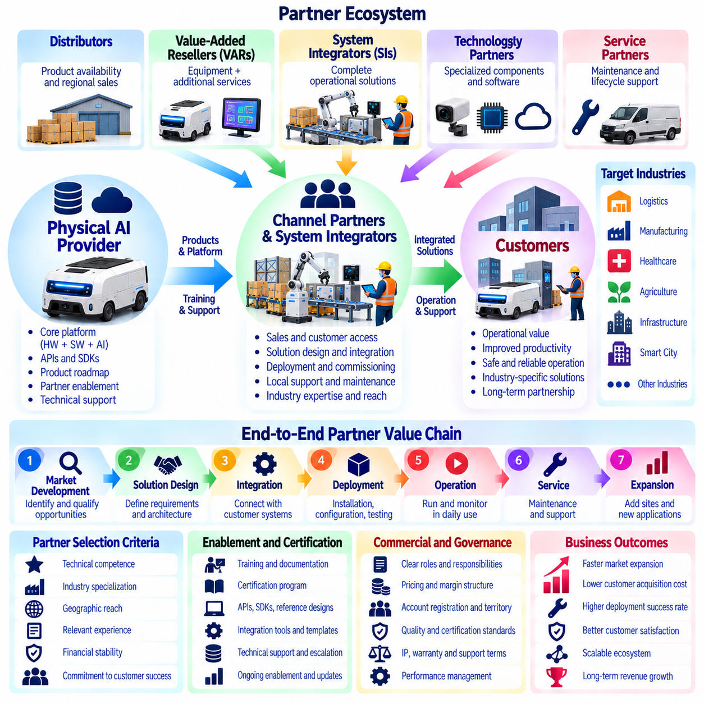{width="7.268055555555556in" height="7.268055555555556in"}

Channel partner and system integrator strategy determines how Physical AI providers expand market access, deliver complex solutions, and support customers beyond their direct organizational capacity. Channel partners connect products with potential buyers, while system integrators adapt robotic technologies to operational environments. A coordinated partner strategy can accelerate adoption, reduce deployment costs, and improve service coverage without requiring equivalent growth in internal resources.

Physical AI sales frequently involve complex purchasing decisions that extend beyond equipment specifications. Customers must evaluate operational compatibility, integration requirements, safety, workforce impacts, and financial returns. Channel partners with established industry relationships can identify qualified opportunities and communicate business value. Their knowledge of customer procurement processes may shorten sales cycles and reduce the provider\'s customer acquisition burden.

Different partner types contribute distinct capabilities to the commercialization process. Distributors manage product availability and regional sales, value-added resellers combine equipment with complementary services, and system integrators implement complete operational solutions. Technology partners supply specialized components or software, while service partners provide maintenance and support. Partner selection should reflect the requirements of target industries and deployment complexity.

System integrators are especially important because Physical AI solutions rarely operate independently of existing infrastructure. Robots may need connections to warehouse management systems, manufacturing execution systems, enterprise applications, and facility controls. Integrators translate customer workflows into technical requirements and coordinate interfaces between systems. Their effectiveness directly influences deployment reliability, customer satisfaction, and project profitability.

Partner strategy should begin with a clear division of responsibilities between the platform provider and external organizations. The provider may retain ownership of core robotics software, artificial intelligence models, safety architecture, and product roadmaps. Partners may manage customer acquisition, installation, workflow configuration, and local support. Explicit responsibility boundaries reduce duplicated effort, commercial disputes, and unresolved technical problems.

Selecting partners requires evaluating technical competence, industry specialization, geographic reach, and financial stability. A large sales network is not necessarily valuable if partners cannot support complex robotic deployments. Relevant experience with automation, industrial communication, safety procedures, and enterprise integration should receive significant consideration. Providers should prioritize partners capable of delivering repeatable customer outcomes rather than maximizing partner registrations.

Partner certification helps establish consistent deployment quality across different organizations. Certification programs may assess installation procedures, software configuration, safety practices, troubleshooting skills, and customer support capabilities. Training should include practical demonstrations and operational scenarios rather than documentation alone. Periodic reassessment is necessary as hardware generations, software releases, and regulatory requirements evolve.

Standardized integration architecture is essential for scaling partner-delivered solutions. Application programming interfaces, software development kits, reference configurations, and documented communication protocols reduce custom engineering requirements. Reusable connectors can simplify integration with common enterprise systems. Standardization improves deployment predictability while allowing controlled customization for industry-specific workflows and customer infrastructure.

Commercial agreements must align incentives between providers and partners. Distribution margins, referral fees, integration charges, recurring service revenue, and performance-based compensation can support different partner roles. Agreements should define pricing authority, customer ownership, warranty obligations, and support responsibilities. Poorly designed incentives may encourage equipment sales without sufficient attention to deployment success or long-term service quality.

Channel conflict becomes a significant concern when providers combine direct sales with partner-led distribution. Partners may hesitate to invest in market development if the provider competes for the same customers. Clear account registration, territory policies, opportunity ownership, and escalation procedures can reduce disputes. A balanced channel model should preserve strategic direct relationships while rewarding partners for measurable contributions to customer acquisition and delivery.

The economics of partner-led growth should be evaluated beyond headline revenue. Partner margins reduce the provider\'s direct revenue share but may lower sales, installation, and support expenses. Customer acquisition cost, integration cost, contribution margin, and service profitability should be compared across direct and indirect channels. The optimal model depends on deployment complexity, customer concentration, geographic coverage, and the degree of partner independence.

Regional expansion often benefits from partners familiar with local operating conditions. Regulations, industrial standards, language requirements, labor practices, and customer purchasing behavior can differ significantly between markets. Local integrators may provide faster installation and maintenance response than a centralized provider organization. However, geographic expansion should be supported by consistent technical standards, service processes, and contractual accountability.

After-sales support is a critical component of partner strategy because robotic systems require ongoing operational attention. Providers and partners must coordinate preventive maintenance, spare parts availability, remote diagnostics, software updates, and emergency recovery. Service-level agreements should identify response obligations and escalation paths. Unclear support ownership can increase downtime and damage customer relationships even when the underlying technology performs adequately.

Knowledge transfer enables partners to become productive without excessive dependence on the original engineering team. Technical documentation, deployment playbooks, troubleshooting databases, simulation tools, and structured training programs support independent execution. Providers should capture lessons from completed projects and distribute validated improvements across the partner network. This process converts deployment experience into reusable organizational capability.

Partner performance management requires measurable indicators covering commercial and operational outcomes. Relevant metrics include qualified leads, conversion rates, deployment duration, first-time acceptance, system availability, customer satisfaction, and recurring revenue retention. Integration defects and unresolved support incidents should also be monitored. Performance reviews can identify training needs, process weaknesses, and opportunities to expand successful partnerships.

A tiered partner ecosystem can accommodate organizations with different capabilities and commitments. Entry-level partners may focus on referrals or limited sales activities, while advanced partners perform certified integrations and regional service operations. Strategic partners may jointly develop industry solutions or support major enterprise accounts. Advancement criteria should be transparent and linked to demonstrated competence, customer outcomes, and investment in shared capabilities.

Joint solution development can strengthen differentiation in specialized markets. System integrators often understand operational problems that general-purpose robot providers cannot fully anticipate. Collaborative engineering can produce reusable workflows, application modules, and reference deployments. Intellectual property ownership, maintenance responsibility, and commercialization rights should be established early to prevent disputes as jointly developed solutions gain commercial value.

Partner dependency introduces strategic risks that require active management. A provider relying heavily on a single distributor or integrator may lose market access if that relationship deteriorates. Partners may also promote competing products, underinvest in technical training, or fail to maintain service standards. Diversification, contractual protections, direct customer visibility, and alternative support capabilities help reduce concentration risk without undermining productive partnerships.

Digital partner infrastructure can improve coordination as the ecosystem grows. Partner portals may provide product documentation, software releases, certification records, opportunity registration, service tickets, and performance dashboards. Shared information systems improve transparency and reduce administrative delays. Access controls and data governance remain important because partners may handle sensitive customer information, proprietary software, and operational records.

Ultimately, channel partner and system integrator strategy enables Physical AI businesses to scale through distributed commercial relationships and technical expertise. Successful ecosystems combine capable partners, standardized integration methods, aligned economic incentives, and accountable service delivery. Providers that invest in partner enablement and governance can expand market coverage, improve deployment consistency, and build sustainable revenue across diverse industries and regions.

채널 파트너 및 시스템 통합업체 전략(Channel Partner and System Integrator Strategy)은 피지컬 인공지능 공급업체(Physical AI Providers)가 시장 접근성(Market Access)을 확대하고 복잡한 솔루션(Complex Solutions)을 제공하며 내부 조직 역량(Internal Organizational Capacity)을 넘어 고객을 지원하는 방식을 결정한다. 채널 파트너(Channel Partners)는 제품과 잠재 구매자(Potential Buyers)를 연결하고, 시스템 통합업체(System Integrators)는 로봇 기술(Robotic Technologies)을 운영 환경(Operational Environments)에 맞게 적용한다. 체계적으로 조정된 파트너 전략(Coordinated Partner Strategy)은 내부 자원(Internal Resources)을 동일한 비율로 늘리지 않고도 도입(Adoption)을 가속하고 배포 비용(Deployment Costs)을 줄이며 서비스 범위(Service Coverage)를 확대할 수 있다.

피지컬 인공지능 영업(Physical AI Sales)은 장비 사양(Equipment Specifications)을 넘어서는 복잡한 구매 의사결정(Complex Purchasing Decisions)을 수반하는 경우가 많다. 고객은 운영 호환성(Operational Compatibility), 통합 요구사항(Integration Requirements), 안전성(Safety), 인력에 미치는 영향(Workforce Impacts), 재무적 수익(Financial Returns)을 평가해야 한다. 기존 산업 관계망(Established Industry Relationships)을 보유한 채널 파트너(Channel Partners)는 적격 영업 기회(Qualified Opportunities)를 발굴하고 사업 가치(Business Value)를 전달할 수 있다. 고객 구매 프로세스(Customer Procurement Processes)에 대한 이들의 지식은 영업 주기(Sales Cycles)를 단축하고 공급업체의 고객 확보 부담(Customer Acquisition Burden)을 줄일 수 있다.

서로 다른 파트너 유형(Partner Types)은 상용화 과정(Commercialization Process)에 각기 다른 역량(Distinct Capabilities)을 제공한다. 유통업체(Distributors)는 제품 공급 가능성(Product Availability)과 지역 영업(Regional Sales)을 관리하고, 부가가치 재판매업체(Value-Added Resellers)는 장비와 보완 서비스(Complementary Services)를 결합하며, 시스템 통합업체(System Integrators)는 완전한 운영 솔루션(Complete Operational Solutions)을 구현한다. 기술 파트너(Technology Partners)는 전문 부품(Specialized Components)이나 소프트웨어(Software)를 공급하고, 서비스 파트너(Service Partners)는 유지보수(Maintenance)와 지원(Support)을 제공한다. 파트너 선정(Partner Selection)은 목표 산업(Target Industries)의 요구사항과 배포 복잡성(Deployment Complexity)을 반영해야 한다.

시스템 통합업체(System Integrators)는 피지컬 인공지능 솔루션(Physical AI Solutions)이 기존 인프라(Existing Infrastructure)와 독립적으로 운영되는 경우가 드물기 때문에 특히 중요하다. 로봇은 창고 관리 시스템(Warehouse Management Systems, WMS), 제조 실행 시스템(Manufacturing Execution Systems, MES), 기업용 응용 프로그램(Enterprise Applications), 시설 제어 시스템(Facility Controls)과 연결되어야 할 수 있다. 통합업체(Integrators)는 고객 작업 흐름(Customer Workflows)을 기술 요구사항(Technical Requirements)으로 전환하고 시스템 간 인터페이스(Interfaces Between Systems)를 조정한다. 이들의 역량은 배포 신뢰성(Deployment Reliability), 고객 만족도(Customer Satisfaction), 프로젝트 수익성(Project Profitability)에 직접적인 영향을 미친다.

파트너 전략(Partner Strategy)은 플랫폼 공급업체(Platform Provider)와 외부 조직(External Organizations) 간의 명확한 책임 분담(Division of Responsibilities)에서 시작해야 한다. 공급업체는 핵심 로봇 소프트웨어(Core Robotics Software), 인공지능 모델(Artificial Intelligence Models), 안전 아키텍처(Safety Architecture), 제품 로드맵(Product Roadmaps)에 대한 소유권을 유지할 수 있다. 파트너는 고객 확보(Customer Acquisition), 설치(Installation), 작업 흐름 설정(Workflow Configuration), 현지 지원(Local Support)을 담당할 수 있다. 명시적인 책임 경계(Explicit Responsibility Boundaries)는 중복 작업(Duplicated Effort), 상업적 분쟁(Commercial Disputes), 해결되지 않은 기술적 문제(Unresolved Technical Problems)를 줄인다.

파트너 선정(Selecting Partners)에는 기술적 역량(Technical Competence), 산업 전문성(Industry Specialization), 지리적 사업 범위(Geographic Reach), 재무적 안정성(Financial Stability)에 대한 평가가 필요하다. 대규모 영업 네트워크(Large Sales Network)를 보유하고 있더라도 복잡한 로봇 배포(Complex Robotic Deployments)를 지원할 수 없다면 반드시 가치 있는 파트너라고 할 수는 없다. 자동화(Automation), 산업용 통신(Industrial Communication), 안전 절차(Safety Procedures), 기업 시스템 통합(Enterprise Integration)에 대한 관련 경험(Relevant Experience)을 중요하게 고려해야 한다. 공급업체는 파트너 등록 수(Partner Registrations)를 극대화하기보다 반복 가능한 고객 성과(Repeatable Customer Outcomes)를 제공할 수 있는 파트너를 우선해야 한다.

파트너 인증(Partner Certification)은 서로 다른 조직 간에 일관된 배포 품질(Consistent Deployment Quality)을 확보하는 데 도움이 된다. 인증 프로그램(Certification Programs)은 설치 절차(Installation Procedures), 소프트웨어 설정(Software Configuration), 안전 관행(Safety Practices), 문제 해결 능력(Troubleshooting Skills), 고객 지원 역량(Customer Support Capabilities)을 평가할 수 있다. 교육(Training)에는 문서화(Documentation)뿐 아니라 실제 시연(Practical Demonstrations)과 운영 시나리오(Operational Scenarios)가 포함되어야 한다. 하드웨어 세대(Hardware Generations), 소프트웨어 릴리스(Software Releases), 규제 요구사항(Regulatory Requirements)이 변화함에 따라 정기적인 재평가(Periodic Reassessment)가 필요하다.

표준화된 통합 아키텍처(Standardized Integration Architecture)는 파트너가 제공하는 솔루션(Partner-Delivered Solutions)을 확장하는 데 필수적이다. 응용 프로그램 프로그래밍 인터페이스(Application Programming Interfaces, APIs), 소프트웨어 개발 키트(Software Development Kits, SDKs), 참조 구성(Reference Configurations), 문서화된 통신 프로토콜(Documented Communication Protocols)은 맞춤형 엔지니어링 요구사항(Custom Engineering Requirements)을 줄인다. 재사용 가능한 커넥터(Reusable Connectors)는 일반적인 기업 시스템(Common Enterprise Systems)과의 통합을 단순화할 수 있다. 표준화(Standardization)는 산업별 작업 흐름(Industry-Specific Workflows)과 고객 인프라(Customer Infrastructure)에 대한 통제된 맞춤화(Controlled Customization)를 허용하면서 배포 예측 가능성(Deployment Predictability)을 개선한다.

상업적 계약(Commercial Agreements)은 공급업체(Providers)와 파트너(Partners) 간의 인센티브(Incentives)를 일치시켜야 한다. 유통 마진(Distribution Margins), 추천 수수료(Referral Fees), 통합 비용(Integration Charges), 반복 서비스 매출(Recurring Service Revenue), 성과 기반 보상(Performance-Based Compensation)은 서로 다른 파트너 역할(Partner Roles)을 지원할 수 있다. 계약에는 가격 결정 권한(Pricing Authority), 고객 소유권(Customer Ownership), 보증 의무(Warranty Obligations), 지원 책임(Support Responsibilities)을 명시해야 한다. 잘못 설계된 인센티브(Poorly Designed Incentives)는 배포 성공(Deployment Success)이나 장기적인 서비스 품질(Long-Term Service Quality)에 충분한 주의를 기울이지 않은 채 장비 판매(Equipment Sales)만을 장려할 수 있다.

채널 갈등(Channel Conflict)은 공급업체가 직접 영업(Direct Sales)과 파트너 주도 유통(Partner-Led Distribution)을 결합할 때 중요한 문제가 된다. 공급업체가 동일한 고객을 대상으로 경쟁한다면 파트너는 시장 개발(Market Development)에 투자하는 것을 주저할 수 있다. 명확한 고객 계정 등록(Account Registration), 영업 지역 정책(Territory Policies), 영업 기회 소유권(Opportunity Ownership), 문제 상향 처리 절차(Escalation Procedures)는 분쟁을 줄일 수 있다. 균형 잡힌 채널 모델(Balanced Channel Model)은 전략적인 직접 고객 관계(Strategic Direct Relationships)를 유지하면서 고객 확보(Customer Acquisition)와 솔루션 제공(Delivery)에 측정 가능한 기여(Measurable Contributions)를 하는 파트너에게 적절한 보상을 제공해야 한다.

파트너 주도 성장(Partner-Led Growth)의 경제성(Economics)은 표면적인 매출(Headline Revenue)을 넘어 평가해야 한다. 파트너 마진(Partner Margins)은 공급업체의 직접 매출 몫(Direct Revenue Share)을 줄이지만 영업(Sales), 설치(Installation), 지원(Support) 비용을 낮출 수 있다. 고객 확보 비용(Customer Acquisition Cost), 통합 비용(Integration Cost), 공헌이익(Contribution Margin), 서비스 수익성(Service Profitability)은 직접 채널(Direct Channels)과 간접 채널(Indirect Channels) 간에 비교되어야 한다. 최적의 모델(Optimal Model)은 배포 복잡성(Deployment Complexity), 고객 집중도(Customer Concentration), 지리적 서비스 범위(Geographic Coverage), 파트너 독립성(Partner Independence)의 수준에 따라 달라진다.

지역 확장(Regional Expansion)은 현지 운영 조건(Local Operating Conditions)에 익숙한 파트너를 활용할 때 이점을 얻는 경우가 많다. 규제(Regulations), 산업 표준(Industrial Standards), 언어 요구사항(Language Requirements), 노동 관행(Labor Practices), 고객 구매 행동(Customer Purchasing Behavior)은 시장에 따라 크게 달라질 수 있다. 현지 시스템 통합업체(Local Integrators)는 중앙집중식 공급업체 조직(Centralized Provider Organization)보다 빠른 설치(Installation)와 유지보수 대응(Maintenance Response)을 제공할 수 있다. 그러나 지리적 확장(Geographic Expansion)은 일관된 기술 표준(Technical Standards), 서비스 프로세스(Service Processes), 계약상 책임성(Contractual Accountability)을 기반으로 이루어져야 한다.

판매 후 지원(After-Sales Support)은 로봇 시스템(Robotic Systems)에 지속적인 운영 관리(Ongoing Operational Attention)가 필요하므로 파트너 전략(Partner Strategy)의 핵심 요소이다. 공급업체와 파트너는 예방 정비(Preventive Maintenance), 예비 부품 가용성(Spare Parts Availability), 원격 진단(Remote Diagnostics), 소프트웨어 업데이트(Software Updates), 긴급 복구(Emergency Recovery)를 조정해야 한다. 서비스 수준 협약(Service-Level Agreements, SLAs)은 대응 의무(Response Obligations)와 문제 상향 처리 경로(Escalation Paths)를 명시해야 한다. 지원 책임(Support Ownership)이 불명확하면 기반 기술(Underlying Technology)이 적절하게 작동하더라도 가동 중단시간(Downtime)이 증가하고 고객 관계(Customer Relationships)가 악화될 수 있다.

지식 이전(Knowledge Transfer)은 파트너가 원래 엔지니어링 팀(Original Engineering Team)에 과도하게 의존하지 않고 독립적인 수행 역량(Independent Execution Capability)을 확보하도록 한다. 기술 문서(Technical Documentation), 배포 실행 지침(Deployment Playbooks), 문제 해결 데이터베이스(Troubleshooting Databases), 시뮬레이션 도구(Simulation Tools), 체계적인 교육 프로그램(Structured Training Programs)은 독립적인 업무 수행(Independent Execution)을 지원한다. 공급업체는 완료된 프로젝트(Completed Projects)에서 얻은 교훈(Lessons Learned)을 수집하고 검증된 개선사항(Validated Improvements)을 파트너 네트워크(Partner Network) 전체에 배포해야 한다. 이러한 과정은 배포 경험(Deployment Experience)을 재사용 가능한 조직 역량(Reusable Organizational Capability)으로 전환한다.

파트너 성과 관리(Partner Performance Management)에는 상업적 성과(Commercial Outcomes)와 운영 성과(Operational Outcomes)를 모두 포함하는 측정 가능한 지표(Measurable Indicators)가 필요하다. 관련 지표(Relevant Metrics)에는 적격 잠재고객(Qualified Leads), 전환율(Conversion Rates), 배포 소요시간(Deployment Duration), 최초 인수 합격(First-Time Acceptance), 시스템 가용성(System Availability), 고객 만족도(Customer Satisfaction), 반복 매출 유지율(Recurring Revenue Retention)이 포함된다. 통합 결함(Integration Defects)과 해결되지 않은 지원 사고(Unresolved Support Incidents)도 모니터링해야 한다. 성과 검토(Performance Reviews)는 교육 필요성(Training Needs), 프로세스 취약점(Process Weaknesses), 성공적인 파트너십(Successful Partnerships)의 확대 기회를 식별할 수 있다.

등급별 파트너 생태계(Tiered Partner Ecosystem)는 서로 다른 역량(Capabilities)과 참여 수준(Commitments)을 가진 조직을 수용할 수 있다. 초기 단계 파트너(Entry-Level Partners)는 고객 추천(Referrals)이나 제한적인 영업 활동(Limited Sales Activities)에 집중할 수 있으며, 상위 단계 파트너(Advanced Partners)는 인증된 시스템 통합(Certified Integrations)과 지역 서비스 운영(Regional Service Operations)을 수행할 수 있다. 전략적 파트너(Strategic Partners)는 산업별 솔루션(Industry Solutions)을 공동 개발하거나 주요 기업 고객(Major Enterprise Accounts)을 지원할 수 있다. 등급 승급 기준(Advancement Criteria)은 투명해야 하며 입증된 역량(Demonstrated Competence), 고객 성과(Customer Outcomes), 공동 역량(Shared Capabilities)에 대한 투자와 연결되어야 한다.

공동 솔루션 개발(Joint Solution Development)은 전문 시장(Specialized Markets)에서 차별화(Differentiation)를 강화할 수 있다. 시스템 통합업체(System Integrators)는 범용 로봇 공급업체(General-Purpose Robot Providers)가 충분히 예상하지 못하는 운영 문제(Operational Problems)를 이해하는 경우가 많다. 협력 엔지니어링(Collaborative Engineering)은 재사용 가능한 작업 흐름(Reusable Workflows), 응용 프로그램 모듈(Application Modules), 참조 배포 사례(Reference Deployments)를 만들어낼 수 있다. 공동 개발 솔루션(Jointly Developed Solutions)의 상업적 가치(Commercial Value)가 증가할 때 발생할 수 있는 분쟁을 방지하려면 지식재산권 소유권(Intellectual Property Ownership), 유지보수 책임(Maintenance Responsibility), 상용화 권리(Commercialization Rights)를 초기 단계에서 확립해야 한다.

파트너 의존성(Partner Dependency)은 적극적인 관리(Active Management)가 필요한 전략적 위험(Strategic Risks)을 발생시킨다. 단일 유통업체(Single Distributor)나 시스템 통합업체(Integrator)에 크게 의존하는 공급업체는 해당 관계가 악화되면 시장 접근성(Market Access)을 상실할 수 있다. 파트너가 경쟁 제품(Competing Products)을 홍보하거나 기술 교육(Technical Training)에 충분히 투자하지 않거나 서비스 표준(Service Standards)을 유지하지 못할 수도 있다. 파트너 다변화(Diversification), 계약상 보호 장치(Contractual Protections), 직접적인 고객 가시성(Direct Customer Visibility), 대체 지원 역량(Alternative Support Capabilities)은 생산적인 파트너십(Productive Partnerships)을 훼손하지 않으면서 집중 위험(Concentration Risk)을 줄이는 데 도움이 된다.

디지털 파트너 인프라(Digital Partner Infrastructure)는 생태계(Ecosystem)가 성장함에 따라 협업 조정(Coordination)을 개선할 수 있다. 파트너 포털(Partner Portals)은 제품 문서(Product Documentation), 소프트웨어 릴리스(Software Releases), 인증 기록(Certification Records), 영업 기회 등록(Opportunity Registration), 서비스 티켓(Service Tickets), 성과 대시보드(Performance Dashboards)를 제공할 수 있다. 공유 정보 시스템(Shared Information Systems)은 투명성(Transparency)을 높이고 관리 지연(Administrative Delays)을 줄인다. 파트너가 민감한 고객 정보(Sensitive Customer Information), 독점 소프트웨어(Proprietary Software), 운영 기록(Operational Records)을 처리할 수 있으므로 접근 통제(Access Controls)와 데이터 거버넌스(Data Governance)는 여전히 중요하다.

궁극적으로 채널 파트너 및 시스템 통합업체 전략(Channel Partner and System Integrator Strategy)은 분산된 상업적 관계(Distributed Commercial Relationships)와 기술 전문성(Technical Expertise)을 통해 피지컬 인공지능 사업(Physical AI Businesses)을 확장할 수 있도록 한다. 성공적인 생태계(Successful Ecosystems)는 역량 있는 파트너(Capable Partners), 표준화된 통합 방법(Standardized Integration Methods), 일치된 경제적 인센티브(Aligned Economic Incentives), 책임 있는 서비스 제공(Accountable Service Delivery)을 결합한다. 파트너 역량 강화(Partner Enablement)와 거버넌스(Governance)에 투자하는 공급업체는 시장 적용 범위(Market Coverage)를 확대하고 배포 일관성(Deployment Consistency)을 개선하며 다양한 산업과 지역(Diverse Industries and Regions)에 걸쳐 지속 가능한 매출(Sustainable Revenue)을 구축할 수 있다.

##  

## 08.23. Regulation Liability and Insurance

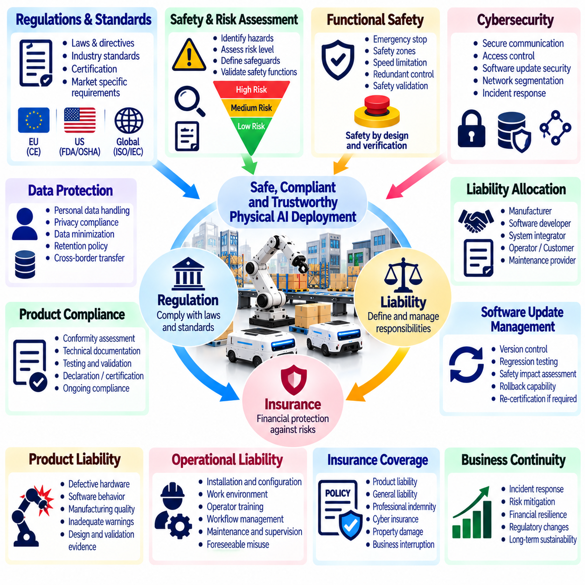{width="7.268055555555556in" height="7.268055555555556in"}

Regulation, liability, and insurance are essential components of sustainable Physical AI business models because autonomous systems operate in environments where technical failures can cause physical harm or financial loss. Unlike purely digital services, robotic systems interact directly with people, equipment, and infrastructure. Commercial success therefore requires regulatory compliance, clearly allocated responsibilities, and financial protection against operational risks.

Regulatory requirements vary according to robot type, application, operating environment, and geographic jurisdiction. Industrial manipulators, autonomous mobile robots, medical robots, agricultural machines, and aerial systems may face different safety obligations. Providers must identify applicable legislation, technical standards, and certification requirements before deployment. Regulatory planning should begin during product design rather than after commercial development is complete.

Functional safety is a central consideration for robotic systems operating near people or valuable equipment. Safety-related control functions may include emergency stopping, protective separation, speed limitation, and monitored operating zones. These functions must be designed and validated according to applicable risk levels and standards. Artificial intelligence capabilities should not replace independently verified protective mechanisms when predictable safety behavior is required.

Risk assessment provides the foundation for determining appropriate safeguards. Providers should identify foreseeable hazards, estimate their severity and likelihood, and evaluate possible mitigation measures. Risks may arise from mechanical motion, unstable payloads, sensor failures, communication interruptions, or unexpected human behavior. Assessments should cover normal operation, maintenance, foreseeable misuse, and emergency recovery rather than ideal operating conditions alone.

Product compliance may require conformity assessments, technical documentation, testing records, and formal declarations or certifications. Requirements depend on the intended market and regulatory classification of the equipment. Standards for machinery, industrial robots, mobile robots, and electrical systems can provide important compliance frameworks. Providers should distinguish legally mandatory requirements from voluntary standards that support evidence of safety.

Liability allocation becomes complicated when multiple organizations contribute to a Physical AI deployment. Robot manufacturers, software developers, system integrators, facility operators, and maintenance providers may each influence operational outcomes. A failure may involve defective hardware, inappropriate configuration, insufficient supervision, or unsafe workflows. Contracts should define responsibilities clearly, while recognizing that contractual terms cannot necessarily eliminate statutory liability.

Product liability concerns injuries or damage caused by defective products or inadequate safety information. Defects may involve mechanical design, manufacturing quality, software behavior, or insufficient warnings. Autonomous systems introduce additional complexity because performance can depend on environmental conditions and learned policies. Providers need traceable design decisions, validation evidence, and documented operating limitations to support product safety and accountability.

Operational liability concerns incidents arising from the way robotic systems are installed, configured, maintained, or used. A technically compliant robot may still create hazards if deployed in an unsuitable environment or operated outside approved conditions. Customers and integrators therefore share important responsibilities for site assessments, operator training, and workflow controls. Responsibility should follow actual authority over the relevant operational decisions.

Software updates create continuing compliance and liability considerations throughout the product lifecycle. Changes to perception, navigation, manipulation, or decision-making policies may alter system behavior and risk exposure. Update procedures should include version control, regression testing, safety impact assessment, and rollback capability. Significant modifications may require renewed evaluation under applicable regulations before deployment.

Cybersecurity is closely connected to physical safety and commercial liability. Unauthorized access, malicious commands, compromised software updates, or communication attacks can disrupt robotic operations. Secure authentication, access controls, network segmentation, monitoring, and vulnerability management reduce exposure. Providers should establish incident response procedures and clarify responsibility for cybersecurity across connected systems and organizational boundaries.

Data protection regulations may apply when robots collect images, audio, location information, or records of human activity. Workplace robots and service robots can process information relating to employees, customers, and visitors. Data minimization, access restrictions, retention policies, and lawful processing arrangements should be incorporated into system design. Cross-border data transfers and cloud-based analytics may introduce additional compliance obligations.

Insurance provides financial protection against selected losses that cannot be eliminated through engineering and operational controls. Relevant coverage may include product liability, general commercial liability, professional indemnity, cyber insurance, and property damage. Policy availability and exclusions depend on jurisdiction, insurer, and application. Providers should assess coverage against realistic incident scenarios rather than assuming conventional equipment insurance covers autonomous operations.

Insurance requirements can influence commercial contracts and customer purchasing decisions. Industrial customers may require minimum coverage limits, proof of insurance, and specific indemnification provisions before approving deployment. Robot-as-a-Service agreements may create different exposures because providers retain asset ownership and operational responsibilities. Insurance costs and deductibles should therefore be included in pricing, unit economics, and lifecycle financial models.

Incident investigation requires reliable records of system behavior and operational context. Sensor logs, command histories, software versions, intervention events, and maintenance records can help reconstruct failures. Accurate timestamps and protected evidence storage improve traceability. Logging systems should balance investigative requirements with privacy and cybersecurity obligations. Documented investigation procedures support corrective action and accountability.

Human oversight remains important even when robots operate autonomously. Operators need clear authority to stop equipment, intervene during abnormal conditions, and report hazards. Training should explain system limitations, emergency procedures, and situations requiring escalation. Excessive reliance on automation can create complacency, while unclear supervision can delay recovery. Human-machine responsibility must be designed as part of the operational system.

Regulatory compliance should be treated as an ongoing lifecycle activity rather than a one-time approval milestone. New software capabilities, additional applications, changed operating environments, and evolving legislation may affect compliance status. Providers should maintain technical files, change records, test evidence, and monitoring processes. Periodic reviews help ensure that deployed systems remain aligned with their intended use and applicable requirements.

International expansion introduces additional complexity because regulatory definitions, conformity procedures, and liability frameworks differ between markets. A robot approved for one jurisdiction may require modifications or additional documentation elsewhere. Local partners can assist with regulatory interpretation and customer requirements, but the provider must maintain control over product safety. Market entry planning should account for compliance costs and approval timelines.

Insurance and liability management also affect partnerships and ecosystem strategy. System integrators may modify configurations, third-party developers may supply applications, and service partners may perform maintenance. Each contribution can change operational risk. Agreements should establish qualification requirements, approved modification boundaries, incident notification duties, and appropriate insurance obligations. Shared governance reduces gaps in accountability across the delivery chain.

The economic impact of regulation extends beyond certification expenses. Safety engineering, testing, documentation, training, insurance premiums, legal support, and incident management contribute to total operating costs. Compliance delays can affect revenue timing, while serious incidents may interrupt operations and damage customer confidence. Financial planning should include these costs and evaluate the value of preventive investment against potential losses.

Ultimately, regulation, liability, and insurance establish the institutional foundations for trustworthy Physical AI commercialization. Effective providers integrate safety engineering, regulatory planning, contractual accountability, cybersecurity, and risk financing throughout the business lifecycle. By managing these obligations proactively, organizations can reduce uncertainty, strengthen customer confidence, and support responsible expansion into increasingly complex physical environments.

규제(Regulation), 법적 책임(Liability), 보험(Insurance)은 자율 시스템(Autonomous Systems)의 기술적 고장이 신체적 피해(Physical Harm)나 재무적 손실(Financial Loss)을 초래할 수 있는 환경에서 운영되기 때문에 지속 가능한 피지컬 인공지능 사업 모델(Sustainable Physical AI Business Models)의 필수 구성요소이다. 순수 디지털 서비스(Purely Digital Services)와 달리 로봇 시스템(Robotic Systems)은 사람(People), 장비(Equipment), 인프라(Infrastructure)와 직접 상호작용한다. 따라서 상업적 성공(Commercial Success)을 위해서는 규제 준수(Regulatory Compliance), 명확한 책임 배분(Clearly Allocated Responsibilities), 운영 위험(Operational Risks)에 대한 재무적 보호(Financial Protection)가 필요하다.

규제 요구사항(Regulatory Requirements)은 로봇 유형(Robot Type), 응용 분야(Application), 운영 환경(Operating Environment), 지리적 관할권(Geographic Jurisdiction)에 따라 달라진다. 산업용 매니퓰레이터(Industrial Manipulators), 자율이동로봇(Autonomous Mobile Robots), 의료용 로봇(Medical Robots), 농업용 기계(Agricultural Machines), 항공 로봇(Aerial Systems)은 서로 다른 안전 의무(Safety Obligations)를 적용받을 수 있다. 공급업체(Providers)는 배포 전에 적용 가능한 법률(Applicable Legislation), 기술 표준(Technical Standards), 인증 요구사항(Certification Requirements)을 파악해야 한다. 규제 계획(Regulatory Planning)은 상업적 개발(Commercial Development)이 완료된 이후가 아니라 제품 설계(Product Design) 단계부터 시작되어야 한다.

기능 안전(Functional Safety)은 사람이나 고가 장비(Valuable Equipment) 주변에서 작동하는 로봇 시스템(Robotic Systems)의 핵심 고려사항이다. 안전 관련 제어 기능(Safety-Related Control Functions)에는 비상 정지(Emergency Stopping), 보호 분리(Protective Separation), 속도 제한(Speed Limitation), 감시 운영 구역(Monitored Operating Zones)이 포함될 수 있다. 이러한 기능은 적용 가능한 위험 수준(Risk Levels)과 표준(Standards)에 따라 설계되고 검증되어야 한다. 예측 가능한 안전 동작(Predictable Safety Behavior)이 필요한 경우 인공지능 기능(Artificial Intelligence Capabilities)이 독립적으로 검증된 보호 메커니즘(Independently Verified Protective Mechanisms)을 대체해서는 안 된다.

위험 평가(Risk Assessment)는 적절한 안전장치(Safeguards)를 결정하기 위한 기반을 제공한다. 공급업체는 예측 가능한 위험요인(Foreseeable Hazards)을 식별하고 심각도(Severity)와 발생 가능성(Likelihood)을 추정하며 가능한 위험 완화 조치(Mitigation Measures)를 평가해야 한다. 위험은 기계적 움직임(Mechanical Motion), 불안정한 적재물(Unstable Payloads), 센서 고장(Sensor Failures), 통신 중단(Communication Interruptions), 예상하지 못한 인간 행동(Unexpected Human Behavior)에서 발생할 수 있다. 평가는 이상적인 운영 조건(Ideal Operating Conditions)뿐 아니라 정상 운영(Normal Operation), 유지보수(Maintenance), 예측 가능한 오사용(Foreseeable Misuse), 긴급 복구(Emergency Recovery)를 포함해야 한다.

제품 규제 준수(Product Compliance)에는 적합성 평가(Conformity Assessments), 기술 문서(Technical Documentation), 시험 기록(Testing Records), 공식 적합성 선언(Formal Declarations) 또는 인증(Certifications)이 필요할 수 있다. 요구사항은 목표 시장(Intended Market)과 장비의 규제상 분류(Regulatory Classification)에 따라 달라진다. 기계류(Machinery), 산업용 로봇(Industrial Robots), 이동로봇(Mobile Robots), 전기 시스템(Electrical Systems)에 관한 표준은 중요한 규제 준수 프레임워크(Compliance Frameworks)를 제공할 수 있다. 공급업체는 법적으로 의무화된 요구사항(Legally Mandatory Requirements)과 안전성 입증(Evidence of Safety)을 지원하는 자발적 표준(Voluntary Standards)을 구분해야 한다.

여러 조직(Multiple Organizations)이 피지컬 인공지능 배포(Physical AI Deployment)에 참여하면 법적 책임 배분(Liability Allocation)이 복잡해진다. 로봇 제조업체(Robot Manufacturers), 소프트웨어 개발업체(Software Developers), 시스템 통합업체(System Integrators), 시설 운영자(Facility Operators), 유지보수 업체(Maintenance Providers)는 각각 운영 결과(Operational Outcomes)에 영향을 미칠 수 있다. 고장(Failure)은 결함이 있는 하드웨어(Defective Hardware), 부적절한 설정(Inappropriate Configuration), 불충분한 감독(Insufficient Supervision), 안전하지 않은 작업 흐름(Unsafe Workflows)과 관련될 수 있다. 계약(Contracts)은 책임(Responsibilities)을 명확하게 정의해야 하지만 계약 조건(Contractual Terms)이 법정 책임(Statutory Liability)을 반드시 면제할 수 있는 것은 아니라는 점을 인식해야 한다.

제조물 책임(Product Liability)은 결함이 있는 제품(Defective Products)이나 불충분한 안전 정보(Inadequate Safety Information)로 인해 발생한 상해(Injuries) 또는 손해(Damage)와 관련된다. 결함(Defects)은 기계 설계(Mechanical Design), 제조 품질(Manufacturing Quality), 소프트웨어 동작(Software Behavior), 불충분한 경고(Insufficient Warnings)에 존재할 수 있다. 자율 시스템(Autonomous Systems)은 성능(Performance)이 환경 조건(Environmental Conditions)과 학습된 정책(Learned Policies)에 따라 달라질 수 있으므로 추가적인 복잡성을 발생시킨다. 공급업체는 제품 안전(Product Safety)과 책임성(Accountability)을 입증하기 위해 추적 가능한 설계 의사결정(Traceable Design Decisions), 검증 근거(Validation Evidence), 문서화된 운영 한계(Documented Operating Limitations)를 확보해야 한다.

운영상 책임(Operational Liability)은 로봇 시스템(Robotic Systems)의 설치(Installation), 설정(Configuration), 유지보수(Maintenance), 사용(Use) 방식에서 발생하는 사고(Incidents)와 관련된다. 기술적으로 규제를 준수하는 로봇(Technically Compliant Robot)이라도 부적합한 환경(Unsuitable Environment)에 배포되거나 승인된 조건(Approved Conditions)을 벗어나 운영되면 위험을 발생시킬 수 있다. 따라서 고객(Customers)과 시스템 통합업체(Integrators)는 현장 평가(Site Assessments), 운영자 교육(Operator Training), 작업 흐름 통제(Workflow Controls)에 중요한 책임을 가진다. 책임(Responsibility)은 관련 운영 의사결정(Operational Decisions)에 대한 실제 권한(Actual Authority)에 따라 배분되어야 한다.

소프트웨어 업데이트(Software Updates)는 제품 수명주기(Product Lifecycle) 전반에 걸쳐 지속적인 규제 준수(Compliance)와 법적 책임(Liability)에 관한 고려사항을 발생시킨다. 인지(Perception), 주행(Navigation), 조작(Manipulation), 의사결정 정책(Decision-Making Policies)의 변경은 시스템 동작(System Behavior)과 위험 노출(Risk Exposure)을 변화시킬 수 있다. 업데이트 절차(Update Procedures)에는 버전 관리(Version Control), 회귀시험(Regression Testing), 안전 영향 평가(Safety Impact Assessment), 롤백 기능(Rollback Capability)이 포함되어야 한다. 중요한 변경사항(Significant Modifications)은 배포 전에 적용 가능한 규제(Applicable Regulations)에 따라 재평가(Renewed Evaluation)가 필요할 수 있다.

사이버보안(Cybersecurity)은 물리적 안전(Physical Safety) 및 상업적 법적 책임(Commercial Liability)과 밀접하게 연결된다. 무단 접근(Unauthorized Access), 악의적인 명령(Malicious Commands), 손상된 소프트웨어 업데이트(Compromised Software Updates), 통신 공격(Communication Attacks)은 로봇 운영(Robotic Operations)을 방해할 수 있다. 안전한 인증(Secure Authentication), 접근 통제(Access Controls), 네트워크 분리(Network Segmentation), 모니터링(Monitoring), 취약점 관리(Vulnerability Management)는 위험 노출(Exposure)을 줄인다. 공급업체는 사고 대응 절차(Incident Response Procedures)를 수립하고 연결된 시스템(Connected Systems)과 조직 간 경계(Organizational Boundaries)에 걸친 사이버보안 책임(Cybersecurity Responsibility)을 명확히 해야 한다.

로봇이 이미지(Images), 음성(Audio), 위치 정보(Location Information), 인간 활동 기록(Records of Human Activity)을 수집하는 경우 데이터 보호 규정(Data Protection Regulations)이 적용될 수 있다. 작업장 로봇(Workplace Robots)과 서비스 로봇(Service Robots)은 직원(Employees), 고객(Customers), 방문자(Visitors)와 관련된 정보를 처리할 수 있다. 데이터 최소화(Data Minimization), 접근 제한(Access Restrictions), 보존 정책(Retention Policies), 적법한 처리 체계(Lawful Processing Arrangements)는 시스템 설계(System Design)에 반영되어야 한다. 국경 간 데이터 이전(Cross-Border Data Transfers)과 클라우드 기반 분석(Cloud-Based Analytics)은 추가적인 규제 준수 의무(Compliance Obligations)를 발생시킬 수 있다.

보험(Insurance)은 엔지니어링(Engineering)과 운영 통제(Operational Controls)를 통해 완전히 제거할 수 없는 특정 손실(Selected Losses)에 대한 재무적 보호(Financial Protection)를 제공한다. 관련 보장(Coverage)에는 제조물 배상책임보험(Product Liability Insurance), 일반 영업배상책임보험(General Commercial Liability Insurance), 전문직 배상책임보험(Professional Indemnity Insurance), 사이버보험(Cyber Insurance), 재산손해 보장(Property Damage Coverage)이 포함될 수 있다. 보험상품의 이용 가능성(Policy Availability)과 면책사항(Exclusions)은 관할권(Jurisdiction), 보험사(Insurer), 응용 분야(Application)에 따라 달라진다. 공급업체는 기존 장비 보험(Conventional Equipment Insurance)이 자율 운영(Autonomous Operations)을 보장한다고 가정하기보다 현실적인 사고 시나리오(Realistic Incident Scenarios)를 기준으로 보장 범위를 평가해야 한다.

보험 요구사항(Insurance Requirements)은 상업적 계약(Commercial Contracts)과 고객 구매 의사결정(Customer Purchasing Decisions)에 영향을 미칠 수 있다. 산업 고객(Industrial Customers)은 배포 승인(Deployment Approval) 전에 최소 보장 한도(Minimum Coverage Limits), 보험 가입 증명(Proof of Insurance), 특정 면책 및 배상 조항(Specific Indemnification Provisions)을 요구할 수 있다. 서비스형 로봇 계약(Robot-as-a-Service Agreements)은 공급업체가 자산 소유권(Asset Ownership)과 운영 책임(Operational Responsibilities)을 유지하기 때문에 서로 다른 위험 노출(Exposures)을 발생시킬 수 있다. 따라서 보험 비용(Insurance Costs)과 자기부담금(Deductibles)은 가격 책정(Pricing), 단위 경제성(Unit Economics), 수명주기 재무 모델(Lifecycle Financial Models)에 포함되어야 한다.

사고 조사(Incident Investigation)에는 시스템 동작(System Behavior)과 운영 상황(Operational Context)에 관한 신뢰할 수 있는 기록(Reliable Records)이 필요하다. 센서 로그(Sensor Logs), 명령 이력(Command Histories), 소프트웨어 버전(Software Versions), 개입 이벤트(Intervention Events), 유지보수 기록(Maintenance Records)은 고장(Failures)의 발생 과정을 재구성하는 데 도움이 된다. 정확한 타임스탬프(Accurate Timestamps)와 보호된 증거 저장소(Protected Evidence Storage)는 추적성(Traceability)을 향상시킨다. 로깅 시스템(Logging Systems)은 조사 요구사항(Investigative Requirements)과 개인정보 보호(Privacy), 사이버보안 의무(Cybersecurity Obligations) 사이의 균형을 유지해야 한다. 문서화된 조사 절차(Documented Investigation Procedures)는 시정조치(Corrective Action)와 책임성(Accountability)을 지원한다.

로봇이 자율적으로 운영되더라도 인간 감독(Human Oversight)은 여전히 중요하다. 운영자(Operators)는 장비를 정지시키고 비정상적인 상황(Abnormal Conditions)에 개입하며 위험요인(Hazards)을 보고할 수 있는 명확한 권한(Clear Authority)을 가져야 한다. 교육(Training)은 시스템 한계(System Limitations), 비상 절차(Emergency Procedures), 문제 상향 보고(Escalation)가 필요한 상황을 설명해야 한다. 자동화에 대한 과도한 의존(Excessive Reliance on Automation)은 경계심 저하(Complacency)를 초래할 수 있으며, 불명확한 감독 체계(Unclear Supervision)는 복구(Recovery)를 지연시킬 수 있다. 인간과 기계의 책임 분담(Human-Machine Responsibility)은 운영 시스템(Operational System)의 일부로 설계되어야 한다.

규제 준수(Regulatory Compliance)는 일회성 승인 단계(One-Time Approval Milestone)가 아니라 지속적인 수명주기 활동(Ongoing Lifecycle Activity)으로 관리되어야 한다. 새로운 소프트웨어 기능(New Software Capabilities), 추가 응용 분야(Additional Applications), 변경된 운영 환경(Changed Operating Environments), 변화하는 법률(Evolving Legislation)은 규제 준수 상태(Compliance Status)에 영향을 미칠 수 있다. 공급업체는 기술 파일(Technical Files), 변경 기록(Change Records), 시험 근거(Test Evidence), 모니터링 프로세스(Monitoring Processes)를 유지해야 한다. 정기적인 검토(Periodic Reviews)는 배포된 시스템(Deployed Systems)이 의도된 사용 목적(Intended Use)과 적용 가능한 요구사항(Applicable Requirements)에 지속적으로 부합하도록 하는 데 도움이 된다.

국제 시장 확장(International Expansion)은 시장마다 규제상 정의(Regulatory Definitions), 적합성 평가 절차(Conformity Procedures), 법적 책임 체계(Liability Frameworks)가 다르기 때문에 추가적인 복잡성을 발생시킨다. 특정 관할권(One Jurisdiction)에서 승인된 로봇이라도 다른 지역에서는 수정(Modification)이나 추가 문서(Additional Documentation)가 필요할 수 있다. 현지 파트너(Local Partners)는 규제 해석(Regulatory Interpretation)과 고객 요구사항(Customer Requirements)을 지원할 수 있지만 공급업체는 제품 안전(Product Safety)에 대한 통제권(Control)을 유지해야 한다. 시장 진입 계획(Market Entry Planning)은 규제 준수 비용(Compliance Costs)과 승인 일정(Approval Timelines)을 고려해야 한다.

보험 및 법적 책임 관리(Insurance and Liability Management)는 파트너십(Partnerships)과 생태계 전략(Ecosystem Strategy)에도 영향을 미친다. 시스템 통합업체(System Integrators)는 설정(Configuration)을 수정할 수 있고, 타사 개발업체(Third-Party Developers)는 응용 프로그램(Applications)을 공급할 수 있으며, 서비스 파트너(Service Partners)는 유지보수(Maintenance)를 수행할 수 있다. 각각의 기여(Contribution)는 운영 위험(Operational Risk)을 변화시킬 수 있다. 계약(Agreements)은 자격 요건(Qualification Requirements), 승인된 수정 범위(Approved Modification Boundaries), 사고 통지 의무(Incident Notification Duties), 적절한 보험 가입 의무(Appropriate Insurance Obligations)를 규정해야 한다. 공동 거버넌스(Shared Governance)는 전체 공급 및 서비스 제공 체계(Delivery Chain)에서 책임 공백(Gaps in Accountability)을 줄인다.

규제(Regulation)의 경제적 영향(Economic Impact)은 인증 비용(Certification Expenses)을 넘어선다. 안전 엔지니어링(Safety Engineering), 시험(Testing), 문서화(Documentation), 교육(Training), 보험료(Insurance Premiums), 법률 지원(Legal Support), 사고 관리(Incident Management)는 총운영비용(Total Operating Costs)에 포함된다. 규제 준수 지연(Compliance Delays)은 매출 발생 시점(Revenue Timing)에 영향을 미칠 수 있으며, 심각한 사고(Serious Incidents)는 운영을 중단시키고 고객 신뢰(Customer Confidence)를 훼손할 수 있다. 재무 계획(Financial Planning)은 이러한 비용을 포함하고 잠재적 손실(Potential Losses)과 비교하여 예방적 투자(Preventive Investment)의 가치를 평가해야 한다.

궁극적으로 규제(Regulation), 법적 책임(Liability), 보험(Insurance)은 신뢰할 수 있는 피지컬 인공지능 상용화(Trustworthy Physical AI Commercialization)를 위한 제도적 기반(Institutional Foundations)을 형성한다. 효과적인 공급업체(Effective Providers)는 사업 수명주기(Business Lifecycle) 전반에 걸쳐 안전 엔지니어링(Safety Engineering), 규제 계획(Regulatory Planning), 계약상 책임성(Contractual Accountability), 사이버보안(Cybersecurity), 위험 재무 관리(Risk Financing)를 통합한다. 이러한 의무(Obligations)를 선제적으로 관리함으로써 조직은 불확실성(Uncertainty)을 줄이고 고객 신뢰(Customer Confidence)를 강화하며 점점 더 복잡해지는 물리적 환경(Physical Environments)으로의 책임 있는 확장(Responsible Expansion)을 지원할 수 있다.

##  

## 08.24. Market Entry and Go to Market

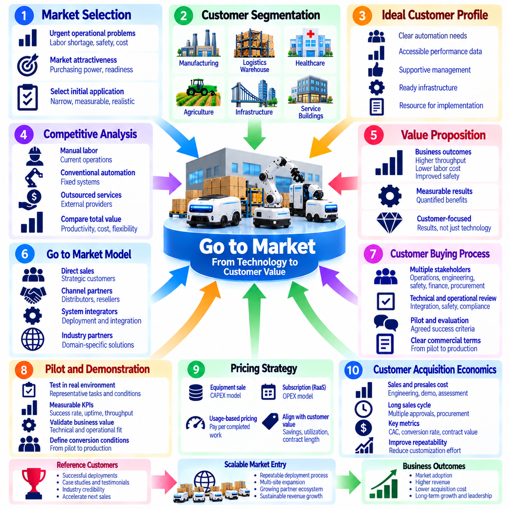{width="7.268055555555556in" height="7.268055555555556in"}

Market entry and go-to-market strategy determine how Physical AI providers convert technological capabilities into commercial adoption and sustainable revenue. Unlike conventional software products, robotic solutions require physical deployment, operational integration, and customer confidence in safety and reliability. Successful market entry therefore depends on selecting suitable applications, demonstrating measurable value, and establishing repeatable sales and delivery processes.

Market selection should begin with identifying industries where automation addresses urgent operational problems. Labor shortages, repetitive tasks, safety risks, productivity constraints, and rising operating costs can create demand for Physical AI solutions. However, market attractiveness depends on more than problem severity. Customers must possess sufficient purchasing capacity, operational readiness, and willingness to change existing workflows.

Customer segmentation helps providers distinguish opportunities with different technical and commercial requirements. Manufacturing facilities, warehouses, hospitals, agricultural operations, and service organizations vary in task complexity, purchasing processes, and deployment conditions. Segmentation should consider workload characteristics, facility infrastructure, automation maturity, and expected economic returns. Clearly defined segments enable more focused product development and marketing.

Early market entry benefits from selecting a narrow initial application with measurable customer value. A focused use case reduces engineering uncertainty, simplifies sales communication, and supports repeatable deployment. Providers should prioritize tasks with predictable workflows, sufficient operating volume, and manageable safety requirements. Broad general-purpose positioning may attract attention but can weaken execution when technical capabilities remain limited.

The ideal customer profile should reflect both operational needs and organizational readiness. Suitable early customers typically have clearly identified automation problems, accessible performance data, supportive management, and resources for implementation. Their facilities should permit meaningful testing without excessive customization. Early adopters can provide valuable feedback and reference deployments, but their requirements should not dictate an unsustainably customized product roadmap.

Competitive analysis should compare Physical AI solutions with existing operational alternatives rather than robotic competitors alone. Manual labor, conventional automation, outsourced services, and process redesign may all address similar customer problems. Providers must evaluate relative productivity, flexibility, safety, integration costs, and lifecycle economics. A compelling market proposition explains why the proposed solution creates superior value under realistic operating conditions.

The customer value proposition should translate technical capabilities into business outcomes. Navigation accuracy, manipulation performance, and artificial intelligence sophistication matter commercially when they improve throughput, reduce labor burdens, increase availability, or enhance safety. Quantified benefits should be supported by realistic assumptions and operational evidence. Messaging should emphasize customer results rather than relying on technological novelty.

Go-to-market models may combine direct enterprise sales, channel partners, system integrators, and industry-specific distributors. Direct sales provide close customer relationships and detailed market feedback but require substantial commercial resources. Partners can expand geographic reach and provide local integration expertise. Channel selection should reflect customer concentration, deployment complexity, service requirements, and the provider\'s organizational capabilities.

Enterprise purchasing processes often involve multiple stakeholders with different priorities. Operations managers evaluate productivity, engineering teams examine integration feasibility, safety personnel assess risks, and finance departments review investment returns. Procurement and information technology teams may introduce additional requirements. Successful sales processes align these stakeholders around measurable objectives, technical responsibilities, and acceptable commercial terms.

Demonstrations and pilot projects are important tools for reducing customer uncertainty. A structured pilot should test representative tasks, realistic operating conditions, and agreed performance indicators. Acceptance criteria may include successful task completion, uptime, intervention frequency, throughput, and safety performance. Providers should establish commercial conversion conditions before the pilot begins so that successful technical validation can lead to a production decision.

Pricing strategy must match the customer\'s financial preferences and perceived value. Equipment sales may suit organizations comfortable with capital expenditure, while Robot-as-a-Service subscriptions can reduce initial investment barriers. Usage-based pricing may align payment with completed work but introduces revenue variability. Providers should evaluate pricing against customer savings, service delivery costs, asset utilization, and expected contract duration.

Customer acquisition economics influence the sustainability of market expansion. Sales engineering, demonstrations, site assessments, proposal development, and pilot support can create substantial acquisition costs. Long purchasing cycles may delay revenue recognition and increase working capital requirements. Providers should monitor customer acquisition cost, sales conversion, contract value, and payback periods. Repeatable offerings improve economics by reducing customized presales effort.

Reference customers and documented case studies can accelerate adoption in risk-sensitive industries. Prospective buyers often require evidence that robotic systems operate reliably under conditions similar to their own. Verified performance data, customer testimonials, and operational benchmarks reduce perceived uncertainty. Reference deployments should represent commercially realistic configurations rather than heavily supervised demonstrations that cannot be reproduced economically.

Market education is frequently necessary because customers may misunderstand the capabilities and limitations of Physical AI. Providers should explain autonomy boundaries, human supervision requirements, integration dependencies, and expected operational changes. Transparent communication reduces unrealistic expectations and improves purchasing decisions. Technical workshops, industry demonstrations, and financial modeling can help customers evaluate appropriate applications.

Deployment capability must develop alongside commercial demand. Aggressive sales growth can damage customer relationships if installation teams, manufacturing capacity, spare parts, or technical support cannot keep pace. Go-to-market planning should coordinate sales forecasts with operational resources and delivery schedules. Standardized commissioning procedures and partner certification help maintain consistent quality as deployment volumes increase.

Geographic expansion requires evaluating market-specific regulations, infrastructure, customer expectations, and service availability. A solution successful in one country may require additional certification, language support, or integration modifications elsewhere. Local partners can reduce entry barriers but introduce coordination and governance requirements. Expansion should follow demonstrated product-market fit and sufficient capacity to maintain reliable customer service.

Strategic partnerships can improve credibility and accelerate access to established customer networks. Industrial equipment suppliers, automation integrators, software vendors, and facility service providers may offer complementary capabilities. Joint solutions can reduce customer integration burdens and strengthen differentiation. Partnership agreements should define commercial ownership, technical responsibilities, intellectual property rights, and ongoing support obligations.

Go-to-market performance should be evaluated using both commercial and operational indicators. Qualified opportunities, sales cycle duration, pilot conversion rate, deployment lead time, customer retention, and recurring revenue reveal commercial effectiveness. Operational metrics such as task success, uptime, intervention cost, and realized productivity indicate whether customer promises are being fulfilled. Integrated measurement prevents sales growth from concealing weak deployment economics.

A phased market expansion strategy reduces risk by linking investment to validated customer demand. Providers can begin with a focused application and a limited number of reference customers, then expand into adjacent workflows and industries. Each stage should demonstrate repeatable deployment, acceptable margins, and manageable support requirements. Expansion decisions should be based on evidence of product-market fit rather than market size projections alone.

Ultimately, market entry and go-to-market strategy connect Physical AI innovation with sustainable customer adoption. Effective providers select attractive applications, communicate measurable business value, coordinate sales with deployment capabilities, and build repeatable commercial processes. By combining technical reliability, disciplined pricing, trusted partnerships, and customer-centered execution, Physical AI businesses can establish market credibility and scale revenue responsibly.

시장 진입 및 시장 출시 전략(Market Entry and Go-to-Market Strategy)은 피지컬 인공지능 공급업체(Physical AI Providers)가 기술적 역량(Technological Capabilities)을 상업적 도입(Commercial Adoption)과 지속 가능한 매출(Sustainable Revenue)로 전환하는 방식을 결정한다. 기존 소프트웨어 제품(Conventional Software Products)과 달리 로봇 솔루션(Robotic Solutions)은 물리적 배포(Physical Deployment), 운영 통합(Operational Integration), 안전성과 신뢰성(Safety and Reliability)에 대한 고객 신뢰(Customer Confidence)를 필요로 한다. 따라서 성공적인 시장 진입(Successful Market Entry)은 적절한 응용 분야(Applications)를 선정하고 측정 가능한 가치(Measurable Value)를 입증하며 반복 가능한 영업 및 공급 프로세스(Repeatable Sales and Delivery Processes)를 구축하는 데 달려 있다.

시장 선정(Market Selection)은 자동화(Automation)가 시급한 운영 문제(Urgent Operational Problems)를 해결할 수 있는 산업을 식별하는 것에서 시작해야 한다. 노동력 부족(Labor Shortages), 반복 작업(Repetitive Tasks), 안전 위험(Safety Risks), 생산성 제약(Productivity Constraints), 운영비용 상승(Rising Operating Costs)은 피지컬 인공지능 솔루션(Physical AI Solutions)에 대한 수요를 창출할 수 있다. 그러나 시장 매력도(Market Attractiveness)는 문제의 심각성(Problem Severity)만으로 결정되지 않는다. 고객은 충분한 구매 능력(Purchasing Capacity), 운영 준비도(Operational Readiness), 기존 작업 흐름(Existing Workflows)을 변경하려는 의지(Willingness to Change)를 갖추어야 한다.

고객 세분화(Customer Segmentation)는 공급업체가 서로 다른 기술적 및 상업적 요구사항(Technical and Commercial Requirements)을 가진 사업 기회(Opportunities)를 구분하는 데 도움이 된다. 제조 시설(Manufacturing Facilities), 창고(Warehouses), 병원(Hospitals), 농업 운영 조직(Agricultural Operations), 서비스 조직(Service Organizations)은 작업 복잡성(Task Complexity), 구매 프로세스(Purchasing Processes), 배포 조건(Deployment Conditions)이 서로 다르다. 세분화(Segmentation)에서는 작업 부하 특성(Workload Characteristics), 시설 인프라(Facility Infrastructure), 자동화 성숙도(Automation Maturity), 예상 경제적 수익(Expected Economic Returns)을 고려해야 한다. 명확하게 정의된 시장 세그먼트(Market Segments)는 더욱 집중적인 제품 개발(Product Development)과 마케팅(Marketing)을 가능하게 한다.

초기 시장 진입(Early Market Entry)에서는 측정 가능한 고객 가치(Measurable Customer Value)를 제공하는 좁은 범위의 초기 응용 분야(Initial Application)를 선정하는 것이 유리하다. 집중된 활용 사례(Focused Use Case)는 엔지니어링 불확실성(Engineering Uncertainty)을 줄이고 영업 커뮤니케이션(Sales Communication)을 단순화하며 반복 가능한 배포(Repeatable Deployment)를 지원한다. 공급업체는 예측 가능한 작업 흐름(Predictable Workflows), 충분한 운영 물량(Sufficient Operating Volume), 관리 가능한 안전 요구사항(Manageable Safety Requirements)을 가진 작업을 우선해야 한다. 광범위한 범용 목적의 포지셔닝(Broad General-Purpose Positioning)은 관심을 끌 수 있지만 기술적 역량(Technical Capabilities)이 제한된 상황에서는 실행력(Execution)을 약화시킬 수 있다.

이상적인 고객 프로파일(Ideal Customer Profile, ICP)은 운영상 필요(Operational Needs)와 조직적 준비도(Organizational Readiness)를 모두 반영해야 한다. 적합한 초기 고객(Early Customers)은 일반적으로 명확하게 식별된 자동화 문제(Automation Problems), 접근 가능한 성능 데이터(Accessible Performance Data), 경영진의 지원(Supportive Management), 구현을 위한 자원(Resources for Implementation)을 보유한다. 고객 시설(Customer Facilities)은 과도한 맞춤화(Excessive Customization) 없이 의미 있는 시험(Meaningful Testing)을 수행할 수 있어야 한다. 초기 도입 고객(Early Adopters)은 가치 있는 피드백(Feedback)과 참조 배포 사례(Reference Deployments)를 제공할 수 있지만, 이들의 요구사항이 지속 가능하지 않은 맞춤형 제품 로드맵(Unsustainably Customized Product Roadmap)을 결정하도록 해서는 안 된다.

경쟁 분석(Competitive Analysis)은 피지컬 인공지능 솔루션(Physical AI Solutions)을 로봇 경쟁업체(Robotic Competitors)뿐 아니라 기존 운영 대안(Existing Operational Alternatives)과 비교해야 한다. 수작업 노동(Manual Labor), 기존 자동화(Conventional Automation), 외주 서비스(Outsourced Services), 프로세스 재설계(Process Redesign)는 모두 유사한 고객 문제(Customer Problems)를 해결할 수 있다. 공급업체는 상대적인 생산성(Relative Productivity), 유연성(Flexibility), 안전성(Safety), 통합 비용(Integration Costs), 수명주기 경제성(Lifecycle Economics)을 평가해야 한다. 설득력 있는 시장 가치 제안(Compelling Market Proposition)은 제안된 솔루션(Proposed Solution)이 현실적인 운영 조건(Realistic Operating Conditions)에서 더 높은 가치(Superior Value)를 창출하는 이유를 설명해야 한다.

고객 가치 제안(Customer Value Proposition)은 기술적 역량(Technical Capabilities)을 사업 성과(Business Outcomes)로 전환하여 설명해야 한다. 주행 정확도(Navigation Accuracy), 조작 성능(Manipulation Performance), 인공지능 고도화(Artificial Intelligence Sophistication)는 처리량(Throughput)을 높이고 노동 부담(Labor Burdens)을 줄이며 가용성(Availability)을 향상시키거나 안전성(Safety)을 강화할 때 상업적 의미를 갖는다. 정량화된 편익(Quantified Benefits)은 현실적인 가정(Realistic Assumptions)과 운영 근거(Operational Evidence)에 의해 뒷받침되어야 한다. 마케팅 메시지(Messaging)는 기술적 새로움(Technological Novelty)에만 의존하기보다 고객 성과(Customer Results)를 강조해야 한다.

시장 출시 모델(Go-to-Market Models)은 직접 기업 영업(Direct Enterprise Sales), 채널 파트너(Channel Partners), 시스템 통합업체(System Integrators), 산업별 전문 유통업체(Industry-Specific Distributors)를 결합할 수 있다. 직접 영업(Direct Sales)은 긴밀한 고객 관계(Close Customer Relationships)와 상세한 시장 피드백(Detailed Market Feedback)을 제공하지만 상당한 영업 자원(Commercial Resources)이 필요하다. 파트너(Partners)는 지리적 사업 범위(Geographic Reach)를 확대하고 현지 통합 전문성(Local Integration Expertise)을 제공할 수 있다. 채널 선정(Channel Selection)은 고객 집중도(Customer Concentration), 배포 복잡성(Deployment Complexity), 서비스 요구사항(Service Requirements), 공급업체의 조직 역량(Organizational Capabilities)을 반영해야 한다.

기업 구매 프로세스(Enterprise Purchasing Processes)에는 서로 다른 우선순위(Different Priorities)를 가진 여러 이해관계자(Multiple Stakeholders)가 참여하는 경우가 많다. 운영 관리자(Operations Managers)는 생산성(Productivity)을 평가하고, 엔지니어링 팀(Engineering Teams)은 통합 실현 가능성(Integration Feasibility)을 검토하며, 안전 담당자(Safety Personnel)는 위험(Risks)을 평가하고, 재무 부서(Finance Departments)는 투자수익(Investment Returns)을 검토한다. 구매 부서(Procurement Teams)와 정보기술 부서(Information Technology Teams)는 추가적인 요구사항(Additional Requirements)을 제시할 수 있다. 성공적인 영업 프로세스(Successful Sales Processes)는 이러한 이해관계자들을 측정 가능한 목표(Measurable Objectives), 기술적 책임(Technical Responsibilities), 수용 가능한 상업 조건(Acceptable Commercial Terms)에 맞춰 조정한다.

시연(Demonstrations)과 파일럿 프로젝트(Pilot Projects)는 고객의 불확실성(Customer Uncertainty)을 줄이는 중요한 수단이다. 체계적인 파일럿(Structured Pilot)은 대표적인 작업(Representative Tasks), 현실적인 운영 조건(Realistic Operating Conditions), 합의된 성능 지표(Agreed Performance Indicators)를 시험해야 한다. 인수 기준(Acceptance Criteria)에는 성공적인 작업 완료(Successful Task Completion), 가동률(Uptime), 개입 빈도(Intervention Frequency), 처리량(Throughput), 안전 성능(Safety Performance)이 포함될 수 있다. 공급업체는 성공적인 기술 검증(Technical Validation)이 양산 운영 의사결정(Production Decision)으로 이어질 수 있도록 파일럿 시작 전에 상업적 전환 조건(Commercial Conversion Conditions)을 확립해야 한다.

가격 전략(Pricing Strategy)은 고객의 재무적 선호(Financial Preferences)와 인지된 가치(Perceived Value)에 부합해야 한다. 장비 판매(Equipment Sales)는 자본적 지출(Capital Expenditure, CAPEX)에 익숙한 조직에 적합할 수 있으며, 서비스형 로봇 구독(Robot-as-a-Service Subscriptions)은 초기 투자 장벽(Initial Investment Barriers)을 낮출 수 있다. 사용량 기반 가격 책정(Usage-Based Pricing)은 지불 금액(Payment)을 완료된 작업(Completed Work)과 연계할 수 있지만 매출 변동성(Revenue Variability)을 발생시킨다. 공급업체는 고객 절감액(Customer Savings), 서비스 제공 비용(Service Delivery Costs), 자산 활용률(Asset Utilization), 예상 계약기간(Expected Contract Duration)을 기준으로 가격을 평가해야 한다.

고객 확보 경제성(Customer Acquisition Economics)은 시장 확장(Market Expansion)의 지속 가능성(Sustainability)에 영향을 미친다. 영업 엔지니어링(Sales Engineering), 시연(Demonstrations), 현장 평가(Site Assessments), 제안서 개발(Proposal Development), 파일럿 지원(Pilot Support)은 상당한 고객 확보 비용(Acquisition Costs)을 발생시킬 수 있다. 긴 구매 주기(Long Purchasing Cycles)는 매출 인식(Revenue Recognition)을 지연시키고 운전자본 요구사항(Working Capital Requirements)을 증가시킬 수 있다. 공급업체는 고객 확보 비용(Customer Acquisition Cost, CAC), 영업 전환율(Sales Conversion), 계약 가치(Contract Value), 투자회수기간(Payback Periods)을 모니터링해야 한다. 반복 가능한 제품 및 서비스(Repeatable Offerings)는 맞춤형 사전 영업 작업(Customized Presales Effort)을 줄여 경제성을 개선한다.

참조 고객(Reference Customers)과 문서화된 사례 연구(Documented Case Studies)는 위험에 민감한 산업(Risk-Sensitive Industries)에서 도입(Adoption)을 가속할 수 있다. 잠재 구매자(Prospective Buyers)는 로봇 시스템(Robotic Systems)이 자신의 운영 조건과 유사한 환경(Similar Operating Conditions)에서 안정적으로 작동한다는 근거를 요구하는 경우가 많다. 검증된 성능 데이터(Verified Performance Data), 고객 추천 의견(Customer Testimonials), 운영 벤치마크(Operational Benchmarks)는 인지된 불확실성(Perceived Uncertainty)을 줄인다. 참조 배포 사례(Reference Deployments)는 경제적으로 재현할 수 없는 과도한 감독 기반 시연(Heavily Supervised Demonstrations)이 아니라 상업적으로 현실적인 구성(Commercially Realistic Configurations)을 대표해야 한다.

고객이 피지컬 인공지능(Physical AI)의 기능(Capabilities)과 한계(Limitations)를 잘못 이해할 수 있기 때문에 시장 교육(Market Education)이 필요한 경우가 많다. 공급업체는 자율성의 범위(Autonomy Boundaries), 인간 감독 요구사항(Human Supervision Requirements), 통합 의존성(Integration Dependencies), 예상되는 운영 변화(Expected Operational Changes)를 설명해야 한다. 투명한 의사소통(Transparent Communication)은 비현실적인 기대(Unrealistic Expectations)를 줄이고 구매 의사결정(Purchasing Decisions)을 개선한다. 기술 워크숍(Technical Workshops), 산업별 시연(Industry Demonstrations), 재무 모델링(Financial Modeling)은 고객이 적절한 응용 분야(Applications)를 평가하는 데 도움이 될 수 있다.

배포 역량(Deployment Capability)은 상업적 수요(Commercial Demand)와 함께 발전해야 한다. 설치 팀(Installation Teams), 제조 능력(Manufacturing Capacity), 예비 부품(Spare Parts), 기술 지원(Technical Support)이 영업 성장(Sales Growth)을 따라가지 못하면 공격적인 매출 확대(Aggressive Sales Growth)가 고객 관계(Customer Relationships)를 훼손할 수 있다. 시장 출시 계획(Go-to-Market Planning)은 영업 예측(Sales Forecasts)을 운영 자원(Operational Resources) 및 납품 일정(Delivery Schedules)과 조정해야 한다. 표준화된 시운전 절차(Standardized Commissioning Procedures)와 파트너 인증(Partner Certification)은 배포 물량(Deployment Volumes)이 증가하더라도 일관된 품질(Consistent Quality)을 유지하는 데 도움이 된다.

지리적 확장(Geographic Expansion)을 위해서는 시장별 규제(Market-Specific Regulations), 인프라(Infrastructure), 고객 기대(Customer Expectations), 서비스 가용성(Service Availability)을 평가해야 한다. 한 국가(One Country)에서 성공한 솔루션(Solution)이라도 다른 지역에서는 추가 인증(Additional Certification), 언어 지원(Language Support), 통합 수정(Integration Modifications)이 필요할 수 있다. 현지 파트너(Local Partners)는 시장 진입 장벽(Entry Barriers)을 낮출 수 있지만 조정 및 거버넌스 요구사항(Coordination and Governance Requirements)을 발생시킨다. 확장은 검증된 제품 시장 적합성(Product-Market Fit)과 안정적인 고객 서비스(Reliable Customer Service)를 유지할 수 있는 충분한 역량(Sufficient Capacity)을 확보한 이후에 진행되어야 한다.

전략적 파트너십(Strategic Partnerships)은 신뢰성(Credibility)을 높이고 기존 고객 네트워크(Established Customer Networks)에 대한 접근을 가속할 수 있다. 산업 장비 공급업체(Industrial Equipment Suppliers), 자동화 통합업체(Automation Integrators), 소프트웨어 공급업체(Software Vendors), 시설 서비스 제공업체(Facility Service Providers)는 상호 보완적인 역량(Complementary Capabilities)을 제공할 수 있다. 공동 솔루션(Joint Solutions)은 고객의 통합 부담(Customer Integration Burdens)을 줄이고 차별화(Differentiation)를 강화할 수 있다. 파트너십 계약(Partnership Agreements)은 상업적 소유권(Commercial Ownership), 기술적 책임(Technical Responsibilities), 지식재산권(Intellectual Property Rights), 지속적인 지원 의무(Ongoing Support Obligations)를 정의해야 한다.

시장 출시 성과(Go-to-Market Performance)는 상업적 지표(Commercial Indicators)와 운영 지표(Operational Indicators)를 모두 사용하여 평가해야 한다. 적격 영업 기회(Qualified Opportunities), 영업 주기(Sales Cycle Duration), 파일럿 전환율(Pilot Conversion Rate), 배포 리드타임(Deployment Lead Time), 고객 유지율(Customer Retention), 반복 매출(Recurring Revenue)은 상업적 효과(Commercial Effectiveness)를 보여준다. 작업 성공률(Task Success), 가동률(Uptime), 개입 비용(Intervention Cost), 실현된 생산성(Realized Productivity)과 같은 운영 지표(Operational Metrics)는 고객에게 약속한 가치(Customer Promises)가 실제로 달성되고 있는지를 나타낸다. 통합적인 측정(Integrated Measurement)은 매출 성장(Sales Growth)이 취약한 배포 경제성(Weak Deployment Economics)을 가리는 것을 방지한다.

단계적 시장 확장 전략(Phased Market Expansion Strategy)은 투자를 검증된 고객 수요(Validated Customer Demand)와 연계함으로써 위험(Risk)을 줄인다. 공급업체는 집중된 응용 분야(Focused Application)와 소수의 참조 고객(Limited Number of Reference Customers)에서 시작한 후 인접한 작업 흐름(Adjacent Workflows)과 산업(Industries)으로 확대할 수 있다. 각 단계(Stage)에서는 반복 가능한 배포(Repeatable Deployment), 수용 가능한 이익률(Acceptable Margins), 관리 가능한 지원 요구사항(Manageable Support Requirements)을 입증해야 한다. 확장 의사결정(Expansion Decisions)은 단순한 시장 규모 예측(Market Size Projections)이 아니라 제품 시장 적합성(Product-Market Fit)에 대한 실증적 근거(Evidence)를 기반으로 이루어져야 한다.

궁극적으로 시장 진입 및 시장 출시 전략(Market Entry and Go-to-Market Strategy)은 피지컬 인공지능 혁신(Physical AI Innovation)을 지속 가능한 고객 도입(Sustainable Customer Adoption)과 연결한다. 효과적인 공급업체(Effective Providers)는 매력적인 응용 분야(Attractive Applications)를 선정하고 측정 가능한 사업 가치(Measurable Business Value)를 전달하며 영업(Sales)을 배포 역량(Deployment Capabilities)과 조정하고 반복 가능한 상업적 프로세스(Repeatable Commercial Processes)를 구축한다. 기술적 신뢰성(Technical Reliability), 체계적인 가격 책정(Disciplined Pricing), 신뢰할 수 있는 파트너십(Trusted Partnerships), 고객 중심 실행(Customer-Centered Execution)을 결합함으로써 피지컬 인공지능 사업(Physical AI Businesses)은 시장 신뢰도(Market Credibility)를 확보하고 책임 있는 방식으로 매출(Revenue)을 확대할 수 있다.

##  

## 08.25. Product Roadmap and Portfolio Strategy

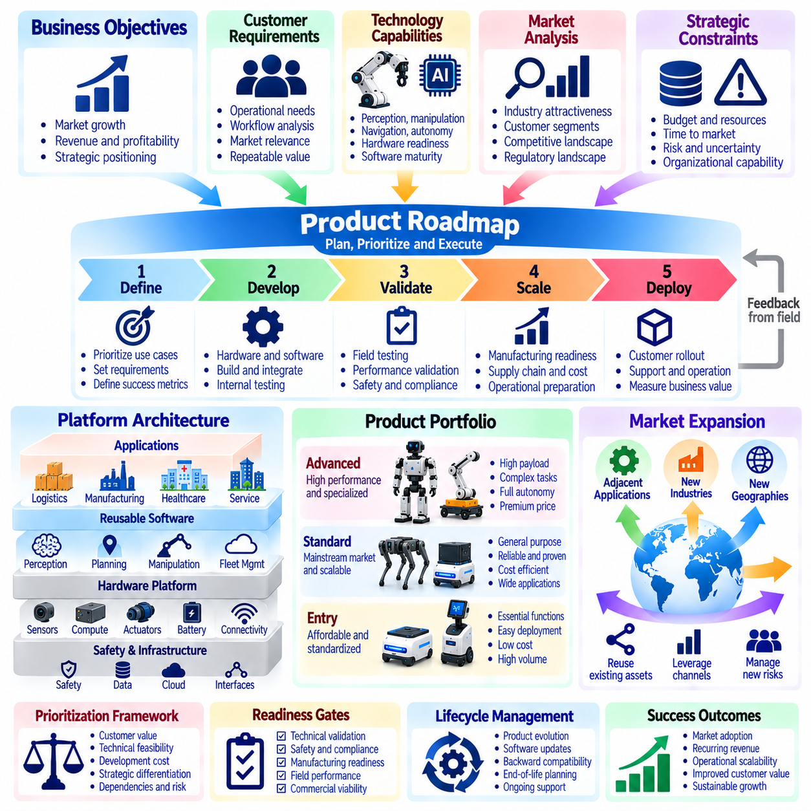{width="7.268055555555556in" height="7.268055555555556in"}

Product roadmap and portfolio strategy define how Physical AI providers evolve technical capabilities into commercially sustainable product families. A roadmap coordinates development priorities, investment timing, and customer requirements, while portfolio strategy determines which products, platforms, and services should coexist. Effective planning balances immediate market opportunities with long-term technology development, operational scalability, and financial sustainability.

Physical AI roadmaps must connect business objectives with engineering capabilities. Improvements in perception, manipulation, navigation, and autonomous decision-making should support measurable customer outcomes rather than isolated technical achievements. Roadmap decisions must consider hardware readiness, software maturity, deployment complexity, and customer adoption barriers. This alignment reduces the risk of investing in capabilities without sufficient commercial demand.

Customer requirements provide an essential foundation for roadmap planning. Providers should analyze operational workflows, performance limitations, service incidents, and requests from existing customers. However, individual customer demands should not automatically determine product priorities. Requirements must be evaluated according to market relevance, repeatability, implementation cost, and strategic value. The objective is to identify capabilities that benefit multiple customers and applications.

Portfolio architecture determines how common technologies are shared across different robotic products. A unified platform may provide reusable perception modules, motion planning, fleet management, safety interfaces, and data infrastructure. Product variants can then address specific payloads, mobility requirements, manipulation tasks, or operating environments. Shared architecture reduces duplicated engineering while supporting differentiated market offerings.

Hardware platform strategy should balance standardization with application-specific performance. Common controllers, sensors, communication interfaces, and software environments can simplify manufacturing and maintenance. However, excessive standardization may constrain payload capacity, environmental durability, or task efficiency. Providers should define modular hardware boundaries that preserve economies of scale without compromising essential operational requirements.

Software roadmaps should prioritize capabilities that improve autonomy, reliability, and deployment efficiency. These may include better perception under changing conditions, adaptive task execution, automated recovery, and simplified configuration. Software improvements can extend the useful life of deployed hardware and create recurring revenue opportunities. Compatibility testing is essential because new functionality must not destabilize existing customer operations.

Artificial intelligence development introduces uncertainty into product planning because model performance does not always improve predictably with investment. Training data quality, task diversity, simulation fidelity, and computing resources influence achievable capabilities. Providers should define measurable performance milestones and evaluate models under representative operating conditions. Research progress should enter commercial roadmaps only when supported by sufficient validation evidence.

A layered roadmap separates foundational technology from customer-facing applications. Foundational investments may include robot operating infrastructure, safety systems, data engines, and reusable autonomy components. Application layers translate these capabilities into warehouse transport, industrial inspection, material handling, or service tasks. This separation allows common technologies to evolve while limiting disruption to established commercial solutions.

Product portfolio segmentation can address customers with different budgets and operational requirements. Entry-level products may emphasize affordability and standardized functions, while advanced configurations provide higher payloads, greater autonomy, or specialized manipulation. Software and service tiers can introduce additional differentiation. Each offering should have a clearly defined target customer, value proposition, and economic contribution.

Portfolio expansion should follow evidence of product-market fit rather than technological possibility alone. Adjacent applications are attractive when they reuse existing hardware, software, distribution channels, or service infrastructure. Expansion into unrelated markets may require substantially different engineering and regulatory capabilities. Providers should estimate incremental revenue opportunities alongside the additional complexity and organizational resources required.

Roadmap prioritization requires balancing expected customer value, technical feasibility, development cost, and strategic differentiation. Features that reduce deployment time or maintenance burden may generate greater economic returns than highly visible autonomy demonstrations. Dependencies between hardware, software, and infrastructure must also be considered. Prioritization frameworks should make tradeoffs explicit and prevent excessive fragmentation of engineering resources.

Technology readiness and commercial readiness should be assessed independently. A prototype may demonstrate impressive performance without meeting production requirements for safety, reliability, manufacturability, and serviceability. Roadmap gates should therefore include technical validation, field testing, cost targets, and operational acceptance criteria. Advancing products prematurely can increase warranty expenses, customer dissatisfaction, and reputational risk.

Lifecycle management is an important component of portfolio strategy. Products progress through introduction, growth, maturity, and eventual replacement or retirement. Providers must plan component availability, software maintenance, spare parts, and customer migration pathways. End-of-life decisions should consider contractual obligations and installed fleet requirements. Predictable lifecycle policies strengthen customer confidence in long-term automation investments.

Backward compatibility helps protect customer investments and reduce adoption barriers for future upgrades. Software interfaces, fleet management systems, and integration protocols should remain stable where practical. Hardware changes may require migration tools or replacement components. Compatibility policies should distinguish mandatory safety updates from optional feature improvements. Clear version management reduces operational disruption across heterogeneous robot fleets.

Financial portfolio management evaluates products according to revenue potential, gross margin, development investment, and lifecycle support costs. Hardware profitability should be considered alongside software subscriptions, maintenance contracts, and service revenue. A product with modest initial margins may still create substantial lifetime value through recurring services. However, portfolio decisions must account for working capital, warranty exposure, and customer concentration risks.

Product differentiation should combine technical performance with measurable operational advantages. Reliability, deployment speed, integration simplicity, safety assurance, and service availability may matter more than isolated benchmark results. Providers should identify capabilities that competitors cannot easily reproduce through hardware substitution or software imitation. Proprietary data, validated workflows, and installed ecosystem relationships can strengthen long-term differentiation.

Roadmap governance requires coordination among engineering, product management, sales, operations, and finance. Engineering teams assess feasibility, commercial teams communicate market demand, and operations teams identify deployment constraints. Financial management evaluates investment capacity and expected returns. Regular portfolio reviews should reassess priorities using field performance, customer feedback, competitive developments, and changes in available technology.

Scenario planning helps providers manage uncertainty in Physical AI markets. Adoption rates, component prices, regulatory requirements, and artificial intelligence capabilities may evolve differently from initial forecasts. Roadmaps should therefore distinguish committed developments from exploratory initiatives. Modular architecture and staged investment allow organizations to respond to changing conditions without abandoning their entire product strategy.

A balanced portfolio should support current revenue generation while developing future capabilities. Mature products provide operational experience and financial stability, while emerging products explore adjacent markets and more advanced autonomy. Research initiatives may investigate longer-term opportunities without immediate commercialization commitments. Resource allocation should reflect technical uncertainty, strategic importance, and the organization\'s capacity to absorb development risk.

Ultimately, product roadmap and portfolio strategy connect Physical AI innovation with disciplined business growth. Successful providers build reusable platforms, prioritize validated customer needs, manage product lifecycles, and allocate resources across near-term and future opportunities. By coordinating technical progress with commercial readiness and financial performance, organizations can develop scalable product families that deliver lasting customer value.

제품 로드맵 및 포트폴리오 전략(Product Roadmap and Portfolio Strategy)은 피지컬 인공지능 공급업체(Physical AI Providers)가 기술적 역량(Technical Capabilities)을 상업적으로 지속 가능한 제품군(Commercially Sustainable Product Families)으로 발전시키는 방식을 정의한다. 로드맵(Roadmap)은 개발 우선순위(Development Priorities), 투자 시점(Investment Timing), 고객 요구사항(Customer Requirements)을 조정하며, 포트폴리오 전략(Portfolio Strategy)은 어떤 제품(Products), 플랫폼(Platforms), 서비스(Services)를 함께 운영할 것인지를 결정한다. 효과적인 계획(Effective Planning)은 단기 시장 기회(Immediate Market Opportunities)와 장기 기술 개발(Long-Term Technology Development), 운영 확장성(Operational Scalability), 재무적 지속 가능성(Financial Sustainability) 사이의 균형을 유지한다.

피지컬 인공지능 로드맵(Physical AI Roadmaps)은 사업 목표(Business Objectives)와 엔지니어링 역량(Engineering Capabilities)을 연결해야 한다. 인지(Perception), 조작(Manipulation), 주행(Navigation), 자율적 의사결정(Autonomous Decision-Making)의 개선은 독립적인 기술적 성과(Isolated Technical Achievements)가 아니라 측정 가능한 고객 성과(Measurable Customer Outcomes)를 지원해야 한다. 로드맵 의사결정(Roadmap Decisions)은 하드웨어 준비도(Hardware Readiness), 소프트웨어 성숙도(Software Maturity), 배포 복잡성(Deployment Complexity), 고객 도입 장벽(Customer Adoption Barriers)을 고려해야 한다. 이러한 연계(Alignment)는 충분한 상업적 수요(Commercial Demand)가 없는 기술적 역량에 투자할 위험을 줄인다.

고객 요구사항(Customer Requirements)은 로드맵 계획(Roadmap Planning)의 필수적인 기반을 제공한다. 공급업체(Providers)는 운영 작업 흐름(Operational Workflows), 성능 한계(Performance Limitations), 서비스 사고(Service Incidents), 기존 고객(Existing Customers)의 요청을 분석해야 한다. 그러나 개별 고객 요구(Individual Customer Demands)가 제품 우선순위(Product Priorities)를 자동으로 결정해서는 안 된다. 요구사항은 시장 관련성(Market Relevance), 반복 적용 가능성(Repeatability), 구현 비용(Implementation Cost), 전략적 가치(Strategic Value)를 기준으로 평가해야 한다. 목표는 여러 고객과 응용 분야(Multiple Customers and Applications)에 공통적으로 도움이 되는 역량을 식별하는 것이다.

포트폴리오 아키텍처(Portfolio Architecture)는 공통 기술(Common Technologies)이 서로 다른 로봇 제품(Robotic Products) 간에 공유되는 방식을 결정한다. 통합 플랫폼(Unified Platform)은 재사용 가능한 인지 모듈(Reusable Perception Modules), 동작 계획(Motion Planning), 군집 관리(Fleet Management), 안전 인터페이스(Safety Interfaces), 데이터 인프라(Data Infrastructure)를 제공할 수 있다. 이후 제품 변형 모델(Product Variants)은 특정 적재하중(Payloads), 이동 요구사항(Mobility Requirements), 조작 작업(Manipulation Tasks), 운영 환경(Operating Environments)에 대응할 수 있다. 공유 아키텍처(Shared Architecture)는 중복 엔지니어링(Duplicated Engineering)을 줄이면서 차별화된 시장 제품(Differentiated Market Offerings)을 지원한다.

하드웨어 플랫폼 전략(Hardware Platform Strategy)은 표준화(Standardization)와 응용 분야별 성능(Application-Specific Performance) 사이의 균형을 유지해야 한다. 공통 제어기(Common Controllers), 센서(Sensors), 통신 인터페이스(Communication Interfaces), 소프트웨어 환경(Software Environments)은 제조(Manufacturing)와 유지보수(Maintenance)를 단순화할 수 있다. 그러나 과도한 표준화(Excessive Standardization)는 적재 능력(Payload Capacity), 환경 내구성(Environmental Durability), 작업 효율성(Task Efficiency)을 제한할 수 있다. 공급업체는 필수적인 운영 요구사항(Essential Operational Requirements)을 훼손하지 않으면서 규모의 경제(Economies of Scale)를 유지할 수 있는 모듈형 하드웨어 경계(Modular Hardware Boundaries)를 정의해야 한다.

소프트웨어 로드맵(Software Roadmaps)은 자율성(Autonomy), 신뢰성(Reliability), 배포 효율성(Deployment Efficiency)을 향상시키는 역량을 우선해야 한다. 여기에는 변화하는 조건(Changing Conditions)에서의 향상된 인지(Better Perception), 적응형 작업 수행(Adaptive Task Execution), 자동 복구(Automated Recovery), 간소화된 설정(Simplified Configuration)이 포함될 수 있다. 소프트웨어 개선(Software Improvements)은 배포된 하드웨어(Deployed Hardware)의 유효 수명(Useful Life)을 연장하고 반복 매출 기회(Recurring Revenue Opportunities)를 창출할 수 있다. 새로운 기능(New Functionality)이 기존 고객 운영(Existing Customer Operations)을 불안정하게 만들어서는 안 되므로 호환성 시험(Compatibility Testing)이 필수적이다.

인공지능 개발(Artificial Intelligence Development)은 모델 성능(Model Performance)이 투자 증가에 따라 항상 예측 가능하게 개선되는 것은 아니므로 제품 계획(Product Planning)에 불확실성(Uncertainty)을 발생시킨다. 학습 데이터 품질(Training Data Quality), 작업 다양성(Task Diversity), 시뮬레이션 충실도(Simulation Fidelity), 컴퓨팅 자원(Computing Resources)은 달성 가능한 역량(Achievable Capabilities)에 영향을 미친다. 공급업체는 측정 가능한 성능 이정표(Measurable Performance Milestones)를 정의하고 대표적인 운영 조건(Representative Operating Conditions)에서 모델을 평가해야 한다. 연구 성과(Research Progress)는 충분한 검증 근거(Validation Evidence)가 확보된 경우에만 상업적 로드맵(Commercial Roadmaps)에 반영되어야 한다.

계층형 로드맵(Layered Roadmap)은 기반 기술(Foundational Technology)과 고객 대상 응용 분야(Customer-Facing Applications)를 분리한다. 기반 투자(Foundational Investments)에는 로봇 운영 인프라(Robot Operating Infrastructure), 안전 시스템(Safety Systems), 데이터 엔진(Data Engines), 재사용 가능한 자율성 구성요소(Reusable Autonomy Components)가 포함될 수 있다. 응용 계층(Application Layers)은 이러한 역량을 창고 운송(Warehouse Transport), 산업 검사(Industrial Inspection), 자재 취급(Material Handling), 서비스 작업(Service Tasks)으로 전환한다. 이러한 분리(Separation)는 기존 상업용 솔루션(Established Commercial Solutions)에 대한 영향을 최소화하면서 공통 기술(Common Technologies)을 발전시킬 수 있도록 한다.

제품 포트폴리오 세분화(Product Portfolio Segmentation)는 서로 다른 예산(Budgets)과 운영 요구사항(Operational Requirements)을 가진 고객에게 대응할 수 있다. 보급형 제품(Entry-Level Products)은 경제성(Affordability)과 표준화된 기능(Standardized Functions)을 강조할 수 있으며, 고급 구성(Advanced Configurations)은 더 높은 적재하중(Higher Payloads), 향상된 자율성(Greater Autonomy), 전문화된 조작 기능(Specialized Manipulation)을 제공할 수 있다. 소프트웨어 및 서비스 등급(Software and Service Tiers)은 추가적인 차별화(Additional Differentiation)를 제공할 수 있다. 각 제품 및 서비스(Offering)는 명확하게 정의된 목표 고객(Target Customer), 가치 제안(Value Proposition), 경제적 기여(Economic Contribution)를 가져야 한다.

포트폴리오 확장(Portfolio Expansion)은 기술적 가능성(Technological Possibility)만이 아니라 제품 시장 적합성(Product-Market Fit)에 대한 근거를 따라야 한다. 인접 응용 분야(Adjacent Applications)는 기존 하드웨어(Existing Hardware), 소프트웨어(Software), 유통 채널(Distribution Channels), 서비스 인프라(Service Infrastructure)를 재사용할 수 있을 때 매력적이다. 관련성이 낮은 시장(Unrelated Markets)으로의 확장은 상당히 다른 엔지니어링 역량(Engineering Capabilities)과 규제 대응 역량(Regulatory Capabilities)을 요구할 수 있다. 공급업체는 추가 매출 기회(Incremental Revenue Opportunities)와 함께 필요한 추가 복잡성(Additional Complexity) 및 조직 자원(Organizational Resources)을 추정해야 한다.

로드맵 우선순위 결정(Roadmap Prioritization)에는 예상 고객 가치(Expected Customer Value), 기술적 실현 가능성(Technical Feasibility), 개발 비용(Development Cost), 전략적 차별화(Strategic Differentiation) 사이의 균형이 필요하다. 배포 시간(Deployment Time)이나 유지보수 부담(Maintenance Burden)을 줄이는 기능은 시각적으로 인상적인 자율성 시연(Autonomy Demonstrations)보다 더 큰 경제적 수익(Economic Returns)을 창출할 수 있다. 하드웨어(Hardware), 소프트웨어(Software), 인프라(Infrastructure) 간의 의존성(Dependencies)도 고려해야 한다. 우선순위 결정 프레임워크(Prioritization Frameworks)는 상충관계(Tradeoffs)를 명확하게 드러내고 엔지니어링 자원(Engineering Resources)의 과도한 분산을 방지해야 한다.

기술 준비도(Technology Readiness)와 상업화 준비도(Commercial Readiness)는 독립적으로 평가되어야 한다. 시제품(Prototype)은 인상적인 성능(Impressive Performance)을 보여주더라도 안전성(Safety), 신뢰성(Reliability), 제조 용이성(Manufacturability), 유지보수 용이성(Serviceability)에 관한 양산 요구사항(Production Requirements)을 충족하지 못할 수 있다. 따라서 로드맵 단계별 통과 기준(Roadmap Gates)에는 기술 검증(Technical Validation), 현장 시험(Field Testing), 원가 목표(Cost Targets), 운영 인수 기준(Operational Acceptance Criteria)이 포함되어야 한다. 제품을 성급하게 다음 단계로 진행시키면 보증 비용(Warranty Expenses), 고객 불만(Customer Dissatisfaction), 평판 위험(Reputational Risk)이 증가할 수 있다.

수명주기 관리(Lifecycle Management)는 포트폴리오 전략(Portfolio Strategy)의 중요한 구성요소이다. 제품(Products)은 도입기(Introduction), 성장기(Growth), 성숙기(Maturity), 최종적인 교체 또는 단종(Replacement or Retirement) 단계를 거친다. 공급업체는 부품 가용성(Component Availability), 소프트웨어 유지보수(Software Maintenance), 예비 부품(Spare Parts), 고객 전환 경로(Customer Migration Pathways)를 계획해야 한다. 제품 수명 종료 의사결정(End-of-Life Decisions)은 계약상 의무(Contractual Obligations)와 기존 설치 로봇군(Installed Fleet)의 요구사항을 고려해야 한다. 예측 가능한 수명주기 정책(Predictable Lifecycle Policies)은 장기 자동화 투자(Long-Term Automation Investments)에 대한 고객 신뢰(Customer Confidence)를 강화한다.

하위 호환성(Backward Compatibility)은 고객 투자(Customer Investments)를 보호하고 향후 업그레이드(Future Upgrades)에 대한 도입 장벽(Adoption Barriers)을 낮추는 데 도움이 된다. 소프트웨어 인터페이스(Software Interfaces), 군집 관리 시스템(Fleet Management Systems), 통합 프로토콜(Integration Protocols)은 가능한 범위에서 안정적으로 유지되어야 한다. 하드웨어 변경(Hardware Changes)에는 전환 도구(Migration Tools)나 교체 부품(Replacement Components)이 필요할 수 있다. 호환성 정책(Compatibility Policies)은 필수 안전 업데이트(Mandatory Safety Updates)와 선택적 기능 개선(Optional Feature Improvements)을 구분해야 한다. 명확한 버전 관리(Version Management)는 이기종 로봇군(Heterogeneous Robot Fleets) 전반의 운영 중단(Operational Disruption)을 줄인다.

재무적 포트폴리오 관리(Financial Portfolio Management)는 매출 잠재력(Revenue Potential), 매출총이익률(Gross Margin), 개발 투자(Development Investment), 수명주기 지원 비용(Lifecycle Support Costs)을 기준으로 제품을 평가한다. 하드웨어 수익성(Hardware Profitability)은 소프트웨어 구독(Software Subscriptions), 유지보수 계약(Maintenance Contracts), 서비스 매출(Service Revenue)과 함께 고려되어야 한다. 초기 이익률(Initial Margins)이 낮은 제품이라도 반복 서비스(Recurring Services)를 통해 상당한 고객 생애가치(Lifetime Value)를 창출할 수 있다. 그러나 포트폴리오 의사결정(Portfolio Decisions)에서는 운전자본(Working Capital), 보증 위험(Warranty Exposure), 고객 집중 위험(Customer Concentration Risks)을 고려해야 한다.

제품 차별화(Product Differentiation)는 기술적 성능(Technical Performance)과 측정 가능한 운영상 이점(Measurable Operational Advantages)을 결합해야 한다. 신뢰성(Reliability), 배포 속도(Deployment Speed), 통합의 단순성(Integration Simplicity), 안전성 보증(Safety Assurance), 서비스 가용성(Service Availability)은 개별 벤치마크 결과(Isolated Benchmark Results)보다 더 중요할 수 있다. 공급업체는 경쟁업체(Competitors)가 하드웨어 대체(Hardware Substitution)나 소프트웨어 모방(Software Imitation)을 통해 쉽게 재현할 수 없는 역량을 식별해야 한다. 독점 데이터(Proprietary Data), 검증된 작업 흐름(Validated Workflows), 구축된 생태계 관계(Installed Ecosystem Relationships)는 장기적인 차별화(Long-Term Differentiation)를 강화할 수 있다.

로드맵 거버넌스(Roadmap Governance)에는 엔지니어링(Engineering), 제품 관리(Product Management), 영업(Sales), 운영(Operations), 재무(Finance) 조직 간의 조정이 필요하다. 엔지니어링 팀(Engineering Teams)은 실현 가능성(Feasibility)을 평가하고, 영업 조직(Commercial Teams)은 시장 수요(Market Demand)를 전달하며, 운영 팀(Operations Teams)은 배포 제약사항(Deployment Constraints)을 식별한다. 재무 관리(Financial Management)는 투자 여력(Investment Capacity)과 예상 수익(Expected Returns)을 평가한다. 정기적인 포트폴리오 검토(Regular Portfolio Reviews)는 현장 성능(Field Performance), 고객 피드백(Customer Feedback), 경쟁 환경 변화(Competitive Developments), 활용 가능한 기술의 변화(Changes in Available Technology)를 바탕으로 우선순위를 재평가해야 한다.

시나리오 계획(Scenario Planning)은 공급업체가 피지컬 인공지능 시장(Physical AI Markets)의 불확실성(Uncertainty)을 관리하는 데 도움이 된다. 도입률(Adoption Rates), 부품 가격(Component Prices), 규제 요구사항(Regulatory Requirements), 인공지능 역량(Artificial Intelligence Capabilities)은 초기 예측(Initial Forecasts)과 다르게 변화할 수 있다. 따라서 로드맵(Roadmaps)은 확정된 개발 과제(Committed Developments)와 탐색적 과제(Exploratory Initiatives)를 구분해야 한다. 모듈형 아키텍처(Modular Architecture)와 단계적 투자(Staged Investment)는 조직이 전체 제품 전략(Entire Product Strategy)을 포기하지 않고도 변화하는 조건(Changing Conditions)에 대응할 수 있도록 한다.

균형 잡힌 포트폴리오(Balanced Portfolio)는 현재 매출 창출(Current Revenue Generation)을 지원하면서 미래 역량(Future Capabilities)을 개발해야 한다. 성숙한 제품(Mature Products)은 운영 경험(Operational Experience)과 재무적 안정성(Financial Stability)을 제공하며, 신흥 제품(Emerging Products)은 인접 시장(Adjacent Markets)과 고도화된 자율성(More Advanced Autonomy)을 탐색한다. 연구 과제(Research Initiatives)는 즉각적인 상용화 약속(Immediate Commercialization Commitments) 없이 장기적인 기회(Longer-Term Opportunities)를 조사할 수 있다. 자원 배분(Resource Allocation)은 기술적 불확실성(Technical Uncertainty), 전략적 중요성(Strategic Importance), 개발 위험(Development Risk)을 감당할 수 있는 조직의 역량(Organizational Capacity)을 반영해야 한다.

궁극적으로 제품 로드맵 및 포트폴리오 전략(Product Roadmap and Portfolio Strategy)은 피지컬 인공지능 혁신(Physical AI Innovation)을 체계적인 사업 성장(Disciplined Business Growth)과 연결한다. 성공적인 공급업체(Successful Providers)는 재사용 가능한 플랫폼(Reusable Platforms)을 구축하고, 검증된 고객 요구(Validated Customer Needs)를 우선하며, 제품 수명주기(Product Lifecycles)를 관리하고, 단기 및 미래 기회(Near-Term and Future Opportunities)에 자원을 배분한다. 기술적 발전(Technical Progress)을 상업화 준비도(Commercial Readiness) 및 재무 성과(Financial Performance)와 조정함으로써 조직은 지속적인 고객 가치(Lasting Customer Value)를 제공하는 확장 가능한 제품군(Scalable Product Families)을 개발할 수 있다.

##  

## 08.26. Physical AI Business Case Model [w/Code]

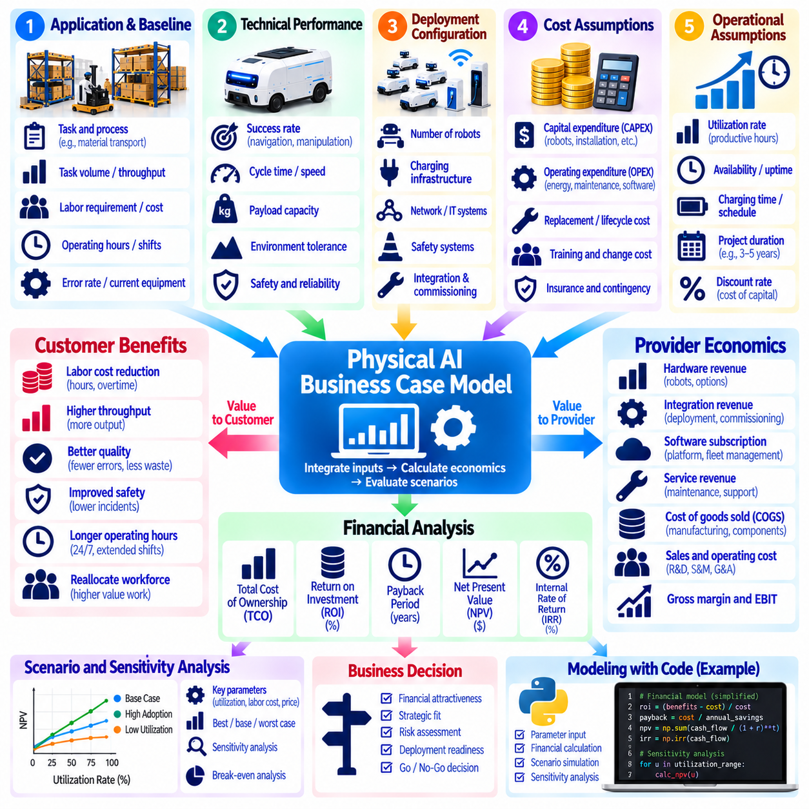{width="7.268055555555556in" height="7.268055555555556in"}

A Physical AI business case model provides a structured framework for evaluating whether robotic automation creates sufficient economic value to justify investment. It connects technical performance, operational requirements, deployment costs, and financial outcomes within a consistent analytical structure. The model should assess both customer benefits and provider profitability, recognizing that commercially attractive automation must deliver sustainable value to both parties.

The model begins by defining the target application, operating environment, and baseline process. Relevant inputs include task volume, labor requirements, operating hours, throughput, error rates, and existing equipment costs. Baseline measurements should reflect actual operating conditions rather than theoretical capacity. A reliable comparison requires documenting current performance before estimating the improvements expected from Physical AI deployment.

Technical feasibility determines whether projected financial benefits can realistically be achieved. Robot payload capacity, navigation accuracy, manipulation success, cycle time, and environmental tolerance influence operational performance. The model should translate these technical parameters into measurable productivity outcomes. Conservative assumptions are important because laboratory demonstrations may not represent performance under continuous industrial operation.

Deployment configuration establishes the physical resources required to achieve target productivity. The model should estimate robot quantity, charging infrastructure, networking equipment, safety systems, and integration requirements. Fleet sizing must consider task demand, travel distance, charging time, and operational congestion. Excessive capacity increases capital expenditure, while insufficient capacity reduces service quality and expected economic benefits.

Capital expenditure includes robot hardware, installation, commissioning, facility modifications, and initial software integration. Additional costs may arise from charging systems, safety equipment, employee training, and project management. The model should distinguish one-time investments from recurring expenses. Accurate investment estimates require supplier quotations, engineering assessments, and appropriate contingencies for deployment uncertainty.

Operating expenditure includes electricity, maintenance, software subscriptions, connectivity, insurance, and technical support. Consumable parts, periodic inspections, battery replacement, and unplanned repairs may create additional lifecycle costs. These expenses should be estimated over the intended operating period. Separating fixed and variable operating costs helps identify how profitability changes with utilization and deployment scale.

Labor economics frequently represent a major source of automation value. The model should estimate hours of work avoided, changes in staffing requirements, overtime reductions, and opportunities to reassign personnel. However, theoretical labor savings do not automatically become financial savings. Realized benefits depend on staffing flexibility, workload growth, labor agreements, and the organization\'s ability to convert released capacity into economic value.

Productivity improvements can generate benefits beyond direct labor reduction. Robots may increase throughput, improve process consistency, reduce material handling errors, and support longer operating hours. These effects can increase output or reduce waste without proportional increases in staffing. The model should quantify each benefit separately and avoid double counting when several performance improvements influence the same financial outcome.

Robot utilization and availability strongly influence economic performance. Utilization measures the proportion of available time spent performing productive work, while availability reflects readiness for operation. Charging, maintenance, waiting, and operational interruptions reduce effective capacity. Financial forecasts should use realistic utilization assumptions and include sensitivity analysis because small changes in productive operating hours can significantly affect returns.

A customer total cost of ownership model combines initial investment with ongoing operating and lifecycle expenses. Relevant categories include equipment, integration, software, maintenance, energy, training, downtime, and eventual replacement. Costs should be evaluated across a defined planning horizon. Comparing robotic and conventional operating models on an equivalent basis helps customers understand the true economic implications of automation.

Return on investment measures financial benefits relative to the resources committed. A simplified calculation divides net financial gain by the initial investment, although detailed evaluations should account for timing and recurring costs. Payback period estimates how long cumulative net savings take to recover the initial expenditure. These indicators are useful for screening projects but should not replace comprehensive discounted cash flow analysis.

Net present value evaluates future cash flows after applying a discount rate that reflects the time value of money and relevant risk. Positive net present value indicates that projected benefits exceed discounted costs under the selected assumptions. Internal rate of return provides another perspective on investment attractiveness. The model should report assumptions transparently because discount rates, project duration, and residual value can materially change results.

Provider economics must be evaluated separately from customer economics. Revenue may include hardware sales, integration fees, software subscriptions, maintenance contracts, and Robot-as-a-Service payments. Corresponding costs include manufacturing, deployment, support, cloud infrastructure, and warranty obligations. A commercially viable business case requires sufficient contribution margin after accounting for the actual cost of serving customers.

Robot-as-a-Service models introduce additional financial considerations because providers may retain ownership of deployed assets. Initial hardware expenditure is recovered through recurring customer payments over time. The model must account for financing costs, depreciation, contract duration, utilization, and customer default risk. Provider cash flow can remain negative during fleet expansion even when individual contracts appear profitable over their full lifecycle.

Fleet economics reveal how costs and revenues change as deployment volume increases. Shared software infrastructure, remote monitoring, standardized maintenance, and centralized support may reduce cost per robot. However, spare parts inventory, field service coverage, and customer onboarding can create new scaling expenses. The model should distinguish genuine economies of scale from costs that increase approximately in proportion to fleet size.

Sensitivity analysis tests how financial results respond to uncertainty in key assumptions. Important variables include robot purchase price, labor cost, task throughput, uptime, utilization, maintenance expense, and contract duration. Scenario analysis can compare optimistic, expected, and conservative operating conditions. These evaluations help identify the assumptions that most strongly determine whether a deployment remains financially attractive.

Risk-adjusted modeling should consider technical failures, deployment delays, customer adoption barriers, and regulatory obligations. Potential impacts include additional engineering work, lost production, warranty claims, and unexpected service costs. Risk allowances should reflect realistic exposure rather than arbitrary percentages. Explicit risk treatment improves investment decisions and prevents optimistic forecasts from concealing operational uncertainty.

A practical implementation can use a spreadsheet or Python-based financial model with separate input, calculation, and reporting layers. Input tables store technical parameters, deployment quantities, pricing, and cost assumptions. Calculation modules estimate productivity, cash flow, profitability, and investment returns. Automated scenario evaluation improves reproducibility, while validation checks help prevent inconsistent assumptions and formula errors.

Business case validation requires comparing projected outcomes with measured deployment results. Pilot data should capture task completion, intervention frequency, operating hours, maintenance effort, and realized productivity. Differences between forecasts and actual performance should update future assumptions. This feedback process improves model accuracy and supports more reliable pricing, fleet sizing, and customer investment proposals.

Ultimately, a Physical AI business case model connects engineering feasibility with customer value and provider financial sustainability. Its effectiveness depends on transparent assumptions, realistic operational data, complete lifecycle costs, and disciplined sensitivity analysis. By continuously validating economic forecasts against field performance, organizations can make better investment decisions, develop credible commercial proposals, and scale Physical AI deployments responsibly.

피지컬 인공지능 사업성 분석 모델(Physical AI Business Case Model)은 로봇 자동화(Robotic Automation)가 투자를 정당화할 만큼 충분한 경제적 가치(Economic Value)를 창출하는지 평가하기 위한 체계적인 프레임워크(Structured Framework)를 제공한다. 이 모델은 기술적 성능(Technical Performance), 운영 요구사항(Operational Requirements), 배포 비용(Deployment Costs), 재무적 성과(Financial Outcomes)를 일관된 분석 구조(Analytical Structure)로 연결한다. 상업적으로 매력적인 자동화(Commercially Attractive Automation)는 고객과 공급업체 모두에게 지속 가능한 가치(Sustainable Value)를 제공해야 하므로 고객 편익(Customer Benefits)과 공급업체 수익성(Provider Profitability)을 함께 평가해야 한다.

모델(Model)은 목표 응용 분야(Target Application), 운영 환경(Operating Environment), 기존 기준 프로세스(Baseline Process)를 정의하는 것에서 시작한다. 관련 입력 변수(Relevant Inputs)에는 작업량(Task Volume), 노동력 요구사항(Labor Requirements), 운영시간(Operating Hours), 처리량(Throughput), 오류율(Error Rates), 기존 장비 비용(Existing Equipment Costs)이 포함된다. 기준 측정값(Baseline Measurements)은 이론적 생산능력(Theoretical Capacity)이 아니라 실제 운영 조건(Actual Operating Conditions)을 반영해야 한다. 신뢰할 수 있는 비교(Reliable Comparison)를 위해서는 피지컬 인공지능 배포(Physical AI Deployment)로 예상되는 개선 효과를 추정하기 전에 현재 성능(Current Performance)을 문서화해야 한다.

기술적 실현 가능성(Technical Feasibility)은 예상되는 재무적 편익(Projected Financial Benefits)을 현실적으로 달성할 수 있는지를 결정한다. 로봇 적재 능력(Robot Payload Capacity), 주행 정확도(Navigation Accuracy), 조작 성공률(Manipulation Success), 사이클 타임(Cycle Time), 환경 적응 능력(Environmental Tolerance)은 운영 성능(Operational Performance)에 영향을 미친다. 모델은 이러한 기술적 매개변수(Technical Parameters)를 측정 가능한 생산성 성과(Measurable Productivity Outcomes)로 변환해야 한다. 실험실 시연(Laboratory Demonstrations)이 연속적인 산업 운영(Continuous Industrial Operation)에서의 성능을 대표하지 못할 수 있으므로 보수적인 가정(Conservative Assumptions)이 중요하다.

배포 구성(Deployment Configuration)은 목표 생산성(Target Productivity)을 달성하는 데 필요한 물리적 자원(Physical Resources)을 결정한다. 모델은 로봇 수량(Robot Quantity), 충전 인프라(Charging Infrastructure), 네트워크 장비(Networking Equipment), 안전 시스템(Safety Systems), 통합 요구사항(Integration Requirements)을 추정해야 한다. 로봇군 규모 산정(Fleet Sizing)에서는 작업 수요(Task Demand), 이동 거리(Travel Distance), 충전 시간(Charging Time), 운영 혼잡(Operational Congestion)을 고려해야 한다. 과도한 설비 용량(Excessive Capacity)은 자본적 지출(Capital Expenditure)을 증가시키며, 부족한 설비 용량(Insufficient Capacity)은 서비스 품질(Service Quality)과 예상 경제적 편익(Expected Economic Benefits)을 감소시킨다.

자본적 지출(Capital Expenditure, CAPEX)에는 로봇 하드웨어(Robot Hardware), 설치(Installation), 시운전(Commissioning), 시설 변경(Facility Modifications), 초기 소프트웨어 통합(Initial Software Integration)이 포함된다. 충전 시스템(Charging Systems), 안전 장비(Safety Equipment), 직원 교육(Employee Training), 프로젝트 관리(Project Management)에서도 추가 비용(Additional Costs)이 발생할 수 있다. 모델은 일회성 투자(One-Time Investments)와 반복 비용(Recurring Expenses)을 구분해야 한다. 정확한 투자 추정(Accurate Investment Estimates)을 위해서는 공급업체 견적(Supplier Quotations), 엔지니어링 평가(Engineering Assessments), 배포 불확실성(Deployment Uncertainty)에 대한 적절한 예비비(Contingencies)가 필요하다.

운영비용(Operating Expenditure, OPEX)에는 전력(Electricity), 유지보수(Maintenance), 소프트웨어 구독(Software Subscriptions), 통신 연결(Connectivity), 보험(Insurance), 기술 지원(Technical Support)이 포함된다. 소모성 부품(Consumable Parts), 정기 점검(Periodic Inspections), 배터리 교체(Battery Replacement), 예기치 않은 수리(Unplanned Repairs)는 추가적인 수명주기 비용(Lifecycle Costs)을 발생시킬 수 있다. 이러한 비용은 의도된 운영기간(Intended Operating Period) 전체에 걸쳐 추정되어야 한다. 고정 운영비용(Fixed Operating Costs)과 변동 운영비용(Variable Operating Costs)을 구분하면 활용률(Utilization)과 배포 규모(Deployment Scale)에 따라 수익성(Profitability)이 어떻게 변화하는지 파악하는 데 도움이 된다.

노동 경제성(Labor Economics)은 자동화 가치(Automation Value)의 주요 원천인 경우가 많다. 모델은 절감 가능한 작업시간(Hours of Work Avoided), 인력 요구사항의 변화(Changes in Staffing Requirements), 초과근무 감소(Overtime Reductions), 인력 재배치 기회(Opportunities to Reassign Personnel)를 추정해야 한다. 그러나 이론적인 노동비 절감(Theoretical Labor Savings)이 자동으로 재무적 절감(Financial Savings)으로 전환되는 것은 아니다. 실현되는 편익(Realized Benefits)은 인력 운영의 유연성(Staffing Flexibility), 작업량 증가(Workload Growth), 노동 관련 협약(Labor Agreements), 확보된 여유 생산능력(Released Capacity)을 경제적 가치(Economic Value)로 전환할 수 있는 조직의 역량에 따라 달라진다.

생산성 향상(Productivity Improvements)은 직접적인 노동비 절감(Direct Labor Reduction)을 넘어서는 편익을 창출할 수 있다. 로봇은 처리량(Throughput)을 증가시키고 프로세스 일관성(Process Consistency)을 개선하며 자재 취급 오류(Material Handling Errors)를 줄이고 운영시간 연장(Longer Operating Hours)을 지원할 수 있다. 이러한 효과는 인력을 비례적으로 증가시키지 않고도 생산량(Output)을 늘리거나 낭비(Waste)를 줄일 수 있다. 모델은 각 편익(Benefit)을 개별적으로 정량화해야 하며, 여러 성능 개선(Performance Improvements)이 동일한 재무적 성과(Financial Outcome)에 영향을 미치는 경우 이중 계산(Double Counting)을 방지해야 한다.

로봇 활용률(Robot Utilization)과 가용성(Availability)은 경제적 성과(Economic Performance)에 큰 영향을 미친다. 활용률(Utilization)은 사용 가능한 시간(Available Time) 중 생산적인 작업(Productive Work)에 투입된 시간의 비율을 나타내며, 가용성(Availability)은 운영 준비 상태(Readiness for Operation)를 의미한다. 충전(Charging), 유지보수(Maintenance), 대기(Waiting), 운영 중단(Operational Interruptions)은 유효 생산능력(Effective Capacity)을 감소시킨다. 재무 예측(Financial Forecasts)은 현실적인 활용률 가정(Realistic Utilization Assumptions)을 사용하고 민감도 분석(Sensitivity Analysis)을 포함해야 한다. 생산적인 운영시간(Productive Operating Hours)의 작은 변화도 투자수익(Investment Returns)에 상당한 영향을 미칠 수 있기 때문이다.

고객 총소유비용 모델(Customer Total Cost of Ownership Model)은 초기 투자(Initial Investment)와 지속적인 운영 및 수명주기 비용(Ongoing Operating and Lifecycle Expenses)을 결합한다. 관련 비용 항목(Cost Categories)에는 장비(Equipment), 통합(Integration), 소프트웨어(Software), 유지보수(Maintenance), 에너지(Energy), 교육(Training), 가동 중단시간(Downtime), 최종 교체(Eventual Replacement)가 포함된다. 비용은 정의된 계획기간(Defined Planning Horizon)에 걸쳐 평가되어야 한다. 로봇 운영 모델(Robotic Operating Model)과 기존 운영 모델(Conventional Operating Model)을 동등한 기준(Equivalent Basis)으로 비교하면 고객이 자동화의 실제 경제적 영향(True Economic Implications of Automation)을 이해하는 데 도움이 된다.

투자수익률(Return on Investment, ROI)은 투입된 자원(Resources Committed) 대비 재무적 편익(Financial Benefits)을 측정한다. 단순화된 계산(Simplified Calculation)에서는 순재무이익(Net Financial Gain)을 초기 투자금(Initial Investment)으로 나누지만, 상세한 평가(Detailed Evaluations)에서는 현금흐름의 발생 시점(Timing)과 반복 비용(Recurring Costs)을 고려해야 한다. 투자회수기간(Payback Period)은 누적 순절감액(Cumulative Net Savings)이 초기 지출(Initial Expenditure)을 회수하는 데 걸리는 시간을 추정한다. 이러한 지표(Indicators)는 프로젝트의 초기 평가(Screening Projects)에 유용하지만 포괄적인 할인현금흐름 분석(Comprehensive Discounted Cash Flow Analysis)을 대체해서는 안 된다.

순현재가치(Net Present Value, NPV)는 화폐의 시간가치(Time Value of Money)와 관련 위험(Relevant Risk)을 반영하는 할인율(Discount Rate)을 적용하여 미래 현금흐름(Future Cash Flows)을 평가한다. 양의 순현재가치(Positive Net Present Value)는 선택한 가정(Selected Assumptions)에서 예상 편익(Projected Benefits)이 할인된 비용(Discounted Costs)을 초과한다는 것을 의미한다. 내부수익률(Internal Rate of Return, IRR)은 투자 매력도(Investment Attractiveness)에 대한 또 다른 관점을 제공한다. 할인율(Discount Rates), 프로젝트 기간(Project Duration), 잔존가치(Residual Value)는 결과를 실질적으로 변화시킬 수 있으므로 모델은 가정을 투명하게 제시해야 한다.

공급업체 경제성(Provider Economics)은 고객 경제성(Customer Economics)과 별도로 평가되어야 한다. 매출(Revenue)에는 하드웨어 판매(Hardware Sales), 통합 수수료(Integration Fees), 소프트웨어 구독(Software Subscriptions), 유지보수 계약(Maintenance Contracts), 서비스형 로봇 요금(Robot-as-a-Service Payments)이 포함될 수 있다. 이에 대응하는 비용(Corresponding Costs)에는 제조(Manufacturing), 배포(Deployment), 지원(Support), 클라우드 인프라(Cloud Infrastructure), 보증 의무(Warranty Obligations)가 포함된다. 상업적으로 실행 가능한 사업성 분석(Commercially Viable Business Case)을 위해서는 실제 고객 서비스 제공 비용(Actual Cost of Serving Customers)을 반영한 이후에도 충분한 공헌이익(Contribution Margin)이 확보되어야 한다.

서비스형 로봇 모델(Robot-as-a-Service Models)은 공급업체가 배포된 자산(Deployed Assets)의 소유권을 유지할 수 있으므로 추가적인 재무적 고려사항(Financial Considerations)을 발생시킨다. 초기 하드웨어 지출(Initial Hardware Expenditure)은 일정 기간 동안 반복적으로 발생하는 고객 요금(Recurring Customer Payments)을 통해 회수된다. 모델은 금융 비용(Financing Costs), 감가상각(Depreciation), 계약기간(Contract Duration), 활용률(Utilization), 고객 채무불이행 위험(Customer Default Risk)을 고려해야 한다. 개별 계약(Individual Contracts)이 전체 수명주기(Full Lifecycle)에 걸쳐 수익성이 있는 것으로 보이더라도 로봇군 확장(Fleet Expansion) 과정에서는 공급업체 현금흐름(Provider Cash Flow)이 계속 음수(Negative)일 수 있다.

로봇군 경제성(Fleet Economics)은 배포 물량(Deployment Volume)이 증가함에 따라 비용(Costs)과 매출(Revenues)이 어떻게 변화하는지를 보여준다. 공유 소프트웨어 인프라(Shared Software Infrastructure), 원격 모니터링(Remote Monitoring), 표준화된 유지보수(Standardized Maintenance), 중앙집중식 지원(Centralized Support)은 로봇당 비용(Cost per Robot)을 줄일 수 있다. 그러나 예비 부품 재고(Spare Parts Inventory), 현장 서비스 범위(Field Service Coverage), 고객 온보딩(Customer Onboarding)은 새로운 확장 비용(Scaling Expenses)을 발생시킬 수 있다. 모델은 실제 규모의 경제(Genuine Economies of Scale)와 로봇군 규모(Fleet Size)에 거의 비례하여 증가하는 비용을 구분해야 한다.

민감도 분석(Sensitivity Analysis)은 주요 가정(Key Assumptions)의 불확실성(Uncertainty)에 따라 재무적 결과(Financial Results)가 어떻게 변화하는지를 시험한다. 중요한 변수(Important Variables)에는 로봇 구매가격(Robot Purchase Price), 노동비(Labor Cost), 작업 처리량(Task Throughput), 가동률(Uptime), 활용률(Utilization), 유지보수 비용(Maintenance Expense), 계약기간(Contract Duration)이 포함된다. 시나리오 분석(Scenario Analysis)은 낙관적 운영 조건(Optimistic Operating Conditions), 예상 운영 조건(Expected Operating Conditions), 보수적 운영 조건(Conservative Operating Conditions)을 비교할 수 있다. 이러한 평가는 배포가 재무적으로 매력적인 상태(Financially Attractive)를 유지하는지를 결정하는 핵심 가정(Key Assumptions)을 식별하는 데 도움이 된다.

위험 조정 모델링(Risk-Adjusted Modeling)은 기술적 고장(Technical Failures), 배포 지연(Deployment Delays), 고객 도입 장벽(Customer Adoption Barriers), 규제 의무(Regulatory Obligations)를 고려해야 한다. 잠재적 영향(Potential Impacts)에는 추가 엔지니어링 작업(Additional Engineering Work), 생산 손실(Lost Production), 보증 청구(Warranty Claims), 예상하지 못한 서비스 비용(Unexpected Service Costs)이 포함된다. 위험 충당액(Risk Allowances)은 임의의 비율(Arbitrary Percentages)이 아니라 현실적인 위험 노출(Realistic Exposure)을 반영해야 한다. 명시적인 위험 처리(Explicit Risk Treatment)는 투자 의사결정(Investment Decisions)을 개선하고 낙관적인 예측(Optimistic Forecasts)이 운영 불확실성(Operational Uncertainty)을 숨기는 것을 방지한다.

실용적인 구현(Practical Implementation)에서는 입력 계층(Input Layer), 계산 계층(Calculation Layer), 보고 계층(Reporting Layer)을 분리한 스프레드시트(Spreadsheet) 또는 파이썬 기반 재무 모델(Python-Based Financial Model)을 사용할 수 있다. 입력 테이블(Input Tables)은 기술적 매개변수(Technical Parameters), 배포 수량(Deployment Quantities), 가격(Pricing), 비용 가정(Cost Assumptions)을 저장한다. 계산 모듈(Calculation Modules)은 생산성(Productivity), 현금흐름(Cash Flow), 수익성(Profitability), 투자수익(Investment Returns)을 추정한다. 자동화된 시나리오 평가(Automated Scenario Evaluation)는 재현성(Reproducibility)을 향상시키며, 검증 검사(Validation Checks)는 일관되지 않은 가정(Inconsistent Assumptions)과 수식 오류(Formula Errors)를 방지하는 데 도움이 된다.

사업성 분석 검증(Business Case Validation)을 위해서는 예상 성과(Projected Outcomes)와 실제 배포 결과(Measured Deployment Results)를 비교해야 한다. 파일럿 데이터(Pilot Data)는 작업 완료(Task Completion), 개입 빈도(Intervention Frequency), 운영시간(Operating Hours), 유지보수 투입량(Maintenance Effort), 실현된 생산성(Realized Productivity)을 기록해야 한다. 예측(Forecasts)과 실제 성능(Actual Performance)의 차이는 향후 가정(Future Assumptions)을 수정하는 데 반영되어야 한다. 이러한 피드백 프로세스(Feedback Process)는 모델 정확도(Model Accuracy)를 개선하고 더욱 신뢰할 수 있는 가격 책정(Pricing), 로봇군 규모 산정(Fleet Sizing), 고객 투자 제안(Customer Investment Proposals)을 지원한다.

궁극적으로 피지컬 인공지능 사업성 분석 모델(Physical AI Business Case Model)은 엔지니어링 실현 가능성(Engineering Feasibility)을 고객 가치(Customer Value) 및 공급업체의 재무적 지속 가능성(Provider Financial Sustainability)과 연결한다. 모델의 효과성(Effectiveness)은 투명한 가정(Transparent Assumptions), 현실적인 운영 데이터(Realistic Operational Data), 완전한 수명주기 비용(Complete Lifecycle Costs), 체계적인 민감도 분석(Disciplined Sensitivity Analysis)에 달려 있다. 경제적 예측(Economic Forecasts)을 현장 성능(Field Performance)과 지속적으로 비교하고 검증함으로써 조직은 더 나은 투자 의사결정(Investment Decisions)을 내리고 신뢰할 수 있는 상업적 제안(Credible Commercial Proposals)을 개발하며 피지컬 인공지능 배포(Physical AI Deployments)를 책임 있게 확장할 수 있다.
