**Volume 12. Physical AI Business and Industry Applications**

# Chapter 09. Case Studies

## 09.01. Smart Factory Physical AI Case

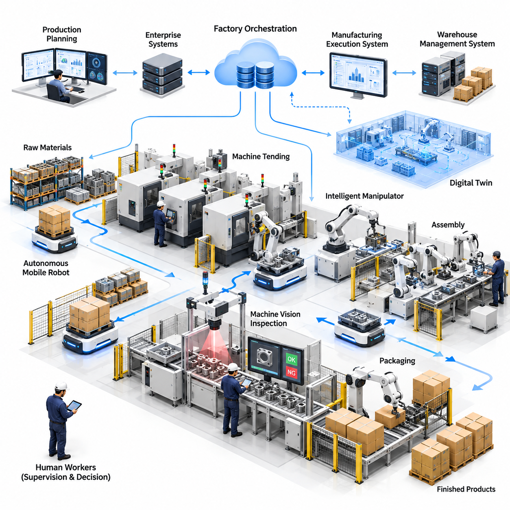{width="7.268055555555556in" height="7.268055555555556in"}

A smart factory represents one of the most practical environments for deploying Physical AI because manufacturing operations combine repetitive workflows, structured production systems, and continuously changing physical conditions. This case examines a representative factory transformation in which autonomous mobile robots, intelligent manipulators, machine vision, and adaptive control systems operate together to improve productivity, flexibility, and operational resilience.

The representative facility produces multiple variants of industrial components through machining, assembly, inspection, and packaging processes. Before introducing Physical AI, operators manually transport materials between workstations, load components into machines, and inspect selected products. Although conventional automation supports individual production cells, disconnected workflows create material shortages, equipment waiting time, inconsistent handling quality, and difficulties responding to changing production schedules.

The transformation begins with a detailed operational assessment covering material flows, production cycle times, equipment utilization, labor allocation, and quality performance. Engineers identify repetitive transportation activities, machine-loading delays, inspection bottlenecks, and unnecessary operator movement. Rather than automating every activity simultaneously, the deployment strategy prioritizes processes with measurable economic value, manageable technical complexity, and relatively predictable safety requirements.

Autonomous mobile robots are introduced to transport raw materials, work-in-process components, and finished products between production areas. Their navigation systems combine localization, environmental perception, obstacle detection, and dynamic path planning. Unlike fixed conveyor systems, these robots can support changing factory layouts and production routes, although traffic management, payload constraints, and charging requirements must be considered during deployment.

The mobile robot fleet connects with manufacturing execution systems and warehouse management platforms to receive transportation requests based on production priorities. When a workstation requires additional components, the orchestration platform assigns an available robot according to location, payload capacity, battery status, and route congestion. This coordination reduces unnecessary travel and allows material delivery to respond more closely to actual manufacturing demand.

Intelligent manipulators extend automation beyond transportation by performing machine tending, component positioning, and repetitive assembly operations. Vision-guided robotic arms identify part locations, estimate object orientation, and adjust grasping strategies when component placement varies. Force and torque sensing supports controlled contact during insertion or alignment, while task-specific fixtures and validated motion sequences maintain precision and repeatability.

Mobile manipulation becomes particularly valuable when several machines require intermittent servicing rather than continuous operation by dedicated robotic arms. A mobile manipulator can navigate between compatible workstations, identify the required operation, and execute a validated handling sequence. However, reliable deployment requires accurate docking, machine interface integration, consistent coordinate calibration, and robust recovery procedures when unexpected conditions occur.

Machine vision introduces another layer of Physical AI by supporting automated quality inspection and process monitoring. Cameras and trained perception models identify surface defects, dimensional anomalies, missing components, and assembly inconsistencies. Inspection results can be associated with production batches and machine conditions, enabling engineers to investigate recurring defects and improve process stability rather than relying exclusively on final product rejection.

A digital twin provides a virtual representation of the factory layout, equipment locations, robot operating zones, and material transportation processes. Engineers use this environment to evaluate alternative robot routes, estimate congestion, test workstation configurations, and investigate scheduling strategies before physical deployment. Simulation results support engineering decisions, but their reliability depends on accurate operational data and validation against real factory behavior.

The factory orchestration architecture connects robots, manufacturing equipment, enterprise software, and production planning functions. Manufacturing execution systems communicate production requirements, while fleet management software coordinates robot movement and resource allocation. Standardized interfaces and event-driven communication reduce integration complexity, although legacy equipment may require gateways, protocol conversion, or additional instrumentation.

Human workers remain essential to the operating model, particularly for complex assembly, maintenance, exception handling, and process improvement. Physical AI changes their responsibilities from repetitive transportation and machine loading toward equipment supervision, quality analysis, and operational decision-making. Effective adoption therefore requires workforce training, clear task ownership, ergonomic assessment, and practical procedures for human intervention.

Safety engineering must address the interaction between autonomous robots, industrial machines, and personnel operating within shared production spaces. Risk assessments determine appropriate protective measures, including speed limitations, protective sensing, emergency stopping, access control, and monitored operating zones. Applicable industrial robot and mobile robot safety standards guide system design, while site-specific validation confirms that integrated operations satisfy required safety conditions.

The implementation follows a staged progression from laboratory validation to controlled production trials and broader factory integration. Initial deployment focuses on a limited number of transportation routes and workstations where performance can be measured reliably. Engineers evaluate navigation accuracy, task completion, docking consistency, recovery behavior, and operator acceptance before expanding the operating area or introducing additional autonomous functions.

Operational performance is evaluated using production throughput, cycle time, equipment availability, transportation completion rate, quality yield, and robot utilization. Overall equipment effectiveness provides a useful manufacturing indicator, while fleet-specific measurements reveal congestion, idle time, charging losses, and failed missions. Baseline comparisons must account for production mix, operating hours, demand fluctuations, and other factors that could distort apparent automation benefits.

Economic evaluation includes robot acquisition, integration engineering, software licensing, infrastructure modification, maintenance, training, and ongoing operational support. Benefits may arise from reduced manual handling, improved machine utilization, lower defect rates, and greater production flexibility. Return on investment is calculated from incremental cash flows rather than theoretical labor replacement, with sensitivity analysis covering utilization, reliability, operating shifts, and deployment costs.

A representative financial model can compare the existing production process with the proposed autonomous operating model over a multiyear evaluation period. Capital expenditures are recorded separately from recurring software, energy, maintenance, and support expenses. Annual benefits are estimated from verified operational improvements, while discounted cash flow, net present value, payback period, and scenario analysis reveal whether the investment remains attractive under realistic uncertainty.

Continuous learning becomes increasingly important after initial deployment because the factory generates operational data from robot missions, perception systems, equipment interfaces, and human interventions. These records help identify recurring navigation failures, grasping difficulties, production delays, and unusual environmental conditions. Carefully curated data can support model refinement, simulation updates, and software improvements, provided changes undergo appropriate validation before production release.

Scaling Physical AI across multiple production lines introduces additional requirements for software configuration, fleet interoperability, maintenance organization, and centralized monitoring. Standardized robot interfaces and reusable task definitions reduce engineering duplication between installations. Nevertheless, differences in factory layouts, product characteristics, machine interfaces, and safety requirements mean that each deployment still requires site-specific commissioning and performance verification.

The case also illustrates limitations that can undermine commercial success. Unreliable perception, excessive integration customization, poor equipment availability, and insufficient operational support can offset expected productivity gains. A technically successful demonstration does not necessarily establish a sustainable business case. Long-term performance depends on stable workflows, maintainable hardware, responsive service capabilities, cybersecurity controls, and clear responsibility for system failures.

From a business perspective, the smart factory creates opportunities for equipment suppliers, AI software developers, system integrators, and managed fleet service providers. Revenue models may combine robot sales, integration projects, recurring software subscriptions, and lifecycle maintenance contracts. Customers increasingly evaluate these offerings according to delivered operational outcomes, encouraging suppliers to demonstrate measurable productivity improvements rather than emphasizing autonomous capabilities alone.

The central lesson of this representative smart factory case is that Physical AI delivers industrial value through coordinated improvements across perception, mobility, manipulation, orchestration, and operational management. Its effectiveness depends less on the sophistication of any individual robot than on reliable integration with production workflows. Successful commercialization requires technical maturity, disciplined deployment, measurable economic benefits, and continuous adaptation to manufacturing requirements.

## 09.02. Warehouse and Logistics Fleet Case

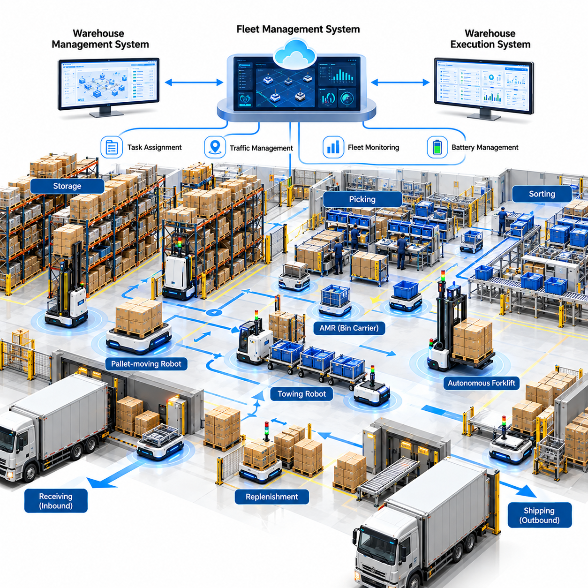{width="7.268055555555556in" height="7.268055555555556in"}

A warehouse and logistics fleet represents a practical application of Physical AI because material movement, inventory handling, and order fulfillment require continuous coordination between autonomous machines and operational systems. This case examines a representative distribution center where autonomous mobile robots, intelligent fleet management, and warehouse software integration improve transportation efficiency, operational flexibility, and service reliability.

The representative facility processes inbound goods, pallet storage, order picking, replenishment, sorting, and outbound shipments. Before automation, forklift operators and warehouse personnel transport materials between receiving docks, storage areas, picking stations, and shipping zones. Manual dispatching, uneven workload distribution, congestion, and variable travel distances create operational inefficiencies that become particularly visible during peak demand periods.

The transformation begins with a detailed analysis of warehouse workflows, transportation demand, inventory movement, and equipment utilization. Engineers examine daily mission volumes, payload distributions, travel distances, congestion points, and labor requirements. This assessment identifies transportation activities suitable for autonomous operation while distinguishing predictable material flows from tasks requiring specialized handling or human judgment.

Autonomous mobile robots are introduced to perform repetitive point-to-point transportation between designated warehouse locations. Depending on operational requirements, the fleet may include pallet-moving robots, towing vehicles, autonomous forklifts, and smaller material carriers. Each robot category has different payload capacities, maneuverability, navigation requirements, and safety constraints, making fleet composition an important engineering and economic decision.

The navigation architecture combines localization, environmental mapping, obstacle detection, and motion planning to support reliable movement through shared warehouse spaces. LiDAR, cameras, wheel encoders, and inertial sensors provide complementary information about robot position and surrounding conditions. Dynamic obstacle avoidance enables robots to respond to pedestrians, forklifts, temporary storage objects, and changing traffic patterns without requiring completely fixed transportation routes.

A centralized fleet management system coordinates robot assignments, route selection, traffic control, and operational monitoring. Transportation requests are allocated according to robot availability, payload compatibility, distance, battery condition, and mission priority. Rather than simply dispatching the nearest robot, intelligent scheduling considers the consequences of each assignment for overall fleet productivity, congestion, and future transportation demand.

Traffic management becomes essential when multiple robots operate through narrow aisles, intersections, loading areas, and shared corridors. The fleet controller can reserve critical passage segments, establish directional movement rules, and regulate entry into congested zones. Deadlock prevention and recovery mechanisms are particularly important because locally efficient robot decisions can create system-wide delays when vehicle interactions are not coordinated.

Warehouse management systems provide inventory locations, stock movement requests, and order fulfillment requirements, while warehouse execution systems coordinate operational workflows. The fleet management platform translates these requests into executable robot missions and reports completion status back to enterprise applications. Reliable integration requires consistent location identifiers, transaction confirmation, exception handling, and synchronization between physical inventory movement and digital records.

A representative goods-to-person workflow illustrates the operational benefits of coordinated automation. When an order requires products from designated storage locations, robots transport inventory containers or mobile shelving units to picking stations. Human workers or automated picking systems complete item selection while fleet software manages container delivery and return. This arrangement reduces unnecessary walking and supports more predictable workstation utilization.

Heavy-payload logistics introduces additional requirements involving load stability, floor conditions, braking performance, and docking precision. Pallet-handling robots must identify pallet geometry, align with storage positions, and confirm secure load engagement before transportation. Payload mass and center-of-gravity variations influence acceleration, turning behavior, and stopping distances, requiring motion planning and safety controls appropriate to the operating environment.

Battery management significantly influences fleet productivity because charging activities temporarily remove robots from transportation service. The orchestration system can schedule charging during low-demand periods, reserve sufficient energy for critical missions, and distribute charging demand across available stations. Opportunity charging and automated docking reduce manual intervention, but charging infrastructure must be sized according to utilization, battery characteristics, and operational schedules.

Fleet sizing is determined by transportation demand rather than warehouse floor area alone. Engineers estimate mission arrival rates, average travel times, loading and unloading durations, charging losses, and expected robot availability. Simulation and queueing analysis help identify the number of vehicles required to maintain service levels while avoiding excessive congestion or underutilized equipment during normal operating conditions.

Demand-aware task allocation improves performance when order volumes fluctuate throughout the day. Historical transaction records and real-time warehouse activity can support short-term transportation demand forecasts. The fleet controller adjusts robot positioning, mission priorities, and resource allocation to reduce response delays. Forecasting accuracy remains important because incorrect demand estimates may cause unnecessary repositioning or insufficient capacity.

A digital twin provides a simulation environment for testing warehouse layouts, fleet configurations, traffic policies, and operational scenarios. Engineers can examine how additional robots affect throughput, where congestion emerges, and whether charging stations create transportation bottlenecks. Simulation results must be calibrated using measured travel times, loading delays, equipment reliability, and actual warehouse demand patterns.

The deployment strategy begins with a controlled pilot covering selected transportation routes and operational processes. Initial validation measures navigation reliability, docking accuracy, mission completion, system integration, and human-robot interaction. Following successful acceptance testing, the fleet expands to additional warehouse zones and mission categories. Gradual scaling reduces operational disruption and provides evidence for investment decisions.

Safety engineering addresses interactions among autonomous robots, pedestrians, forklifts, storage racks, and loading equipment. Risk assessments determine appropriate speed limits, protective sensing, emergency stopping, and operational separation measures. Safety-rated functions must remain effective independently of higher-level AI decisions. Clearly defined recovery procedures and personnel training are necessary for handling blocked routes, damaged loads, and unexpected equipment behavior.

Operational performance is measured through missions per hour, transportation cycle time, order throughput, fleet utilization, mission success rate, and system availability. Additional indicators include empty travel distance, congestion delay, charging downtime, and human intervention frequency. These measurements reveal whether automation improves the overall warehouse process rather than merely increasing the number of completed robot movements.

The economic model considers robot acquisition, charging infrastructure, software integration, installation, maintenance, connectivity, and technical support. Benefits may include reduced manual transportation effort, improved labor allocation, increased throughput, and more consistent service during extended operating hours. Total cost of ownership and return on investment should reflect realistic utilization, maintenance expenses, equipment replacement, and operational variability.

A representative financial evaluation compares the existing manual transportation process with alternative autonomous fleet configurations over several years. Capital expenditure, recurring operating expenses, and expected productivity benefits are modeled separately. Sensitivity analysis examines robot utilization, labor costs, mission demand, reliability, and fleet expansion. Net present value and payback period help determine whether deployment creates sustainable economic value.

Continuous operational data collection supports fleet improvement after deployment. Mission histories, navigation events, traffic delays, charging cycles, and intervention records reveal recurring inefficiencies and failure patterns. Engineers can refine dispatching policies, adjust route configurations, and improve predictive maintenance strategies. Software updates and learned models require controlled testing to prevent unexpected changes in live warehouse operations.

Scaling across multiple distribution centers creates opportunities for standardized software platforms, reusable robot interfaces, centralized analytics, and remote fleet monitoring. However, differences in warehouse geometry, inventory characteristics, operating procedures, and enterprise systems require site-specific configuration. A scalable deployment model combines common fleet management capabilities with adaptable integration and operational support services.

From a commercial perspective, logistics fleet automation supports robot sales, fleet software subscriptions, system integration contracts, and Robot-as-a-Service offerings. Subscription-based models can reduce initial customer capital requirements while creating recurring revenue for providers. Their sustainability depends on fleet availability, maintenance efficiency, service-level commitments, and the provider\'s ability to manage lifecycle costs across deployed installations.

The central lesson of this warehouse and logistics fleet case is that Physical AI creates value through coordinated system-level performance rather than isolated robot autonomy. Reliable navigation, intelligent scheduling, enterprise integration, charging management, and operational support must function as a unified system. Successful commercialization depends on measurable throughput improvements, predictable lifecycle economics, safe operation, and the ability to scale autonomous logistics across diverse facilities.

## 09.03. Hospital Robot Service Case

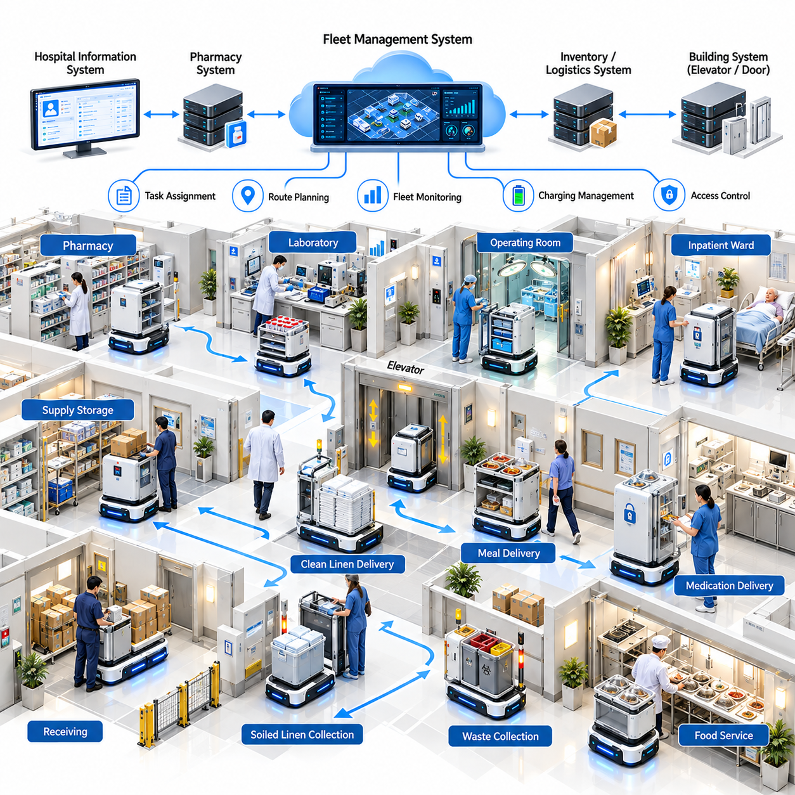{width="7.268055555555556in" height="7.268055555555556in"}

A hospital robot service represents a practical application of Physical AI because healthcare facilities require continuous movement of supplies, equipment, and information across complex environments. This case examines a representative hospital deploying autonomous mobile robots, intelligent service coordination, and integrated operational software to improve logistics efficiency, reduce repetitive staff workloads, and support reliable clinical operations.

The representative hospital contains inpatient wards, operating rooms, pharmacies, laboratories, supply storage areas, and administrative departments. Before automation, nurses, porters, and support personnel manually transport medicines, specimens, linens, meals, and medical supplies. These activities consume valuable working time, create delivery delays, and reduce the availability of clinical personnel for direct patient care and other specialized responsibilities.

The transformation begins with an operational assessment of transportation demand, delivery frequency, travel distance, service urgency, and departmental workflows. Engineers examine peak delivery periods, elevator availability, corridor congestion, and material handling requirements. The assessment identifies suitable autonomous transportation tasks while separating routine logistics from activities requiring clinical judgment, specialized handling, or immediate human intervention.

Autonomous mobile robots are introduced to transport medical supplies, clean linens, meals, and other approved materials between designated hospital locations. Robots navigate corridors, approach service stations, and interact with automated doors and elevators through authorized interfaces. Different payload compartments and secure storage configurations support multiple delivery categories while maintaining appropriate separation between incompatible materials.

The navigation system combines localization, environmental mapping, obstacle detection, and dynamic motion planning to operate in spaces shared with patients, visitors, and medical personnel. LiDAR, cameras, and proximity sensors provide environmental information, while motion controllers regulate speed and stopping behavior. Hospital navigation requires conservative responses to wheelchairs, stretchers, crowded corridors, and unpredictable pedestrian movement.

A centralized fleet management system coordinates transportation requests, robot assignments, route selection, and charging schedules. Tasks are prioritized according to operational urgency, delivery deadlines, payload compatibility, and available robot capacity. The scheduler must also consider elevator waiting time, restricted zones, and corridor congestion to prevent individually efficient assignments from producing unnecessary delays across the hospital.

Hospital information systems and logistics applications provide service requests and delivery destinations, while fleet software translates approved requests into executable robot missions. Integration with inventory, pharmacy, and departmental systems supports transaction tracking and delivery confirmation. Access to clinical information is limited to authorized operational requirements, with secure interfaces protecting sensitive records and preventing unnecessary data exposure.

Medication delivery illustrates the importance of secure and traceable robotic services. Approved medicines may be transported in locked compartments with authorized pickup and receiving procedures. Identity verification, delivery confirmation, and exception reporting establish accountability throughout transportation. Controlled substances, temperature-sensitive medicines, and other regulated materials require additional safeguards and may be excluded unless validated procedures permit their handling.

Laboratory specimen transportation introduces requirements involving container integrity, contamination prevention, delivery timing, and chain of custody. Robots can support scheduled movement between collection points and laboratories when packaging and operating procedures satisfy applicable requirements. Specimen identification, handling exceptions, and transfer confirmation remain essential because transportation efficiency must never compromise diagnostic quality or biological safety.

Clean and soiled linen logistics provide another opportunity for reducing repetitive manual transportation. Robots can move approved linen containers between storage, collection, and processing areas using designated workflows. Infection prevention policies determine whether separate vehicles, compartments, routes, or cleaning procedures are required. Operational design must prevent cross-contamination while maintaining reliable delivery schedules for patient care departments.

Elevator and automatic door integration is a critical requirement for multi-floor hospital operations. Authorized building interfaces allow robots to request elevator service, enter designated cars, and continue missions across floors. Scheduling algorithms account for elevator capacity, passenger priority, and service restrictions. Communication failures or inaccessible passages must trigger safe waiting, rerouting, or human-assisted recovery rather than uncontrolled movement.

Human-robot interaction strongly influences service acceptance because robots operate near vulnerable patients and busy medical personnel. Clear status indicators, understandable movement behavior, and accessible assistance procedures help users anticipate robot actions. Staff training explains loading requirements, delivery confirmation, emergency stopping, and incident reporting. Human supervisors retain authority to interrupt or redirect operations when clinical circumstances require priority access.

Safety engineering addresses collisions, unexpected obstacles, mechanical failures, cybersecurity threats, and inappropriate access to restricted areas. Risk assessments determine protective sensing, speed limitations, emergency stopping, and operational boundaries. Safety-critical controls must remain independent of high-level AI planning functions. Hospital-specific validation also considers infection prevention, electromagnetic compatibility, equipment interference, and emergency evacuation procedures.

The implementation begins with a controlled pilot involving low-risk transportation tasks between selected departments. Engineers measure navigation reliability, delivery accuracy, mission completion, elevator integration, and staff acceptance under representative operating conditions. Initial service hours and routes may be restricted to reduce disruption. Expansion follows documented acceptance criteria, operational training, and demonstrated reliability across repeated missions.

Operational performance is evaluated through completed deliveries, average delivery time, on-time service rate, robot utilization, system availability, and human intervention frequency. Additional measurements include elevator waiting time, charging downtime, failed missions, and delivery exceptions. Hospital managers also examine whether automation reduces nonclinical transportation workloads without introducing new delays, additional supervision requirements, or unintended patient safety risks.

The economic evaluation includes robot acquisition, secure payload modules, building integration, software licensing, maintenance, charging infrastructure, training, and technical support. Potential benefits arise from reduced manual transportation effort, improved delivery consistency, and better allocation of support personnel. Financial assumptions must distinguish measurable labor savings from time released for other responsibilities, since improved staff availability does not automatically reduce payroll expenditure.

A representative business model compares existing transportation operations with autonomous service alternatives over a multiyear period. Capital expenditures, recurring operating costs, expected service volumes, and productivity improvements are evaluated separately. Sensitivity analysis considers utilization, hospital operating hours, maintenance requirements, and service reliability. Net present value and payback calculations support investment decisions without treating clinical quality improvements as automatically monetizable savings.

Robot-as-a-Service offers an alternative commercial model in which hospitals pay recurring fees for equipment availability, fleet software, maintenance, and operational support. Service-level agreements may specify availability, response times, and maintenance responsibilities. Providers must account for installation complexity, replacement equipment, remote monitoring, and on-site technical support. Sustainable contracts require pricing that reflects actual lifecycle costs and operational obligations.

Continuous improvement relies on mission histories, navigation events, delivery delays, battery performance, and intervention records. These datasets help identify recurring bottlenecks, inefficient routes, and maintenance requirements. Software updates can improve scheduling and reliability, but modifications must undergo controlled validation before production deployment. Patient privacy and hospital data governance policies determine what information may be collected, retained, and used for learning.

Scaling robotic services across hospital departments introduces challenges involving diverse workflows, building layouts, equipment interfaces, and clinical priorities. Standardized service requests and reusable software interfaces reduce integration effort, while department-specific operating procedures preserve necessary flexibility. Centralized monitoring supports coordinated fleet operation, but local staff must retain practical mechanisms for requesting assistance and resolving urgent exceptions.

The central lesson of this hospital robot service case is that Physical AI creates value by improving operational coordination while preserving patient safety and clinical accountability. Reliable navigation, secure material handling, hospital system integration, human oversight, and lifecycle service support must operate together. Successful commercialization depends on measurable workflow improvements, realistic economics, staff acceptance, and consistent performance within demanding healthcare environments.

## 09.04. Agricultural Autonomy Case

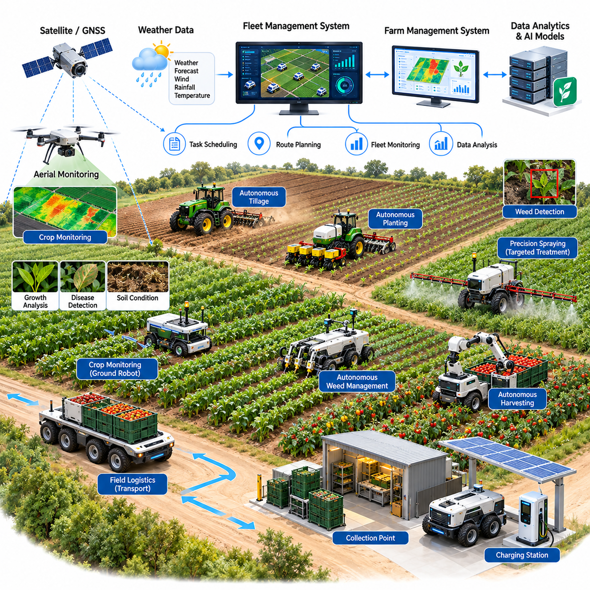{width="7.268055555555556in" height="7.268055555555556in"}

Agricultural autonomy represents an important application of Physical AI because farming operations combine labor-intensive activities, variable environmental conditions, and strict seasonal constraints. This case examines a representative agricultural enterprise introducing autonomous field robots, intelligent perception, precision treatment, and coordinated fleet operations to improve productivity, reduce resource consumption, and strengthen operational resilience.

The representative farm manages multiple crop fields requiring soil preparation, planting, crop monitoring, weed control, spraying, and harvesting. Before automation, tractor operators and seasonal workers perform most field activities using conventional machinery. Labor shortages, unpredictable weather, rising input costs, and narrow harvesting windows create operational difficulties that limit productivity and increase uncertainty in agricultural planning.

The transformation begins with an assessment of field geometry, crop characteristics, soil conditions, equipment utilization, and seasonal labor requirements. Engineers identify repetitive activities suitable for autonomy and distinguish structured field operations from tasks requiring complex manipulation. Initial deployment prioritizes applications with measurable economic benefits, manageable environmental variability, and clearly defined operational boundaries.

Autonomous field vehicles are introduced to perform repetitive navigation and agricultural operations across designated areas. These platforms may include compact electric robots, autonomous tractors, and specialized crop treatment vehicles. Their configurations depend on terrain conditions, payload requirements, crop spacing, and operating duration. Reliable mobility requires careful consideration of ground clearance, traction, wheel slip, and soil compaction.

The navigation architecture combines satellite positioning, inertial sensing, visual perception, and terrain-aware motion planning. Real-time kinematic positioning can provide precise localization when satellite reception and correction signals remain reliable. Cameras and LiDAR support obstacle detection and crop-row identification, while local navigation algorithms compensate for positioning uncertainty, uneven terrain, and unexpected environmental changes.

Agricultural perception systems identify crops, weeds, soil conditions, and visible indicators of plant stress. Computer vision models analyze imagery from onboard cameras or aerial platforms to estimate crop distribution and detect potential problems. Because lighting, growth stages, dust, and vegetation density vary substantially, perception models require diverse training data and validation across representative agricultural conditions.

Precision spraying illustrates how Physical AI can reduce unnecessary chemical application while maintaining crop protection objectives. Vision-guided treatment systems identify target vegetation and activate individual spray nozzles according to spatial location and treatment requirements. Application effectiveness depends on detection accuracy, nozzle response, vehicle speed, weather conditions, and appropriate chemical use. Field validation is essential before claiming resource savings or equivalent treatment performance.

Autonomous weed management may combine mechanical removal, targeted spraying, and localized treatment according to crop type and operating constraints. Robots distinguish desirable plants from competing vegetation and select appropriate actions within predefined safety boundaries. Mechanical approaches reduce dependence on herbicides in suitable environments, but soil disturbance, crop damage, energy consumption, and treatment speed must be evaluated.

Crop monitoring robots collect repeated observations of plant growth, soil moisture, canopy development, and visible disease symptoms. Ground robots provide close-range measurements, while aerial systems cover larger areas efficiently. Combining these data sources supports spatially detailed field assessment and targeted interventions. However, visual observations alone may not establish definitive disease diagnoses or accurately represent subsurface soil conditions.

Autonomous harvesting introduces greater technical complexity because crop geometry, ripeness, visibility, and mechanical sensitivity vary. Robotic manipulators must locate harvestable produce, estimate grasping positions, and apply controlled forces to prevent damage. Harvesting performance depends on perception reliability, end-effector design, manipulation speed, and crop accessibility. Human assistance may remain necessary for difficult or ambiguous harvesting situations.

Heavy-payload agricultural logistics provides another opportunity for autonomous operation. Field robots can transport harvested produce, seed containers, tools, and agricultural supplies between working areas and collection points. Payload mass, uneven ground, slopes, and changing traction conditions influence stability and energy consumption. Appropriate vehicle design and load monitoring are necessary to maintain safe operation across variable terrain.

Coordinated fleet management enables multiple agricultural robots to share field assignments and operational resources. A central scheduling platform allocates tasks according to field location, equipment capability, battery status, and agricultural priorities. Route coordination reduces unnecessary travel and overlapping operations, while communication systems support supervision. Intermittent connectivity requires local autonomy and safe fallback behavior.

Weather and seasonal variability strongly influence agricultural autonomy. Rainfall changes soil bearing capacity, while wind affects spraying accuracy and visibility may deteriorate under dust or fog. Operational planning must incorporate environmental limits and appropriate weather forecasts. Autonomous systems should suspend activities when conditions exceed validated operating boundaries rather than attempting to maintain productivity at the expense of safety.

A digital farm model integrates field boundaries, crop maps, equipment locations, soil observations, and operational histories. Engineers can use this representation to plan routes, evaluate treatment coverage, and compare alternative equipment deployment strategies. Simulation supports fleet sizing and operational planning, but model assumptions must be calibrated against actual field measurements and seasonal variations.

The deployment process begins with a limited pilot on selected fields and clearly defined agricultural tasks. Engineers evaluate localization accuracy, navigation reliability, treatment quality, crop damage, and human intervention requirements. Trials should cover representative terrain and crop conditions before broader deployment. Seasonal testing is particularly important because performance observed during one growth stage may not generalize to another.

Safety engineering addresses interactions between autonomous machinery, workers, animals, public access routes, and agricultural infrastructure. Risk assessments determine operating boundaries, protective sensing, speed limits, emergency stopping, and remote supervision requirements. Agricultural machinery must also account for slopes, unstable ground, and equipment attachments. Safety-critical functions should remain independent of higher-level AI decision-making.

Operational performance is measured through hectares processed per hour, task completion rate, treatment accuracy, crop damage, equipment availability, and resource consumption. Additional indicators include energy use per hectare, human intervention frequency, and weather-related downtime. Comparisons with conventional operations should account for crop type, field conditions, seasonal variation, and differences in treatment quality.

Economic evaluation includes robot acquisition, agricultural attachments, positioning infrastructure, software, maintenance, connectivity, and operator training. Potential benefits arise from reduced repetitive labor, more precise input application, improved operational timing, and better equipment utilization. Financial models must distinguish measurable cost reductions from uncertain yield improvements and consider the limited annual utilization of season-specific machinery.

A representative investment model compares conventional agricultural operations with autonomous alternatives over multiple production seasons. Capital expenditure, recurring operating costs, equipment replacement, and expected productivity benefits are evaluated separately. Sensitivity analysis considers labor availability, cultivated area, operating hours, weather interruptions, and crop prices. Net present value and payback calculations support decisions under uncertain agricultural conditions.

Robot-as-a-Service and autonomous farming service models can reduce the initial investment required from individual farms. Providers may charge according to operating hours, hectares processed, equipment availability, or completed agricultural services. Commercial viability depends on seasonal utilization, transportation between farms, maintenance efficiency, and service reliability. Shared fleets may improve asset utilization when regional crop schedules permit complementary deployment.

Continuous learning uses field imagery, robot trajectories, treatment outcomes, equipment diagnostics, and operator interventions to improve performance. Data collected across different farms and seasons can support perception refinement and operational planning. However, variations in crops, soil, climate, and equipment configurations require careful data management. Updated models must undergo field validation before replacing established production policies.

Scaling agricultural autonomy requires standardized equipment interfaces, reliable technical support, adaptable software, and practical maintenance capabilities. Small farms may prioritize shared services, while large agricultural enterprises may operate dedicated autonomous fleets. Successful expansion depends on local agronomic knowledge, regulatory requirements, seasonal service capacity, and the ability to demonstrate consistent benefits across diverse farming environments.

The central lesson of this agricultural autonomy case is that Physical AI creates value when intelligent perception, reliable mobility, precision intervention, and operational coordination address genuine farming constraints. Technical autonomy alone does not guarantee agricultural productivity or commercial success. Sustainable adoption requires measurable field performance, realistic lifecycle economics, safe operation, and adaptation to environmental and seasonal variability.

## 09.05. Infrastructure Inspection Case

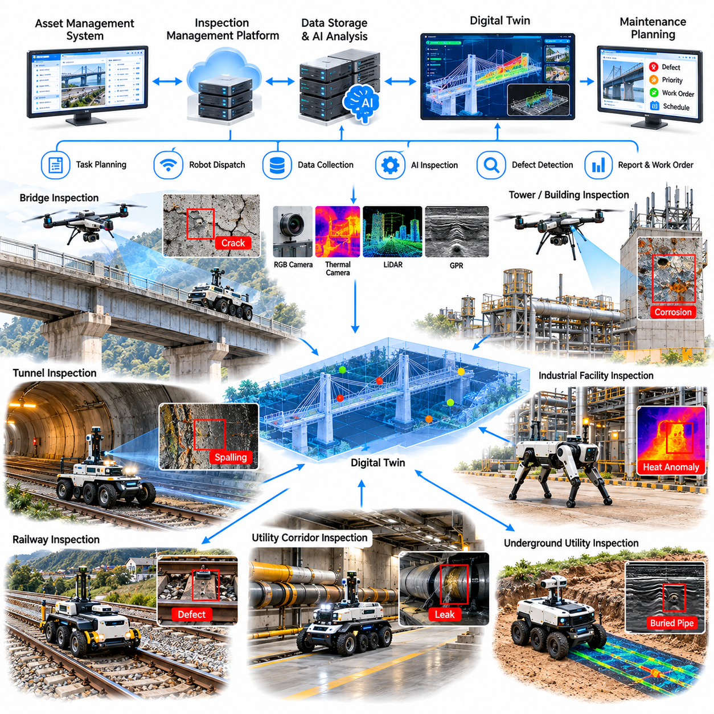{width="7.268055555555556in" height="7.268055555555556in"}

Infrastructure inspection represents a valuable application of Physical AI because bridges, tunnels, railways, industrial facilities, and utility networks require continuous monitoring under difficult operating conditions. This case examines a representative infrastructure operator deploying autonomous ground robots, aerial inspection systems, intelligent sensing, and digital asset management to improve inspection coverage, worker safety, and maintenance decision-making.

The representative operator manages transportation structures, underground passages, utility corridors, and industrial assets distributed across multiple locations. Traditional inspection depends on personnel performing visual surveys, manual measurements, and specialized access procedures. Difficult terrain, confined spaces, traffic restrictions, and hazardous environments increase inspection costs while limiting the frequency and consistency of condition assessments.

The transformation begins with an assessment of asset criticality, inspection requirements, accessibility, environmental hazards, and historical maintenance records. Engineers classify inspection tasks according to operational risk, sensor requirements, measurement accuracy, and potential automation benefits. Initial deployment prioritizes repeatable inspection routes where autonomous systems can collect useful evidence without disrupting essential infrastructure operations.

Autonomous ground robots are introduced to inspect tunnels, utility corridors, industrial facilities, and accessible structural surfaces. Wheeled platforms provide efficient mobility on relatively smooth terrain, while quadruped robots can negotiate stairs, obstacles, and uneven surfaces. Platform selection depends on terrain complexity, payload requirements, operating duration, communication availability, and the physical constraints of each inspection environment.

Aerial robots extend inspection coverage to elevated structures, bridge components, roofs, towers, and difficult-to-access surfaces. High-resolution cameras, thermal sensors, and other suitable instruments collect observations without requiring personnel to approach every inspection point. Flight planning must account for structural obstacles, wind conditions, positioning uncertainty, restricted airspace, and the limitations of satellite navigation near large structures.

The perception architecture combines visual imagery, LiDAR, thermal measurements, and position information to characterize infrastructure conditions. Computer vision models can identify candidate cracks, corrosion, surface deterioration, missing components, and visible deformation. Detection results require appropriate confidence estimates and expert verification because lighting variation, surface contamination, and sensor limitations can produce false indications or missed defects.

Three-dimensional mapping supports inspection planning and the spatial organization of collected evidence. LiDAR and visual reconstruction techniques generate geometric representations of tunnels, bridges, and industrial facilities. Sensor observations can be associated with asset coordinates, structural components, and inspection timestamps. Consistent spatial registration is essential for comparing measurements collected during different inspection campaigns.

Bridge inspection illustrates the advantages of combining aerial and ground-based robotic systems. Aerial platforms examine accessible elevated surfaces, while ground robots collect observations from decks, service passages, and supporting infrastructure. Engineers integrate these datasets to identify locations requiring closer examination. Robotic inspection supplements rather than automatically replaces legally required professional assessments and specialized structural testing.

Tunnel and railway inspection introduce additional challenges involving restricted access, low illumination, vibration, dust, and intermittent communications. Ground robots can collect visual and geometric observations during approved inspection windows. Thermal or other specialized sensing may support selected diagnostic tasks. Operations must comply with infrastructure access procedures, railway possession requirements, and emergency recovery protocols.

Underground utility inspection may incorporate ground-penetrating radar, electromagnetic sensing, and geometric mapping to investigate subsurface conditions. These technologies can provide evidence about buried structures or potential anomalies, but interpretation depends strongly on soil composition, moisture, depth, and sensor configuration. Physical AI supports data collection and analysis while qualified specialists determine the significance of uncertain findings.

Inspection autonomy requires reliable localization and navigation in environments where satellite positioning may be unavailable. Visual-inertial odometry, LiDAR-based localization, and simultaneous localization and mapping support robot movement through tunnels and industrial structures. Mission planning considers obstacle clearance, route accessibility, battery capacity, and safe return paths. Robots must stop or request assistance when localization uncertainty exceeds acceptable limits.

A centralized inspection management platform coordinates robot assignments, mission schedules, sensor configurations, and collected datasets. Inspection tasks are prioritized according to asset criticality, regulatory requirements, operational availability, and observed deterioration. The platform connects robotic observations with maintenance management systems, allowing inspection findings to support engineering review, work orders, and longer-term asset planning.

Digital twins provide a structured environment for combining infrastructure geometry, inspection histories, defect locations, and maintenance records. Engineers can compare successive observations to identify possible changes in asset condition. Reliable change detection requires consistent measurement methods, calibration, environmental context, and uncertainty analysis. A digital representation becomes valuable when it supports traceable engineering decisions rather than merely displaying three-dimensional models.

Human experts remain responsible for interpreting inspection findings and determining appropriate maintenance actions. AI-assisted defect detection can reduce the effort required to review large image collections, but automated classifications should not be treated as definitive structural diagnoses. Inspection workflows must preserve original measurements, model outputs, reviewer decisions, and evidence supporting recommendations for repair or further investigation.

Safety engineering addresses falls, collisions, confined-space hazards, electrical equipment, unstable surfaces, and unexpected robot failures. Risk assessments establish operating boundaries, protective controls, emergency stopping, and recovery procedures. Aerial operations require appropriate flight authorization and separation from personnel, while ground operations must account for hazardous atmospheres and restricted areas. Autonomous behavior must remain within validated safety limits.

The deployment strategy begins with controlled inspections of selected assets where existing inspection records provide reference information. Engineers evaluate navigation reliability, sensor coverage, defect detection performance, localization accuracy, and mission completion. Results are compared with qualified human inspections and appropriate measurement methods. Broader deployment follows documented validation, operator training, and demonstrated operational reliability.

Operational performance is evaluated through inspection coverage, mission completion rate, data quality, defect detection accuracy, equipment availability, and human intervention frequency. Additional indicators include inspection duration, access preparation time, repeatability, and the number of findings requiring expert review. Performance evaluation must distinguish improved data collection efficiency from actual improvements in infrastructure condition or maintenance effectiveness.

Economic evaluation includes robotic equipment, inspection sensors, software integration, operator training, maintenance, transportation, and technical support. Potential benefits arise from reduced access preparation, fewer hazardous manual activities, more consistent documentation, and improved inspection scheduling. Financial analysis should avoid assuming that every robotic inspection eliminates conventional inspection costs, since expert verification and specialized testing may remain necessary.

A representative investment model compares conventional inspection methods with robotic alternatives across a multiyear asset portfolio. Capital expenditures, recurring service costs, inspection frequency, and operational savings are modeled separately. Sensitivity analysis examines equipment utilization, travel requirements, inspection complexity, reliability, and regulatory constraints. Net present value and payback calculations help determine whether deployment offers sustainable economic benefits.

Inspection-as-a-Service provides an alternative commercial model in which infrastructure owners purchase inspection outcomes rather than operating robotic equipment directly. Providers may charge per asset, inspection mission, covered area, or recurring monitoring contract. Commercial sustainability depends on equipment utilization, deployment logistics, qualified personnel, data processing costs, and contractual responsibilities for inspection quality and reporting.

Continuous learning uses inspection imagery, geometric measurements, navigation histories, equipment diagnostics, and expert annotations to improve system performance. Data collected across different asset types can support defect recognition and mission planning. However, variations in materials, structural geometry, environmental conditions, and sensor configurations require careful dataset management. Updated models must be validated before use in consequential inspection decisions.

Scaling infrastructure inspection across large asset networks requires standardized data formats, reusable mission procedures, interoperable robotic platforms, and centralized asset records. Regional service teams may manage deployment and maintenance while centralized software supports analysis and reporting. Successful expansion depends on consistent evidence quality, regulatory compliance, qualified engineering oversight, and practical support for diverse operating environments.

The central lesson of this infrastructure inspection case is that Physical AI creates value by improving access, measurement consistency, and the availability of actionable infrastructure information. Autonomous mobility, intelligent sensing, digital asset integration, and expert engineering judgment must function together. Sustainable commercialization requires validated inspection performance, measurable lifecycle benefits, safe deployment, and trustworthy evidence for maintenance decisions.

## 09.06. Humanoid Workforce Augmentation Case

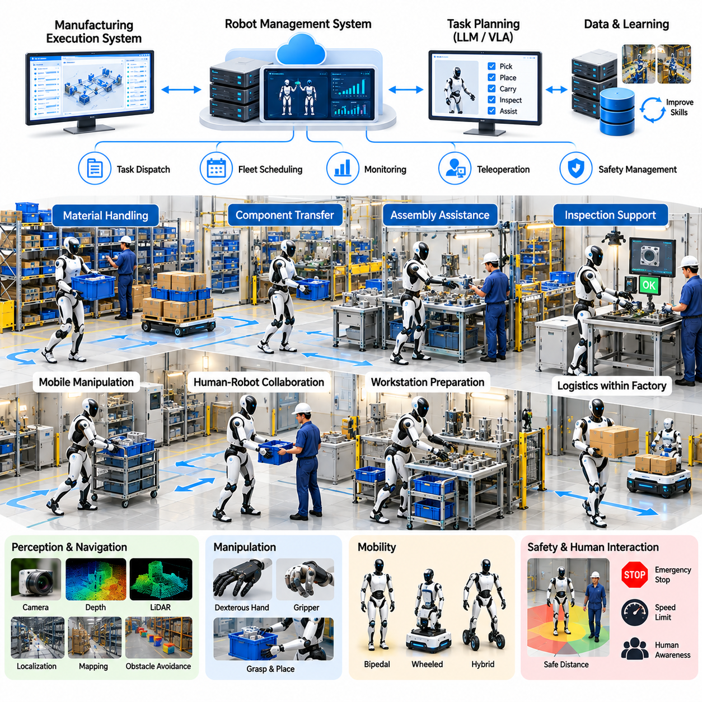{width="7.268055555555556in" height="7.268055555555556in"}

Humanoid workforce augmentation represents an emerging application of Physical AI in which general-purpose robots support human workers across industrial and service environments. This case examines a representative manufacturing enterprise deploying humanoid robots for repetitive material handling, component transfer, and workstation assistance. The objective is to improve workforce productivity, reduce physical strain, and expand operational flexibility without replacing essential human judgment.

The representative enterprise operates assembly lines, component warehouses, inspection stations, and packaging areas designed primarily for human workers. Employees perform repetitive transportation, loading, sorting, and preparation activities throughout each production shift. Labor shortages, ergonomic risks, and fluctuating production demand create opportunities for robotic assistance, although existing workflows and workplace safety requirements constrain deployment.

The transformation begins with a detailed assessment of worker activities, task frequency, object characteristics, physical effort, and environmental complexity. Engineers identify tasks that require human-like reach, mobility, or manipulation but involve limited decision uncertainty. Initial deployment focuses on structured, repetitive operations where task success can be measured reliably and workers can supervise robotic performance without excessive additional effort.

Humanoid platforms combine articulated arms, dexterous or specialized grippers, mobile lower bodies, and integrated perception systems. Their human-compatible morphology allows interaction with shelves, worktables, containers, and equipment originally designed for people. However, humanoid form does not automatically provide superior efficiency. Platform selection must compare reachability, payload, stability, cost, and reliability against conventional industrial robots.

The perception architecture integrates cameras, depth sensing, proprioception, and environmental mapping to recognize objects, workstations, and nearby personnel. Vision-language-action models may translate task instructions and visual observations into manipulation policies. Reliable execution still requires calibrated sensors, object localization, and explicit operational constraints because model predictions can fail when objects, lighting, or workspace conditions change.

Manipulation tasks include retrieving components, transferring containers, positioning parts, and preparing materials for human operators. The robot estimates grasp locations, selects suitable contact points, and coordinates arm movements with balance control. Task performance depends on object geometry, friction, weight, and placement uncertainty. Specialized end effectors may provide greater reliability than anthropomorphic hands for repetitive industrial operations.

Bipedal mobility allows humanoid robots to navigate some environments designed around human walking, including narrow passages and workstations with limited access. Nevertheless, dynamic balance, uneven flooring, and unexpected contact introduce significant operational challenges. Where terrain permits, wheeled or hybrid mobile platforms may offer better energy efficiency and stability. Mobility architecture should therefore follow task requirements rather than appearance.

Human-robot collaboration requires clearly defined responsibilities and predictable interaction patterns. Workers may assign tasks, prepare workstations, confirm completion, and handle exceptions, while robots perform approved repetitive activities. Visual indicators and understandable motion behavior help personnel anticipate robot actions. Effective augmentation depends on reducing total human workload rather than transferring repetitive labor into continuous robot supervision.

A supervisory control system coordinates task assignments, robot availability, operating schedules, and exception handling. Integration with manufacturing execution systems enables robots to receive approved production instructions and report completed activities. Task allocation considers robot capabilities, workstation readiness, material availability, and production priorities. Human supervisors retain authority to interrupt operations when conditions change.

Teleoperation provides an important mechanism for early deployment, recovery, and demonstration collection. Remote operators can guide robots through unfamiliar tasks, resolve selected manipulation failures, and record successful actions for subsequent learning. However, intervention requirements directly affect operating economics. A commercially viable system must progressively reduce routine human assistance while preserving reliable escalation procedures.

Safety engineering addresses collisions, pinch points, dropped objects, loss of balance, and unintended contact with workers. Risk assessments establish speed limits, protective separation, emergency stopping, and safe operating boundaries. Safety-critical functions must remain independent of high-level AI planning. Collaborative operation requires application-specific validation, and human-like appearance must never be treated as evidence of inherent safety.

The implementation begins with a controlled pilot involving a small number of robots and selected workstations. Engineers measure task completion, manipulation accuracy, cycle time, intervention frequency, and operational availability. Early tasks may involve standardized containers or components to limit uncertainty. Expansion occurs only after repeated trials demonstrate acceptable safety, reliability, and measurable benefits under representative production conditions.

Worker acceptance is a central factor in successful deployment. Employees require practical training on task requests, robot limitations, emergency procedures, and recovery workflows. Management should explain how robotic assistance changes responsibilities, performance expectations, and skill requirements. Participation by experienced workers helps identify overlooked workflow constraints and prevents automation designs that create unnecessary operational friction.

Operational performance is evaluated through successful tasks per hour, cycle time, robot utilization, human intervention rate, and system availability. Additional indicators include manipulation failures, recovery duration, energy consumption, and production disruptions. Productivity assessments must account for supervision and preparation time. A robot completing many individual actions does not necessarily improve overall production throughput.

Economic evaluation includes robot acquisition, grippers, software integration, charging infrastructure, maintenance, training, and technical support. Potential benefits include reduced repetitive manual effort, improved staffing flexibility, and more consistent task execution. Financial models should distinguish measurable labor cost savings from improvements in worker ergonomics or redeployment. These benefits have different economic implications and should not be counted twice.

A representative investment model compares existing human-centered workflows with humanoid-assisted operations over multiple years. Capital expenditures, recurring costs, expected utilization, and productivity changes are modeled separately. Sensitivity analysis considers task success rates, intervention requirements, equipment lifetime, and maintenance downtime. Net present value and payback calculations reveal whether the proposed deployment can achieve sustainable financial returns.

Robot-as-a-Service provides an alternative commercial approach that reduces initial equipment expenditure. Customers may pay recurring fees based on robot availability, operating hours, or completed service tasks. Providers assume responsibilities for software updates, maintenance, and technical support according to contractual terms. Sustainable pricing requires realistic assumptions about utilization, replacement components, intervention costs, and operational reliability.

Continuous improvement relies on robot trajectories, manipulation outcomes, perception data, and human correction records. These datasets support policy refinement, failure analysis, and task adaptation. Simulation and imitation learning may accelerate development, but deployment performance must be verified on physical hardware. Model updates require controlled testing to prevent regressions in previously reliable behaviors.

Scaling humanoid augmentation across multiple facilities requires reusable task definitions, standardized interfaces, consistent safety procedures, and reliable service infrastructure. Differences in workstation geometry, materials, and production schedules may limit direct transfer of learned policies. Centralized software can distribute validated improvements, while local engineering teams adapt deployments to specific operational conditions.

Humanoid robots are most valuable when their mobility and manipulation capabilities provide advantages that simpler automation cannot deliver economically. Reconfigurable workstations, mixed production tasks, and human-oriented facilities may support this value proposition. However, specialized manipulators, autonomous mobile robots, and conventional automation remain preferable for many high-volume or tightly structured operations.

The central lesson of this humanoid workforce augmentation case is that Physical AI should be evaluated according to measurable operational contributions rather than human resemblance. Successful commercialization requires reliable manipulation, safe human interaction, manageable intervention costs, and realistic lifecycle economics. Humanoid systems become sustainable workforce tools when they complement human expertise and deliver consistent value across practical production environments.

## 09.07. Mobile Manipulator Business Case

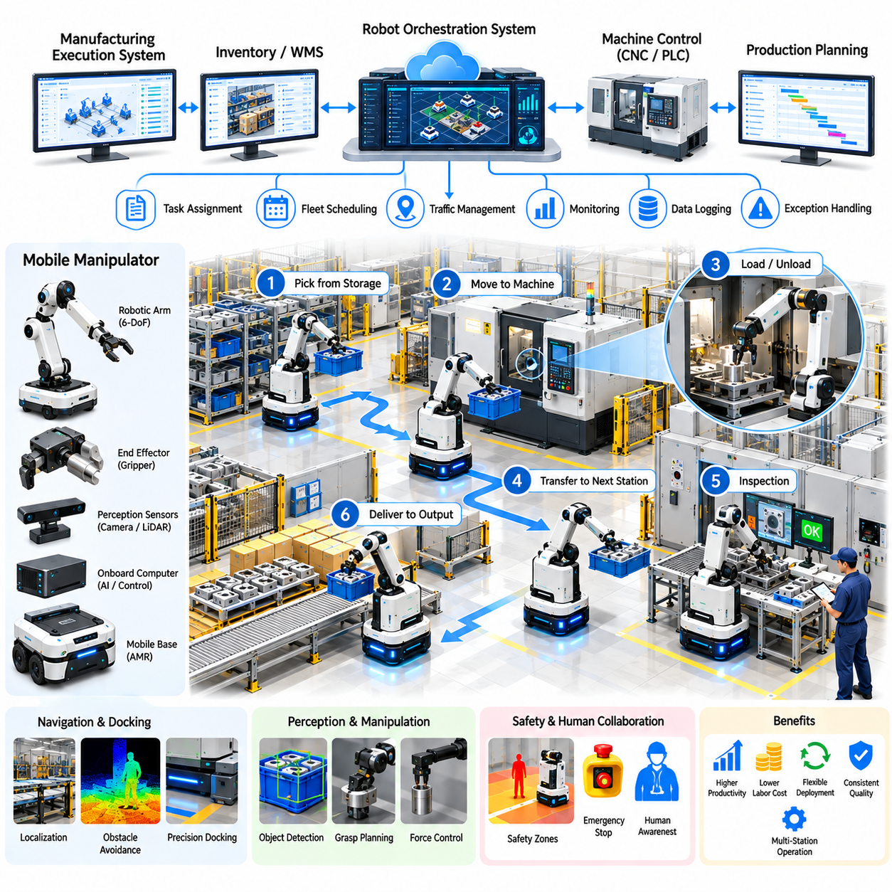{width="7.268055555555556in" height="7.268055555555556in"}

Mobile manipulator robotics represents a commercially promising application of Physical AI because industrial operations frequently require both autonomous transportation and physical interaction with objects. This case examines a representative manufacturing enterprise deploying mobile manipulators to automate component transfer, machine tending, and material handling. The business objective is to improve productivity, reduce repetitive labor, and increase flexibility across changing production environments.

The representative enterprise operates machining centers, assembly workstations, component storage areas, and inspection stations. Before automation, workers manually transport containers, load machines, retrieve parts, and move finished components between production stages. These repetitive activities consume skilled labor capacity and create delays between processing operations. Variable production volumes and frequent product changes further complicate conventional fixed automation.

The business transformation begins with an assessment of material flows, workstation layouts, task frequency, object characteristics, and labor requirements. Engineers identify processes requiring both mobility and manipulation, then compare mobile manipulators with fixed robot arms and autonomous mobile robots. Initial deployment prioritizes repetitive tasks with predictable objects, accessible workstations, measurable cycle times, and manageable integration requirements.

A mobile manipulator combines an autonomous mobile base, robotic arm, end effector, perception sensors, and integrated control software. The mobile base transports the system between workstations, while the manipulator performs grasping, placement, loading, and unloading. System design must balance payload capacity, arm reach, positioning accuracy, stability, and energy consumption. These constraints determine which industrial tasks can be automated reliably.

The navigation architecture integrates localization, mapping, obstacle detection, and path planning to support movement through shared production environments. LiDAR, cameras, and wheel odometry provide complementary information about robot position and nearby obstacles. Autonomous navigation must account for pedestrians, forklifts, temporary storage, and changing workstation arrangements. Reliable docking is particularly important because manipulation accuracy depends on consistent positioning.

Manipulation performance requires accurate object detection, pose estimation, grasp planning, and motion control. Vision systems identify target components and estimate their position relative to the robot arm. Grasp planners select suitable contact points based on geometry, orientation, and end-effector capabilities. Force sensing and compliant control can improve interaction reliability, although difficult objects and uncertain placements may still require human assistance.

Machine tending provides a practical application in which mobile manipulators load raw components into manufacturing equipment and remove completed parts. The robot travels between machines, confirms equipment readiness, and performs approved loading sequences. Integration with machine controllers supports status monitoring and process coordination. Safe operation requires validated interfaces, controlled access, and reliable handling of unexpected machine conditions.

Flexible assembly support represents another business opportunity. Mobile manipulators can deliver components, position fixtures, and assist workers with repetitive preparation activities. Unlike fixed automation, a single platform may serve multiple workstations when task schedules permit. However, movement between stations introduces transportation time and docking uncertainty. Productivity gains depend on balancing manipulation efficiency with travel and coordination overhead.

Warehouse-to-production material transfer combines autonomous logistics with localized handling. A mobile manipulator retrieves approved containers from storage locations, transports them to production areas, and places them at designated positions. Integration with inventory systems supports material identification and transaction confirmation. Payload compatibility, storage geometry, and grasp reliability determine whether this approach offers advantages over simpler transport robots.

A centralized orchestration system coordinates transportation missions, manipulation tasks, workstation availability, and production priorities. Integration with manufacturing execution systems enables approved work orders to generate robot assignments. Scheduling algorithms consider travel distance, task duration, equipment readiness, and robot capabilities. Effective coordination prevents individual robots from creating bottlenecks or interfering with production equipment.

Task execution follows a structured sequence of navigation, docking, perception, manipulation, verification, and departure. Each stage produces operational status information that supports monitoring and exception handling. Failed grasps, blocked routes, unavailable machines, and positioning errors trigger predefined recovery procedures. Reliable recovery is commercially important because frequent human intervention can eliminate the labor savings expected from automation.

Safety engineering addresses the combined risks of mobile navigation and robotic manipulation. Risk assessments consider collisions, arm movements, dropped objects, unstable payloads, and interactions with workers. Protective sensing, speed limitations, emergency stopping, and controlled operating zones reduce exposure to hazards. Safety-critical functions must remain independent of higher-level AI planning, and collaborative tasks require application-specific validation.

The deployment process begins with a controlled pilot involving selected workstations and standardized components. Engineers evaluate navigation reliability, docking accuracy, grasp success, cycle time, and intervention frequency. Pilot operations should include representative production schedules and realistic environmental disturbances. Expansion follows demonstrated task reliability, documented safety acceptance, and confirmation that automation improves overall workflow performance.

Operational performance is evaluated through successful manipulation cycles, completed transport missions, equipment utilization, system availability, and average task duration. Additional indicators include grasp failure rate, docking errors, recovery time, and human intervention frequency. Production managers also measure machine idle time and throughput changes. These metrics distinguish local robotic efficiency from actual improvements in manufacturing productivity.

Fleet sizing requires analysis of task demand, workstation distribution, travel time, manipulation duration, and charging requirements. A single mobile manipulator may serve several machines when utilization patterns are complementary. Additional robots increase capacity but also introduce scheduling complexity and infrastructure costs. Simulation and operational measurements help determine the appropriate fleet size without assuming that maximum robot utilization produces maximum production throughput.

Economic evaluation includes mobile platforms, robotic arms, grippers, sensors, software integration, charging infrastructure, maintenance, and operator training. Potential benefits arise from reduced manual transportation, improved machine utilization, and flexible deployment across workstations. Financial models must account for installation, supervision, recovery labor, and equipment downtime. Labor savings should be distinguished from productivity improvements and staffing flexibility.

A representative investment model compares existing manual operations with mobile manipulator deployment over a multiyear period. Capital expenditure, recurring operating costs, expected utilization, and productivity benefits are evaluated separately. Sensitivity analysis considers grasp success, intervention frequency, production volume, equipment lifetime, and maintenance requirements. Net present value and payback calculations reveal the conditions required for commercially sustainable deployment.

Robot-as-a-Service provides an alternative model in which customers pay recurring fees for robotic equipment, software, maintenance, and technical support. Contracts may specify availability, operating hours, or completed manipulation tasks. Providers must consider installation complexity, customer-specific integration, replacement components, and field service costs. Commercial sustainability depends on maintaining reliable performance while controlling customization and support expenses.

Continuous improvement relies on navigation histories, manipulation trajectories, perception data, task outcomes, and human correction records. These datasets support failure analysis, grasp policy refinement, and improved task scheduling. Simulation and imitation learning may accelerate adaptation to new objects and workstations. Nevertheless, updated models require physical validation because changes in perception or control can introduce unexpected production failures.

Scaling mobile manipulator services across factories requires standardized workstation interfaces, reusable task definitions, compatible grippers, and consistent safety procedures. Differences in machine geometry, material presentation, and operating schedules may limit direct reuse of learned behaviors. Modular hardware and software architectures reduce adaptation costs. Centralized monitoring supports fleet-wide performance analysis, while local engineering teams manage site-specific integration.

The central lesson of this mobile manipulator business case is that Physical AI creates commercial value by combining transportation and manipulation within adaptable production workflows. Successful deployment depends on reliable navigation, precise handling, effective orchestration, and manageable intervention requirements. Mobile manipulators become economically attractive when their flexibility produces measurable productivity benefits that justify their additional complexity and lifecycle costs.

## 09.08. Quadruped Inspection Business Case

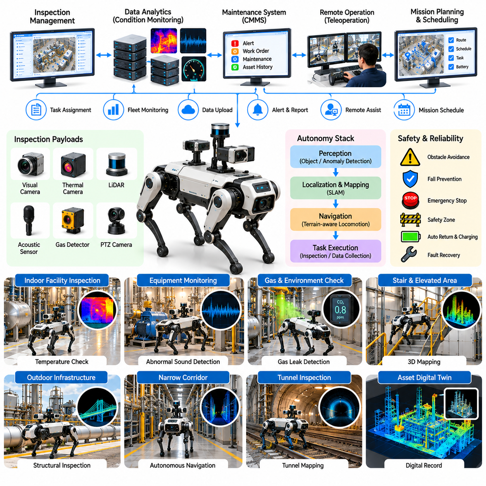{width="7.268055555555556in" height="7.268055555555556in"}

Quadruped inspection robotics represents a practical application of Physical AI in industrial environments where conventional wheeled robots face mobility limitations. This case examines a representative industrial facility deploying quadruped robots for autonomous inspection, equipment monitoring, and hazardous-area observation. The business objective is to improve inspection consistency, reduce worker exposure to dangerous conditions, and support predictive maintenance.

The representative facility contains production equipment, utility corridors, stairways, elevated platforms, and outdoor infrastructure. Traditional inspection relies on technicians walking established routes to check gauges, identify abnormal sounds, and observe equipment conditions. Repetitive patrols consume maintenance resources, while restricted access and environmental hazards can delay inspections and reduce the frequency of operational monitoring.

The transformation begins with an assessment of inspection routes, asset criticality, environmental hazards, and maintenance requirements. Engineers identify locations where legged mobility provides advantages over wheeled platforms or fixed sensors. Initial deployment prioritizes repeatable inspection tasks with accessible measurement targets, manageable terrain conditions, and clear operational boundaries. Business value is evaluated against existing inspection methods.

Quadruped robots combine articulated legs, onboard computing, perception sensors, and autonomous navigation software. Their locomotion systems support movement across stairs, uneven surfaces, and selected industrial obstacles. However, mobility performance depends on terrain geometry, surface friction, payload mass, and stability margins. Robot selection must consider inspection requirements, operating duration, environmental protection, and maintenance complexity.

The navigation architecture integrates LiDAR, cameras, inertial sensing, and simultaneous localization and mapping to estimate robot position and surrounding geometry. Autonomous route execution requires reliable localization, obstacle avoidance, and terrain-aware footstep planning. Industrial environments introduce challenges involving reflective surfaces, narrow passages, changing equipment layouts, and limited satellite positioning. Safe navigation requires validated operating limits.

Inspection payloads may include visible-light cameras, thermal imagers, acoustic sensors, and gas detection instruments. These sensors support observation of equipment surfaces, temperature patterns, abnormal sounds, and selected environmental conditions. Sensor selection depends on inspection objectives and required measurement accuracy. Reliable results require appropriate calibration, measurement distance, environmental compensation, and consistent data collection procedures.

Thermal inspection illustrates a commercially useful application for quadruped robots. Thermal cameras can identify temperature patterns associated with overheating equipment, electrical connections, or mechanical components. Automated image capture enables repeated observations from similar positions. However, emissivity, reflections, ambient temperature, and viewing angle influence measurements. Qualified personnel must interpret anomalies before determining maintenance actions.

Acoustic inspection supports monitoring of pumps, motors, compressors, and other rotating equipment. Microphones or specialized acoustic sensors collect sound patterns that may indicate changes in operating conditions. Machine learning models can identify deviations from established baselines, but environmental noise and varying equipment loads complicate interpretation. Acoustic findings should be combined with maintenance history and additional measurements.

Gas detection and environmental monitoring provide additional opportunities in selected industrial facilities. Robots equipped with suitable sensors can measure designated gases or atmospheric conditions along approved inspection routes. Such measurements may reduce routine personnel exposure in appropriately controlled environments. However, sensor certification, hazardous-area equipment requirements, and emergency procedures must be satisfied before deployment in potentially explosive or dangerous locations.

Autonomous inspection missions follow predefined routes connecting measurement points and equipment locations. At each checkpoint, the robot positions itself, collects sensor readings, and records operational metadata. Mission software verifies data completeness and reports unsuccessful measurements. Repeatable positioning improves comparison across inspection cycles, although changes in equipment operation and environmental conditions must be considered during analysis.

A centralized inspection management platform schedules missions, monitors robot status, and organizes collected data. Integration with computerized maintenance management systems allows inspection findings to support work orders and maintenance planning. Asset identifiers, timestamps, measurement locations, and inspection histories provide traceability. Automated alerts should include confidence information and escalation rules rather than treating every detected anomaly as confirmed equipment failure.

Remote supervision remains important because industrial environments can change unexpectedly. Operators may intervene when routes become blocked, localization confidence decreases, or inspection targets become inaccessible. Teleoperation supports recovery and selected manual observations, but frequent intervention increases operating costs. Commercial deployment therefore requires reliable autonomous completion, clear exception handling, and practical procedures for retrieving disabled robots.

Safety engineering addresses falls, collisions, unstable footing, dropped equipment, and interactions with workers or industrial machinery. Risk assessments define permissible routes, operating speeds, protective separation, and emergency stopping procedures. Special attention is required near moving machinery, open edges, electrical installations, and hazardous atmospheres. Autonomous behavior must remain within validated limits, and safety-critical functions must not depend solely on AI predictions.

The deployment process begins with a controlled pilot covering selected inspection routes and equipment categories. Engineers evaluate navigation success, checkpoint accuracy, sensor data quality, mission duration, and intervention frequency. Results are compared with conventional inspection records and qualified technician observations. Expansion follows demonstrated operational reliability, documented safety acceptance, and confirmation that collected measurements support useful maintenance decisions.

Operational performance is measured through completed inspection missions, checkpoint coverage, data quality, system availability, and human intervention rate. Additional indicators include navigation failures, recovery time, battery consumption, and repeatability of measurements. Maintenance managers also evaluate whether earlier anomaly detection improves response time or reduces unplanned downtime. Inspection activity alone does not establish measurable maintenance value.

Fleet sizing depends on inspection frequency, route length, travel speed, measurement duration, charging requirements, and facility operating schedules. A single quadruped may cover multiple inspection zones when mission demand is moderate. Larger facilities may require several robots and coordinated scheduling. Simulation and operational records help determine appropriate capacity while accounting for maintenance downtime, battery limitations, and emergency inspection requests.

Economic evaluation includes robot acquisition, inspection payloads, software integration, charging equipment, maintenance, operator training, and technical support. Potential benefits arise from reduced repetitive patrol labor, improved inspection consistency, and lower exposure to selected hazards. Financial models must also include supervision, calibration, recovery operations, and component replacement. Safety improvements and avoided failures require careful valuation rather than unsupported assumptions.

A representative investment model compares conventional inspection practices with quadruped-assisted operations over multiple years. Capital expenditures, recurring service costs, expected utilization, and measurable operational savings are evaluated separately. Sensitivity analysis considers mission reliability, inspection frequency, equipment lifetime, intervention requirements, and maintenance costs. Net present value and payback calculations support decisions under realistic operating assumptions.

Inspection-as-a-Service provides an alternative commercial model in which industrial customers purchase recurring inspection services rather than owning robotic equipment. Providers may charge per facility, inspection route, completed mission, or contracted service period. Sustainable pricing depends on robot utilization, travel logistics, qualified personnel, maintenance responsibilities, and reporting requirements. Service agreements should clearly define inspection scope and performance expectations.

Continuous improvement uses navigation histories, sensor measurements, anomaly reports, equipment diagnostics, and technician feedback to refine inspection performance. Data collected across facilities can support anomaly detection and route optimization. However, differences in machinery, environmental conditions, and sensor configurations require careful validation. Updated AI models must be tested before influencing consequential maintenance decisions.

Scaling quadruped inspection services requires standardized mission definitions, reusable sensor configurations, interoperable maintenance interfaces, and reliable technical support. Different industrial sites may require customized routes, safety assessments, and equipment integration. Centralized monitoring supports fleet-wide performance analysis, while local personnel manage operational exceptions. Commercial expansion depends on consistent inspection quality and controlled deployment costs.

The central lesson of this quadruped inspection business case is that Physical AI creates value when legged mobility enables reliable measurements in environments where conventional approaches are inefficient or hazardous. Successful commercialization requires dependable navigation, calibrated sensing, safe operation, and integration with maintenance workflows. Quadruped robots become economically attractive when measurable inspection benefits justify their complexity and lifecycle costs.

## 09.09. Autonomous Aerial Logistics Case

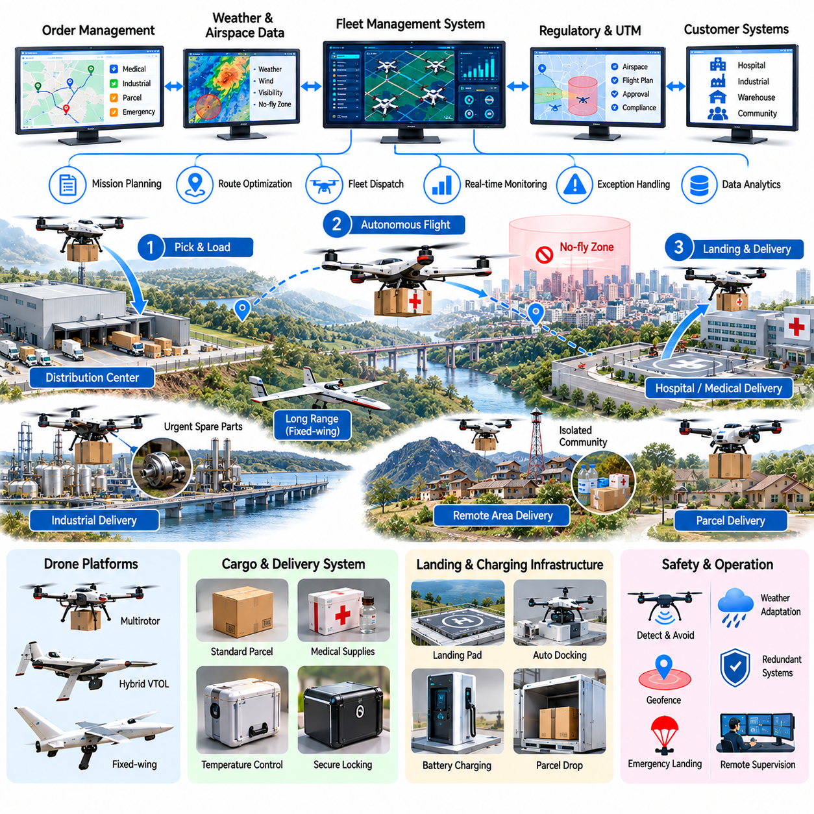{width="7.268055555555556in" height="7.268055555555556in"}

Autonomous aerial logistics represents an emerging application of Physical AI that combines unmanned aircraft, intelligent navigation, and automated delivery operations. This case examines a representative logistics provider deploying autonomous drones to transport medical supplies, industrial components, and time-sensitive parcels. The business objective is to shorten delivery times, improve access to remote locations, and establish economically sustainable aerial transportation services.

The representative operator serves hospitals, distribution centers, industrial campuses, and geographically isolated communities. Conventional delivery depends on roads, vehicles, and human drivers, creating delays where distances, congestion, or difficult terrain constrain access. Aerial transportation may bypass selected ground obstacles, but payload limitations, weather conditions, airspace restrictions, and infrastructure requirements determine its practical competitiveness.

The business transformation begins with an assessment of delivery demand, route characteristics, shipment urgency, and operating costs. Engineers identify routes where aerial transportation offers measurable advantages over ground delivery. Initial deployment prioritizes lightweight, high-value, time-sensitive cargo and predictable delivery corridors. Commercial feasibility depends on sufficient demand density, regulatory permissions, and reliable service availability.

Autonomous delivery aircraft integrate propulsion systems, flight controllers, navigation sensors, communication equipment, and cargo-handling mechanisms. Multirotor platforms provide vertical takeoff and precise landing, while fixed-wing and hybrid aircraft may offer greater range. Platform selection considers payload capacity, flight endurance, cruising speed, landing requirements, and energy efficiency. Aircraft architecture must match actual delivery missions.

The perception and navigation architecture combines satellite positioning, inertial measurement, onboard sensing, and route planning. Autonomous flight requires accurate localization, obstacle awareness, and continuous monitoring of aircraft condition. Urban structures, terrain, signal interference, and changing environmental conditions introduce uncertainty. Navigation systems must maintain safe operating margins and support predefined contingency procedures when positioning confidence deteriorates.

Flight planning incorporates delivery destinations, terrain elevation, restricted airspace, weather forecasts, and available energy reserves. Route optimization balances travel time, battery consumption, operational risk, and service commitments. Wind conditions and payload weight influence achievable range and flight stability. Mission planning must include alternative landing locations, return-to-base requirements, and sufficient energy for unexpected delays.

Cargo integration is a critical component of aerial logistics. Packages must remain securely attached throughout takeoff, flight, and landing while respecting aircraft balance and payload limits. Automated loading stations may verify package identity, mass, dimensions, and attachment status. Specialized medical shipments can require temperature monitoring and chain-of-custody records. Reliable handling is essential because delivery failures directly affect customer trust.

Landing and delivery infrastructure determines whether autonomous aerial operations can scale efficiently. Dedicated landing pads, automated docking stations, charging equipment, and protected cargo compartments reduce manual handling. Some operations may use controlled package lowering where permitted and appropriately validated. Infrastructure design must account for pedestrian safety, surrounding obstacles, weather exposure, and unauthorized access.

A representative medical logistics application connects regional distribution centers with hospitals and remote clinics. Drones transport selected diagnostic samples, medicines, or emergency supplies under approved operating procedures. Faster transportation may improve responsiveness when road access is limited. However, healthcare applications require validated packaging, shipment traceability, temperature control where necessary, and procedures for failed or delayed deliveries.

Industrial logistics provides another application involving spare parts, maintenance tools, and urgent components. Large industrial campuses or geographically separated facilities may benefit from rapid point-to-point delivery. Integration with maintenance and inventory systems enables automated shipment requests and delivery confirmation. Economic value depends on avoided equipment downtime, shipment frequency, payload compatibility, and the availability of suitable landing infrastructure.

A centralized fleet management platform coordinates delivery requests, aircraft availability, route assignments, charging schedules, and maintenance status. Integration with warehouse management and enterprise systems supports order processing and shipment tracking. Scheduling algorithms consider payload requirements, aircraft capabilities, weather restrictions, and service priorities. Fleet orchestration must prevent conflicting operations and preserve capacity for urgent missions.

Communication architecture connects aircraft, ground stations, fleet management systems, and authorized operators. Telemetry provides information about position, battery status, flight condition, and mission progress. Communication interruptions require predefined autonomous responses appropriate to the approved operation. Cybersecurity controls protect command channels, navigation data, and shipment information. Remote supervision remains necessary even when routine flight execution is automated.

Safety engineering addresses loss of propulsion, navigation errors, battery failures, unexpected obstacles, and risks to people or property. Aircraft require appropriate redundancy, fault detection, emergency procedures, and maintenance inspections. Operational risk assessments consider ground exposure, airspace interactions, and environmental conditions. Safety-critical functions must remain dependable independently of experimental AI decision-making components.

Regulatory compliance is fundamental to commercial aerial logistics. Operators must satisfy applicable requirements concerning aircraft approval, operational authorization, pilot or remote-operator responsibilities, and airspace access. Beyond-visual-line-of-sight operations may require additional safety evidence and permissions. Regulatory conditions vary across jurisdictions, making approved operating environments and compliance costs central considerations in market selection.

The implementation process begins with a controlled pilot connecting a limited number of approved locations. Engineers measure delivery completion, navigation reliability, landing accuracy, flight duration, and intervention frequency. Trials include representative payloads, permitted weather conditions, and realistic operating schedules. Commercial expansion follows demonstrated safety performance, operational reliability, customer acceptance, and compliance with applicable authorizations.

Operational performance is evaluated through completed deliveries, average delivery time, aircraft utilization, on-time service rate, and system availability. Additional indicators include mission cancellations, weather-related delays, energy consumption, maintenance events, and human intervention requirements. Customer satisfaction and shipment integrity provide important service-quality measures. High flight frequency alone does not establish profitable logistics operations.

Fleet sizing depends on delivery demand, route distance, aircraft turnaround time, charging duration, and operating restrictions. Additional aircraft can increase service capacity but also require maintenance resources, spare batteries, and supporting infrastructure. Demand forecasting and scheduling simulations help estimate the appropriate fleet composition. Capacity planning must consider seasonal weather, peak demand, and aircraft temporarily unavailable for service.

Economic evaluation includes aircraft acquisition, batteries, charging infrastructure, landing facilities, software, regulatory compliance, insurance, maintenance, and personnel. Potential benefits include shorter delivery times, reduced dependence on difficult road routes, and improved access to remote customers. Financial models must account for unsuccessful missions, battery replacement, infrastructure utilization, and supervisory labor. Cost per successful delivery is a central economic indicator.

A representative investment model compares conventional transportation with autonomous aerial delivery over multiple years. Capital expenditure, recurring operating costs, shipment volume, and expected service benefits are evaluated separately. Sensitivity analysis considers payload utilization, flight reliability, weather cancellations, battery lifetime, and regulatory limitations. Net present value and payback calculations identify the demand and operating conditions required for sustainable profitability.

Delivery-as-a-Service provides a commercial model in which customers purchase aerial transportation capacity without owning aircraft. Providers may charge per shipment, route, service subscription, or guaranteed delivery capacity. Service agreements define delivery windows, payload restrictions, liability, and exception handling. Sustainable pricing depends on route density, aircraft utilization, maintenance costs, and the ability to maintain dependable service under operational constraints.

Continuous improvement relies on flight telemetry, navigation histories, delivery outcomes, weather observations, and maintenance records. These datasets support route refinement, energy prediction, anomaly detection, and fleet scheduling. Simulation can evaluate new operating conditions before physical trials, but updated autonomy functions require controlled validation. Scaling across regions depends on reusable infrastructure, regulatory readiness, and consistent operational standards.

The central lesson of this autonomous aerial logistics case is that Physical AI creates value when autonomous flight solves transportation problems that conventional delivery cannot address efficiently. Successful commercialization requires safe aircraft operation, reliable cargo handling, coordinated fleet management, regulatory compliance, and realistic unit economics. Aerial logistics becomes sustainable when measurable customer benefits justify infrastructure, supervision, and lifecycle costs.

## 09.10. RaaS and Fleet Service Case

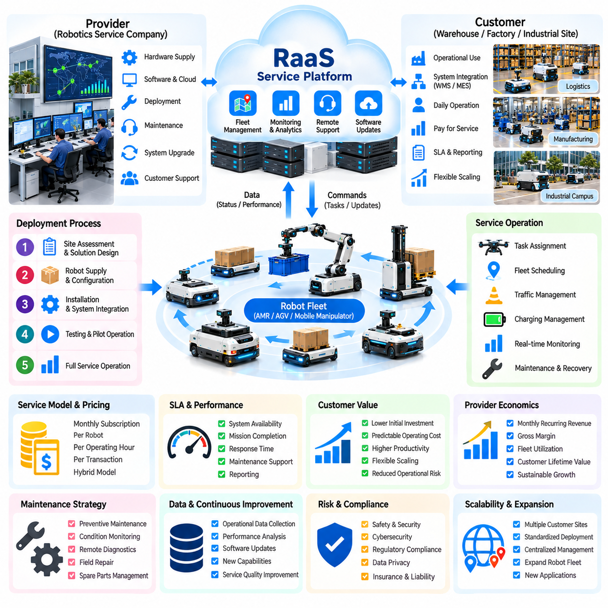{width="7.268055555555556in" height="7.268055555555556in"}

Robot-as-a-Service (RaaS) represents a business model that transforms Physical AI from equipment ownership into recurring operational services. This case examines a representative robotics provider delivering autonomous mobile robots and fleet management services to logistics and manufacturing customers. The objective is to reduce adoption barriers, establish predictable service revenue, and create sustainable value through reliable robotic operations.

The representative provider serves warehouses, distribution centers, factories, and industrial campuses requiring repetitive transportation and material handling. Customers traditionally purchase robotic equipment through capital investment and maintain internal technical resources. This approach creates financial and operational barriers, especially when automation demand changes. RaaS replaces large initial purchases with contractual access to robotic capabilities.

The business transformation begins by identifying customer workflows suitable for standardized robotic services. Engineers evaluate transport frequency, payload requirements, facility layouts, operating schedules, and integration complexity. Commercial teams estimate service demand and expected productivity improvements. Initial contracts prioritize environments where robot utilization is predictable and deployment costs can be recovered through recurring payments.

The RaaS offering combines robotic hardware, navigation software, fleet management, maintenance, technical support, and periodic system upgrades. Customers purchase operational capability rather than individual machines. Service agreements specify deployment scope, equipment responsibilities, support conditions, and performance expectations. A modular offering allows customers to expand or reduce service capacity as operational requirements evolve.

Fleet management software forms the operational foundation of the service model. It coordinates task assignments, traffic management, charging schedules, and robot availability across customer facilities. Integration with warehouse management and manufacturing execution systems enables automated mission generation. Reliable orchestration improves fleet utilization and prevents congestion, idle equipment, and unnecessary human intervention.

A centralized service platform monitors robot health, battery condition, navigation performance, task completion, and operational exceptions. Remote diagnostics identify emerging problems before they cause extended downtime. Service personnel can investigate failures, update configurations, and coordinate recovery actions. Effective monitoring reduces maintenance response time and supports consistent service quality across multiple customer locations.

Service-level agreements establish measurable obligations between providers and customers. Common indicators include system availability, mission completion, response time, and maintenance support performance. Contracts should distinguish provider-controlled failures from disruptions caused by customer infrastructure or operating conditions. Clearly defined measurement procedures and exclusions reduce disputes and support transparent performance reporting.

Pricing architecture must align customer value with the provider\'s cost structure. Contracts may use fixed monthly subscriptions, charges per robot, operating-hour fees, or transaction-based pricing. Hybrid models combine a base service fee with variable usage charges. Pricing decisions consider deployment complexity, expected utilization, support requirements, and contractual risk while preserving sufficient margins for long-term operation.

Customer economics differ from traditional equipment ownership because substantial initial capital expenditure can be converted into recurring operating expenditure. This structure may improve financial flexibility and simplify expansion decisions. However, recurring payments do not automatically reduce total ownership-equivalent costs. Customers must compare service fees, productivity benefits, contract duration, and operational dependencies against alternative automation investments.

Provider economics require a detailed understanding of equipment acquisition, financing, deployment, maintenance, software, and customer support. Initial installation creates substantial cash outflows before recurring revenue accumulates. Contract profitability depends on robot utilization, service duration, component lifetime, and maintenance frequency. Financial planning must account for working capital, replacement equipment, and the timing of customer payments.

Unit economics can be evaluated through monthly recurring revenue per deployed robot, direct service costs, gross margin, and customer acquisition expenses. Contribution margin should include field maintenance, cloud infrastructure, communications, and routine support. Customer lifetime value must be compared with acquisition and deployment costs. Sustainable growth requires positive lifecycle economics rather than increasing robot deployment numbers alone.

Fleet utilization is a critical determinant of profitability. Robots operating below expected capacity generate insufficient service revenue when pricing depends on usage. Excessive utilization may increase wear, charging constraints, and service interruptions. Fleet sizing therefore balances customer demand, service availability, and maintenance reserves. Data-driven scheduling improves productive operating time without sacrificing operational reliability.

Maintenance strategy combines preventive servicing, condition monitoring, remote diagnostics, and field repair. Battery degradation, drive-system wear, sensor contamination, and communication failures can reduce availability. Standardized components and modular replacement procedures shorten repair time. Spare-parts planning must consider installed fleet size, failure patterns, and geographic distribution to avoid excessive inventory or prolonged customer downtime.

Deployment standardization reduces the cost of expanding RaaS operations. Reusable site assessment procedures, mapping workflows, integration interfaces, and safety documentation accelerate installation. Nevertheless, customer facilities differ in layout, traffic conditions, equipment interfaces, and operating practices. Providers must control customization carefully because extensive site-specific engineering can eliminate the economic advantages of standardized recurring services.

Customer onboarding begins with workflow analysis, facility assessment, and measurable performance objectives. Pilot deployments validate navigation reliability, task completion, integration performance, and operational safety. Results establish realistic fleet requirements and contractual service expectations. Transition to production occurs after operational acceptance, employee training, exception-handling procedures, and maintenance responsibilities have been confirmed.

Operational dashboards provide visibility into completed missions, robot availability, intervention frequency, energy consumption, and service incidents. Customers use these metrics to evaluate productivity and workflow performance. Providers analyze the same information to improve scheduling, maintenance, and support efficiency. Shared performance reporting establishes accountability and supports contract renewal decisions based on measurable operational outcomes.

Safety and cybersecurity remain essential service responsibilities. Robots operating near workers require validated protective functions, emergency stopping, and documented risk assessments. Remote access and cloud connectivity introduce additional cybersecurity requirements involving authentication, encryption, and access control. Contracts must allocate responsibilities for facility safety, software updates, incident response, and protection of operational data.

A representative financial model evaluates recurring revenue, deployment expenditure, operating costs, financing requirements, and equipment residual value over several years. Sensitivity analysis examines customer retention, robot availability, service utilization, maintenance costs, and contract pricing. Cash-flow projections reveal the capital required to support fleet expansion. Profitability must be assessed at both individual contract and overall portfolio levels.

Scaling the service business requires regional maintenance networks, standardized training, reliable suppliers, and centralized fleet intelligence. Geographic expansion increases market access but introduces transportation costs, technician coverage requirements, and operational complexity. Partnerships with system integrators and local service organizations can improve deployment capacity. Service quality must remain consistent as the installed fleet grows.

Continuous improvement relies on fleet telemetry, navigation histories, maintenance records, customer feedback, and intervention data. These information sources support predictive maintenance, software refinement, and operational benchmarking. Improvements validated across multiple installations can reduce support costs and increase service reliability. Data governance must protect customer information while enabling authorized fleet-level learning and performance analysis.

The central lesson of this RaaS and fleet service case is that Physical AI commercialization depends on delivering dependable operational outcomes rather than selling robotic hardware alone. Successful providers combine reliable autonomy, disciplined service operations, transparent contracts, and sustainable unit economics. Long-term competitiveness emerges when recurring customer value exceeds the complete lifecycle cost of deploying and supporting robotic fleets.

## 09.11. Physical AI Platform Business Case

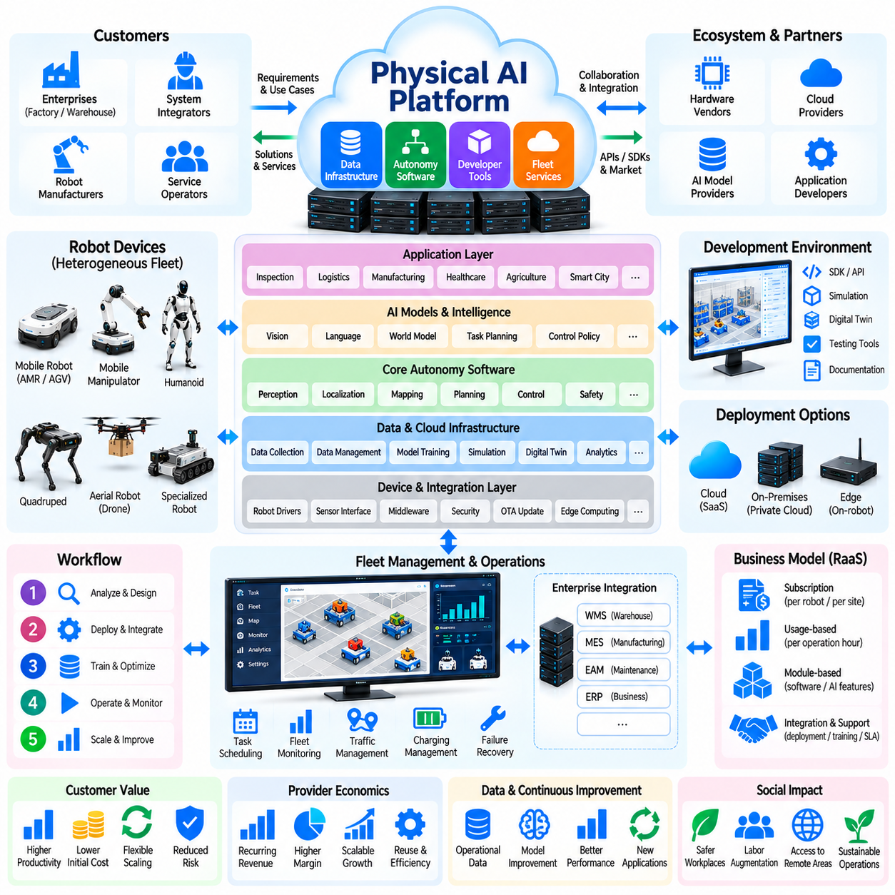{width="7.268055555555556in" height="7.268055555555556in"}

A Physical AI platform business transforms robotics from isolated products into a shared foundation for developing, deploying, and operating intelligent machines. This case examines a representative technology provider offering reusable autonomy software, data infrastructure, and fleet services across multiple robot categories. Its objective is to reduce integration costs, accelerate customer adoption, and generate scalable recurring revenue.

The representative provider serves robot manufacturers, system integrators, industrial enterprises, and service operators. These customers often maintain separate software stacks for perception, navigation, control, and fleet management. Fragmented architectures increase development costs and complicate maintenance. A common platform addresses these inefficiencies through standardized interfaces, shared services, and reusable intelligence.

The platform strategy begins by identifying capabilities that can be shared across applications without eliminating necessary hardware specialization. Common functions include device connectivity, identity management, telemetry, mission orchestration, data storage, and software deployment. Robot-specific adapters handle differences in sensors, actuators, and control systems. This separation establishes a reusable foundation while preserving embodiment-specific behavior.

A layered architecture connects robotic hardware, edge computing, cloud services, and enterprise applications. Real-time motion control and safety functions remain close to physical equipment, while centralized services support fleet analytics and lifecycle management. Communication interfaces exchange commands, status, and operational records. Architecture boundaries must account for latency, connectivity failures, cybersecurity, and functional safety requirements.

The autonomy software layer provides reusable perception, localization, planning, and task-execution components. Mobile robots, manipulators, quadrupeds, and aerial systems may share selected algorithms but require different control policies and physical constraints. Modular software enables developers to replace or extend individual capabilities. Interoperability depends on stable interfaces, consistent data models, and validated integration procedures.

Robot foundation models and vision-language-action systems may extend the platform with adaptable task understanding and behavior generation. Such models can support instruction interpretation, scene understanding, and selected manipulation tasks. However, general-purpose intelligence does not eliminate embodiment-specific validation. Platform operators must separate experimental AI capabilities from safety-critical execution and provide controlled deployment mechanisms.

A unified data infrastructure collects sensor observations, robot states, task outcomes, interventions, and operational metadata. Standardized episode formats enable analysis across deployments and support training-data curation. Data lineage records the origin, transformation, and permitted use of information. Customer ownership, confidentiality, privacy, and access permissions determine whether datasets can contribute to shared model improvement.

The platform\'s development environment includes software development kits, application programming interfaces, simulation tools, and testing frameworks. Developers use these resources to create robotic applications without rebuilding common infrastructure. Reference implementations shorten integration time, while automated testing identifies compatibility problems. Documentation quality and developer support strongly influence adoption and long-term ecosystem participation.

Simulation and digital twins provide environments for testing robot behavior before physical deployment. Developers evaluate navigation, task scheduling, sensor configurations, and selected failure scenarios under controlled conditions. Simulation-generated data can supplement real-world observations, although physical validation remains essential. A repeatable simulation-to-deployment workflow reduces engineering uncertainty and improves release quality.

Fleet orchestration connects individual robot capabilities to enterprise workflows. A common management layer assigns tasks, monitors availability, schedules charging, and handles operational exceptions. Integration with warehouse, manufacturing, and maintenance systems translates business requests into robotic missions. Heterogeneous fleets require capability-aware scheduling because robots differ in mobility, payload, sensing, and operating restrictions.

The commercial offering combines platform subscriptions, device connectivity, software licensing, integration services, and premium AI capabilities. Pricing may depend on connected robots, active sites, transaction volumes, or enabled modules. Enterprise customers may require private-cloud or on-premises deployment options. A sustainable pricing structure reflects customer value while covering infrastructure, support, model operation, and ongoing development costs.

Platform economics differ from conventional hardware sales because software components can be reused across customers. Initial investment in architecture, developer tools, security, and integrations may be substantial. Marginal deployment costs can decline as standardized adoption increases. However, customization, cloud consumption, technical support, and model inference expenses can limit profitability. Reuse must be demonstrated through actual deployments.

A representative financial model evaluates recurring platform revenue, implementation fees, customer acquisition costs, infrastructure expenses, and development investment. Unit economics include revenue per connected robot, contribution margin per customer, and support cost per deployment. Customer retention and expansion revenue influence lifetime value. Financial projections must distinguish recurring software income from lower-margin integration and hardware-related activities.

Ecosystem development creates additional opportunities for platform growth. Robot manufacturers contribute compatible devices, system integrators deliver industry solutions, and independent developers build specialized applications. Certification programs and interface specifications improve compatibility. Marketplace mechanisms may distribute applications and services, but their commercial value depends on sufficient adoption, transparent revenue sharing, and dependable quality control.

Network effects emerge when additional participants increase the platform\'s usefulness. More compatible robots can attract developers, while broader application availability can encourage enterprise adoption. Operational data may improve selected algorithms when sharing is authorized and technically appropriate. These benefits are not automatic. Fragmented standards, incompatible hardware, restricted data rights, and poor developer experiences can prevent ecosystem growth.

Customer onboarding begins with architecture assessment, interface mapping, security review, and operational requirements analysis. Pilot projects validate device connectivity, mission execution, data exchange, and enterprise integration. Performance benchmarks establish acceptable latency, reliability, and service availability. Production rollout requires documented responsibilities, operator training, monitoring procedures, and clear recovery mechanisms for platform failures.

Platform governance establishes rules for software compatibility, version management, application permissions, and security updates. Breaking interface changes can disrupt customer operations and increase integration costs. Versioned APIs, staged releases, and rollback capabilities reduce these risks. Governance also defines how third-party extensions are reviewed, how vulnerabilities are reported, and how service responsibilities are allocated.

Security and data governance are central to enterprise adoption. The platform may process facility maps, production information, robot telemetry, and operational instructions. Authentication, encryption, access control, and audit records protect these resources. Deployment architectures must accommodate customer confidentiality requirements and relevant regulations. Shared learning services should operate only within clearly defined contractual and technical permissions.

Operational performance is measured through connected robot growth, active customer sites, software availability, integration time, and deployment success. Commercial indicators include recurring revenue, gross margin, retention, expansion revenue, and customer acquisition efficiency. Developer adoption and application reuse provide additional evidence of platform maturity. High registration numbers alone do not demonstrate productive ecosystem activity.

Scaling requires a disciplined product roadmap that balances common platform capabilities with industry-specific requirements. Excessive customization fragments the architecture, while rigid standardization may exclude valuable applications. Modular extensions provide a practical compromise. Regional expansion also requires reliable support, regulatory awareness, integration partners, and consistent service delivery across different operating environments.

Continuous improvement combines fleet telemetry, software diagnostics, customer feedback, and validated learning pipelines. Repeated failures reveal opportunities to improve interfaces, autonomy components, and operational workflows. Model updates require benchmarking, regression testing, and controlled rollout. Platform-wide learning creates commercial advantages only when improvements remain reliable, measurable, and compatible with deployed robotic systems.

The central lesson of this Physical AI platform business case is that scalable value emerges from reusable capabilities connecting intelligent machines, enterprise workflows, and developer ecosystems. Successful commercialization requires modular architecture, trustworthy operations, disciplined governance, and sustainable software economics. A platform becomes strategically valuable when customers can deploy new robotic applications faster and at lower lifecycle cost.

## 09.12. End to End Physical AI Commercialization Case

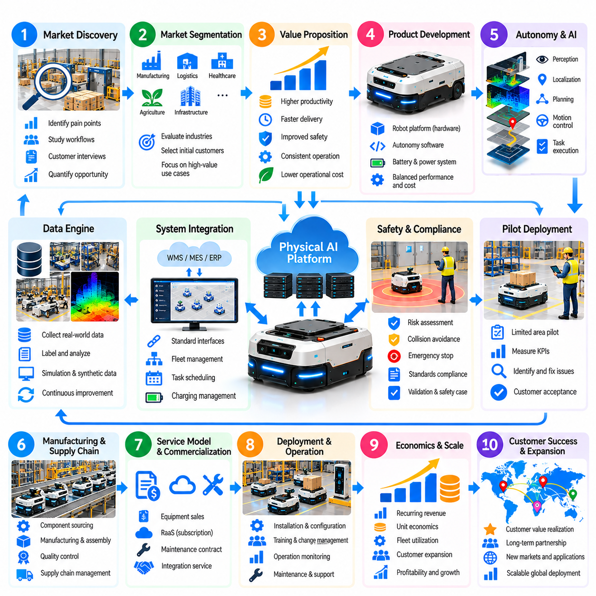{width="7.268055555555556in" height="7.268055555555556in"}

End-to-end Physical AI commercialization transforms a robotic concept into a validated, deployable, and financially sustainable business. This case examines a representative company developing autonomous mobile robots for industrial material transport. The commercialization journey connects market discovery, product engineering, operational validation, manufacturing, service delivery, and business expansion. Success requires alignment between technical capability and customer value.

The process begins with identifying a costly operational problem rather than selecting technology for its novelty. The company studies material movement in factories and warehouses, including transport frequency, payload requirements, labor demand, and workflow interruptions. Customer interviews reveal operational constraints and purchasing expectations. A promising opportunity exists when automation can deliver measurable improvements under realistic facility conditions.

Market segmentation determines which customers should be served first. The company compares industries according to workflow repeatability, automation readiness, safety requirements, purchasing capacity, and integration complexity. Early customers are selected for clear operational needs and accessible deployment environments. A focused initial market reduces engineering variation and provides stronger evidence for subsequent commercial expansion.

The value proposition translates technical performance into business outcomes. Customers evaluate transport throughput, labor productivity, delivery consistency, operational safety, and system availability. The provider establishes baseline measurements before introducing automation. Expected benefits are expressed through measurable indicators rather than broad claims about artificial intelligence. This approach connects product requirements directly to economic justification.

Product development begins with a minimum viable system capable of completing a defined transport workflow. Engineers integrate the mobile platform, navigation sensors, onboard computing, battery system, and fleet software. Hardware and software are designed together to balance payload capacity, operating duration, localization accuracy, and cost. Early prototypes prioritize dependable task completion over unnecessary functional complexity.

The autonomy architecture combines perception, localization, path planning, motion control, and task execution. Robot behavior must remain reliable when obstacles appear, routes change, or localization confidence decreases. Higher-level AI may improve adaptability, but deterministic safety mechanisms govern critical operating limits. Modular software interfaces allow individual components to evolve without requiring complete system redesign.

A structured data engine supports product improvement throughout development and deployment. Robot telemetry, navigation failures, human interventions, and completed missions are recorded with operational context. Engineers use these observations to identify recurring problems and improve algorithms. Simulation and synthetic scenarios supplement physical testing, while real-world validation determines whether updated capabilities are suitable for deployment.

System integration connects robotic operations with customer business processes. Warehouse management, manufacturing execution, and enterprise systems generate transport requests and receive completion information. Fleet management software coordinates assignments, traffic, charging, and exception handling. Standard interfaces reduce deployment effort, while site-specific configuration accommodates operational differences. Integration reliability is essential to customer acceptance.

Safety engineering begins during product definition rather than after prototype completion. Risk assessments examine collisions, load instability, emergency stopping, human interaction, and foreseeable system failures. Protective functions, operational boundaries, and recovery procedures are validated under representative conditions. Applicable standards and regulations inform the safety case. Documented evidence supports customer approval and responsible operation.

A pilot deployment tests the complete solution within a limited operational area. Engineers measure mission success, transport throughput, navigation failures, intervention frequency, and system availability. Customer personnel evaluate workflow compatibility and practical usability. Pilot results are compared with baseline operations and agreed acceptance criteria. Unresolved reliability problems must be corrected before broader deployment commitments.

The transition from pilot to production requires engineering maturity and repeatable installation procedures. Hardware designs undergo reliability testing, component qualification, and manufacturing review. Software releases require version control, regression testing, and rollback mechanisms. Installation documentation and operator training reduce dependence on individual engineers. Standardization becomes essential as the company moves beyond customized demonstrations.

Supply-chain development determines whether the product can be manufactured consistently at acceptable cost. The company evaluates motors, batteries, sensors, computing modules, structural components, and contract manufacturers. Supplier selection considers quality, lead time, replacement availability, and technical support. Design-for-manufacturing activities simplify assembly and servicing. Component shortages and supplier concentration remain important commercial risks.

The commercial model must match customer purchasing preferences and the provider\'s financial capacity. Equipment sales generate upfront revenue, while software subscriptions and maintenance contracts create recurring income. Robot-as-a-Service can lower customer adoption barriers but increases the provider\'s financing requirements. Hybrid offerings combine hardware, software, integration, and operational support. Pricing must reflect measurable value and lifecycle obligations.

Customer financial evaluation compares expected automation benefits with total lifecycle costs. Capital expenditure, integration, energy, maintenance, software, training, and replacement components are included. Productivity gains are estimated from verified workflow changes rather than assumed labor elimination. Return on investment, payback period, and net present value support purchasing decisions. Sensitivity analysis addresses utilization, reliability, and demand uncertainty.

Provider economics require separate analysis of hardware margins, software revenue, deployment costs, and service obligations. Revenue growth can conceal weak profitability when installations require excessive customization or field support. Unit economics track contribution margin per robot, customer acquisition cost, and recurring revenue retention. Cash-flow forecasts account for inventory, manufacturing commitments, payment terms, and expansion investment.

After commercial deployment, fleet operations become part of the product\'s value proposition. Remote monitoring identifies degraded performance, battery problems, navigation exceptions, and emerging maintenance needs. Service teams coordinate preventive maintenance, replacement parts, and incident response. Service-level agreements define availability, response expectations, and responsibilities. Consistent support protects customer operations and strengthens renewal opportunities.

Operational data enables continuous improvement after deployment. Fleet-wide analysis identifies common failures, inefficient routes, and opportunities for software optimization. Validated updates improve reliability and reduce maintenance requirements across compatible installations. Data governance defines customer permissions, confidentiality, and authorized learning activities. Improvements must be measured against established benchmarks before release into production environments.

Scaling begins when the company demonstrates repeatable deployment economics across multiple customer sites. Standardized hardware, reusable software, documented integration methods, and regional service partnerships reduce expansion costs. Sales teams use verified customer outcomes to support new contracts. Growth planning considers production capacity, technical staffing, support coverage, and working capital. Rapid expansion without operational readiness can damage profitability.

A broader platform strategy may emerge as the installed base increases. Shared fleet services, developer interfaces, data infrastructure, and reusable autonomy modules can support additional robot configurations. Partners may contribute specialized applications or integration capabilities. Platform expansion should follow demonstrated customer demand rather than speculative ecosystem assumptions. Governance and compatibility become increasingly important as participation grows.

Commercial risk management spans technical, financial, regulatory, and organizational dimensions. Product failures, cybersecurity incidents, supply disruptions, contract disputes, and delayed customer adoption can threaten business continuity. Management establishes measurable risk indicators, contingency plans, and clear accountability. Investment decisions are reviewed at development milestones. Commercialization advances when evidence justifies additional capital and operational commitments.

The central lesson of this end-to-end commercialization case is that Physical AI succeeds through coordinated execution across technology, operations, economics, and customer relationships. A functioning robot is only the beginning of a viable business. Sustainable commercialization requires validated customer value, dependable autonomy, repeatable deployment, disciplined financial management, and lifecycle service capability. These foundations enable responsible growth from pilot projects to industrial-scale adoption.
